<!-- guide:meta
feature: dashboard.customise
title: ড্যাশবোর্ড নিজের মতো সাজানো
summary: কোন উইজেট দেখাবে, কোনটা আগে আসবে আর কত বড় হবে ঠিক করুন; স্কুলের ড্যাশবোর্ড সেটিংস বদলান; মাসিক সভার রিপোর্ট প্রিন্ট করুন।
roles: [ADMIN, EXECUTIVE, TEACHER, ACCOUNTANT, OFFICE_STAFF, EXAM_CONTROLLER, COMMITTEE]
sources:
  - client-admin/src/dashboard/layout/dashboard-page.tsx
  - client-admin/src/dashboard/layout/customise/customise-mode.tsx
  - client-admin/src/dashboard/layout/customise/customise-panel.tsx
  - client-admin/src/dashboard/layout/use-dashboard-prefs.ts
  - client-admin/src/pages/settings/DashboardSection.tsx
  - client-admin/src/routes/_staff/print/committee-report.tsx
labels:
  [
    dashboard:page.customise,
    dashboard:states.allHidden.*,
    dashboard:customise.*,
    dashboard:committeeSummary.printReport,
    dashboard:committeeReport.*,
    settings:dashboard.*,
    settings:categories.academics,
    settings:save.*,
    nav:items.settings,
  ]
helpIds: [dashboard.customise]
devices: [desktop, phone]
entry: [sidebar, palette, page:dashboard]
keywords: [সাজান, উইজেট লুকান, ক্রম বদলান, ড্যাশবোর্ড সেটিংস, মাসিক সভার রিপোর্ট, customise, layout, hide widget, committee report]
appVersion: 0.1.0 (6b36c2549)
owner: tareq89
lastVerified: 2026-10-24
knownIssues: []
-->

# ড্যাশবোর্ড নিজের মতো সাজানো

কোন উইজেট দেখাবে, কোনটা আগে আসবে আর কত বড় হবে, তা নিজে ঠিক করুন।

**যেতে হবে:** বাম মেনুতে **ড্যাশবোর্ড**, তারপর উপরে ডান দিকে **সাজান**। ফোনেও **সাজান** বোতাম একই জায়গায়।
**শুরুর আগে:** কিছু লাগে না।

আপনার **সাজানো** মানে কোন উইজেট দেখাবে, কোন ক্রমে আর কত বড়। প্রতিটি মানুষের প্রতিটি ভূমিকার জন্য একটি করে সাজানো সেভ থাকে। আপনি বদলালে শুধু আপনার ড্যাশবোর্ড বদলায়, অন্য কারও নয়। উইজেট কী: [উইজেটগুলোর মানে](widgets.md)।

[ড্যাশবোর্ড সাজান](#task-main) · [ডিফল্টে ফেরা](#task-reset) · [স্কুলের ড্যাশবোর্ড সেটিংস](#task-settings) · [মাসিক সভার রিপোর্ট](#task-committee-report) · [সমস্যা ও সমাধান](#trouble)

**এই পাতায় যা আছে**

- [এই পাতায় যেভাবে আসবেন](#arrive)
- [ড্যাশবোর্ড সাজান](#task-main)
- [সাজানো সেভ হয়েছে কি না বুঝবেন কীভাবে](#confirm)
- [অন্য পরিস্থিতিতে](#other)
  - [ফোনে সাজানো](#task-phone)
  - [শুধু কি-বোর্ড দিয়ে](#task-keyboard)
  - [ডিফল্টে ফেরা](#task-reset)
  - [স্কুলের ড্যাশবোর্ড সেটিংস (অ্যাডমিন)](#task-settings)
  - [মাসিক সভার রিপোর্ট প্রিন্ট](#task-committee-report)
- [সমস্যা ও সমাধান](#trouble)
- [কে কী করতে পারেন](#roles)
- [আরও জানুন](#more)

---

## এই পাতায় যেভাবে আসবেন 

**ড্যাশবোর্ড থেকে:** [ড্যাশবোর্ডে আজকের কাজ দেখা](dashboard.md)-র উপরে ডান দিকে **সাজান** চাপুন। নিচের ধাপ ১ থেকে শুরু করুন।

**সব উইজেট লুকানো থাকলে:** ড্যাশবোর্ডে **সব উইজেট লুকানো** লেখা আসে, নিচে **সাজান** বোতাম। সেটি চাপুন; একই সাজানোর প্যানেল খোলে।

---

## ড্যাশবোর্ড সাজান 

1. ড্যাশবোর্ডের উপরে ডান দিকে **সাজান** চাপুন।

   → উপরে **সাজানো হচ্ছে** লেখা আসে, আর **উইজেট** প্যানেল খোলে। প্যানেলে দুটি তালিকা: **দেখানো হচ্ছে** আর **লুকানো**। পাশে প্রিভিউ: **প্রিভিউ: সেভ করলে এভাবে দেখাবে**।

<!-- image pending: সাজানোর প্যানেল খোলা, দেখানো হচ্ছে ও লুকানো তালিকা আর প্রিভিউ চিহ্নিত, অ্যাডমিন, desktop -->

2. কোনো উইজেট লুকাতে তার সারির টিক তুলে দিন। দেখাতে টিক দিন।

   → উইজেটটি অন্য তালিকায় চলে যায়, আর প্রিভিউ বদলায়।

3. ক্রম বদলাতে সারির **↑** বা **↓** বোতাম চাপুন। শুধু **দেখানো হচ্ছে** তালিকার উইজেট সরানো যায়। টেনে সরানো যায় না।

   → উইজেটটি এক ঘর উপরে বা নিচে যায়।

4. কম্পিউটারে আকার বদলাতে সারির আকারের তালিকা থেকে **ছোট**, **মাঝারি** বা **বড়** বেছে নিন। কোনো উইজেটের একটিমাত্র আকার থাকলে তালিকাটি ধূসর থাকে।

5. সব ঠিক হলে নিচে **সেভ করুন** চাপুন।

   → **ড্যাশবোর্ড সেভ হয়েছে** বার্তা আসে, আর নতুন সাজানোয় ড্যাশবোর্ড ফিরে আসে।

> **মনে রাখুন:** **সেভ করুন** না চাপা পর্যন্ত কিছুই বদলায় না। **বাতিল** চাপলে সব আগের মতো থাকে।

---

## সাজানো সেভ হয়েছে কি না বুঝবেন কীভাবে 

| অবস্থা                       | কীভাবে বুঝবেন                                                          | এরপর কী             |
| ---------------------------- | ---------------------------------------------------------------------- | ------------------- |
| **শুধু স্ক্রিনে বদলেছে**     | উপরে **সাজানো হচ্ছে**, প্রিভিউতে নতুন সাজানো                           | **সেভ করুন** চাপুন। |
| **স্কুলের সিস্টেমে পৌঁছেছে** | **ড্যাশবোর্ড সেভ হয়েছে** বার্তা, আর প্যানেল বন্ধ হয়ে ড্যাশবোর্ড ফেরে | কাজ শেষ।            |

এই কাজ ইন্টারনেট ছাড়া ডিভাইসে জমা থাকে না; তাই "এই ডিভাইসে সংরক্ষিত" অবস্থা নেই।

**যাচাই করতে চাইলে:** অন্য কম্পিউটার বা ফোনে একই অ্যাকাউন্টে, একই ভূমিকায় সাইন ইন করুন। একই সাজানো দেখা যাবে।

<!-- image pending: সেভের পর নতুন সাজানোয় ড্যাশবোর্ড, ড্যাশবোর্ড সেভ হয়েছে বার্তা সহ, অ্যাডমিন, desktop -->

**বার্তা না এলে:** [সমস্যা ও সমাধান](#trouble) দেখুন। প্যানেল খোলা থাকলে আবার **সেভ করুন** চাপতে পারেন।

---

## অন্য পরিস্থিতিতে 

### ফোনে সাজানো 

ফোনে **সাজান** চাপলে প্যানেলটি নিচ থেকে উঠে আসা একটি পাতা হয়ে খোলে, উপরে ছোট একটি দাগ থাকে। বাকি সব একই, শুধু:

- আকার বদলানো যায় না; আকার শুধু কম্পিউটারে।
- উইজেটের ছোট বর্ণনা দেখায় না, শুধু নাম।

<!-- image pending: ফোনে নিচের পাতা হয়ে সাজানোর প্যানেল, শিক্ষক, phone -->

### শুধু কি-বোর্ড দিয়ে 

প্যানেলে লেখা থাকে **Space দিয়ে দেখান/লুকান, Alt + ↑ / ↓ দিয়ে সরান**।

| কি            | কাজ              |
| ------------- | ---------------- |
| `Space`       | দেখান / লুকান    |
| `Alt + ↑` `↓` | উপরে / নিচে সরান |
| `Enter`       | সেভ করুন         |
| `Esc`         | বাতিল            |

প্রতিটি বদল স্ক্রিন রিডার পড়ে শোনায়, যেমন "… এখন ২ নম্বরে"।

### ডিফল্টে ফেরা 

1. **সাজান** খুলুন।
2. নিচে **ডিফল্টে ফিরুন** চাপুন। → প্রিভিউ আপনার ভূমিকার শুরুর সাজানোয় ফেরে। এখনো সেভ হয়নি।
3. **সেভ করুন** চাপুন। → **ড্যাশবোর্ড সেভ হয়েছে**।

| আপনি চাপলেন       | কী হবে                                                 | সেভ হলো?            |
| ----------------- | ------------------------------------------------------ | ------------------- |
| **ডিফল্টে ফিরুন** | প্রিভিউ ভূমিকার শুরুর সাজানোয় ফেরে                    | না, এখনো নয়        |
| **বাতিল**         | প্যানেল বন্ধ হয়, আগের সেভ করা সাজানো থাকে             | না, কিছুই বদলায় না |
| **সেভ করুন**      | প্রিভিউর মতো ড্যাশবোর্ড হয়, **ড্যাশবোর্ড সেভ হয়েছে** | হ্যাঁ               |

### স্কুলের ড্যাশবোর্ড সেটিংস (অ্যাডমিন) 

কিছু উইজেট স্কুলের ঠিক করা সীমা মেনে চলে। এগুলো পুরো স্কুলের জন্য, শুধু অ্যাডমিন বদলাতে পারেন।

1. বাম মেনুতে **সেটিংস** চাপুন, তারপর বাম পাশের তালিকায় **একাডেমিক**।
2. নিচে নেমে **ড্যাশবোর্ড** অংশে যান।
3. ঘরগুলো বদলান (নিচের তালিকা দেখুন)।
4. অংশের নিচে **সংরক্ষণ করুন** চাপুন। → **সংরক্ষিত হয়েছে** লেখা আসে।

**ঝুঁকিপূর্ণ শিক্ষার্থী:** নিচের ৪টি সংকেতের যেকোনো ২টি মিললে শিক্ষার্থী **ঝুঁকিপূর্ণ শিক্ষার্থী** উইজেটে আসে। সেভ করার কয়েক মিনিট পরে তালিকা বদলায়।

| ঘর                                                     | মানে                                                               | শুরুতে | যা লেখা যায় |
| ------------------------------------------------------ | ------------------------------------------------------------------ | ------ | ------------ |
| **টানা অনুপস্থিত (দিন)**                               | এত দিন বা বেশি টানা না এলে                                         | ৩      | ১ থেকে ৩০    |
| **গত ৩০ দিনের উপস্থিতি এর কম হলে (%)**                 | গত ৩০ দিনে উপস্থিতি এর নিচে নামলে                                  | ৭৫     | ১ থেকে ১০০   |
| **সর্বশেষ প্রকাশিত পরীক্ষায় ফেল করা বিষয় (কমপক্ষে)** | শেষ প্রকাশিত পরীক্ষায় এতগুলো বা বেশি বিষয়ে ফেল করলে              | ১      | ১ থেকে ২০    |
| **সবচেয়ে পুরোনো বকেয়া এর বেশি দিনের হলে (দিন)**      | সবচেয়ে পুরোনো না-দেওয়া বিলের শেষ তারিখ এত দিন বা তার বেশি পেরোলে | ৬০     | ১ থেকে ৩৬৫   |
| **উপস্থিতির লক্ষ্য (%)** (কমিটি অংশ)                   | কমিটির উপস্থিতি চার্টে একটি রেখা হয়ে দেখায়                       | ৯০     | ১ থেকে ১০০   |
| **পাঠানোর সময়** (সকালের সারসংক্ষেপ অংশ)               | স্কুলের সময়ে কখন সকালের সারসংক্ষেপ যাবে; ছুটির দিনে যায় না       | ০৭:৩০  | যেকোনো সময়  |

সীমার বাইরে কিছু লিখলে ঘরের নিচে আসে, যেমন **১ থেকে ৩০-এর মধ্যে একটা পূর্ণ সংখ্যা লিখুন।**

সকালের সারসংক্ষেপ নিজে বন্ধ করা: [সতর্কতা ও বিজ্ঞপ্তি → সকালের সারসংক্ষেপ](alerts.md#task-digest)।

### মাসিক সভার রিপোর্ট প্রিন্ট 

পরিচালনা পর্ষদের সভার জন্য এই মাসের, আজ পর্যন্ত, মোট হিসাবের এক পাতার রিপোর্ট।

1. পরিচালনা পর্ষদ সদস্য হিসেবে ড্যাশবোর্ডে উপরে **মাসিক সভার রিপোর্ট প্রিন্ট** চাপুন।

   → **মাসিক সভার রিপোর্ট** পাতা খোলে। অংশগুলো: **মূল সংখ্যা**, **ভর্তি**, **উপস্থিতি**, **আদায় ও বকেয়া**, **শ্রেণিভিত্তিক পাসের হার**। নিচে লেখা **শুধু মোট হিসাব। কোনো শিক্ষার্থী, অভিভাবক বা কর্মীর তথ্য ছাপা হয় না।**

2. **প্রিন্ট করুন** চাপুন।

   → ব্রাউজারের নিজের প্রিন্টের বাক্স খোলে। প্রিন্টার বেছে প্রিন্ট করুন, অথবা গন্তব্যে "PDF হিসেবে সেভ" বেছে ফাইল রাখুন।

3. ফিরতে **ড্যাশবোর্ডে ফিরুন** চাপুন।

<!-- image pending: মাসিক সভার রিপোর্ট পাতা, পরিচালনা পর্ষদ সদস্য, desktop -->

রিপোর্টের সংখ্যা ড্যাশবোর্ডের কমিটি উইজেটের সংখ্যার সাথে সবসময় মেলে, কারণ দুটো একই হিসাব থেকে আসে। যে ঘরের তথ্য নেই, সেখানে "—" ছাপা হয়। রিপোর্ট নিজে থেকে ইমেইলে যায় না বা কোনো নির্দিষ্ট দিনে তৈরি হয় না; যখন দরকার, তখন এখান থেকে প্রিন্ট করুন।

---

## সমস্যা ও সমাধান 

| আপনি যা দেখছেন                                  | কী করবেন                                                          | কে সাহায্য করতে পারেন |
| ----------------------------------------------- | ----------------------------------------------------------------- | --------------------- |
| আকারের তালিকা নেই                               | আপনি ফোনে আছেন। আকার শুধু কম্পিউটারে বদলায়।                      | নিজে                  |
| আকারের তালিকা ধূসর                              | এই উইজেটের একটিই আকার। বদলানো যায় না।                            | —                     |
| যে উইজেট চান, তালিকায় নেই                      | সেটি আপনার ভূমিকার জন্য নয়, বা দেখার অনুমতি নেই।                 | অ্যাডমিন              |
| অন্য ভূমিকায় গেলে সাজানো আলাদা                 | ঠিক আছে: প্রতিটি ভূমিকার সাজানো আলাদা সেভ থাকে।                   | নিজে                  |
| **১ থেকে ৩০-এর মধ্যে একটা পূর্ণ সংখ্যা লিখুন।** | ঘরে সীমার ভেতরের পূর্ণ সংখ্যা লিখুন, তারপর আবার **সংরক্ষণ করুন**। | অ্যাডমিন              |
| **রিপোর্ট লোড হয়নি।**                          | পাতা রিলোড করুন।                                                  | অ্যাডমিন              |
| **মাসিক সভার রিপোর্ট প্রিন্ট** বোতাম নেই        | বোতামটি শুধু পরিচালনা পর্ষদ সদস্যের ড্যাশবোর্ডে আসে।              | অ্যাডমিন              |

---

## কে কী করতে পারেন 

| ভূমিকা                                                                     | নিজের ড্যাশবোর্ড সাজান | স্কুলের ড্যাশবোর্ড সেটিংস | মাসিক সভার রিপোর্ট |
| -------------------------------------------------------------------------- | ---------------------- | ------------------------- | ------------------ |
| অ্যাডমিন                                                                   | হ্যাঁ                  | হ্যাঁ                     | না                 |
| একাডেমিক কো-অর্ডিনেটর, শিক্ষক, হিসাবরক্ষক, অফিস সহকারী, পরীক্ষা নিয়ন্ত্রক | হ্যাঁ                  | না                        | না                 |
| পরিচালনা পর্ষদ সদস্য                                                       | হ্যাঁ                  | না                        | হ্যাঁ              |

---

## আরও জানুন 

<strong>সাজানো কীভাবে কাজ করে</strong> — প্যানেল থেকে সেভ

<figure>
  
  <figcaption><em>সাজানো কীভাবে কাজ করে</em></figcaption>
</figure>

- প্রতিটি মানুষের প্রতিটি ভূমিকার জন্য একটি সাজানো সেভ থাকে; সব ডিভাইসে একই।
- সেভ করা সাজানো আনা না গেলে ভূমিকার শুরুর সাজানো দেখায়।
- আপনার ভূমিকার শুরুর সাজানোয় নতুন উইজেট যোগ হলে, আপনার নিজের সাজানো থাকলেও সেটি শেষে দেখা যায়।

**সম্পর্কিত পাতা**

- [**ড্যাশবোর্ডে আজকের কাজ দেখা**](dashboard.md) — যে পাতা আপনি সাজাচ্ছেন।
- [**উইজেটগুলোর মানে**](widgets.md) — কোন উইজেট রাখবেন, ঠিক করার আগে পড়ুন।
- [**সতর্কতা ও বিজ্ঞপ্তি**](alerts.md) — সকালের সারসংক্ষেপ আর সতর্কতার সেটিংস।

---

_সংস্করণ ০.১.০ · শেষ যাচাই ২০২৬-১০-২৪_
