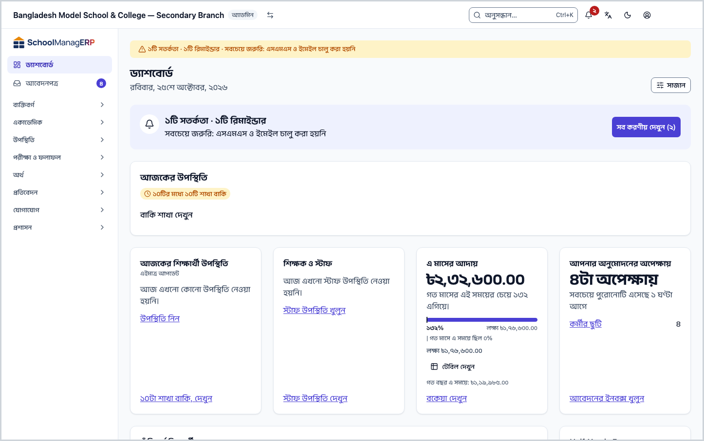
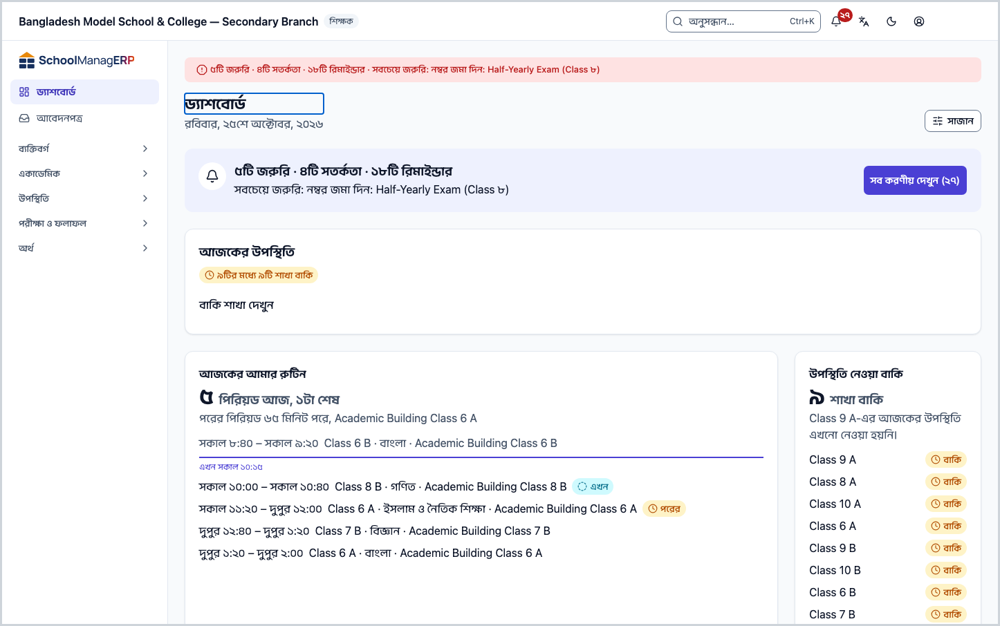
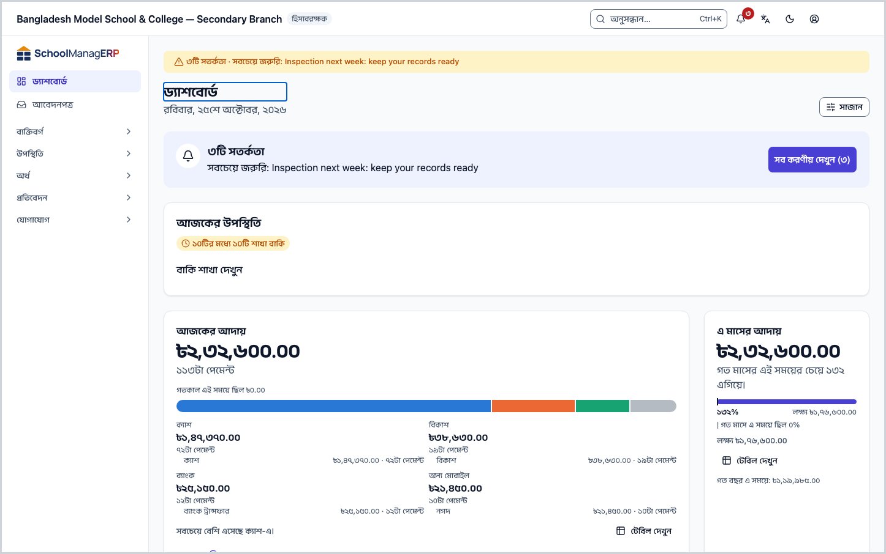
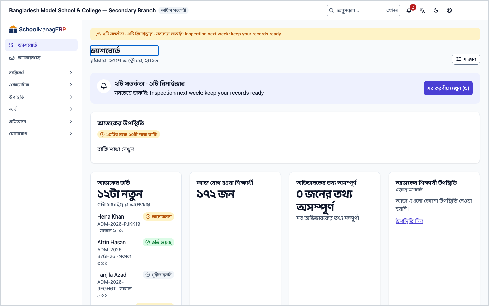
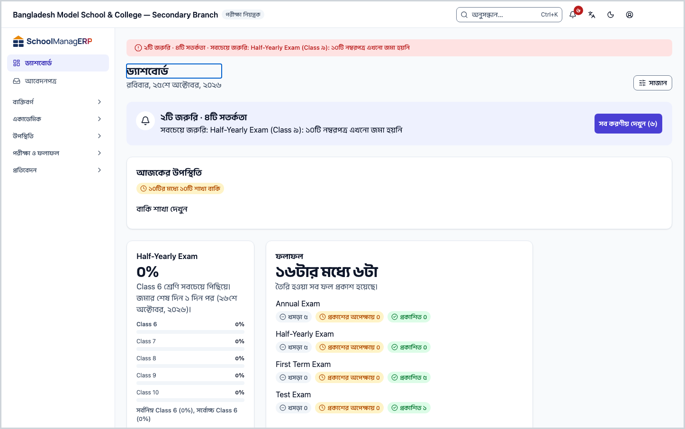
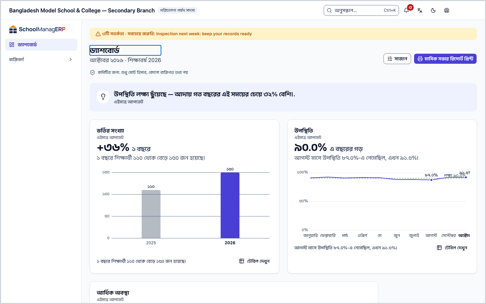
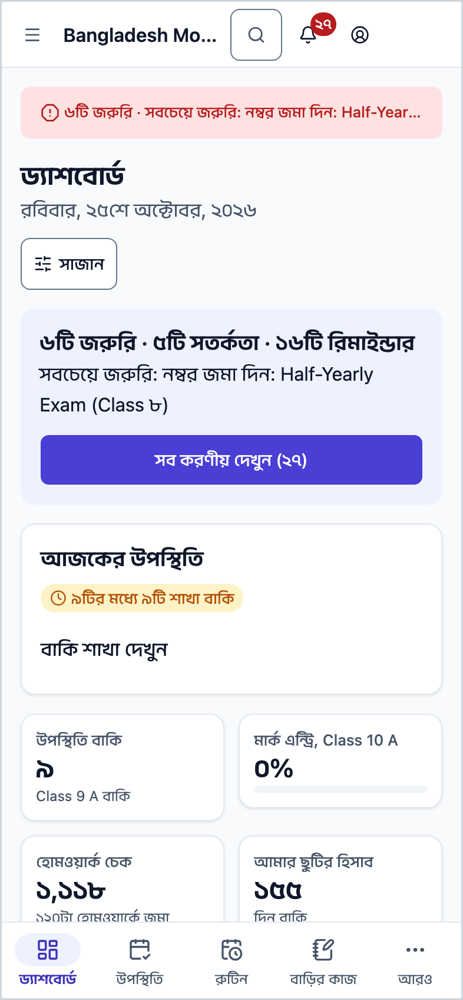
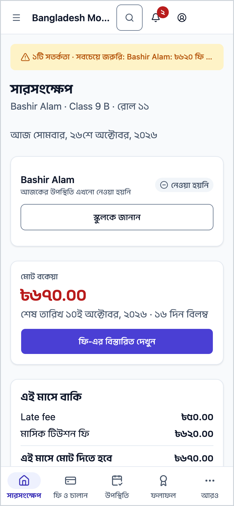

<!-- guide:meta
feature: dashboard
title: ড্যাশবোর্ডে আজকের কাজ দেখা
summary: সাইন ইন করার পর প্রথম পাতায় দেখুন আজ কী আপনার নজর চাইছে, আর এক চাপে সেই কাজের পাতায় যান।
roles: [ADMIN, EXECUTIVE, TEACHER, ACCOUNTANT, OFFICE_STAFF, EXAM_CONTROLLER, COMMITTEE]
sources:
  - client-admin/src/dashboard/layout/dashboard-page.tsx
  - client-admin/src/dashboard/layout/briefing-slot.tsx
  - client-admin/src/dashboard/layout/dashboard-grid.tsx
  - client-admin/src/dashboard/layout/widget-slot.tsx
  - client-admin/src/dashboard/layout/committee-summary.tsx
  - client-admin/src/dashboard/report-cards/report-cards.tsx
  - client-admin/src/dashboard/report-cards/report-prefs.ts
  - client-admin/src/routes/portal/index.tsx
  - shared/src/dashboard/widget-catalogue.ts
labels:
  [
    dashboard:page.*,
    dashboard:states.*,
    dashboard:committeeSummary.privacyNote,
    dashboard:committeeSummary.printReport,
    attention:bar.*,
    attention:modal.empty,
    attention:modal.seeAll,
    reports:pinned.*,
    reports:usefulCard.*,
    portal:today.*,
    portal:heatmap.title,
    portal:homeworkCard.title,
    portal:latestResult.title,
    portal:nextHoliday.title,
    portal:fees.dueThisMonth,
    nav:items.dashboard,
    nav:items.portalOverview,
  ]
helpIds: [dashboard]
devices: [desktop, phone]
entry: [sidebar, palette, notification:morning-digest]
keywords: [ড্যাশবোর্ড, প্রথম পাতা, আজকের কাজ, করণীয়, উইজেট, dashboard, home, briefing, widgets]
appVersion: 0.1.0 (6b36c2549)
owner: tareq89
lastVerified: 2026-10-31
knownIssues:
  - { id: report-cards-this-browser-only, checked: 2026-10-31, issue: null }
-->

# ড্যাশবোর্ডে আজকের কাজ দেখা

সাইন ইন করার পর প্রথম পাতায় দেখুন আজ কী আপনার নজর চাইছে, আর এক চাপে সেই কাজের পাতায় যান।

**যেতে হবে:** বাম মেনুতে **ড্যাশবোর্ড**। ফোনে উপরে বাম দিকের **☰** মেনু থেকে ([ফোনে খোলা](../start/phone.md))।
**শুরুর আগে:** কিছু লাগে না। প্রতিটি কর্মীর ভূমিকার জন্য ড্যাশবোর্ড নিজে থেকে তৈরি থাকে।

**ড্যাশবোর্ড** ([শব্দের তালিকা](../help/glossary.md#dashboard)) হলো কয়েকটি **উইজেট**-এর পাতা। উইজেট মানে একটি ছোট কার্ড: তাতে একটি সংখ্যা বা ছোট তালিকা থাকে, আর একটি লিংক থাকে যেখানে সেই কাজটি করবেন। কোন উইজেট আসবে, তা আপনার ভূমিকা ঠিক করে; শিক্ষক আর হিসাবরক্ষক একই পাতা দেখেন না।

[আজকের কাজ দেখুন](#task-main) · [ভূমিকা অনুযায়ী ড্যাশবোর্ড](#task-roles) · [রিপোর্টের কার্ড](#task-report-cards) · [ফোনে](#task-phone) · [সমস্যা ও সমাধান](#trouble)

**এই পাতায় যা আছে**

- [এই পাতায় যেভাবে আসবেন](#arrive)
- [আজকের কাজ দেখুন](#task-main)
- [ড্যাশবোর্ড ঠিকমতো এসেছে কি না বুঝবেন কীভাবে](#confirm)
- [অন্য পরিস্থিতিতে](#other)
  - [ভূমিকা অনুযায়ী ড্যাশবোর্ড](#task-roles)
  - [রিপোর্টের কার্ড](#task-report-cards)
  - [পরিচালনা পর্ষদ সদস্যের ড্যাশবোর্ড](#task-committee)
  - [ফোনে ড্যাশবোর্ড](#task-phone)
  - [অভিভাবকের সারসংক্ষেপ পাতা](#task-portal)
- [সমস্যা ও সমাধান](#trouble)
- [কে কী করতে পারেন](#roles)
- [জানা সমস্যা](#known-issues)
- [আরও জানুন](#more)

---

## এই পাতায় যেভাবে আসবেন 

**বাম মেনু থেকে:** **ড্যাশবোর্ড** চাপুন। নিচের ধাপ ১ থেকে শুরু করুন।

**খোঁজ থেকে:** উপরের খোঁজার ঘরে (Ctrl+K) "ড্যাশবোর্ড" লিখে বেছে নিন। খোঁজার নিয়ম: [যেকোনো পাতা খুঁজে পাওয়া](../start/find-anything.md)।

**সকালের সারসংক্ষেপ বিজ্ঞপ্তি থেকে:**

1. স্কুল খোলার দিনে সকালে ফোনে বা কম্পিউটারে একটি বিজ্ঞপ্তি আসে, যাতে লেখা থাকে আজ কয়টা বিষয় আপনার নজর চাইছে। এটি কীভাবে চালু বা বন্ধ করবেন: [সতর্কতা ও বিজ্ঞপ্তি](alerts.md#task-digest)।
2. বিজ্ঞপ্তিতে চাপুন। → ড্যাশবোর্ড খোলে। নিচের ধাপ ১ থেকে শুরু করুন।

---

## আজকের কাজ দেখুন 

1. বাম মেনুতে **ড্যাশবোর্ড** চাপুন।

   → উপরে **ড্যাশবোর্ড** শিরোনাম, তার নিচে আজকের বার ও তারিখ। ডান দিকে **সাজান** বোতাম।

2. শিরোনামের ঠিক নিচের লম্বা সারিটি পড়ুন। এটি **আজকের সারাংশ**: আপনার নামে কয়টি সতর্কতা খোলা আছে।

   → যেমন **২টি জরুরি · ৩টি সতর্কতা**, নিচে **সবচেয়ে জরুরি: …**। কিছু না থাকলে লেখা থাকে **এই মুহূর্তে আপনার কোনো করণীয় নেই।**

3. পুরো তালিকা দেখতে সারাংশের **সব করণীয় দেখুন (n)** বোতাম চাপুন।

   → **সতর্কতা ও বিজ্ঞপ্তি** পাতা খোলে, **করণীয়** ট্যাবে। প্রতিটি সতর্কতার মানে আর কী করবেন: [সতর্কতা ও বিজ্ঞপ্তি](alerts.md)।

4. নিচে নামুন। প্রতিটি উইজেটের সংখ্যা দেখুন, আর যে কাজ করবেন তার লিংকে চাপুন।

   → সেই কাজের পাতা খোলে। প্রতিটি উইজেটের মানে: [উইজেটগুলোর মানে](widgets.md)।

> **মনে রাখুন:** ড্যাশবোর্ড শুধু দেখায়। এখানে কিছু চাপলে কোনো তথ্য বদলায় না; কাজটি হয় যে পাতায় লিংক নিয়ে যায়, সেখানে।

সাজানোর ক্রম বা কোন উইজেট দেখাবে বদলাতে চাইলে: [ড্যাশবোর্ড সাজানো](customise.md)।

---

## ড্যাশবোর্ড ঠিকমতো এসেছে কি না বুঝবেন কীভাবে 

এই পাতা কিছু সেভ করে না। প্রতিটি উইজেট আলাদা করে লোড হয়, তাই একটি উইজেটের অবস্থা এভাবে বুঝবেন:

| অবস্থা                   | কীভাবে বুঝবেন                                           | এরপর কী                                               |
| ------------------------ | ------------------------------------------------------- | ----------------------------------------------------- |
| **লোড হচ্ছে**            | কার্ডের জায়গায় ধূসর খালি বাক্স                        | একটু অপেক্ষা করুন।                                    |
| **পুরনো হিসাব দেখাচ্ছে** | কার্ডের উপরে **সর্বশেষ সেভ করা হিসাব দেখানো হচ্ছে।**    | ইন্টারনেট ফিরলে নিজে থেকে নতুন হিসাব আসবে।            |
| **লোড হয়নি**            | **এই উইজেটটা লোড হয়নি।** আর **আবার চেষ্টা করুন** বোতাম | **আবার চেষ্টা করুন** চাপুন। বাকি উইজেটগুলো ঠিকই থাকে। |
| **ঠিক আছে**              | সংখ্যা, ছোট বাক্য আর লিংক দেখা যায়                     | কাজ শেষ।                                              |

**বার্তা না এলে:** [সমস্যা ও সমাধান](#trouble) দেখুন। ড্যাশবোর্ড না এলেও আপনার কোনো তথ্য হারায় না।

---

## অন্য পরিস্থিতিতে 

### ভূমিকা অনুযায়ী ড্যাশবোর্ড 

প্রতিটি ভূমিকার নিজের শুরুর সাজানো আছে। নিচের তালিকা অ্যাপের ভেতরের তালিকা থেকে নিজে থেকে তৈরি; প্রতিটি নামে চাপলে সেই উইজেটের মানে খোলে। আপনি নিজে বদলালে আপনার ড্যাশবোর্ড এর থেকে আলাদা হতে পারে।

<!-- guide:generated:widgets:roles -->

### অ্যাডমিন

1. [আজকের শিক্ষার্থী উপস্থিতি](widgets.md#widget.attendance-today) — আজ কত শতাংশ এসেছে, কোন শাখা বাকি (ফোনে ছোট ঘর হিসেবে দেখায়)
2. [শিক্ষক ও স্টাফ](widgets.md#widget.staff-today) — কে উপস্থিত, কে কোন ছুটিতে
3. [এ মাসের আদায়](widgets.md#widget.collection-month) — লক্ষ্যের কতটা আদায় হলো, গত মাসের তুলনায় (ফোনে ছোট ঘর হিসেবে দেখায়)
4. [আপনার অনুমোদনের অপেক্ষায়](widgets.md#widget.approvals-pending) — ছুটি, ভর্তি আর ফি মওকুফের আবেদন (ফোনে ছোট ঘর হিসেবে দেখায়)
5. [ঝুঁকিপূর্ণ শিক্ষার্থী](widgets.md#widget.at-risk-students) — যাদের ২টা বা বেশি সতর্ক সংকেত মিলেছে (ফোনে ছোট ঘর হিসেবে দেখায়)
6. [মার্ক এন্ট্রি](widgets.md#widget.mark-entry-progress) — কোন শ্রেণির মার্ক জমা বাকি
7. [সিলেবাস অগ্রগতি](widgets.md#widget.syllabus-progress) — কোন শ্রেণি পড়ানোয় পিছিয়ে আছে
8. [সামনে কী আছে](widgets.md#widget.upcoming) — পরের ছুটি আর সামনের অনুষ্ঠান
9. [SMS ব্যালান্স](widgets.md#widget.sms-balance) — আর কতগুলো SMS পাঠানো যাবে
10. [যে বার্তা যায়নি](widgets.md#widget.failed-messages) — গত ৭ দিনে যে SMS যায়নি
11. [সেটআপ তালিকা](widgets.md#widget.setup-checklist) — স্কুলের জন্য আর কী কী সেটআপ বাকি

### হিসাবরক্ষক

1. [আজকের আদায়](widgets.md#widget.collection-today) — আজ কত টাকা এসেছে, ক্যাশ আর অন্যান্য (ফোনে ছোট ঘর হিসেবে দেখায়)
2. [এ মাসের আদায়](widgets.md#widget.collection-month) — লক্ষ্যের কতটা আদায় হলো, গত মাসের তুলনায় (ফোনে ছোট ঘর হিসেবে দেখায়)
3. [ফি তৈরির অবস্থা](widgets.md#widget.fee-generation-status) — এ মাসের বিল তৈরি হয়েছে কি না
4. [অপেক্ষায় থাকা রিমাইন্ডার](widgets.md#widget.reminders-pending) — পাঠানোর জন্য তৈরি ফি রিমাইন্ডার (ফোনে ছোট ঘর হিসেবে দেখায়)
5. [মাস অনুযায়ী আদায়](widgets.md#widget.collection-by-month) — এই শিক্ষাবর্ষের প্রতি মাসের আদায়
6. [বকেয়া কত দিনের](widgets.md#widget.dues-ageing) — কত দিন ধরে বকেয়া, সেই অনুযায়ী টাকার পরিমাণ (ফোনে ছোট ঘর হিসেবে দেখায়)
7. [সাম্প্রতিক পেমেন্ট](widgets.md#widget.recent-payments) — সবশেষ যে পেমেন্টগুলো এসেছে
8. [শ্রেণি অনুযায়ী বকেয়া](widgets.md#widget.dues-by-class) — কোন শ্রেণির বকেয়া সবচেয়ে বেশি

### শিক্ষক

1. [আজকের আমার রুটিন](widgets.md#widget.my-routine-today) — আজ আপনার পিরিয়ডগুলো পর পর
2. [উপস্থিতি নেওয়া বাকি](widgets.md#widget.my-pending-sections) — আপনার যে শাখাগুলোয় এখনো উপস্থিতি নেওয়া হয়নি (ফোনে ছোট ঘর হিসেবে দেখায়)
3. [মার্ক জমার সময়সীমা](widgets.md#widget.my-mark-deadlines) — কোন মার্ক কবে পর্যন্ত জমা দিতে হবে (ফোনে ছোট ঘর হিসেবে দেখায়)
4. [দেখার বাকি হোমওয়ার্ক](widgets.md#widget.homework-to-check) — জমা পড়েছে কিন্তু আপনি এখনো দেখেননি (ফোনে ছোট ঘর হিসেবে দেখায়)
5. [আমার ছুটির হিসাব](widgets.md#widget.my-leave-balance) — কত ছুটি নিয়েছেন আর কত বাকি (ফোনে ছোট ঘর হিসেবে দেখায়)
6. [আমার শ্রেণির ধারাবাহিকতা](widgets.md#widget.class-teacher-streaks) — যারা টানা কয়েক দিন অনুপস্থিত
7. [আমার সিলেবাস অগ্রগতি](widgets.md#widget.my-syllabus-progress) — প্রতি শ্রেণিতে কতটা পড়ানো হলো

### একাডেমিক কো-অর্ডিনেটর

1. [আজকের শিক্ষার্থী উপস্থিতি](widgets.md#widget.attendance-today) — আজ কত শতাংশ এসেছে, কোন শাখা বাকি (ফোনে ছোট ঘর হিসেবে দেখায়)
2. [শিক্ষক ও স্টাফ](widgets.md#widget.staff-today) — কে উপস্থিত, কে কোন ছুটিতে
3. [এ মাসের আদায়](widgets.md#widget.collection-month) — লক্ষ্যের কতটা আদায় হলো, গত মাসের তুলনায় (ফোনে ছোট ঘর হিসেবে দেখায়)
4. [আপনার অনুমোদনের অপেক্ষায়](widgets.md#widget.approvals-pending) — ছুটি, ভর্তি আর ফি মওকুফের আবেদন (ফোনে ছোট ঘর হিসেবে দেখায়)
5. [ঝুঁকিপূর্ণ শিক্ষার্থী](widgets.md#widget.at-risk-students) — যাদের ২টা বা বেশি সতর্ক সংকেত মিলেছে (ফোনে ছোট ঘর হিসেবে দেখায়)
6. [মার্ক এন্ট্রি](widgets.md#widget.mark-entry-progress) — কোন শ্রেণির মার্ক জমা বাকি
7. [সিলেবাস অগ্রগতি](widgets.md#widget.syllabus-progress) — কোন শ্রেণি পড়ানোয় পিছিয়ে আছে
8. [সামনে কী আছে](widgets.md#widget.upcoming) — পরের ছুটি আর সামনের অনুষ্ঠান

### অফিস সহকারী

1. [আজকের ভর্তি](widgets.md#widget.admissions-today) — আজ নতুন কত ভর্তির আবেদন এসেছে (ফোনে ছোট ঘর হিসেবে দেখায়)
2. [আজ যোগ হওয়া শিক্ষার্থী](widgets.md#widget.students-added-today) — আজ নতুন কত শিক্ষার্থী যোগ হয়েছে (ফোনে ছোট ঘর হিসেবে দেখায়)
3. [অভিভাবকের তথ্য অসম্পূর্ণ](widgets.md#widget.guardians-incomplete) — যাদের অভিভাবকের ফোন নম্বর নেই (ফোনে ছোট ঘর হিসেবে দেখায়)
4. [আজকের শিক্ষার্থী উপস্থিতি](widgets.md#widget.attendance-today) — আজ কত শতাংশ এসেছে, কোন শাখা বাকি (ফোনে ছোট ঘর হিসেবে দেখায়)
5. [শিক্ষক ও স্টাফ](widgets.md#widget.staff-today) — কে উপস্থিত, কে কোন ছুটিতে
6. [প্রিন্টের তালিকা](widgets.md#widget.print-queue) — প্রিন্টের অপেক্ষায় থাকা নথি
7. [সামনে কী আছে](widgets.md#widget.upcoming) — পরের ছুটি আর সামনের অনুষ্ঠান

### পরীক্ষা নিয়ন্ত্রক

1. [মার্ক এন্ট্রি](widgets.md#widget.mark-entry-progress) — কোন শ্রেণির মার্ক জমা বাকি
2. [ফলাফল](widgets.md#widget.results-state) — কোন পরীক্ষার ফল প্রকাশ হয়েছে (ফোনে ছোট ঘর হিসেবে দেখায়)
3. [আসন পরিকল্পনা](widgets.md#widget.seat-plan-status) — কোন পরীক্ষার আসন পরিকল্পনা আছে, কোনটার নেই
4. [প্রিন্টের তালিকা](widgets.md#widget.print-queue) — প্রিন্টের অপেক্ষায় থাকা নথি
5. [সামনে কী আছে](widgets.md#widget.upcoming) — পরের ছুটি আর সামনের অনুষ্ঠান

### পরিচালনা পর্ষদ সদস্য

1. [ভর্তির সংখ্যা](widgets.md#widget.committee-enrollment) — মোট শিক্ষার্থী আর গত বছরের তুলনায় পরিবর্তন (ফোনে ছোট ঘর হিসেবে দেখায়)
2. [উপস্থিতি](widgets.md#widget.committee-attendance) — লক্ষ্যের তুলনায় উপস্থিতির ধারা (ফোনে ছোট ঘর হিসেবে দেখায়)
3. [আর্থিক অবস্থা](widgets.md#widget.committee-finance) — আদায় আর বকেয়ার সংক্ষিপ্ত চিত্র (ফোনে ছোট ঘর হিসেবে দেখায়)
4. [পাসের হার](widgets.md#widget.committee-pass-rate) — সর্বশেষ প্রকাশিত পরীক্ষায় পাসের হার (ফোনে ছোট ঘর হিসেবে দেখায়)

<!-- /guide:generated -->

একাধিক ভূমিকা থাকলে যে ভূমিকায় এখন আছেন, তার ড্যাশবোর্ড দেখবেন।

নতুন স্কুলে, যেখানে সেটআপের একটি ধাপও হয়নি, অ্যাডমিন প্রথমে শুধু সেটআপের তালিকা দেখেন। ধাপগুলো কী: [স্কুলের সব কিছু কীভাবে জোড়া লাগে](../admin/how-it-works.md) ও [স্কুল সাজানোর ক্রম](../admin/setup-order.md)।

### রিপোর্টের কার্ড 

উইজেটের গ্রিডের ওপরে দুই ধরনের রিপোর্টের কার্ড আসতে পারে। দুটোই উইজেট নয়, তাই **সাজান**-এ এদের দেখানো বা লুকানো যায় না। কিছু দেখানোর না থাকলে কার্ডটি পাতায় থাকেই না।

| কার্ড                                           | কী দেখায়                                           | কে দেখেন                                                                                             |
| ----------------------------------------------- | --------------------------------------------------- | ---------------------------------------------------------------------------------------------------- |
| **প্রয়োজনীয় রিপোর্ট**                         | যে তৈরি রিপোর্ট আপনি এখনো খোলেননি, সর্বোচ্চ তিনটি   | অ্যাডমিন, হিসাবরক্ষক, একাডেমিক কো-অর্ডিনেটর                                                          |
| আপনার রাখা রিপোর্টের কার্ড (নাম রিপোর্টের নামে) | যে রিপোর্ট আপনি **ড্যাশবোর্ডে রাখুন** দিয়ে রেখেছেন | যাঁরা রিপোর্ট খুলতে পারেন: অ্যাডমিন, হিসাবরক্ষক, একাডেমিক কো-অর্ডিনেটর, শিক্ষক, পরিচালনা পর্ষদ সদস্য |

অফিস সহকারী ও পরীক্ষা নিয়ন্ত্রক রিপোর্ট খুলতে পারেন না, তাই তাঁরা কোনো রিপোর্টের কার্ড পান না। নতুন স্কুলে, যেখানে সেটআপের একটি ধাপও হয়নি, অ্যাডমিন প্রথমে শুধু সেটআপের তালিকা দেখেন, তখন এই কার্ডও আসে না।

**প্রয়োজনীয় রিপোর্ট কার্ডে:**

1. **ড্যাশবোর্ড** খুলে **প্রয়োজনীয় রিপোর্ট** কার্ডটি দেখুন।

   → শিরোনামের নিচে লেখা থাকে **যে তৈরি রিপোর্টগুলো আপনি এখনো খোলেননি।** তার নিচে সর্বোচ্চ তিনটি রিপোর্ট, প্রতিটির নাম আর এক লাইনে সে কী দেখায়। এই শিক্ষাবর্ষে BANBEIS-এর ছাত্রসংখ্যা না খুলে থাকলে সেটি সবার আগে আসে; আগে কখনো খুলে থাকলে তার নিচে লেখা থাকে **এই শিক্ষাবর্ষে এখনো খোলা হয়নি।**

2. কোনো রিপোর্টের নামে চাপুন।

   → রিপোর্টটি খোলে। খোলার পর সেটি আর এই কার্ডে আসে না। শুধু BANBEIS-এর ছাত্রসংখ্যা নতুন শিক্ষাবর্ষে আবার আসে, যদি তখনো না খুলে থাকেন।

3. কার্ডটি আর না চাইলে ডান দিকের উপরের **×** চিহ্ন চাপুন (এর নাম **এই কার্ড লুকান**)।

   → কার্ডটি চলে যায়, আর ফেরে না। সব তৈরি রিপোর্ট খোলা হয়ে গেলেও কার্ডটি নিজে থেকে চলে যায়।

**আপনার রাখা রিপোর্টের কার্ডে:**

1. একটি রিপোর্ট খুলুন, **আরও অ্যাকশন** চাপুন, তারপর **ড্যাশবোর্ডে রাখুন** চাপুন। বিস্তারিত: [সব রিপোর্ট](../reports/hub.md#task-pin)।

   → **ড্যাশবোর্ডে রাখা হয়েছে।** লেখা আসে।

2. **ড্যাশবোর্ড** খুলুন।

   → রিপোর্টের নামে একটি কার্ড আসে। তাতে রিপোর্টের প্রতিটি সারি আর তার প্রথম গণনা থাকে, সর্বোচ্চ ৫০টি সারি। নিচে **পুরো রিপোর্ট খুলুন** লিংক আর **ড্যাশবোর্ড থেকে সরান** বোতাম। কয়েকটি রিপোর্ট রাখলে কার্ডগুলো দুই সারিতে পাশাপাশি আসতে পারে।

3. কার্ড সরাতে **ড্যাশবোর্ড থেকে সরান** চাপুন।

   → কার্ডটি চলে যায়।

কার্ডটি আপনার নিজের ভূমিকার জন্য চালানো হয়, তাই আপনি শুধু যা দেখতে পারেন তা-ই দেখেন। কার্ডে এই লেখাগুলোও আসতে পারে:

| আপনি যা দেখছেন                              | মানে কী                                                         |
| ------------------------------------------- | --------------------------------------------------------------- |
| **শুধু প্রথম ৫০টি সারি দেখানো হচ্ছে।**      | রিপোর্টে আরও সারি আছে। সবটা দেখতে **পুরো রিপোর্ট খুলুন** চাপুন  |
| **গোপনীয়তার জন্য কিছু সংখ্যা লুকানো আছে।** | ছোট সংখ্যা কারও পরিচয় ফাঁস করতে পারে, তাই সেগুলো দেখানো হয় না |
| **এখনো দেখানোর মতো কিছু নেই।**              | রিপোর্টটি এখন ফাঁকা                                             |
| **রিপোর্টটি দেখানো যায়নি।**                | **আবার চেষ্টা করুন** চাপুন। বাকি ড্যাশবোর্ড ঠিকই থাকে           |

যে রিপোর্ট আপনার ভূমিকার জন্য আর খোলা নেই, তার কার্ড বাদ পড়ে। কোন রিপোর্ট খুলেছেন, কোন রিপোর্ট রেখেছেন আর **প্রয়োজনীয় রিপোর্ট** কার্ড লুকিয়েছেন কি না, তা শুধু এই কম্পিউটার বা ফোনের ব্রাউজারে থাকে ([জানা সমস্যা](#known-issues))।

### পরিচালনা পর্ষদ সদস্যের ড্যাশবোর্ড 

পরিচালনা পর্ষদ সদস্য অন্যদের মতো আজকের সারাংশ দেখেন না। তাঁর পাতায়:

- শিরোনামের নিচে তারিখের বদলে মাস আর শিক্ষাবর্ষ।
- শিরোনামের ঠিক নিচে লেখা **কমিটির জন্য: শুধু মোট হিসাব, কোনো ব্যক্তিগত তথ্য নয়**।
- উপরে **মাসিক সভার রিপোর্ট প্রিন্ট** বোতাম। রিপোর্ট কীভাবে প্রিন্ট করবেন: [ড্যাশবোর্ড সাজানো → মাসিক সভার রিপোর্ট](customise.md#task-committee-report)।

পুরো ভূমিকাটি এক জায়গায়: [পরিচালনা পর্ষদ সদস্য](../roles/committee.md)।

### ফোনে ড্যাশবোর্ড 

ফোনে একই উইজেট, শুধু অন্যভাবে সাজানো:

1. উপরে **মূল সংখ্যা**: দুই কলামে ছোট ঘর। যে উইজেট শুধু একটি সংখ্যা দেখায়, সেটি এখানে ছোট ঘর হয়ে আসে। যে ছোট ঘরে কোনো লিংক নেই, তাতে চাপলে পুরো উইজেট খোলে; আবার চাপলে বন্ধ হয়।
2. তার নিচে বাকি উইজেট, একটির নিচে আরেকটি, ছোট আকারে।
3. **সাজান** বোতাম ফোনেও থাকে।

কোন উইজেট ফোনে ছোট ঘর হয়, তা উপরের ভূমিকার তালিকায় প্রতিটি নামের পাশে লেখা আছে।

### অভিভাবকের সারসংক্ষেপ পাতা 

অভিভাবকের অ্যাপে ড্যাশবোর্ড নেই। তার বদলে **সারসংক্ষেপ** পাতা, যেখানে কয়েকটি স্থির কার্ড থাকে; এগুলো সাজানো যায় না:

- আজকের সারি: প্রতিটি সন্তান আজ স্কুলে কি না, যেমন **আজ স্কুলে উপস্থিত** বা **এখনো উপস্থিতি নেওয়া হয়নি**।
- **এ মাসের উপস্থিতি**
- **এই মাসে বাকি** (ফি)
- **আজকের হোমওয়ার্ক**
- **সর্বশেষ ফল**
- **পরের ছুটি**

---

## সমস্যা ও সমাধান 

| আপনি যা দেখছেন                          | কী করবেন                                                                                                                                                                                            | কে সাহায্য করতে পারেন |
| --------------------------------------- | --------------------------------------------------------------------------------------------------------------------------------------------------------------------------------------------------- | --------------------- |
| **এই উইজেটটা লোড হয়নি।**               | **আবার চেষ্টা করুন** চাপুন। বারবার হলে পাতা রিলোড করুন।                                                                                                                                             | অ্যাডমিন              |
| **সব উইজেট লুকানো**                     | **সাজান** চাপুন, তারপর যেগুলো চান সেগুলো দেখান — [ড্যাশবোর্ড সাজানো](customise.md)।                                                                                                                 | নিজে                  |
| **প্রয়োজনীয় রিপোর্ট** কার্ডটি নেই     | সব তৈরি রিপোর্ট আপনার খোলা হয়ে গেলে, বা আপনি কার্ডটি লুকালে, কার্ড আসে না। অন্য কম্পিউটার বা ব্রাউজারে খোলার হিসাব আলাদা, তাই সেখানে কার্ড আবার আসতে পারে — [রিপোর্টের কার্ড](#task-report-cards)। | নিজে                  |
| আজকের সারাংশ সারিটি নেই                 | সারাংশ আনা না গেলে সারিটি লুকিয়ে থাকে, বাকি পাতা ঠিক থাকে। পাতা রিলোড করুন।                                                                                                                        | অ্যাডমিন              |
| **সর্বশেষ সেভ করা হিসাব দেখানো হচ্ছে।** | ইন্টারনেট নেই। সংখ্যাগুলো পুরনো হতে পারে; ইন্টারনেট ফিরলে নিজে থেকে নতুন হবে।                                                                                                                       | নিজে                  |
| যে উইজেট আগে ছিল, এখন নেই               | আপনি সম্ভবত লুকিয়েছেন, বা আপনার ভূমিকা বদলেছে। **সাজান** খুলে **লুকানো** তালিকা দেখুন।                                                                                                             | অ্যাডমিন              |

---

## কে কী করতে পারেন 

| ভূমিকা                                                                     | ড্যাশবোর্ড দেখেন        | আজকের সারাংশ | নিজের মতো সাজান | মাসিক সভার রিপোর্ট |
| -------------------------------------------------------------------------- | ----------------------- | ------------ | --------------- | ------------------ |
| অ্যাডমিন                                                                   | হ্যাঁ                   | হ্যাঁ        | হ্যাঁ           | না                 |
| একাডেমিক কো-অর্ডিনেটর, শিক্ষক, হিসাবরক্ষক, অফিস সহকারী, পরীক্ষা নিয়ন্ত্রক | হ্যাঁ                   | হ্যাঁ        | হ্যাঁ           | না                 |
| পরিচালনা পর্ষদ সদস্য                                                       | হ্যাঁ, শুধু মোট হিসাব   | না           | হ্যাঁ           | হ্যাঁ              |
| অভিভাবক, শিক্ষার্থী                                                        | না, **সারসংক্ষেপ** পাতা | না           | না              | না                 |

প্রতিটি উইজেট শুধু তখনই দেখা যায়, যখন সেটি আপনার ভূমিকার জন্য রাখা আছে এবং সেই তথ্য দেখার অনুমতি আপনার আছে।

রিপোর্টের কার্ড উইজেট নয়। কোন ভূমিকা কোন কার্ড পায়, তা [রিপোর্টের কার্ড](#task-report-cards)-এর তালিকায়।

---

## জানা সমস্যা 

সংস্করণ ০.১.০-এ যাচাই করা, ২০২৬-১০-৩১। ঠিক হলে এই অংশ থেকে সরিয়ে দেওয়া হবে।

| সমস্যা                                                                                                                                                                                                                                          | কার, কখন                                   | তথ্য সংরক্ষিত?                          | আপাতত কী করবেন                                                                                                                 |
| ----------------------------------------------------------------------------------------------------------------------------------------------------------------------------------------------------------------------------------------------- | ------------------------------------------ | --------------------------------------- | ------------------------------------------------------------------------------------------------------------------------------ |
| ড্যাশবোর্ডে রাখা রিপোর্ট, খোলা রিপোর্টের হিসাব আর লুকানো **প্রয়োজনীয় রিপোর্ট** কার্ড শুধু যে ব্রাউজারে করেছেন সেখানেই থাকে। অন্য কম্পিউটার, ফোন বা অন্য ব্রাউজারে মিলবে না, আর ব্রাউজারের তথ্য মুছলে বা গোপন (প্রাইভেট) উইন্ডোতে হারিয়ে যায় | রিপোর্টের কার্ড যাঁরা পান তাঁদের, প্রতিবার | শুধু ওই ব্রাউজারে; স্কুলের সিস্টেমে নয় | নতুন ব্রাউজারে আবার **ড্যাশবোর্ডে রাখুন** চাপুন; **প্রয়োজনীয় রিপোর্ট** কার্ড লুকাতে হলে সেখানে আবার **এই কার্ড লুকান** চাপুন |

---

## আরও জানুন 

<strong>পাতার অংশগুলো</strong> — উপর থেকে নিচে

1. **শিরোনাম** — **ড্যাশবোর্ড**, নিচে আজকের বার ও তারিখ।
2. **সাজান** — উইজেট দেখান, লুকান, সাজান।
3. **আজকের সারাংশ** — আপনার খোলা সতর্কতার হিসাব, আর **সব করণীয় দেখুন (n)**।
4. **উইজেটের গ্রিড** — আপনার ভূমিকার উইজেট, আপনার সাজানো ক্রমে।

<strong>ড্যাশবোর্ড কীভাবে কাজ করে</strong> — উইজেট থেকে কাজের পাতা

<figure>
  
  <figcaption><em>ড্যাশবোর্ড কীভাবে কাজ করে</em></figcaption>
</figure>

- প্রতিটি উইজেট একটি সংখ্যা দেখায়, আর লিংকে যে পাতায় নেয় সেখানেই কাজ।
- আজকের সারাংশ আসে স্কুলের সতর্কতা থেকে; একই হিসাব পাতার উপরের ঘণ্টা আইকনেও।
- কোন উইজেট কোথায় থাকবে, তা প্রতিটি মানুষ নিজের ভূমিকার জন্য আলাদা করে সাজাতে পারেন।

**সম্পর্কিত পাতা**

- [**উইজেটগুলোর মানে**](widgets.md) — প্রতিটি উইজেটের সংখ্যা কী বলে, কোথা থেকে আসে, কী করবেন।
- [**ড্যাশবোর্ড সাজানো**](customise.md) — উইজেট দেখান, লুকান, সাজান; স্কুলের ড্যাশবোর্ড সেটিংস; মাসিক সভার রিপোর্ট।
- [**সতর্কতা ও বিজ্ঞপ্তি**](alerts.md) — আজকের সারাংশের পুরো তালিকা।
- [**SchoolManager-এ স্বাগতম**](../README.md) — কোন ভূমিকা কী করে, এক নজরে।
- [**উপস্থিতি প্রতিবেদন**](../attendance/attendance-reports.md) — ড্যাশবোর্ডের উপস্থিতির পুরো সংখ্যা।
- [**কর্মীর উপস্থিতি ও ছুটি**](../attendance/staff-attendance.md) — কর্মীর উপস্থিতি ও ছুটি।

---

_সংস্করণ ০.১.০ · শেষ যাচাই ২০২৬-১০-৩১_
