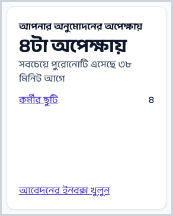

<!-- guide:meta
feature: dashboard.widgets
title: উইজেটগুলোর মানে বোঝা
summary: ড্যাশবোর্ডের প্রতিটি উইজেট কী বলে, সংখ্যাটি কোথা থেকে আসে, আর দেখে কী করবেন।
roles: [ADMIN, EXECUTIVE, TEACHER, ACCOUNTANT, OFFICE_STAFF, EXAM_CONTROLLER, COMMITTEE]
sources:
  - shared/src/dashboard/widget-catalogue.ts
  - client-admin/src/dashboard/widgets/registry.ts
  - client-admin/src/dashboard/widgets/**/*.widget.tsx
  - client-admin/src/help/guide-gen/dashboard.ts
labels: [dashboard:widgets.*, dashboard:help.widget.*, dashboard:states.*, nav:items.reminderHistory, nav:items.batchDetail, settings:dashboard.risk.absentStreakDays]
helpIds:
  [
    widget.attendance-today,
    widget.staff-today,
    widget.collection-month,
    widget.mark-entry-progress,
    widget.syllabus-progress,
    widget.at-risk-students,
    widget.sms-balance,
    widget.failed-messages,
    widget.upcoming,
    widget.homework-submission-rate,
    widget.recent-activity,
    widget.my-routine-today,
    widget.my-pending-sections,
    widget.my-mark-deadlines,
    widget.homework-to-check,
    widget.class-teacher-streaks,
    widget.my-leave-balance,
    widget.my-syllabus-progress,
    widget.collection-today,
    widget.collection-by-month,
    widget.dues-ageing,
    widget.dues-by-class,
    widget.fee-generation-status,
    widget.reminders-pending,
    widget.recent-payments,
    widget.committee-enrollment,
    widget.committee-attendance,
    widget.committee-finance,
    widget.committee-pass-rate,
    widget.seat-plan-status,
    widget.results-state,
    widget.admissions-today,
    widget.guardians-incomplete,
    widget.students-added-today,
    widget.approvals-pending,
    widget.print-queue,
    widget.setup-checklist,
    widget.syllabus-vs-plan,
    widget.my-lessons-to-mark,
  ]
devices: [desktop, phone]
entry: [sidebar, palette, page:dashboard]
keywords: [উইজেট, কার্ড, সংখ্যার মানে, ড্যাশবোর্ড, widget, card, dashboard numbers]
appVersion: 0.1.0 (6b36c2549)
owner: tareq89
lastVerified: 2026-10-24
knownIssues: []
-->

# উইজেটগুলোর মানে বোঝা

ড্যাশবোর্ডের প্রতিটি উইজেট কী বলে, সংখ্যাটি কোথা থেকে আসে, আর দেখে কী করবেন।

**যেতে হবে:** বাম মেনুতে **ড্যাশবোর্ড**, তারপর যে উইজেট বুঝতে চান সেটির নাম নিচের তালিকায় খুঁজুন।
**শুরুর আগে:** কিছু লাগে না।

**উইজেট** হলো ড্যাশবোর্ডের একটি কার্ড। প্রতিটি কার্ডে উপরে নাম, মাঝে একটি বড় সংখ্যা বা ছোট তালিকা, নিচে এক লাইনের বাক্য আর একটি লিংক। ড্যাশবোর্ড নিজে কী: [ড্যাশবোর্ডে আজকের কাজ দেখা](dashboard.md)।

[উইজেট পড়ুন](#task-main) · [সব উইজেট](#task-list) · [সমস্যা ও সমাধান](#trouble)

**এই পাতায় যা আছে**

- [এই পাতায় যেভাবে আসবেন](#arrive)
- [একটি উইজেট পড়ুন](#task-main)
- [সংখ্যাটি ঠিক আছে কি না বুঝবেন কীভাবে](#confirm)
- [অন্য পরিস্থিতিতে](#other)
  - [সব উইজেট, একটি একটি করে](#task-list)
- [সমস্যা ও সমাধান](#trouble)
- [কে কী করতে পারেন](#roles)
- [আরও জানুন](#more)

---

## এই পাতায় যেভাবে আসবেন 

**ড্যাশবোর্ড থেকে:** [ড্যাশবোর্ডে আজকের কাজ দেখা](dashboard.md#task-roles)-র ভূমিকার তালিকায় কোনো উইজেটের নামে চাপুন। → এই পাতা খোলে, সেই উইজেটের অংশে।

**খোঁজ থেকে:** উপরের খোঁজার ঘরে (Ctrl+K) উইজেটের নাম লিখুন।

---

## একটি উইজেট পড়ুন 

1. উইজেটের **নাম** পড়ুন। যেমন **আজকের শিক্ষার্থী উপস্থিতি**।
2. বড় **সংখ্যা** দেখুন। এটিই মূল খবর।
3. নিচের **বাক্য** পড়ুন। সংখ্যাটি ভালো না খারাপ, বা আগের চেয়ে বেশি না কম, তা এখানে লেখা।
4. কিছু করতে হলে **লিংক** চাপুন।

   → যে পাতায় কাজটি হয়, সেটি খোলে।

নিচের তালিকায় প্রতিটি উইজেটের জন্য তিনটি লাইন আছে:

- **এর মানে** — সংখ্যাটি ঠিক কী গোনে।
- **সংখ্যাটি কোথা থেকে আসে** — কোন পাতার কোন কাজ থেকে।
- **কী করবেন** — দেখার পর পরের কাজ।

> **মনে রাখুন:** উইজেট শুধু দেখায়। সংখ্যা বদলাতে হলে লিংকের পাতায় গিয়ে কাজটি করুন।

---

## সংখ্যাটি ঠিক আছে কি না বুঝবেন কীভাবে 

উইজেট কিছু সেভ করে না। কিন্তু সংখ্যাটি নতুন না পুরনো, তা এভাবে বুঝবেন:

| অবস্থা                   | কীভাবে বুঝবেন                                        | এরপর কী                                    |
| ------------------------ | ---------------------------------------------------- | ------------------------------------------ |
| **পুরনো হিসাব দেখাচ্ছে** | কার্ডের উপরে **সর্বশেষ সেভ করা হিসাব দেখানো হচ্ছে।** | ইন্টারনেট ফিরলে নিজে থেকে নতুন হবে।        |
| **লোড হয়নি**            | **এই উইজেটটা লোড হয়নি।**                            | **আবার চেষ্টা করুন** চাপুন।                |
| **ঠিক আছে**              | সংখ্যা, বাক্য আর লিংক দেখা যায়                      | তবুও সন্দেহ হলে লিংকের পাতায় মিলিয়ে নিন। |

**বার্তা না এলে:** [সমস্যা ও সমাধান](#trouble) দেখুন।

---

## অন্য পরিস্থিতিতে 

### সব উইজেট, একটি একটি করে 

এই তালিকা অ্যাপের ভেতরের লেখা থেকে নিজে থেকে তৈরি হয়, তাই অ্যাপের সাথে মেলে। আপনার ভূমিকায় যে উইজেট নেই, সেটিও এখানে আছে।

<!-- guide:generated:widgets:sections -->

### আজকের শিক্ষার্থী উপস্থিতি 

- **এর মানে:** যেসব শাখার হাজিরার খাতা জমা হয়েছে, সেখানে আজ কত ভাগ শিক্ষার্থী উপস্থিত, আর কয়টি শাখার খাতা এখনো জমা হয়নি। দেরিতে আসাকে উপস্থিত ধরা হবে কি না, তা স্কুলের উপস্থিতির নিয়মে ঠিক হয়।
- **সংখ্যাটি কোথা থেকে আসে:** শিক্ষকেরা আজ সারাদিনের যে হাজিরার খাতা জমা দেন, সেখান থেকে আসে। রেখাটি গত ৩০ দিনের; আগের দিনগুলো রাতে হালনাগাদ হয়।
- **কী করবেন:** কোনো শাখা বাকি থাকলে সেই শিক্ষককে মনে করিয়ে দিন। কার্ডের লিংক চাপলে উপস্থিতি পাতা খোলে, সেখানে কোন খাতা বাকি দেখবেন।

### শিক্ষক ও স্টাফ 

- **এর মানে:** আজ কতজন শিক্ষক ও কর্মী উপস্থিত, কতজন অনুমোদিত ছুটিতে, আর কতজন না জানিয়ে অনুপস্থিত।
- **সংখ্যাটি কোথা থেকে আসে:** আজকের কর্মীর উপস্থিতি আর আজকের জন্য অনুমোদিত ছুটির আবেদন থেকে আসে।
- **কী করবেন:** কেউ না জানিয়ে অনুপস্থিত থাকলে খোঁজ নিন। স্টাফ উপস্থিতি দেখুন চাপলে কর্মীর উপস্থিতি পাতা খোলে।

### এ মাসের আদায় 

- **এর মানে:** এ মাসে এখন পর্যন্ত কত টাকা এসেছে, আর এ মাসের ফির বিল কত, তার তুলনা। পুরোনো বকেয়ার টাকাও যোগ হয়, তাই হার ১০০%-এর বেশি হতে পারে।
- **সংখ্যাটি কোথা থেকে আসে:** এ মাসে নেওয়া পেমেন্ট (ফেরত দেওয়া টাকা বাদে) আর ছাড় বাদ দিয়ে এ মাসের ফির বিল থেকে আসে।
- **কী করবেন:** আগের মাসের চেয়ে পিছিয়ে থাকলে বকেয়া আদায়ে মন দিন। বকেয়া দেখুন চাপলে শিক্ষার্থীর বকেয়া খোলে; বিল না থাকলে ফি তৈরি করুন চাপুন।

### মার্ক এন্ট্রি 

- **এর মানে:** যে পরীক্ষার নম্বর এখন নেওয়া হচ্ছে, তাতে প্রতিটি শ্রেণিতে শাখা ও বিষয়ের কত ভাগ নম্বরপত্র জমা হয়েছে। সবচেয়ে পিছিয়ে থাকা শ্রেণির নাম দেখায়।
- **সংখ্যাটি কোথা থেকে আসে:** শিক্ষকেরা নম্বর দেওয়া পাতায় যে নম্বরপত্র জমা দেন, সেখান থেকে আসে। শুরু হয়ে যাওয়া সর্বশেষ পরীক্ষা, যার ফলাফল এখনো তৈরি হয়নি।
- **কী করবেন:** শেষ দিনের আগে পিছিয়ে থাকা শ্রেণির শিক্ষকদের মনে করিয়ে দিন। লিংক চাপলে নম্বর দেওয়া পাতা খোলে।

### সিলেবাস অগ্রগতি 

- **এর মানে:** এ বছর প্রতিটি শ্রেণিতে সিলেবাসের কত ভাগ বিষয়বস্তু শেষ বলে চিহ্ন দেওয়া হয়েছে। শ্রেণির পাঠ পরিকল্পনা থাকলে আজ পর্যন্ত কতটা হওয়ার কথা, তাও দেখায়।
- **সংখ্যাটি কোথা থেকে আসে:** শিক্ষকেরা সিলেবাসে যা শেষ বলে চিহ্ন দেন, আর পাঠ পরিকল্পনা ও ক্লাস রুটিন থেকে আসে।
- **কী করবেন:** পিছিয়ে থাকা শ্রেণির শিক্ষকদের সাথে কথা বলুন। সিলেবাস দেখুন চাপলে সিলেবাস পাতা খোলে।

### ঝুঁকিপূর্ণ শিক্ষার্থী 

- **এর মানে:** ৪টি সতর্ক সংকেতের অন্তত ২টি যাদের সাথে মেলে: টানা অনুপস্থিতি, ৩০ দিনে কম উপস্থিতি, ফেল করা বিষয়, পুরোনো বকেয়া। বেশি সংকেত যাদের, তারা আগে।
- **সংখ্যাটি কোথা থেকে আসে:** হাজিরার খাতা, সর্বশেষ প্রকাশিত পরীক্ষার ফলাফল আর বকেয়া ফির বিল থেকে আসে। তালিকা প্রতি রাতে আর সীমা বদলালে নতুন করে তৈরি হয়।
- **কী করবেন:** শিক্ষার্থী, শ্রেণি শিক্ষক বা অভিভাবকের সাথে কথা বলুন। সীমা বদলান চাপলে সেটিংস খোলে, সেখানে ড্যাশবোর্ড অংশে ৪টি সীমা ঠিক করা যায়।

### SMS ব্যালান্স 

- **এর মানে:** স্কুল আর কতগুলো SMS পাঠাতে পারবে, আর এখন যে বার্তা যাচ্ছে তার জন্য কতগুলো আটকে রাখা আছে। কিছু স্কুলে SMS গোনা হয় না।
- **সংখ্যাটি কোথা থেকে আসে:** স্কুলের SMS ব্যালান্স থেকে আসে। প্রতিটি বার্তা পাঠালে এটি কমে।
- **কী করবেন:** ব্যালান্স কম হলে রিমাইন্ডার পাঠানোর আগে রিচার্জ করুন। পাঠানো বার্তা দেখুন চাপলে বার্তার তালিকা খোলে, শুধু SMS দেখিয়ে।

### যে বার্তা যায়নি 

- **এর মানে:** আজসহ গত ৭ দিনে কতগুলো SMS পাঠানো যায়নি।
- **সংখ্যাটি কোথা থেকে আসে:** স্কুল থেকে পাঠানো প্রতিটি SMS-এর রেকর্ড থেকে আসে, যেমন ফি রিমাইন্ডার আর সতর্কবার্তা।
- **কী করবেন:** ফোন নম্বর আর SMS ব্যালান্স দেখে আবার পাঠান। কোনগুলো দেখুন চাপলে বার্তার তালিকা খোলে, একই ৭ দিনের যে SMS যায়নি সেগুলো দেখিয়ে।

### সামনে কী আছে 

- **এর মানে:** পরের ছুটি আর সামনের ৬০ দিনের প্রকাশিত অনুষ্ঠানের মধ্যে প্রথম পাঁচটি।
- **সংখ্যাটি কোথা থেকে আসে:** স্কুলের ক্যালেন্ডারে দেওয়া ছুটি আর অনুষ্ঠান থেকে আসে।
- **কী করবেন:** কোনো অনুষ্ঠান যোগ করতে বা বদলাতে কার্ড থেকে ক্যালেন্ডার খুলুন।

### হোমওয়ার্ক জমার হার 

- **এর মানে:** আজসহ গত ৭ দিনে যত বাড়ির কাজ জমার শেষ দিন ছিল, তার কত ভাগ জমা পড়েছে। সবচেয়ে কম জমা যে শ্রেণিতে, তার নাম দেখায়।
- **সংখ্যাটি কোথা থেকে আসে:** এ শিক্ষাবর্ষে শিক্ষকেরা যে বাড়ির কাজ দেন আর প্রতিটি শিক্ষার্থীর জমার রেকর্ড থেকে আসে।
- **কী করবেন:** কম জমা পড়া শ্রেণির শিক্ষকের কাছে কারণ জানুন। হোমওয়ার্ক দেখুন চাপলে বাড়ির কাজ পাতা খোলে।

### সাম্প্রতিক কার্যকলাপ 

- **এর মানে:** সিস্টেমে সবশেষ ৮টি পরিবর্তন: কে করেছেন, কী করেছেন, কোন রেকর্ডে।
- **সংখ্যাটি কোথা থেকে আসে:** কার্যক্রমের রেকর্ড থেকে আসে। প্রতিটি যোগ, বদল আর মুছে ফেলা সেখানে লেখা থাকে।
- **কী করবেন:** কোনো পরিবর্তন ভুল মনে হলে মিলিয়ে দেখুন। পুরো কার্যকলাপের তালিকা চাপলে কার্যক্রমের রেকর্ড খোলে।

### আজকের আমার রুটিন 

- **এর মানে:** আজ আপনার পিরিয়ডগুলো, সময় অনুযায়ী: শ্রেণি, বিষয় আর রুম। কার বদলে নিচ্ছেন, কোন পিরিয়ড বাতিল আর কোনটি আপনার নিজের শাখা, তাও দেখায়।
- **সংখ্যাটি কোথা থেকে আসে:** ক্লাস রুটিন আর আজকের বদলি শিক্ষকের তালিকা থেকে আসে।
- **কী করবেন:** পরের পিরিয়ড আর রুম দেখে নিন। পুরো সপ্তাহের রুটিন চাপলে আমার রুটিন খোলে।

### উপস্থিতি নেওয়া বাকি 

- **এর মানে:** আপনার কয়টি শাখার আজকের হাজিরার খাতা এখনো জমা হয়নি।
- **সংখ্যাটি কোথা থেকে আসে:** যে শাখাগুলোতে আপনি হাজিরা নিতে পারেন, সেগুলোর আজকের হাজিরার খাতা থেকে আসে।
- **কী করবেন:** বাকি প্রতিটি শাখার হাজিরা নিন। বোতাম চাপলে সেই শাখার হাজিরার খাতা খোলে।

### মার্ক জমার সময়সীমা 

- **এর মানে:** যে পরীক্ষার নম্বর এখন নেওয়া হচ্ছে, তাতে কতজন শিক্ষার্থীর নম্বর আপনার দেওয়া বাকি, আর প্রতিটি শাখা ও বিষয়ের শেষ দিন কবে।
- **সংখ্যাটি কোথা থেকে আসে:** আপনাকে দেওয়া শাখা ও বিষয়, আর প্রতিটি শিক্ষার্থীর জন্য যা নম্বর দেওয়া হয়েছে, তা থেকে আসে।
- **কী করবেন:** শেষ দিনের আগে বাকি নম্বর দিন। বোতাম চাপলে সেই শাখার নম্বরপত্র খোলে; নম্বর দেওয়া পাতাও খুলতে পারেন।

### দেখার বাকি হোমওয়ার্ক 

- **এর মানে:** কতগুলো জমা দেওয়া বাড়ির কাজ আপনার দেখার অপেক্ষায়, আর সেগুলো কয়টি বাড়ির কাজের।
- **সংখ্যাটি কোথা থেকে আসে:** আপনার শাখা ও বিষয়ে শিক্ষার্থীরা যে বাড়ির কাজ জমা দিয়েছে, তা থেকে আসে।
- **কী করবেন:** কাজ দেখে মতামত দিন। জমা দেখুন চাপলে কার্ডের প্রথম বাড়ির কাজের কাজ দেখা তালিকা খোলে।

### আমার শ্রেণির ধারাবাহিকতা 

- **এর মানে:** আপনার নিজের শাখার যেসব শিক্ষার্থী পরপর কয়েক দিন স্কুল খোলার দিনে অনুপস্থিত, শেষ হাজিরার খাতা পর্যন্ত। কত দিন, তা ঠিক হয় সেটিংসের টানা অনুপস্থিত (দিন) থেকে; না বদলালে ৩ দিন।
- **সংখ্যাটি কোথা থেকে আসে:** যে শাখার আপনি শ্রেণি শিক্ষক, তার সারাদিনের হাজিরার খাতা থেকে আসে।
- **কী করবেন:** আজই অভিভাবককে ফোন করুন। অভিভাবককে জানান আর নিচের লিংক, দুটোই আমার শ্রেণি-তে আপনার শাখার পাতা খোলে।

### আমার ছুটির হিসাব 

- **এর মানে:** এই ক্যালেন্ডার বছরে আপনার মোট ছুটির মধ্যে আর কত দিন বাকি, সব ধরনের ছুটি একসাথে যোগ করে।
- **সংখ্যাটি কোথা থেকে আসে:** স্কুলের ঠিক করা ছুটির পরিমাণ আর আপনার অনুমোদিত ছুটির আবেদন থেকে আসে। শুধু স্কুল খোলার দিন গোনা হয়।
- **কী করবেন:** ছুটি নিতে ছুটির আবেদন চাপুন, ছুটি পাতা খুলবে। ছুটি ঠিক করা না থাকলে অফিসে বলুন।

### আমার সিলেবাস অগ্রগতি 

- **এর মানে:** আপনি যে শ্রেণি ও বিষয় পড়ান, তার সিলেবাসের কত ভাগ শেষ বলে চিহ্ন দেওয়া। পাঠ পরিকল্পনা থাকলে কতটা হওয়ার কথা, তাও দেখায়।
- **সংখ্যাটি কোথা থেকে আসে:** সিলেবাসে আপনি যা শেষ বলে চিহ্ন দেন আর আপনার পাঠ পরিকল্পনা থেকে আসে।
- **কী করবেন:** শেষ হওয়া বিষয়বস্তুতে চিহ্ন দিন, তাহলে হিসাব ঠিক থাকবে। সিলেবাস খুলুন চাপলে সিলেবাস পাতা খোলে।

### আজকের আদায় 

- **এর মানে:** আজ এখন পর্যন্ত কত টাকা এসেছে আর কয়টি পেমেন্ট, ক্যাশ, বিকাশ, ব্যাংক আর অন্য মোবাইল ভাগ করে। গতকালের এই সময়ের সাথে তুলনা করে।
- **সংখ্যাটি কোথা থেকে আসে:** আজ নেওয়া পেমেন্ট থেকে আসে, ফেরত দেওয়া টাকা বাদ দিয়ে।
- **কী করবেন:** দিনের শেষে হাতের নগদ টাকা এই হিসাবের সাথে মিলিয়ে নিন। সংগ্রহ প্রতিবেদন চাপলে ফি আদায়ের প্রতিবেদন খোলে।

### মাস অনুযায়ী আদায় 

- **এর মানে:** চলতি শিক্ষাবর্ষের প্রথম মাস থেকে প্রতি মাসে কত টাকা আদায় হয়েছে (চলতি বর্ষ না থাকলে ক্যালেন্ডার বছর)। চলতি মাসের হিসাব এখনো চলছে, আগের মাসের একই দিনগুলোর সাথে তুলনা দেখায়।
- **সংখ্যাটি কোথা থেকে আসে:** নেওয়া পেমেন্ট থেকে আসে, ফেরত দেওয়া টাকা বাদ দিয়ে।
- **কী করবেন:** কোন মাস পিছিয়ে আছে দেখুন। সংগ্রহ প্রতিবেদন খুলুন চাপলে ফি আদায়ের প্রতিবেদন খোলে।

### বকেয়া কত দিনের 

- **এর মানে:** সব বকেয়া টাকা, শেষ তারিখ পার হওয়ার দিন ধরে ভাগ করা: ০–৩০, ৩১–৬০ আর ৬০ দিনের বেশি। যে বিলের শেষ তারিখ আসেনি, তা ০–৩০-এ পড়ে।
- **সংখ্যাটি কোথা থেকে আসে:** যেসব ফির বিল পুরো শোধ হয়নি, পেমেন্ট আর ছাড় বাদ দিয়ে, সেখান থেকে আসে।
- **কী করবেন:** সবচেয়ে পুরোনো বকেয়া আগে আদায় করুন। সব বকেয়া দেখুন চাপলে শিক্ষার্থীর বকেয়া খোলে।

### শ্রেণি অনুযায়ী বকেয়া 

- **এর মানে:** প্রতিটি শ্রেণির বকেয়া টাকা, সবচেয়ে বেশি যেটির সেটি আগে, আর কতজন শিক্ষার্থীর বকেয়া আছে।
- **সংখ্যাটি কোথা থেকে আসে:** যেসব ফির বিল পুরো শোধ হয়নি, শিক্ষার্থীর শ্রেণি ধরে যোগ করে আসে।
- **কী করবেন:** যে শ্রেণির বকেয়া সবচেয়ে বেশি, সেখান থেকে শুরু করুন। লিংক চাপলে সেই শ্রেণির শিক্ষার্থীর বকেয়া খোলে।

### ফি তৈরির অবস্থা 

- **এর মানে:** এ মাসের ফির বিল তৈরি হয়েছে কি না, কয়টি বিল হয়েছে, আর পরের স্বয়ংক্রিয় বিল কবে তৈরি হবে।
- **সংখ্যাটি কোথা থেকে আসে:** এ মাসে যতবার ফির বিল তৈরি করা হয়েছে আর স্বয়ংক্রিয় বিলের নিয়ম থেকে আসে।
- **কী করবেন:** বিল তৈরি না হলে ফি তৈরি করুন চাপুন। চালান দেখুন চাপলে চালান পাতা খোলে।

### অপেক্ষায় থাকা রিমাইন্ডার 

- **এর মানে:** কতজন শিক্ষার্থীর ফি রিমাইন্ডারের তারিখ পার হয়ে গেছে, কিন্তু তারপর এখনো কোনো রিমাইন্ডার যায়নি।
- **সংখ্যাটি কোথা থেকে আসে:** বকেয়া ফির বিল আর আগে পাঠানো ফি রিমাইন্ডারের রেকর্ড থেকে আসে।
- **কী করবেন:** রিমাইন্ডার পাঠান চাপুন, ফি রিমাইন্ডার পাতা খুলবে।

### সাম্প্রতিক পেমেন্ট 

- **এর মানে:** সবশেষ ৫টি পেমেন্ট: শিক্ষার্থী, শ্রেণি, টাকা, মাধ্যম আর সময়। যে পেমেন্ট সফল হয়নি, তা দেখায় কিন্তু মোট টাকায় ধরে না।
- **সংখ্যাটি কোথা থেকে আসে:** সিস্টেমে নেওয়া পেমেন্ট থেকে আসে, ফেরত দেওয়ার রেকর্ড বাদ দিয়ে।
- **কী করবেন:** প্রতিটি পেমেন্ট ঠিক আছে কি না দেখুন। সব পেমেন্ট চাপলে পেমেন্ট পাতা খোলে।

### ভর্তির সংখ্যা 

- **এর মানে:** এ বছর মোট শিক্ষার্থী আর গত বছরের তুলনায় কত বেড়েছে বা কমেছে, সবচেয়ে বেশি ৫ বছরের হিসাব।
- **সংখ্যাটি কোথা থেকে আসে:** প্রতি শিক্ষাবর্ষে ভর্তি থাকা বা পাশ করে বের হওয়া শিক্ষার্থীদের থেকে আসে।
- **কী করবেন:** এই কার্ড শুধু দেখার জন্য, কোনো লিংক নেই। কোনো বছরের সংখ্যা ভুল মনে হলে অফিসে জানান।

### উপস্থিতি 

- **এর মানে:** এ শিক্ষাবর্ষে প্রতি মাসে পুরো স্কুলের উপস্থিতি আর এ মাসের গড়, স্কুলের লক্ষ্যের সাথে তুলনা করে (না বদলালে লক্ষ্য ৯০%)।
- **সংখ্যাটি কোথা থেকে আসে:** জমা দেওয়া সারাদিনের হাজিরার খাতা থেকে আসে। গত ৭ দিন সাথে সাথে বদলায়; তার আগের দিনগুলো রাতে হালনাগাদ হয়।
- **কী করবেন:** উপস্থিতি লক্ষ্যের নিচে থাকলে সভায় তুলুন। লক্ষ্য ঠিক করা হয় সেটিংস-এর ড্যাশবোর্ড অংশে।

### আর্থিক অবস্থা 

- **এর মানে:** এ মাসের আদায় আর এ মাসের বিলের তুলনা, আর এ শিক্ষাবর্ষের বিলে মাস অনুযায়ী কত টাকা এখনো বকেয়া।
- **সংখ্যাটি কোথা থেকে আসে:** ফির বিল আর নেওয়া পেমেন্ট থেকে আসে।
- **কী করবেন:** এই কার্ড শুধু দেখার জন্য, কোনো লিংক নেই। বকেয়া বেশি হলে হিসাবরক্ষকের কাছে জানতে চান।

### পাসের হার 

- **এর মানে:** সর্বশেষ প্রকাশিত পরীক্ষায় শ্রেণি অনুযায়ী কত ভাগ শিক্ষার্থী পাস করেছে, আগের প্রকাশিত পরীক্ষার সাথে তুলনা করে।
- **সংখ্যাটি কোথা থেকে আসে:** প্রকাশিত পরীক্ষার ফলাফল থেকে আসে।
- **কী করবেন:** এই কার্ড শুধু দেখার জন্য, কোনো লিংক নেই। পাসের হার সবচেয়ে কম যে শ্রেণিতে, তা সভায় আলোচনা করুন।

### আসন পরিকল্পনা 

- **এর মানে:** এ বছরের সামনের যেসব পরীক্ষার এক বা একাধিক দিনের সিট প্ল্যান এখনো বাকি। পরীক্ষার প্রথম দিন পর্যন্ত সেটি তালিকায় থাকে।
- **সংখ্যাটি কোথা থেকে আসে:** পরীক্ষার সময়সূচি আর প্রতিটি দিনের জন্য তৈরি সিট প্ল্যান থেকে আসে।
- **কী করবেন:** পরীক্ষার আগে বাকি সিট প্ল্যান তৈরি করুন। সিট প্ল্যান খুলুন চাপলে সিট প্ল্যান পাতা খোলে।

### ফলাফল 

- **এর মানে:** এ বছরের কয়টি পরীক্ষার ফলাফল প্রকাশ হয়েছে, আর কয়টি তৈরি হয়ে প্রকাশের অপেক্ষায়। প্রতিটি শ্রেণিকে একটি পরীক্ষা ধরে গোনা হয়।
- **সংখ্যাটি কোথা থেকে আসে:** প্রতিটি পরীক্ষার অবস্থা থেকে আসে: খসড়া, প্রকাশের জন্য তৈরি, বা প্রকাশিত।
- **কী করবেন:** যে ফলাফল তৈরি, তা প্রকাশ করুন। ফলাফল খুলুন চাপলে ফলাফল পাতা খোলে।

### আজকের ভর্তি 

- **এর মানে:** আজ কয়টি নতুন ভর্তির আবেদন এসেছে, মোট কয়টি দেখার অপেক্ষায়, আর সবশেষ ৫টি আবেদন।
- **সংখ্যাটি কোথা থেকে আসে:** স্কুলে আসা ভর্তির আবেদন থেকে আসে।
- **কী করবেন:** অপেক্ষায় থাকা আবেদনগুলো দেখুন। আবেদনকারী খুলুন চাপলে ভর্তি আবেদনকারী পাতা খোলে।

### অভিভাবকের তথ্য অসম্পূর্ণ 

- **এর মানে:** কতজন অভিভাবকের তথ্য অসম্পূর্ণ। নাম, সম্পর্ক, বা কোনো ফোন নম্বরই না থাকলে তথ্য অসম্পূর্ণ ধরা হয়।
- **সংখ্যাটি কোথা থেকে আসে:** শিক্ষার্থীদের জন্য দেওয়া অভিভাবকের তথ্য থেকে আসে।
- **কী করবেন:** বাকি তথ্য দিন, যাতে অভিভাবকের কাছে বার্তা পৌঁছায়। কারা, দেখুন চাপলে অভিভাবক পাতা খোলে।

### আজ যোগ হওয়া শিক্ষার্থী 

- **এর মানে:** আজ সিস্টেমে কতজন শিক্ষার্থী যোগ হয়েছে।
- **সংখ্যাটি কোথা থেকে আসে:** আজ তৈরি হওয়া শিক্ষার্থীর রেকর্ড থেকে আসে, একজন করে যোগ করা হোক বা ফাইল থেকে।
- **কী করবেন:** নতুন রেকর্ডগুলো পুরো আছে কি না দেখুন। শিক্ষার্থী খুলুন চাপলে শিক্ষার্থী পাতা খোলে।

### আপনার অনুমোদনের অপেক্ষায় 

- **এর মানে:** ছুটি, ভর্তি বা ফি মওকুফের মতো কয়টি আবেদন আপনার সিদ্ধান্তের অপেক্ষায়, আর সবচেয়ে পুরোনোটি কবে পাঠানো।
- **সংখ্যাটি কোথা থেকে আসে:** কর্মী, অভিভাবক বা শিক্ষার্থীরা যে আবেদন পাঠিয়েছেন এবং যা আপনার ইনবক্সে আছে, তা থেকে আসে।
- **কী করবেন:** সবচেয়ে পুরোনোটি আগে দেখুন। আবেদনের ইনবক্স খুলুন চাপলে আবেদনপত্র পাতা খোলে।

### প্রিন্টের তালিকা 

- **এর মানে:** কতগুলো কাগজ এখনো প্রিন্ট বাকি: যে পরীক্ষার সিট প্ল্যান প্রকাশ হয়েছে তার প্রবেশপত্র, আর শিক্ষার্থীর আইডি কার্ড।
- **সংখ্যাটি কোথা থেকে আসে:** চালু থাকা শিক্ষার্থী আর আগে যা প্রিন্ট হয়েছে তার রেকর্ড থেকে আসে। ব্যর্থ বা বাতিল প্রিন্ট বাকি হিসেবেই ধরা হয়।
- **কী করবেন:** বাকি কার্ডগুলো প্রিন্ট করুন। প্রিন্টের তালিকা খুলুন চাপলে প্রিন্ট ও ডকুমেন্ট পাতা খোলে।

### সেটআপ তালিকা 

- **এর মানে:** স্কুল চালু করতে আর কী কী ঠিক করা বাকি, যেমন স্কুলের তথ্য, শ্রেণি, শাখা, শিক্ষার্থী, কর্মী আর ফি। সব শেষ হলে বা লুকালে কার্ডটি আর দেখায় না।
- **সংখ্যাটি কোথা থেকে আসে:** আপনার স্কুল সিস্টেমে এর মধ্যে যা দিয়েছে, তা থেকে আসে।
- **কী করবেন:** কোনো ধাপ শেষ করতে সেটি চাপুন, অথবা কার্ড সরাতে লুকান চাপুন।

### পরিকল্পনার তুলনায় সিলেবাস 

- **এর মানে:** পাঠ পরিকল্পনা আছে এমন প্রতিটি শ্রেণিতে আজ পর্যন্ত কতটা পড়ানো হয়েছে আর কতটা হওয়ার কথা, আর আগের কয়টি পাঠ কেউ হালনাগাদ করেনি।
- **সংখ্যাটি কোথা থেকে আসে:** পাঠ পরিকল্পনা, ক্লাস রুটিন আর শিক্ষকেরা পাঠের যে অবস্থা জানান, তা থেকে আসে।
- **কী করবেন:** পিছিয়ে থাকা শ্রেণির শিক্ষকদের সাথে কথা বলুন। লিংক চাপলে সিলেবাস পাতার পাঠ পরিকল্পনা ট্যাব খোলে।

### শেষ বলে চিহ্নিত করার পাঠ 

- **এর মানে:** পাঠ পরিকল্পনায় থাকা আপনার আগের যে পিরিয়ডগুলোর পাঠ হয়েছে কি না, তা এখনো জানাননি। আজকের পিরিয়ড গোনা হয় না।
- **সংখ্যাটি কোথা থেকে আসে:** আপনার পাঠ পরিকল্পনা, ক্লাস রুটিন আর অন্যের বদলে নেওয়া পিরিয়ড থেকে আসে।
- **কী করবেন:** প্রতিটি পাঠের অবস্থা জানান। পাঠ চিহ্নিত করুন চাপলে আমার রুটিন খোলে।

<!-- /guide:generated -->

---

## সমস্যা ও সমাধান 

| আপনি যা দেখছেন                           | কী করবেন                                                                                | কে সাহায্য করতে পারেন |
| ---------------------------------------- | --------------------------------------------------------------------------------------- | --------------------- |
| **এই উইজেটটা লোড হয়নি।**                | **আবার চেষ্টা করুন** চাপুন। বারবার হলে পাতা রিলোড করুন।                                 | অ্যাডমিন              |
| সংখ্যা লিংকের পাতার সাথে মিলছে না        | উপরে উইজেটের **এর মানে** লাইন পড়ুন: সংখ্যাটি কোন কয় দিনের, তা সেখানে লেখা। লিংকের পাতা বেশি দিনের হিসাব দেখাতে পারে। | অ্যাডমিন              |
| তালিকার কোনো উইজেট আপনার ড্যাশবোর্ডে নেই | হয় সেটি আপনার ভূমিকার জন্য নয়, নয়তো লুকানো। [ড্যাশবোর্ড সাজানো](customise.md) দেখুন। | নিজে                  |

---

## কে কী করতে পারেন 

| ভূমিকা                                                                               | কোন উইজেট দেখেন                                      |
| ------------------------------------------------------------------------------------ | ---------------------------------------------------- |
| অ্যাডমিন, একাডেমিক কো-অর্ডিনেটর, শিক্ষক, হিসাবরক্ষক, অফিস সহকারী, পরীক্ষা নিয়ন্ত্রক | নিজের ভূমিকার জন্য রাখা উইজেট, যেটি দেখার অনুমতি আছে |
| পরিচালনা পর্ষদ সদস্য                                                                 | শুধু মোট হিসাবের উইজেট; কোনো শিক্ষার্থীর নাম থাকে না |

কোন ভূমিকা শুরুতে কোন উইজেট পায়: [ভূমিকা অনুযায়ী ড্যাশবোর্ড](dashboard.md#task-roles)।

---

## আরও জানুন 

<strong>উইজেট কীভাবে কাজ করে</strong> — সংখ্যা থেকে কাজের পাতা

<figure>
  
  <figcaption><em>উইজেট থেকে কাজের পাতা</em></figcaption>
</figure>

- প্রতিটি উইজেট আলাদা করে লোড হয়; একটি না এলে বাকিগুলো ঠিক থাকে।
- ইন্টারনেট না থাকলে শেষবার আনা সংখ্যা দেখায়, সাথে একটি নোট।
- ফোনে শুধু-সংখ্যার উইজেট উপরে **মূল সংখ্যা** অংশে ছোট ঘর হয়ে আসে।

**সম্পর্কিত পাতা**

- [**ড্যাশবোর্ডে আজকের কাজ দেখা**](dashboard.md) — উইজেটগুলো যে পাতায় থাকে, আর কোন ভূমিকা কোনগুলো পায়।
- [**ড্যাশবোর্ড সাজানো**](customise.md) — উইজেট দেখান, লুকান, আকার বদলান; ঝুঁকিপূর্ণ শিক্ষার্থীর সীমা।
- [**সতর্কতা ও বিজ্ঞপ্তি**](alerts.md) — উইজেটের পাশাপাশি যে সতর্কতা আসে।

---

_সংস্করণ ০.১.০ · শেষ যাচাই ২০২৬-১০-২৪_
