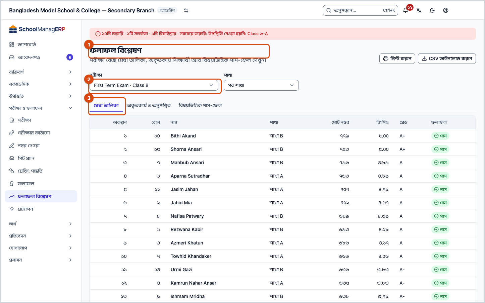
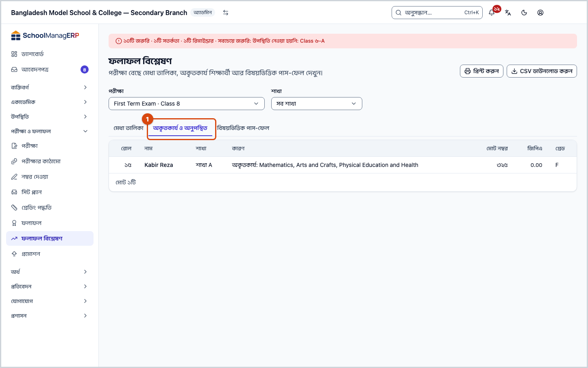

<!-- guide:meta
feature: examsResults.analysis
title: মেধা তালিকা ও ফলাফল বিশ্লেষণ
summary: একটি পরীক্ষার মেধা তালিকা, অকৃতকার্য ও অনুপস্থিত শিক্ষার্থী আর বিষয়ভিত্তিক পাস-ফেল দেখুন, শাখা ধরে ছাঁকুন, প্রিন্ট করুন বা CSV নামান।
roles: [ADMIN, TEACHER, EXECUTIVE, EXAM_CONTROLLER]
sources:
  - client-admin/src/routes/_staff/analysis/index.tsx
  - client-admin/src/routes/_staff/analysis/-merit-tab.tsx
  - client-admin/src/routes/_staff/analysis/-defaulted-tab.tsx
  - client-admin/src/routes/_staff/analysis/-pass-fail-tab.tsx
  - client-admin/src/routes/_staff/exams/-detail/use-result-actions.tsx
  - client-admin/src/route-permissions.ts
  - client-admin/src/nav-tree.ts
  - server/src/modules/exams/analysis.controller.ts
  - server/src/modules/exams/analysis.service.ts
  - server/src/modules/classes/teacher-scope.service.ts
labels:
  [
    grading:analysisPage.*,
    grading:marksEntry.noExams*,
    exams:analysis.*,
    exams:resultsRoute.examLabel,
    exams:resultsRoute.examPlaceholder,
    exams:resultsRoute.loadError,
    exams:resultsRoute.selectExamHint,
    exams:resultsPanel.loadError,
    nav:items.analysis,
    nav:groups.examsResults,
  ]
helpIds:
  [
    examsResults.analysis,
    examsResults.analysis.action.print,
    examsResults.analysis.action.downloadCsv,
    examsResults.analysis.field.byPart,
  ]
devices: [desktop]
entry: [sidebar, palette, page:examsResults.results]
keywords:
  [ফলাফল বিশ্লেষণ, মেধা তালিকা, অকৃতকার্য, অনুপস্থিত, পাস-ফেল, পাসের হার, প্রিন্ট, CSV, analysis, merit list, defaulters, pass fail]
appVersion: 0.1.0 (a25ab3344)
owner: tareq89
lastVerified: 2026-10-25
knownIssues: []
-->

# মেধা তালিকা ও ফলাফল বিশ্লেষণ

একটি পরীক্ষার ফলাফল থেকে মেধা তালিকা, কারা ফেল বা অনুপস্থিত, আর কোন বিষয়ে কতজন পাস করেছে তা দেখুন। দরকারে প্রিন্ট করুন।

**যেতে হবে:** বাম মেনুতে **পরীক্ষা ও ফলাফল → ফলাফল বিশ্লেষণ**।
**শুরুর আগে:** পরীক্ষার ফলাফল অন্তত প্রক্রিয়া করা থাকতে হবে ([ফলাফল প্রক্রিয়া ও প্রকাশ](results.md))। আপনি অ্যাডমিন, পরীক্ষা নিয়ন্ত্রক, একাডেমিক কো-অর্ডিনেটর বা শিক্ষক হবেন।

এই পাতা শুধু দেখার জন্য। এখানে কিছু চাপলে কোনো নম্বর বা ফলাফল বদলায় না। পাতায় তিনটি ট্যাব: **মেধা তালিকা**, **অকৃতকার্য ও অনুপস্থিত** আর **বিষয়ভিত্তিক পাস-ফেল**।

[মেধা তালিকা দেখুন](#task-main) · [অকৃতকার্য ও অনুপস্থিত](#task-defaulted) · [বিষয়ভিত্তিক পাস-ফেল](#task-passfail) · [প্রিন্ট ও CSV](#task-print) · [সমস্যা ও সমাধান](#trouble)

**এই পাতায় যা আছে**

- [এই পাতায় যেভাবে আসবেন](#arrive)
- [মেধা তালিকা দেখুন](#task-main)
- [ঠিক তালিকা দেখছেন কি না বুঝবেন কীভাবে](#confirm)
- [অন্য পরিস্থিতিতে](#other)
  - [অকৃতকার্য ও অনুপস্থিত শিক্ষার্থী দেখুন](#task-defaulted)
  - [বিষয়ভিত্তিক পাস-ফেল দেখুন](#task-passfail)
  - [প্রিন্ট করুন বা CSV নামান](#task-print)
- [সমস্যা ও সমাধান](#trouble)
- [কে কী করতে পারেন](#roles)
- [আরও জানুন](#more)

---

## এই পাতায় যেভাবে আসবেন 

**বাম মেনু থেকে**

1. বাম মেনুতে **পরীক্ষা ও ফলাফল → ফলাফল বিশ্লেষণ** চাপুন। → এই পাতা খোলে, তালিকার প্রথম পরীক্ষাটি বাছা থাকে। নিচের [মেধা তালিকা দেখুন](#task-main) থেকে শুরু করুন।

**ফলাফল পাতা থেকে**

1. [ফলাফল](results.md) পাতায় একটি পরীক্ষা বেছে **ফলাফল বিশ্লেষণ** চাপুন। → সোজা সেই পরীক্ষার **মেধা তালিকা** খোলে; নিচের ধাপ ৩ থেকে শুরু করুন।

---

## মেধা তালিকা দেখুন 

1. বাম মেনুতে **পরীক্ষা ও ফলাফল** চাপুন, তারপর **ফলাফল বিশ্লেষণ** চাপুন।

   → **ফলাফল বিশ্লেষণ** পাতা খোলে। নিচে লেখা **পরীক্ষা বেছে মেধা তালিকা, অকৃতকার্য শিক্ষার্থী আর বিষয়ভিত্তিক পাস-ফেল দেখুন।**

2. **পরীক্ষা** ঘরে পরীক্ষাটি বেছে নিন।

   → ফলাফল প্রক্রিয়া হয়ে থাকলে তিনটি ট্যাব আসে, **মেধা তালিকা** খোলা থাকে। না হলে আসে **এই পরীক্ষার ফলাফল এখনো তৈরি হয়নি**।

3. সব শাখা একসাথে দেখতে **শাখা** ঘরে **সব শাখা** রাখুন। একটি শাখা দেখতে সেই শাখা বাছুন।

   → তালিকায় প্রতিটি শিক্ষার্থীর **অবস্থান**, **রোল**, **নাম**, **মোট নম্বর**, **জিপিএ**, **গ্রেড** আর **ফলাফল** (**পাস** বা **ফেল**)। সব শাখা দেখলে **শাখা** কলামও থাকে। একটি শাখা বাছলে প্রথম কলাম হয় **শাখা অবস্থান**।

উদাহরণ: ৮ম শ্রেণির অর্ধবার্ষিক পরীক্ষায় **সব শাখা** রাখলে পুরো শ্রেণির অবস্থান দেখায়, যেমন ১, ২, ৩। **শাখা** ঘরে "ক" বাছলে শুধু ক শাখার শিক্ষার্থীরা আসেন, আর **শাখা অবস্থান** সেই শাখার ভেতরের ক্রম।

| শাখা ঘরে আপনি রাখলেন | প্রথম কলাম       | কারা আসেন                 |
| -------------------- | ---------------- | ------------------------- |
| **সব শাখা**          | **অবস্থান**      | পুরো শ্রেণি (শাখা কলামসহ) |
| একটি শাখা            | **শাখা অবস্থান** | শুধু সেই শাখা             |

> **মনে রাখুন:** **ফেল** করা শিক্ষার্থীর অবস্থান থাকে না; তাঁরা তালিকার শেষে আসেন।

---

## ঠিক তালিকা দেখছেন কি না বুঝবেন কীভাবে 

এই পাতা কিছু সংরক্ষণ করে না, শুধু স্কুলের সিস্টেম থেকে পড়ে দেখায়।

| অবস্থা               | কীভাবে বুঝবেন                         | এরপর কী                                 |
| -------------------- | ------------------------------------- | --------------------------------------- |
| **তালিকা এসেছে**     | ট্যাবের নিচে সারি দেখা যায়           | দরকারে প্রিন্ট বা CSV নামান             |
| **ফলাফল তৈরি হয়নি** | **এই পরীক্ষার ফলাফল এখনো তৈরি হয়নি** | আগে [ফলাফল](results.md) প্রক্রিয়া করুন |

**যাচাই করতে চাইলে:** পাতার ঠিকানায় পরীক্ষা, শাখা আর ট্যাব লেখা থাকে। ঠিকানাটি কপি করে পাঠালে অন্যজনও একই তালিকা দেখেন, যদি তাঁর এই পাতা দেখার অনুমতি থাকে।

**ফলাফল প্রকাশ না হলেও** তালিকা আসে: **প্রক্রিয়াকৃত** অবস্থার পরীক্ষাও এখানে দেখা যায়। তাই প্রকাশের আগে মিলিয়ে দেখতে এই পাতা কাজে লাগে।

---

## অন্য পরিস্থিতিতে 

### অকৃতকার্য ও অনুপস্থিত শিক্ষার্থী দেখুন 

1. পরীক্ষা বেছে **অকৃতকার্য ও অনুপস্থিত** ট্যাব চাপুন।

   → শুধু সেই শিক্ষার্থীরা আসেন যাঁরা পুরো ফলাফলে ফেল, অথবা অন্তত একটি বিষয়ে অনুপস্থিত। **কারণ** কলামে লেখা থাকে, যেমন **অকৃতকার্য: Math, English**, আর পরের লাইনে **অনুপস্থিত: Science**। বিষয়ের নাম এখানে ইংরেজিতে আসে।

2. কেউ না থাকলে আসে **সবাই কৃতকার্য হয়েছে** আর **এই পরীক্ষায় কেউ অকৃতকার্য বা অনুপস্থিত হয়নি।**

এই তালিকা পাতায় ভাগ করা নয়; সবাই একসাথে আসেন।

### বিষয়ভিত্তিক পাস-ফেল দেখুন 

1. পরীক্ষা বেছে **বিষয়ভিত্তিক পাস-ফেল** ট্যাব চাপুন।

   → প্রতিটি বিষয়ের একটি সারি: **উপস্থিত**, **পাস**, **ফেল**, **অনুপস্থিত**, **পাসের হার %**, **সর্বোচ্চ**, **গড়** আর গ্রেডভিত্তিক সংখ্যা (যেমন **A+: ১২**)। শেষে মোটা অক্ষরে **সামগ্রিক** সারি, পুরো ফলাফলের হিসাব।

2. বিষয়ের ভেতরের অংশ (যেমন লিখিত, বহুনির্বাচনী) আলাদা দেখতে **অংশ অনুযায়ী** টিক দিন।

   → তালিকা বদলে প্রতিটি **বিষয়** আর **অংশ**-এর সারি আসে: **উপস্থিত**, **অনুপস্থিত**, **পাস নম্বরের নিচে**, **সর্বোচ্চ**, **গড়**।

উদাহরণ: গণিতে ৪০ জনের ৩৮ জন উপস্থিত, ৩৪ জন পাস, ৪ জন ফেল, ২ জন অনুপস্থিত। তাহলে **পাসের হার %** = ৩৪ ÷ ৩৮ = ৮৯.৫%। অনুপস্থিতরা এই হিসাবে ধরা হন না।

### প্রিন্ট করুন বা CSV নামান 

1. যে ট্যাব প্রিন্ট করতে চান সেটি খুলুন, দরকারে শাখা বাছুন।
2. উপরে ডান দিকে **প্রিন্ট করুন** চাপুন।

   → ব্রাউজারের প্রিন্টের জানালা খোলে। কাগজে উপরে পরীক্ষার নাম আর শ্রেণি (শাখা বাছা থাকলে শাখাও), নিচে খোলা ট্যাবের তালিকা। **মেধা তালিকা** পাতায় ভাগ করা থাকলেও প্রিন্টে সব সারি আসে।

3. স্প্রেডশিটে খুলতে **CSV ডাউনলোড করুন** চাপুন।

   → খোলা ট্যাব আর বাছা শাখার একটি CSV ফাইল নামে। না নামলে আসে **CSV ডাউনলোড করা যায়নি। আবার চেষ্টা করুন।**

| আপনি চাপলেন          | কী হবে                             | কিছু বদলায়? |
| -------------------- | ---------------------------------- | ------------ |
| **প্রিন্ট করুন**     | খোলা ট্যাবের প্রিন্টের জানালা খোলে | না           |
| **CSV ডাউনলোড করুন** | খোলা ট্যাবের CSV ফাইল নামে         | না           |

ফলাফল তৈরি না হওয়া পরীক্ষায় এই দুই বোতাম থাকে না।

---

## সমস্যা ও সমাধান 

| আপনি যা দেখছেন                                | কী করবেন                                                                                                                        | কে সাহায্য করতে পারেন        |
| --------------------------------------------- | ------------------------------------------------------------------------------------------------------------------------------- | ---------------------------- |
| **এখনো কোনো পরীক্ষা নেই**                     | আগে পরীক্ষা তৈরি করুন ([পরীক্ষা তৈরি ও সাজানো](exams.md))।                                                                      | অ্যাডমিন                     |
| **এই পরীক্ষার ফলাফল এখনো তৈরি হয়নি**         | ফলাফল প্রক্রিয়া করুন ([ফলাফল](results.md#task-main))। অ্যাডমিন আর পরীক্ষা নিয়ন্ত্রক এখানে **পরীক্ষার পাতা খুলুন** বোতামও পান। | অ্যাডমিন, পরীক্ষা নিয়ন্ত্রক |
| **পরীক্ষার তালিকা লোড করা যায়নি।**           | ইন্টারনেট দেখে আবার চেষ্টা করুন।                                                                                                | —                            |
| **ফলাফল লোড করা যায়নি।**                     | ট্যাবের ভেতরে আবার চেষ্টার বোতাম চাপুন।                                                                                         | —                            |
| **এই বাছাইয়ে কোনো ফলাফল নেই**                | বাছা শাখায় কারো ফলাফল নেই। **অন্য শাখা বেছে দেখুন।**                                                                           | —                            |
| **CSV ডাউনলোড করা যায়নি। আবার চেষ্টা করুন।** | ইন্টারনেট দেখে আবার চাপুন।                                                                                                      | —                            |
| শিক্ষক হিসেবে **শাখা** ঘরে সব শাখা নেই        | স্বাভাবিক: শিক্ষক শুধু চলতি বছরে নিজের দায়িত্বের শাখা দেখেন। শাখা যোগ করতে অ্যাডমিনকে বলুন।                                    | অ্যাডমিন                     |
| **পরীক্ষা** ঘরে পুরোনো পরীক্ষা নেই            | এই ঘরে ৫০টি পরীক্ষা পর্যন্ত আসে (কোড দেখে; অ্যাপে যাচাই হয়নি)।                                                                 | —                            |

---

## কে কী করতে পারেন 

| ভূমিকা                         | এই পাতা খোলা | কোন শিক্ষার্থী দেখেন       | প্রিন্ট ও CSV |
| ------------------------------ | ------------ | -------------------------- | ------------- |
| অ্যাডমিন                       | হ্যাঁ        | সব                         | হ্যাঁ         |
| পরীক্ষা নিয়ন্ত্রক             | হ্যাঁ        | সব                         | হ্যাঁ         |
| একাডেমিক কো-অর্ডিনেটর          | হ্যাঁ        | সব                         | হ্যাঁ         |
| শিক্ষক                         | হ্যাঁ        | শুধু চলতি বছরে নিজের শাখার | হ্যাঁ         |
| হিসাবরক্ষক, অফিস সহকারী, কমিটি | না           | —                          | না            |

শিক্ষক অন্য শাখার তালিকা চাইলে সেটি "পাওয়া যায়নি" হয়। **সব শাখা** রাখলেও শিক্ষক শুধু নিজের শাখার শিক্ষার্থী দেখেন, তবে **অবস্থান** কলামে পুরো শ্রেণির অবস্থানই থাকে।

---

## আরও জানুন 

<strong>পাতার অংশগুলো</strong> — উপর থেকে নিচে

1. **ফলাফল বিশ্লেষণ** — শিরোনাম, ডানে **প্রিন্ট করুন** আর **CSV ডাউনলোড করুন**।
2. **পরীক্ষা** আর **শাখা** ঘর।
3. তিনটি ট্যাব — **মেধা তালিকা**, **অকৃতকার্য ও অনুপস্থিত**, **বিষয়ভিত্তিক পাস-ফেল**।
4. তালিকা। **মেধা তালিকা** প্রতি পাতায় ২৫ জন দিয়ে শুরু হয়; বাকি দুই ট্যাব সব সারি একসাথে দেখায়।

<strong>ঘরগুলোর অর্থ</strong>

| ঘর           | কী বাছবেন                                                                       | বাধ্যতামূলক? |
| ------------ | ------------------------------------------------------------------------------- | ------------ |
| পরীক্ষা      | কোন পরীক্ষার বিশ্লেষণ। প্রথমবার তালিকার প্রথম পরীক্ষাটি বাছা থাকে।              | হ্যাঁ        |
| শাখা         | **সব শাখা**, অথবা একটি শাখা। পরীক্ষা বদলালে আবার **সব শাখা** হয়ে যায়।         | না           |
| অংশ অনুযায়ী | শুধু **বিষয়ভিত্তিক পাস-ফেল** ট্যাবে। টিক দিলে বিষয়ের ভেতরের অংশ আলাদা দেখায়। | না           |

<strong>কে পাস, কে ফেল, কে অনুপস্থিত</strong> — হিসাবের নিয়ম

<figure>
  
  <figcaption><em>একই ফলাফল থেকে তিনটি দৃশ্য</em></figcaption>
</figure>

- **পাস / ফেল:** ফলাফল প্রক্রিয়ার সময় যা ঠিক হয়েছে তাই দেখায় ([ফলাফল কীভাবে হিসাব হয়](results.md#more))। এই পাতা নতুন করে কিছু হিসাব করে না।
- **অনুপস্থিত:** কোনো বিষয়ের গ্রেড **ABS** হলে সেই বিষয়ে অনুপস্থিত। বিষয়ের সারিতে অনুপস্থিতরা **উপস্থিত**, **পাস**, **ফেল**, **সর্বোচ্চ** আর **গড়**-এ ধরা হন না।
- **অকৃতকার্য ও অনুপস্থিত ট্যাব:** পুরো ফলাফলে ফেল, অথবা অন্তত একটি বিষয়ে **ABS**।
- **ক্রম আর সমান হলে:** **অবস্থান** ছোট থেকে বড়; অবস্থান সমান হলে নামের বর্ণক্রমে। অবস্থান ঠিক হয় ফলাফল প্রক্রিয়ার সময় (আগে জিপিএ, তারপর মোট নম্বর; দুটোই সমান হলে একই অবস্থান)।
- **সামগ্রিক সারি:** **উপস্থিত** মানে যতজনের ফলাফল আছে; **সর্বোচ্চ** আর **গড়** মোট নম্বরের।

<strong>ঘরগুলোর সংক্ষিপ্ত সাহায্য (? বোতাম)</strong>

<!-- guide:generated:fields:exams -->

| ঘর                             | কী লিখবেন                                                                                                                        | বাধ্যতামূলক?              |
| ------------------------------ | -------------------------------------------------------------------------------------------------------------------------------- | ------------------------- |
| নাম (পরীক্ষা)                  | পরীক্ষার নাম, যেমন অর্ধ-বার্ষিক ২০২৬। একই শ্রেণি ও বর্ষে দুটি পরীক্ষার একই নাম হয় না।                                           | হ্যাঁ                     |
| ধরন (পরীক্ষা)                  | টার্ম, মাসিক, মডেল টেস্ট বা অন্যান্য। ফল প্রকাশের পর বদলানো যায় না।                                                             | না                        |
| মার্ক জমার শেষ তারিখ           | শিক্ষকরা ড্যাশবোর্ডে দেখেন কত দিন বাকি। না থাকলে ফাঁকা রাখুন।                                                                    | না                        |
| শিক্ষাবর্ষ                     | কোন বর্ষের পরীক্ষা। শুধু যোগ করার সময় বাছা যায়।                                                                                | হ্যাঁ                     |
| শ্রেণি                         | কোন শ্রেণির পরীক্ষা। আগে শিক্ষাবর্ষ বাছতে হয়; পরে বদলানো যায় না।                                                               | হ্যাঁ                     |
| কাঠামো থেকে শুরু করুন (ঐচ্ছিক) | একটি পরীক্ষার কাঠামো বাছলে শ্রেণির বিষয়গুলোর অংশ নিজে থেকে তৈরি হয়। কোনো কাঠামো না থাকলে ঘরটি আসে না।                          | না                        |
| নাম (অংশ)                      | অংশের নাম, যেমন লিখিত। একই বিষয়ে দুটি অংশের একই নাম হয় না।                                                                     | হ্যাঁ                     |
| ধরন (অংশ)                      | লিখিত, এমসিকিউ, মৌখিক, ব্যবহারিক ইত্যাদি। উপস্থিতি বাছলে নম্বর নিজে থেকে গোনা হয়।                                               | না                        |
| পূর্ণমান                       | অংশের পূর্ণমান, যেমন ৭০; ধনাত্মক সংখ্যা। উপস্থিতি অংশে এই ঘর থাকে না।                                                            | হ্যাঁ, উপস্থিতি অংশ ছাড়া |
| পাশ নম্বর                      | এই অংশে পাশের নম্বর, যেমন ২৩। পূর্ণমানের বেশি হয় না। না লাগলে ফাঁকা রাখুন।                                                      | না                        |
| পরীক্ষা (নম্বর তোলা)           | যে পরীক্ষার নম্বর তুলবেন। আপনি যেসব শাখা ও বিষয়ের নম্বর তুলতে পারেন, সেগুলোর তালিকা নিচে দেখায়।                                | হ্যাঁ                     |
| নম্বর (নম্বর তোলা)             | ওই শিক্ষার্থীর ওই অংশের নম্বর, দেখানো সর্বোচ্চ পর্যন্ত। অনুপস্থিত হলে A, অব্যাহতি হলে E লিখুন। উপস্থিতির অংশ নিজে থেকে গোনা হয়। | না                        |
| অংশ অনুযায়ী (বিশ্লেষণ)        | "পাস-ফেল" ট্যাবে টিক দিলে পুরো বিষয়ের বদলে বিষয়ের প্রতিটি অংশের ফল দেখায়।                                                     | না                        |

<!-- /guide:generated -->

**সম্পর্কিত পাতা**

- [**ফলাফল প্রক্রিয়া ও প্রকাশ**](results.md) — বিশ্লেষণের আগে ফলাফল প্রক্রিয়া করতে হয়।
- [**পরীক্ষার নম্বর দেওয়া ও জমা দেওয়া**](marks-entry.md) — নম্বর ভুল দেখলে সেখানে ঠিক করা হয়।
- [**গ্রেডিং পদ্ধতি ঠিক করা**](grading-scales.md) — কোন শতাংশে কোন গ্রেড।
- [**শিক্ষার্থীদের প্রমোশন**](promotion.md) — ফলাফল দেখে শিক্ষার্থীদের পরের শ্রেণিতে তোলা।
- [**পরীক্ষা তৈরি ও সাজানো**](exams.md) — পরীক্ষা তৈরি ও সাজানো

---

_সংস্করণ ০.১.০ · শেষ যাচাই ২০২৬-১০-২৫_
