<!-- guide:meta
feature: examsResults.examTemplates
title: পরীক্ষার কাঠামো বানানো
summary: প্রতিটি শ্রেণি ও বিষয়ের অংশ আর নম্বর একবার কাঠামোতে লিখে রাখুন, তারপর পরীক্ষা যোগ করার সময় কাঠামো বেছে সব অংশ একসঙ্গে পান।
roles: [ADMIN, EXAM_CONTROLLER]
sources:
  - client-admin/src/routes/_staff/exams/templates/index.tsx
  - client-admin/src/routes/_staff/exams/templates/$templateId.tsx
  - client-admin/src/routes/_staff/exams/-templates-list.tsx
  - client-admin/src/routes/_staff/exams/-template-form-dialog.tsx
  - client-admin/src/routes/_staff/exams/-template-detail.tsx
  - client-admin/src/routes/_staff/exams/-template-grid.tsx
  - client-admin/src/routes/_staff/exams/-use-exam-templates.ts
  - server/src/modules/exams/exam-templates.controller.ts
  - server/src/modules/exams/exam-templates.service.ts
  - server/src/modules/exams/exams.service.ts
labels:
  [
    examTemplates:list.*,
    examTemplates:form.*,
    examTemplates:delete.*,
    examTemplates:detail.*,
    examTemplates:grid.*,
    examTemplates:fields.*,
    examTemplates:help.*,
    exams:kind.*,
    exams:componentKind.*,
    examsTemplateField:label,
    examsTemplateField:toast.*,
    nav:items.examTemplates,
    nav:groups.examsResults,
    common:actions.cancel,
    common:accessDenied.*,
  ]
helpIds:
  [
    examsResults.examTemplates,
    examsResults.examTemplates.action.add,
    examsResults.examTemplates.action.delete,
    examsResults.examTemplates.action.addGrade,
    examsResults.examTemplates.action.addSubject,
    examsResults.examTemplates.action.save,
    examsResults.examTemplates.field.grade,
    examsResults.examTemplates.field.fullMarks,
    examsResults.examTemplates.field.passMarks,
  ]
devices: [desktop]
entry: [sidebar, palette]
keywords:
  [পরীক্ষার কাঠামো, কাঠামো, টেমপ্লেট, অংশ, পূর্ণমান, পাস নম্বর, শ্রেণির নম্বর, লিখিত, এমসিকিউ, exam structure, exam template, component, full marks, pass marks]
appVersion: 0.1.0 (dd9119702)
owner: tareq89
lastVerified: 2026-10-25
knownIssues:
  - { id: template-unsaved-no-warning, checked: 2026-10-25, issue: 2915 }
-->

# পরীক্ষার কাঠামো বানানো

প্রতিটি শ্রেণি ও বিষয়ের অংশ আর নম্বর একবার কাঠামোতে লিখে রাখুন, তারপর পরীক্ষা যোগ করার সময় কাঠামো বেছে সব অংশ একসঙ্গে পান।

**যেতে হবে:** বাম মেনুতে **পরীক্ষা ও ফলাফল → পরীক্ষার কাঠামো**। এই পাতার কাজ কম্পিউটারে করুন।
**শুরুর আগে:** আপনি অ্যাডমিন বা পরীক্ষা নিয়ন্ত্রক হবেন ([কে কী করতে পারেন](#roles))। স্কুলের বিষয়গুলো কোডসহ আগে থেকে থাকতে হবে, আর যে [শ্রেণি](../academics/classes.md)র পরীক্ষায় কাঠামো লাগাবেন তার **গ্রেড** দেওয়া থাকতে হবে।

ধরুন প্রতি বছর **অর্ধ-বার্ষিক** পরীক্ষায় নবম শ্রেণির গণিতে **লিখিত ৭০** আর **এমসিকিউ ৩০** থাকে। কাঠামোতে এটি একবার লিখে রাখলে প্রতিটি নতুন [পরীক্ষা](exams.md) যোগ করার সময় কাঠামো বাছলেই অংশগুলো চলে আসে। কাঠামো সাজানো থাকে **শ্রেণির নম্বর** (যেমন ৯) আর **বিষয়** ধরে।

[কাঠামো যোগ করুন](#task-main) · [শ্রেণি, বিষয় ও অংশ দিন](#task-grid) · [পরীক্ষায় ব্যবহার করুন](#task-use) · [সমস্যা ও সমাধান](#trouble)

**এই পাতায় যা আছে**

- [এই পাতায় যেভাবে আসবেন](#arrive)
- [কাঠামো যোগ করুন](#task-main)
- [কাঠামো সংরক্ষিত হয়েছে কি না বুঝবেন কীভাবে](#confirm)
- [অন্য পরিস্থিতিতে](#other)
  - [শ্রেণি, বিষয় ও অংশ দিন](#task-grid)
  - [কাঠামো দিয়ে পরীক্ষা যোগ করুন](#task-use)
  - [নাম ও ধরন বদলান](#task-edit)
  - [কাঠামো মুছুন](#task-delete)
- [সমস্যা ও সমাধান](#trouble)
- [কে কী করতে পারেন](#roles)
- [জানা সমস্যা](#known-issues)
- [আরও জানুন](#more)

---

## এই পাতায় যেভাবে আসবেন 

**বাম মেনু থেকে:** **পরীক্ষা ও ফলাফল → পরীক্ষার কাঠামো** চাপুন। নিচের ধাপ ১ থেকে শুরু করুন।

**খোঁজার ঘর থেকে:** উপরের খোঁজার ঘরে (Ctrl+K) **পরীক্ষার কাঠামো যোগ করুন** লিখে বেছে নিন। → কাঠামোর তালিকা খোলে, আর **পরীক্ষার কাঠামো যোগ করুন** ঘর নিজে থেকে খোলা থাকে। নিচের ধাপ ৩ থেকে শুরু করুন। খোঁজার নিয়ম: [যেকোনো পাতা খুঁজে পাওয়া](../start/find-anything.md)।

---

## কাঠামো যোগ করুন 

1. বাম মেনুতে **পরীক্ষা ও ফলাফল → পরীক্ষার কাঠামো** চাপুন।

   → উপরে **পরীক্ষার কাঠামো** শিরোনাম। তালিকায় **নাম**, **ধরন**, **শ্রেণি**, **মোট বিষয়** কলাম। কিছু না থাকলে **এখনো কোনো পরীক্ষার কাঠামো নেই**।

<!-- image pending: পরীক্ষার কাঠামোর তালিকা, কাঠামো যোগ করুন বোতাম চিহ্নিত, অ্যাডমিন, desktop -->

2. পাতার উপরে **কাঠামো যোগ করুন** চাপুন।

   → **পরীক্ষার কাঠামো যোগ করুন** ঘর খোলে।

3. **নাম** লিখুন, যেমন `অর্ধ-বার্ষিক`।

   → ফাঁকা রাখলে **নাম আবশ্যক।** দেখায়; ২০০ অক্ষরের বেশি হলে **নাম সর্বোচ্চ ২০০ অক্ষরের হতে পারে।**

4. **ধরন** থেকে **টার্ম**, **মাসিক**, **মডেল টেস্ট** বা **অন্যান্য** বাছুন।

5. **তৈরি করুন** চাপুন।

   → কাঠামোর নিজের পাতা খোলে। শুরুতে লেখা **এখনো কোনো শ্রেণি নেই**। এবার [শ্রেণি, বিষয় ও অংশ দিন](#task-grid)।

---

## কাঠামো সংরক্ষিত হয়েছে কি না বুঝবেন কীভাবে 

কাঠামোর তথ্য শুধু ইন্টারনেট থাকলে সংরক্ষিত হয়; ডিভাইসে জমিয়ে রেখে পরে পাঠানো যায় না। তাই **এই ডিভাইসে সংরক্ষিত** অবস্থা এখানে নেই।

| অবস্থা                       | কীভাবে বুঝবেন                                                          | এরপর কী                                   |
| ---------------------------- | ---------------------------------------------------------------------- | ----------------------------------------- |
| **শুধু স্ক্রিনে বদলেছে**     | নামের পাশে **সংরক্ষণ হয়নি** চিহ্ন, আর উপরে **পরিবর্তন বাতিল** বোতাম    | উপরে **সংরক্ষণ করুন** চাপুন              |
| **স্কুলের সিস্টেমে পৌঁছেছে** | **সংরক্ষণ হয়নি** চিহ্ন চলে গেছে; উপরে **মোট বিষয়** আর **মোট অংশ** বেড়েছে | [পরীক্ষায় ব্যবহার করুন](#task-use)        |

**যাচাই করতে চাইলে:** পাতা রিলোড করুন। অংশগুলো আগের মতো থাকলে সংরক্ষিত হয়েছে।

**বার্তা না এলে:** [সমস্যা ও সমাধান](#trouble) দেখুন। পাতা না ছাড়লে বদলগুলো স্ক্রিনেই থাকে। সংরক্ষণের আগে অন্য পাতায় গেলে বদল হারিয়ে যায় ([জানা সমস্যা](#known-issues))।

---

## অন্য পরিস্থিতিতে 

### শ্রেণি, বিষয় ও অংশ দিন 

1. কাঠামোর পাতায় **শ্রেণি যোগ করুন** চাপুন।

   → **শ্রেণি যোগ করুন** ঘর খোলে।

2. **শ্রেণির নম্বর** লিখুন, যেমন `৯`, তারপর **শ্রেণি যোগ করুন** চাপুন।

   → ১ থেকে ৯৯-এর বাইরে বা ভগ্নাংশ দিলে **১ থেকে ৯৯-এর মধ্যে একটি পূর্ণসংখ্যা লিখুন।** দেখায়। ঠিক হলে **শ্রেণি ৯** নামে একটি ট্যাব আসে।

3. **শ্রেণি ৯-এ বিষয় যোগ করুন** অংশে **বিষয়** বাছুন, তারপর **বিষয় যোগ করুন** চাপুন। এই শ্রেণিতে যে বিষয় আগেই আছে, তা তালিকায় আসে না।

   → বিষয়ের একটি কার্ড আসে, তাতে একটি ফাঁকা অংশের সারি; ধরন **লিখিত**।

4. সারিতে **অংশের নাম**, **ধরন**, **পূর্ণমান** আর **পাস নম্বর** লিখুন। বাংলা বা ইংরেজি অঙ্ক, দুই-ই চলে।

   → কার্ডের উপরে লেখা থাকে, যেমন **কোড {বিষয় কোড} · ২টি অংশ · মোট পূর্ণমান ১০০**।

5. আরেকটি অংশ লাগলে **অংশ যোগ করুন** চাপুন। সারির শেষ ঘরে Enter চাপলেও নতুন সারি আসে।

6. বাকি বিষয় আর শ্রেণির জন্য একইভাবে করুন। সব শ্রেণির বদল একসঙ্গে থাকে।

7. পাতার উপরে **সংরক্ষণ করুন** চাপুন।

   → **সংরক্ষণ হয়নি** চিহ্ন চলে যায়।

<!-- image pending: কাঠামোর পাতা, শ্রেণি ৯ ট্যাব, বিষয়ের কার্ড, অংশের সারি ও সংরক্ষণ করুন বোতাম চিহ্নিত, অ্যাডমিন, desktop -->

**সরাতে:** সারির **অংশ সরান**, বা পুরো বিষয়ের জন্য **বিষয় সরান**। সব বদল বাতিল করতে উপরে **পরিবর্তন বাতিল**। সরানো তখনই পাকা হয়, যখন **সংরক্ষণ করুন** চাপেন।

**ভুল থাকলে সংরক্ষণ হয় না।** উপরে লেখা আসে **সংরক্ষণের আগে চিহ্নিত ঘরগুলো ঠিক করুন।**, আর যে শ্রেণিতে ভুল তার ট্যাবে **শ্রেণি {নম্বর}-এ ভুল আছে**। ঘরের পাশের বার্তা:

| বার্তা                                                                  | মানে                                                           |
| ----------------------------------------------------------------------- | -------------------------------------------------------------- |
| **অংশের নাম লিখুন।**                                                     | নাম ফাঁকা                                                      |
| **এই বিষয়ের দুটি অংশের নাম একই।**                                       | একই বিষয়ে একই নাম দুবার                                        |
| **পূর্ণমান ০-এর বেশি ও সর্বোচ্চ ৯৯৯৯.৯৯ হতে হবে, দশমিকের পর সর্বোচ্চ ২ ঘর।** | পূর্ণমান ফাঁকা, শূন্য বা খুব বড়                               |
| **পাস নম্বর ০ থেকে পূর্ণমানের মধ্যে হতে হবে, দশমিকের পর সর্বোচ্চ ২ ঘর।** | পাস নম্বর ফাঁকা বা পূর্ণমানের বেশি। পাস নম্বর না থাকলে `০` দিন |
| **প্রতিটি বিষয়ে কেবল একটি উপস্থিতি অংশ থাকতে পারবে।**                   | দুটি **উপস্থিতি** অংশ                                          |
| **অন্তত একটি অংশ যোগ করুন, অথবা এই বিষয়টি সরিয়ে দিন।**                 | বিষয়ের কার্ডে কোনো অংশ নেই                                    |

যে শ্রেণিতে কোনো বিষয় নেই, সংরক্ষণের পর সেই শ্রেণির ট্যাব আর থাকে না।

### কাঠামো দিয়ে পরীক্ষা যোগ করুন 

1. [পরীক্ষা যোগ করুন](exams.md#task-main) ঘরে শ্রেণি বাছার পর **কাঠামো থেকে শুরু করুন (ঐচ্ছিক)** ঘরে কাঠামোটি বাছুন।

2. **সংরক্ষণ করুন** চাপুন।

   → বার্তা আসে, যেমন **পরীক্ষা তৈরি হয়েছে, ১২টি অংশসহ**। পরীক্ষার **নম্বর বিভাজন** ট্যাবে অংশগুলো দেখা যায়।

কী কপি হয়: শ্রেণির **গ্রেড** যে নম্বর, কাঠামোর সেই শ্রেণির অংশ, শুধু সেই বিষয়গুলোর জন্য যা ওই বর্ষে শ্রেণিতে যুক্ত আছে। বিষয় মেলানো হয় **বিষয় কোড** দিয়ে। কিছুই না মিললে পরীক্ষা তবুও তৈরি হয়, বার্তা আসে **পরীক্ষা তৈরি হয়েছে — কাঠামোতে এই শ্রেণির বিষয়গুলোর জন্য কিছু ছিল না। অংশগুলো নিজে যোগ করুন।**

পরে কাঠামো বদলালে বা মুছলে আগে তৈরি পরীক্ষার অংশ বদলায় না।

### নাম ও ধরন বদলান 

কাঠামোর পাতায় উপরে **নাম ও ধরন বদলান** চাপুন। একই নামের ঘর খোলে; বদলে **সংরক্ষণ করুন** চাপুন। এতে গ্রিডের না-সংরক্ষিত বদল মুছে যায় না। তালিকার **সম্পাদনা** চাপলে কাঠামোর পাতা খোলে।

### কাঠামো মুছুন 

1. তালিকায় সারির শেষে **মুছুন — {নাম}** চাপুন।

   → **কাঠামোটি মুছবেন?** ঘর খোলে: „{নাম}“ ও এর সব অংশ মুছে যাবে। এর থেকে আগে তৈরি পরীক্ষাগুলোর কোনো পরিবর্তন হবে না।

2. **মুছুন** চাপুন।

| আপনি চাপলেন    | কী হবে                                                   | জমা হলো? |
| -------------- | -------------------------------------------------------- | -------- |
| **মুছুন**      | কাঠামো তালিকা থেকে চলে যায়; ফেরানো যায় না               | হ্যাঁ    |
| **বাতিল করুন** | কিছুই বদলায় না                                          | না       |

কোনো পরীক্ষা কাঠামোটি থেকে তৈরি হয়ে থাকলেও মোছা যায়; সেই পরীক্ষাগুলো আগের মতোই থাকে।

---

## সমস্যা ও সমাধান 

| আপনি যা দেখছেন                                                  | কী করবেন                                                                                                         | কে সাহায্য করতে পারেন |
| --------------------------------------------------------------- | ---------------------------------------------------------------------------------------------------------------- | --------------------- |
| **এই পাতাটি দেখার অনুমতি আপনার নেই।**                           | এই পাতা শুধু অ্যাডমিন আর পরীক্ষা নিয়ন্ত্রক দেখেন। **ড্যাশবোর্ডে ফিরে যান** চাপুন।                               | অ্যাডমিন              |
| **পরীক্ষার কাঠামোর তালিকা লোড করা যায়নি।** বা **এই কাঠামো লোড করা যায়নি।** | ইন্টারনেট দেখে পাতা রিলোড করুন।                                                                                  | অ্যাডমিন              |
| **এই নামে আর একটি কাঠামো আছে।**                                 | অন্য নাম দিন।                                                                                                    | অ্যাডমিন              |
| **কাঠামো সংরক্ষণ করা যায়নি।**                                   | ইন্টারনেট দেখে আবার চেষ্টা করুন।                                                                                 | অ্যাডমিন              |
| **পরিবর্তন সংরক্ষণ করা যায়নি।**                                 | পাতা ছাড়বেন না; ইন্টারনেট দেখে আবার **সংরক্ষণ করুন** চাপুন।                                                     | অ্যাডমিন              |
| **কাঠামো মোছা যায়নি।**                                          | ইন্টারনেট দেখে আবার **মুছুন** চাপুন।                                                                             | অ্যাডমিন              |
| **বিষয়** তালিকায় কাঙ্ক্ষিত বিষয় নেই                            | বিষয়টি এই শ্রেণিতে আগেই যোগ করা আছে কি না দেখুন, অথবা স্কুলের বিষয়ের তালিকায় সেটি নেই।                        | অ্যাডমিন              |
| পরীক্ষা যোগ করার সময় **কাঠামো থেকে শুরু করুন (ঐচ্ছিক)** ঘর নেই   | স্কুলে কোনো কাঠামো নেই। আগে [কাঠামো যোগ করুন](#task-main)।                                                       | অ্যাডমিন              |
| পরীক্ষায় অংশ আসেনি                                               | শ্রেণির **গ্রেড** কাঠামোর শ্রেণির নম্বরের সঙ্গে মেলে কি না, আর বিষয়গুলো শ্রেণিতে যুক্ত কি না দেখুন ([শ্রেণি](../academics/classes.md#task-subjects))। | অ্যাডমিন              |

---

## কে কী করতে পারেন 

| ভূমিকা                                                                       | তালিকা ও কাঠামোর পাতা দেখতে | কাঠামো যোগ, বদল, মোছা |
| ---------------------------------------------------------------------------- | --------------------------- | --------------------- |
| অ্যাডমিন                                                                     | হ্যাঁ                       | হ্যাঁ                 |
| পরীক্ষা নিয়ন্ত্রক                                                           | হ্যাঁ                       | হ্যাঁ                 |
| একাডেমিক কো-অর্ডিনেটর, শিক্ষক, হিসাবরক্ষক, অফিস সহকারী, পরিচালনা পর্ষদ সদস্য | না                          | না                    |

অন্য ভূমিকার বাম মেনুতে **পরীক্ষার কাঠামো** থাকে না। পাতাটি খুললে তাঁরা **এই পাতাটি দেখার অনুমতি আপনার নেই।** দেখেন।

---

## জানা সমস্যা 

সংস্করণ ০.১.০-এ কোড দেখে যাচাই করা, ২০২৬-১০-২৫। অ্যাপে চালিয়ে দেখা হয়নি। ঠিক হলে এই অংশ থেকে সরিয়ে দেওয়া হবে।

| সমস্যা                                                                                       | কার, কখন                              | তথ্য সংরক্ষিত?                       | আপাতত কী করবেন                                   |
| -------------------------------------------------------------------------------------------- | ------------------------------------- | ------------------------------------ | ------------------------------------------------ |
| গ্রিডে বদল করে **সংরক্ষণ করুন** না চেপে অন্য পাতায় গেলে কোনো সতর্কবার্তা আসে না, বদল হারিয়ে যায় | যিনি কাঠামোর অংশ লেখেন               | না, শেষ সংরক্ষণের পরের বদল হারায়     | মাঝে মাঝে **সংরক্ষণ করুন** চাপুন                 |

---

## আরও জানুন 

<strong>পাতার অংশগুলো</strong> — কাঠামোর পাতা, উপর থেকে নিচে

1. **নাম ও অবস্থা** — কাঠামোর নাম; না-সংরক্ষিত বদল থাকলে **সংরক্ষণ হয়নি**।
2. **তথ্যের সারি** — **ধরন**, **শ্রেণি**, **মোট বিষয়**, **মোট অংশ**।
3. **উপরের বোতাম** — **পরিবর্তন বাতিল**, **সংরক্ষণ করুন**, **নাম ও ধরন বদলান**।
4. **শ্রেণির ট্যাব** — **শ্রেণি ৯**, **শ্রেণি ১০** …, পাশে **শ্রেণি যোগ করুন**।
5. **বিষয়ের কার্ড** — প্রতিটিতে অংশের সারি: **অংশের নাম**, **ধরন**, **পূর্ণমান**, **পাস নম্বর**, **কাজ**।

<!-- image pending: কাঠামোর পাতার পাঁচটি অংশ নম্বর দিয়ে চিহ্নিত, অ্যাডমিন, desktop -->

<strong>ঘরগুলোর অর্থ</strong>

<!-- guide:generated:fields:examTemplates -->

| ঘর            | কী লিখবেন                                                           | বাধ্যতামূলক? |
| ------------- | ------------------------------------------------------------------- | ------------ |
| নাম (কাঠামো)  | যেমন অর্ধ-বার্ষিক; সর্বোচ্চ ২০০ অক্ষর। দুটি কাঠামোর একই নাম হয় না। | হ্যাঁ        |
| ধরন (কাঠামো)  | টার্ম, মাসিক, মডেল টেস্ট বা অন্যান্য।                               | না           |
| শ্রেণির নম্বর | ১ থেকে ৯৯, যেমন ৯। শ্রেণির গ্রেডের সঙ্গে মিলিয়ে কাঠামো কাজ করে।    | হ্যাঁ        |
| বিষয়         | স্কুলের বিষয় থেকে একটি। পরীক্ষায় বিষয় কোড দিয়ে মেলানো হয়।      | হ্যাঁ        |
| অংশের নাম     | যেমন লিখিত; একই বিষয়ে দুটি অংশের একই নাম হয় না।                   | হ্যাঁ        |
| ধরন (অংশ)     | লিখিত, এমসিকিউ, মৌখিক ইত্যাদি। একটি বিষয়ে উপস্থিতি অংশ একটিই।      | না           |
| পূর্ণমান      | ০-এর বেশি, সর্বোচ্চ ৯৯৯৯.৯৯, দশমিকের পর সর্বোচ্চ ২ ঘর।              | হ্যাঁ        |
| পাস নম্বর     | ০ থেকে পূর্ণমানের মধ্যে, দশমিকের পর সর্বোচ্চ ২ ঘর।                  | হ্যাঁ        |

<!-- /guide:generated -->

<strong>কাঠামো কীভাবে কাজ করে</strong> — শ্রেণির নম্বর থেকে পরীক্ষার অংশ

<figure>
  
  <figcaption><em>কাঠামো থেকে পরীক্ষার অংশ</em></figcaption>
</figure>

<figure>
  
  <figcaption><em>পরীক্ষা থেকে প্রমোশন পর্যন্ত</em></figcaption>
</figure>

- কাঠামো শুধু শুরুর জন্য। পরীক্ষা তৈরির পর অংশ বদলাতে পরীক্ষার [নম্বর বিভাজন](exams.md#task-components) ট্যাবে যান।
- শ্রেণির গ্রেড কোথায় দেয়: [শ্রেণি সম্পাদনা করুন](../academics/classes.md#task-edit)।

**সম্পর্কিত পাতা**

- [**পরীক্ষা**](exams.md) — কাঠামো বেছে পরীক্ষা যোগ করুন, অংশ পরে বদলান।
- [**সিট প্ল্যান**](seat-plans.md) — পরীক্ষার বিষয় ধরে আসন সাজান।
- [**তৈরি শিক্ষাক্রম**](../administration/curriculum-preset.md) — একেবারে নতুন স্কুলে একটি তৈরি শিক্ষাক্রম বেছে শিক্ষাবর্ষ, শ্রেণি, বিষয়, গ্রেডিং স্কেল আর পরীক্ষার টেমপ্লেট একবারে তৈরি করুন।

---

_সংস্করণ ০.১.০ · শেষ যাচাই ২০২৬-১০-২৫_
