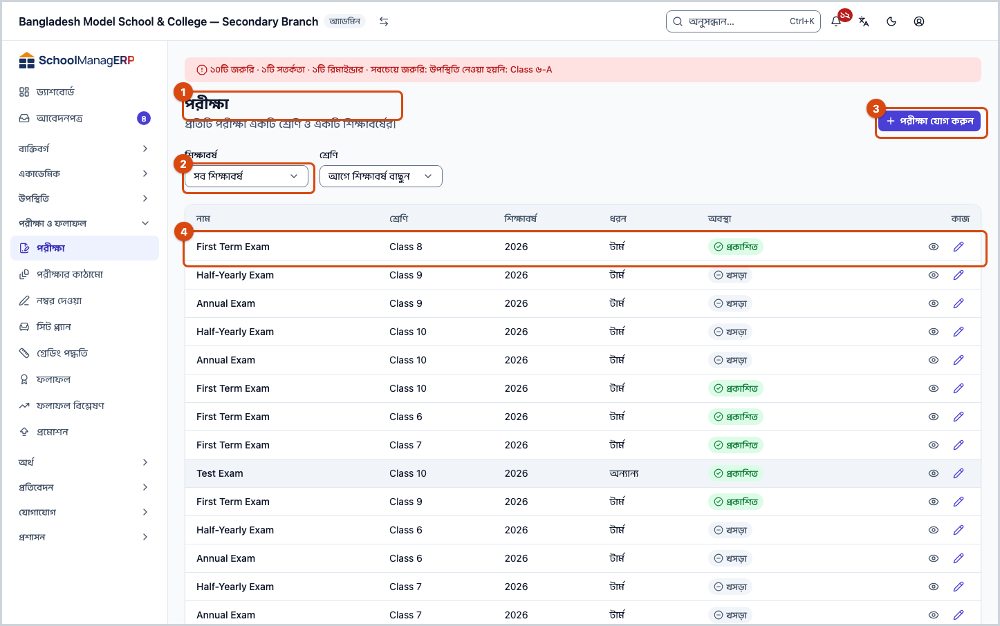
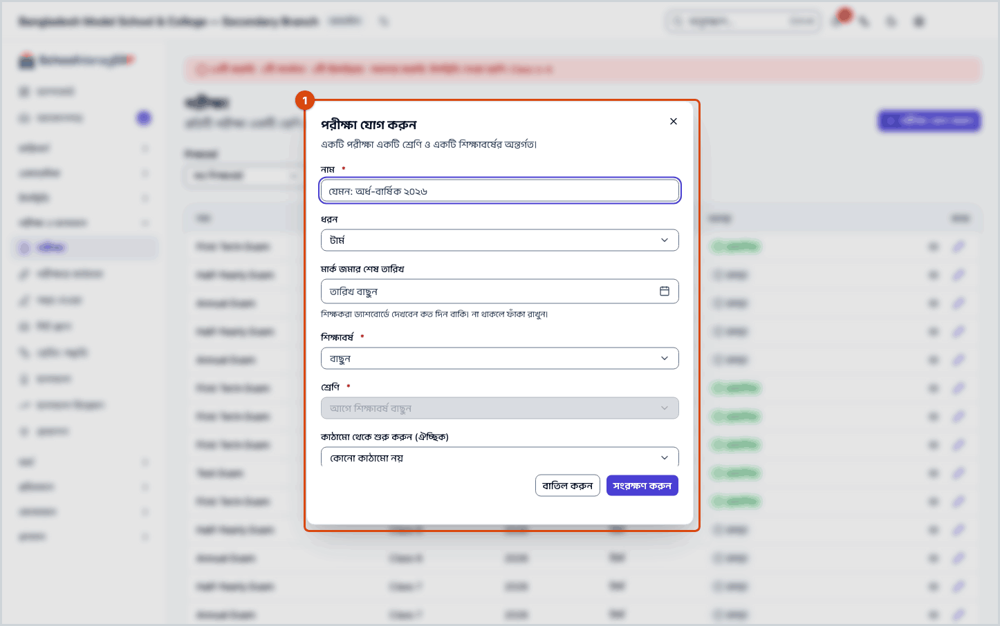
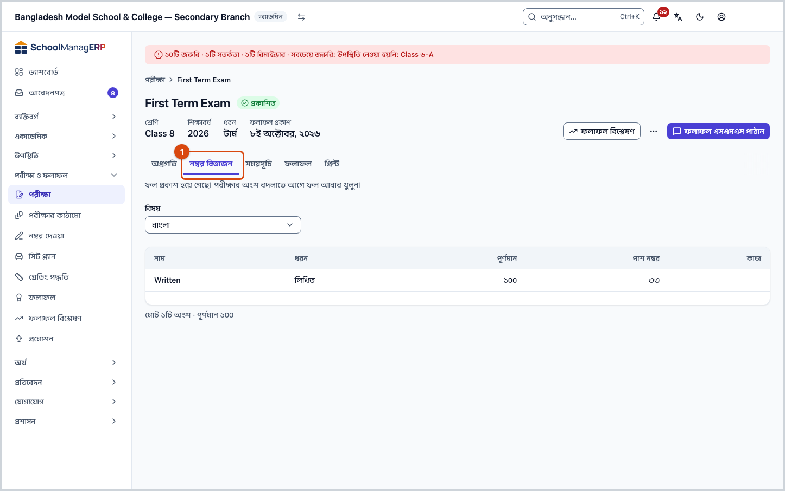

<!-- guide:meta
feature: examsResults.exams
title: পরীক্ষা তৈরি ও সাজানো
summary: শ্রেণির জন্য পরীক্ষা যোগ করুন, প্রতিটি বিষয়ের অংশ ও নম্বর ঠিক করুন, সময়সূচি দিন, আর নম্বর জমা থেকে ফল প্রকাশ পর্যন্ত পরীক্ষার অবস্থা দেখুন।
roles: [ADMIN, EXAM_CONTROLLER]
sources:
  - client-admin/src/routes/_staff/exams/index.tsx
  - client-admin/src/routes/_staff/exams/$examId.tsx
  - client-admin/src/routes/_staff/exams/-exam-form-dialog.tsx
  - client-admin/src/routes/_staff/exams/-exam-status-badge.tsx
  - client-admin/src/routes/_staff/exams/-copy-components-dialog.tsx
  - client-admin/src/routes/_staff/exams/-detail/progress-panel.tsx
  - client-admin/src/routes/_staff/exams/-detail/components-panel.tsx
  - client-admin/src/routes/_staff/exams/-detail/schedule-panel.tsx
  - client-admin/src/routes/_staff/exams/-detail/results-panel.tsx
  - client-admin/src/routes/_staff/exams/-detail/print-panel.tsx
  - client-admin/src/routes/_staff/exams/-detail/use-result-actions.tsx
  - server/src/modules/exams/exams.controller.ts
  - server/src/modules/exams/exams.service.ts
  - server/src/modules/exams/exam-components.controller.ts
  - server/src/modules/exams/exam-components.service.ts
  - server/src/modules/exams/exam-schedules.controller.ts
  - server/src/modules/exams/exam-schedules.service.ts
labels:
  [
    exams:list.*,
    exams:kind.*,
    exams:status.*,
    exams:examForm.*,
    exams:detail.*,
    exams:progressPanel.*,
    exams:componentsPanel.*,
    exams:componentKind.*,
    exams:copyDialog.*,
    exams:schedulePanel.*,
    exams:resultsPanel.*,
    exams:fields.*,
    exams:help.*,
    examsTemplateField:label,
    examsTemplateField:none,
    examsTemplateField:toast.*,
    nav:groups.examsResults,
    common:entities.exam*,
    common:actions.cancel,
    common:accessDenied.*,
  ]
helpIds:
  [
    examsResults.exams,
    examsResults.exams.action.add,
    examsResults.exams.action.edit,
    examsResults.exams.action.addComponent,
    examsResults.exams.action.copyComponents,
    examsResults.exams.action.addSchedule,
    examsResults.exams.field.name,
    examsResults.exams.field.kind,
    examsResults.exams.field.deadline,
    examsResults.exams.field.template,
  ]
devices: [desktop]
entry: [sidebar, palette]
keywords:
  [পরীক্ষা, পরীক্ষা যোগ, টার্ম, মাসিক, মডেল টেস্ট, অংশ, পূর্ণমান, পাশ নম্বর, নম্বর বিভাজন, সময়সূচি, মার্ক জমার শেষ তারিখ, exam, term exam, component, full marks, pass marks, schedule]
appVersion: 0.1.0 (dd9119702)
owner: tareq89
lastVerified: 2026-10-25
knownIssues: []
-->

# পরীক্ষা তৈরি ও সাজানো

শ্রেণির জন্য পরীক্ষা যোগ করুন, প্রতিটি বিষয়ের অংশ ও নম্বর ঠিক করুন, সময়সূচি দিন, আর নম্বর জমা থেকে ফল প্রকাশ পর্যন্ত পরীক্ষার অবস্থা দেখুন।

**যেতে হবে:** বাম মেনুতে **পরীক্ষা ও ফলাফল → পরীক্ষা**। এই পাতার কাজ কম্পিউটারে করুন।
**শুরুর আগে:** আপনি অ্যাডমিন বা পরীক্ষা নিয়ন্ত্রক হবেন ([কে কী করতে পারেন](#roles))। শিক্ষাবর্ষে [শ্রেণি](../academics/classes.md) আর শ্রেণিতে [বিষয়](../academics/classes.md#task-subjects) আগে থেকে থাকতে হবে।

প্রতিটি পরীক্ষা একটি শ্রেণি ও একটি শিক্ষাবর্ষের, যেমন **২০২৬** বর্ষের **নবম শ্রেণি**র **অর্ধ-বার্ষিক**। পরীক্ষার ভেতরে প্রতিটি বিষয়ের **অংশ** থাকে, যেমন গণিতে **লিখিত ৭০** আর **এমসিকিউ ৩০**। শিক্ষকরা এই অংশ ধরেই নম্বর দেন। তাই পরীক্ষা যোগ করার পর অংশ ঠিক করা দরকার।

[পরীক্ষা যোগ করুন](#task-main) · [অংশ ঠিক করুন](#task-components) · [সময়সূচি দিন](#task-schedule) · [পরীক্ষার অবস্থা](#task-status) · [সমস্যা ও সমাধান](#trouble)

**এই পাতায় যা আছে**

- [এই পাতায় যেভাবে আসবেন](#arrive)
- [পরীক্ষা যোগ করুন](#task-main)
- [পরীক্ষা যোগ হয়েছে কি না বুঝবেন কীভাবে](#confirm)
- [অন্য পরিস্থিতিতে](#other)
  - [বিষয়ের অংশ ঠিক করুন](#task-components)
  - [অন্য জায়গা থেকে অংশ কপি করুন](#task-copy)
  - [সময়সূচি দিন](#task-schedule)
  - [পরীক্ষা সম্পাদনা করুন](#task-edit)
  - [পরীক্ষার অবস্থা: খসড়া থেকে প্রকাশিত](#task-status)
  - [পরীক্ষা মোছা](#task-delete)
  - [তালিকা ছাঁকুন](#task-find)
  - [পরীক্ষার পাতা: ট্যাবগুলো](#task-detail)
- [সমস্যা ও সমাধান](#trouble)
- [কে কী করতে পারেন](#roles)
- [আরও জানুন](#more)

---

## এই পাতায় যেভাবে আসবেন 

**বাম মেনু থেকে:** **পরীক্ষা ও ফলাফল → পরীক্ষা** চাপুন। নিচের ধাপ ১ থেকে শুরু করুন।

**খোঁজার ঘর থেকে:** উপরের খোঁজার ঘরে (Ctrl+K) **টেমপ্লেট থেকে পরীক্ষা তৈরি করুন** লিখে বেছে নিন। → পরীক্ষার তালিকা খোলে, আর **পরীক্ষা যোগ করুন** ঘর নিজে থেকে খোলা থাকে। নিচের ধাপ ৩ থেকে শুরু করুন। খোঁজার নিয়ম: [যেকোনো পাতা খুঁজে পাওয়া](../start/find-anything.md)।

---

## পরীক্ষা যোগ করুন 

1. বাম মেনুতে **পরীক্ষা ও ফলাফল → পরীক্ষা** চাপুন।

   → উপরে **পরীক্ষা** শিরোনাম, নিচে লেখা "প্রতিটি পরীক্ষা একটি শ্রেণি ও একটি শিক্ষাবর্ষের।" তালিকায় **নাম**, **শ্রেণি**, **শিক্ষাবর্ষ**, **ধরন**, **অবস্থা** কলাম। শুরুতে সব বর্ষের পরীক্ষা দেখায়।

2. পাতার উপরে **পরীক্ষা যোগ করুন** চাপুন।

   → **পরীক্ষা যোগ করুন** ঘর খোলে।

3. **নাম** ঘরে পরীক্ষার নাম লিখুন, যেমন `অর্ধ-বার্ষিক ২০২৬`।

   → ফাঁকা রেখে সংরক্ষণ করলে **নাম আবশ্যক।** দেখায়।

4. **ধরন** থেকে **টার্ম**, **মাসিক**, **মডেল টেস্ট** বা **অন্যান্য** বাছুন। শুরুতে **টার্ম** বাছা থাকে।

5. চাইলে **মার্ক জমার শেষ তারিখ** দিন।

   → শিক্ষকরা ড্যাশবোর্ডে দেখেন কত দিন বাকি। ভুল তারিখ দিলে **তারিখ মুছুন** চাপুন।

6. **শিক্ষাবর্ষ** বাছুন, তারপর **শ্রেণি** বাছুন। তালিকা কোনো বর্ষে ছাঁকা থাকলে সেই বর্ষ আগে থেকে বাছা থাকে।

   → বর্ষ না বাছা পর্যন্ত **শ্রেণি** ঘরে লেখা থাকে **আগে শিক্ষাবর্ষ বাছুন**। দুটির কোনোটি না দিলে **শিক্ষাবর্ষ ও শ্রেণি আবশ্যক।** দেখায়। পরে বর্ষ বা শ্রেণি বদলানো যায় না, তাই ঠিকটি বাছুন।

7. স্কুলে [পরীক্ষার কাঠামো](exam-templates.md) থাকলে **কাঠামো থেকে শুরু করুন (ঐচ্ছিক)** ঘর আসে। একটি কাঠামো বাছলে অংশগুলো নিজে থেকে তৈরি হয়; না চাইলে **কোনো কাঠামো নয়** রাখুন।

8. **সংরক্ষণ করুন** চাপুন।

   → ঘর বন্ধ হয়, আর নতুন পরীক্ষা তালিকায় আসে, অবস্থা **খসড়া**। কাঠামো বাছলে উপরে বার্তা আসে, যেমন **পরীক্ষা তৈরি হয়েছে, ১২টি অংশসহ**।

> **মনে রাখুন:** অংশ ছাড়া শিক্ষকরা নম্বর দিতে পারেন না। কাঠামো না বাছলে এখনই পরীক্ষার নামে চেপে [অংশ ঠিক করুন](#task-components)।

---

## পরীক্ষা যোগ হয়েছে কি না বুঝবেন কীভাবে 

পরীক্ষার তথ্য শুধু ইন্টারনেট থাকলে সংরক্ষিত হয়; ডিভাইসে জমিয়ে রেখে পরে পাঠানো যায় না। তাই **এই ডিভাইসে সংরক্ষিত** অবস্থা এখানে নেই।

| অবস্থা                       | কীভাবে বুঝবেন                                                | এরপর কী                          |
| ---------------------------- | ------------------------------------------------------------ | -------------------------------- |
| **শুধু স্ক্রিনে বদলেছে**     | ঘর খোলা, তথ্য লেখা, কিন্তু ঘর বন্ধ হয়নি                     | **সংরক্ষণ করুন** চাপুন           |
| **স্কুলের সিস্টেমে পৌঁছেছে** | ঘর বন্ধ হয়েছে, আর তালিকায় পরীক্ষাটি **খসড়া** অবস্থায় আছে | [অংশ ঠিক করুন](#task-components) |

**যাচাই করতে চাইলে:** পাতা রিলোড করুন। পরীক্ষাটি না দেখালে উপরের **শিক্ষাবর্ষ** আর **শ্রেণি** ছাঁকনি দেখুন।

**বার্তা না এলে:** [সমস্যা ও সমাধান](#trouble) দেখুন। ঘরে লেখা তথ্য তখনও ঘরেই থাকে।

---

## অন্য পরিস্থিতিতে 

### বিষয়ের অংশ ঠিক করুন 

1. তালিকায় পরীক্ষার নামে চাপুন, তারপর **নম্বর বিভাজন** ট্যাব খুলুন।

2. **বিষয়** ঘরে একটি বিষয় বাছুন।

   → সেই বিষয়ের অংশের তালিকা: **নাম**, **ধরন**, **পূর্ণমান**, **পাশ নম্বর**। নিচে লেখা থাকে, যেমন **মোট ২টি অংশ · পূর্ণমান ১০০**। কিছু না থাকলে **এই বিষয়ে এখনো কোনো অংশ নেই**।

3. **নতুন অংশ যোগ করুন** অংশে **নাম** লিখুন, যেমন `লিখিত`, আর **ধরন** বাছুন।

4. **পূর্ণমান** দিন, যেমন `৭০`। চাইলে **পাশ নম্বর** দিন, যেমন `২৩`।

   → পূর্ণমান ফাঁকা বা শূন্য হলে **পূর্ণমান অবশ্যই একটি ধনাত্মক সংখ্যা হতে হবে।** দেখায়। **উপস্থিতি** ধরন বাছলে নম্বরের ঘর থাকে না; লেখা আসে **উপস্থিতি অংশ স্বয়ংক্রিয়ভাবে গণনা হয় — এর জন্য নম্বর দেওয়া হয় না।**

5. **যোগ করুন** চাপুন।

   → অংশটি তালিকায় আসে। উপস্থিতি অংশের পূর্ণমানে লেখা থাকে **স্বয়ংক্রিয়**।

**অংশ মুছতে:** সারির **মুছুন** চাপুন, তারপর **এই অংশটি মুছবেন?** ঘরে **মুছুন**। এখানে অংশ বদলানোর বোতাম নেই; ভুল হলে মুছে আবার যোগ করুন।

**নিয়ম:**

- একই বিষয়ে দুটি অংশের একই নাম হয় না, আর উপস্থিতি অংশ একটিই থাকে।
- পাশ নম্বর পূর্ণমানের বেশি হয় না।
- ফল প্রক্রিয়া হয়ে গেলে (**প্রক্রিয়াকৃত**) অংশ যোগ বা মোছা যায়; তখন ফল নিজে থেকে আবার গোনা হয়।
- ফল **প্রকাশিত** হলে অংশ আর বদলানো যায় না। লেখা থাকে **ফল প্রকাশ হয়ে গেছে। পরীক্ষার অংশ বদলাতে আগে ফল আবার খুলুন।**

### অন্য জায়গা থেকে অংশ কপি করুন 

একই অংশ অনেক বিষয়ে লাগলে একটি একটি করে যোগ না করে কপি করুন।

1. **নম্বর বিভাজন** ট্যাবে **অন্য জায়গা থেকে কপি করুন** চাপুন।

   → **অংশ কপি করুন** খোলে। লেখা থাকে, নিশ্চিত না করা পর্যন্ত কিছুই তৈরি হবে না।

2. **উৎস** থেকে বাছুন:
   - **এই পরীক্ষার অন্য একটি বিষয়**: তারপর **বিষয়** বাছুন।
   - **একই বিষয়, ভিন্ন পরীক্ষা**: একই শ্রেণির অন্য একটি **পরীক্ষা** আর তার **বিষয়** বাছুন।

3. **যেখানে কপি হবে** থেকে এক বা একাধিক বিষয়ে টিক দিন।

   → **পূর্বরূপ** অংশে প্রতিটি বিষয়ের পাশে লেখা থাকে কী তৈরি হবে, যেমন **২ টি তৈরি হবে: লিখিত, এমসিকিউ**। যা আগে থেকে আছে তা **বাদ যাবে**, কারণসহ: **এই নামে একটি অংশ ইতিমধ্যে আছে** বা **এই বিষয়ে ইতিমধ্যে একটি উপস্থিতি অংশ আছে**।

4. **কপি করুন** চাপুন। মত বদলালে **বাতিল**।

### সময়সূচি দিন 

সময়সূচি থেকেই [সিট প্ল্যান](seat-plans.md) কোন বিষয়ের আসন সাজাবে তা বাছা হয়, আর পরীক্ষার রুটিন প্রিন্ট হয়।

1. পরীক্ষার পাতায় **সময়সূচি** ট্যাব খুলুন।

   → তালিকায় **বিষয়**, **তারিখ**, **শুরু**, **শেষ**, **স্থান**। কিছু না থাকলে **এখনো কোনো সময়সূচি নেই**।

2. **সময়সূচিতে বিষয় যোগ করুন** অংশে **বিষয়** বাছুন। যে বিষয় আগেই আছে, তা তালিকায় আসে না।

3. **তারিখ** দিন, তারপর **শুরু** আর **শেষ**-এর সময় দিন।

4. **যোগ করুন** চাপুন।

   → বিষয়টি তালিকায় আসে। একই সময়ে অন্য বিষয় থাকলে পাশে **সময় মিলে যাচ্ছে** চিহ্ন আসে; এটি শুধু সতর্কতা, সংরক্ষণ আটকায় না।

তালিকার ঘরে চেপেই তারিখ, সময় বা স্থান বদলানো যায়। বিষয় সরাতে **সময়সূচি থেকে সরান** চাপুন, তারপর **সময়সূচি থেকে সরাবেন?** ঘরে **সরান**।

**নিয়ম:** তারিখ পরীক্ষার শিক্ষাবর্ষের ভেতরে হতে হয়, আর শুরুর সময় শেষের আগে। কোনো বিষয় **প্রকাশিত** সিট প্ল্যানে থাকলে তার তারিখ-সময় বদলানো বা সরানো যায় না; আগে সিট প্ল্যানের [প্রকাশ বন্ধ করুন](seat-plans.md#task-unpublish)। স্থান তখনও বদলানো যায়।

### পরীক্ষা সম্পাদনা করুন 

1. তালিকায় সারির শেষে **সম্পাদনা** চাপুন (পরীক্ষার পাতায় উপরেও **সম্পাদনা** আছে)।

   → **পরীক্ষা সম্পাদনা করুন** ঘর খোলে। এখানে শুধু **নাম**, **ধরন** আর **মার্ক জমার শেষ তারিখ** থাকে; বর্ষ বা শ্রেণি বদলানো যায় না।

2. বদলে **সংরক্ষণ করুন** চাপুন।

ফল **প্রকাশিত** হলে শুধু নাম আর শেষ তারিখ বদলানো যায়; **ধরন** বদলালে সংরক্ষণ হয় না, দেখায় **এই পরীক্ষার ফলাফল প্রকাশিত। ধরন বদলানোর আগে ফলাফল আবার খুলুন।**

### পরীক্ষার অবস্থা: খসড়া থেকে প্রকাশিত 

পরীক্ষার পাতার উপরে অবস্থা লেখা থাকে, আর পাশে শুধু সেই অবস্থার পরের কাজের বোতাম।

| অবস্থা            | মানে                                             | উপরের বোতাম                                                   |
| ----------------- | ------------------------------------------------ | ------------------------------------------------------------- |
| **খসড়া**         | অংশ, সময়সূচি আর নম্বর দেওয়া চলছে               | **ফলাফল প্রক্রিয়া করুন**                                     |
| **প্রক্রিয়াকৃত** | জমা নম্বর থেকে ফল গোনা হয়েছে, এখনো প্রকাশ হয়নি | **ফলাফল বিশ্লেষণ**, **আবার প্রক্রিয়া করুন**, **প্রকাশ করুন** |
| **প্রকাশিত**      | ফল প্রকাশ হয়েছে; অংশ বদলানো বন্ধ                | **ফলাফল বিশ্লেষণ**, **ফলাফল এসএমএস পাঠান**, **পুনরায় খুলুন** |

**পুনরায় খুলুন** চাপলে পরীক্ষা আবার **প্রক্রিয়াকৃত** হয়। প্রক্রিয়া, প্রকাশ আর পুনরায় খোলার পুরো নিয়ম [ফলাফলের পাতায়](results.md) থাকবে।

### পরীক্ষা মোছা 

শুধু **খসড়া** পরীক্ষা মোছা যায়, যেমন ভুল করে বানানো পরীক্ষা। ফল একবার প্রক্রিয়া হলে পরীক্ষাটি আর মোছা যায় না; তখন **পুনরায় খুলুন** চেপে ফল ঠিক করুন।

1. পরীক্ষার পাতা খুলে উপরে **পরীক্ষা মুছুন** চাপুন।

   → **এই পরীক্ষা মুছবেন?** ঘর খোলে: "পরীক্ষা, এর নম্বর বিভাজন, সময়সূচি এবং দেওয়া সব নম্বর মুছে যাবে। অ্যাপ থেকে এটি ফেরানো যাবে না।"

2. **মুছুন** চাপুন।

   → পরীক্ষাটি মুছে যায়, আর পরীক্ষার তালিকা খোলে।

ঘরে **এই পরীক্ষার ফলাফল আছে। পরীক্ষা মুছে না ফেলে ফলাফল আবার খুলে ঠিক করুন।** বা **পরীক্ষাটি মুছতে পারেনি। আবার চেষ্টা করুন।** এলে পরীক্ষাটি মোছা হয়নি।

### তালিকা ছাঁকুন 

| ঘর             | কী বাছবেন                                                                                                         |
| -------------- | ----------------------------------------------------------------------------------------------------------------- |
| **শিক্ষাবর্ষ** | একটি বর্ষ, বা **সব শিক্ষাবর্ষ**                                                                                   |
| **শ্রেণি**     | একটি শ্রেণি, বা **সব শ্রেণি**। আগে বর্ষ না বাছলে লেখা থাকে **আগে শিক্ষাবর্ষ বাছুন**। বর্ষ বদলালে শ্রেণি মুছে যায় |

কিছু না মিললে **এই ফিল্টারে কোনো পরীক্ষা নেই** দেখায়, সঙ্গে **সব মুছুন** বোতাম। ছাঁকনি শুধু দেখার জন্য; কিছু বদলায় না।

### পরীক্ষার পাতা: ট্যাবগুলো 

তালিকায় পরীক্ষার নামে বা **দেখুন**-এ চাপলে তার পাতা খোলে। উপরে নাম, অবস্থা, আর **শ্রেণি**, **শিক্ষাবর্ষ**, **ধরন**; ফল প্রকাশ হলে **ফলাফল প্রকাশ**-এর তারিখও।

| ট্যাব            | কী আছে                                                                                                                                                                   |
| ---------------- | ------------------------------------------------------------------------------------------------------------------------------------------------------------------------ |
| **অগ্রগতি**      | পাতা খুললে এটিই সামনে। **নম্বর জমার অগ্রগতি**, যেমন **২০ টির মধ্যে ১৫ টি নম্বর তালিকা জমা হয়েছে**, আর **যে তালিকা এখনো জমা হয়নি** তার শাখা ও বিষয়, পাশে **নম্বর দিন** |
| **নম্বর বিভাজন** | বিষয়ের অংশ; [অংশ ঠিক করুন](#task-components)                                                                                                                            |
| **সময়সূচি**     | বিষয়ের তারিখ ও সময়; [সময়সূচি দিন](#task-schedule)                                                                                                                     |
| **ফলাফল**        | শিক্ষার্থীভিত্তিক ফল: **অবস্থান**, **রোল · নাম**, **মোট**, **জিপিএ**, **গ্রেড**, **অবস্থা**                                                                              |
| **প্রিন্ট**      | প্রবেশপত্র, সিট লিস্ট, মার্কশিট ইত্যাদি; [পরীক্ষার কাগজপত্র](../administration/print-templates/exam-documents.md)। প্রিন্টের অনুমতি থাকলে তবেই ট্যাবটি আসে               |

---

## সমস্যা ও সমাধান 

| আপনি যা দেখছেন                                                                                    | কী করবেন                                                                                                                                                   | কে সাহায্য করতে পারেন |
| ------------------------------------------------------------------------------------------------- | ---------------------------------------------------------------------------------------------------------------------------------------------------------- | --------------------- |
| **এই পাতাটি দেখার অনুমতি আপনার নেই।**                                                             | এই পাতা শুধু অ্যাডমিন আর পরীক্ষা নিয়ন্ত্রক দেখেন। **ড্যাশবোর্ডে ফিরে যান** চাপুন।                                                                         | অ্যাডমিন              |
| **পরীক্ষার তালিকা লোড করা যায়নি।** বা **এই পরীক্ষা লোড করা যায়নি।**                             | ইন্টারনেট দেখে পাতা রিলোড করুন।                                                                                                                            | অ্যাডমিন              |
| **এই নামে আগেই একটি পরীক্ষা আছে।**                                                                | একই শ্রেণি ও বর্ষে এই নামের পরীক্ষা আছে। অন্য নাম দিন।                                                                                                     | অ্যাডমিন              |
| **এই পরীক্ষার ফলাফল প্রকাশিত। ধরন বদলানোর আগে ফলাফল আবার খুলুন।**                                 | **ধরন** আগের মতো রাখুন, অথবা আগে ফল **পুনরায় খুলুন** ([পরীক্ষার অবস্থা](#task-status))।                                                                   | অ্যাডমিন              |
| **এই ক্লাসের গ্রেড ঠিক করা নেই, তাই পরীক্ষার কাঠামো ব্যবহার করা যাবে না। …**                      | শ্রেণিকে **গ্রেড** দিন ([শ্রেণি সম্পাদনা করুন](../academics/classes.md#task-edit)), অথবা **কোনো কাঠামো নয়** বাছুন।                                        | অ্যাডমিন              |
| **পরীক্ষা সংরক্ষণ করা যায়নি।**                                                                   | ইন্টারনেট দেখে আবার **সংরক্ষণ করুন** চাপুন।                                                                                                                | অ্যাডমিন              |
| **শ্রেণি** তালিকা ফাঁকা                                                                           | বাছা বর্ষে শ্রেণি নেই। আগে [শ্রেণি যোগ করুন](../academics/classes.md#task-main)।                                                                           | অ্যাডমিন              |
| **পরীক্ষা তৈরি হয়েছে — কাঠামোতে এই শ্রেণির বিষয়গুলোর জন্য কিছু ছিল না। অংশগুলো নিজে যোগ করুন।** | কাঠামোতে এই শ্রেণির গ্রেড বা বিষয় নেই, অথবা বিষয় কোড মেলেনি। [অংশ ঠিক করুন](#task-components) নিজে, অথবা [কাঠামো](exam-templates.md#task-grid) ঠিক করুন। | অ্যাডমিন              |
| **অংশ সংরক্ষণ করা যায়নি।**                                                                       | একই বিষয়ে একই নামের অংশ বা দ্বিতীয় উপস্থিতি অংশ আছে কি না দেখুন; পাশ নম্বর পূর্ণমানের বেশি কি না দেখুন।                                                  | অ্যাডমিন              |
| **ফল প্রকাশ হয়ে গেছে। পরীক্ষার অংশ বদলাতে আগে ফল আবার খুলুন।**                                   | ফল প্রকাশিত। অংশ বদলাতে উপরে **পুনরায় খুলুন**।                                                                                                            | অ্যাডমিন              |
| **অংশ কপি করা যায়নি।**                                                                           | ইন্টারনেট দেখে আবার **কপি করুন** চাপুন।                                                                                                                    | অ্যাডমিন              |
| **সময়সূচির পরিবর্তন সংরক্ষণ করা যায়নি।** বা **সরানো যায়নি।**                                   | তারিখ শিক্ষাবর্ষের ভেতরে আর শুরু শেষের আগে কি না দেখুন। বিষয়টি প্রকাশিত সিট প্ল্যানে থাকলে আগে [প্রকাশ বন্ধ করুন](seat-plans.md#task-unpublish)।          | অ্যাডমিন              |
| **সময়সূচি** ট্যাবে **বিষয়** ঘর নেই                                                              | শ্রেণির সব বিষয় সময়সূচিতে আছে, অথবা শ্রেণিতে বিষয় নেই ([বিষয় যুক্ত করুন](../academics/classes.md#task-subjects))।                                      | অ্যাডমিন              |

---

## কে কী করতে পারেন 

| ভূমিকা                                                                       | তালিকা ও পরীক্ষার পাতা দেখতে | পরীক্ষা যোগ, সম্পাদনা, অংশ ও সময়সূচি | ফল প্রক্রিয়া, প্রকাশ, পুনরায় খোলা | প্রিন্ট ট্যাব |
| ---------------------------------------------------------------------------- | ---------------------------- | ------------------------------------- | ----------------------------------- | ------------- |
| অ্যাডমিন                                                                     | হ্যাঁ                        | হ্যাঁ                                 | হ্যাঁ                               | হ্যাঁ         |
| পরীক্ষা নিয়ন্ত্রক                                                           | হ্যাঁ                        | হ্যাঁ                                 | হ্যাঁ                               | হ্যাঁ         |
| একাডেমিক কো-অর্ডিনেটর, শিক্ষক, হিসাবরক্ষক, অফিস সহকারী, পরিচালনা পর্ষদ সদস্য | না                           | না                                    | না                                  | না            |

অন্য ভূমিকার বাম মেনুতে **পরীক্ষা** থাকে না; পাতাটি খুললে তাঁরা **এই পাতাটি দেখার অনুমতি আপনার নেই।** দেখেন। শিক্ষক আর একাডেমিক কো-অর্ডিনেটর পরীক্ষার নাম দেখেন শুধু [নম্বর দেওয়া](marks-entry.md) আর [ফলাফল বিশ্লেষণের](analysis.md) পাতায় পরীক্ষা বাছার ঘরে।

---

## আরও জানুন 

<strong>পাতার অংশগুলো</strong> — উপর থেকে নিচে

1. **পরীক্ষা** — শিরোনাম, নিচে এক লাইনের ব্যাখ্যা।
2. **পরীক্ষা যোগ করুন** — পাতার উপরের বোতাম।
3. **ছাঁকনির সারি** — **শিক্ষাবর্ষ** ও **শ্রেণি**।
4. **তালিকা** — **নাম**, **শ্রেণি**, **শিক্ষাবর্ষ**, **ধরন**, **অবস্থা**; প্রতি সারির শেষে **দেখুন** ও **সম্পাদনা**।

<strong>ঘরগুলোর অর্থ</strong>

<!-- guide:generated:fields:exams -->

| ঘর                             | কী লিখবেন                                                                                                                        | বাধ্যতামূলক?              |
| ------------------------------ | -------------------------------------------------------------------------------------------------------------------------------- | ------------------------- |
| নাম (পরীক্ষা)                  | পরীক্ষার নাম, যেমন অর্ধ-বার্ষিক ২০২৬। একই শ্রেণি ও বর্ষে দুটি পরীক্ষার একই নাম হয় না।                                           | হ্যাঁ                     |
| ধরন (পরীক্ষা)                  | টার্ম, মাসিক, মডেল টেস্ট বা অন্যান্য। ফল প্রকাশের পর বদলানো যায় না।                                                             | না                        |
| মার্ক জমার শেষ তারিখ           | শিক্ষকরা ড্যাশবোর্ডে দেখেন কত দিন বাকি। না থাকলে ফাঁকা রাখুন।                                                                    | না                        |
| শিক্ষাবর্ষ                     | কোন বর্ষের পরীক্ষা। শুধু যোগ করার সময় বাছা যায়।                                                                                | হ্যাঁ                     |
| শ্রেণি                         | কোন শ্রেণির পরীক্ষা। আগে শিক্ষাবর্ষ বাছতে হয়; পরে বদলানো যায় না।                                                               | হ্যাঁ                     |
| কাঠামো থেকে শুরু করুন (ঐচ্ছিক) | একটি পরীক্ষার কাঠামো বাছলে শ্রেণির বিষয়গুলোর অংশ নিজে থেকে তৈরি হয়। কোনো কাঠামো না থাকলে ঘরটি আসে না।                          | না                        |
| নাম (অংশ)                      | অংশের নাম, যেমন লিখিত। একই বিষয়ে দুটি অংশের একই নাম হয় না।                                                                     | হ্যাঁ                     |
| ধরন (অংশ)                      | লিখিত, এমসিকিউ, মৌখিক, ব্যবহারিক ইত্যাদি। উপস্থিতি বাছলে নম্বর নিজে থেকে গোনা হয়।                                               | না                        |
| পূর্ণমান                       | অংশের পূর্ণমান, যেমন ৭০; ধনাত্মক সংখ্যা। উপস্থিতি অংশে এই ঘর থাকে না।                                                            | হ্যাঁ, উপস্থিতি অংশ ছাড়া |
| পাশ নম্বর                      | এই অংশে পাশের নম্বর, যেমন ২৩। পূর্ণমানের বেশি হয় না। না লাগলে ফাঁকা রাখুন।                                                      | না                        |
| পরীক্ষা (নম্বর তোলা)           | যে পরীক্ষার নম্বর তুলবেন। আপনি যেসব শাখা ও বিষয়ের নম্বর তুলতে পারেন, সেগুলোর তালিকা নিচে দেখায়।                                | হ্যাঁ                     |
| নম্বর (নম্বর তোলা)             | ওই শিক্ষার্থীর ওই অংশের নম্বর, দেখানো সর্বোচ্চ পর্যন্ত। অনুপস্থিত হলে A, অব্যাহতি হলে E লিখুন। উপস্থিতির অংশ নিজে থেকে গোনা হয়। | না                        |
| অংশ অনুযায়ী (বিশ্লেষণ)        | "পাস-ফেল" ট্যাবে টিক দিলে পুরো বিষয়ের বদলে বিষয়ের প্রতিটি অংশের ফল দেখায়।                                                     | না                        |

<!-- /guide:generated -->

<strong>পরীক্ষা কীভাবে কাজ করে</strong> — খসড়া থেকে প্রকাশ, আর পুরো পরীক্ষার ধারা

<figure>
  
  <figcaption><em>পরীক্ষার তিনটি অবস্থা</em></figcaption>
</figure>

<figure>
  
  <figcaption><em>পরীক্ষা থেকে প্রমোশন পর্যন্ত</em></figcaption>
</figure>

- পরীক্ষার অংশ ধরেই শিক্ষকরা শাখা আর বিষয় অনুযায়ী [নম্বর দেন](marks-entry.md)।
- গ্রেড আর জিপিএ আসে স্কুলের [গ্রেডিং স্কেল](grading-scales.md) থেকে।
- একই অংশ বারবার লাগলে [পরীক্ষার কাঠামো](exam-templates.md) বানিয়ে রাখুন।

**সম্পর্কিত পাতা**

- [**পরীক্ষার কাঠামো**](exam-templates.md) — অংশ আর নম্বর একবার ঠিক করে প্রতিটি পরীক্ষায় ব্যবহার।
- [**সিট প্ল্যান**](seat-plans.md) — পরীক্ষার বিষয় ধরে কে কোন কক্ষে কোন আসনে বসবে।
- [**শ্রেণি, শাখা ও বিষয়**](../academics/classes.md) — পরীক্ষার শ্রেণি আর বিষয় যেখানে ঠিক হয়।
- [**পরীক্ষার কাগজপত্র ছাপা**](../administration/print-templates/exam-documents.md) — পরীক্ষার প্রবেশপত্র, সিট স্লিপ, নম্বরপত্র ও ফলাফলের কাগজ এক এক করে বা ব্যাচে ছাপুন।
- [**পরীক্ষার নম্বর দেওয়া ও জমা দেওয়া**](marks-entry.md) — শিক্ষকরা ফলাফলের আগে নম্বর তালিকা জমা দেন।
- [**ফলাফল প্রক্রিয়া ও প্রকাশ**](results.md) — ফলাফল প্রক্রিয়া, প্রকাশ ও পুনরায় খোলা।
- [**মেধা তালিকা ও ফলাফল বিশ্লেষণ**](analysis.md) — ফলাফলের পর মেধা তালিকা আর পাস-ফেল।
- [**শিক্ষার্থীদের প্রমোশন**](promotion.md) — শিক্ষার্থীদের পরের শ্রেণিতে তোলা।
- [**গ্রেডিং পদ্ধতি ঠিক করা**](grading-scales.md) — কত শতাংশে কোন গ্রেড ও জিপিএ।

---

_সংস্করণ ০.১.০ · শেষ যাচাই ২০২৬-১০-২৫_
