<!-- guide:meta
feature: examsResults.gradingScales
title: গ্রেডিং পদ্ধতি ঠিক করা
summary: প্রতি শিক্ষাবর্ষে কত শতাংশ নম্বরে কোন গ্রেড ও জিপিএ, তা ঠিক করুন; NCTB-র গ্রেড দিয়ে শুরু করুন, অন্য শ্রেণি বা বর্ষে কপি করুন, আর বদল সংরক্ষণের আগে দেখে নিন কতজনের ফলাফল আবার হিসাব হবে।
roles: [ADMIN]
sources:
  - client-admin/src/routes/_staff/grading-scales/index.tsx
  - client-admin/src/routes/_staff/grading-scales/$scaleId.tsx
  - client-admin/src/routes/_staff/grading-scales/-band-editor.tsx
  - client-admin/src/routes/_staff/grading-scales/-coverage-bar.tsx
  - client-admin/src/routes/_staff/grading-scales/-copy-scale-dialog.tsx
  - client-admin/src/routes/_staff/grading-scales/-recompute-preview-dialog.tsx
  - server/src/modules/grading/grading.controller.ts
  - server/src/modules/grading/grading.service.ts
  - server/src/modules/grading/recompute.service.ts
  - server/src/modules/grading/band-validation.ts
  - server/src/modules/grading/scale-lookup.ts
  - server/src/modules/grading/dto/grading.dto.ts
labels:
  [
    grading:list.*,
    grading:createDialog.*,
    grading:detail.*,
    grading:bandEditor.*,
    grading:coverageBar.*,
    grading:copyDialog.*,
    grading:recomputePreview.*,
    grading:fields.*,
    grading:help.*,
    nav:items.gradingScales,
    nav:groups.examsResults,
  ]
helpIds:
  [
    examsResults.gradingScales,
    examsResults.gradingScales.action.add,
    examsResults.gradingScales.action.startFromNctb,
    examsResults.gradingScales.action.copy,
    examsResults.gradingScales.action.save,
    examsResults.gradingScales.field.appliesTo,
    examsResults.gradingScales.field.failGrade,
  ]
devices: [desktop]
entry: [sidebar, palette]
keywords:
  [গ্রেড, গ্রেডিং, জিপিএ, গ্রেডিং পদ্ধতি, NCTB, ফেল গ্রেড, শতাংশ, grading scale, grade, GPA, bands, NCTB]
appVersion: 0.1.0 (dd9119702)
owner: tareq89
lastVerified: 2026-10-25
knownIssues: []
-->

# গ্রেডিং পদ্ধতি ঠিক করা

কত শতাংশ নম্বরে কোন গ্রেড আর কত জিপিএ, তা প্রতি শিক্ষাবর্ষের জন্য ঠিক করুন।

**যেতে হবে:** বাম মেনুতে **পরীক্ষা ও ফলাফল → গ্রেডিং পদ্ধতি**। এই পাতার কাজ কম্পিউটারে করুন।
**শুরুর আগে:** আপনি অ্যাডমিন হবেন। শিক্ষাবর্ষটি আগে থেকে থাকতে হবে ([শিক্ষাবর্ষ](../academics/academic-years.md))। কোনো একটি শ্রেণির আলাদা পদ্ধতি দিতে চাইলে সেই শ্রেণিও থাকতে হবে ([শ্রেণি](../academics/classes.md))।

এই পাতায় কাজ **গ্রেডিং পদ্ধতি** নিয়ে। একটি পদ্ধতি হলো কয়েকটি **গ্রেডের সারি**। প্রতিটি সারিতে একটি নম্বরের সীমা (শুরু % থেকে শেষ %), একটি গ্রেড আর তার জিপিএ, যেমন ৮০–১০০% = A+ = ৫। প্রতি শিক্ষাবর্ষে **সব শ্রেণি**র জন্য একটি পদ্ধতি থাকে। কোনো শ্রেণির নিজের পদ্ধতি থাকলে সেই শ্রেণিতে সেটিই খাটে। ফলাফল প্রক্রিয়ার সময় অ্যাপ এই পদ্ধতি দেখে গ্রেড বসায় ([ফলাফল](results.md))।

[পদ্ধতি তৈরি করুন](#task-main) · [গ্রেড বদলান](#task-edit) · [অন্য শ্রেণি বা বর্ষে কপি করুন](#task-copy) · [সমস্যা ও সমাধান](#trouble)

**এই পাতায় যা আছে**

- [পদ্ধতি তৈরি করে গ্রেড বসান](#task-main)
- [পদ্ধতি সংরক্ষিত হয়েছে কি না বুঝবেন কীভাবে](#confirm)
- [অন্য পরিস্থিতিতে](#other)
  - [আগের পদ্ধতির গ্রেড বদলান](#task-edit)
  - [অন্য শ্রেণি বা বর্ষে কপি করুন](#task-copy)
  - [প্রকাশিত ফলাফলে ব্যবহৃত পদ্ধতি বদলাতে চাইলে](#task-published)
  - [সংরক্ষণ না করে পাতা ছাড়তে চাইলে](#task-leave)
- [সমস্যা ও সমাধান](#trouble)
- [কে কী করতে পারেন](#roles)
- [আরও জানুন](#more)

---

## পদ্ধতি তৈরি করে গ্রেড বসান 

1. বাম মেনুতে **পরীক্ষা ও ফলাফল** চাপুন, তারপর **গ্রেডিং পদ্ধতি** চাপুন।

   → **গ্রেডিং পদ্ধতি** তালিকা খোলে: **নাম**, **শিক্ষাবর্ষ**, **কোন শ্রেণির জন্য**, **গ্রেড**। গ্রেড না থাকা পদ্ধতির পাশে **গ্রেড বাকি** লেখা থাকে।

2. উপরে **পদ্ধতি যোগ করুন** চাপুন।

   → **গ্রেডিং পদ্ধতি যোগ করুন** জানালা খোলে।

3. **নাম** ঘরে একটি নাম লিখুন, যেমন `জাতীয় পাঠ্যক্রম ২০২৬`।
4. **শিক্ষাবর্ষ** বেছে নিন।
5. **কোন শ্রেণির জন্য** ঘরে **বর্ষের সব শ্রেণি** রেখে দিন। শুধু একটি শ্রেণির আলাদা পদ্ধতি চাইলে সেই শ্রেণি বেছে নিন।
6. **তৈরি করুন** চাপুন।

   → নতুন পদ্ধতির পাতা খোলে। উপরে **শিক্ষাবর্ষ**, **কোন শ্রেণির জন্য** আর **গ্রেড**। নিচে **এখনো কোনো গ্রেড নেই**।

7. **NCTB-র গ্রেড বসান** চাপুন। নিজে শুরু থেকে বানাতে চাইলে **সারি যোগ করুন** চাপুন।

   → সাতটি সারি বসে যায়: ৮০–১০০ A+ (৫), ৭০–৭৯ A (৪), ৬০–৬৯ A- (৩.৫), ৫০–৫৯ B (৩), ৪০–৪৯ C (২), ৩৩–৩৯ D (১), আর ০–৩২ F, যেটি **ফেল গ্রেড** আর যার জিপিএ নেই। এগুলো এখনো সংরক্ষিত হয়নি।

<!-- image pending: NCTB-র গ্রেড বসানোর পর পদ্ধতির পাতা: উপরে ০–১০০% বার পুরো ভরা, নিচে সাতটি সারি; ১ · বার ২ · সারির তালিকা ৩ · সংরক্ষণ করুন; অ্যাডমিন, desktop -->

8. দরকার হলে কোনো সারির **শুরু (%)**, **শেষ (%)**, **গ্রেড**, **জিপিএ** বা **মন্তব্য (ঐচ্ছিক)** বদলান। নতুন সারি লাগলে **সারি যোগ করুন** চাপুন; নতুন সারি তালিকার শেষ সারির **শেষ (%)**-এর পরের সংখ্যা থেকে শুরু হয়ে ১০০-তে শেষ হয়, আর তার গ্রেড ফাঁকা থাকে; সীমা আর গ্রেড ঠিক করে নিন। সারি বাদ দিতে **সারি মুছুন** চাপুন।

   → উপরের **০ থেকে ১০০% — কোন নম্বরে কোন গ্রেড** বার সাথে সাথে বদলায়। লাল অংশ মানে ওই নম্বরের কোনো গ্রেড নেই; ডোরাকাটা অংশ মানে ওই নম্বরে দুটি গ্রেড পড়েছে।

9. বারের নিচে **০ থেকে ১০০ পর্যন্ত প্রতিটি নম্বরের একটি করে গ্রেড আছে।** দেখা গেলে উপরে ডান দিকে **সংরক্ষণ করুন** চাপুন।

   → **এই পরিবর্তন নিশ্চিত করবেন?** জানালা খোলে। নতুন পদ্ধতিতে লেখা থাকে **এই পদ্ধতি এখনো কোনো ফলাফলে ব্যবহার হয়নি — কিছু আবার হিসাব হবে না।**

10. জানালায় **সংরক্ষণ করুন** চাপুন।

    → অতিরিক্ত অনুমোদনের জানালা আসতে পারে; সেখানে যা চায় তা দিয়ে যাচাই শেষ করুন। তারপর জানালা বন্ধ হয়, আর পাতায় সংরক্ষিত সারিগুলো দেখা যায়।

| জানালায় আপনি চাপলেন | কী হবে                                                                         | সংরক্ষিত হলো? |
| -------------------- | ------------------------------------------------------------------------------ | ------------- |
| **সংরক্ষণ করুন**     | সারিগুলো সংরক্ষিত হয়; ব্যবহৃত প্রক্রিয়াকৃত ফলাফল নতুন গ্রেডে আবার হিসাব হয়। | হ্যাঁ         |
| **বাতিল**            | কিছুই সংরক্ষিত হয় না; পাতায় আপনার বদলগুলো স্ক্রিনে থেকে যায়।                | না            |

> **মনে রাখুন:** জানালার **সংরক্ষণ করুন** না চাপা পর্যন্ত কোনো সারি সংরক্ষিত হয় না। গ্রেডের সারিগুলো একসাথে পুরোটা বদলে সংরক্ষিত হয়, একটি একটি করে নয়।

---

## পদ্ধতি সংরক্ষিত হয়েছে কি না বুঝবেন কীভাবে 

| অবস্থা                       | কীভাবে বুঝবেন                                                                                           | এরপর কী                |
| ---------------------------- | ------------------------------------------------------------------------------------------------------- | ---------------------- |
| **শুধু স্ক্রিনে বদলেছে**     | উপরের **সংরক্ষণ করুন** চাপা যায়; পাতা ছাড়তে গেলে **সংরক্ষণ না করে চলে যাবেন?** আসে                    | **সংরক্ষণ করুন** চাপুন |
| **স্কুলের সিস্টেমে পৌঁছেছে** | জানালা বন্ধ হয়, উপরের **সংরক্ষণ করুন** আবার চাপা যায় না, আর তালিকায় **গ্রেড** কলামে সারির সংখ্যা আসে | কাজ শেষ                |

এই পাতা কিছু ফোন বা কম্পিউটারে আলাদা করে রাখে না, তাই "এই ডিভাইসে সংরক্ষিত" অবস্থা নেই।

**যাচাই করতে চাইলে:** **গ্রেডিং পদ্ধতি** তালিকায় ফিরে যান। পদ্ধতির সারিতে **গ্রেড বাকি**-র বদলে সারির সংখ্যা (যেমন **৭টি**) থাকলে গ্রেডগুলো সংরক্ষিত।

**জানালা বন্ধ না হলে:** জানালার লাল বার্তা দেখুন আর [সমস্যা ও সমাধান](#trouble) দেখুন। আপনার বদলগুলো স্ক্রিনে থেকে যায়।

---

## অন্য পরিস্থিতিতে 

### আগের পদ্ধতির গ্রেড বদলান 

1. **গ্রেডিং পদ্ধতি** তালিকায় পদ্ধতির সারিতে **সম্পাদনা করুন** চাপুন।
2. সারিগুলো বদলান, তারপর উপরে **সংরক্ষণ করুন** চাপুন।

   → **এই পরিবর্তন নিশ্চিত করবেন?** জানালায় লেখা থাকে **… জন শিক্ষার্থীর ফলাফল নতুন গ্রেড অনুযায়ী আবার হিসাব হবে।** এই সংখ্যা শুধু সেই পরীক্ষাগুলোর, যাদের ফলাফল **প্রক্রিয়াকৃত** কিন্তু এখনো প্রকাশিত নয়।

3. জানালায় **সংরক্ষণ করুন** চাপুন, তারপর অনুমোদন শেষ করুন।

   → সারিগুলো সংরক্ষিত হয়, আর ওই ফলাফলগুলো নতুন গ্রেডে আবার হিসাব হয়।

### অন্য শ্রেণি বা বর্ষে কপি করুন 

নতুন বর্ষে বা অন্য শ্রেণিতে একই গ্রেড চাইলে নতুন করে না লিখে কপি করুন।

1. যে পদ্ধতি কপি করবেন, সেটি খুলুন।
2. উপরে **অন্য শ্রেণি বা বর্ষে কপি করুন** চাপুন।

   → **গ্রেডিং পদ্ধতি কপি করুন** জানালা খোলে।

3. **কোন শিক্ষাবর্ষে** বেছে নিন।
4. **কোন শ্রেণিতে** বেছে নিন, অথবা **সব শ্রেণি** রাখুন।

   → লেখা আসে কতটি গ্রেড কপি হবে। ওই বর্ষ ও শ্রেণিতে আগে থেকেই গ্রেডসহ পদ্ধতি থাকলে লাল লেখায় **ওই শ্রেণির এই বর্ষে আগে থেকেই গ্রেড আছে। বদলাতে চাইলে সেটি খুলুন।** আসে, আর কপি হয় না।

5. **কপি করুন** চাপুন।

   → জানালা বন্ধ হয়। ওই বর্ষ ও শ্রেণিতে পদ্ধতি না থাকলে একই নামে নতুন পদ্ধতি তৈরি হয়; গ্রেডহীন পদ্ধতি থাকলে তাতেই গ্রেড বসে। **গ্রেডিং পদ্ধতি** তালিকায় সেটি দেখা যায়।

একই বর্ষ ও একই শ্রেণি বাছলে কপি হয় না, কারণ সেটি একই পদ্ধতি। কপিতে অনুমোদন লাগে না, কারণ এটি শুধু খালি পদ্ধতিতে গ্রেড বসায়।

### প্রকাশিত ফলাফলে ব্যবহৃত পদ্ধতি বদলাতে চাইলে 

কোনো পরীক্ষার ফলাফল এই পদ্ধতিতে **প্রকাশিত** হয়ে থাকলে গ্রেড বদলানো যায় না। **সংরক্ষণ করুন** চাপলে লাল বাক্সে আসে **এই পদ্ধতির গ্রেডে ফল আগেই প্রকাশ হয়ে গেছে। গ্রেড বদলাতে হলে আগে সেই ফল আবার খুলুন।**

1. [ফলাফল](results.md#task-reopen) পাতায় ওই পরীক্ষার ফলাফল **পুনরায় খুলুন**।
2. এখানে ফিরে গ্রেড বদলে **সংরক্ষণ করুন** চাপুন। ফলাফল নতুন গ্রেডে আবার হিসাব হয়।
3. [ফলাফল](results.md) পাতায় আবার **প্রকাশ করুন**।

### সংরক্ষণ না করে পাতা ছাড়তে চাইলে 

| আপনি চাপলেন      | কী হবে                                  | সংরক্ষিত হলো? |
| ---------------- | --------------------------------------- | ------------- |
| **থাকুন**        | পাতায় থেকে যান; বদলগুলো স্ক্রিনে থাকে। | না, এখনো নয়  |
| **তবুও চলে যান** | পাতা ছেড়ে যান; বদলগুলো হারিয়ে যায়।   | না            |

---

## সমস্যা ও সমাধান 

| আপনি যা দেখছেন                                                                          | কী করবেন                                                                                                                                            | কে সাহায্য করতে পারেন |
| --------------------------------------------------------------------------------------- | --------------------------------------------------------------------------------------------------------------------------------------------------- | --------------------- |
| **গ্রেডিং পদ্ধতি তৈরি করা যায়নি। আবার চেষ্টা করুন।**                                   | ইন্টারনেট দেখুন। একই বর্ষে **সব শ্রেণি**র পদ্ধতি একটিই থাকে, আর একটি শ্রেণির নিজের পদ্ধতিও একটিই; আগে থেকে থাকলে সেটি খুলে বদলান।                   | অ্যাডমিন              |
| **এই পদ্ধতি এখনো সংরক্ষণ করা যাবে না:** আর নিচে কারণের তালিকা                           | প্রতিটি কারণ ঠিক করুন: সবচেয়ে নিচের সারি ০ থেকে, সবচেয়ে উপরের সারি ১০০-তে শেষ; মাঝে ফাঁক বা দুবার পড়া নম্বর নয়। বারের লাল ও ডোরাকাটা অংশ দেখুন। | অ্যাডমিন              |
| **কিছু নম্বরের গ্রেড নেই — বারের লাল অংশ দেখুন।**                                       | পাশের দুই সারির সীমা এমন করুন যাতে একটির **শেষ (%)**-এর ঠিক পরের সংখ্যা থেকে পরেরটির **শুরু (%)**।                                                  | অ্যাডমিন              |
| **কিছু নম্বরে দুটি গ্রেড পড়েছে — বারের ডোরাকাটা অংশ দেখুন।**                           | দুই সারির সীমা যেন একই নম্বরে না পড়ে, যেমন ৬০–৬৯ আর ৭০–৭৯।                                                                                         | অ্যাডমিন              |
| **এই পদ্ধতির গ্রেডে ফল আগেই প্রকাশ হয়ে গেছে। গ্রেড বদলাতে হলে আগে সেই ফল আবার খুলুন।** | [প্রকাশিত ফলাফলে ব্যবহৃত পদ্ধতি বদলাতে চাইলে](#task-published) দেখুন।                                                                               | অ্যাডমিন              |
| **গ্রেডগুলো যাচাই করা যায়নি। আবার চেষ্টা করুন।**                                       | ইন্টারনেট দেখুন। কোনো সারির **গ্রেড** ফাঁকা থাকলেও এটি আসে; প্রতিটি সারিতে গ্রেড লিখুন (১০ অক্ষরের মধ্যে)।                                          | অ্যাডমিন              |
| **গ্রেডের পরিবর্তন সংরক্ষণ করা যায়নি। আবার চেষ্টা করুন।**                              | ইন্টারনেট দেখে আবার **সংরক্ষণ করুন** চাপুন, অনুমোদন শেষ করুন।                                                                                       | অ্যাডমিন              |
| **ওই শ্রেণির এই বর্ষে আগে থেকেই গ্রেড আছে। বদলাতে চাইলে সেটি খুলুন।**                   | কপির বদলে সেই পদ্ধতি খুলে গ্রেড বদলান।                                                                                                              | অ্যাডমিন              |
| **কপি করা যায়নি। আবার চেষ্টা করুন।**                                                   | ইন্টারনেট দেখে আবার **কপি করুন** চাপুন।                                                                                                             | অ্যাডমিন              |
| **গ্রেডিং পদ্ধতি লোড করা যায়নি।**                                                      | পাতা রিলোড করুন।                                                                                                                                    | অ্যাডমিন              |
| **এটি দেখার অনুমতি আপনার নেই।**                                                         | এই পাতা শুধু অ্যাডমিনের। [কে কী করতে পারেন](#roles) দেখুন।                                                                                          | অ্যাডমিন              |
| ফলাফল প্রক্রিয়া করতে গিয়ে গ্রেডিং পদ্ধতি পাওয়া যায় না                               | ওই পরীক্ষার শিক্ষাবর্ষে **সব শ্রেণি**র একটি পদ্ধতি তৈরি করুন, বা সেই শ্রেণির নিজের পদ্ধতি দিন।                                                      | অ্যাডমিন              |
| পদ্ধতির নাম বদলাতে বা পদ্ধতি মুছতে চান                                                  | এই পাতায় সেই বোতাম নেই। পুরোনো পদ্ধতি রেখে দিন।                                                                                                    | —                     |

---

## কে কী করতে পারেন 

| ভূমিকা                                                                                           | পদ্ধতি দেখা | তৈরি, গ্রেড বদল ও কপি |
| ------------------------------------------------------------------------------------------------ | ----------- | --------------------- |
| অ্যাডমিন                                                                                         | হ্যাঁ       | হ্যাঁ                 |
| একাডেমিক কো-অর্ডিনেটর, শিক্ষক, হিসাবরক্ষক, অফিস সহকারী, পরীক্ষা নিয়ন্ত্রক, পরিচালনা পর্ষদ সদস্য | না          | না                    |

অন্য ভূমিকার বাম মেনুতে **গ্রেডিং পদ্ধতি** থাকে না। তাঁরা কোনো শিক্ষার্থীর ফলাফলপত্রের নিচে গ্রেড বিবরণী দেখতে পারেন ([ফলাফল](results.md#task-card))।

---

## আরও জানুন 

<strong>পাতার অংশগুলো</strong> — পদ্ধতির পাতা, উপর থেকে নিচে

1. **পদ্ধতির নাম** আর তথ্য — **শিক্ষাবর্ষ**, **কোন শ্রেণির জন্য**, **গ্রেড**।
2. **অন্য শ্রেণি বা বর্ষে কপি করুন** আর **সংরক্ষণ করুন** — উপরে ডান দিকে।
3. **০ থেকে ১০০% — কোন নম্বরে কোন গ্রেড** — রঙিন বার; নিচে এক লাইনে পুরো ভরা কি না।
4. **গ্রেডের সারি** — **সারি**, **শুরু (%)**, **শেষ (%)**, **গ্রেড**, **জিপিএ**, **ফেল গ্রেড**, **মন্তব্য (ঐচ্ছিক)**, **কাজ**; নিচে **সারি যোগ করুন**।

<!-- image pending: পদ্ধতির পাতার চারটি অংশ নম্বর দিয়ে চিহ্নিত, বারে একটি লাল ফাঁক দেখানো, অ্যাডমিন, desktop -->

<strong>কি-বোর্ড শর্টকাট</strong>

| কী        | কাজ                                             |
| --------- | ----------------------------------------------- |
| **Tab**   | সারির পরের ঘরে যায়                             |
| **Enter** | শেষ সারির **গ্রেড** ঘরে চাপলে নতুন সারি যোগ হয় |

<strong>ঘরগুলোর অর্থ</strong>

<!-- guide:generated:fields:grading -->
<!-- /guide:generated -->

<strong>গ্রেডিং পদ্ধতি কীভাবে কাজ করে</strong> — কোন পদ্ধতি খাটে, আর শতাংশ থেকে গ্রেড

<figure>
  
  <figcaption><em>গ্রেডিং পদ্ধতি কোন ফলাফলে খাটে</em></figcaption>
</figure>

- **শতাংশ গোল করা:** প্রতিটি বিষয়ের শতাংশ আগে পূর্ণসংখ্যায় গোল করা হয় (.৫ হলে উপরে), তারপর সারি মেলানো হয়। যেমন ৭৯.৫% গোল হয়ে ৮০, তাই NCTB-র গ্রেডে A+।
- **ফেল গ্রেড:** যে সারিতে **ফেল গ্রেড** টিক দেওয়া, তাতে পড়লে বিষয়টি ফেল, আর তার জিপিএ থাকে না। কোনো অংশের পাস নম্বরের কম পেলেও বিষয়টি এই ফেল গ্রেড পায়।
- **কখন বদলানো যায়:** ফলাফল প্রক্রিয়াকৃত থাকলে গ্রেড বদলালে সেই ফলাফল নিজে থেকে আবার হিসাব হয়। প্রকাশিত ফলাফল বদলায় না; আগে ফলাফল পুনরায় খুলতে হয়।

**সম্পর্কিত পাতা**

- [**ফলাফল প্রক্রিয়া ও প্রকাশ**](results.md) — এই পদ্ধতি দিয়েই ফলাফলের গ্রেড ও জিপিএ বসে।
- [**পরীক্ষার নম্বর দেওয়া ও জমা দেওয়া**](marks-entry.md) — যে নম্বর থেকে শতাংশ হিসাব হয়।
- [**শিক্ষাবর্ষ**](../academics/academic-years.md) — প্রতিটি পদ্ধতি একটি শিক্ষাবর্ষের।
- [**শ্রেণি**](../academics/classes.md) — কোনো শ্রেণির জন্য আলাদা পদ্ধতি দেওয়া যায়।

---

_সংস্করণ ০.১.০ · শেষ যাচাই ২০২৬-১০-২৫_
