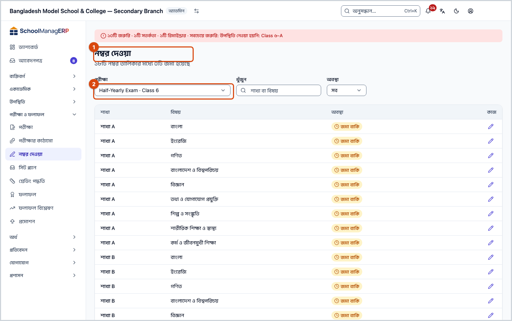
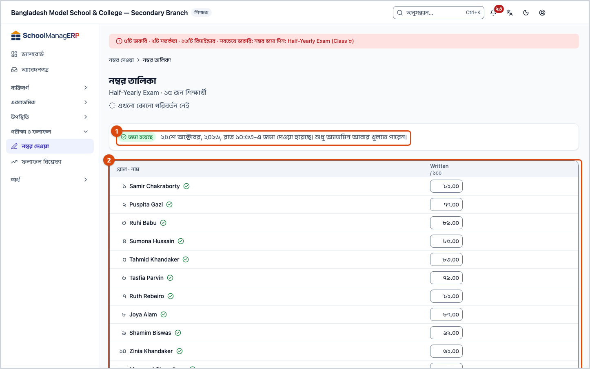
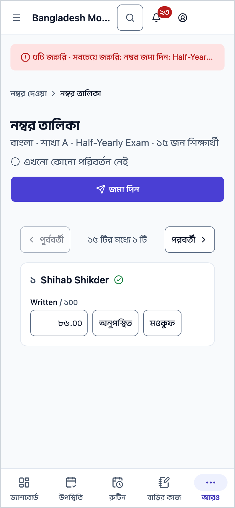

<!-- guide:meta
feature: examsResults.marksEntry
title: পরীক্ষার নম্বর দেওয়া ও জমা দেওয়া
summary: পরীক্ষা বেছে নিজের শাখা ও বিষয়ের নম্বর তালিকা খুলুন, প্রতিটি শিক্ষার্থীর নম্বর বা অনুপস্থিত/মওকুফ লিখুন, তারপর তালিকা জমা দিন।
roles: [ADMIN, TEACHER, EXECUTIVE, EXAM_CONTROLLER]
sources:
  - client-admin/src/routes/_staff/marks/index.tsx
  - client-admin/src/routes/_staff/marks/$examId.$sectionId.$subjectId.tsx
  - client-admin/src/routes/_staff/marks/-submit-dialog.tsx
  - ui/src/components/marks-grid.tsx
  - ui/src/components/marks-stepper.tsx
  - ui/src/hooks/autosave.ts
  - client-admin/src/nav-tree.ts
  - server/src/modules/exams/marks.controller.ts
  - server/src/modules/exams/marks.service.ts
  - server/src/modules/exams/mark-grid.service.ts
  - server/src/modules/exams/marks-authorization.util.ts
labels:
  [
    grading:marksEntry.*,
    grading:marksSheet.*,
    exams:marksList.*,
    exams:marksGrid.*,
    exams:marksStepper.*,
    exams:saveState.*,
    exams:submitDialog.*,
    common:marksEntry.*,
    nav:items.marksEntry,
    nav:groups.examsResults,
  ]
helpIds:
  [
    examsResults.marksEntry,
    examsResults.marksEntry.action.submit,
    examsResults.marksEntry.action.reopen,
    examsResults.marksEntry.field.exam,
    examsResults.marksEntry.field.mark,
  ]
devices: [desktop, phone]
entry: [sidebar, palette]
keywords:
  [নম্বর, নম্বর দেওয়া, নম্বর তালিকা, অনুপস্থিত, মওকুফ, জমা দিন, পরীক্ষা, marks, marks entry, grid, submit, absent, exempt]
appVersion: 0.1.0 (dd9119702)
owner: tareq89
lastVerified: 2026-10-25
knownIssues: []
-->

# পরীক্ষার নম্বর দেওয়া ও জমা দেওয়া

একটি পরীক্ষার নিজের শাখা ও বিষয়ের নম্বর দিন, আর শেষ হলে নম্বর তালিকা জমা দিন।

**যেতে হবে:** বাম মেনুতে **পরীক্ষা ও ফলাফল → নম্বর দেওয়া**। ফোনে উপরে বাম দিকের **☰** চেপে মেনু খুলুন, তারপর একই পথ। নিচের বোতামের সারিতে এটি নেই।
**শুরুর আগে:** অ্যাডমিন [পরীক্ষাটি তৈরি করে](exams.md) তার বিষয় ও নম্বরের ভাগ ঠিক করে থাকবেন। আপনি শিক্ষক হলে ওই শাখার ওই বিষয়ে আপনাকে **বিষয় শিক্ষক** হিসেবে দায়িত্ব দেওয়া থাকতে হবে ([শিক্ষকের দায়িত্ব](../people/teaching-assignments.md))।

এই পাতায় কাজ **নম্বর তালিকা** নিয়ে। একটি পরীক্ষার একটি শাখার একটি বিষয়ের জন্য একটি নম্বর তালিকা, যেমন "শাখা ক · গণিত"। তালিকায় সারি হলো শিক্ষার্থী, আর কলাম হলো বিষয়ের নম্বরের ভাগ (যেমন লিখিত, বহুনির্বাচনী)। তালিকার দুটি অবস্থা: **জমা বাকি** (নম্বর লেখা যায়) আর **জমা হয়েছে** (শুধু দেখা যায়)।

[নম্বর দিন ও জমা দিন](#task-main) · [ফোনে নম্বর দিন](#task-phone) · [জমা দেওয়া তালিকা আবার খুলুন](#task-reopen) · [সমস্যা ও সমাধান](#trouble)

**এই পাতায় যা আছে**

- [নম্বর দিন ও জমা দিন](#task-main)
- [নম্বর সংরক্ষিত ও জমা হয়েছে কি না বুঝবেন কীভাবে](#confirm)
- [অন্য পরিস্থিতিতে](#other)
  - [ফোনে নম্বর দিন](#task-phone)
  - [জমা দেওয়া তালিকা আবার খুলুন (শুধু অ্যাডমিন)](#task-reopen)
  - [সংরক্ষণ শেষ হওয়ার আগে পাতা ছাড়তে চাইলে](#task-leave)
  - [শুধু দেখার জন্য তালিকা খুলুন](#task-view)
- [সমস্যা ও সমাধান](#trouble)
- [কে কী করতে পারেন](#roles)
- [আরও জানুন](#more)

---

## নম্বর দিন ও জমা দিন 

1. বাম মেনুতে **পরীক্ষা ও ফলাফল** চাপুন, তারপর **নম্বর দেওয়া** চাপুন।

   → **নম্বর দেওয়া** পাতা খোলে। উপরে লেখা থাকে কতটি নম্বর তালিকার মধ্যে কতটি জমা হয়েছে।

2. **পরীক্ষা** ঘরে আপনার পরীক্ষাটি বেছে নিন। প্রতিটি নাম "পরীক্ষা · শ্রেণি" আকারে থাকে। প্রথমবার তালিকার প্রথম পরীক্ষাটি নিজে থেকে বাছা থাকে।

   → নিচে নম্বর তালিকাগুলো আসে: **শাখা**, **বিষয়**, **অবস্থা**। **জমা বাকি** তালিকাগুলো আগে থাকে। শিক্ষক শুধু সেই তালিকাগুলো দেখেন, যেখানে তিনি নম্বর দিতে পারেন।

3. যে তালিকায় নম্বর দেবেন, তার সারির শেষে **নম্বর দিন** চাপুন।

   → **নম্বর তালিকা** খোলে। উপরে বিষয়, শাখা, পরীক্ষা আর কতজন শিক্ষার্থী, তার নিচে **এখনো কোনো পরিবর্তন নেই**। প্রতিটি কলামের মাথায় পূর্ণ নম্বর লেখা থাকে, যেমন **/ ৫০**।

4. প্রথম শিক্ষার্থীর ঘরে নম্বর লিখুন। দশমিকও লেখা যায়, যেমন `৩৪.৫`। বাংলা বা ইংরেজি অঙ্ক দুটোই চলে।

   → পূর্ণ নম্বরের বেশি লিখলে ঘরের নিচে **সর্বোচ্চ …** লেখা আসে, আর সেই নম্বর নেওয়া হয় না।

5. **Enter** চাপুন।

   → ঘরটি একই কলামের নিচের শিক্ষার্থীর কাছে যায়। এভাবে একটি কলাম উপর থেকে নিচে শেষ করুন।

6. কোনো শিক্ষার্থী অনুপস্থিত হলে তাঁর ঘরে থেকে **A** চাপুন। কোনো শিক্ষার্থীকে এই অংশ থেকে মওকুফ দিলে **E** চাপুন।

   → ঘরে **অনু** বা **মওকুফ** লেখা আসে। পরে ভুল বুঝলে সেই ঘরে নম্বর লিখলেই আবার সাধারণ নম্বর হয়ে যায়।

7. প্রতিটি নম্বর লেখার একটু পরেই অ্যাপ নিজে থেকে সংরক্ষণ করে। কিছু করতে হয় না।

   → উপরের লাইনে প্রথমে **সংরক্ষণ হচ্ছে…**, তারপর **সব পরিবর্তন সংরক্ষিত হয়েছে · <সময়>** আসে। যে শিক্ষার্থীর সব ঘর সংরক্ষিত, তাঁর নামের পাশে সবুজ টিক দেখা যায়।

8. সব শিক্ষার্থীর সব ঘর পূরণ হলে উপরে ডান দিকে **জমা দিন** চাপুন। অথবা কি-বোর্ডে **Ctrl+Enter** চাপুন।

   → **এই নম্বর তালিকা জমা দেবেন?** জানালা খোলে। কোনো ঘর ফাঁকা থাকলে সেখানে লাল লেখায় কতটি ঘর ফাঁকা দেখায়, আর **জমা দিন** চাপা যায় না।

9. জানালায় **জমা দিন** চাপুন।

   → অ্যাপ আগে বাকি সব পরিবর্তন সংরক্ষণ করে, তারপর তালিকা জমা দেয়। জানালা বন্ধ হয়, আর উপরে **জমা হয়েছে** ব্যাজের পাশে লেখা আসে **<সময়>-এ জমা দেওয়া হয়েছে। শুধু অ্যাডমিন আবার খুলতে পারেন।** এখন ঘরগুলো আর বদলানো যায় না।

| জানালায় আপনি চাপলেন | কী হবে                                                                                   | জমা হলো? |
| -------------------- | ---------------------------------------------------------------------------------------- | -------- |
| **জমা দিন**          | বাকি পরিবর্তন সংরক্ষিত হয়, তারপর তালিকা জমা হয় আর বন্ধ হয়ে যায়।                      | হ্যাঁ    |
| **বাতিল**            | জানালা বন্ধ হয়। লেখা নম্বর যেমন ছিল তেমনই থাকে (সেগুলো আগেই নিজে থেকে সংরক্ষিত হয়েছে)। | না       |

> **মনে রাখুন:** নম্বর নিজে থেকে সংরক্ষিত হয়, কিন্তু **জমা দিন** না চাপা পর্যন্ত তালিকা জমা হয় না। জমা বাকি তালিকা থাকলে অ্যাডমিন ফলাফল প্রক্রিয়া করতে গেলে সতর্কবার্তা পান ([ফলাফল](results.md))।

---

## নম্বর সংরক্ষিত ও জমা হয়েছে কি না বুঝবেন কীভাবে 

নম্বর আপনার ফোন বা কম্পিউটারে আলাদা করে রাখা হয় না। ইন্টারনেট না থাকলে অ্যাপ বারবার পাঠানোর চেষ্টা করে, কিন্তু পাতা বন্ধ করলে না-পাঠানো নম্বর হারিয়ে যায়। তাই এখানে "এই ডিভাইসে সংরক্ষিত" অবস্থা নেই।

| অবস্থা                       | কীভাবে বুঝবেন                                                                                                             | এরপর কী                                        |
| ---------------------------- | ------------------------------------------------------------------------------------------------------------------------- | ---------------------------------------------- |
| **শুধু স্ক্রিনে বদলেছে**     | উপরের লাইনে **সংরক্ষণ হচ্ছে…**, অথবা লাল লেখায় **…টি পরিবর্তন সংরক্ষিত হয়নি — আবার চেষ্টা চলছে**; ঘরের চারপাশে রঙিন দাগ | অপেক্ষা করুন, ইন্টারনেট দেখুন; পাতা ছাড়বেন না |
| **স্কুলের সিস্টেমে পৌঁছেছে** | **সব পরিবর্তন সংরক্ষিত হয়েছে · <সময়>**, আর নামের পাশে সবুজ টিক                                                          | সব ঘর শেষ হলে **জমা দিন**                      |
| **জমা হয়েছে**               | **জমা হয়েছে** ব্যাজ আর **<সময়>-এ জমা দেওয়া হয়েছে। শুধু অ্যাডমিন আবার খুলতে পারেন।**                                   | কাজ শেষ                                        |

**যাচাই করতে চাইলে:** পাতা ছেড়ে আবার **নম্বর দেওয়া** থেকে একই তালিকা খুলুন। আপনার লেখা নম্বর ঘরে দেখা গেলে সেগুলো সিস্টেমে আছে। জমা দেওয়ার পর উপরের লাইনে জমার সংখ্যা এক বাড়ে।

**বার্তা না এলে:** [সমস্যা ও সমাধান](#trouble) দেখুন। পাতা খোলা রাখলে সংরক্ষিত-না-হওয়া নম্বর মুছে যায় না।

---

## অন্য পরিস্থিতিতে 

### ফোনে নম্বর দিন 

ফোনের মতো ছোট স্ক্রিনে নম্বর তালিকা একবারে একজন শিক্ষার্থী দেখায়।

1. উপরের ধাপ ১–৩ একইভাবে করুন।

   → একজন শিক্ষার্থীর নাম, তার নিচে প্রতিটি নম্বরের ভাগের ঘর। উপরে **পূর্ববর্তী**, "**… টির মধ্যে … টি**" আর **পরবর্তী**।

2. প্রতিটি ঘরে নম্বর লিখুন। অনুপস্থিত হলে ঘরের পাশে **অনুপস্থিত** চাপুন, মওকুফ দিলে **মওকুফ** চাপুন।
3. **পরবর্তী** চেপে পরের শিক্ষার্থীর কাছে যান।
4. সবার শেষে উপরের **জমা দিন** চাপুন, তারপর জানালায় আবার **জমা দিন** চাপুন।

   → ডেস্কটপের মতোই **জমা হয়েছে** ব্যাজ আসে।

ফোনে **A**, **E** বা **Ctrl+Enter** কাজে লাগে না; বোতামগুলো ব্যবহার করুন।

### জমা দেওয়া তালিকা আবার খুলুন (শুধু অ্যাডমিন) 

শিক্ষক জমা দেওয়ার পর ভুল ধরা পড়লে শুধু অ্যাডমিন তালিকাটি আবার খুলতে পারেন।

1. অ্যাডমিন হিসেবে জমা দেওয়া নম্বর তালিকাটি খুলুন ([পরীক্ষার পাতা](exams.md) থেকে, বা **নম্বর দেওয়া** তালিকায় থাকলে **নম্বর দেখুন** চেপে)।
2. **জমা হয়েছে** ব্যাজের সারিতে **আবার খুলুন** চাপুন।

   → কোনো জানালা আসে না। তালিকা আবার **জমা বাকি** হয়, আর ঘরগুলো আবার লেখা যায়।

3. শিক্ষক নম্বর ঠিক করে আবার **জমা দিন** চাপবেন।

ফলাফল **প্রকাশিত** থাকলে তালিকা আবার খোলা যায় না। আগে [ফলাফল পুনরায় খুলুন](results.md#task-reopen)। ফলাফল **প্রক্রিয়াকৃত** অবস্থায় থাকলে খোলা তালিকায় নম্বর বদলালে পুরো পরীক্ষার ফলাফল নিজে থেকে আবার হিসাব হয়।

### সংরক্ষণ শেষ হওয়ার আগে পাতা ছাড়তে চাইলে 

কিছু নম্বর এখনো সংরক্ষিত না হলে অ্যাপের ভেতরে অন্য পাতায় যেতে চাইলে **সংরক্ষণ না করে চলে যাবেন?** জানালা আসে।

| আপনি চাপলেন      | কী হবে                                                      | সংরক্ষিত হলো?                |
| ---------------- | ----------------------------------------------------------- | ---------------------------- |
| **থাকুন**        | পাতায় থেকে যান; অ্যাপ সংরক্ষণের চেষ্টা চালিয়ে যায়।       | একটু পরে হবে                 |
| **তবুও চলে যান** | পাতা ছেড়ে যান। যে নম্বরগুলো সংরক্ষিত হয়নি, সেগুলো হারায়। | না, শুধু না-পাঠানো নম্বরগুলো |

### শুধু দেখার জন্য তালিকা খুলুন 

একাডেমিক কো-অর্ডিনেটর আর পরীক্ষা নিয়ন্ত্রক নম্বর দেখতে পারেন, লিখতে পারেন না। তাঁদের তালিকায় সারির শেষে **নম্বর দেখুন** থাকে। খোলা তালিকায় ঘরগুলো ধূসর থাকে, **জমা দিন** বোতাম থাকে না।

---

## সমস্যা ও সমাধান 

| আপনি যা দেখছেন                                                                                         | কী করবেন                                                                                                                  | কে সাহায্য করতে পারেন                                             |
| ------------------------------------------------------------------------------------------------------ | ------------------------------------------------------------------------------------------------------------------------- | ----------------------------------------------------------------- |
| **এখনো কোনো পরীক্ষা নেই**                                                                              | অ্যাডমিন [পরীক্ষা তৈরি করলে](exams.md) এখানে আসবে।                                                                        | অ্যাডমিন                                                          |
| **এখনো কোনো নম্বর তালিকা নেই**                                                                         | পরীক্ষার বিষয় আর নম্বরের ভাগ ঠিক হয়নি, অথবা এই পরীক্ষায় আপনার কোনো বিষয়ের দায়িত্ব নেই।                               | অ্যাডমিন ([শিক্ষকের দায়িত্ব](../people/teaching-assignments.md)) |
| তালিকায় আপনার একটি শাখা বা বিষয় নেই                                                                  | শিক্ষক শুধু সেই তালিকা দেখেন যেখানে তিনি ওই বিষয়ের **বিষয় শিক্ষক**। শ্রেণি শিক্ষক হলেই নম্বর দেওয়া যায় না।            | অ্যাডমিন ([শিক্ষকের দায়িত্ব](../people/teaching-assignments.md)) |
| **কিছু মেলেনি**                                                                                        | **সব মুছুন** চেপে খোঁজা আর ছাঁকনি মুছুন।                                                                                  | —                                                                 |
| **নম্বর তালিকা লোড করা যায়নি।**                                                                       | ইন্টারনেট দেখে আবার চেষ্টা করুন।                                                                                          | অ্যাডমিন                                                          |
| **সর্বোচ্চ …**                                                                                         | পূর্ণ নম্বরের বেশি লেখা যায় না। ঠিক নম্বর লিখুন।                                                                         | —                                                                 |
| **…টি পরিবর্তন সংরক্ষিত হয়নি — আবার চেষ্টা চলছে**                                                     | ইন্টারনেট দেখুন, পাতা খোলা রাখুন। অ্যাপ নিজে আবার চেষ্টা করে; নতুন কিছু লিখলে সাথে সাথে আবার পাঠায়।                      | —                                                                 |
| **…টি ঘর ফাঁকা। আগে নম্বর, A (অনুপস্থিত) বা E (মওকুফ) লিখুন।**                                         | প্রতিটি ফাঁকা ঘরে নম্বর, **A** বা **E** দিন। দেরিতে ভর্তি হওয়া বা এই বিষয় না-পড়া শিক্ষার্থীর ফাঁকা সারি জমা আটকায় না। | —                                                                 |
| **নম্বর তালিকা জমা দেওয়া যায়নি। আবার চেষ্টা করুন।**                                                  | ইন্টারনেট দেখে আবার **জমা দিন** চাপুন। ফলাফল এর মধ্যে প্রকাশ হয়ে গেলে আর জমা দেওয়া যায় না; অ্যাডমিনকে জানান।           | অ্যাডমিন ([ফলাফল](results.md))                                    |
| সংরক্ষণ বারবার ব্যর্থ হয়, আর তালিকা আপনার খোলা অবস্থাতেই অন্য কেউ জমা দিয়েছেন বা ফলাফল প্রকাশ হয়েছে | তালিকা বা পরীক্ষা বন্ধ হয়ে গেলে নতুন নম্বর নেওয়া হয় না। পাতা রিলোড করে অবস্থা দেখুন।                                   | অ্যাডমিন                                                          |
| **নম্বর তালিকা আবার খোলা যায়নি। আবার চেষ্টা করুন।**                                                   | ইন্টারনেট দেখুন। ফলাফল প্রকাশিত থাকলে আগে [ফলাফল পুনরায় খুলুন](results.md#task-reopen)।                                  | অ্যাডমিন                                                          |
| **জমা দিন** বা **আবার খুলুন** বোতাম দেখছেন না                                                          | [কে কী করতে পারেন](#roles) দেখুন।                                                                                         | অ্যাডমিন                                                          |

---

## কে কী করতে পারেন 

| ভূমিকা                                        | কোন তালিকা দেখেন                                                                                            | নম্বর দেওয়া ও জমা       | জমা দেওয়া তালিকা আবার খোলা   |
| --------------------------------------------- | ----------------------------------------------------------------------------------------------------------- | ------------------------ | ----------------------------- |
| অ্যাডমিন                                      | স্কুলের সব                                                                                                  | হ্যাঁ, সব তালিকায়       | হ্যাঁ (ফলাফল প্রকাশিত না হলে) |
| শিক্ষক                                        | শুধু যেখানে তিনি ওই বিষয়ের বিষয় শিক্ষক, চলতি শিক্ষাবর্ষে (আগের বর্ষের শ্রেণিতে খসড়া পরীক্ষা থাকলে সেটিও) | হ্যাঁ, শুধু সেই তালিকায় | না                            |
| একাডেমিক কো-অর্ডিনেটর, পরীক্ষা নিয়ন্ত্রক     | স্কুলের সব                                                                                                  | না, শুধু দেখতে পারেন     | না                            |
| হিসাবরক্ষক, অফিস সহকারী, পরিচালনা পর্ষদ সদস্য | মেনুতে **নম্বর দেওয়া** নেই                                                                                 | না                       | না                            |

শিক্ষক অন্য শাখার কোনো তালিকার ঠিকানা সরাসরি খুললে অ্যাপ সেটিকে "পাওয়া যায়নি" হিসেবে দেখায়, যেন তালিকাটি নেই।

---

## আরও জানুন 

<strong>পাতার অংশগুলো</strong> — নম্বর তালিকা, উপর থেকে নিচে

1. **নম্বর তালিকা** — শিরোনাম; নিচে বিষয় · শাখা · পরীক্ষা · কতজন শিক্ষার্থী।
2. **সংরক্ষণের লাইন** — **এখনো কোনো পরিবর্তন নেই**, **সংরক্ষণ হচ্ছে…** বা **সব পরিবর্তন সংরক্ষিত হয়েছে · <সময়>**।
3. **জমা দিন** — উপরে ডান দিকে; জমা বাকি তালিকায় আর নম্বর দেওয়ার অনুমতি থাকলেই আসে।
4. **কি-বোর্ডের সাহায্য লাইন** — তালিকার ঠিক উপরে।
5. **তালিকা** — **রোল · নাম**, তারপর প্রতিটি নম্বরের ভাগ। ধূসর কলামগুলো অ্যাপ নিজে হিসাব করে (যেমন হাজিরা থেকে), সেখানে লেখা যায় না।

<strong>কি-বোর্ড শর্টকাট</strong>

| কী             | কাজ                                        |
| -------------- | ------------------------------------------ |
| **Enter**      | একই কলামে নিচের শিক্ষার্থীর ঘরে যায়       |
| **↑ ↓ ← →**    | উপরে, নিচে, বাঁয়ে, ডানে ঘর বদলায়         |
| **Tab**        | সারি ধরে পরের ঘরে যায়                     |
| **A**          | অনুপস্থিত (**অনু**)                        |
| **E**          | মওকুফ (**মওকুফ**)                          |
| **Ctrl+Enter** | **এই নম্বর তালিকা জমা দেবেন?** জানালা খোলে |

ম্যাক কম্পিউটারে **Ctrl**-এর বদলে **⌘** চাপলেও চলে।

<strong>ঘরগুলোর অর্থ</strong>

| ঘর         | কী লিখবেন                                                                    | বাধ্যতামূলক?                   |
| ---------- | ---------------------------------------------------------------------------- | ------------------------------ |
| পরীক্ষা    | কোন পরীক্ষার নম্বর দেবেন।                                                    | হ্যাঁ                          |
| খুঁজুন     | শাখা বা বিষয়ের নামের অংশ। শুধু অ্যাডমিন দেখেন।                              | না                             |
| অবস্থা     | **সব**, **জমা বাকি** বা **জমা হয়েছে**।                                      | না                             |
| নম্বরের ঘর | ০ থেকে পূর্ণ নম্বর পর্যন্ত, দশমিক চলে; অনুপস্থিত হলে **A**, মওকুফ হলে **E**। | হ্যাঁ — ফাঁকা থাকলে জমা হয় না |

**হিসাবে যা হয়:** কোনো বিষয়ের যেকোনো অংশে অনুপস্থিত হলে পুরো বিষয়ে **অনুপস্থিত** ধরা হয় আর বিষয়টি ফেল হয়। মওকুফ অংশটি প্রাপ্ত নম্বর আর পূর্ণ নম্বর দুটো থেকেই বাদ যায়। কোনো অংশে পাস নম্বর ঠিক করা থাকলে তার কম পেলে পুরো বিষয় ফেল হয়। বিস্তারিত: [ফলাফল](results.md#more)।

<strong>নম্বর দেওয়া কীভাবে কাজ করে</strong> — পরীক্ষা থেকে তালিকা, তারপর ফলাফল

<figure>
  
  <figcaption><em>নম্বর তালিকা জমা থেকে ফলাফল পর্যন্ত</em></figcaption>
</figure>

- প্রতিটি পরীক্ষার প্রতিটি শাখা ও বিষয়ের একটি নম্বর তালিকা। তালিকার কলাম আসে [পরীক্ষার নম্বরের ভাগ](exams.md) থেকে।
- নম্বর লেখার প্রায় সাথে সাথে (এক সেকেন্ডের কম পরে) অ্যাপ সেগুলো একসাথে পাঠায়; ব্যর্থ হলে কিছুক্ষণ পরপর আবার চেষ্টা করে।
- সব তালিকা জমা হলে অ্যাডমিন বা পরীক্ষা নিয়ন্ত্রক [ফলাফল](results.md) প্রক্রিয়া করেন। ফলাফলে কোন গ্রেড বসবে, তা ঠিক করে [গ্রেডিং পদ্ধতি](grading-scales.md)।

<strong>ঘরগুলোর সংক্ষিপ্ত সাহায্য (? বোতাম)</strong>

<!-- guide:generated:fields:exams -->

| ঘর                             | কী লিখবেন                                                                                                                        | বাধ্যতামূলক?                         |
| ------------------------------ | -------------------------------------------------------------------------------------------------------------------------------- | ------------------------------------ |
| নাম (পরীক্ষা)                  | পরীক্ষার নাম, যেমন অর্ধ-বার্ষিক ২০২৬। একই শ্রেণি ও বর্ষে দুটি পরীক্ষার একই নাম হয় না।                                           | হ্যাঁ                                |
| ধরন (পরীক্ষা)                  | টার্ম, মাসিক, মডেল টেস্ট বা অন্যান্য। ফল প্রকাশের পর বদলানো যায় না।                                                             | না                                   |
| মার্ক জমার শেষ তারিখ           | শিক্ষকরা ড্যাশবোর্ডে দেখেন কত দিন বাকি। না থাকলে ফাঁকা রাখুন।                                                                    | না                                   |
| শিক্ষাবর্ষ                     | কোন বর্ষের পরীক্ষা। শুধু যোগ করার সময় বাছা যায়।                                                                                | হ্যাঁ                                |
| শ্রেণি                         | কোন শ্রেণির পরীক্ষা। আগে শিক্ষাবর্ষ বাছতে হয়; পরে বদলানো যায় না।                                                               | হ্যাঁ                                |
| কাঠামো থেকে শুরু করুন (ঐচ্ছিক) | একটি পরীক্ষার কাঠামো বাছলে শ্রেণির বিষয়গুলোর অংশ নিজে থেকে তৈরি হয়। কোনো কাঠামো না থাকলে ঘরটি আসে না।                          | না                                   |
| নাম (অংশ)                      | অংশের নাম, যেমন লিখিত। একই বিষয়ে দুটি অংশের একই নাম হয় না।                                                                     | হ্যাঁ                                |
| ধরন (অংশ)                      | লিখিত, এমসিকিউ, মৌখিক, ব্যবহারিক ইত্যাদি। উপস্থিতি বাছলে নম্বর নিজে থেকে গোনা হয়।                                               | না                                   |
| পূর্ণমান                       | অংশের পূর্ণমান, যেমন ৭০; ধনাত্মক সংখ্যা। উপস্থিতি অংশে এই ঘর থাকে না।                                                            | হ্যাঁ, উপস্থিতি অংশ ছাড়া            |
| পাশ নম্বর                      | এই অংশে পাশের নম্বর, যেমন ২৩। পূর্ণমানের বেশি হয় না। না লাগলে ফাঁকা রাখুন।                                                      | না                                   |
| পরীক্ষা (নম্বর তোলা)           | যে পরীক্ষার নম্বর তুলবেন। আপনি যেসব শাখা ও বিষয়ের নম্বর তুলতে পারেন, সেগুলোর তালিকা নিচে দেখায়।                                | হ্যাঁ                                |
| নম্বর (নম্বর তোলা)             | ওই শিক্ষার্থীর ওই অংশের নম্বর, দেখানো সর্বোচ্চ পর্যন্ত। অনুপস্থিত হলে A, অব্যাহতি হলে E লিখুন। উপস্থিতির অংশ নিজে থেকে গোনা হয়। | হ্যাঁ, ফাঁকা থাকলে তালিকা জমা হয় না |
| অংশ অনুযায়ী (বিশ্লেষণ)        | "পাস-ফেল" ট্যাবে টিক দিলে পুরো বিষয়ের বদলে বিষয়ের প্রতিটি অংশের ফল দেখায়।                                                     | না                                   |

<!-- /guide:generated -->

**সম্পর্কিত পাতা**

- [**ফলাফল প্রক্রিয়া ও প্রকাশ**](results.md) — জমা দেওয়া নম্বর থেকে ফলাফল তৈরি হয়।
- [**গ্রেডিং পদ্ধতি**](grading-scales.md) — কত শতাংশে কোন গ্রেড, তা এখানে ঠিক হয়।
- [**শিক্ষকের দায়িত্ব**](../people/teaching-assignments.md) — কোন শিক্ষক কোন শাখার কোন বিষয়ের নম্বর দেবেন।
- [**পরীক্ষা তৈরি ও সাজানো**](exams.md) — তালিকা ও তার কলাম এখান থেকে আসে।
- [**মেধা তালিকা ও ফলাফল বিশ্লেষণ**](analysis.md) — একটি পরীক্ষার মেধা তালিকা, অকৃতকার্য ও অনুপস্থিত শিক্ষার্থী আর বিষয়ভিত্তিক পাস-ফেল দেখুন, শাখা ধরে ছাঁকুন, প্রিন্ট করুন বা CSV নামান।

---

_সংস্করণ ০.১.০ · শেষ যাচাই ২০২৬-১০-২৫_
