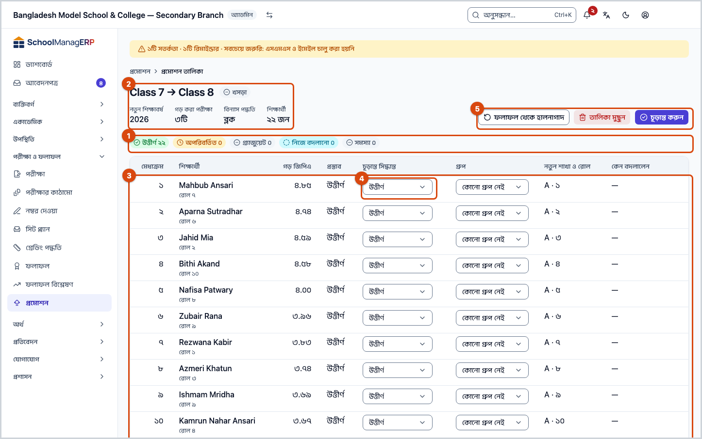
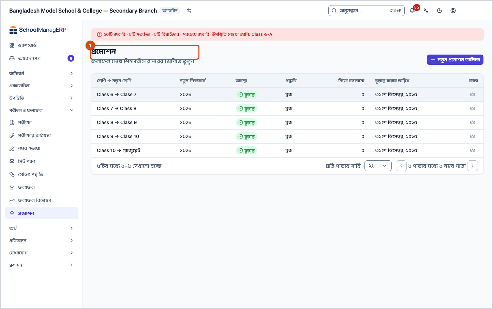

<!-- guide:meta
feature: examsResults.promotion
title: শিক্ষার্থীদের প্রমোশন
summary: প্রকাশিত ফলাফল দেখে একটি শ্রেণির শিক্ষার্থীদের নতুন শিক্ষাবর্ষে পরের শ্রেণিতে তুলুন, একই শ্রেণিতে রাখুন বা গ্র্যাজুয়েট করুন; আগে খসড়া তালিকা, দেখে চূড়ান্ত।
roles: [ADMIN]
sources:
  - client-admin/src/routes/_staff/promotions/index.tsx
  - client-admin/src/routes/_staff/promotions/new.tsx
  - client-admin/src/routes/_staff/promotions/$runId.tsx
  - client-admin/src/routes/_staff/promotions/-commit-dialog.tsx
  - client-admin/src/route-permissions.ts
  - client-admin/src/nav-tree.ts
  - server/src/modules/promotions/promotions.controller.ts
  - server/src/modules/promotions/promotions.service.ts
  - server/src/modules/promotions/placement.ts
  - server/src/modules/enrollments/enrollments.service.ts
  - shared/src/enums/permissions.ts
labels:
  [
    promotions:list.*,
    promotions:newRunForm.*,
    promotions:blocking.*,
    promotions:grid.*,
    promotions:outcome.*,
    promotions:overrideNote,
    nav:items.promotion*,
    nav:groups.examsResults,
  ]
helpIds:
  [
    examsResults.promotion,
    examsResults.promotion.action.create,
    examsResults.promotion.action.refresh,
    examsResults.promotion.action.commit,
    examsResults.promotion.action.delete,
    examsResults.promotion.field.targetClass,
    examsResults.promotion.field.exams,
    examsResults.promotion.field.algorithm,
    examsResults.promotion.field.finalOutcome,
    examsResults.promotion.field.overrideNote,
  ]
devices: [desktop]
entry: [sidebar, palette]
keywords:
  [প্রমোশন, উত্তীর্ণ, পরের শ্রেণি, অপরিবর্তিত, গ্র্যাজুয়েট, শর্তসাপেক্ষে, শাখা বিন্যাস, রোল, নতুন শিক্ষাবর্ষ, promotion, promote, retain, graduate, roll]
appVersion: 0.1.0 (a25ab3344)
owner: tareq89
lastVerified: 2026-10-25
knownIssues: []
-->

# শিক্ষার্থীদের প্রমোশন

বছর শেষে একটি শ্রেণির শিক্ষার্থীদের নতুন শিক্ষাবর্ষে পরের শ্রেণিতে তুলুন। যাঁরা উত্তীর্ণ হননি, তাঁদের একই শ্রেণিতে রাখুন। শেষ শ্রেণির শিক্ষার্থীদের গ্র্যাজুয়েট করুন।

**যেতে হবে:** বাম মেনুতে **পরীক্ষা ও ফলাফল → প্রমোশন**।
**শুরুর আগে:** আপনি অ্যাডমিন হবেন। শ্রেণির অন্তত একটি পরীক্ষার ফলাফল **প্রকাশিত** থাকতে হবে ([ফলাফল প্রক্রিয়া ও প্রকাশ](results.md))। নতুন শিক্ষাবর্ষ, তার শ্রেণি আর শাখা আগে তৈরি থাকতে হবে ([শিক্ষাবর্ষ](../academics/academic-years.md), [শ্রেণি](../academics/classes.md))।

কাজ দুই ধাপে। প্রথমে একটি **খসড়া** প্রমোশন তালিকা তৈরি হয়; তাতে কিছুই বদলায় না, ইচ্ছেমতো দেখা, বদলানো বা মুছে ফেলা যায়। তারপর **চূড়ান্ত করুন** চাপলে সব শিক্ষার্থী একসাথে নতুন শ্রেণিতে যান।

> **সাবধান:** **চূড়ান্ত করুন** চাপার পর এটি আর ফেরানো যায় না। শিক্ষার্থীদের নতুন শ্রেণি, শাখা আর রোল বসে যায়, গ্র্যাজুয়েটরা "গ্র্যাজুয়েট" হয়ে যান। অ্যাপে "পূর্বাবস্থায় ফেরান" বোতাম নেই। চূড়ান্ত করার আগে তালিকা ভালো করে দেখুন।

[তালিকা তৈরি ও চূড়ান্ত](#task-main) · [সিদ্ধান্ত বদলান](#task-override) · [হালনাগাদ](#task-refresh) · [খসড়া মুছুন](#task-delete) · [সমস্যা ও সমাধান](#trouble)

**এই পাতায় যা আছে**

- [এই পাতায় যেভাবে আসবেন](#arrive)
- [প্রমোশন তালিকা তৈরি করে চূড়ান্ত করুন](#task-main)
- [প্রমোশন হয়েছে কি না বুঝবেন কীভাবে](#confirm)
- [অন্য পরিস্থিতিতে](#other)
  - [একজন শিক্ষার্থীর সিদ্ধান্ত নিজে বদলান](#task-override)
  - [ফলাফল বা শিক্ষার্থী বদলালে তালিকা হালনাগাদ করুন](#task-refresh)
  - [খসড়া তালিকা মুছে ফেলুন](#task-delete)
  - [শেষ শ্রেণি গ্র্যাজুয়েট করুন](#task-graduate)
- [সমস্যা ও সমাধান](#trouble)
- [কে কী করতে পারেন](#roles)
- [আরও জানুন](#more)

---

## এই পাতায় যেভাবে আসবেন 

**বাম মেনু থেকে**

1. বাম মেনুতে **পরীক্ষা ও ফলাফল → প্রমোশন** চাপুন। → সব প্রমোশন তালিকা দেখা যায়। নতুন তালিকার জন্য [প্রমোশন তালিকা তৈরি করে চূড়ান্ত করুন](#task-main) দেখুন; পুরোনো তালিকা খুলতে সারির **দেখুন** চাপুন।

---

## প্রমোশন তালিকা তৈরি করে চূড়ান্ত করুন 

1. বাম মেনুতে **পরীক্ষা ও ফলাফল** চাপুন, তারপর **প্রমোশন** চাপুন।

   → **প্রমোশন** পাতা খোলে, নিচে লেখা **ফলাফল দেখে শিক্ষার্থীদের পরের শ্রেণিতে তুলুন।**

2. ডান দিকে **নতুন প্রমোশন তালিকা** চাপুন।

   → **নতুন প্রমোশন তালিকা** ফর্ম খোলে।

3. **বর্তমান শ্রেণি** ঘরে যে শ্রেণি থেকে তুলবেন সেটি বাছুন, যেমন "২০২৬-এর ৭ম শ্রেণি"।

   → **নতুন শিক্ষাবর্ষ** নিজে থেকে বসে (ঠিক পরের শিক্ষাবর্ষ), আর **নতুন শ্রেণি**-তে প্রস্তাবিত শ্রেণি আসে, যেমন "৮ম শ্রেণি"। পাশে লেখা **প্রস্তাবিত — চাইলে বদলাতে পারেন।** পরের ধাপের কোনো শ্রেণি না থাকলে লেখা আসে **গ্র্যাজুয়েট করুন (কোনো লক্ষ্য শ্রেণি নেই)**।

4. দরকার হলে **নতুন শিক্ষাবর্ষ** বা **নতুন শ্রেণি** বদলান।

5. **গড় করার পরীক্ষাসমূহ**-এ দেখুন কোন পরীক্ষাগুলো ধরা হবে। এই শ্রেণির সব **প্রকাশিত** পরীক্ষায় শুরুতে টিক থাকে; যেটি ধরবেন না তার টিক তুলুন।

   → অন্তত একটি না থাকলে লেখা আসে **অন্তত একটি পরীক্ষা নির্বাচন করুন।**

6. **শাখায় বিন্যাস পদ্ধতি**-তে **ব্লক** বা **স্নেক** বাছুন (নিচের টেবিল দেখুন)।

7. নিচে **তালিকা তৈরি করুন** চাপুন।

   → খসড়া তালিকার পাতা খোলে। উপরে সারসংক্ষেপ: **উত্তীর্ণ**, **অপরিবর্তিত**, **গ্র্যাজুয়েট**, **নিজে বদলানো**, **সমস্যা**। নিচে প্রতিটি শিক্ষার্থীর **মেধাক্রম**, **শিক্ষার্থী**, **গড় জিপিএ**, **প্রস্তাব**, **চূড়ান্ত সিদ্ধান্ত**, **নতুন শাখা ও রোল** আর **কেন বদলালেন**। এখনো কোনো শিক্ষার্থীর কিছু বদলায়নি।

8. তালিকা দেখুন। কারো সিদ্ধান্ত বদলাতে চাইলে [সিদ্ধান্ত নিজে বদলান](#task-override)। লাল **সমস্যা** থাকলে আগে সেগুলো ঠিক করুন ([সমস্যা ও সমাধান](#trouble))।

9. উপরে **চূড়ান্ত করুন** চাপুন (কীবোর্ডে Ctrl+Enter)।

   → **এই প্রমোশন তালিকাটি চূড়ান্ত করবেন?** জানালা খোলে। লেখা থাকে, যেমন **৩৮ জন উত্তীর্ণ, ২ জন অপরিবর্তিত, ০ জন গ্র্যাজুয়েট হবে। এটি পূর্বাবস্থায় ফেরানো যাবে না।**

10. সংখ্যাগুলো মিলিয়ে নিন, তারপর জানালার **চূড়ান্ত করুন** চাপুন।

    → কোনো সিদ্ধান্ত নিজে বদলানো থাকলে আগে অতিরিক্ত অনুমোদনের জানালা আসে; সেখানে যা চায় তা দিয়ে যাচাই শেষ করুন। তারপর জানালা বন্ধ হয়, তালিকা **চূড়ান্ত** হয়, আর আর বদলানো যায় না।

| জানালায় আপনি চাপলেন | কী হবে                                                                           | শিক্ষার্থীরা সরলেন?   |
| -------------------- | -------------------------------------------------------------------------------- | --------------------- |
| **চূড়ান্ত করুন**    | সব শিক্ষার্থী একসাথে নতুন শ্রেণিতে যান। একজনেরও সমস্যা হলে কারো কিছুই বদলায় না। | হ্যাঁ, ফেরানো যায় না |
| **বাতিল করুন**       | জানালা বন্ধ হয়, তালিকা খসড়াই থাকে।                                             | না                    |

জানালায় **চূড়ান্ত করুন** চাপা যায় না যদি লাল লেখা আসে **চূড়ান্ত করার আগে প্রতিটি বিন্যাস ত্রুটি ঠিক করুন।** অথবা **চূড়ান্ত করার আগে নিজে বদলানো প্রতিটি সিদ্ধান্তের কারণ লিখুন।**

**চূড়ান্ত করলে ঠিক কী বদলায়**

| চূড়ান্ত সিদ্ধান্ত        | কী হয়                                                                                                                                            |
| ------------------------- | ------------------------------------------------------------------------------------------------------------------------------------------------- |
| **উত্তীর্ণ**              | নতুন শিক্ষাবর্ষে নতুন শ্রেণির বাছা শাখায় ভর্তি হয়, নতুন রোল বসে।                                                                                |
| **শর্তসাপেক্ষে উত্তীর্ণ** | **উত্তীর্ণ**-এর মতোই নতুন শ্রেণিতে যায়; শুধু তালিকায় আলাদা লেখা থাকে।                                                                           |
| **অপরিবর্তিত**            | নতুন শিক্ষাবর্ষে একই মানের শ্রেণিতে ভর্তি হয় (যেমন আবার ৭ম শ্রেণি)। আগের শাখার নামের শাখা থাকলে সেখানে, না থাকলে প্রথম শাখায়; রোল শেষে যোগ হয়। |
| **গ্র্যাজুয়েট**          | নতুন কোনো ভর্তি হয় না। শিক্ষার্থী আর তাঁর চলতি ভর্তি দুটোই "গ্র্যাজুয়েট" হয়, শিক্ষার্থীর ইতিহাসে লেখা থাকে।                                    |

এছাড়া: নতুন শাখায় আগে থেকে যাঁরা ছিলেন, তাঁদের রোল পেছনে সরে যায় (নতুনদের পরে)। পছন্দের বিষয়-গুচ্ছের বাছাই নতুন শ্রেণিতে একই বিষয় একই গুচ্ছে থাকলে সাথে যায়। সব বদল অডিট লগে লেখা থাকে। কাউকে কোনো SMS বা নোটিশ যায় না।

---

## প্রমোশন হয়েছে কি না বুঝবেন কীভাবে 

খসড়ার প্রতিটি বদল সাথে সাথে স্কুলের সিস্টেমে সংরক্ষিত হয়। কিন্তু খসড়া থাকা পর্যন্ত কোনো শিক্ষার্থীর শ্রেণি বদলায় না।

| অবস্থা       | কীভাবে বুঝবেন                                                                                             | এরপর কী                       |
| ------------ | --------------------------------------------------------------------------------------------------------- | ----------------------------- |
| **খসড়া**    | তালিকায় **অবস্থা** **খসড়া**; উপরে **চূড়ান্ত করুন** বোতাম আছে                                           | দেখে চূড়ান্ত করুন বা মুছুন   |
| **চূড়ান্ত** | **অবস্থা** **চূড়ান্ত**; তথ্যে **চূড়ান্ত করার তারিখ**, **চূড়ান্ত করেছেন** (আর লাগলে **অনুমোদন করেছেন**) | কিছু করার নেই; শুধু দেখা যায় |

**যাচাই করতে চাইলে:** [শিক্ষার্থী](../people/students.md) তালিকায় একজন উত্তীর্ণ শিক্ষার্থীর পাতা খুলুন; নতুন শ্রেণি, শাখা আর রোল দেখা যাবে।

**জানালা বন্ধ না হলে:** কিছু অর্ধেক হয় না; হয় সবার প্রমোশন হয়, নয়তো কারো না। পাতার বার্তা পড়ুন আর [সমস্যা ও সমাধান](#trouble) দেখুন।

---

## অন্য পরিস্থিতিতে 

### একজন শিক্ষার্থীর সিদ্ধান্ত নিজে বদলান 

সিস্টেম প্রস্তাব দেয়: বাছা সব পরীক্ষায় ফলাফল আছে আর কোনোটিতে ফেল নেই → **উত্তীর্ণ** (শেষ শ্রেণিতে **গ্র্যাজুয়েট**)। নইলে → **অপরিবর্তিত**। আপনি চাইলে বদলাতে পারেন।

1. খসড়া তালিকায় শিক্ষার্থীর **চূড়ান্ত সিদ্ধান্ত** ঘরে নতুন সিদ্ধান্ত বাছুন: **উত্তীর্ণ**, **অপরিবর্তিত**, **গ্র্যাজুয়েট** বা **শর্তসাপেক্ষে উত্তীর্ণ**। কীবোর্ডে ঘরে P, R বা G চাপলেও হয়।

   → ঘরের নিচে **নিজে বদলানো** চিহ্ন আসে, আর কার্সর চলে যায় **কেন বদলালেন** ঘরে।

2. **কেন বদলালেন** ঘরে কারণ লিখুন, যেমন "অসুস্থতার কারণে বার্ষিক পরীক্ষা দিতে পারেনি, অভিভাবকের আবেদনে শর্তসাপেক্ষে উত্তীর্ণ"।

   → কারণ ফাঁকা রাখলে লেখা আসে **নিজে বদলালে কারণ লেখা আবশ্যক।** কারণ না লেখা পর্যন্ত চূড়ান্ত করা যায় না।

3. আবার প্রস্তাবের সিদ্ধান্তে ফিরলে **নিজে বদলানো** চিহ্ন চলে যায়, কারণও মুছে যায়।

নিজে বদলানো থাকলে চূড়ান্ত করার সময় অতিরিক্ত অনুমোদন লাগে। পরে শিক্ষার্থীর পাতায় এই বদলের কারণ, বছর আর কে বদলেছেন তা দেখা যায়। নতুন শ্রেণির শাখাগুলো গ্রুপভিত্তিক হলে **গ্রুপ** কলামে গ্রুপ বদলানো যায়; গ্রুপ মুছে ফাঁকা করা যায় না (**গ্রুপ মুছে ফেলার সুবিধা এখনো নেই**)।

### ফলাফল বা শিক্ষার্থী বদলালে তালিকা হালনাগাদ করুন 

খসড়া তৈরির পর কোনো ফলাফল আবার প্রক্রিয়া হলে, বা কেউ শ্রেণি ছাড়লে বা যোগ দিলে, তালিকা পুরোনো হয়ে যায়।

1. খসড়া তালিকায় উপরে **ফলাফল থেকে হালনাগাদ** চাপুন।

   → **হালনাগাদ হচ্ছে…** দেখায়, তারপর তালিকা নতুন করে হিসাব হয়।

হালনাগাদে যা হয়:

- যাঁরা শ্রেণি ছেড়েছেন তাঁদের সারি মুছে যায়, তাঁদের নিজে বদলানো সিদ্ধান্তসহ।
- নতুন যোগ দেওয়া শিক্ষার্থীরা তালিকায় আসেন।
- যাঁদের সিদ্ধান্ত নিজে বদলানো নয়, তাঁদের প্রস্তাব ও সিদ্ধান্ত নতুন ফলাফল ধরে আবার বসে।
- নিজে বদলানো সিদ্ধান্ত, কারণ আর গ্রুপ যেমন ছিল থাকে।

### খসড়া তালিকা মুছে ফেলুন 

1. খসড়া তালিকায় উপরে লাল **তালিকা মুছুন** চাপুন।

   → **এই খসড়া প্রমোশন তালিকাটি মুছবেন?** জানালায় লেখা **এটি তালিকার প্রতিটি এন্ট্রি মুছে ফেলবে। এটি পূর্বাবস্থায় ফেরানো যাবে না।**

2. **মুছুন** চাপুন।

   → তালিকা মুছে যায়, আপনি **প্রমোশন** পাতায় ফেরেন। কোনো শিক্ষার্থীর কিছু বদলায় না।

| আপনি চাপলেন | কী হবে                                                  | মোছা হলো? |
| ----------- | ------------------------------------------------------- | --------- |
| **মুছুন**   | খসড়া আর তার সব সারি মুছে যায়; শিক্ষার্থীরা যেমন ছিলেন | হ্যাঁ     |
| **বাতিল**   | কিছুই বদলায় না                                         | না        |

শুধু খসড়া মোছা যায়। **চূড়ান্ত** তালিকা মোছা যায় না।

### শেষ শ্রেণি গ্র্যাজুয়েট করুন 

নতুন শিক্ষাবর্ষে পরের মানের শ্রেণি না থাকলে (যেমন দশম শ্রেণির পর), ফর্মে **নতুন শ্রেণি**-র জায়গায় **গ্র্যাজুয়েট করুন (কোনো লক্ষ্য শ্রেণি নেই)** লেখা আসে। তখন উত্তীর্ণদের প্রস্তাব হয় **গ্র্যাজুয়েট**, আর **শর্তসাপেক্ষে উত্তীর্ণ** বাছা যায় না। বাকি ধাপ উপরের মতোই। যাঁরা ফেল করেছেন তাঁরা **অপরিবর্তিত**, অর্থাৎ নতুন বছরে আবার একই শ্রেণিতে।

---

## সমস্যা ও সমাধান 

| আপনি যা দেখছেন                                                                                 | কী করবেন                                                                                                                                              | কে সাহায্য করতে পারেন |
| ---------------------------------------------------------------------------------------------- | ----------------------------------------------------------------------------------------------------------------------------------------------------- | --------------------- |
| **এই শ্রেণির এখনো কোনো প্রকাশিত পরীক্ষা নেই।**                                                 | আগে এই শ্রেণির অন্তত একটি পরীক্ষার ফলাফল [প্রকাশ করুন](results.md#task-publish)।                                                                      | অ্যাডমিন              |
| **একটি লক্ষ্য শ্রেণি নির্বাচন করুন, অথবা উৎস শ্রেণি গ্র্যাজুয়েট করুন।**                       | শ্রেণিটির মান (নম্বর) দেওয়া নেই, তাই পরের শ্রেণি আন্দাজ করা যায়নি। **নতুন শ্রেণি** নিজে বাছুন।                                                      | অ্যাডমিন              |
| **লক্ষ্য শ্রেণিতে এখনো কোনো শাখা নেই — এটি চালানোর আগে অন্তত একটি তৈরি করুন।**                 | নতুন শ্রেণিতে শাখা তৈরি করুন ([শ্রেণি](../academics/classes.md)), তারপর আবার চেষ্টা করুন।                                                             | অ্যাডমিন              |
| **উত্তীর্ণ না হওয়া শিক্ষার্থীদের রাখার জন্য কোনো শ্রেণি সেট করা নেই — প্রথমে একটি যোগ করুন।** | নতুন শিক্ষাবর্ষে একই মানের শ্রেণি (যেমন আবার ৭ম শ্রেণি, একই শিফট ও ভার্সন) তৈরি করুন। তালিকায় কাউকে একই শ্রেণিতে রাখা হলেই শুধু এটি লাগে।            | অ্যাডমিন              |
| **তালিকা তৈরি করা যায়নি। আবার চেষ্টা করুন।**                                                  | নতুন শিক্ষাবর্ষ বর্তমান শ্রেণির শিক্ষাবর্ষের পরে শুরু হয় কি না দেখুন; ইন্টারনেট দেখুন।                                                               | অ্যাডমিন              |
| লাল **শাখায় জায়গা নেই**                                                                      | নতুন শাখাগুলো ধারণক্ষমতায় ভরে গেছে। শাখার ধারণক্ষমতা বাড়ান বা নতুন শাখা খুলুন, তারপর **ফলাফল থেকে হালনাগাদ**। অথবা সেই শিক্ষার্থীর সিদ্ধান্ত বদলান। | অ্যাডমিন              |
| লাল **মানানসই কোনো শাখা নেই**                                                                  | শিক্ষার্থীর গ্রুপের সাথে মেলে এমন শাখা নতুন শ্রেণিতে নেই। **গ্রুপ** বদলান, বা সেই গ্রুপের শাখা খুলে হালনাগাদ করুন।                                    | অ্যাডমিন              |
| **সর্বশেষ প্রিভিউয়ের পর ফলাফল পরিবর্তিত হয়েছে — রিফ্রেশ করুন**                               | পাশের **ফলাফল থেকে হালনাগাদ** চাপুন, তালিকা আবার দেখুন, তারপর চূড়ান্ত করুন।                                                                          | অ্যাডমিন              |
| **তালিকাটি শেষবার হালনাগাদ করার পর কিছু শিক্ষার্থী শ্রেণি ছেড়েছে বা যোগ দিয়েছে। …**          | পাশের **ফলাফল থেকে হালনাগাদ** চাপুন, তালিকা দেখে আবার চূড়ান্ত করুন।                                                                                  | অ্যাডমিন              |
| **তালিকাটি চূড়ান্ত করা যায়নি। আবার চেষ্টা করুন।**                                            | অনুমোদন শেষ হয়েছে কি না আর ইন্টারনেট দেখুন। কোনো শিক্ষার্থী আগে থেকেই নতুন শিক্ষাবর্ষে ভর্তি থাকলে এটি আসতে পারে।                                    | অ্যাডমিন              |
| **এই পরিবর্তনটি সংরক্ষণ করা যায়নি। আবার চেষ্টা করুন।**                                        | সিদ্ধান্ত আবার বাছুন। নিজে বদলানো হলে কারণ লেখা আছে কি না দেখুন।                                                                                      | —                     |
| **তালিকাটি আর মোছা যাবে না — হয়তো অন্য কেউ চূড়ান্ত করেছেন। পাতাটি হালনাগাদ হয়েছে।**         | তালিকাটি এর মধ্যে চূড়ান্ত হয়ে গেছে। এখন শুধু দেখা যায়।                                                                                             | —                     |
| **প্রমোশন তালিকা লোড করা যায়নি।** বা **প্রমোশন তালিকাটি লোড করা যায়নি।**                     | ইন্টারনেট দেখে আবার চেষ্টা করুন।                                                                                                                      | —                     |

---

## কে কী করতে পারেন 

| ভূমিকা         | এই পাতা খোলা ও খসড়া বানানো | নিজে বদলানো সিদ্ধান্তসহ চূড়ান্ত করা |
| -------------- | --------------------------- | ------------------------------------ |
| অ্যাডমিন       | হ্যাঁ                       | হ্যাঁ (অতিরিক্ত অনুমোদন দিয়ে)       |
| অন্য সব ভূমিকা | না                          | না                                   |

অন্য ভূমিকার বাম মেনুতে **প্রমোশন** থাকে না। শিক্ষার্থীর পাতায় নিজে বদলানো প্রমোশনের চিহ্ন অবশ্য শিক্ষার্থী দেখার অনুমতি থাকলেই দেখা যায়।

---

## আরও জানুন 

<strong>পাতার অংশগুলো</strong> — তালিকার পাতা আর একটি তালিকার পাতা

**প্রমোশন** পাতা:

1. **প্রমোশন** — শিরোনাম, ডানে **নতুন প্রমোশন তালিকা**।
2. তালিকা — **শ্রেণি → নতুন শ্রেণি**, **নতুন শিক্ষাবর্ষ**, **অবস্থা**, **পদ্ধতি**, **নিজে বদলানো**, **চূড়ান্ত করার তারিখ**, আর **দেখুন**।

একটি তালিকার পাতা:

1. শিরোনামে শ্রেণি থেকে নতুন শ্রেণি; ডানে **ফলাফল থেকে হালনাগাদ**, **চূড়ান্ত করুন**, **তালিকা মুছুন** (শুধু খসড়ায়)।
2. তথ্য — **নতুন শিক্ষাবর্ষ**, **গড় করা পরীক্ষা**, **বিন্যাস পদ্ধতি**, **শিক্ষার্থী**।
3. সারসংক্ষেপ ব্যাজ।
4. শিক্ষার্থীদের সারি, মেধাক্রম অনুযায়ী।

<strong>ঘরগুলোর অর্থ</strong>

| ঘর                    | কী বাছবেন বা লিখবেন                                                                                          | বাধ্যতামূলক?      |
| --------------------- | ------------------------------------------------------------------------------------------------------------ | ----------------- |
| বর্তমান শ্রেণি        | যে শ্রেণির শিক্ষার্থীদের তুলবেন।                                                                             | হ্যাঁ             |
| নতুন শিক্ষাবর্ষ       | যে বছরে যাবেন। এটি বর্তমান শ্রেণির শিক্ষাবর্ষের পরে শুরু হতে হবে। শুরুতে ঠিক পরের বছর বসে।                   | হ্যাঁ             |
| নতুন শ্রেণি           | নতুন বছরে কোন শ্রেণিতে। শুরুতে একই শিফট ও ভার্সনের পরের মানের শ্রেণি বসে। না থাকলে পুরো শ্রেণি গ্র্যাজুয়েট। | প্রস্তাব থাকলে না |
| গড় করার পরীক্ষাসমূহ  | কোন প্রকাশিত পরীক্ষা ধরে পাস-ফেল আর মেধাক্রম। শুরুতে সবগুলো বাছা।                                            | অন্তত একটি        |
| শাখায় বিন্যাস পদ্ধতি | **ব্লক** বা **স্নেক**। শুরুতে **ব্লক**।                                                                      | হ্যাঁ             |
| চূড়ান্ত সিদ্ধান্ত    | **উত্তীর্ণ**, **অপরিবর্তিত**, **গ্র্যাজুয়েট**, **শর্তসাপেক্ষে উত্তীর্ণ**। শুরুতে প্রস্তাবের সমান।           | হ্যাঁ             |
| গ্রুপ                 | নতুন শ্রেণির কোন গ্রুপের শাখায় বসবেন। শুরুতে বর্তমান শাখার গ্রুপ। গ্রুপ না থাকলে এই কলাম আসে না।            | না                |
| কেন বদলালেন           | প্রস্তাব বদলানোর কারণ।                                                                                       | বদলালে হ্যাঁ      |

<strong>মেধাক্রম, শাখা আর রোল কীভাবে ঠিক হয়</strong>

<figure>
  
  <figcaption><em>খসড়া থেকে চূড়ান্ত</em></figcaption>
</figure>

- **কে তালিকায়:** তালিকা তৈরির সময় বর্তমান শ্রেণিতে যাঁদের ভর্তি চালু আছে।
- **প্রস্তাব:** বাছা প্রতিটি পরীক্ষায় শিক্ষার্থীর ফলাফল আছে আর কোনোটিতে ফেল নেই → **উত্তীর্ণ**। একটি পরীক্ষার ফলাফলও না থাকলে → **অপরিবর্তিত**।
- **মেধাক্রম:** বাছা পরীক্ষাগুলোর গড় জিপিএ বেশি আগে; সমান হলে সব পরীক্ষার মোট নম্বর বেশি আগে। দুটোই সমান হলে একটি স্থির অভ্যন্তরীণ ক্রমে, কাউকে একই মেধাক্রম দেওয়া হয় না।
- **শাখা বাছাই** (শুধু **উত্তীর্ণ** আর **শর্তসাপেক্ষে উত্তীর্ণ**-এর জন্য), মেধাক্রম ধরে:
  - **ব্লক:** আগে ক শাখা ভরে, তারপর খ। উদাহরণ: ক ও খ দুই শাখা, ৬০ জন, ধারণক্ষমতা দেওয়া নেই → মেধাক্রম ১–৩০ ক শাখায়, ৩১–৬০ খ শাখায়।
  - **স্নেক:** পালা করে, সাপের মতো: ক, খ, খ, ক, ক, খ… ফলে সব শাখায় ভালো-মন্দ মিশে সমান থাকে।
  - শাখায় ধারণক্ষমতা দেওয়া থাকলে আগে থেকে বসা শিক্ষার্থী বাদ দিয়ে যত জায়গা খালি, ততজন বসে। ধারণক্ষমতা না দেওয়া শাখা থাকলে বাড়তিরা সেখানে যান; না থাকলে **শাখায় জায়গা নেই**।
  - নতুন শ্রেণির কোনো শাখায় গ্রুপ থাকলে শিক্ষার্থী শুধু নিজের গ্রুপের শাখায় বসেন; না মিললে **মানানসই কোনো শাখা নেই**।
- **রোল:** প্রতিটি নতুন শাখায় উত্তীর্ণরা মেধাক্রমে ১, ২, ৩… পান। ওই শাখায় আগে থেকে যাঁরা ছিলেন, তাঁদের রোল নতুনদের পরে সরে যায় (আগের ক্রম ঠিক রেখে)।

<strong>কী ফেরানো যায়, কী যায় না</strong>

- **খসড়া:** পুরোপুরি ফেরানো যায়। সিদ্ধান্ত বদলান, হালনাগাদ করুন, বা মুছে দিন; কোনো শিক্ষার্থীর কিছু বদলায় না।
- **চূড়ান্ত করা:** একবারে সব, নয়তো কিছুই না। কোনো সমস্যা হলে কারো কিছু বদলায় না।
- **চূড়ান্তের পর:** অ্যাপে প্রমোশন বাতিলের কোনো উপায় নেই। তালিকা আর বদলানো বা মোছা যায় না, আবার চূড়ান্তও করা যায় না। নতুন ভর্তি, নতুন রোল, অন্য শিক্ষার্থীদের সরানো রোল, সাথে যাওয়া বিষয় বাছাই, "গ্র্যাজুয়েট" অবস্থা আর শিক্ষার্থীর ইতিহাসে গ্র্যাজুয়েশনের লেখা থেকে যায়। একজনের ভুল ঠিক করতে হলে তাঁর শ্রেণি বা শাখা আলাদা করে বদলাতে হবে (কীভাবে, তা এই পাতার বাইরে; অ্যাপে যাচাই হয়নি)।
- আগের বছরের ভর্তির রেকর্ড মুছে যায় না; উত্তীর্ণ ও অপরিবর্তিতদের আগের বছরের ভর্তি যেমন ছিল থাকে।

<strong>ঘরগুলোর সংক্ষিপ্ত সাহায্য (? বোতাম)</strong>

<!-- guide:generated:fields:promotions -->

| ঘর                    | কী লিখবেন                                                                                                                                                            | বাধ্যতামূলক?           |
| --------------------- | -------------------------------------------------------------------------------------------------------------------------------------------------------------------- | ---------------------- |
| নতুন শ্রেণি           | যে শ্রেণিতে শিক্ষার্থীরা যাবে। বর্তমান শ্রেণি বাছলে নিজে থেকে বসে; চাইলে বদলাতে পারেন। পরের শ্রেণি না থাকলে সিস্টেম নিজেই "গ্র্যাজুয়েট" দেখায়, তখন বদলানো যায় না। | প্রস্তাব থাকলে না      |
| গড় করার পরীক্ষাসমূহ  | গড় করার প্রকাশিত পরীক্ষাগুলোতে টিক দিন। মেধাক্রম ঠিক হয় এগুলোর গড় জিপিএ থেকে। অন্তত একটি বাছুন।                                                                   | হ্যাঁ, অন্তত একটি      |
| শাখায় বিন্যাস পদ্ধতি | ব্লক: মেধাক্রম অনুযায়ী আগে ক শাখা ভরে, তারপর খ। স্নেক: মেধাক্রম অনুযায়ী শাখাগুলোতে পালা করে বসায়, সব শাখা সমান থাকে।                                              | হ্যাঁ                  |
| ফলাফল                 | প্রতিটি শিক্ষার্থীর জন্য উত্তীর্ণ, অপরিবর্তিত, গ্র্যাজুয়েট বা শর্তসাপেক্ষে উত্তীর্ণ। শুরুতে সিস্টেমের প্রস্তাব থাকে; বদলালে কারণ লিখতে হয়।                         | হ্যাঁ                  |
| কেন বদলানো হলো        | এই শিক্ষার্থীর জন্য সিস্টেমের প্রস্তাব কেন বদলালেন। ফল প্রস্তাবের চেয়ে আলাদা হলেই লাগে।                                                                             | হ্যাঁ, প্রস্তাব বদলালে |

<!-- /guide:generated -->

**সম্পর্কিত পাতা**

- [**ফলাফল প্রক্রিয়া ও প্রকাশ**](results.md) — প্রমোশনের আগে ফলাফল প্রকাশ করতে হয়।
- [**মেধা তালিকা ও ফলাফল বিশ্লেষণ**](analysis.md) — কে পাস, কে ফেল আগে দেখে নিন।
- [**শিক্ষার্থী যোগ করা ও তাদের তথ্য দেখা**](../people/students.md) — প্রমোশনের পর শিক্ষার্থীর নতুন শ্রেণি ও রোল দেখুন।
- [**পরীক্ষা তৈরি ও সাজানো**](exams.md) — পরীক্ষা তৈরি ও সাজানো

---

_সংস্করণ ০.১.০ · শেষ যাচাই ২০২৬-১০-২৫_
