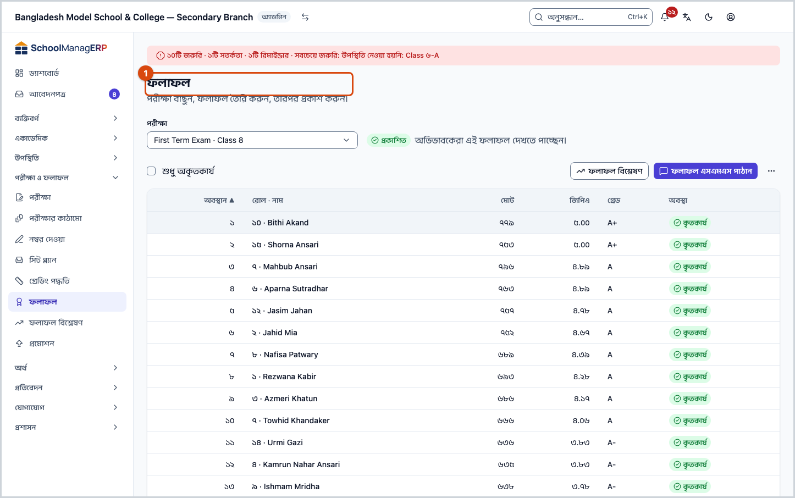
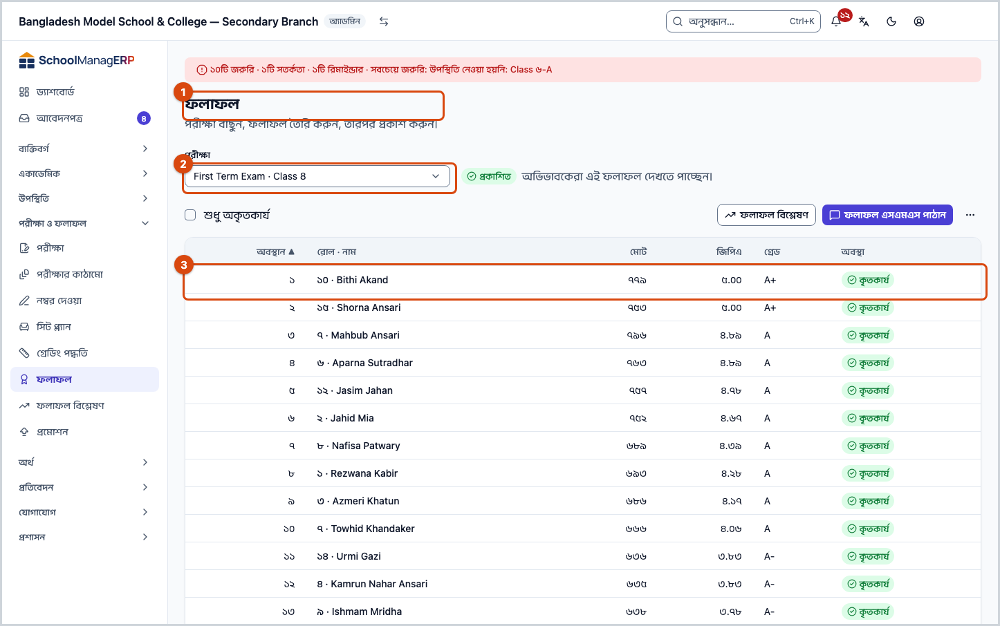

<!-- guide:meta
feature: examsResults.results
title: ফলাফল প্রক্রিয়া ও প্রকাশ
summary: জমা দেওয়া নম্বর থেকে পরীক্ষার ফলাফল তৈরি করুন, দেখে প্রকাশ করুন, অভিভাবকদের এসএমএস পাঠান, দরকারে পুনরায় খুলুন, আর প্রতিটি শিক্ষার্থীর ফলাফলপত্র প্রিন্ট করুন।
roles: [ADMIN, EXAM_CONTROLLER]
sources:
  - client-admin/src/routes/_staff/results/index.tsx
  - client-admin/src/routes/_staff/results/$examId.$studentId.tsx
  - client-admin/src/routes/_staff/results/-process-dialog.tsx
  - client-admin/src/routes/_staff/results/-publish-dialog.tsx
  - client-admin/src/routes/_staff/results/-send-result-sms-dialog.tsx
  - client-admin/src/routes/_staff/exams/-detail/results-panel.tsx
  - client-admin/src/routes/_staff/exams/-detail/use-result-actions.tsx
  - client-admin/src/routes/_staff/students/-detail/results-panel.tsx
  - client-admin/src/route-permissions.ts
  - server/src/modules/exams/results.controller.ts
  - server/src/modules/exams/results.service.ts
  - server/src/modules/exams/result-rules.ts
  - server/src/modules/exams/result-sms.service.ts
labels:
  [
    exams:status.*,
    exams:resultsRoute.*,
    exams:resultsPanel.*,
    exams:processDialog.*,
    exams:publishDialog.*,
    exams:reopenDialog.*,
    exams:smsDialog.*,
    exams:reportCard.*,
    grading:resultsPage.*,
    grading:marksEntry.noExams*,
    printHistory:reopenRevoke*,
    printHistory:reopenRegisterError,
    nav:items.results,
    nav:groups.examsResults,
  ]
helpIds:
  [
    examsResults.results,
    examsResults.results.action.process,
    examsResults.results.action.publish,
    examsResults.results.action.reopen,
    examsResults.results.action.sendSms,
    examsResults.results.action.printReportCard,
  ]
devices: [desktop, phone]
entry: [sidebar, palette, page:people.students]
keywords:
  [ফলাফল, ফল প্রকাশ, প্রক্রিয়া, জিপিএ, অবস্থান, ফলাফলপত্র, এসএমএস, পুনরায় খুলুন, results, process, publish, report card, GPA, SMS, reopen]
appVersion: 0.1.0 (dd9119702)
owner: tareq89
lastVerified: 2026-10-25
knownIssues:
  - { id: sms-credit-per-segment, checked: 2026-10-25, issue: null }
  - { id: report-card-other-roles, checked: 2026-10-25, issue: null }
-->

# ফলাফল প্রক্রিয়া ও প্রকাশ

জমা দেওয়া নম্বর থেকে একটি পরীক্ষার ফলাফল তৈরি করুন, দেখে প্রকাশ করুন, আর অভিভাবকদের এসএমএসে জানান।

**যেতে হবে:** বাম মেনুতে **পরীক্ষা ও ফলাফল → ফলাফল**। ফোনে উপরে বাম দিকের **☰** চেপে মেনু খুলুন, তারপর একই পথ।
**শুরুর আগে:** আপনাকে অ্যাডমিন বা পরীক্ষা নিয়ন্ত্রক হতে হবে। শিক্ষকদের নম্বর তালিকা জমা দেওয়া থাকতে হবে ([নম্বর দেওয়া](marks-entry.md))। পরীক্ষার শিক্ষাবর্ষের একটি [গ্রেডিং পদ্ধতি](grading-scales.md) থাকতে হবে।

এই পাতায় কাজ একটি পরীক্ষার **ফলাফল** নিয়ে। প্রতিটি পরীক্ষার ফলাফল তিন অবস্থার একটিতে থাকে: **খসড়া** (এখনো তৈরি হয়নি), **প্রক্রিয়াকৃত** (তৈরি হয়েছে, শুধু স্কুলের লোকজন দেখেন) আর **প্রকাশিত** (অভিভাবকেরা দেখেন)। পরীক্ষা বাছলে উপরে তার অবস্থা আর পরের কাজ লেখা থাকে, আর মূল বোতামটি সবসময় পরের ধাপ।

[ফলাফল প্রক্রিয়া করুন](#task-main) · [প্রকাশ করুন](#task-publish) · [এসএমএস পাঠান](#task-sms) · [পুনরায় খুলুন](#task-reopen) · [ফলাফলপত্র প্রিন্ট](#task-card) · [সমস্যা ও সমাধান](#trouble)

**এই পাতায় যা আছে**

- [এই পাতায় যেভাবে আসবেন](#arrive)
- [ফলাফল প্রক্রিয়া করুন](#task-main)
- [ফলাফল তৈরি ও প্রকাশ হয়েছে কি না বুঝবেন কীভাবে](#confirm)
- [অন্য পরিস্থিতিতে](#other)
  - [ফলাফল প্রকাশ করুন](#task-publish)
  - [অভিভাবকদের ফলাফল এসএমএস পাঠান](#task-sms)
  - [প্রকাশিত ফলাফল পুনরায় খুলুন](#task-reopen)
  - [একজন শিক্ষার্থীর ফলাফলপত্র দেখুন ও প্রিন্ট করুন](#task-card)
  - [নম্বর বদলের পর আবার প্রক্রিয়া করুন](#task-reprocess)
- [সমস্যা ও সমাধান](#trouble)
- [কে কী করতে পারেন](#roles)
- [জানা সমস্যা](#known-issues)
- [আরও জানুন](#more)

---

## এই পাতায় যেভাবে আসবেন 

**বাম মেনু থেকে**

1. বাম মেনুতে **পরীক্ষা ও ফলাফল → ফলাফল** চাপুন। → এই পাতা খোলে, প্রথম পরীক্ষাটি বাছা থাকে। নিচের [ফলাফল প্রক্রিয়া করুন](#task-main) থেকে শুরু করুন।

**শিক্ষার্থীর পাতা থেকে**

1. [শিক্ষার্থী](../people/students.md) তালিকা থেকে একজন শিক্ষার্থীর পাতা খুলুন, তারপর তাঁর ফলাফলের অংশে একটি পরীক্ষার সারি চাপুন। → সোজা সেই পরীক্ষার ফলাফলপত্র খোলে; [ফলাফলপত্র দেখুন ও প্রিন্ট করুন](#task-card)-এর ধাপ ২ থেকে শুরু করুন।

**পরীক্ষার পাতা থেকে**

1. [পরীক্ষার পাতার](exams.md) ফলাফলের ট্যাবে একই তালিকা আর একই বোতাম থাকে। সেখানকার কাজও এই পাতার ধাপ মেনে চলে।

---

## ফলাফল প্রক্রিয়া করুন 

1. বাম মেনুতে **পরীক্ষা ও ফলাফল** চাপুন, তারপর **ফলাফল** চাপুন।

   → **ফলাফল** পাতা খোলে।

2. **পরীক্ষা** ঘরে পরীক্ষাটি বেছে নিন।

   → পাশে অবস্থা আসে, যেমন **খসড়া**, আর লেখা **সব নম্বর তালিকা জমা হলে ফলাফল প্রক্রিয়া করুন।** নিচে **এখনো কোনো ফলাফল নেই**।

<!-- image pending: ফলাফল পাতা, পরীক্ষা বাছা, খসড়া ব্যাজ ও পরের কাজের লাইন, ডান দিকে ফলাফল প্রক্রিয়া করুন; ১ · পরীক্ষা ঘর ২ · অবস্থা ৩ · মূল বোতাম; অ্যাডমিন, desktop -->

3. ডান দিকে **ফলাফল প্রক্রিয়া করুন** চাপুন।

   → **এই পরীক্ষার ফলাফল প্রক্রিয়া করবেন?** জানালা খোলে। সব নম্বর তালিকা জমা হয়ে থাকলে নিচে শুধু **প্রক্রিয়া করুন** বোতাম। কোনো তালিকা জমা বাকি থাকলে লেখা আসে **…টি নম্বর তালিকা এখনো জমা দেওয়া হয়নি:** আর সেগুলোর তালিকা, সাথে একটি সতর্কবার্তা।

4. **প্রক্রিয়া করুন** চাপুন।

   → জানালা বন্ধ হয়। অবস্থা হয় **প্রক্রিয়াকৃত**, লেখা আসে **ফলাফল দেখে নিন, তারপর প্রকাশ করুন। প্রকাশের পর অভিভাবকেরা দেখতে পাবেন।** নিচের তালিকায় প্রতিটি শিক্ষার্থীর **অবস্থান**, **রোল · নাম**, **মোট**, **জিপিএ**, **গ্রেড** আর **কৃতকার্য** বা **অকৃতকার্য**।

| জানালায় আপনি চাপলেন     | কী হবে                                                                                                                                                                        | ফলাফল তৈরি হলো? |
| ------------------------ | ----------------------------------------------------------------------------------------------------------------------------------------------------------------------------- | --------------- |
| **প্রক্রিয়া করুন**      | সব জমা দেওয়া নম্বর থেকে প্রতিটি শিক্ষার্থীর ফলাফল হিসাব হয়।                                                                                                                 | হ্যাঁ           |
| **তবুও প্রক্রিয়া করুন** | জমা বাকি বা ফাঁকা ঘরসহ তালিকাগুলো যেমন আছে তেমনই ধরে ফলাফল হিসাব হয়। **ফাঁকা ঘর অনুপস্থিত ধরা হয়, তাই সেই শিক্ষার্থী ওই বিষয়ে ফেল করেন।** এই সিদ্ধান্ত অডিট লগে লেখা থাকে। | হ্যাঁ           |
| **বাতিল**                | কিছুই হয় না।                                                                                                                                                                 | না              |

> **মনে রাখুন:** **প্রক্রিয়াকৃত** ফলাফল অভিভাবকেরা দেখেন না। তাঁদের দেখাতে হলে [প্রকাশ করুন](#task-publish)।

---

## ফলাফল তৈরি ও প্রকাশ হয়েছে কি না বুঝবেন কীভাবে 

এই পাতা কিছু ফোন বা কম্পিউটারে আলাদা করে রাখে না। প্রতিটি কাজ জানালার বোতাম চাপলেই স্কুলের সিস্টেমে যায়, তাই "শুধু স্ক্রিনে বদলেছে" বা "এই ডিভাইসে সংরক্ষিত" অবস্থা নেই।

| অবস্থা                       | কীভাবে বুঝবেন                                                                                                       | এরপর কী                |
| ---------------------------- | ------------------------------------------------------------------------------------------------------------------- | ---------------------- |
| **স্কুলের সিস্টেমে পৌঁছেছে** | জানালা বন্ধ হয়, পরীক্ষার পাশের ব্যাজ বদলায়: **প্রক্রিয়াকৃত** বা **প্রকাশিত**, আর তালিকায় শিক্ষার্থীদের সারি আসে | পরের ধাপের বোতাম চাপুন |

**যাচাই করতে চাইলে:** অন্য পাতায় গিয়ে আবার **ফলাফল** খুলে পরীক্ষাটি বাছুন। ব্যাজ আর তালিকা একই থাকলে কাজটি সিস্টেমে আছে। প্রকাশের পর একজন শিক্ষার্থীর ফলাফলপত্র খুলেও দেখতে পারেন ([ফলাফলপত্র](#task-card))।

**জানালা বন্ধ না হলে:** জানালার লাল বার্তা পড়ুন আর [সমস্যা ও সমাধান](#trouble) দেখুন। কোনো কাজ অর্ধেক হয়ে আটকে থাকে না; হয় পুরো কাজ হয়, নয়তো কিছুই না।

---

## অন্য পরিস্থিতিতে 

### ফলাফল প্রকাশ করুন 

1. **প্রক্রিয়াকৃত** অবস্থার পরীক্ষাটি বেছে নিন। তালিকা দেখে নিন; শুধু ফেল করা শিক্ষার্থী দেখতে **শুধু অকৃতকার্য** টিক দিন।
2. ডান দিকে **প্রকাশ করুন** চাপুন।

   → **এই ফলাফল প্রকাশ করবেন?** জানালায় লেখা **… জন শিক্ষার্থীর ফলাফল অভিভাবকদের কাছে দৃশ্যমান হবে।**

3. জানালায় **প্রকাশ করুন** চাপুন।

   → অবস্থা হয় **প্রকাশিত**, লেখা আসে **অভিভাবকেরা এই ফলাফল দেখতে পাচ্ছেন।** মূল বোতাম এখন **ফলাফল এসএমএস পাঠান**।

| আপনি চাপলেন     | কী হবে                                              | প্রকাশ হলো? |
| --------------- | --------------------------------------------------- | ----------- |
| **প্রকাশ করুন** | ফলাফল প্রকাশিত হয়; অভিভাবকেরা তাঁদের পাতায় দেখেন। | হ্যাঁ       |
| **বাতিল**       | কিছুই বদলায় না।                                    | না          |

প্রকাশের পর এই পরীক্ষার কোনো নম্বর বা নম্বর তালিকা বদলানো যায় না, আর এই ফলাফলে ব্যবহৃত [গ্রেডিং পদ্ধতি](grading-scales.md#task-published)-র গ্রেডও বদলানো যায় না।

### অভিভাবকদের ফলাফল এসএমএস পাঠান 

1. **প্রকাশিত** পরীক্ষাটি বেছে নিন।
2. **ফলাফল এসএমএস পাঠান** চাপুন।

   → **ফলাফল এসএমএস পাঠান** জানালায় লেখা **… জন পর্যন্ত অভিভাবককে তাদের সন্তানের ফলাফল এসএমএসে পাঠানো হবে। প্রতিটি বার্তায় একটি এসএমএস ক্রেডিট খরচ হবে।** এই সংখ্যা একটি আন্দাজ, ঠিক কতজন পাবেন তা আগে দেখা যায় না।

3. **পাঠান** চাপুন।

   → জানালায় সবুজ টিকসহ **…টি বার্তা সারিবদ্ধ হয়েছে।** আসে, আর **পাঠান** আর চাপা যায় না। বার্তাগুলো এরপর একে একে যায়।

বার্তায় থাকে শিক্ষার্থীর নাম, পরীক্ষার নাম, জিপিএ আর গ্রেড, আর ফেল হলে "(অকৃতকার্য)"। যে অভিভাবকের ফোন নম্বর নেই, তিনি বার্তা পান না। একই প্রকাশের জন্য যাঁরা আগে বার্তা পেয়েছেন, আবার পাঠালে তাঁরা দ্বিতীয়বার পান না। ফলাফল পুনরায় খুলে আবার প্রকাশ করলে সেটি নতুন প্রকাশ ধরা হয়।

| আপনি চাপলেন | কী হবে                                                 | পাঠানো হলো? |
| ----------- | ------------------------------------------------------ | ----------- |
| **পাঠান**   | বার্তাগুলো পাঠানোর সারিতে ওঠে, এসএমএস ক্রেডিট খরচ হয়। | হ্যাঁ       |
| **বাতিল**   | কিছুই পাঠানো হয় না।                                   | না          |

### প্রকাশিত ফলাফল পুনরায় খুলুন 

প্রকাশের পর ভুল ধরা পড়লে ফলাফল আবার **প্রক্রিয়াকৃত** অবস্থায় ফেরানো যায়।

1. **প্রকাশিত** পরীক্ষাটি বেছে নিন।
2. ডান দিকে **⋯** (আরও কাজ) চাপুন, তারপর লাল **পুনরায় খুলুন** চাপুন।

   → **এই পরীক্ষার ফলাফল পুনরায় খুলবেন?** জানালায় লেখা **…টি প্রকাশিত ফলাফল অপ্রকাশিত হবে এবং নম্বর পুনরায় সম্পাদনাযোগ্য হবে। এর জন্য অতিরিক্ত অনুমোদন প্রয়োজন।** এই পরীক্ষার জন্য আগে কোনো সনদ দেওয়া হয়ে থাকলে নিচে **এই পরীক্ষার জন্য আগেই দেওয়া সনদ** তালিকা আসে, সবগুলোতে টিক দেওয়া।

3. যে সনদ বাতিল করতে চান না, তার টিক তুলে দিন।
4. লাল বোতামটি চাপুন: সনদ বাছা থাকলে **ফলাফল খুলুন এবং …টি বাতিল করুন**, না থাকলে **পুনরায় খুলুন**।

   → অতিরিক্ত অনুমোদনের জানালা আসে; সেখানে যা চায় তা দিয়ে যাচাই শেষ করুন। তারপর অবস্থা হয় **প্রক্রিয়াকৃত**, আর অভিভাবকেরা আর ফলাফল দেখেন না।

5. নম্বর ঠিক করতে অ্যাডমিন সেই নম্বর তালিকাটি [আবার খুলবেন](marks-entry.md#task-reopen), শিক্ষক ঠিক করে আবার জমা দেবেন। প্রক্রিয়াকৃত অবস্থায় নম্বর বদলালে ফলাফল নিজে থেকে আবার হিসাব হয়।
6. শেষে আবার **প্রকাশ করুন**।

| আপনি চাপলেন                        | কী হবে                                                             | পুনরায় খোলা হলো? |
| ---------------------------------- | ------------------------------------------------------------------ | ----------------- |
| **পুনরায় খুলুন**                  | অনুমোদনের পর ফলাফল অপ্রকাশিত হয়; সনদগুলো যেমন ছিল থাকে।           | হ্যাঁ             |
| **ফলাফল খুলুন এবং …টি বাতিল করুন** | অনুমোদনের পর ফলাফল অপ্রকাশিত হয়, আর টিক দেওয়া সনদগুলো বাতিল হয়। | হ্যাঁ             |
| **বাতিল**                          | কিছুই বদলায় না।                                                   | না                |

পুনরায় খোলার পর জমা দেওয়া নম্বর তালিকা নিজে থেকে খোলে না; প্রতিটি তালিকা অ্যাডমিনকে আলাদা করে আবার খুলতে হয়। সনদ বাতিলের টিক শুধু অ্যাডমিন দেখেন; অন্যরা দেখেন **এগুলো বাতিল করতে সনদ রেজিস্টার থেকে অ্যাডমিনকে বলুন**।

### একজন শিক্ষার্থীর ফলাফলপত্র দেখুন ও প্রিন্ট করুন 

1. ফলাফলের তালিকায় শিক্ষার্থীর **রোল · নাম**-এ চাপুন।

   → শিক্ষার্থীর ফলাফলপত্র খোলে: উপরে নাম, **কৃতকার্য** বা **অকৃতকার্য**, **পরীক্ষা**, **রোল**, **জিপিএ** (গ্রেডসহ) আর **অবস্থান**। নিচে স্কুলের নাম-ঠিকানাসহ ফলাফলপত্র, বিষয়ভিত্তিক **প্রাপ্ত**, **গ্রেড**, **জিপিএ**, আর শেষে **গ্রেড বিবরণী**।

2. উপরে **প্রিন্ট করুন** চাপুন।

   → অ্যাপ আগে প্রিন্টের একটি রেকর্ড রাখে, তারপর প্রিন্টের জানালা খোলে। রেকর্ড রাখা না গেলে প্রিন্ট হয় না।

একসাথে অনেক ফলাফলপত্র বা সনদ প্রিন্ট করতে [সনদপত্র](../administration/print-templates/certificates.md) আর [পরীক্ষার কাগজপত্র](../administration/print-templates/exam-documents.md) দেখুন।

### নম্বর বদলের পর আবার প্রক্রিয়া করুন 

**প্রক্রিয়াকৃত** অবস্থায় **আবার প্রক্রিয়া করুন** বোতাম থাকে (ফোনে **⋯**-এর ভেতরে)। এটি চাপলে একই **এই পরীক্ষার ফলাফল প্রক্রিয়া করবেন?** জানালা আসে, আর পুরোনো ফলাফলের জায়গায় নতুন ফলাফল বসে। **প্রকাশিত** অবস্থায় আবার প্রক্রিয়া করা যায় না; আগে [পুনরায় খুলুন](#task-reopen)।

---

## সমস্যা ও সমাধান 

| আপনি যা দেখছেন                                                                                                | কী করবেন                                                                                                                                                                                                                                              | কে সাহায্য করতে পারেন                             |
| ------------------------------------------------------------------------------------------------------------- | ----------------------------------------------------------------------------------------------------------------------------------------------------------------------------------------------------------------------------------------------------- | ------------------------------------------------- |
| **এখনো কোনো পরীক্ষা নেই**                                                                                     | আগে [পরীক্ষা তৈরি করুন](exams.md)।                                                                                                                                                                               | অ্যাডমিন                                          |
| **পরীক্ষার তালিকা লোড করা যায়নি।** বা **ফলাফল লোড করা যায়নি।**                                              | ইন্টারনেট দেখে আবার চেষ্টা করুন।                                                                                                                                                                                                                      | অ্যাডমিন                                          |
| **জমা দেওয়া হয়েছে, কিন্তু কিছু ঘর ফাঁকা — তালিকাটি আবার খুলুন**                                             | তালিকাটি জমা হয়েছে কিন্তু কিছু ঘর ফাঁকা। অ্যাডমিন তালিকাটি [আবার খুলবেন](marks-entry.md#task-reopen), শিক্ষক ঘরগুলো পূরণ করে আবার জমা দেবেন।                                                                                                         | শিক্ষক, অ্যাডমিন                                  |
| **এই পরীক্ষা প্রক্রিয়া করা যায়নি।**                                                                         | কয়েকটি কারণে আসে: পরীক্ষার শিক্ষাবর্ষে কোনো [গ্রেডিং পদ্ধতি](grading-scales.md) নেই; কোনো শিক্ষার্থী পছন্দের বিষয়-গুচ্ছ থেকে বিষয় বাছেননি; গ্রুপভিত্তিক বিষয় থাকা শ্রেণির কোনো শাখার গ্রুপ ঠিক নেই; অথবা ইন্টারনেট সমস্যা। একে একে দেখে ঠিক করুন। | অ্যাডমিন                                          |
| **এই ফলাফল প্রকাশ করা যায়নি।**                                                                               | ইন্টারনেট দেখুন। পরীক্ষা **প্রক্রিয়াকৃত** না হলে প্রকাশ করা যায় না; পাতা রিলোড করে অবস্থা দেখুন।                                                                                                                                                    | অ্যাডমিন                                          |
| **এই পরীক্ষা পুনরায় খোলা যায়নি।**                                                                           | অনুমোদন শেষ হয়েছে কি না, আর পরীক্ষা **প্রকাশিত** কি না দেখুন।                                                                                                                                                                                        | অ্যাডমিন                                          |
| **ফলাফল আবার খোলা হয়েছে, কিন্তু এগুলো বাতিল করা যায়নি: …। আবার চেষ্টা করুন বা সনদ রেজিস্টার ব্যবহার করুন।** | ফলাফল খোলা হয়ে গেছে। আবার লাল বোতাম চাপলে শুধু বাকি সনদ বাতিলের চেষ্টা হয়।                                                                                                                                                                          | অ্যাডমিন ([সনদপত্র](../administration/print-templates/certificates.md)) |
| **এই পরীক্ষার সনদের তালিকা আনা যায়নি। ফলাফল খোলার পর সনদ রেজিস্টার দেখে নিন।**                               | ফলাফল খোলার পর সনদ রেজিস্টারে গিয়ে পুরোনো সনদ দেখে নিন।                                                                                                                                                                                              | অ্যাডমিন ([সনদপত্র](../administration/print-templates/certificates.md)) |
| **এসএমএস পাঠানোর আগে ফলাফল প্রকাশ করতে হবে।**                                                                 | আগে [প্রকাশ করুন](#task-publish)।                                                                                                                                                                                                                     | অ্যাডমিন                                          |
| **ফলাফল এসএমএস পাঠানো যায়নি।**                                                                               | এসএমএস ক্রেডিট যথেষ্ট আছে কি না দেখুন, তারপর আবার চেষ্টা করুন। ক্রেডিট কম থাকলে কোনো বার্তাই যায় না।                                                                                                                                                 | অ্যাডমিন                                          |
| **এই ফলাফলপত্র লোড করা যায়নি।**                                                                              | আবার চেষ্টা করুন। এই শিক্ষার্থীর এই পরীক্ষার ফলাফল এখনো তৈরি না হলেও এটি আসে।                                                                                                                                                                         | অ্যাডমিন                                          |
| **প্রিন্টের রেকর্ড রাখা যায়নি, তাই প্রিন্ট হয়নি। আবার চেষ্টা করুন।**                                        | ইন্টারনেট দেখে আবার **প্রিন্ট করুন** চাপুন।                                                                                                                                                                                                           | —                                                 |
| তালিকায় কিছু শিক্ষার্থীর **অবস্থান** নেই                                                                     | এটি স্বাভাবিক: অকৃতকার্য শিক্ষার্থীর অবস্থান থাকে না।                                                                                                                                                                                                 | —                                                 |
| **ফলাফল প্রক্রিয়া করুন** বা **প্রকাশ করুন** বোতাম নেই                                                        | [কে কী করতে পারেন](#roles) দেখুন।                                                                                                                                                                                                                     | অ্যাডমিন                                          |

এ নিয়ে আরও সাহায্য: [সমস্যা হলে কী করবেন](../help/troubleshooting.md#sms)।

---

## কে কী করতে পারেন 

| ভূমিকা                                     | এই পাতা খোলা | প্রক্রিয়া ও আবার প্রক্রিয়া | প্রকাশ, এসএমএস, পুনরায় খোলা | পুনরায় খোলার সময় সনদ বাতিল |
| ------------------------------------------ | ------------ | ---------------------------- | ---------------------------- | ---------------------------- |
| অ্যাডমিন                                   | হ্যাঁ        | হ্যাঁ                        | হ্যাঁ                        | হ্যাঁ                        |
| পরীক্ষা নিয়ন্ত্রক                         | হ্যাঁ        | হ্যাঁ                        | হ্যাঁ                        | না                           |
| একাডেমিক কো-অর্ডিনেটর, শিক্ষক, অফিস সহকারী | না           | না                           | না                           | না                           |
| হিসাবরক্ষক, পরিচালনা পর্ষদ সদস্য           | না           | না                           | না                           | না                           |

অন্য ভূমিকার বাম মেনুতে **ফলাফল** থাকে না। একাডেমিক কো-অর্ডিনেটর, শিক্ষক আর অফিস সহকারীর ফলাফল পড়ার অনুমতি আছে, কিন্তু শিক্ষার্থীর পাতা থেকে ফলাফলপত্র খুলতে গেলে তাঁদের সমস্যা হতে পারে, [জানা সমস্যা](#known-issues) দেখুন। শিক্ষক শুধু নিজের শাখার শিক্ষার্থীর ফলাফল পান; অন্য শিক্ষার্থীর ফলাফল "পাওয়া যায়নি" দেখায়। অভিভাবকেরা প্রকাশিত ফলাফল নিজেদের পাতায় দেখেন।

---

## জানা সমস্যা 

সংস্করণ ০.১.০-এ কোড দেখে যাচাই করা, ২০২৬-১০-২৫। অ্যাপে চালিয়ে দেখা হয়নি। ঠিক হলে এই অংশ থেকে সরিয়ে দেওয়া হবে।

| সমস্যা                                                                                                                                                                | কার, কখন                                                        | তথ্য সংরক্ষিত? | আপাতত কী করবেন                                                    |
| --------------------------------------------------------------------------------------------------------------------------------------------------------------------- | --------------------------------------------------------------- | -------------- | ----------------------------------------------------------------- |
| এসএমএস জানালায় লেখা "প্রতিটি বার্তায় একটি এসএমএস ক্রেডিট", কিন্তু ক্রেডিট কাটে বার্তার অংশ (সেগমেন্ট) হিসেবে; লম্বা বাংলা বার্তায় একাধিক ক্রেডিট লাগতে পারে        | যিনি ফলাফল এসএমএস পাঠান                                         | হ্যাঁ          | পাঠানোর আগে হাতে কিছু বাড়তি ক্রেডিট রাখুন।                       |
| ফলাফলপত্রের পাতা পরীক্ষার তথ্য আনতে পরীক্ষা পরিচালনার অনুমতি চায়, তাই শিক্ষার্থীর পাতা থেকে খুললে অনুমতি না থাকা ভূমিকায় **এই ফলাফলপত্র লোড করা যায়নি।** আসতে পারে | একাডেমিক কো-অর্ডিনেটর, শিক্ষক, অফিস সহকারী (অ্যাপে যাচাই হয়নি) | —              | অ্যাডমিন বা পরীক্ষা নিয়ন্ত্রককে ফলাফলপত্র প্রিন্ট করে দিতে বলুন। |

---

## আরও জানুন 

<strong>পাতার অংশগুলো</strong> — উপর থেকে নিচে

1. **ফলাফল** — শিরোনাম; নিচে **পরীক্ষা বাছুন, ফলাফল তৈরি করুন, তারপর প্রকাশ করুন।**
2. **পরীক্ষা** ঘর, তার পাশে অবস্থার ব্যাজ আর পরের কাজের লাইন।
3. **শুধু অকৃতকার্য** টিক।
4. কাজের বোতাম — **ফলাফল বিশ্লেষণ**, **আবার প্রক্রিয়া করুন**, মূল বোতাম, আর **⋯**। ফোনে মূল বোতামটি দেখা যায়, বাকিগুলো **⋯**-এর ভেতরে।
5. **তালিকা** — **অবস্থান**, **রোল · নাম**, **মোট**, **জিপিএ**, **গ্রেড**, **অবস্থা**। কলামের নাম চাপলে সেই কলাম ধরে সাজানো যায়; প্রতি পাতায় ২৫ জন দিয়ে শুরু হয়।

<strong>ঘরগুলোর অর্থ</strong>

| ঘর              | কী লিখবেন                                                              | বাধ্যতামূলক? |
| --------------- | ---------------------------------------------------------------------- | ------------ |
| পরীক্ষা         | কোন পরীক্ষার ফলাফল। প্রথমবার তালিকার প্রথম পরীক্ষাটি বাছা থাকে।        | হ্যাঁ        |
| শুধু অকৃতকার্য  | টিক দিলে শুধু ফেল করা শিক্ষার্থীরা তালিকায় থাকেন।                     | না           |
| সনদ বাতিলের টিক | পুনরায় খোলার সময় কোন পুরোনো সনদ বাতিল হবে। শুরুতে সবগুলোতে টিক থাকে। | না           |

<strong>ফলাফল কীভাবে হিসাব হয়</strong> — অবস্থা, গ্রেড, জিপিএ আর অবস্থান

<figure>
  
  <figcaption><em>ফলাফলের তিন অবস্থা</em></figcaption>
</figure>

- **বিষয়ের গ্রেড:** প্রতিটি বিষয়ের শতাংশ পূর্ণসংখ্যায় গোল করে [গ্রেডিং পদ্ধতি](grading-scales.md) থেকে গ্রেড ও জিপিএ বসে। যেকোনো অংশে অনুপস্থিত হলে বিষয়ের গ্রেড **ABS** আর বিষয়টি ফেল। কোনো অংশে পাস নম্বরের কম পেলে বিষয়টি পদ্ধতির ফেল গ্রেড পায়। মওকুফ অংশ হিসাবে বাদ যায়। জোর করে প্রক্রিয়া করলে ফাঁকা ঘর অনুপস্থিত ধরা হয়।
- **মোট জিপিএ:** আবশ্যিক বিষয়গুলোর জিপিএ যোগ করা হয়। চতুর্থ বিষয় থাকলে তার জিপিএ ২-এর যতটুকু বেশি, ততটুকুও যোগ হয়। এই যোগফল আবশ্যিক বিষয়ের সংখ্যা দিয়ে ভাগ করে দুই দশমিক পর্যন্ত গোল করা হয়; মোট জিপিএ ৫-এর বেশি হয় না। কোনো আবশ্যিক বিষয়ে ফেল করলে পুরো ফলাফল **F**, জিপিএ ০। চতুর্থ বিষয়ে ফেল করলে শুধু তার বাড়তি অংশ বাদ যায়।
- **অবস্থান:** বেশি জিপিএ আগে; জিপিএ সমান হলে বেশি মোট নম্বর আগে। দুটোই সমান হলে একই অবস্থান, আর পরের জন সেই সংখ্যা বাদ দিয়ে পান (১, ২, ২, ৪)। অকৃতকার্য শিক্ষার্থীর অবস্থান থাকে না।

**সম্পর্কিত পাতা**

- [**পরীক্ষার নম্বর দেওয়া ও জমা দেওয়া**](marks-entry.md) — ফলাফলের আগে শিক্ষকেরা নম্বর তালিকা জমা দেন।
- [**গ্রেডিং পদ্ধতি ঠিক করা**](grading-scales.md) — কোন শতাংশে কোন গ্রেড ও জিপিএ।
- [**শিক্ষার্থী**](../people/students.md) — শিক্ষার্থীর পাতা থেকে তাঁর সব পরীক্ষার ফলাফল দেখা যায়।
- [**পরীক্ষা তৈরি ও সাজানো**](exams.md) — একই ফলাফলের ট্যাব পরীক্ষার পাতায়ও আছে।
- [**শিক্ষার্থীদের প্রমোশন**](promotion.md) — ফলাফলের পর শিক্ষার্থীদের পরের শ্রেণিতে তোলা।
- [**পরীক্ষার কাগজপত্র ছাপা**](../administration/print-templates/exam-documents.md) — পরীক্ষার প্রবেশপত্র, সিট স্লিপ, নম্বরপত্র ও ফলাফলের কাগজ এক এক করে বা ব্যাচে ছাপুন।
- [**মেধা তালিকা ও ফলাফল বিশ্লেষণ**](analysis.md) — একটি পরীক্ষার মেধা তালিকা, অকৃতকার্য ও অনুপস্থিত শিক্ষার্থী আর বিষয়ভিত্তিক পাস-ফেল দেখুন, শাখা ধরে ছাঁকুন, প্রিন্ট করুন বা CSV নামান।
- [**শিক্ষার্থীদের প্রমোশন**](promotion.md) — প্রকাশিত ফলাফল দেখে একটি শ্রেণির শিক্ষার্থীদের নতুন শিক্ষাবর্ষে পরের শ্রেণিতে তুলুন।
- [**ফলাফল**](../portal/results.md) — অভিভাবক ও শিক্ষার্থী যেখানে প্রকাশিত ফলাফল দেখেন।

---

_সংস্করণ ০.১.০ · শেষ যাচাই ২০২৬-১০-২৫_
