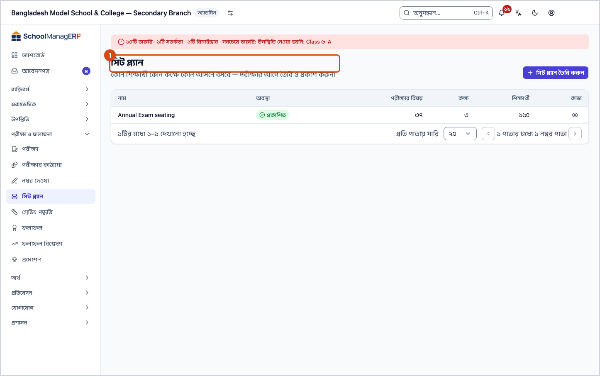
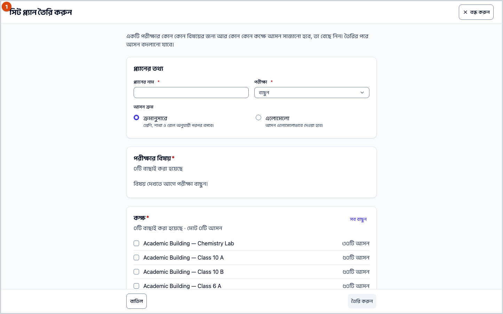

<!-- guide:meta
feature: examsResults.seatPlans
title: সিট প্ল্যান তৈরি ও প্রকাশ
summary: পরীক্ষার বিষয় আর কক্ষ বেছে কোন শিক্ষার্থী কোন কক্ষে কোন আসনে বসবে তা তৈরি করুন, দরকারে আসন বদলান, কক্ষে পরিদর্শক দিন, তারপর প্রকাশ করুন।
roles: [ADMIN, EXAM_CONTROLLER]
sources:
  - client-admin/src/routes/_staff/exams/seat-plans/index.tsx
  - client-admin/src/routes/_staff/exams/seat-plans/$planId.tsx
  - client-admin/src/routes/_staff/exams/seat-plans/-generate-seat-plan-modal.tsx
  - client-admin/src/routes/_staff/exams/seat-plans/-invigilator-picker.tsx
  - client-admin/src/routes/_staff/exams/seat-plans/-publish-dialog.tsx
  - client-admin/src/routes/_staff/exams/seat-plans/-reseat-dialog.tsx
  - client-admin/src/routes/_staff/exams/seat-plans/-seat-plan-status-badge.tsx
  - server/src/modules/seat-plans/seat-plans.controller.ts
  - server/src/modules/seat-plans/seat-plans.service.ts
  - server/src/modules/seat-plans/allocation.ts
labels:
  [
    seatPlans:list.*,
    seatPlans:status.*,
    seatPlans:generate.*,
    seatPlans:errors.*,
    seatPlans:fields.*,
    seatPlans:help.*,
    seatPlansDetail:detail.*,
    seatPlansDetail:room.*,
    seatPlansDetail:reseat.*,
    seatPlansDetail:publish.*,
    seatPlansDetail:reshuffle.*,
    seatPlansDetail:unpublish.*,
    seatPlansDetail:delete.*,
    seatPlansDetail:errors.*,
    seatPlansDetail:fields.*,
    seatPlansDetail:help.*,
    nav:items.seatPlans,
    nav:groups.examsResults,
    common:actions.cancel,
    common:accessDenied.*,
  ]
helpIds:
  [
    examsResults.seatPlans,
    examsResults.seatPlans.action.generate,
    examsResults.seatPlans.action.publish,
    examsResults.seatPlans.action.unpublish,
    examsResults.seatPlans.action.reshuffle,
    examsResults.seatPlans.action.reseat,
    examsResults.seatPlans.action.delete,
    examsResults.seatPlans.field.rooms,
    examsResults.seatPlans.field.seatOrder,
    examsResults.seatPlans.field.invigilator,
  ]
devices: [desktop]
entry: [sidebar, palette]
keywords:
  [সিট প্ল্যান, আসন, আসন বিন্যাস, কক্ষ, পরিদর্শক, ইনভিজিলেটর, আসন ক্রম, এলোমেলো, প্রকাশ, seat plan, seating, room, invigilator, reshuffle, publish]
appVersion: 0.1.0 (dd9119702)
owner: tareq89
lastVerified: 2026-10-25
knownIssues:
  - { id: seat-plan-claimed-sitting-generic-error, checked: 2026-10-25, issue: 2918 }
  - { id: seat-plan-publish-conflict-generic-error, checked: 2026-10-25, issue: 2919 }
  - { id: seat-plan-invigilator-busy-generic-error, checked: 2026-10-25, issue: 2920 }
-->

# সিট প্ল্যান তৈরি ও প্রকাশ

পরীক্ষার বিষয় আর কক্ষ বেছে কোন শিক্ষার্থী কোন কক্ষে কোন আসনে বসবে তা তৈরি করুন, দরকারে আসন বদলান, কক্ষে পরিদর্শক দিন, তারপর প্রকাশ করুন।

**যেতে হবে:** বাম মেনুতে **পরীক্ষা ও ফলাফল → সিট প্ল্যান**। এই পাতার কাজ কম্পিউটারে করুন।
**শুরুর আগে:** আপনি অ্যাডমিন বা পরীক্ষা নিয়ন্ত্রক হবেন ([কে কী করতে পারেন](#roles))। যে [পরীক্ষা](exams.md)র আসন সাজাবেন, তার [সময়সূচি](exams.md#task-schedule) দেওয়া থাকতে হবে। কক্ষগুলো ধারণক্ষমতাসহ যোগ করা থাকতে হবে ([কক্ষ যোগ করুন](../academics/routine-setup.md#task-rooms))।

সিট প্ল্যান বানানো হয় পরীক্ষার **বিষয়** ধরে, যেমন **অর্ধ-বার্ষিক**-এর **বাংলা ১ম পত্র**, ১২ মার্চ সকাল ১০টা। যে শ্রেণির পরীক্ষা, তার সব শাখার শিক্ষার্থী বাছা কক্ষগুলোতে আসন পায়। প্রকাশের আগে প্ল্যান **খসড়া** থাকে; তখন আসন বদলানো যায়। প্রকাশের পর প্ল্যানটি শুধু দেখা যায়।

[সিট প্ল্যান তৈরি করুন](#task-main) · [আসন বদলান](#task-reseat) · [প্রকাশ করুন](#task-publish) · [প্রকাশ বন্ধ করুন](#task-unpublish) · [সমস্যা ও সমাধান](#trouble)

**এই পাতায় যা আছে**

- [এই পাতায় যেভাবে আসবেন](#arrive)
- [সিট প্ল্যান তৈরি করুন](#task-main)
- [সিট প্ল্যান তৈরি হয়েছে কি না বুঝবেন কীভাবে](#confirm)
- [অন্য পরিস্থিতিতে](#other)
  - [আসন যথেষ্ট না হলে](#task-shortfall)
  - [কক্ষে পরিদর্শক দিন](#task-invigilator)
  - [একজনের আসন বদলান](#task-reseat)
  - [পুরো কক্ষের আসন আবার সাজান](#task-reshuffle)
  - [সিট প্ল্যান প্রকাশ করুন](#task-publish)
  - [প্রকাশ বন্ধ করুন](#task-unpublish)
  - [সিট প্ল্যান মুছুন](#task-delete)
  - [প্ল্যানের পাতা](#task-detail)
- [সমস্যা ও সমাধান](#trouble)
- [কে কী করতে পারেন](#roles)
- [জানা সমস্যা](#known-issues)
- [আরও জানুন](#more)

---

## এই পাতায় যেভাবে আসবেন 

**বাম মেনু থেকে:** **পরীক্ষা ও ফলাফল → সিট প্ল্যান** চাপুন। নিচের ধাপ ১ থেকে শুরু করুন।

**খোঁজার ঘর থেকে:** উপরের খোঁজার ঘরে (Ctrl+K) **সিট প্ল্যান তৈরি করুন** লিখে বেছে নিন। → সিট প্ল্যানের তালিকা খোলে, আর **সিট প্ল্যান তৈরি করুন** ঘর নিজে থেকে খোলা থাকে। নিচের ধাপ ৩ থেকে শুরু করুন। **সিট প্ল্যান প্রকাশ করুন** লিখে বাছলে শুধু তালিকা খোলে; সেখান থেকে প্ল্যান খুলে [প্রকাশ করুন](#task-publish)। খোঁজার নিয়ম: [যেকোনো পাতা খুঁজে পাওয়া](../start/find-anything.md)।

---

## সিট প্ল্যান তৈরি করুন 

1. বাম মেনুতে **পরীক্ষা ও ফলাফল → সিট প্ল্যান** চাপুন।

   → উপরে **সিট প্ল্যান** শিরোনাম। তালিকায় **নাম**, **অবস্থা**, **পরীক্ষার বিষয়**, **কক্ষ**, **শিক্ষার্থী** কলাম। কিছু না থাকলে **এখনো কোনো সিট প্ল্যান নেই**।

2. পাতার উপরে **সিট প্ল্যান তৈরি করুন** চাপুন।

   → **সিট প্ল্যান তৈরি করুন** ঘর খোলে।

3. **প্ল্যানের তথ্য** অংশে **প্ল্যানের নাম** লিখুন, যেমন `অর্ধ-বার্ষিক, প্রথম সপ্তাহ`।

4. **পরীক্ষা** বাছুন।

   → **পরীক্ষার বিষয়** অংশে সেই পরীক্ষার সময়সূচির বিষয়গুলো আসে, প্রতিটির নিচে তারিখ ও সময়। সময়সূচি না থাকলে **এই পরীক্ষার এখনো কোনো সময়সূচি নেই।**

5. **আসন ক্রম** বাছুন: **ক্রমানুসারে** (শ্রেণি, শাখা ও রোল অনুযায়ী পরপর বসবে) বা **এলোমেলো**। শুরুতে **ক্রমানুসারে** বাছা থাকে।

6. **পরীক্ষার বিষয়** থেকে এক বা একাধিক বিষয়ে টিক দিন। সব একসঙ্গে বাছতে **সব বাছুন**।

7. **কক্ষ** থেকে কক্ষে টিক দিন। যে ক্রমে টিক দেন, সেই ক্রমে কক্ষ ভরে।

   → উপরে লেখা থাকে, যেমন **৩টি বাছাই করা হয়েছে · মোট ১২০টি আসন**। কোনো কক্ষ না থাকলে **এখনো কোনো কক্ষ সেট আপ করা হয়নি।**

8. **তৈরি করুন** চাপুন। নাম, অন্তত একটি বিষয় আর একটি কক্ষ না দেওয়া পর্যন্ত বোতামটি চাপা যায় না।

   → **সিট প্ল্যান তৈরি হয়েছে।** বার্তা আসে, আর প্ল্যানের পাতা খোলে, অবস্থা **খসড়া**।

> **মনে রাখুন:** খসড়া প্ল্যান শিক্ষার্থী বা পরিদর্শকের জন্য চূড়ান্ত নয়। আসন দেখে ঠিক করে নিন, তারপর [প্রকাশ করুন](#task-publish)।

---

## সিট প্ল্যান তৈরি হয়েছে কি না বুঝবেন কীভাবে 

সিট প্ল্যান শুধু ইন্টারনেট থাকলে সংরক্ষিত হয়; ডিভাইসে জমিয়ে রেখে পরে পাঠানো যায় না। তাই **এই ডিভাইসে সংরক্ষিত** অবস্থা এখানে নেই।

| অবস্থা                       | কীভাবে বুঝবেন                                                            | এরপর কী                                   |
| ---------------------------- | ------------------------------------------------------------------------ | ----------------------------------------- |
| **শুধু স্ক্রিনে বদলেছে**     | ঘর খোলা, বিষয় আর কক্ষ বাছা, কিন্তু প্ল্যানের পাতা খোলেনি                | **তৈরি করুন** চাপুন                       |
| **স্কুলের সিস্টেমে পৌঁছেছে** | প্ল্যানের পাতা খুলেছে, অবস্থা **খসড়া**, কক্ষের কার্ডে শিক্ষার্থীর তালিকা | আসন দেখে [প্রকাশ করুন](#task-publish)     |
| **প্রকাশিত**                 | অবস্থা **প্রকাশিত**; লেখা থাকে আর বদলানো যাবে না                        | [প্রবেশপত্র ও সিট লিস্ট প্রিন্ট](../administration/print-templates/exam-documents.md) |

**যাচাই করতে চাইলে:** তালিকায় ফিরে দেখুন প্ল্যানটি আছে কি না, আর **শিক্ষার্থী** কলামে সংখ্যা ঠিক কি না।

**বার্তা না এলে:** [সমস্যা ও সমাধান](#trouble) দেখুন। বাছাইগুলো ঘরেই থাকে।

---

## অন্য পরিস্থিতিতে 

### আসন যথেষ্ট না হলে 

বাছা কক্ষে সবার আসন না হলে প্ল্যান তৈরি হয় না। ঘরেই লেখা আসে, যেমন **পর্যাপ্ত আসন নেই: ১৫০ জন শিক্ষার্থীর আসন প্রয়োজন কিন্তু মাত্র ১২০টি আসন আছে (৩০টি কম)। একটি প্রস্তাবিত কক্ষ যোগ করে আবার চেষ্টা করুন।**

1. নিচের প্রস্তাবিত কক্ষের পাশে **যোগ করুন** চাপুন।
2. আবার **তৈরি করুন** চাপুন।

একই সময়ের একাধিক বিষয় বাছলে সবার আসন একসঙ্গে লাগে; ভিন্ন সময়ের বিষয় একই কক্ষ আলাদাভাবে পুরোটা ব্যবহার করতে পারে। ধারণক্ষমতা না দেওয়া কক্ষে কোনো আসন গোনা হয় না।

**সময় মিলে গেলে:** বাছা কক্ষ একই সময়ে অন্য একটি **প্রকাশিত** প্ল্যানেও থাকলে প্ল্যান তবুও তৈরি হয়, কিন্তু আগে একটি ঘর আসে: **সময় মিলে যাচ্ছে**, আর প্রতিটি কক্ষের লাইন, যেমন **কক্ষ ১০১ · একই সময়ে „বার্ষিক“ প্ল্যানেও আছে**। **প্ল্যান খুলুন** চেপে প্ল্যানে যান, অথবা **বন্ধ করুন**। এই অবস্থায় প্ল্যানটি প্রকাশ করা যায় না, যতক্ষণ না কক্ষ বদলান ([জানা সমস্যা](#known-issues))।

### কক্ষে পরিদর্শক দিন 

1. খসড়া প্ল্যানের পাতায় কক্ষের কার্ডে **পরিদর্শক** ঘরে চাপুন।
2. একজন কর্মী বাছুন। কাউকে না রাখতে **নির্ধারিত নয়** বাছুন।

   → সঙ্গে সঙ্গে সংরক্ষিত হয়। না হলে **পরিদর্শক বদলানো যায়নি।** দেখায়।

শুধু স্কুলের কর্মীদের পরিদর্শক করা যায়। যিনি ওই কক্ষের কোনো পরীক্ষার সময়ে অন্য কাজে ব্যস্ত, তাঁকে দেওয়া যায় না।

### একজনের আসন বদলান 

1. কক্ষের তালিকায় শিক্ষার্থীর সারিতে **আসন বদলান — {নাম}** চাপুন।

   → **আসন বদলান** ঘর খোলে: "{নাম}-কে অন্য কক্ষ বা আসনে সরান।"

2. **কক্ষ** বাছুন আর **আসন নম্বর** লিখুন।

3. **সংরক্ষণ করুন** চাপুন।

   → আসনে কেউ থাকলে **এই আসনে আর একজন বসে আছে।**; কক্ষ ভরা থাকলে **এই কক্ষে আর খালি আসন নেই।**

আসন বদল শুধু উপরে বাছা বিষয়ের জন্য হয়। প্ল্যানে কয়েকটি বিষয় থাকলে উপরের **কোন বিষয়ের আসন দেখবেন** ঘর থেকে বিষয় বাছুন।

### পুরো কক্ষের আসন আবার সাজান 

1. কক্ষের কার্ডে **আসন আবার সাজান** চাপুন।

   → **এই কক্ষের আসন আবার সাজাবেন?** ঘর: "{কক্ষ}-এর সব আসন নতুন করে দেওয়া হবে। আগের আসন বদল হারিয়ে যাবে।"

2. **আবার সাজান** চাপুন।

   → প্ল্যানের **আসন ক্রম** মেনে ওই কক্ষের শিক্ষার্থীরা আবার আসন পান। শিক্ষার্থীরা কক্ষ বদলান না।

### সিট প্ল্যান প্রকাশ করুন 

1. খসড়া প্ল্যানের পাতায় উপরে **সিট প্ল্যান প্রকাশ করুন** চাপুন।

   → **সিট প্ল্যান প্রকাশ করুন** ঘর: প্রকাশের পর আসন, কক্ষ এবং পরিদর্শক আর পরিবর্তন করা যাবে না।

2. **প্রকাশ করুন** চাপুন।

   → অবস্থা **প্রকাশিত**। লেখা থাকে **এই সিট প্ল্যান প্রকাশিত — আসন, কক্ষ ও পরিদর্শক আর বদলানো যাবে না।** আসন বদলের সব বোতাম চলে যায়।

একটি বিষয় একসঙ্গে দুটি প্রকাশিত প্ল্যানে থাকতে পারে না। প্রকাশের পর সেই বিষয়ের পরীক্ষার তারিখ-সময় বদলানো যায় না ([সময়সূচি দিন](exams.md#task-schedule))।

### প্রকাশ বন্ধ করুন 

1. প্রকাশিত প্ল্যানের পাতায় উপরে **প্রকাশ বন্ধ করুন** চাপুন।

   → **আসন পরিকল্পনার প্রকাশ বন্ধ করুন** ঘর: পরিকল্পনাটি আবার খসড়া হবে, পরে আবার প্রকাশ করা যাবে।

2. **প্রকাশ বন্ধ করুন** চাপুন।

   → অবস্থা আবার **খসড়া**; আসন, কক্ষ ও পরিদর্শক বদলানো যায়।

প্ল্যানের প্রথম বিষয়ের পরীক্ষার দিন এসে গেলে (স্কুলের সময় অনুযায়ী সেই দিন থেকেই) প্রকাশ বন্ধ করা যায় না। তখন দেখায় **এই পরিকল্পনার প্রথম পরীক্ষা শুরু হয়ে গেছে, তাই আর বদলানো যাবে না।**

### সিট প্ল্যান মুছুন 

শুধু **খসড়া** প্ল্যান মোছা যায়। প্রকাশিত প্ল্যান মুছতে আগে [প্রকাশ বন্ধ করুন](#task-unpublish)।

1. প্ল্যানের পাতায় উপরে **পরিকল্পনা মুছুন** চাপুন।

   → **আসন পরিকল্পনা মুছুন** ঘর: খসড়াটি মুছে যাবে, আর এর পরীক্ষার বিষয়গুলো নতুন প্ল্যানে দেওয়া যাবে।

2. **মুছুন** চাপুন।

| আপনি চাপলেন    | কী হবে                                                      | জমা হলো? |
| -------------- | ----------------------------------------------------------- | -------- |
| **মুছুন**      | প্ল্যান চলে যায়, তালিকায় ফেরেন; ফেরানো যায় না             | হ্যাঁ    |
| **বাতিল করুন** | কিছুই বদলায় না                                             | না       |

### প্ল্যানের পাতা 

তালিকায় প্ল্যানের নামে বা **দেখুন**-এ চাপলে পাতা খোলে। উপরে নাম, অবস্থা, আর **পরীক্ষার বিষয়**, **কক্ষ**, **শিক্ষার্থী**, **আসন ক্রম**। প্রতিটি কক্ষের কার্ডে লেখা থাকে কতজন বসেছে, যেমন **৩৮ জন বসেছে · ধারণক্ষমতা ৪০**, আর তালিকায় **আসন**, **শিক্ষার্থী**, **শাখা**, **রোল**। ওই বিষয়ে কেউ না বসলে **এই বিষয়ে এই কক্ষে কেউ বসেনি।**

---

## সমস্যা ও সমাধান 

| আপনি যা দেখছেন                                                           | কী করবেন                                                                                                                                         | কে সাহায্য করতে পারেন |
| ------------------------------------------------------------------------ | ------------------------------------------------------------------------------------------------------------------------------------------------ | --------------------- |
| **এই পাতাটি দেখার অনুমতি আপনার নেই।**                                    | এই পাতা শুধু অ্যাডমিন আর পরীক্ষা নিয়ন্ত্রক দেখেন। **ড্যাশবোর্ডে ফিরে যান** চাপুন।                                                               | অ্যাডমিন              |
| **সিট প্ল্যান লোড করা যায়নি।** বা **এই সিট প্ল্যান লোড করা যায়নি।**     | ইন্টারনেট দেখে পাতা রিলোড করুন।                                                                                                                  | অ্যাডমিন              |
| **এই পরীক্ষার এখনো কোনো সময়সূচি নেই।**                                   | আগে পরীক্ষার [সময়সূচি দিন](exams.md#task-schedule)।                                                                                             | অ্যাডমিন              |
| **এখনো কোনো কক্ষ সেট আপ করা হয়নি।**                                      | আগে [কক্ষ যোগ করুন](../academics/routine-setup.md#task-rooms), ধারণক্ষমতাসহ।                                                                     | অ্যাডমিন              |
| **পর্যাপ্ত আসন নেই: …**                                                   | [আসন যথেষ্ট না হলে](#task-shortfall) দেখুন।                                                                                                     | অ্যাডমিন              |
| **কিছু একটা ভুল হয়েছে। আবার চেষ্টা করুন।** (তৈরি করার সময়)               | বাছা কোনো বিষয় হয়তো আগেই অন্য প্রকাশিত প্ল্যানে আছে; তালিকা দেখে সেই বিষয় বাদ দিন ([জানা সমস্যা](#known-issues))। না হলে ইন্টারনেট দেখুন।    | অ্যাডমিন              |
| **সিট প্ল্যান প্রকাশ করা যায়নি।**                                        | কোনো কক্ষ একই সময়ে অন্য প্রকাশিত প্ল্যানে আছে কি না দেখুন; থাকলে সেই শিক্ষার্থীদের অন্য কক্ষে সরান ([আসন বদলান](#task-reseat))।                | অ্যাডমিন              |
| **পরিদর্শক বদলানো যায়নি।**                                               | তিনি হয়তো ওই সময়ে অন্য কাজে ব্যস্ত; অন্য কাউকে বাছুন।                                                                                           | অ্যাডমিন              |
| **এই আসনে আর একজন বসে আছে।** বা **এই কক্ষে আর খালি আসন নেই।**           | অন্য আসন নম্বর বা অন্য কক্ষ দিন।                                                                                                                 | অ্যাডমিন              |
| **এই পরিকল্পনার প্রথম পরীক্ষা শুরু হয়ে গেছে, তাই আর বদলানো যাবে না।**    | পরীক্ষা শুরু হয়ে গেলে প্ল্যান বদলানো যায় না। দরকারে কেন্দ্রে হাতে বদল লিখে রাখুন।                                                             | অ্যাডমিন              |
| **আসন পরিকল্পনা মুছতে পারেনি।**                                          | প্ল্যানটি খসড়া কি না দেখুন, তারপর ইন্টারনেট দেখে আবার চেষ্টা করুন।                                                                              | অ্যাডমিন              |

---

## কে কী করতে পারেন 

| ভূমিকা                                                                       | তালিকা ও প্ল্যান দেখতে | তৈরি, আসন বদল, পরিদর্শক, মোছা | প্রকাশ ও প্রকাশ বন্ধ |
| ---------------------------------------------------------------------------- | ---------------------- | ----------------------------- | -------------------- |
| অ্যাডমিন                                                                     | হ্যাঁ                  | হ্যাঁ                         | হ্যাঁ                |
| পরীক্ষা নিয়ন্ত্রক                                                           | হ্যাঁ                  | হ্যাঁ                         | হ্যাঁ                |
| একাডেমিক কো-অর্ডিনেটর, শিক্ষক, হিসাবরক্ষক, অফিস সহকারী, পরিচালনা পর্ষদ সদস্য | না                     | না                            | না                   |

অন্য ভূমিকার বাম মেনুতে **সিট প্ল্যান** থাকে না; পাতাটি খুললে তাঁরা **এই পাতাটি দেখার অনুমতি আপনার নেই।** দেখেন। শুধু দেখার আলাদা কোনো অনুমতি নেই। সিট লিস্ট আর পরিদর্শকের শিট প্রিন্ট হয় পরীক্ষার **প্রিন্ট** ট্যাব থেকে ([পরীক্ষার কাগজপত্র](../administration/print-templates/exam-documents.md))।

---

## জানা সমস্যা 

সংস্করণ ০.১.০-এ কোড দেখে যাচাই করা, ২০২৬-১০-২৫। অ্যাপে চালিয়ে দেখা হয়নি। ঠিক হলে এই অংশ থেকে সরিয়ে দেওয়া হবে।

| সমস্যা                                                                                                                                           | কার, কখন                                  | তথ্য সংরক্ষিত?             | আপাতত কী করবেন                                                         |
| ------------------------------------------------------------------------------------------------------------------------------------------------ | ----------------------------------------- | -------------------------- | ---------------------------------------------------------------------- |
| যে বিষয় আগেই অন্য প্রকাশিত প্ল্যানে আছে, সেটি বেছে তৈরি করলে শুধু **কিছু একটা ভুল হয়েছে। আবার চেষ্টা করুন।** দেখায়; কোন বিষয় তা বলে না           | যিনি সিট প্ল্যান তৈরি করেন                | না, প্ল্যান তৈরি হয়নি      | তালিকায় প্রকাশিত প্ল্যানগুলো খুলে দেখুন কোন বিষয় আছে, সেটি বাদ দিন   |
| কোনো কক্ষ একই সময়ে অন্য প্রকাশিত প্ল্যানে থাকলে প্রকাশে শুধু **সিট প্ল্যান প্রকাশ করা যায়নি।** দেখায়; কোন কক্ষ তা বলে না                         | যিনি প্রকাশ করেন                          | না, প্ল্যান খসড়াই থাকে     | তৈরির সময়ের **সময় মিলে যাচ্ছে** তালিকা মনে রাখুন; সেই কক্ষ খালি করুন |
| ব্যস্ত কাউকে পরিদর্শক বাছলে শুধু **পরিদর্শক বদলানো যায়নি।** দেখায়; কেন তা বলে না                                                                 | যিনি পরিদর্শক দেন                         | না, আগের পরিদর্শকই থাকেন   | অন্য কাউকে বাছুন                                                       |

---

## আরও জানুন 

<strong>পাতার অংশগুলো</strong> — প্ল্যানের পাতা, উপর থেকে নিচে

1. **নাম ও অবস্থা** — **খসড়া** বা **প্রকাশিত**।
2. **তথ্যের সারি** — **পরীক্ষার বিষয়**, **কক্ষ**, **শিক্ষার্থী**, **আসন ক্রম**।
3. **উপরের বোতাম** — **সিট প্ল্যান প্রকাশ করুন** ও **পরিকল্পনা মুছুন** (খসড়ায়), **প্রকাশ বন্ধ করুন** (প্রকাশিত হলে)।
4. **কোন বিষয়ের আসন দেখবেন** — প্ল্যানে একাধিক বিষয় থাকলে।
5. **কক্ষের কার্ড** — পরিদর্শক, **আসন আবার সাজান**, শিক্ষার্থীর তালিকা।

<!-- image pending: খসড়া প্ল্যানের পাতার পাঁচটি অংশ নম্বর দিয়ে চিহ্নিত, অ্যাডমিন, desktop -->

<strong>ঘরগুলোর অর্থ</strong>

<!-- guide:generated:fields:seatPlans -->

| ঘর             | কী লিখবেন                                                           | বাধ্যতামূলক? |
| -------------- | ------------------------------------------------------------------- | ------------ |
| প্ল্যানের নাম  | যেমন অর্ধ-বার্ষিক, প্রথম সপ্তাহ।                                    | হ্যাঁ        |
| পরীক্ষা        | যে পরীক্ষার বিষয়ের আসন সাজাবেন।                                    | হ্যাঁ        |
| পরীক্ষার বিষয় | পরীক্ষার সময়সূচিতে থাকা বিষয়; অন্তত একটি।                         | হ্যাঁ        |
| কক্ষ           | অন্তত একটি কক্ষ। কক্ষগুলো বাছার ক্রমে ভরে।                          | হ্যাঁ        |
| আসন ক্রম       | ক্রমানুসারে: শ্রেণি, শাখা ও রোল ধরে পরপর। এলোমেলো: আসন এলোমেলোভাবে। | না           |

<!-- /guide:generated -->

<!-- guide:generated:fields:seatPlansDetail -->

| ঘর        | কী লিখবেন                                                                     | বাধ্যতামূলক? |
| --------- | ----------------------------------------------------------------------------- | ------------ |
| পরিদর্শক  | কক্ষ দেখার দায়িত্বে একজন কর্মী। ওই সময়ে তাঁর অন্য কাজ থাকলে দেওয়া যায় না। | না           |
| কক্ষ      | আসন বদলের সময় শিক্ষার্থীকে যে কক্ষে সরাবেন।                                  | হ্যাঁ        |
| আসন নম্বর | সেই কক্ষে খালি একটি আসনের নম্বর।                                              | হ্যাঁ        |

<!-- /guide:generated -->

<strong>সিট প্ল্যান কীভাবে কাজ করে</strong> — খসড়া থেকে প্রকাশ, আর পুরো পরীক্ষার ধারা

<figure>
  
  <figcaption><em>সিট প্ল্যানের দুটি অবস্থা</em></figcaption>
</figure>

<figure>
  
  <figcaption><em>পরীক্ষা থেকে প্রমোশন পর্যন্ত</em></figcaption>
</figure>

- সিট প্ল্যান বিষয় ধরে, পুরো পরীক্ষা ধরে নয়। এক সপ্তাহের বিষয় এক প্ল্যানে, পরের সপ্তাহের বিষয় আরেক প্ল্যানে রাখা যায়।
- প্রকাশের পর সিট লিস্ট, পরিদর্শকের শিট আর সিট স্টিকার প্রিন্ট করুন: [পরীক্ষার কাগজপত্র](../administration/print-templates/exam-documents.md)।

**সম্পর্কিত পাতা**

- [**পরীক্ষা**](exams.md) — পরীক্ষার সময়সূচি, যা থেকে প্ল্যানের বিষয় আসে।
- [**পরীক্ষার কাঠামো**](exam-templates.md) — পরীক্ষার অংশ একবার ঠিক করে রাখা।
- [**রুটিন সেটআপ**](../academics/routine-setup.md) — কক্ষ আর তার ধারণক্ষমতা যোগ করা।
- [**পরীক্ষার কাগজপত্র ছাপা**](../administration/print-templates/exam-documents.md) — পরীক্ষার প্রবেশপত্র, সিট স্লিপ, নম্বরপত্র ও ফলাফলের কাগজ এক এক করে বা ব্যাচে ছাপুন।
- [**পরীক্ষার সময়সূচি**](../portal/exam-schedule.md) — অভিভাবক ও শিক্ষার্থী যেখানে পরীক্ষার তারিখ ও আসন দেখেন।

---

_সংস্করণ ০.১.০ · শেষ যাচাই ২০২৬-১০-২৫_
