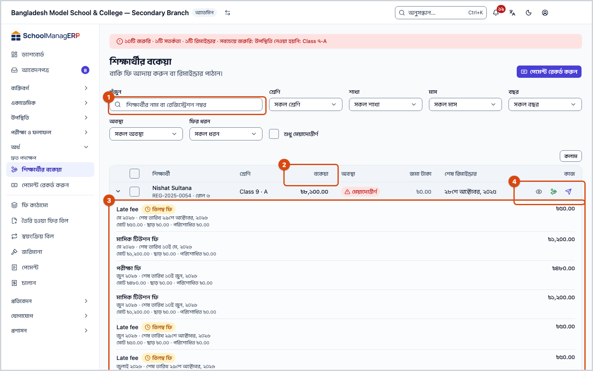
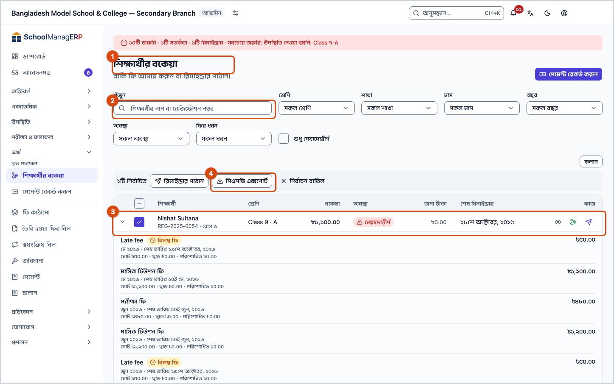

<!-- guide:meta
feature: finance.dues
title: শিক্ষার্থীর বকেয়া
summary: কোন শিক্ষার্থীর কত টাকা বাকি তা এক তালিকায় দেখুন, মেয়াদোত্তীর্ণদের আলাদা করুন, তারপর সেখান থেকেই ফি আদায় করুন, রিমাইন্ডার পাঠান বা তালিকা সিএসভি করে নিন।
roles: [ADMIN, ACCOUNTANT]
sources:
  - client-admin/src/routes/_staff/fees/dues.tsx
  - server/src/modules/fees/fees.controller.ts
  - server/src/modules/fees/fee-dues.service.ts
labels:
  [
    fees:dues.*,
    nav:items.studentDues,
    nav:groups.finance,
  ]
helpIds:
  [
    finance.dues,
    finance.dues.action.collect,
    finance.dues.action.sendReminder,
    finance.dues.action.exportCsv,
    finance.dues.field.flagged,
  ]
devices: [desktop, phone]
entry: [sidebar, palette]
keywords:
  [বকেয়া, বাকি টাকা, মেয়াদোত্তীর্ণ, ফি আদায়, রিমাইন্ডার, জমা টাকা, dues, outstanding, overdue, arrears, collect]
appVersion: 0.1.0 (978d9b96a)
owner: tareq89
lastVerified: 2026-10-25
knownIssues: []
-->

# শিক্ষার্থীর বকেয়া

কার কত টাকা বাকি, এক জায়গায় দেখুন, আর সেখান থেকেই টাকা নিন।

**যেতে হবে:** বাম মেনুতে **অর্থ → শিক্ষার্থীর বকেয়া**।
**শুরুর আগে:** আপনি অ্যাডমিন বা হিসাবরক্ষক হবেন। বকেয়া দেখাতে আগে বিল থাকতে হবে ([**ফির বিল তৈরি করা**](generate-fees.md))।

তালিকার প্রতিটি সারি একজন শিক্ষার্থী, যাঁর অন্তত একটি বিল এখনো পুরো শোধ হয়নি। সারি খুললে তাঁর প্রতিটি বাকি বিল আলাদা দেখা যায়। টাকা নিতে [**পেমেন্ট রেকর্ড করুন**](record-payment.md) পাতায় যান।

[বকেয়া খুঁজুন](#task-main) · [ফি আদায়](#task-collect) · [রিমাইন্ডার](#task-remind) · [সমস্যা ও সমাধান](#trouble)

**এই পাতায় যা আছে**

- [একজন শিক্ষার্থীর বকেয়া খুঁজুন](#task-main)
- [ঠিক দেখছেন কি না বুঝবেন কীভাবে](#confirm)
- [অন্য পরিস্থিতিতে](#other)
  - [তালিকা থেকে ফি আদায় করুন](#task-collect)
  - [শুধু মেয়াদোত্তীর্ণদের দেখুন](#task-overdue)
  - [রিমাইন্ডার পাঠান](#task-remind)
  - [সিএসভি এক্সপোর্ট](#task-export)
- [সমস্যা ও সমাধান](#trouble)
- [কে কী করতে পারেন](#roles)
- [আরও জানুন](#more)

---

## একজন শিক্ষার্থীর বকেয়া খুঁজুন 

1. বাম মেনুতে **অর্থ** চাপুন, তারপর **শিক্ষার্থীর বকেয়া** চাপুন।

   → **শিক্ষার্থীর বকেয়া** তালিকা খোলে। প্রতি সারিতে **শিক্ষার্থী**, **শ্রেণি**, **বকেয়া**, **অবস্থা**, **জমা টাকা** আর **শেষ রিমাইন্ডার**। যাঁর বকেয়া সবচেয়ে বেশি, তিনি সবার আগে। শুরুতে প্রতি পাতায় ২৫টি সারি থাকে; চাইলে ১০০ পর্যন্ত বাড়াতে পারেন।

2. **খুঁজুন** ঘরে শিক্ষার্থীর নাম বা রেজিস্ট্রেশন নম্বর লিখুন। দরকার হলে **শ্রেণি**, **শাখা**, **মাস**, **বছর**, **অবস্থা** বা **ফির ধরন** দিয়ে ছাঁকুন।
3. সারির বাঁ পাশের তীর চাপুন।

   → সারির নিচে প্রতিটি বাকি বিল খোলে: ফির নাম, মেয়াদ, **শেষ তারিখ**, বাকি টাকা, আর **মোট … · ছাড় … · পরিশোধিত …**। দেরির জন্য যোগ হওয়া বিলের পাশে লেখা **বিলম্ব ফি**।

> **মনে রাখুন:** **বকেয়া** মানে যা এখনো বাকি, মোট বিল নয়। মোট বিল আর পরিশোধিত টাকা দেখতে **কলাম** চেপে **মোট** আর **পরিশোধিত** কলাম চালু করুন; শুরুতে এ দুটি লুকানো থাকে।

---

## ঠিক দেখছেন কি না বুঝবেন কীভাবে 

| **অবস্থা** কলামে   | মানে                                                  |
| ------------------ | ----------------------------------------------------- |
| **মেয়াদোত্তীর্ণ** | অন্তত একটি বিলের শেষ তারিখ পার হয়েছে, টাকা এখনো বাকি |
| **আংশিক পরিশোধিত** | কোনো বিলে কিছু টাকা পড়েছে, পুরোটা নয়                |
| **অপেক্ষমাণ**      | বিল আছে, এখনো কোনো টাকা পড়েনি, শেষ তারিখও পার হয়নি  |

একজনের বিলের মধ্যে মেয়াদোত্তীর্ণ একটি থাকলেই পুরো সারিতে **মেয়াদোত্তীর্ণ** দেখায়।

এই পাতা শুধু দেখায়; এখান থেকে কোনো টাকা বদলায় না। টাকা নিলে তালিকা নিজে থেকে কমে যায়; পুরো শোধ হলে শিক্ষার্থী তালিকা থেকে সরে যান।

---

## অন্য পরিস্থিতিতে 

### তালিকা থেকে ফি আদায় করুন 

1. শিক্ষার্থীর সারির মেনুতে **ফি আদায়** চাপুন।

   → [**পেমেন্ট রেকর্ড করুন**](record-payment.md) পাতা খোলে, শিক্ষার্থী আগে থেকে বাছা।

2. সেখানে টাকা নিন। শেষ হলে ফিরে এলে বকেয়া কমে গেছে।

কাউকে বাছা ছাড়া শুরু করতে উপরে [**পেমেন্ট রেকর্ড করুন**](record-payment.md) চাপুন। শিক্ষার্থীর সব বিল আর পেমেন্ট দেখতে সারির **দেখুন** চাপুন; [**শিক্ষার্থী**](../people/students.md) পাতার ফি অংশ খোলে।

### শুধু মেয়াদোত্তীর্ণদের দেখুন 

ছাঁকনিতে **শুধু মেয়াদোত্তীর্ণ** টিক দিন। শুধু তাঁরা থাকেন যাঁদের অন্তত একটি বিলের শেষ তারিখ পার হয়েছে (শেষ তারিখের দিনটি এখনো মেয়াদোত্তীর্ণ নয়)। যাঁর এমন বিল সবচেয়ে বেশি, তিনি আগে; সমান হলে যাঁর বকেয়া বেশি, তিনি আগে।

এই অবস্থায় **খুঁজুন**, **মাস**, **বছর**, **অবস্থা** আর **ফির ধরন** লুকিয়ে যায়, আর কলাম চেপে সাজানো যায় না। **শ্রেণি** আর **শাখা** থাকে।

### রিমাইন্ডার পাঠান 

1. একজনকে পাঠাতে সারির মেনুতে **রিমাইন্ডার** চাপুন। কয়েকজনকে পাঠাতে তাঁদের টিক দিন, তারপর উপরে **রিমাইন্ডার পাঠান** চাপুন।
2. রিমাইন্ডারের জানালায় বার্তা দেখে পাঠান।

   → পাঠানো হলে **শেষ রিমাইন্ডার** কলামে আজকের তারিখ বসে। কখনো পাঠানো না হলে লেখা **কখনো না**।

একসাথে কয়েকজনকে পাঠালে, পাঠানোর পর টিকগুলো উঠে যায়।

### সিএসভি এক্সপোর্ট 

শিক্ষার্থীদের টিক দিন, তারপর **সিএসভি এক্সপোর্ট** চাপুন। `dues.csv` ফাইল নামে: **শিক্ষার্থী**, **শ্রেণি**, **শাখা**, **মোট**, **পরিশোধিত**, **বকেয়া**, **অবস্থা**, **শেষ রিমাইন্ডার**।

> **মনে রাখুন:** তালিকার মাথার টিক বক্স শুধু এই পাতার সারিগুলোতে টিক দেয়। অন্য পাতায় গেলে বা ছাঁকনি বদলালে আপনার টিক থেকে যায়, তাই কয়েক পাতা জুড়ে টিক দেওয়া যায়। পাতা রিলোড করলে সব টিক মুছে যায়। একসাথে অনেকজনকে টিক দিতে প্রতি পাতায় সারির সংখ্যা বাড়িয়ে নিন (১০০ পর্যন্ত)।

---

## সমস্যা ও সমাধান 

| আপনি যা দেখছেন                                                            | কী করবেন                                                                                                              | কে সাহায্য করতে পারেন |
| ------------------------------------------------------------------------- | --------------------------------------------------------------------------------------------------------------------- | --------------------- |
| **কোনো বকেয়া হিসাব পাওয়া যায়নি**                                       | ছাঁকনি সরিয়ে দেখুন। সত্যিই সবার টাকা শোধ হলেও এটি দেখায়।                                                            | —                     |
| **শিক্ষার্থীর বকেয়া লোড করা যায়নি**                                     | পাতা রিলোড করুন।                                                                                                      | অ্যাডমিন              |
| **ফি আদায়** বা [**পেমেন্ট রেকর্ড করুন**](record-payment.md) দেখা যায় না | এর জন্য ফি আদায় আর পেমেন্ট রেকর্ড দুই অনুমতিই লাগে। অ্যাডমিনকে জিজ্ঞেস করুন।                                         | অ্যাডমিন              |
| **জমা টাকা** কলামে —                                                      | শিক্ষার্থীর জমা টাকা লোড হয়নি। পাতা রিলোড করুন।                                                                      | —                     |
| শিক্ষার্থীকে খুঁজছেন, কিন্তু **খুঁজুন** ঘর নেই                            | **শুধু মেয়াদোত্তীর্ণ** টিক তুলে দিন।                                                                                 | —                     |
| এক্সপোর্ট ফাইলে কম সারি                                                   | শুধু টিক দেওয়া সারি আসে, আর রিলোড করলে টিক মুছে যায়। পাতাগুলো আবার ঘুরে টিক দিন। ([সিএসভি এক্সপোর্ট](#task-export)) | —                     |

---

## কে কী করতে পারেন 

| ভূমিকা                                                                               | বকেয়া দেখা | ফি আদায় | রিমাইন্ডার |
| ------------------------------------------------------------------------------------ | ----------- | -------- | ---------- |
| অ্যাডমিন                                                                             | হ্যাঁ       | হ্যাঁ    | হ্যাঁ      |
| হিসাবরক্ষক                                                                           | হ্যাঁ       | হ্যাঁ    | হ্যাঁ      |
| একাডেমিক কো-অর্ডিনেটর, শিক্ষক, অফিস সহকারী, পরীক্ষা নিয়ন্ত্রক, পরিচালনা পর্ষদ সদস্য | না          | না       | না         |

**অ্যাডমিন:** সব কাজ করতে পারেন।

**হিসাবরক্ষক:** সব কাজ করতে পারেন। বকেয়া দেখে টাকা নেওয়াই সাধারণত হিসাবরক্ষকের প্রতিদিনের কাজ।

অন্য ভূমিকার বাম মেনুতে **শিক্ষার্থীর বকেয়া** থাকে না।

---

## আরও জানুন 

<strong>পাতার অংশগুলো</strong> — শিক্ষার্থীর বকেয়া তালিকা

1. **শিক্ষার্থীর বকেয়া** শিরোনাম আর [**পেমেন্ট রেকর্ড করুন**](record-payment.md) বোতাম।
2. ছাঁকনি — **খুঁজুন**, **শ্রেণি**, **শাখা**, **মাস**, **বছর**, **অবস্থা**, **ফির ধরন**, **শুধু মেয়াদোত্তীর্ণ**।
3. তালিকা — তীর চাপলে বিলগুলো খোলে; সারির মেনুতে **দেখুন**, **ফি আদায়**, **রিমাইন্ডার**।
4. টিক দিলে উপরে আসে **রিমাইন্ডার পাঠান**, **সিএসভি এক্সপোর্ট**, **নির্বাচন বাতিল**।

<strong>বকেয়া কীভাবে হিসাব হয়</strong>

<figure>
  
  <figcaption><em>বকেয়ার পথ, বিল থেকে আদায়</em></figcaption>
</figure>

- **প্রতিটি বিলের বাকি:** মোট − ছাড় − পরিশোধিত। শিক্ষার্থীর **বকেয়া** তাঁর সব বাকি বিলের যোগফল।
- **কোন বিল আসে:** শুধু অপেক্ষমাণ, আংশিক পরিশোধিত বা মেয়াদোত্তীর্ণ বিল। পুরো শোধ বা মওকুফ করা বিল আসে না।
- **জমা টাকা:** আগে বেশি দেওয়া টাকা, যা শিক্ষার্থীর নামে জমা আছে। এটি বকেয়া থেকে নিজে কাটে না; টাকা নেওয়ার সময় [**জমা টাকা ব্যবহার করুন**](record-payment.md#task-wallet) বাছতে হয়।
- **একই মেয়াদে দুটি বিল:** ফির নামের পাশে (২) লেখা থাকে।

<strong>ঘরগুলোর সংক্ষিপ্ত সাহায্য (? বোতাম)</strong>

<!-- guide:generated:fields:fees -->

| ঘর                  | কী লিখবেন                                                                                                  | বাধ্যতামূলক? |
| ------------------- | ---------------------------------------------------------------------------------------------------------- | ------------ |
| শুধু মেয়াদোত্তীর্ণ | শুধু যাঁদের কোনো ফি রিমাইন্ডারের তারিখ পেরিয়ে গেছে তাঁদের দেখায়। বকেয়া আছে এমন সবাইকে দেখতে বন্ধ রাখুন। | না           |
| কখন বিল তৈরি হবে    | প্রতি মাসে আপনার বাছা একটি দিনে (বা শেষ দিনে), অথবা প্রতি সপ্তাহে আপনার বাছা দিনগুলোতে।                    | হ্যাঁ        |
| পরিশোধের সময় (দিন) | মেয়াদ শুরুর কত দিন পরে বিলের শেষ তারিখ। ০ থেকে ৬০-এর মধ্যে একটি সংখ্যা।                                   | হ্যাঁ        |
| কাদের বিল হবে       | পুরো স্কুল, অথবা একটি শ্রেণি, শাখা বা প্রোগ্রাম। শুধু এখন ভর্তি থাকা শিক্ষার্থীদের বিল হয়।                | না           |

<!-- /guide:generated -->

**সম্পর্কিত পাতা**

- [**ফি ও চালান**](../portal/fees.md) — অভিভাবক একই ফি যেভাবে দেখেন।

- [**পেমেন্ট রেকর্ড করুন**](record-payment.md) — বকেয়া থেকে টাকা নেওয়া।
- [**পেমেন্ট**](payments.md) — নেওয়া সব পেমেন্ট, রসিদ আর বাতিল।
- [**ফির বিল তৈরি করা**](generate-fees.md) — বকেয়া যেখান থেকে আসে।
- [**শিক্ষার্থী**](../people/students.md) — একজনের সব বিল আর পেমেন্ট।
- [**ফি রিমাইন্ডার**](../communications/fee-reminders.md) — বকেয়াদারদের ফি রিমাইন্ডার পাঠাতে
- [**জরিমানা**](fines.md) — জরিমানার বিলও এখানে বাকি দেখায়।
- [**চালান**](invoices.md) — পেমেন্টের রসিদ খোঁজা আর পাঠানো।
- [**ফি কাঠামো ঠিক করা**](fee-structures.md) — ফি কাঠামো ঠিক করা
- [**স্বয়ংক্রিয় বিলের নিয়ম**](recurring-schedules.md) — স্বয়ংক্রিয় বিলের নিয়ম
- [**ফি আদায়ের প্রতিবেদন**](../reports/collections-report.md) — পেমেন্ট থেকে তৈরি ফি আদায়ের প্রতিবেদন
