<!-- guide:meta
feature: finance.feeStructures
title: ফি কাঠামো ঠিক করা
summary: কোন ফি কত টাকা, তা প্রতি শিক্ষাবর্ষের জন্য লিখে রাখুন; পুরো বিদ্যালয়, একটি শ্রেণি বা একটি শাখার জন্য ফি দিন, পরে পরিমাণ বদলান বা অপ্রয়োজনীয় কাঠামো মুছুন।
roles: [ADMIN, ACCOUNTANT]
sources:
  - client-admin/src/routes/_staff/fee-structures/index.tsx
  - client-admin/src/routes/_staff/fee-structures/-structure-form-dialog.tsx
  - client-admin/src/routes/_staff/fee-structures/-delete-structure-dialog.tsx
  - server/src/modules/fees/fees.controller.ts
  - server/src/modules/fees/fees.service.ts
  - server/src/modules/fees/dto/fees.dto.ts
labels:
  [
    feeStructures:list.*,
    feeStructures:form.*,
    feeStructures:deleteDialog.*,
    feeStructures:feeTypes.*,
    feeStructures:fields.*,
    feeStructures:help.*,
    nav:items.feeStructures,
    nav:groups.finance,
  ]
helpIds:
  [
    finance.feeStructures,
    finance.feeStructures.action.add,
    finance.feeStructures.action.edit,
    finance.feeStructures.action.delete,
    finance.feeStructures.field.amount,
    finance.feeStructures.field.feeType,
    finance.feeStructures.field.academicYear,
    finance.feeStructures.field.class,
  ]
devices: [desktop]
entry: [sidebar, palette]
keywords:
  [ফি, ফি কাঠামো, বেতন, মাসিক বেতন, পরীক্ষার ফি, ভর্তি ফি, ফির পরিমাণ, fee structure, fee, tuition, amount]
appVersion: 0.1.0 (a25ab3344)
owner: tareq89
lastVerified: 2026-10-25
knownIssues:
  - { id: delete-blocked-wrong-reason, checked: 2026-10-25, issue: null } # delete-blocked red text names payments, but a fine rule or automatic billing rule is the real cause
  - { id: window-text-says-monthly-fees, checked: 2026-10-25, issue: null } # window text says fees are generated monthly; bills are created only by Create bills or an automatic billing rule
-->

# ফি কাঠামো ঠিক করা

কোন ফি কত টাকা, তা প্রতি শিক্ষাবর্ষের জন্য এখানে লিখে রাখুন।

**যেতে হবে:** বাম মেনুতে **অর্থ → ফি কাঠামো**। এই পাতার কাজ কম্পিউটারে করুন।
**শুরুর আগে:** আপনি অ্যাডমিন বা হিসাবরক্ষক হবেন। শিক্ষাবর্ষটি আগে থেকে থাকতে হবে ([শিক্ষাবর্ষ](../academics/academic-years.md))। কোনো শ্রেণির জন্য ফি দিতে চাইলে সেই শ্রেণিও থাকতে হবে ([শ্রেণি](../academics/classes.md))।

একটি **ফি কাঠামো** মানে একটি দামের লেবেল: নাম, ফির ধরন আর পরিমাণ, যেমন `মাসিক বেতন — মাসিক বেতন — ৳১,৫০০`। কাঠামো নিজে কোনো বিল তৈরি করে না। বিল হয় যখন আপনি [**বিল তৈরি করুন**](generate-fees.md) চালান, বা [**স্বয়ংক্রিয় বিল**](recurring-schedules.md)-এর নিয়ম চলে। তখন কাঠামোর পরিমাণটি বিলে কপি হয়।

[কাঠামো যোগ করুন](#task-main) · [পরিমাণ বদলান](#task-edit) · [কাঠামো মুছুন](#task-delete) · [সমস্যা ও সমাধান](#trouble)

**এই পাতায় যা আছে**

- [ফি কাঠামো যোগ করুন](#task-main)
- [কাঠামো সংরক্ষিত হয়েছে কি না বুঝবেন কীভাবে](#confirm)
- [অন্য পরিস্থিতিতে](#other)
  - [পরিমাণ বা নাম বদলান](#task-edit)
  - [কাঠামো মুছুন](#task-delete)
  - [তালিকায় খুঁজুন](#task-filter)
- [সমস্যা ও সমাধান](#trouble)
- [কে কী করতে পারেন](#roles)
- [আরও জানুন](#more)

---

## ফি কাঠামো যোগ করুন 

1. বাম মেনুতে **অর্থ** চাপুন, তারপর **ফি কাঠামো** চাপুন।

   → **ফি কাঠামো** তালিকা খোলে: **নাম**, **ধরন**, **শিক্ষাবর্ষ**, **শ্রেণি · শাখা**, **পরিমাণ**।

2. উপরে **ফি কাঠামো যোগ করুন** চাপুন।

   → **ফি কাঠামো যোগ করুন** জানালা খোলে।

3. **নাম** ঘরে একটি নাম লিখুন, যেমন `মাসিক বেতন`।
4. **ফির ধরন** বেছে নিন, যেমন **মাসিক বেতন** বা **পরীক্ষার ফি**।
5. **পরিমাণ** ঘরে টাকা লিখুন, যেমন `1500`। পয়সা লাগলে দশমিকের পর দুই ঘর পর্যন্ত লিখুন।
6. **শিক্ষাবর্ষ** বেছে নিন।
7. **শ্রেণি** ঘরে কিছু না বদলালে কাঠামোটি **পুরো বিদ্যালয়**-এর। একটি শ্রেণির জন্য চাইলে সেই শ্রেণি বাছুন।
8. শ্রেণি বাছলে **শাখা** ঘরে **শ্রেণির সব শাখা** রেখে দিন, অথবা একটি শাখা বাছুন।

<!-- image pending: ফি কাঠামো যোগ করুন জানালা, ঘরগুলো ভরা; ১ · নাম ২ · ফির ধরন ৩ · পরিমাণ ৪ · শিক্ষাবর্ষ ৫ · শ্রেণি ৬ · শাখা ৭ · সংরক্ষণ করুন; অ্যাডমিন, desktop -->

9. **সংরক্ষণ করুন** চাপুন।

   → জানালা বন্ধ হয়। নতুন কাঠামো তালিকায় দেখা যায়।

> **মনে রাখুন:** কাঠামোর শ্রেণি বা শাখা একটি পরিচয় মাত্র। [**বিল তৈরি করুন**](generate-fees.md)-এ আপনি যে শিক্ষার্থী আর যে ফি বাছেন, তাদের সবার বিল হয়, শ্রেণি না মিললেও। তাই বিল তৈরির সময় ঠিক ফি বাছুন।

---

## কাঠামো সংরক্ষিত হয়েছে কি না বুঝবেন কীভাবে 

| অবস্থা                       | কীভাবে বুঝবেন                                                             | এরপর কী                |
| ---------------------------- | ------------------------------------------------------------------------- | ---------------------- |
| **শুধু স্ক্রিনে লেখা**       | জানালা খোলা, **সংরক্ষণ করুন** চাপা হয়নি                                   | **সংরক্ষণ করুন** চাপুন |
| **স্কুলের সিস্টেমে পৌঁছেছে** | জানালা বন্ধ হয়, আর তালিকায় কাঠামোটি তার পরিমাণসহ দেখা যায়               | কাজ শেষ                |

এই পাতা কিছু ফোন বা কম্পিউটারে আলাদা করে রাখে না, তাই "এই ডিভাইসে সংরক্ষিত" অবস্থা নেই।

**জানালা বন্ধ না হলে:** জানালার লাল বার্তা দেখুন আর [সমস্যা ও সমাধান](#trouble) দেখুন। আপনার লেখা জানালায় থেকে যায়।

---

## অন্য পরিস্থিতিতে 

### পরিমাণ বা নাম বদলান 

1. তালিকায় কাঠামোর সারিতে **সম্পাদনা** চাপুন।

   → **ফি কাঠামো সম্পাদনা করুন** জানালা খোলে। **শিক্ষাবর্ষ** ঘর বন্ধ থাকে, নিচে লেখা **শিক্ষাবর্ষ পরে বদলানো যায় না।**

2. **নাম**, **পরিমাণ**, **শ্রেণি** বা **শাখা** বদলান।
3. **সংরক্ষণ করুন** চাপুন।

   → নতুন পরিমাণ শুধু এরপর তৈরি হওয়া বিলে বসে। আগে তৈরি হওয়া বিলের টাকা বদলায় না। প্রতিটি বদল কে, কখন করেছেন, তা স্কুলের অডিট লগে থাকে।

এই কাঠামো থেকে একটিও বিল তৈরি হয়ে থাকলে **ফির ধরন** আর বদলানো যায় না। নতুন ধরনের জন্য নতুন কাঠামো যোগ করুন।

### কাঠামো মুছুন 

শুধু অ্যাডমিন মুছতে পারেন।

1. তালিকায় কাঠামোর সারিতে **মুছুন** চাপুন।

   → **ফি কাঠামো মুছুন** জানালা খোলে। লেখা থাকে, এই কাঠামো থেকে আগে তৈরি হওয়া ফি যেমন আছে তেমনই থাকবে; কিছু মুছবে না, কিছু ফেরতও হবে না।

2. **মুছুন** চাপুন।

| জানালায় আপনি চাপলেন | কী হবে                                                                     | মুছল? |
| -------------------- | -------------------------------------------------------------------------- | ----- |
| **মুছুন**            | কাঠামো তালিকা থেকে সরে যায়; ভবিষ্যতের বিলে আর বাছা যায় না। পুরোনো বিল থাকে। | হ্যাঁ |
| **বাতিল**            | কিছুই বদলায় না।                                                           | না    |

কোনো জরিমানার নিয়ম বা [**স্বয়ংক্রিয় বিল**](recurring-schedules.md)-এর নিয়ম এই কাঠামো ব্যবহার করলে মোছা যায় না। আগে সেই নিয়ম থেকে কাঠামোটি সরান।

### তালিকায় খুঁজুন 

তালিকার উপরে **খুঁজুন** ঘরে নাম লিখুন। **শিক্ষাবর্ষ**, **শ্রেণি**, **শাখা** আর **ফির ধরন** দিয়েও ছাঁকতে পারেন। কিছু না মিললে **এই ফিল্টারে কোনো ফি কাঠামো মেলেনি** আসে; ফিল্টার মুছে দিন।

---

## সমস্যা ও সমাধান 

| আপনি যা দেখছেন                                                                                       | কী করবেন                                                                                                                                   | কে সাহায্য করতে পারেন |
| ---------------------------------------------------------------------------------------------------- | ------------------------------------------------------------------------------------------------------------------------------------------ | --------------------- |
| **নাম আবশ্যক**                                                                                       | **নাম** ঘরে একটি নাম লিখুন (১০০ অক্ষরের মধ্যে)।                                                                                             | —                     |
| **পরিমাণ শূন্যের চেয়ে বড় হতে হবে**                                                                 | ০-এর বেশি টাকা লিখুন।                                                                                                                       | —                     |
| **শিক্ষাবর্ষ আবশ্যক**                                                                                | একটি শিক্ষাবর্ষ বাছুন। তালিকা ফাঁকা হলে আগে [শিক্ষাবর্ষ](../academics/academic-years.md) যোগ করুন।                                           | অ্যাডমিন              |
| **ফি কাঠামো সংরক্ষণ করতে ব্যর্থ হয়েছে**                                                              | ইন্টারনেট দেখে আবার চাপুন। এই কাঠামোর বিল থাকলে **ফির ধরন** বদলানো যায় না; ধরন আগের মতো রেখে দিন, বা নতুন কাঠামো যোগ করুন।                  | অ্যাডমিন              |
| **এই কাঠামো থেকে তৈরি ফি-এর বিপরীতে ইতিমধ্যে পেমেন্ট নেওয়া হয়েছে, তাই এটি মোছা যাবে না।**           | লেখাটি পুরো সঠিক নয়: আসলে কোনো জরিমানার নিয়ম বা [স্বয়ংক্রিয় বিলের নিয়ম](recurring-schedules.md) কাঠামোটি ব্যবহার করছে। সেই নিয়ম বদলান, তারপর মুছুন। | অ্যাডমিন              |
| **ফি কাঠামো মুছতে ব্যর্থ হয়েছে**                                                                     | ইন্টারনেট দেখে আবার চেষ্টা করুন।                                                                                                            | অ্যাডমিন              |
| **ফি কাঠামো লোড করতে ব্যর্থ হয়েছে**                                                                  | পাতা রিলোড করুন।                                                                                                                            | অ্যাডমিন              |
| **মুছুন** বোতাম দেখা যায় না                                                                         | হিসাবরক্ষক মুছতে পারেন না। অ্যাডমিনকে বলুন।                                                                                                 | অ্যাডমিন              |
| পরিমাণ বদলালাম, কিন্তু পুরোনো বিলের টাকা আগের মতো                                                     | এটিই নিয়ম; বিল তৈরির সময়ের পরিমাণ বিলে থাকে। পুরোনো বিল ঠিক করতে [বিল তৈরি করুন](generate-fees.md#task-batch) পাতা দেখুন।                    | হিসাবরক্ষক            |

---

## কে কী করতে পারেন 

| ভূমিকা                                                                                           | কাঠামো দেখা | যোগ ও সম্পাদনা | মোছা  |
| ------------------------------------------------------------------------------------------------ | ----------- | -------------- | ----- |
| অ্যাডমিন                                                                                         | হ্যাঁ       | হ্যাঁ          | হ্যাঁ |
| হিসাবরক্ষক                                                                                       | হ্যাঁ       | হ্যাঁ          | না    |
| একাডেমিক কো-অর্ডিনেটর, শিক্ষক, অফিস সহকারী, পরীক্ষা নিয়ন্ত্রক, পরিচালনা পর্ষদ সদস্য             | না          | না             | না    |

**অ্যাডমিন:** সব কাজ করতে পারেন, মোছাসহ।

**হিসাবরক্ষক:** কাঠামো যোগ করতে আর বদলাতে পারেন। তাঁর তালিকায় **মুছুন** থাকে না।

অন্য ভূমিকার বাম মেনুতে **ফি কাঠামো** থাকে না। অভিভাবক তাঁর পোর্টালে বকেয়ার পাশে ফির নাম দেখেন, পুরো তালিকা নয়।

---

## আরও জানুন 

<strong>পাতার অংশগুলো</strong> — উপর থেকে নিচে

1. **ফি কাঠামো** শিরোনাম আর **ফি কাঠামো যোগ করুন** বোতাম।
2. ছাঁকনি — **খুঁজুন**, **শিক্ষাবর্ষ**, **শ্রেণি**, **শাখা**, **ফির ধরন**।
3. তালিকা — **নাম**, **ধরন**, **শিক্ষাবর্ষ**, **শ্রেণি · শাখা**, **পরিমাণ**; সারির শেষে **সম্পাদনা** আর **মুছুন**।

<!-- image pending: ফি কাঠামো তালিকা, তিনটি অংশ নম্বর দিয়ে চিহ্নিত; একটি সারিতে "পুরো বিদ্যালয়", একটি সারিতে শ্রেণি · শাখা; অ্যাডমিন, desktop -->

<strong>ঘরগুলোর অর্থ</strong>

<!-- guide:generated:fields:feeStructures -->

| ঘর         | কী লিখবেন                                                                                                              | বাধ্যতামূলক? |
| ---------- | ---------------------------------------------------------------------------------------------------------------------- | ------------ |
| নাম        | তালিকায় আর বিলে দেখানো নাম, যেমন মাসিক বেতন; ১০০ অক্ষরের মধ্যে।                                                       | আবশ্যক।      |
| ফির ধরন    | কোন ধরনের ফি, যেমন মাসিক বেতন বা পরীক্ষার ফি। এই কাঠামো থেকে একটিও বিল হলে ধরন আর বদলানো যায় না।                      | না           |
| পরিমাণ     | প্রতি শিক্ষার্থীর টাকা; ০-এর বেশি, দশমিকের পর দুই ঘর পর্যন্ত। বদলালে শুধু এরপর তৈরি হওয়া বিলে খাটে, আগের বিলে নয়।    | আবশ্যক।      |
| শিক্ষাবর্ষ | কোন শিক্ষাবর্ষের ফি। শুধু তৈরির সময় বাছা যায়, পরে বদলানো যায় না।                                                    | আবশ্যক।      |
| শ্রেণি     | কোনো শ্রেণির ফি হলে সেই শ্রেণি; না বাছলে পুরো বিদ্যালয়ের। এটি পরিচয় মাত্র; বিল তৈরির সময় যাদের বাছেন তাদের বিল হয়। | না           |
| শাখা       | শ্রেণির একটি শাখার ফি হলে সেই শাখা; না বাছলে শ্রেণির সব শাখা। আগে শ্রেণি বাছতে হয়।                                    | না           |

<!-- /guide:generated -->

<strong>ফি কাঠামো কীভাবে কাজ করে</strong> — কার জন্য, আর টাকা কখন বিলে যায়

<figure>
  
  <figcaption><em>একটি ফি কাঠামো কী দিয়ে তৈরি</em></figcaption>
</figure>

- **টাকার সীমা:** পরিমাণ ০-এর বেশি, দশমিকের পর দুই ঘর পর্যন্ত, আর সর্বোচ্চ ৯,৯৯,৯৯,৯৯৯.৯৯ টাকা।
- **কখন টাকা বিলে যায়:** বিল তৈরির মুহূর্তে কাঠামোর পরিমাণ বিলে কপি হয়। এরপর কাঠামো বদলালে বা মুছলে সেই বিল বদলায় না।
- **ছাড়:** শিক্ষার্থীর কোনো ছাড়ের নিয়ম থাকলে, বিল তৈরির সময় সেটি এই পরিমাণ থেকে কাটা হয়।
- **[জরিমানার নিয়ম](fines.md):** জরিমানার নিয়মও একটি ফি কাঠামো ব্যবহার করে।

**সম্পর্কিত পাতা**

- [**বিল তৈরি করুন**](generate-fees.md) — এই কাঠামো বেছে শিক্ষার্থীদের বিল তৈরি করুন।
- [**স্বয়ংক্রিয় বিল**](recurring-schedules.md) — প্রতি মাসে বা সপ্তাহে নিজে থেকে এই কাঠামোর বিল।
- [**শিক্ষাবর্ষ**](../academics/academic-years.md) — প্রতিটি কাঠামো একটি শিক্ষাবর্ষের।
- [**শ্রেণি**](../academics/classes.md) — কোনো শ্রেণি বা শাখার জন্য কাঠামো দেওয়া যায়।
- [**জরিমানা**](fines.md) — শিক্ষার্থীর জরিমানা হাতে যোগ করুন, অনুপস্থিতি বা দেরির নিয়ম থেকে মাস শেষে জরিমানা তৈরি করুন, জরিমানার নিয়ম ঠিক করুন।
- [**শিক্ষার্থীর বকেয়া**](dues.md) — কে কত বকেয়া দিয়েছে দেখতে

---

_সংস্করণ ০.১.০ · শেষ যাচাই ২০২৬-১০-২৫_
