<!-- guide:meta
feature: finance.fines
title: জরিমানা
summary: শিক্ষার্থীর জরিমানা হাতে যোগ করুন, অনুপস্থিতি বা দেরির নিয়ম থেকে মাস শেষে জরিমানা তৈরি করুন, জরিমানার নিয়ম ঠিক করুন, আর দরকারে জরিমানা পুরো বা আংশিক মওকুফ করুন।
roles: [ADMIN, ACCOUNTANT, TEACHER, EXECUTIVE, OFFICE_STAFF]
sources:
  - client-admin/src/routes/_staff/fees/fines/index.tsx
  - client-admin/src/routes/_staff/fees/fines/rules.tsx
  - client-admin/src/routes/_staff/fees/fines/-modals/log-fine-modal.tsx
  - client-admin/src/routes/_staff/fees/fines/-modals/generate-fines-modal.tsx
  - client-admin/src/routes/_staff/fees/fines/-modals/waive-fine-dialog.tsx
  - client-admin/src/routes/_staff/fees/fines/-rules/rules-panel.tsx
  - client-admin/src/routes/_staff/fees/fines/-rules/rule-form-dialog.tsx
  - server/src/modules/fees/fines/fines.controller.ts
  - server/src/modules/fees/fines/fines.service.ts
  - server/src/modules/fees/fines/fine-sweep.service.ts
  - server/src/modules/fees/fines/fine-rules.controller.ts
labels:
  [
    fines:title,
    fines:subtitle,
    fines:filters.*,
    fines:totals.*,
    fines:columns.*,
    fines:logForm.*,
    fines:generate.*,
    fines:waiveDialog.*,
    fines:deleteRuleDialog.*,
    fees:fines.rules.*,
    nav:items.fines,
    nav:groups.finance,
  ]
helpIds:
  [
    finance.fines,
    finance.fines.action.log,
    finance.fines.action.generate,
    finance.fines.action.waive,
    finance.fines.action.rules,
    finance.fines.field.waiveReason,
  ]
devices: [desktop, phone]
entry: [sidebar, palette]
keywords:
  [জরিমানা, মওকুফ, মাফ, অনুপস্থিতি, দেরি, জরিমানার নিয়ম, fines, fine, penalty, waive, late, absent]
appVersion: 0.1.0 (978d9b96a)
owner: tareq89
lastVerified: 2026-10-25
knownIssues: []
-->

# জরিমানা

শিক্ষার্থীর জরিমানা যোগ করুন, নিয়ম থেকে তৈরি করুন, আর দরকারে মওকুফ করুন।

**যেতে হবে:** বাম মেনুতে **অর্থ → জরিমানা**।
**শুরুর আগে:** জরিমানা যোগ বা তৈরি করেন অ্যাডমিন আর হিসাবরক্ষক। আগে "জরিমানা" ধরনের অন্তত একটি ফি থাকতে হবে ([**ফি কাঠামো**](fee-structures.md))।

প্রতিটি জরিমানা আসলে শিক্ষার্থীর একটি বিল। তাই তা [**শিক্ষার্থীর বকেয়া**](dues.md) তালিকায় আসে, আর টাকা নেওয়া হয় [**পেমেন্ট রেকর্ড করুন**](record-payment.md) দিয়ে।

[জরিমানা যোগ](#task-main) · [নিয়ম থেকে তৈরি](#task-generate) · [মওকুফ](#task-waive) · [নিয়ম ঠিক করা](#task-rules) · [সমস্যা ও সমাধান](#trouble)

**এই পাতায় যা আছে**

- [একজন বা কয়েকজনের জরিমানা যোগ করুন](#task-main)
- [জরিমানা হয়েছে কি না বুঝবেন কীভাবে](#confirm)
- [অন্য পরিস্থিতিতে](#other)
  - [নিয়ম থেকে মাসের জরিমানা তৈরি করুন](#task-generate)
  - [জরিমানা মওকুফ করুন](#task-waive)
  - [জরিমানার নিয়ম যোগ বা বদল করুন](#task-rules)
  - [গত বছরের নিয়ম কপি করুন](#task-copy)
- [সমস্যা ও সমাধান](#trouble)
- [কে কী করতে পারেন](#roles)
- [আরও জানুন](#more)

---

## একজন বা কয়েকজনের জরিমানা যোগ করুন 

যেমন: কেউ লাইব্রেরির বই হারিয়েছে, বা কিছু ভেঙেছে।

1. বাম মেনুতে **অর্থ** চাপুন, তারপর **জরিমানা** চাপুন।
2. উপরে [**জরিমানা যোগ করুন**](#task-main) চাপুন (কিবোর্ডে `l`)।

   → **জরিমানা যোগ করুন** জানালা খোলে।

3. **শিক্ষার্থী** ঘরে নাম লিখে এক বা একাধিক শিক্ষার্থী বাছুন। একবারে সর্বোচ্চ ২০০ জন।
4. **জরিমানার ধরন** বাছুন।
5. **পরিমাণ** খালি রাখলে জরিমানার ধরনের নিজস্ব পরিমাণ বসে। অন্য অঙ্ক চাইলে লিখুন।
6. **ঘটনার তারিখ** দিন। আজকের পরের তারিখ হয় না।
7. **কারণ** লিখুন, যেমন "লাইব্রেরির বই হারানো"। ৩ থেকে ২৮০ অক্ষর।
8. **অভিভাবককে জানান** শুরুতে চালু থাকে; না জানাতে চাইলে বন্ধ করুন।
9. **জরিমানা যোগ করুন** চাপুন।

   → "**২টি জরিমানা যোগ করা হয়েছে**"-এর মতো বার্তা আসে। প্রত্যেক শিক্ষার্থীর জন্য আলাদা বিল হয়।

<!-- image pending: জরিমানা যোগ করুন জানালা; ১ · শিক্ষার্থী ২ · জরিমানার ধরন ৩ · পরিমাণ ৪ · ঘটনার তারিখ ৫ · কারণ ৬ · অভিভাবককে জানান; হিসাবরক্ষক, desktop -->

> **মনে রাখুন:** একই মাসে একই শিক্ষার্থীকে আবার জরিমানা যোগ করলে আগেরটা বদলায় না; নতুন আরেকটি বিল হয়। জরিমানার শেষ তারিখ হয় আজ থেকে কিছু দিন পর; স্কুলের সেটিংসে না বদলালে ৭ দিন।

---

## জরিমানা হয়েছে কি না বুঝবেন কীভাবে 

তালিকায় প্রতিটি জরিমানা এক সারি: **শিক্ষার্থী**, **জরিমানা**, **কারণ**, **তারিখ**, **মাস**, **পরিমাণ**, **পরিশোধিত**, **অবস্থা**, **উৎস**।

| ঘর         | কী বোঝায়                                                                 |
| ---------- | ------------------------------------------------------------------------- |
| **উৎস**    | **নিজে যোগ করা** (হাতে যোগ) বা **নিয়ম অনুযায়ী** (নিয়ম থেকে তৈরি)            |
| **অবস্থা** | বিলের অবস্থা — বাকি, আংশিক পরিশোধ, পরিশোধিত বা মওকুফ                       |

উপরে **এই তালিকার হিসাব** — ছাঁকনিতে যা দেখাচ্ছে তার **ধার্য করা হয়েছে**, **আদায় হয়েছে**, **মওকুফ হয়েছে**, **বাকি আছে**।

ছাঁকতে **মাস**, **শ্রেণি**, **শাখা**, **উৎস**, **জরিমানার ধরন**, **অবস্থা** ব্যবহার করুন।

---

## অন্য পরিস্থিতিতে 

### নিয়ম থেকে মাসের জরিমানা তৈরি করুন 

[জরিমানার নিয়ম](#task-rules) থাকলে অ্যাপ এক মাসের উপস্থিতি গুনে জরিমানা হিসাব করে।

1. উপরে [**নিয়ম থেকে জরিমানা তৈরি**](#task-generate) চাপুন (কিবোর্ডে `g`)।
2. **মাস** বাছুন। দরকার হলে **শ্রেণি** আর **শাখা** বাছুন।
3. **হিসাব দেখুন** চাপুন।

   → **যা তৈরি হবে** অংশে প্রতিটি শিক্ষার্থী, জরিমানা, **কতবার** আর **পরিমাণ** দেখায়।

4. এই মাসের কিছু জরিমানা আগে থেকে থাকলে একটি বাছুন:
   - **যাদের আগে থেকে আছে তাদের বাদ দিন** — নিরাপদ পছন্দ।
   - **আগেরটা মুছে নতুন তৈরি করুন** — পুরনোটা মুছে নতুন হয়।
   - **তবুও নতুন তৈরি করুন** — একই মাসে দ্বিতীয় জরিমানা; অ্যাডমিনের অনুমোদন লাগে।
5. **জরিমানা তৈরি হলে পরিবারকে জানান** চালু বা বন্ধ রাখুন।
6. **জরিমানা তৈরি করুন** চাপুন।

   → **জরিমানা তৈরি শেষ হয়েছে**: কতটি তৈরি হলো আর কতটি বাদ গেল।

**জরিমানা কীভাবে হিসাব হয়, উদাহরণ দিয়ে:**

নিয়ম: অনুপস্থিতির দিন, জরিমানার ধরন ৫০ টাকা, **মাসে যতবার মওকুফ** ২, **মাসে সর্বোচ্চ** ২০০ টাকা।

| মাসে অনুপস্থিত | জরিমানা গণ্য (অনুপস্থিত − মওকুফ) | হিসাব       | জরিমানা               |
| -------------- | -------------------------------- | ----------- | --------------------- |
| ২ দিন          | ০                                | —           | কিছু হয় না           |
| ৫ দিন          | ৩                                | ৩ × ৫০ = ১৫০ | ১৫০ টাকা              |
| ৯ দিন          | ৭                                | ৭ × ৫০ = ৩৫০ | ২০০ টাকা (সর্বোচ্চে আটকায়) |

- শুধু চলতি মাস শেষ হওয়ার পর সেই মাসের জরিমানা তৈরি করা যায়; চলতি মাস বাছলে অ্যাপ থামায়।
- ছুটির দিন, বন্ধের দিন আর ছুটি নেওয়া (LEAVE) দিন গোনা হয় না।
- শুধু দিনের হাজিরা গোনা হয়; কোনো ক্লাস পিরিয়ডে অনুপস্থিত কিন্তু দিনে উপস্থিত হলে গোনা হয় না।
- দেরিতে আসার নিয়মে অন্তত **কতো মিনিট দেরি হলে গণ্য হবে** তত মিনিট দেরি হলে গোনা হয়। দেরির মিনিট লেখা না থাকলে সবসময় গোনা হয়।

> **মনে রাখুন:** অ্যাপ নিজেও প্রতিদিন আগের মাসের জরিমানা তৈরি করে, তবে মাস শেষের পর হাজিরা ঠিক করার সময় পেরোলে (সেটিংসে না বদলালে ২ দিন)। এই স্বয়ংক্রিয় চালানো আগে থেকে থাকা জরিমানা সবসময় বাদ দেয়, আর পরিবারকে জানায়।

একই অপশনগুলো ফির বিলেও আছে; বিস্তারিত [**ফির বিল তৈরি করা**](generate-fees.md) পাতায়।

### জরিমানা মওকুফ করুন 

শুধু অ্যাডমিন মওকুফ করতে পারেন, আর প্রতিবার অনুমোদন লাগে।

1. জরিমানার সারিতে [**জরিমানা মওকুফ করুন**](#task-waive) চাপুন। পুরো পরিশোধিত বা আগেই মওকুফ হওয়া জরিমানায় এটি আসে না।

   → জানালায় লেখা: **যতটা মওকুফ করবেন, শিক্ষার্থীর বকেয়া থেকে ততটা কমে যাবে।**

2. **পুরোটা মওকুফ করুন** বা **কিছু অংশ মওকুফ করুন** বাছুন।
3. কিছু অংশ হলে **কত টাকা মওকুফ করবেন** লিখুন। বাকি টাকার বেশি লেখা যায় না।
4. **কারণ** লিখুন। ৩ থেকে ২৮০ অক্ষর।
5. **মওকুফ করুন** চাপুন।

   → অনুমোদনের জানালা আসে; সেখানে অনুমোদনকারী তাঁর পাসওয়ার্ড বা কোড দেন।

   → সফল হলে বাকি টাকা কমে। কিছু না দিয়ে পুরোটা মওকুফ হলে অবস্থা হয় মওকুফ; আংশিক টাকা দেওয়ার পর বাকিটা মওকুফ হলে অবস্থা হয় পরিশোধিত।

যেকোনো সক্রিয় অ্যাডমিন অনুমোদন দিতে পারেন; যিনি মওকুফ করছেন সেই অ্যাডমিনও নিজের পাসওয়ার্ড বা কোড দিয়ে পারেন।

### জরিমানার নিয়ম যোগ বা বদল করুন 

1. জরিমানা পাতার উপরে [**জরিমানার নিয়ম**](#task-rules) চাপুন।

   → নিয়মের তালিকা খোলে। উপরে **শিক্ষাবর্ষ** বাছুন; নিয়ম প্রতি শিক্ষাবর্ষের আলাদা।

2. **নিয়ম যোগ করুন** চাপুন।
3. **কী দেখে জরিমানা হবে** — **অনুপস্থিতির দিন** বা **দেরিতে আসা**। পরে এটি বদলানো যায় না।
4. **জরিমানার ধরন** বাছুন; প্রতিবারের জরিমানা এর পরিমাণে হয়।
5. **শ্রেণি** বাছুন, বা **পুরো স্কুল** রাখুন।
6. **মাসে যতবার মওকুফ** লিখুন (০ মানে প্রথমবার থেকেই জরিমানা)।
7. দরকার হলে **মাসে সর্বোচ্চ** টাকা লিখুন; খালি রাখলে সীমা নেই।
8. দেরিতে আসা হলে **কতো মিনিট দেরি হলে গণ্য হবে** লিখুন, ০ থেকে ২৪০।
9. **সংরক্ষণ করুন** চাপুন।

একই শিক্ষাবর্ষ, ধরন আর শ্রেণির জন্য সক্রিয় নিয়ম আগে থাকলে নতুনটা সংরক্ষণ হয় না।

সারির মেনু থেকে **পরিবর্তন করুন**, **নিষ্ক্রিয় করুন** / **সক্রিয় করুন**, আর **মুছে ফেলুন**। মুছলে জানালা জিজ্ঞেস করে; মুছে ফেলা নিয়ম আর ফেরানো যায় না। নিষ্ক্রিয় নিয়মে নতুন জরিমানা হয় না।

<!-- image pending: জরিমানার নিয়মের তালিকা, একটি অনুপস্থিতি ও একটি দেরিতে আসার নিয়ম; নিয়ম যোগ করুন বোতাম চিহ্নিত; অ্যাডমিন, desktop -->

### গত বছরের নিয়ম কপি করুন 

1. নিয়মের পাতায় **গত বছর থেকে কপি করুন** চাপুন।
2. **যে বছর থেকে কপি হবে** বাছুন।
3. **কপি করুন** চাপুন।

   → কতটি জরিমানার ধরন আর নিয়ম কপি হলো, আর কতটি বাদ গেল, দেখায়। আগেই কপি করা জিনিস আবার কপি হয় না।

---

## সমস্যা ও সমাধান 

| আপনি যা দেখছেন                                                         | কী করবেন                                                                                    | কে সাহায্য করতে পারেন |
| ---------------------------------------------------------------------- | ------------------------------------------------------------------------------------------- | --------------------- |
| **এখনো কোনো জরিমানা নেই**                                              | কোনো জরিমানা যোগ বা তৈরি হয়নি।                                                               | হিসাবরক্ষক            |
| **এই ফিল্টারে কোনো জরিমানা নেই**                                       | অন্য মাস বা অবস্থা বাছুন, বা ছাঁকনি মুছুন।                                                   | —                     |
| **জরিমানার তালিকা আনা যায়নি।**                                         | পাতা রিলোড করুন।                                                                             | অ্যাডমিন              |
| **জরিমানার ধরন** তালিকা ফাঁকা                                          | আগে "জরিমানা" ধরনের ফি বানান ([**ফি কাঠামো**](fee-structures.md))।                           | অ্যাডমিন              |
| **জরিমানা যোগ করা যায়নি**                                              | ঘটনার তারিখ জরিমানার ধরনের শিক্ষাবর্ষের ভেতরে কি না দেখুন।                                   | হিসাবরক্ষক            |
| **এই মাসে কোনো জরিমানা তৈরি হবে না।**                                  | কারও মওকুফের সংখ্যার বেশি অনুপস্থিতি বা দেরি নেই, বা সক্রিয় নিয়ম নেই। অন্য মাস বা শ্রেণি বাছুন। | —                     |
| **জরিমানা তৈরি করা যায়নি**                                             | মাসটি শেষ হয়েছে কি না দেখুন; চলতি মাসের জরিমানা তৈরি হয় না।                                 | হিসাবরক্ষক            |
| **এই জরিমানা ইতিমধ্যে পরিশোধ হয়ে গেছে — আগে পেমেন্টটা ফেরত দিন।**    | বাকি টাকা নেই। ভুল হলে আগে [**পেমেন্ট বাতিল**](payments.md#task-reverse) করুন।              | অ্যাডমিন              |
| **জরিমানা মওকুফ করুন** দেখা যায় না                                     | শুধু অ্যাডমিন দেখেন; পরিশোধিত বা মওকুফ জরিমানায় আসে না।                                      | অ্যাডমিন              |
| **এই বছর, ধরন ও শ্রেণির জন্য একটি সক্রিয় জরিমানার নিয়ম আগেই আছে**     | পুরনো নিয়মটা বদলান, বা আগে নিষ্ক্রিয় করুন।                                                  | হিসাবরক্ষক            |
| **জরিমানার নিয়ম লোড করা যায়নি**                                       | শিক্ষক, একাডেমিক কো-অর্ডিনেটর বা অফিস সহকারী হলে নিয়মের পাতা আপনার জন্য খোলে না। অন্যদের: রিলোড করুন। | অ্যাডমিন              |

---

## কে কী করতে পারেন 

| ভূমিকা                     | জরিমানা দেখা                  | যোগ ও তৈরি | মওকুফ           | নিয়ম দেখা | নিয়ম যোগ/বদল | নিয়ম মোছা |
| -------------------------- | ----------------------------- | ---------- | --------------- | ---------- | ------------- | --------- |
| অ্যাডমিন                   | সবার                          | হ্যাঁ      | হ্যাঁ, অনুমোদনে | হ্যাঁ      | হ্যাঁ         | হ্যাঁ     |
| হিসাবরক্ষক                 | সবার                          | হ্যাঁ      | না              | হ্যাঁ      | হ্যাঁ         | না        |
| শিক্ষক                     | শুধু নিজের শাখার শিক্ষার্থীদের | না         | না              | না         | না            | না        |
| একাডেমিক কো-অর্ডিনেটর | সবার                          | না         | না              | না         | না            | না        |
| অফিস সহকারী                | সবার                          | না         | না              | না         | না            | না        |

### অ্যাডমিন 

সব জরিমানা দেখেন, যোগ আর তৈরি করেন, মওকুফ করেন (প্রতিবার অনুমোদনে), আর নিয়ম যোগ, বদল ও মোছেন।

### হিসাবরক্ষক 

সব জরিমানা দেখেন, যোগ আর তৈরি করেন, নিয়ম যোগ ও বদল করেন। মওকুফ করতে বা নিয়ম মুছতে পারেন না; অ্যাডমিনকে বলুন।

### শিক্ষক 

**অর্থ → জরিমানা** তালিকা দেখেন, কিন্তু শুধু চলতি বছরে যে শাখাগুলো আপনাকে দেওয়া, সেগুলোর শিক্ষার্থীর। কোনো শাখা দেওয়া না থাকলে তালিকা ফাঁকা। যোগ, তৈরি বা মওকুফ করতে পারেন না।

### একাডেমিক কো-অর্ডিনেটর 

সব জরিমানা আর মোট হিসাব শুধু দেখেন। কোনো পরিবর্তন করতে পারেন না।

### অফিস সহকারী 

সব জরিমানা শুধু দেখেন, যেমন অভিভাবক জানতে চাইলে। কোনো পরিবর্তন করতে পারেন না।

---

## আরও জানুন 

<strong>পাতার অংশগুলো</strong> — জরিমানা তালিকা

1. **জরিমানা** শিরোনাম, আর **জরিমানার নিয়ম**, **জরিমানা যোগ করুন**, **নিয়ম থেকে জরিমানা তৈরি** বোতাম।
2. **এই তালিকার হিসাব** — ধার্য, আদায়, মওকুফ, বাকি।
3. ছাঁকনি — **মাস**, **শ্রেণি**, **শাখা**, **উৎস**, **জরিমানার ধরন**, **অবস্থা**।
4. তালিকা — সারির মেনুতে **শিক্ষার্থী দেখুন** আর **জরিমানা মওকুফ করুন**।

<!-- image pending: জরিমানা তালিকা, হিসাবের চারটি ঘর আর একটি "নিয়ম অনুযায়ী" ও একটি "নিজে যোগ করা" সারি; চারটি অংশ নম্বর দিয়ে চিহ্নিত; অ্যাডমিন, desktop -->

<strong>ঘরগুলোর অর্থ</strong>

<!-- guide:generated:fields:fines -->
<!-- /guide:generated -->

<strong>জরিমানা কীভাবে কাজ করে</strong>

<figure>
  
  <figcaption><em>জরিমানা থেকে শোধ বা মওকুফ পর্যন্ত</em></figcaption>
</figure>

- **জরিমানা মানে বিল:** হাতে যোগ হোক বা নিয়ম থেকে, প্রতিটি জরিমানা একটি সাধারণ বিল; বকেয়া, রিমাইন্ডার আর পেমেন্ট সব একইভাবে চলে।
- **মওকুফ মানে ছাড়:** মওকুফের টাকা বিলের ছাড়ে যোগ হয়; বিল মোছে না, তাই হিসাবে থাকে।
- **একসাথে দুজন:** একই জরিমানা দুজন একসাথে মওকুফ করতে চাইলে একজনের পর অন্যজনেরটা চলে, আর বাকি টাকার বেশি মওকুফ হয় না।
- **সীমা:** কোনো অঙ্ক ৯,৯৯,৯৯,৯৯৯.৯৯ টাকার বেশি আর দুই দশমিকের বেশি হয় না।

**সম্পর্কিত পাতা**

- [**শিক্ষার্থীর বকেয়া**](dues.md) — জরিমানার বিল এখানে বাকি দেখায়।
- [**পেমেন্ট রেকর্ড করুন**](record-payment.md) — জরিমানার টাকা নেওয়া।
- [**পেমেন্ট**](payments.md) — ভুল পেমেন্ট বাতিল।
- [**চালান**](invoices.md) — পেমেন্টের রসিদ।
- [**ফির বিল তৈরি করা**](generate-fees.md) — আগে থেকে থাকা বিলের অপশনগুলো।
- [**ফি কাঠামো**](fee-structures.md) — "জরিমানা" ধরনের ফি বানানো।
