<!-- guide:meta
feature: finance.generateFees
title: ফির বিল তৈরি করা
summary: একটি মাস বা সপ্তাহের জন্য বাছাই করা শিক্ষার্থীদের ফির বিল একসাথে তৈরি করুন; একই মেয়াদের বিল আগে থাকলে ঠিক করুন কী হবে, আর আগের বিলের দফা দেখুন, বদলান বা মুছুন।
roles: [ADMIN, ACCOUNTANT]
sources:
  - client-admin/src/routes/_staff/fees/generate.tsx
  - client-admin/src/routes/_staff/fees/-generate/generate-fees-modal.tsx
  - client-admin/src/routes/_staff/fees/-generate/audience-picker.tsx
  - client-admin/src/routes/_staff/fees/-generate/fee-picker.tsx
  - client-admin/src/routes/_staff/fees/-generate/duplicates-step.tsx
  - client-admin/src/routes/_staff/fees/-generations/batch-table.tsx
  - client-admin/src/routes/_staff/fees/-generations/batch-actions.tsx
  - client-admin/src/routes/_staff/fees/-generations/edit-batch-dialog.tsx
  - client-admin/src/routes/_staff/fees/-generations/batch-bills-drawer.tsx
  - server/src/modules/fees/fees.controller.ts
  - server/src/modules/fees/fee-generation.service.ts
  - server/src/modules/fees/fee-generations.controller.ts
  - server/src/modules/fees/fee-generation-batch.service.ts
labels:
  [
    feeGeneration:title,
    feeGeneration:modal.*,
    feeGeneration:audience.*,
    feeGeneration:fees.*,
    feeGeneration:notify.*,
    feeGeneration:summary.*,
    feeGeneration:duplicates.*,
    feeGeneration:year.*,
    feeGeneration:period.*,
    feeGeneration:errors.*,
    feeGeneration:notifications.*,
    feeGeneration:section.*,
    feeGeneration:fields.*,
    feeGeneration:help.*,
    fees:generations.*,
    nav:items.generateFees,
    nav:groups.finance,
  ]
helpIds:
  [
    finance.generateFees,
    finance.generateFees.action.generate,
    finance.generateFees.action.createAnyway,
    finance.generateFees.action.removeOlder,
    finance.generateFees.action.deleteBatch,
    finance.generateFees.action.removeUncollected,
    finance.generateFees.action.editPeriod,
    finance.generateFees.field.duplicateDecision,
    finance.generateFees.field.dueDate,
    finance.generateFees.field.fees,
  ]
devices: [desktop]
entry: [sidebar, palette]
keywords:
  [বিল, ফির বিল, বিল তৈরি, মাসিক বিল, বকেয়া, দফা, দুবার বিল, generate fees, billing, invoice, batch, duplicate]
appVersion: 0.1.0 (a25ab3344)
owner: tareq89
lastVerified: 2026-10-25
knownIssues: []
-->

# ফির বিল তৈরি করা

একটি মাস বা সপ্তাহের ফির বিল অনেক শিক্ষার্থীর জন্য একসাথে তৈরি করুন।

**যেতে হবে:** বাম মেনুতে **অর্থ → তৈরি হওয়া ফির বিল**। এই পাতার কাজ কম্পিউটারে করুন।
**শুরুর আগে:** আপনি অ্যাডমিন বা হিসাবরক্ষক হবেন। শিক্ষাবর্ষটির [**ফি কাঠামো**](fee-structures.md) আগে থেকে থাকতে হবে। শিক্ষার্থীরা ভর্তি থাকতে হবে ([শিক্ষার্থী](../people/students.md))।

একবার বিল তৈরি করলে একটি **বিলের দফা** হয়। দফায় থাকে কোন মেয়াদ, কোন ফি, কতজন শিক্ষার্থী আর মোট কত টাকা। প্রতিটি বিল শিক্ষার্থীর বকেয়ায় যোগ হয়। পরে পেমেন্ট নিলে রসিদ হয়। প্রতি মাসে নিজে থেকে বিল চাইলে [**স্বয়ংক্রিয় বিল**](recurring-schedules.md) দেখুন।

[বিল তৈরি করুন](#task-main) · [আগে থেকে বিল থাকলে](#task-duplicates) · [দফা বদলান বা মুছুন](#task-batch) · [সমস্যা ও সমাধান](#trouble)

**এই পাতায় যা আছে**

- [একটি মাসের বিল তৈরি করুন](#task-main)
- [বিল তৈরি হয়েছে কি না বুঝবেন কীভাবে](#confirm)
- [অন্য পরিস্থিতিতে](#other)
  - [এই মেয়াদের বিল আগে থেকে থাকলে](#task-duplicates)
  - [সাপ্তাহিক বিল](#task-week)
  - [একটি দফার বিলগুলো দেখুন](#task-view)
  - [দফার মেয়াদ বদলান, অনাদায়ি বিল সরান বা দফা মুছুন](#task-batch)
- [সমস্যা ও সমাধান](#trouble)
- [কে কী করতে পারেন](#roles)
- [আরও জানুন](#more)

---

## একটি মাসের বিল তৈরি করুন 

1. বাম মেনুতে **অর্থ** চাপুন, তারপর **তৈরি হওয়া ফির বিল** চাপুন।

   → **তৈরি হওয়া ফির বিল** তালিকা খোলে। আগের প্রতিটি দফা এক সারিতে: **মেয়াদ**, **ফি**, **শিক্ষার্থী**, **মোট বিল**, **আদায়**, **অবস্থা**, **কীভাবে তৈরি**, **তৈরির তারিখ**।

2. উপরে **বিল তৈরি করুন** চাপুন।

   → **ফির বিল তৈরি করুন** পাতা খোলে। তিনটি অংশ: **মেয়াদ**, **শিক্ষার্থী**, **ফি**; নিচে **তৈরি করার আগে এটি দেখে নিন**।

3. **মেয়াদ** অংশে **শিক্ষাবর্ষ** বেছে নিন।
4. **মেয়াদের ধরন**-এ **মাস** রেখে দিন। **মাস** ঘরে মাস ও বছর বেছে নিন, যেমন জানুয়ারি ২০২৬।

   → **শেষ তারিখ** নিজে থেকে বসে যায়: মেয়াদ শুরুর ৯ দিন পর। যেমন জানুয়ারির বিলের শেষ তারিখ ১০ জানুয়ারি।

5. অন্য শেষ তারিখ চাইলে **শেষ তারিখ** বদলান।
6. **শিক্ষার্থী** অংশে **শ্রেণি** আর **শাখা** দিয়ে ছাঁকুন, তারপর শিক্ষার্থীদের টিক দিন। সবাইকে একসাথে চাইলে **মিলে যাওয়া … জন সবাইকে বাছুন** চাপুন।

   → উপরে লেখা আসে **… জন নির্বাচিত**।

7. **ফি** অংশে এক বা একাধিক ফি টিক দিন। প্রতিটির পাশে লেখা **প্রতি শিক্ষার্থী ৳…**।

   → **তৈরি করার আগে এটি দেখে নিন** অংশে আসে **…টি বিল তৈরি হবে** আর **… জন শিক্ষার্থী × …টি ফি**।

<!-- image pending: ফির বিল তৈরি করুন পাতা, সব ঘর ভরা; ১ · মেয়াদ ২ · শিক্ষার্থী ৩ · ফি ৪ · তৈরি করার আগে এটি দেখে নিন ও বিলের সংখ্যা ৫ · বিল তৈরি হলে পরিবারকে জানান ৬ · বিল তৈরি করুন; হিসাবরক্ষক, desktop -->

8. পরিবারকে জানাতে না চাইলে **বিল তৈরি হলে পরিবারকে জানান** টিক তুলে দিন। শুরুতে টিক দেওয়া থাকে।
9. **বিল তৈরি করুন** চাপুন।

   → অ্যাপ আগে যাচাই করে। এই মেয়াদের বিল আগে থেকে না থাকলে, আর কোনো নিষ্ক্রিয় শিক্ষার্থী না থাকলে, সাথে সাথে বিল তৈরি হয়। পাতা বন্ধ হয়, আর বার্তা আসে **… জন শিক্ষার্থীর জন্য …টি বিল তৈরি হয়েছে (…টি বাদ)।**

   → আগে থেকে বিল থাকলে পাতায় **এই মেয়াদের কিছু বিল আগে থেকেই আছে** অংশ আসে। [এই মেয়াদের বিল আগে থেকে থাকলে](#task-duplicates) দেখুন।

> **মনে রাখুন:** আপনি যে শিক্ষার্থী আর যে ফি বাছেন, তাদের প্রত্যেকের জন্য প্রতিটি ফির একটি বিল হয়। ফি কাঠামোর শ্রেণি মিলিয়ে দেখা হয় না। তাই সপ্তম শ্রেণির বেতন শুধু সপ্তম শ্রেণির শিক্ষার্থীদের বাছুন।

---

## বিল তৈরি হয়েছে কি না বুঝবেন কীভাবে 

| অবস্থা                       | কীভাবে বুঝবেন                                                                           | এরপর কী                    |
| ---------------------------- | --------------------------------------------------------------------------------------- | -------------------------- |
| **শুধু স্ক্রিনে বাছা**       | **ফির বিল তৈরি করুন** পাতা খোলা; ছেড়ে যেতে চাইলে সতর্কবার্তা আসে                        | **বিল তৈরি করুন** চাপুন    |
| **স্কুলের সিস্টেমে পৌঁছেছে** | পাতা বন্ধ হয়, সবুজ বার্তা আসে, আর তালিকার উপরে নতুন দফা দেখা যায়                       | কাজ শেষ                    |

এই পাতা কিছু ফোন বা কম্পিউটারে আলাদা করে রাখে না, তাই "এই ডিভাইসে সংরক্ষিত" অবস্থা নেই।

**বার্তা না এলে, বা ভুল এলে:** আবার চালানো নিরাপদ। একই মেয়াদের একই ফি যাদের আগেই আছে, তাঁরা নিজে থেকে বাদ পড়েন, যদি না আপনি অন্য কিছু বাছেন। একজনের একই মেয়াদের একই ফি দুবার হয় না।

---

## অন্য পরিস্থিতিতে 

### এই মেয়াদের বিল আগে থেকে থাকলে 

**এই মেয়াদের কিছু বিল আগে থেকেই আছে** অংশে প্রতিটি মিল এক লাইনে: **শিক্ষার্থী — ফি**। কোনো নির্বাচিত শিক্ষার্থী নিষ্ক্রিয় হলে লেখা থাকে **নির্বাচিত … জন শিক্ষার্থী সক্রিয় নয়।**

1. **আগে থেকে থাকা বিল নিয়ে কী করবেন** থেকে একটি বাছুন। শুরুতে প্রথমটি বাছা থাকে।
2. **বিল তৈরি করুন** আবার চাপুন।

| আপনি বাছলেন                                | কী হবে                                                                    | অনুমোদন লাগে?                             |
| ------------------------------------------ | ------------------------------------------------------------------------- | ----------------------------------------- |
| **যাদের আগে থেকেই আছে তাদের বাদ দিন**       | যাদের এই মেয়াদের বিল নেই, শুধু তাদের বিল হয়। আগের বিল যেমন ছিল থাকে।     | না                                        |
| **আগের বিলটি মুছে নতুন তৈরি করুন**          | পুরোনো বিল মুছে নতুন বিল হয়, নতুন পরিমাণে।                                | শুধু পুরোনো বিলে কোনো টাকা জমা থাকলে       |
| **তবুও তৈরি করুন**                          | একই মেয়াদের জন্য দ্বিতীয় একটি বিল হয়; শিক্ষার্থী দুবার টাকা দেবেন।       | সবসময়                                    |

অনুমোদন লাগলে অতিরিক্ত অনুমোদনের জানালা আসে। শুধু অ্যাডমিন অনুমোদন দিতে পারেন: অ্যাডমিন সেই জানালায় তাঁর পাসওয়ার্ড বা কোড দেন। অনুমোদন না দিলে কিছুই তৈরি হয় না, কিছুই মোছে না।

> **মনে রাখুন:** ভুল করে দুবার চালালেও প্রথম বিকল্প বাছা থাকে, তাই কারও দুবার টাকা ধরা হয় না। **তবুও তৈরি করুন** শুধু তখনই বাছুন, যখন সত্যিই একই মাসে দ্বিতীয় বিল চান।

### সাপ্তাহিক বিল 

**মেয়াদের ধরন**-এ **সপ্তাহ** বাছুন, তারপর **সপ্তাহ শুরু** তারিখ দিন। বাকি ধাপ একই। **শেষ তারিখ** তখনও সপ্তাহ শুরুর ৯ দিন পরে বসে।

### একটি দফার বিলগুলো দেখুন 

তালিকায় দফার সারি চাপুন। পাশে **বিলের দফা — …** খোলে: প্রতিটি শিক্ষার্থীর **শ্রেণি**, **ফি**, **পরিমাণ**, **পরিশোধিত** আর **অবস্থা**। উপরে লেখা **… জন শিক্ষার্থী · মোট ৳…**।

### দফার মেয়াদ বদলান, অনাদায়ি বিল সরান বা দফা মুছুন 

দফার সারিতে **বিলের দফা কার্যক্রম** মেনু খুলুন।

| মেনুতে আপনি চাপলেন                  | কী হয়                                                                         | অনুমোদন লাগে?                         |
| ----------------------------------- | ------------------------------------------------------------------------------ | ------------------------------------- |
| **মেয়াদ / শেষ তারিখ সম্পাদনা**      | দফার সব বিলের **মেয়াদ শুরু** আর **শেষ তারিখ** একসাথে বদলায়।                   | দফার কোনো বিলে পেমেন্ট হয়ে থাকলে      |
| **অনাদায়ি বিল অপসারণ**              | যে বিলে এখনো কোনো টাকা জমা পড়েনি, শুধু সেগুলো সরে যায়। টাকা দেওয়া বিল থাকে। | না                                    |
| **বিলের দফা মুছুন**                 | দফা আর তার সব বিল মুছে যায়।                                                    | দফার কোনো বিলে পেমেন্ট হয়ে থাকলে      |

অনুমোদন লাগলে জানালাতেই আগে লেখা থাকে, যেমন **…টি বিলের মধ্যে …টিতে ইতিমধ্যে পেমেন্ট হয়েছে — এই বিলের দফা মুছতে অ্যাডমিন অনুমোদন প্রয়োজন হবে।**

---

## সমস্যা ও সমাধান 

| আপনি যা দেখছেন                                                                                                     | কী করবেন                                                                                                     | কে সাহায্য করতে পারেন |
| ------------------------------------------------------------------------------------------------------------------ | ------------------------------------------------------------------------------------------------------------ | --------------------- |
| **এই শিক্ষাবর্ষের জন্য এখনো কোনো ফি কাঠামো নেই।**                                                                   | আগে [**ফি কাঠামো**](fee-structures.md#task-main) যোগ করুন।                                                     | হিসাবরক্ষক            |
| **… শিক্ষাবর্ষের (… থেকে …) বাইরে।**                                                                               | শিক্ষাবর্ষের ভেতরের একটি মাস বাছুন, অথবা অন্য শিক্ষাবর্ষ বাছুন।                                                | —                     |
| **বিল তৈরি করুন** চাপা যায় না                                                                                      | শিক্ষাবর্ষ, মাস, শেষ তারিখ, অন্তত একজন শিক্ষার্থী (বা একটি প্রোগ্রাম) আর অন্তত একটি ফি বাছা আছে কি না দেখুন। | —                     |
| **ফি তৈরি মিনিটে ৫ বারের মধ্যে সীমাবদ্ধ — একটু অপেক্ষা করে আবার চেষ্টা করুন।**                                     | এক মিনিট অপেক্ষা করে আবার চাপুন।                                                                              | —                     |
| **এই কার্যক্রমের ফলাফল নিশ্চিত করা যায়নি। আবার চালানো নিরাপদ — আগে থেকে তৈরি হওয়া ফি বাদ দেওয়া হবে।**            | তালিকায় নতুন দফা এসেছে কি না দেখুন। না এলে আবার চালান; প্রথম বিকল্প বাছা থাকলে দুবার বিল হয় না।             | অ্যাডমিন              |
| **অনেক বেশি ফলাফল মিলেছে — ফিল্টার সংকুচিত করে আবার চেষ্টা করুন।**                                                  | একটি শ্রেণি বা শাখা বেছে কম শিক্ষার্থী আনুন, তারপর কয়েকবারে বিল তৈরি করুন।                                    | —                     |
| **এই মেয়াদ ইতিমধ্যে বিদ্যমান একটি বিলের দফার সাথে সাংঘর্ষিক:**                                                     | ওই মেয়াদে আগেই একই দফা আছে। অন্য মেয়াদ বাছুন, অথবা আগের দফাটি দেখুন।                                         | হিসাবরক্ষক            |
| **এই বিলের দফা মুছা যায়নি — রিফ্রেশ করে আবার চেষ্টা করুন।**                                                       | পাতা রিলোড করে আবার চেষ্টা করুন; এর মধ্যে কেউ পেমেন্ট নিয়ে থাকতে পারেন।                                      | অ্যাডমিন              |
| **উৎপাদিত ফি তালিকা লোড করা যায়নি**                                                                                | পাতা রিলোড করুন।                                                                                              | অ্যাডমিন              |
| এক শিক্ষার্থীর এক মাসে একই ফির দুটি বিল                                                                            | কেউ **তবুও তৈরি করুন** বেছেছিলেন। ভুল হলে দ্বিতীয় দফায় টাকা না পড়ে থাকলে **অনাদায়ি বিল অপসারণ** চাপুন।                                 | অ্যাডমিন              |

---

## কে কী করতে পারেন 

| ভূমিকা                                                                                   | দফা দেখা | বিল তৈরি ও দফা বদল | দ্বিতীয় বিল বা টাকা দেওয়া বিল মোছা |
| ---------------------------------------------------------------------------------------- | -------- | ------------------ | ------------------------------------- |
| অ্যাডমিন                                                                                 | হ্যাঁ    | হ্যাঁ              | হ্যাঁ, অনুমোদন দিয়ে                  |
| হিসাবরক্ষক                                                                               | হ্যাঁ    | হ্যাঁ              | হ্যাঁ, অনুমোদন দিয়ে                  |
| একাডেমিক কো-অর্ডিনেটর, শিক্ষক, অফিস সহকারী, পরীক্ষা নিয়ন্ত্রক, পরিচালনা পর্ষদ সদস্য     | না       | না                 | না                                    |

**অ্যাডমিন ও হিসাবরক্ষক:** দুজনেই এই পাতার সব কাজ করতে পারেন। টাকা জড়িত ঝুঁকির কাজে (দ্বিতীয় বিল, টাকা দেওয়া বিল মোছা বা বদলানো) অতিরিক্ত অনুমোদন লাগে। **তৈরি করেছেন** ছাঁকনিটি শুধু তিনিই পান, যাঁর কর্মী তালিকা দেখার অনুমতি আছে।

অন্য ভূমিকার বাম মেনুতে **তৈরি হওয়া ফির বিল** থাকে না।

---

## আরও জানুন 

<strong>পাতার অংশগুলো</strong> — তৈরি হওয়া ফির বিল তালিকা

1. **তৈরি হওয়া ফির বিল** শিরোনাম আর **বিল তৈরি করুন** বোতাম।
2. ছাঁকনি — **মেয়াদ** (**থেকে**, **পর্যন্ত**), **ফির ধরন**, **কীভাবে তৈরি** (**নিজে**, **স্বয়ংক্রিয় বিল**, **জরিমানার নিয়ম**), **তৈরি করেছেন**, **আদায়ের অবস্থা**।
3. দফার তালিকা — সারিতে চাপলে বিলগুলো খোলে; শেষে **বিলের দফা কার্যক্রম** মেনু।

<!-- image pending: তৈরি হওয়া ফির বিল তালিকা, তিনটি অংশ নম্বর দিয়ে চিহ্নিত, একটি দফায় "আংশিক আদায়"; হিসাবরক্ষক, desktop -->

<strong>ঘরগুলোর অর্থ</strong>

<!-- guide:generated:fields:feeGeneration -->
<!-- /guide:generated -->

<strong>বিল তৈরি কীভাবে কাজ করে</strong> — যাচাই, আগের বিল আর অনুমোদন

<figure>
  
  <figcaption><em>বিল তৈরির ধাপ</em></figcaption>
</figure>

- **একই বিল দুবার হয় না:** একজন শিক্ষার্থী, একটি ফি আর একটি মেয়াদ মিলে একটি বিল। আবার চালালে আগের বিল খুঁজে বাদ দেওয়া হয়। দুজন একসাথে চালালেও স্কুলের সিস্টেম একটিই রাখে।
- **টাকা কোথা থেকে:** বিলের পরিমাণ ফি কাঠামো থেকে আসে, বিল তৈরির মুহূর্তে। শিক্ষার্থীর ছাড়ের নিয়ম থাকলে সেই ছাড় তখনই বিলে বসে।
- **শেষ তারিখ:** না বদলালে মেয়াদ শুরুর ৯ দিন পর।
- **সীমা:** একবারে সর্বোচ্চ ২০টি ফি আর ৫,০০০ জন শিক্ষার্থী বাছা যায়।
- **নিষ্ক্রিয় শিক্ষার্থী:** **নিষ্ক্রিয় শিক্ষার্থীও দেখান** টিক না দিলে তাঁদের বিল হয় না।

<figure>
  
  <figcaption><em>টাকার পথ, ফি কাঠামো থেকে রসিদ</em></figcaption>
</figure>

**সম্পর্কিত পাতা**

- [**ফি কাঠামো**](fee-structures.md) — কোন ফি কত টাকা, তা এখানে ঠিক হয়।
- [**স্বয়ংক্রিয় বিল**](recurring-schedules.md) — প্রতি মাসে বা সপ্তাহে নিজে থেকে বিল।
- [**শিক্ষার্থী**](../people/students.md) — যাঁদের বিল হয়।
<!-- link pending: finance/student-dues.md — শিক্ষার্থীর বকেয়া (অন্য লেনের) -->
<!-- link pending: finance/payments.md — পেমেন্ট রেকর্ড করুন ও রসিদ (অন্য লেনের) -->
<!-- link pending: finance/fee-reminders.md — ফি রিমাইন্ডার (অন্য লেনের) -->

---

_সংস্করণ ০.১.০ · শেষ যাচাই ২০২৬-১০-২৫_
