<!-- guide:meta
feature: finance.invoices
title: চালান
summary: প্রতিটি পেমেন্টের চালান আর ক্রেডিট নোট খুঁজুন, প্রিন্ট করুন, হোয়াটসঅ্যাপ বা এসএমএসে অভিভাবককে পাঠান, আর ৩০ দিনের একটি শেয়ার লিংক দিন যা লগইন ছাড়াই খোলে।
roles: [ADMIN, ACCOUNTANT, OFFICE_STAFF]
sources:
  - client-admin/src/routes/_staff/invoices/index.tsx
  - client-admin/src/routes/_staff/invoices/$invoiceId.tsx
  - client-admin/src/routes/i/$token.tsx
  - server/src/modules/invoices/invoices.controller.ts
  - server/src/modules/invoices/invoice-share.service.ts
  - server/src/modules/invoices/public-invoice.controller.ts
  - server/src/modules/invoices/invoice-numbering.util.ts
labels:
  [
    fees:invoices.*,
    fees:invoiceDetail.*,
    payments:invoices.*,
    payments:invoiceDetail.*,
    payments:printFormat.*,
    nav:items.invoices,
    nav:groups.finance,
  ]
helpIds:
  [
    finance.invoices,
    finance.invoices.action.print,
    finance.invoices.action.send,
    finance.invoices.action.share,
    finance.invoices.action.regenerate,
    finance.invoices.action.revoke,
  ]
devices: [desktop, phone]
entry: [sidebar, palette]
keywords:
  [চালান, রসিদ, ক্রেডিট নোট, শেয়ার লিংক, প্রিন্ট, হোয়াটসঅ্যাপ, এসএমএস, invoices, invoice, receipt, credit note, share link, print]
appVersion: 0.1.0 (978d9b96a)
owner: tareq89
lastVerified: 2026-10-25
knownIssues: []
-->

# চালান

প্রতিটি পেমেন্টের চালান খুঁজুন, প্রিন্ট করুন, আর অভিভাবককে পাঠান।

**যেতে হবে:** বাম মেনুতে **অর্থ → চালান**।
**শুরুর আগে:** আপনি অ্যাডমিন বা হিসাবরক্ষক হবেন। অফিস সহকারী শুধু দেখতে পারেন।

চালান নিজে বানাতে হয় না। [**পেমেন্ট রেকর্ড করুন**](record-payment.md) দিয়ে টাকা নিলে চালান তৈরি হয়। পেমেন্ট [**বাতিল**](payments.md#task-reverse) করলে মূল চালান বাতিল হয় আর তার বিপরীতে একটি **ক্রেডিট নোট** হয়।

[চালান খুঁজুন](#task-main) · [প্রিন্ট](#task-print) · [অভিভাবককে পাঠান](#task-send) · [শেয়ার লিংক](#task-share) · [সমস্যা ও সমাধান](#trouble)

**এই পাতায় যা আছে**

- [একটি চালান খুঁজে খুলুন](#task-main)
- [চালান না ক্রেডিট নোট, বুঝবেন কীভাবে](#confirm)
- [অন্য পরিস্থিতিতে](#other)
  - [চালান প্রিন্ট করুন](#task-print)
  - [হোয়াটসঅ্যাপ বা এসএমএসে অভিভাবককে পাঠান](#task-send)
  - [শেয়ার লিংক তৈরি করুন](#task-share)
  - [লিংক নতুন করে তৈরি করুন বা বন্ধ করুন](#task-regenerate)
  - [অভিভাবক লিংক খুললে কী দেখেন](#task-guardian)
- [সমস্যা ও সমাধান](#trouble)
- [কে কী করতে পারেন](#roles)
- [আরও জানুন](#more)

---

## একটি চালান খুঁজে খুলুন 

1. বাম মেনুতে **অর্থ** চাপুন, তারপর **চালান** চাপুন।

   → তালিকা খোলে, নতুনগুলো আগে: **চালান নং**, **শিক্ষার্থী**, **পরিমাণ**, **অবস্থা**, **ইস্যুর তারিখ**, **শেষ তারিখ**।

2. **চালান খুঁজুন** ঘরে চালান নম্বর বা শিক্ষার্থীর নাম লিখুন। দরকার হলে **অবস্থা**, **ইস্যুর তারিখ** (**ইস্যু শুরু**, **ইস্যু শেষ**) আর **পরিমাণ (৳)** (**সর্বনিম্ন**, **সর্বোচ্চ**) দিয়ে ছাঁকুন।
3. সারির **দেখুন** চাপুন।

   → চালানের পাতা খোলে: **শিক্ষার্থী**, **ইস্যুর তারিখ**, **শেষ তারিখ**, **মোট**, **পেমেন্ট**। নিচে প্রতিটি বিলের **ফি**, **মেয়াদ**, **বিল**, **ছাড়**, **এবার পরিশোধ**, **বাকি**; তারপর **মোট বিল**, **ছাড়**, **ওয়ালেট থেকে**, **পরিশোধিত**, **ফেরত**।

চালান নম্বর দেখতে এমন: `INV-2026-00042`। প্রতি স্কুলে প্রতি বছর নতুন করে ১ থেকে গোনা হয়; বছর মানে বাংলাদেশ সময়ের ক্যালেন্ডার বছর।

<!-- image pending: একটি চালানের পাতা; ১ · চালানের তথ্য ২ · বিলের তালিকা ৩ · মোট হিসাব ৪ · প্রিন্ট ৫ · অভিভাবককে পাঠান ৬ · শেয়ার লিংক; হিসাবরক্ষক, desktop -->

---

## চালান না ক্রেডিট নোট, বুঝবেন কীভাবে 

| কী              | কীভাবে বুঝবেন                                                                          | নম্বর              |
| --------------- | -------------------------------------------------------------------------------------- | ------------------ |
| **চালান**       | সাধারণ পাতা; **পেমেন্ট** সারিতে পদ্ধতি আর তারিখ                                         | `INV-2026-00042`   |
| **ক্রেডিট নোট** | নম্বরের পাশে **ক্রেডিট নোট** লেবেল, আর **মূল চালান** লিংক                               | `CN-2026-000007`   |

ক্রেডিট নোটের নম্বর আলাদা ধারায় চলে, চালানের চেয়ে এক অঙ্ক বেশি চওড়া। চালান মোছা বা হাতে বাতিল করার কোনো বোতাম নেই; ভুল হলে পেমেন্টটি বাতিল করুন ([**পেমেন্ট**](payments.md#task-reverse))।

---

## অন্য পরিস্থিতিতে 

### চালান প্রিন্ট করুন 

1. চালানের পাতায় **প্রিন্ট** অংশে **কাগজের মাপ** বাছুন: **A4 পাতা**, **রসিদ প্রিন্টার — ৮০ মিমি**, বা **রসিদ প্রিন্টার — ৫৮ মিমি**।
2. **প্রিন্ট করুন** চাপুন।

   → প্রিন্টের জন্য চালান খোলে; সেখান থেকে প্রিন্ট করুন।

আপনার বাছাই করা মাপ অ্যাপ মনে রাখে। তালিকা থেকেও সারির **প্রিন্ট** দিয়ে সরাসরি প্রিন্ট করা যায়। প্রিন্টার ঠিক করতে [**প্রিন্টার ও মাপ ঠিক করা**](../administration/print-templates/printers-and-calibration.md) দেখুন।

### হোয়াটসঅ্যাপ বা এসএমএসে অভিভাবককে পাঠান 

1. চালানের পাতায় **অভিভাবককে পাঠান** অংশে **হোয়াটসঅ্যাপ** বা **এসএমএস** চাপুন।
2. একাধিক অভিভাবক থাকলে **একজন অভিভাবক বেছে নিন** জানালা আসে; একজনকে বাছুন। একজন থাকলে সরাসরি পাঠায়।

   → **রসিদ পাঠানো হয়েছে।** বার্তায় রসিদের একটি নতুন [শেয়ার লিংক](#task-share) থাকে।

- অভিভাবক না থাকলে বোতাম চাপা যায় না, আর লেখা থাকে **এই শিক্ষার্থীর জন্য রসিদ পাঠানোর মতো কোনো অভিভাবক নেই।**
- ভাইবোনের একসাথে চালান হলে প্রত্যেক শিক্ষার্থীর অভিভাবক তালিকায় আসেন।
- এসএমএসে স্কুলের এসএমএস ক্রেডিট খরচ হয়। ক্রেডিট কম থাকলে পাঠানো হয় না।
- প্রতিবার পাঠালে একটি নতুন লিংক তৈরি হয়; আগের লিংক চালু থাকে।

### শেয়ার লিংক তৈরি করুন 

লিংক থাকলে যে কেউ লগইন ছাড়া রসিদটি দেখতে পারেন। তাই শুধু অভিভাবককেই দিন।

1. চালানের পাতায় **শেয়ার লিংক** অংশে **লিংক তৈরি করুন** চাপুন।

   → **শেয়ারযোগ্য রসিদ লিংক** দেখায়, যেমন `https://<আপনার স্কুলের ঠিকানা>/i/…`। নিচে **লিংকটি কাজ করবে … পর্যন্ত** — আজ থেকে ৩০ দিন।

2. **লিংক কপি করুন** চাপুন, তারপর অভিভাবককে পাঠান।

> **মনে রাখুন:** লিংকটি শুধু তৈরির সাথে সাথেই দেখায়। পাতা রিলোড করলে আর দেখায় না; অ্যাপ লিংকটি নিজে রাখে না। পরে আবার লাগলে [**লিংক নতুন করে তৈরি করুন**](#task-regenerate)।

৩০ দিন পর লিংক নিজে থেকে বন্ধ হয়ে যায়। তখন পাতায় আবার **লিংক তৈরি করুন** আসে।

### লিংক নতুন করে তৈরি করুন বা বন্ধ করুন 

চালু লিংক থাকলে দুটি বোতাম আসে:

| বোতাম                         | যা হয়                                                                                                       |
| ----------------------------- | ------------------------------------------------------------------------------------------------------------ |
| **লিংক নতুন করে তৈরি করুন**  | এই চালানের সব পুরনো লিংক বন্ধ হয়, আর নতুন একটি ৩০ দিনের লিংক হয়। বার্তা: **নতুন লিংক তৈরি হয়েছে। পুরনো লিংক আর কাজ করবে না।** |
| **লিংক বন্ধ করুন**            | এই লিংকটি বন্ধ হয়। বার্তা: **শেয়ার লিংক বাতিল হয়েছে।**                                                    |

দুটোতেই আগে জিজ্ঞেস করে, কারণ পুরনো লিংক থাকা কেউ আর রসিদ খুলতে পারবেন না। ভুল মানুষের কাছে লিংক গেলে **লিংক নতুন করে তৈরি করুন** চাপুন, তারপর ঠিক অভিভাবককে নতুনটা দিন।

### অভিভাবক লিংক খুললে কী দেখেন 

অভিভাবক ফোনে লিংক খুললে লগইন ছাড়াই **চালান রসিদ** পাতা দেখেন:

- ওপরে স্কুলের নাম (লোগো আর ঠিকানা থাকলে সেগুলোও), তারপর চালান নম্বর আর **ইস্যুর তারিখ**।
- প্রতিটি বিল, **বিলকৃত**, **ছাড়**, **পরিশোধিত**, **ফেরত**।
- **পরিশোধের মাধ্যম**, **পরিশোধের তারিখ**, আর টাকার অঙ্ক **কথায়**।
- ক্রেডিট নোট হলে **ক্রেডিট নোট** লেখা।
- নিচে **পিডিএফ হিসেবে সংরক্ষণ করুন** — ফোনের প্রিন্ট খোলে, সেখান থেকে পিডিএফ রাখা যায়।

<!-- image pending: অভিভাবকের ফোনে চালান রসিদ পাতা, ৩৯০ পিক্সেল চওড়া; পিডিএফ হিসেবে সংরক্ষণ করুন বোতাম দেখা যায়; অভিভাবক, phone -->

লিংক বন্ধ, মেয়াদ শেষ বা ভুল হলে অভিভাবক দেখেন **এই লিংকটি সঠিক নয়** — **রসিদটি বাতিল হয়ে থাকতে পারে, অথবা লিংকে ভুল থাকতে পারে।** কোন কারণে বন্ধ, তা পাতা বলে না। তখন স্কুল থেকে নতুন লিংক দিন।

---

## সমস্যা ও সমাধান 

| আপনি যা দেখছেন                                              | কী করবেন                                                                          | কে সাহায্য করতে পারেন |
| ----------------------------------------------------------- | --------------------------------------------------------------------------------- | --------------------- |
| **কোনো চালান পাওয়া যায়নি**                                 | কোনো পেমেন্ট হয়নি, বা ছাঁকনি সব লুকিয়েছে। ছাঁকনি সরান।                            | —                     |
| **চালান তালিকা লোড করা যায়নি**                              | পাতা রিলোড করুন।                                                                  | অ্যাডমিন              |
| **চালান লোড করা যায়নি।**                                    | **আবার চেষ্টা করুন** চাপুন।                                                        | অ্যাডমিন              |
| **প্রিন্টযোগ্য চালান খোলা যায়নি। আবার চেষ্টা করুন।**        | ব্রাউজারে পপ-আপ চালু আছে কি না দেখুন, তারপর আবার চাপুন।                            | —                     |
| **প্রিন্ট** অংশ দেখা যায় না                                 | প্রিন্ট শুধু অ্যাডমিন আর হিসাবরক্ষক করেন।                                          | অ্যাডমিন              |
| **রসিদ পাঠানো যায়নি।**                                      | অভিভাবকের ফোন নম্বর ঠিক আছে কি না দেখুন, তারপর আবার চেষ্টা করুন।                  | অ্যাডমিন              |
| এসএমএসে পাঠাতে গেলে **রসিদ পাঠানো যায়নি।**                 | স্কুলের এসএমএস ক্রেডিট শেষ হতে পারে। হোয়াটসঅ্যাপে পাঠান, বা এসএমএস ক্রেডিট কিনুন। | অ্যাডমিন              |
| শেয়ার লিংক আর দেখা যায় না                                  | লিংক শুধু তৈরির সাথে সাথে দেখায়। **লিংক নতুন করে তৈরি করুন** চাপুন।               | —                     |
| **লিংক কপি করা যায়নি। নিচে থেকে নির্বাচন করে কপি করুন।**    | লিংকের লেখা নিজে বাছাই করে কপি করুন।                                               | —                     |
| **শেয়ার লিংক তৈরি করা যায়নি।** / **লিংক বন্ধ করা যায়নি।** | আবার চেষ্টা করুন। অফিস সহকারী হলে এটি আপনার জন্য নয়; হিসাবরক্ষককে বলুন।         | অ্যাডমিন              |
| অভিভাবক বলছেন **এই লিংকটি সঠিক নয়**                         | লিংকের ৩০ দিন পেরিয়েছে বা বন্ধ হয়েছে। নতুন লিংক বানিয়ে পাঠান।                    | হিসাবরক্ষক            |

---

## কে কী করতে পারেন 

| ভূমিকা                                                                               | চালান দেখা | প্রিন্ট | অভিভাবককে পাঠান | শেয়ার লিংক |
| ------------------------------------------------------------------------------------ | ---------- | ------- | ---------------- | ----------- |
| অ্যাডমিন                                                                             | হ্যাঁ      | হ্যাঁ   | হ্যাঁ            | হ্যাঁ       |
| হিসাবরক্ষক                                                                           | হ্যাঁ      | হ্যাঁ   | হ্যাঁ            | হ্যাঁ       |
| অফিস সহকারী                                                                          | হ্যাঁ      | না      | না               | না          |
| একাডেমিক কো-অর্ডিনেটর, শিক্ষক, পরীক্ষা নিয়ন্ত্রক, পরিচালনা পর্ষদ সদস্য             | না         | না      | না               | না          |

**অ্যাডমিন ও হিসাবরক্ষক:** সব চালান দেখেন, প্রিন্ট করেন, অভিভাবককে পাঠান, আর শেয়ার লিংক তৈরি, নতুন বা বন্ধ করেন।

**অফিস সহকারী:** সব চালান আর ক্রেডিট নোট দেখেন, যেমন অভিভাবক জানতে চাইলে। পাতায় পাঠানো আর শেয়ারের বোতাম দেখা গেলেও অ্যাপ তা করতে দেয় না; হিসাবরক্ষককে বলুন।

অন্য ভূমিকার বাম মেনুতে **চালান** থাকে না।

---

## আরও জানুন 

<strong>পাতার অংশগুলো</strong> — চালান তালিকা

1. **চালান** শিরোনাম।
2. ছাঁকনি — **চালান খুঁজুন**, **অবস্থা**, **ইস্যুর তারিখ**, **পরিমাণ (৳)**।
3. তালিকা — সারির **দেখুন** আর **প্রিন্ট**। ক্রেডিট নোটের সারিতে **ক্রেডিট নোট** লেবেল।

<!-- image pending: চালান তালিকা, একটি সাধারণ চালান ও একটি ক্রেডিট নোট; তিনটি অংশ নম্বর দিয়ে চিহ্নিত; হিসাবরক্ষক, desktop -->

<strong>চালান আর শেয়ার লিংক কীভাবে কাজ করে</strong>

<figure>
  
  <figcaption><em>পেমেন্ট থেকে চালান, প্রিন্ট আর শেয়ার লিংক</em></figcaption>
</figure>

- **লিংক রাখা হয় না:** অ্যাপ লিংকের শুধু একটি গোপন ছাপ রাখে, পুরো লিংক নয়। তাই পরে লিংক আবার দেখানো যায় না, নতুন বানাতে হয়।
- **একসাথে দুজন:** একই চালানে দুজন একসাথে **লিংক নতুন করে তৈরি করুন** চাপলে শেষে একটিই চালু লিংক থাকে।
- **বন্ধ মানে বন্ধ:** বন্ধ বা মেয়াদ শেষ লিংক কখনো আবার চালু হয় না।

**সম্পর্কিত পাতা**

- [**পেমেন্ট রেকর্ড করুন**](record-payment.md) — চালান যেখান থেকে তৈরি হয়।
- [**পেমেন্ট**](payments.md) — পেমেন্ট বাতিল আর ক্রেডিট নোট।
- [**শিক্ষার্থীর বকেয়া**](dues.md) — বাকি টাকা দেখা।
- [**জরিমানা**](fines.md) — জরিমানার বিল আর মওকুফ।
- [**প্রিন্টার ও মাপ ঠিক করা**](../administration/print-templates/printers-and-calibration.md) — রসিদ প্রিন্টার ঠিক করা।
