<!-- guide:meta
feature: finance.onlinePayments
title: অনলাইন পেমেন্ট দেখুন ও নিশ্চিত করুন
summary: অভিভাবকের পাঠানো পেমেন্টের প্রমাণ যাচাই করে নিশ্চিত বা বাতিল করুন, বিকাশে আসা অনলাইন পেমেন্ট দেখুন, আর অমিল রসিদের টাকা কোথায় গেল জানুন।
roles: [ADMIN, ACCOUNTANT]
sources:
  - client-admin/src/routes/_staff/payments/online/index.tsx
  - client-admin/src/routes/_staff/payments/online/$id.tsx
  - client-admin/src/routes/_staff/payments/online/-online-tab.tsx
  - client-admin/src/routes/_staff/payments/online/-unmatched-tab.tsx
  - client-admin/src/routes/_staff/payments/online/-reject-dialog.tsx
  - server/src/modules/payment-submissions/proof-review.controller.ts
  - server/src/modules/payment-submissions/proof-review.service.ts
labels:
  [
    onlinePayments:*,
    nav:items.onlinePayments,
    nav:groups.finance,
  ]
helpIds: [finance.onlinePayments]
devices: [desktop, phone]
entry: [sidebar, palette]
keywords:
  [অনলাইন পেমেন্ট, পেমেন্টের প্রমাণ, লেনদেন নম্বর, TrxID, বিকাশ, নিশ্চিত করা বাকি, অমিল রসিদ, ওয়ালেট, online payments, payment proof, bKash, unmatched receipt, wallet]
appVersion: 0.1.0 (4fa6d3d1b)
owner: tareq89
lastVerified: 2026-11-15
knownIssues: []
-->

# অনলাইন পেমেন্ট দেখুন ও নিশ্চিত করুন

অভিভাবক যে পেমেন্টের প্রমাণ পাঠিয়েছেন তা যাচাই করে নিশ্চিত বা বাতিল করুন, আর বিকাশে আসা অনলাইন পেমেন্ট দেখুন।

**যেতে হবে:** বাম মেনুতে **অর্থ → অনলাইন পেমেন্ট**।
**শুরুর আগে:** আপনি অ্যাডমিন বা হিসাবরক্ষক হবেন। অভিভাবক তখনই প্রমাণ পাঠাতে বা বিকাশে দিতে পারেন, যখন অ্যাডমিন [**সেটিংস**](../administration/settings.md#task-online-payments)-এ **অর্থ → অনলাইন পেমেন্ট** চালু করেছেন।

এই পাতায় দুই রকম টাকা আসে। **পেমেন্টের প্রমাণ**: অভিভাবক নিজে আগে টাকা দিয়েছেন, তারপর **লেনদেন নম্বর (TrxID)** আর ছবি পাঠিয়েছেন; আপনি মিলিয়ে নিশ্চিত করেন। **অনলাইন পেমেন্ট**: অভিভাবক পোর্টাল থেকে বিকাশে দিয়েছেন; টাকা সরাসরি স্কুলের বিকাশ অ্যাকাউন্টে গেছে, আপনাকে কিছু নিশ্চিত করতে হয় না।

[প্রমাণ নিশ্চিত করুন](#task-main) · [বাতিল করুন](#task-reject) · [অনলাইন পেমেন্ট দেখুন](#task-online) · [অমিল রসিদ](#task-unmatched) · [সমস্যা ও সমাধান](#trouble)

**এই পাতায় যা আছে**

- [পেমেন্টের প্রমাণ যাচাই করে নিশ্চিত করুন](#task-main)
- [নিশ্চিত হয়েছে কি না বুঝবেন কীভাবে](#confirm)
- [অন্য পরিস্থিতিতে](#other)
  - [একটি প্রমাণ বাতিল করুন](#task-reject)
  - [বিকাশে আসা অনলাইন পেমেন্ট দেখুন](#task-online)
  - [অমিল রসিদ দেখুন](#task-unmatched)
  - [নিশ্চিত করা পেমেন্ট ফেরত দিন](#task-reverse)
- [সমস্যা ও সমাধান](#trouble)
- [কে কী করতে পারেন](#roles)
- [আরও জানুন](#more)

---

## পেমেন্টের প্রমাণ যাচাই করে নিশ্চিত করুন 

1. বাম মেনুতে **অর্থ → অনলাইন পেমেন্ট** চাপুন।

   → প্রথম ট্যাব **নিশ্চিত করা বাকি** খোলে। শিরোনামের নিচে লেখা থাকে কয়টি প্রমাণ অপেক্ষায় আছে। প্রতিটি সারিতে **অভিভাবক**, **পাঠানো হয়েছে**, **বিল**, **মাধ্যম**, **লেনদেন নম্বর (TrxID)** আর **টাকা**।

2. যে সারি খুলবেন, তার পাশে **যাচাই করুন** চাপুন।

   → **পেমেন্টের প্রমাণ যাচাই** পাতা খোলে। বাঁ দিকে অভিভাবকের পাঠানো ছবি, ডান দিকে "…-এর অভিভাবক", তাঁর নাম, ফোন নম্বর আর কখন পাঠিয়েছেন। নিচে **মাধ্যম**, **লেনদেন নম্বর (TrxID)**, **টাকা**, **কবে দিয়েছেন**, তারপর **কোন বিল** (প্রতি শিক্ষার্থীর টাকা আর **মোট**) আর **ইতিহাস**।

3. স্কুলের বিকাশ বা ব্যাংকের হিসাবের সঙ্গে লেনদেন নম্বর, টাকার অঙ্ক আর তারিখ মেলান। ছবি বড় বা ছোট করতে **বড় করুন** আর **ছোট করুন** চাপুন; একাধিক ছবি থাকলে **পরের ফাইল** দিয়ে দেখুন।
4. সব ঠিক থাকলে **নিশ্চিত করুন, পরেরটি খুলুন** চাপুন। এটাই শেষ প্রমাণ হলে বোতামের লেখা শুধু **নিশ্চিত করুন**।

   → **নিশ্চিত করা হয়েছে।** বার্তা আসে। প্রমাণের টাকা বিলে পড়ে আর রসিদ তৈরি হয়। তারপর পরের নিশ্চিত করা বাকি প্রমাণ খোলে; আর না থাকলে তালিকায় ফিরে যায়।

যাচাইয়ের সময় লাল বা হলুদ বার্তা আসতে পারে:

| বার্তা                                                                                         | কী করবেন                                                                                                                 |
| ---------------------------------------------------------------------------------------------- | ------------------------------------------------------------------------------------------------------------------------ |
| **এই লেনদেন নম্বর আগেই একটি নিশ্চিত পেমেন্টে আছে। নিশ্চিত করার আগে মিলিয়ে দেখুন।**            | একই টাকা দুবার গোনা হচ্ছে কি না দেখুন। নিশ্চিত না হলে অভিভাবককে **ফোন করুন**।                                            |
| **এই লেনদেন নম্বর আরেকটি নিশ্চিত করা বাকি প্রমাণেও আছে। নিশ্চিত করার আগে মিলিয়ে দেখুন।**      | দুটো প্রমাণ মিলিয়ে একটি রাখুন; অন্যটি **বাতিল করুন**, কারণ **আগেই জমা হয়েছে**।                                         |
| **এখানকার একটি বিল আগেই পরিশোধিত। নিশ্চিত করলে এই প্রমাণ বাতিল হবে এবং কোনো টাকা যোগ হবে না।** | বিল অন্য পথে শোধ হয়ে গেছে। **নিশ্চিত করুন** চাপলে প্রমাণ **বাতিল — বিল আগেই পরিশোধিত** হয়ে যায়, কোনো টাকা যোগ হয় না। |

> **মনে রাখুন:** **নিশ্চিত করুন** চাপার আগে পর্যন্ত কোনো টাকা বিলে পড়ে না। চাপার পর টাকা বিলে বসে যায়; ভুল হলে [নিশ্চিত করা পেমেন্ট ফেরত দিন](#task-reverse) দেখুন।

**ফোনে:** ছবি আর তথ্য এক কলামে ওপর-নিচে আসে, **নিশ্চিত করুন** বোতাম নিচে আটকে থাকে। বাকি ধাপ একই।

---

## নিশ্চিত হয়েছে কি না বুঝবেন কীভাবে 

| অবস্থা                       | কীভাবে বুঝবেন                                                                         | এরপর কী                               |
| ---------------------------- | ------------------------------------------------------------------------------------- | ------------------------------------- |
| **শুধু স্ক্রিনে বদলেছে**     | প্রমাণের পাতায় **নিশ্চিত করুন** চাপার আগে সবই আগের মতো, প্রমাণ **নিশ্চিত করা বাকি**। | **নিশ্চিত করুন, পরেরটি খুলুন** চাপুন। |
| **স্কুলের সিস্টেমে পৌঁছেছে** | **নিশ্চিত করা হয়েছে।** বার্তা আসে, আর প্রমাণ তালিকা থেকে সরে যায়।                   | কাজ শেষ।                              |

এই পাতার কোনো কাজ ইন্টারনেট ছাড়া ডিভাইসে জমা থাকে না, তাই **এই ডিভাইসে সংরক্ষিত** অবস্থা নেই। ইন্টারনেট না থাকলে **নিশ্চিত করা যায়নি। কিছু বদলায়নি। আবার চেষ্টা করুন।** আসে।

**যাচাই করতে চাইলে:** মেনুতে **অর্থ → পেমেন্ট** খুলুন। নতুন পেমেন্টটি তালিকার একদম ওপরে থাকে। খুললে দেখবেন কোন বিলে টাকা গেছে। [**পেমেন্ট**](payments.md) পাতায় আরও আছে। শিক্ষার্থীর বিল পরিশোধিত দেখাবে।

**বার্তা না এলে:** [সমস্যা ও সমাধান](#trouble) দেখুন। কিছু বদলায়নি, তাই কোনো টাকা দুবার পড়ে না।

<figure>
  
  <figcaption><em>অনলাইন পেমেন্টের পথ: অভিভাবক থেকে রসিদ পর্যন্ত</em></figcaption>
</figure>

---

## অন্য পরিস্থিতিতে 

### একটি প্রমাণ বাতিল করুন 

1. **পেমেন্টের প্রমাণ যাচাই** পাতায় **বাতিল করুন** চাপুন।

   → **এই পেমেন্টের প্রমাণ বাতিল করুন** ঘর খোলে। লেখা থাকে: অভিভাবক কারণটি পোর্টালে দেখবেন এবং বার্তা পাবেন।

2. **কারণ** ঘর থেকে একটি কারণ বাছুন: **লেনদেন নম্বর পাওয়া যায়নি**, **টাকার অঙ্ক মিলছে না**, **ছবি পরিষ্কার নয়**, **আগেই জমা হয়েছে** বা **অন্য কারণ**।
3. **অন্য কারণ** বাছলে **নোট** ঘরে অভিভাবকের জন্য ছোট একটি কথা লিখুন। এটি লেখা ছাড়া চলে না। অন্য কারণে নোট লিখলে অভিভাবক সেটিও দেখেন।
4. **বাতিল করুন** চাপুন।

   → প্রমাণ **বাতিল** হয়। পরের নিশ্চিত করা বাকি প্রমাণ খোলে। অভিভাবক পোর্টালের **আমার পেমেন্টের প্রমাণ**-এ কারণ দেখেন।

| আপনি চাপলেন    | কী হবে                                                                   | জমা হলো?     |
| -------------- | ------------------------------------------------------------------------ | ------------ |
| **বাতিল করুন** | প্রমাণ **বাতিল** হয়, কারণ অভিভাবককে দেখানো হয়। বিলে কোনো টাকা পড়ে না। | হ্যাঁ        |
| **থাক**        | ঘর বন্ধ হয়, প্রমাণ আগের মতোই **নিশ্চিত করা বাকি**।                      | না, এখনো নয় |

**কারণ** না বাছা পর্যন্ত **বাতিল করুন** বোতাম বন্ধ থাকে। যে প্রমাণ আগেই নিশ্চিত হয়েছে তা বাতিল করা যায় না; সেটি [ফেরত দিতে হয়](#task-reverse)।

### বিকাশে আসা অনলাইন পেমেন্ট দেখুন 

1. **অনলাইন পেমেন্ট** পাতায় **অনলাইন** ট্যাব চাপুন।

   → অভিভাবকরা পোর্টাল থেকে যত অনলাইন পেমেন্ট করেছেন, প্রতিটি এক সারি: **তারিখ**, **শিক্ষার্থী**, **অবস্থা**। কিছু না থাকলে **এখনো কোনো অনলাইন পেমেন্ট নেই**।

2. নির্দিষ্ট অবস্থার পেমেন্ট দেখতে **অবস্থা** বাছাইয়ে একটি বেছে নিন, যেমন **নিশ্চিত করা বাকি**, **নিশ্চিত**, **ব্যর্থ**, **বাতিল**, **মেয়াদ শেষ** বা **ফেরত**। সব দেখতে **সব অবস্থা**।
3. সারির পাশে **পেমেন্ট খুলুন** চাপলে সেই পেমেন্ট খোলে। এখনো পেমেন্ট তৈরি না হয়ে থাকলে সেখানে **বিস্তারিত খুলুন** আসে।

এখানে আপনার কিছু নিশ্চিত করার নেই। বিকাশ জানালেই বিল পরিশোধিত হয়ে যায়। কোনো সারি **নিশ্চিত করা বাকি** থাকলে বিকাশের জবাব এখনো আসেনি; পাতা নতুন করে খুলে দেখুন।

একবারে ১০০টি পেমেন্ট দেখানো হয়। বেশি থাকলে লেখা আসে **প্রথম ১০০টি অনলাইন পেমেন্ট দেখানো হচ্ছে।** পরের ১০০টি দেখতে **পরের পাতা** চাপুন, ফিরে যেতে **প্রথম পাতা**।

### অমিল রসিদ দেখুন 

কখনো অভিভাবক বিকাশে দেওয়ার মুহূর্তে সেই বিল অন্য পথে শোধ হয়ে যায়। তখন বিলের টাকা বিলে যায়, বাকি টাকা শিক্ষার্থীর **ওয়ালেটে** জমা হয়। অভিভাবকের পোর্টালে এই টাকাই **জমা টাকা**।

1. **অমিল রসিদ** ট্যাব চাপুন।

   → প্রতিটি সারিতে **শিক্ষার্থী**, **মোট দেওয়া**, **বিলে গেছে**, **ওয়ালেটে গেছে** আর **অবস্থা**। কিছু না থাকলে **কোনো অমিল রসিদ নেই**।

   একবারে ১০০টি দেখানো হয়। **অনলাইন** ট্যাবের মতোই **পরের পাতা** ও **প্রথম পাতা** ব্যবহার করুন।

2. টাকার হিসাব দেখতে **পেমেন্ট খুলুন** চাপুন। শিক্ষার্থীর জমা টাকা দেখতে **ওয়ালেট খুলুন** চাপুন; একাধিক শিক্ষার্থী থাকলে নাম সহ **…-এর ওয়ালেট খুলুন**।

   → শিক্ষার্থীর পাতার ফি ট্যাব খোলে; সেখানে ওয়ালেট আর তা থেকে টাকা ফেরত দেওয়ার ব্যবস্থা।

অভিভাবক পোর্টালের **ফি ও চালান** পাতায় এই টাকা **জমা টাকা** নামে দেখেন। টাকা নেওয়ার সময় স্কুল এই টাকা দিয়ে বিল শোধ করে।

### নিশ্চিত করা পেমেন্ট ফেরত দিন 

ভুল করে নিশ্চিত করে ফেললে প্রমাণের পাতায় (এখন অবস্থা **নিশ্চিত**) **এই পেমেন্ট ফেরত দিন** চাপুন। এটি [**পেমেন্ট**](payments.md#task-reverse) পাতার সেই পেমেন্টে নিয়ে যায়। ফেরত দেওয়া শুধু অ্যাডমিন করতে পারেন, নিয়ম সেই পাতাতেই লেখা।

---

## সমস্যা ও সমাধান 

| আপনি যা দেখছেন                                                        | কী করবেন                                                                                                                                                           | কে সাহায্য করতে পারেন |
| --------------------------------------------------------------------- | ------------------------------------------------------------------------------------------------------------------------------------------------------------------ | --------------------- |
| **নিশ্চিত করার মতো কিছু বাকি নেই**                                    | কোনো অভিভাবক এখনো প্রমাণ পাঠাননি। পাঠালে এখানে আসবে।                                                                                                               | —                     |
| **পেমেন্টের প্রমাণ আনা যায়নি। আবার চেষ্টা করুন।**                    | ইন্টারনেট দেখে পাতা নতুন করে খুলুন।                                                                                                                                | অ্যাডমিন              |
| **এই পেমেন্টের প্রমাণ আনা যায়নি।**                                   | **আবার চেষ্টা করুন** চাপুন।                                                                                                                                        | অ্যাডমিন              |
| **প্রমাণের ফাইল আনা যায়নি।**                                         | পাতা নতুন করে খুলুন। ছবি ছাড়া নিশ্চিত করবেন না; অভিভাবককে ফোন করে লেনদেন নম্বর মিলিয়ে নিন।                                                                       | অ্যাডমিন              |
| **এই প্রমাণ আর অপেক্ষায় নেই। এখন কী অবস্থা দেখতে পাতা আবার খুলুন।**  | অন্য কেউ আগে নিশ্চিত বা বাতিল করেছেন, অথবা অভিভাবক **তুলে নিন** চেপেছেন। পাতা নতুন করে খুলুন।                                                                      | —                     |
| **নিশ্চিত করা যায়নি। কিছু বদলায়নি। আবার চেষ্টা করুন।**              | আবার **নিশ্চিত করুন** চাপুন। কিছু বদলায়নি, তাই টাকা দুবার পড়বে না।                                                                                               | অ্যাডমিন              |
| **বাতিল করা যায়নি। কিছু বদলায়নি। আবার চেষ্টা করুন।**                | আবার **বাতিল করুন** চাপুন।                                                                                                                                         | অ্যাডমিন              |
| **এই বিল আগেই পরিশোধিত। প্রমাণটি বাতিল হয়েছে, কোনো টাকা যোগ হয়নি।** | বিল আগেই শোধ হয়ে গেছে, তাই কিছু যোগ হয়নি। অভিভাবককে জানিয়ে দিন।                                                                                                 | হিসাবরক্ষক            |
| অভিভাবক বলছেন বিকাশে টাকা কাটা গেছে, অথচ বিল বাকি                     | **অনলাইন** ট্যাবে সেই পেমেন্ট **নিশ্চিত করা বাকি** আছে কি না দেখুন। বিকাশের জবাব এলেই বিল শোধ হয়। বেশি দেরি হলে স্কুলের বিকাশ অ্যাকাউন্টে টাকা এসেছে কি না দেখুন। | হিসাবরক্ষক            |
| **ফোন করুন** বোতাম নেই                                                | অভিভাবকের ফোন নম্বর লেখা নেই। শিক্ষার্থীর পাতায় অভিভাবকের তথ্য ঠিক করুন।                                                                                          | অ্যাডমিন              |

---

## কে কী করতে পারেন 

| ভূমিকা                       | প্রমাণ দেখা ও নিশ্চিত বা বাতিল | অনলাইন পেমেন্ট ও অমিল রসিদ দেখা | সংযোগ চালু করা                                                       |
| ---------------------------- | ------------------------------ | ------------------------------- | -------------------------------------------------------------------- |
| অ্যাডমিন                     | হ্যাঁ                          | হ্যাঁ                           | হ্যাঁ ([সেটিংস](../administration/settings.md#task-online-payments)) |
| হিসাবরক্ষক                   | হ্যাঁ                          | হ্যাঁ                           | না                                                                   |
| অফিস সহকারী, শিক্ষক ও অন্যরা | না                             | না                              | না                                                                   |

**অ্যাডমিন ও হিসাবরক্ষক:** দুজনেই প্রমাণ নিশ্চিত বা বাতিল করেন। নিশ্চিত করা পেমেন্ট ফেরত দেওয়া শুধু অ্যাডমিনের।

**অন্যরা:** বাম মেনুতে **অনলাইন পেমেন্ট** আসে না।

---

## আরও জানুন 

<strong>পাতার অংশগুলো</strong> — অনলাইন পেমেন্ট

1. উপরে তিনটি ট্যাব: **নিশ্চিত করা বাকি**, **অনলাইন**, **অমিল রসিদ**।
2. প্রতিটি সারিতে **যাচাই করুন** (প্রমাণ), **পেমেন্ট খুলুন** (অনলাইন) বা **ওয়ালেট খুলুন** (অমিল রসিদ)।
3. যাচাইয়ের পাতায় বাঁয়ে ছবি, ডানে তথ্য, নিচে আটকানো বোতাম: **বাতিল করুন**, **ফোন করুন**, **SMS পাঠান**, **নিশ্চিত করুন, পরেরটি খুলুন**।

<strong>অনলাইন পেমেন্ট কীভাবে কাজ করে</strong>

<figure>
  
  <figcaption><em>দুই পথ: বিকাশে সরাসরি, অথবা প্রমাণ জমা দিয়ে নিশ্চিতের অপেক্ষা</em></figcaption>
</figure>

- **বিকাশে পরিশোধ:** টাকা সরাসরি স্কুলের বিকাশ অ্যাকাউন্টে যায়; আপনাকে কিছু করতে হয় না।
- **প্রমাণ জমা:** আপনি নিশ্চিত না করা পর্যন্ত বিল বাকিই থাকে।
- **অভিভাবক কী দেখেন:** প্রমাণ **নিশ্চিত করা বাকি** থেকে **নিশ্চিত** বা **বাতিল** হয়; বাতিলে কারণ সহ। বিস্তারিত [**ফি ও চালান**](../portal/fees.md)-এ।

**সম্পর্কিত পাতা**

- [**ফি ও চালান**](../portal/fees.md) — অভিভাবক যেখানে পরিশোধ করেন আর প্রমাণের অবস্থা দেখেন।
- [**পেমেন্ট**](payments.md) — নিশ্চিত হওয়া পেমেন্ট খোঁজা আর ফেরত দেওয়া।
- [**চালান**](invoices.md) — রসিদ আর সেখানকার **কীভাবে পরিশোধ হয়েছে** অংশ।
- [**সেটিংস**](../administration/settings.md#task-online-payments) — বিকাশ সংযোগ আর প্রমাণের মাধ্যম ঠিক করা।

---

_সংস্করণ 0.1.0 · শেষ যাচাই 2026-11-15_
