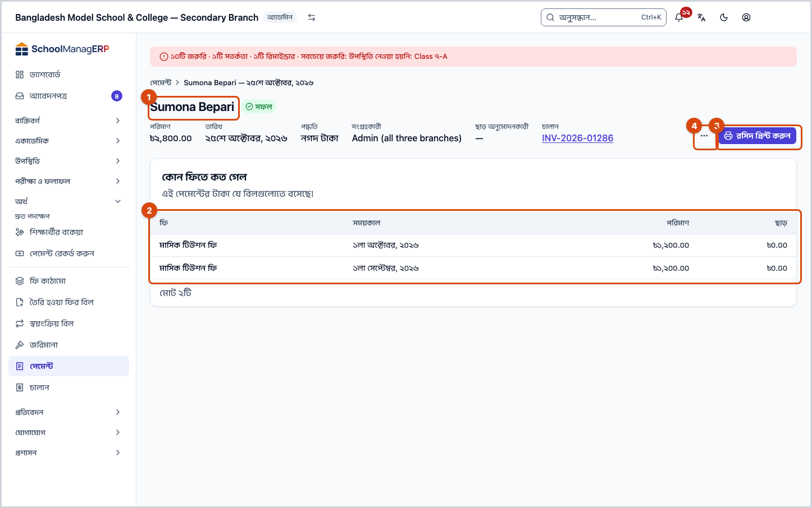
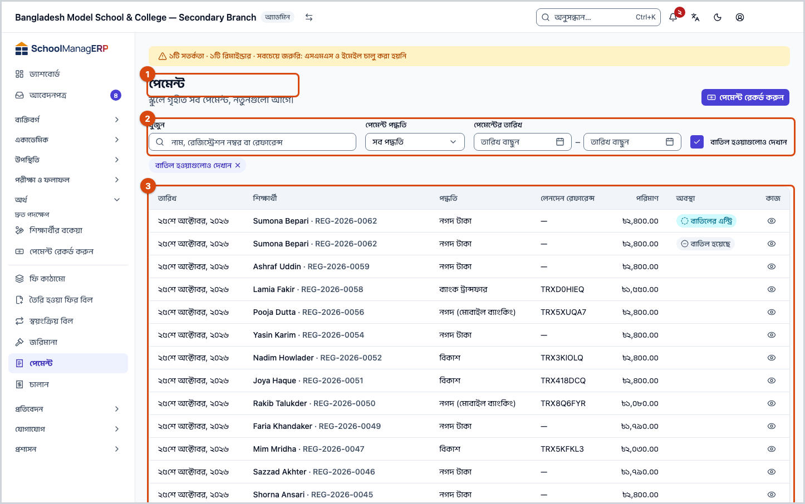

<!-- guide:meta
feature: finance.payments
title: পেমেন্ট
summary: স্কুলে নেওয়া সব পেমেন্ট খুঁজুন, একটি পেমেন্ট খুলে দেখুন টাকা কোন বিলে গেল, রসিদ আবার প্রিন্ট করুন, আর ভুল পেমেন্ট পুরোটা বাতিল করুন।
roles: [ADMIN, ACCOUNTANT]
sources:
  - client-admin/src/routes/_staff/payments/index.tsx
  - client-admin/src/routes/_staff/payments/$id.tsx
  - client-admin/src/routes/_staff/payments/-reverse-payment-dialog.tsx
  - client-admin/src/routes/_staff/payments/-list/use-payments-list.ts
  - server/src/modules/fees/checkout.controller.ts
  - server/src/modules/fees/payments-query.service.ts
  - server/src/modules/fees/payment-reversal.service.ts
labels:
  [
    payments:title,
    payments:subtitle,
    payments:list.*,
    payments:detail.*,
    payments:recordAction,
    nav:items.payments,
    nav:items.paymentDetail,
    nav:groups.finance,
  ]
helpIds:
  [
    finance.payments,
    finance.payments.action.reverse,
    finance.payments.action.printReceipt,
    finance.payments.field.reverseReason,
    finance.payments.field.includeReversed,
  ]
devices: [desktop, phone]
entry: [sidebar, palette]
keywords:
  [পেমেন্ট, রসিদ, চালান, বাতিল, পেমেন্ট বাতিল, ক্রেডিট নোট, লেনদেন রেফারেন্স, payments, receipt, reverse, reversal, refund, credit note]
appVersion: 0.1.0 (978d9b96a)
owner: tareq89
lastVerified: 2026-10-25
knownIssues: []
-->

# পেমেন্ট

স্কুলে নেওয়া প্রতিটি পেমেন্ট দেখুন, রসিদ আবার দিন, আর ভুল পেমেন্ট বাতিল করুন।

**যেতে হবে:** বাম মেনুতে **অর্থ → পেমেন্ট**।
**শুরুর আগে:** আপনি অ্যাডমিন বা হিসাবরক্ষক হবেন। পেমেন্ট বাতিল শুধু অ্যাডমিন করতে পারেন।

তালিকায় প্রতিটি পেমেন্ট এক সারি, নতুনগুলো আগে। নতুন টাকা নিতে [**পেমেন্ট রেকর্ড করুন**](record-payment.md) দেখুন।

[পেমেন্ট খুঁজুন](#task-main) · [রসিদ প্রিন্ট](#task-print) · [পেমেন্ট বাতিল](#task-reverse) · [সমস্যা ও সমাধান](#trouble)

**এই পাতায় যা আছে**

- [একটি পেমেন্ট খুঁজে খুলুন](#task-main)
- [বাতিল হয়েছে কি না বুঝবেন কীভাবে](#confirm)
- [অন্য পরিস্থিতিতে](#other)
  - [রসিদ আবার প্রিন্ট করুন](#task-print)
  - [একটি পেমেন্ট বাতিল করুন](#task-reverse)
  - [পরে নেওয়া পেমেন্ট আগে বাতিল করতে বললে](#task-later)
  - [বাতিল হওয়া পেমেন্ট দেখুন](#task-reversed)
- [সমস্যা ও সমাধান](#trouble)
- [কে কী করতে পারেন](#roles)
- [আরও জানুন](#more)

---

## একটি পেমেন্ট খুঁজে খুলুন 

1. বাম মেনুতে **অর্থ** চাপুন, তারপর **পেমেন্ট** চাপুন।

   → **পেমেন্ট** তালিকা খোলে: **তারিখ**, **শিক্ষার্থী**, **পদ্ধতি**, **লেনদেন রেফারেন্স**, **পরিমাণ**।

2. **খুঁজুন** ঘরে নাম, রেজিস্ট্রেশন নম্বর বা রেফারেন্স লিখুন। দরকার হলে **পেমেন্ট পদ্ধতি** আর **পেমেন্টের তারিখ** (**শুরুর তারিখ**, **শেষের তারিখ**) দিয়ে ছাঁকুন।
3. সারির **দেখুন** চাপুন।

   → পেমেন্টের পাতা খোলে: **পরিমাণ**, **তারিখ**, **পদ্ধতি**, **লেনদেন রেফারেন্স**, **সংগ্রহকারী**, **ছাড় অনুমোদনকারী**, [**চালান**](invoices.md)। নিচে **কোন ফিতে কত গেল** — কোন বিলে কত টাকা আর কত ছাড় বসেছে।

---

## বাতিল হয়েছে কি না বুঝবেন কীভাবে 

| অবস্থা              | কীভাবে বুঝবেন                                                                                     |
| ------------------- | ------------------------------------------------------------------------------------------------- |
| **সাধারণ পেমেন্ট**  | পাতায় কোনো ব্যানার নেই; অ্যাডমিন **পেমেন্ট বাতিল করুন** দেখেন                                    |
| **বাতিল হয়েছে**    | নামের পাশে **বাতিল হয়েছে**, উপরে **এই পেমেন্টটি বাতিল করা হয়েছে।** আর **বাতিলের এন্ট্রি দেখুন** |
| **বাতিলের এন্ট্রি** | উপরে **এটি একটি বাতিলের এন্ট্রি।** আর **মূল পেমেন্ট দেখুন**                                       |

বাতিল কখনো মূল পেমেন্ট মুছে ফেলে না। একটি নতুন **বাতিলের এন্ট্রি** যোগ হয়, আর দুটি একে অপরের সাথে যুক্ত থাকে। তাই হিসাবে সবসময় দেখা যায় কী হয়েছিল।

---

## অন্য পরিস্থিতিতে 

### রসিদ আবার প্রিন্ট করুন 

পেমেন্টের পাতায় **রসিদ প্রিন্ট করুন** চাপুন। চালানটি প্রিন্টের জন্য নতুন জায়গায় খোলে; সেখান থেকে প্রিন্ট করুন।

পেমেন্টের সাথে চালান না থাকলে (**কোনো চালান নেই**) এই বোতাম আসে না। পুরো চালান দেখতে [**চালান দেখুন**](invoices.md#task-main) — সেখান থেকে অভিভাবককে পাঠানো আর [শেয়ার লিংক](invoices.md#task-share)ও দেওয়া যায়, শিক্ষার্থীর পাতায় যেতে **শিক্ষার্থীর পাতা** চাপুন। প্রিন্টার ঠিক করতে [**প্রিন্টার ও মাপ ঠিক করা**](../administration/print-templates/printers-and-calibration.md) দেখুন।

### একটি পেমেন্ট বাতিল করুন 

ভুল শিক্ষার্থী, ভুল অঙ্ক বা ভুল পদ্ধতিতে রেকর্ড হলে পুরো পেমেন্টটি বাতিল করুন, তারপর ঠিকভাবে আবার রেকর্ড করুন। আংশিক বাতিল হয় না।

1. পেমেন্টের পাতায় **পেমেন্ট বাতিল করুন** চাপুন।

   → **এই পেমেন্টটি বাতিল করবেন?** জানালা খোলে, আর জানায়:
   - **এই পেমেন্ট থেকে তৈরি হওয়া যেকোনো জমা টাকা ফেরত নেওয়া হবে।**
   - **সংযুক্ত চালানের বিপরীতে একটি ক্রেডিট নোট ইস্যু করা হবে।**
   - **নিশ্চিত করার পর এটি ফেরানো যাবে না।**

2. **কারণ** ঘরে কেন বাতিল করছেন লিখুন, যেমন "ভুল শিক্ষার্থীর নামে রেকর্ড হয়েছিল"। ৩ থেকে ৫০০ অক্ষর।
3. **পেমেন্ট বাতিল করুন** চাপুন।

   → অতিরিক্ত অনুমোদনের জানালা আসে। একজন অ্যাডমিন সেখানে তাঁর পাসওয়ার্ড বা কোড দেন।

   → সফল হলে জানালা বন্ধ হয়, পাতায় **বাতিল হয়েছে** দেখায়।

**বাতিল হলে যা যা হয়, ধাপে ধাপে:**

1. পেমেন্টটি যে বিলগুলোতে বসেছিল, সেগুলোর পরিশোধিত টাকা ফিরে যায়। বিলগুলো আবার বকেয়া হয়, [**শিক্ষার্থীর বকেয়া**](dues.md) তালিকায় ফেরে।
2. এই পেমেন্টের ফেরতের টাকা জমা টাকায় রাখা হয়ে থাকলে, তা জমা টাকা থেকে কেটে নেওয়া হয়।
3. এই পেমেন্টে জমা টাকা থেকে কাটা হয়ে থাকলে, সেই টাকা শিক্ষার্থীর জমা টাকায় ফেরত আসে।
4. চালানটি বাতিল হয়, আর তার বিপরীতে একটি ক্রেডিট নোট হয়; আপনার লেখা কারণ তাতে থাকে।
5. একটি নতুন **বাতিলের এন্ট্রি** তৈরি হয়, আর মূল পেমেন্টে **বাতিল হয়েছে** লেখা হয়।

**যা বাতিল করা যায় না:**

- একবার বাতিল হওয়া পেমেন্ট আবার বাতিল হয় না।
- **বাতিলের এন্ট্রি** নিজে বাতিল হয় না। ভুল করে বাতিল করলে পেমেন্টটি নতুন করে রেকর্ড করুন।
- যে পেমেন্ট সফলভাবে সম্পন্ন হয়নি, তা বাতিল হয় না।

সময়ের কোনো সীমা নেই: ওপরের কোনোটি না হলে পুরোনো পেমেন্টও বাতিল করা যায়।

> **মনে রাখুন:** স্কুলে অনুমোদন দিতে পারেন এমন আরেকজন সক্রিয় অ্যাডমিন থাকলে, অথবা স্কুলের সেটিংসে দ্বিতীয় অনুমোদনকারী চালু থাকলে, নিজের বাতিল নিজে অনুমোদন করা যায় না। তখন আরেকজন অ্যাডমিনকে তাঁর কোড দিতে বলুন। স্কুলে একজনই অ্যাডমিন থাকলে, আর দ্বিতীয় অনুমোদনকারী চালু না থাকলে, তিনি নিজেই অনুমোদন দিতে পারেন।

### পরে নেওয়া পেমেন্ট আগে বাতিল করতে বললে 

কখনো জানালায় লেখা আসে **পরবর্তী পেমেন্টগুলো আগে বাতিল করতে হবে:**, নিচে **পরবর্তী পেমেন্ট ১**, **পরবর্তী পেমেন্ট ২** … লিংক।

এর মানে: এই পেমেন্ট শিক্ষার্থীর জমা টাকায় কিছু রেখেছিল, আর পরের কোনো পেমেন্ট সেই জমা টাকা খরচ করে ফেলেছে। আগেরটি বাতিল করলে জমা টাকা শূন্যের নিচে নামবে, তাই অ্যাপ থামায়।

1. প্রতিটি লিংক খুলে সেই পেমেন্টগুলো আগে বাতিল করুন।
2. তারপর এই পেমেন্টে ফিরে এসে আবার বাতিল করুন।

### বাতিল হওয়া পেমেন্ট দেখুন 

শুরুতে তালিকায় বাতিল হওয়া পেমেন্ট দেখায় না। ছাঁকনিতে **বাতিল হওয়াগুলোও দেখান** টিক দিন। তখন একটি **অবস্থা** কলাম আসে: **বাতিল হয়েছে** (মূল পেমেন্ট) বা **বাতিলের এন্ট্রি**।

**বাতিলের এন্ট্রি**-তে মূল পেমেন্টের একই অঙ্ক দেখায়, মাইনাস চিহ্ন ছাড়া; কোনটা কী, তা **অবস্থা** কলাম দেখে বুঝুন।

---

## সমস্যা ও সমাধান 

| আপনি যা দেখছেন                                                                | কী করবেন                                                                                     | কে সাহায্য করতে পারেন |
| ----------------------------------------------------------------------------- | -------------------------------------------------------------------------------------------- | --------------------- |
| **এখনো কোনো পেমেন্ট নেই**                                                     | কোনো পেমেন্ট রেকর্ড হয়নি, বা ছাঁকনি সব লুকিয়েছে। ছাঁকনি সরান।                              | —                     |
| **পেমেন্টের তালিকা লোড করা যায়নি।**                                          | পাতা রিলোড করুন।                                                                             | অ্যাডমিন              |
| **এই পেমেন্ট লোড করা যায়নি।**                                                | **আবার চেষ্টা করুন** চাপুন।                                                                  | অ্যাডমিন              |
| **পেমেন্ট বাতিল করুন** দেখা যায় না                                           | শুধু অ্যাডমিন দেখেন। পেমেন্টটি আগেই বাতিল হয়ে থাকতে পারে, বা এটি নিজেই বাতিলের এন্ট্রি।     | অ্যাডমিন              |
| **এই বাতিল অন্য একজন অ্যাডমিনকে অনুমোদন করতে হবে। তাঁকে তাঁর কোড দিতে বলুন।** | আরেকজন অ্যাডমিনকে ডেকে আবার **পেমেন্ট বাতিল করুন** চাপুন; তিনি অনুমোদনের জানালায় কোড দেবেন। | অ্যাডমিন              |
| **পরবর্তী পেমেন্টগুলো আগে বাতিল করতে হবে:**                                   | [পরে নেওয়া পেমেন্ট আগে বাতিল করুন](#task-later)।                                            | অ্যাডমিন              |
| **পেমেন্ট বাতিল করুন** (নিশ্চিত) চাপা যায় না                                 | **কারণ** অন্তত ৩ অক্ষর লিখুন।                                                                | —                     |
| **পেমেন্ট বাতিল করা যায়নি।**                                                 | পাতা রিলোড করে দেখুন আগেই বাতিল হয়েছে কি না; না হলে আবার চেষ্টা করুন।                       | অ্যাডমিন              |
| **রসিদ প্রিন্টের জন্য খোলা যায়নি।**                                          | ব্রাউজারে পপ-আপ চালু করুন আর ইন্টারনেট সংযোগ দেখুন, তারপর আবার চাপুন।                        | —                     |
| **মুছে ফেলা শিক্ষার্থী**                                                      | শিক্ষার্থীটি মুছে ফেলা হয়েছে; পেমেন্ট হিসাবে থেকে যায়।                                     | অ্যাডমিন              |

এ নিয়ে আরও সাহায্য: [সমস্যা হলে কী করবেন](../help/troubleshooting.md#fees)।

---

## কে কী করতে পারেন 

| ভূমিকা                                                                               | পেমেন্ট দেখা | রসিদ প্রিন্ট | পেমেন্ট বাতিল        | বাতিল অনুমোদন |
| ------------------------------------------------------------------------------------ | ------------ | ------------ | -------------------- | ------------- |
| অ্যাডমিন                                                                             | হ্যাঁ        | হ্যাঁ        | হ্যাঁ, অনুমোদন দিয়ে | হ্যাঁ         |
| হিসাবরক্ষক                                                                           | হ্যাঁ        | হ্যাঁ        | না                   | না            |
| একাডেমিক কো-অর্ডিনেটর, শিক্ষক, অফিস সহকারী, পরীক্ষা নিয়ন্ত্রক, পরিচালনা পর্ষদ সদস্য | না           | না           | না                   | না            |

**অ্যাডমিন:** সব পেমেন্ট দেখেন, রসিদ প্রিন্ট করেন, আর পেমেন্ট বাতিল করেন। বাতিলে সবসময় অনুমোদন লাগে।

**হিসাবরক্ষক:** সব পেমেন্ট দেখেন আর রসিদ প্রিন্ট করেন। পেমেন্ট বাতিল করতে পারেন না; ভুল হলে অ্যাডমিনকে বলুন।

অন্য ভূমিকার বাম মেনুতে **পেমেন্ট** থাকে না। শিক্ষক একজন শিক্ষার্থীর পেমেন্ট শুধু সেই [**শিক্ষার্থী**](../people/students.md)-র পাতায় দেখতে পারেন, যদি অনুমতি থাকে।

---

## আরও জানুন 

<strong>পাতার অংশগুলো</strong> — পেমেন্ট তালিকা

1. **পেমেন্ট** শিরোনাম আর [**পেমেন্ট রেকর্ড করুন**](record-payment.md) বোতাম।
2. ছাঁকনি — **খুঁজুন**, **পেমেন্ট পদ্ধতি**, **পেমেন্টের তারিখ**, **বাতিল হওয়াগুলোও দেখান**।
3. তালিকা — সারির **দেখুন** চাপলে পেমেন্টের পাতা খোলে।

<strong>ঘরগুলোর অর্থ</strong>

<!-- guide:generated:fields:payments -->

| ঘর                     | কী লিখবেন                                                                                                                                            | বাধ্যতামূলক? |
| ---------------------- | ---------------------------------------------------------------------------------------------------------------------------------------------------- | ------------ |
| প্রাপ্ত পরিমাণ         | মোট কত টাকা পেলেন। লিখলে টাকা সবচেয়ে পুরনো শেষ তারিখের বিল থেকে ভাগ হয়ে পরিশোধ ঘরে বসে; না লিখে প্রতিটি ঘর নিজেও ভরতে পারেন।                       | না           |
| পরিশোধ                 | এই বিলে কত টাকা বসবে। পরিশোধ আর ছাড় মিলে বিলের বকেয়ার বেশি হতে পারে না।                                                                            | না           |
| ছাড়                   | এই বিলে এককালীন ছাড়। যেকোনো ছাড় দিলে জমা দেওয়ার সময় অ্যাডমিনের অনুমোদন লাগে।                                                                     | না           |
| জমা টাকা ব্যবহার করুন  | টিক দিলে শিক্ষার্থীর আগের জমা টাকা থেকে কাটা হয়: জমা টাকা আর উপমোটের মধ্যে যেটা কম, সেটা; একাধিক শিক্ষার্থীর পেমেন্টে জমা টাকা ব্যবহার করা যায় না। | না           |
| পেমেন্ট পদ্ধতি         | টাকা কীভাবে পেলেন। শুধু নগদ টাকায় প্রদেয়র চেয়ে বেশি নেওয়া আর ফেরত দেওয়া যায়।                                                                   | না           |
| লেনদেন রেফারেন্স       | বিকাশ, নগদ, রকেট, ব্যাংক, চেক বা কার্ডের লেনদেন নম্বর; নগদ টাকায় এই ঘর থাকে না।                                                                     | না           |
| হাতে পেলেন             | শুধু নগদে: ক্রেতা হাতে কত দিলেন। ফেরত কত, তা হিসাব করতে; না লিখলেও চলে। জমা টাকা মিলিয়ে প্রদেয় পরিমাণের কম হলে জমা দেওয়া যায় না।                 | না           |
| ফেরতের টাকা            | ফেরতের টাকা হাতে দেবেন, না শিক্ষার্থীর জমা টাকায় রাখবেন। জমা রাখা যায় শুধু একজন শিক্ষার্থীর পেমেন্টে।                                              | না           |
| মন্তব্য                | নিজেদের জন্য একটি নোট, যেমন কে টাকা দিয়ে গেলেন।                                                                                                     | না           |
| কারণ                   | কেন পেমেন্টটি বাতিল করছেন; ৩ থেকে ৫০০ অক্ষর। বাতিলের এন্ট্রিতে আর ক্রেডিট নোটে এই কারণ থাকে।                                                         | আবশ্যক।      |
| বাতিল হওয়াগুলোও দেখান | বন্ধ থাকলে বাতিল হওয়া পেমেন্ট দেখায় না। চালু করলে বাতিল হওয়া পেমেন্ট ও বাতিলের এন্ট্রিও দেখায়, "বাতিল" ও "বিপরীত এন্ট্রি" চিহ্নসহ।               | না           |

<!-- /guide:generated -->

<strong>পেমেন্ট বাতিল কীভাবে কাজ করে</strong>

<figure>
  
  <figcaption><em>পেমেন্ট থেকে বাতিল পর্যন্ত</em></figcaption>
</figure>

- **শুধু যোগ, মোছা নয়:** বাতিল একটি নতুন এন্ট্রি; মূল পেমেন্ট আর চালান থেকে যায়, শুধু চিহ্নিত হয়।
- **একসাথে দুজন:** একই পেমেন্ট দুজন একসাথে বাতিল করতে চাইলে একজনেরটাই হয়; অন্যজন দেখেন আগেই বাতিল হয়েছে।
- **জমা টাকা শূন্যের নিচে নামে না:** তাই পরে খরচ হওয়া জমা টাকার পেমেন্ট আগে বাতিল করতে হয়।
- **অনুমোদন:** প্রতিটি বাতিলে নতুন অনুমোদন লাগে; একটি অনুমোদন একবারই কাজে লাগে।

**সম্পর্কিত পাতা**

- [**পেমেন্ট রেকর্ড করুন**](record-payment.md) — নতুন টাকা নেওয়া।
- [**শিক্ষার্থীর বকেয়া**](dues.md) — বাতিলের পর বিল আবার এখানে আসে।
- [**ফির বিল তৈরি করা**](generate-fees.md) — বিল যেখান থেকে আসে।
- [**প্রিন্টার ও মাপ ঠিক করা**](../administration/print-templates/printers-and-calibration.md) — রসিদ প্রিন্টার ঠিক করা।
- [**চালান**](invoices.md) — চালান আর ক্রেডিট নোট দেখা, শেয়ার লিংক।
- [**জরিমানা**](fines.md) — জরিমানা মওকুফ।
- [**শিক্ষার্থী যোগ করা ও তাদের তথ্য দেখা**](../people/students.md) — নতুন শিক্ষার্থী যোগ করুন, একসাথে অনেককে আমদানি করুন, আর প্রত্যেকের প্রোফাইল থেকে শ্রেণি, অভিভাবক, ফি, নোট ও স্কুল ছাড়ার তথ্য সামলান।
- [**ফি আদায়ের প্রতিবেদন**](../reports/collections-report.md) — পেমেন্ট থেকে তৈরি ফি আদায়ের প্রতিবেদন
