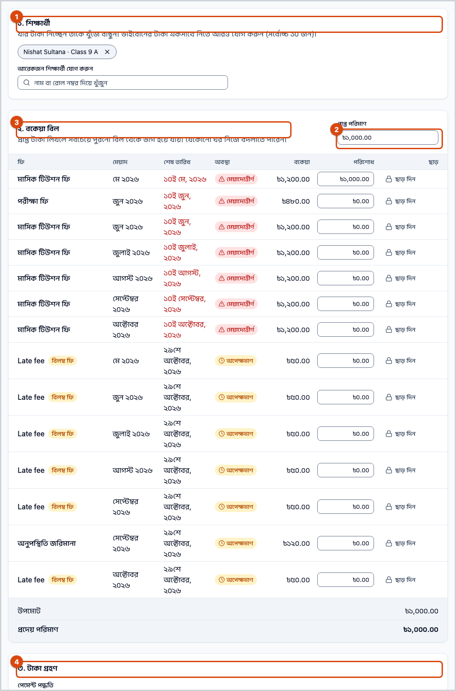
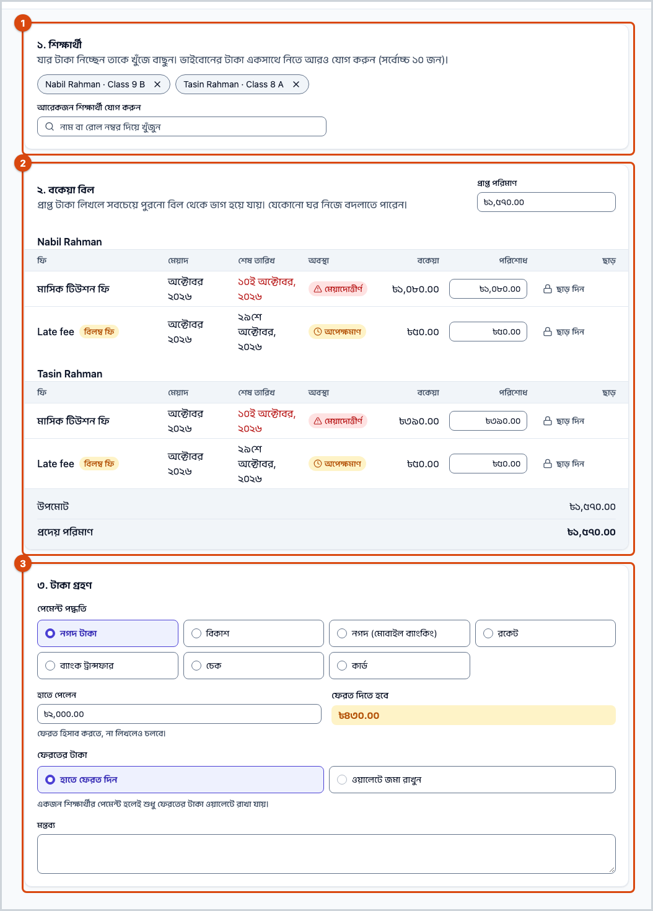

<!-- guide:meta
feature: finance.recordPayment
title: পেমেন্ট রেকর্ড করুন
summary: এক বা একাধিক শিক্ষার্থীর বকেয়া বিলের টাকা নিন — টাকা পুরনো বিল থেকে ভাগ হয়, দরকারে ছাড় দিন, নগদে ফেরত হিসাব করুন বা জমা টাকায় রাখুন, তারপর রসিদ প্রিন্ট করুন বা পাঠান।
roles: [ADMIN, ACCOUNTANT]
sources:
  - client-admin/src/routes/_staff/payments/record.tsx
  - client-admin/src/routes/_staff/payments/-record/record-payment-modal.tsx
  - client-admin/src/routes/_staff/payments/-record/cart-table.tsx
  - client-admin/src/routes/_staff/payments/-record/discount-cell.tsx
  - client-admin/src/routes/_staff/payments/-record/tender-section.tsx
  - client-admin/src/routes/_staff/payments/-record/checkout-success.tsx
  - server/src/modules/fees/checkout.controller.ts
  - server/src/modules/fees/checkout.service.ts
  - server/src/modules/fees/checkout-cart.service.ts
labels:
  [
    payments:record.*,
    payments:recordAction,
    payments:printFormat.*,
    payments:fields.*,
    payments:help.*,
    nav:items.recordPayment,
    nav:groups.finance,
  ]
helpIds:
  [
    finance.recordPayment,
    finance.recordPayment.action.submit,
    finance.recordPayment.action.discountTheRest,
    finance.recordPayment.action.print,
    finance.recordPayment.field.amountReceived,
    finance.recordPayment.field.discount,
    finance.recordPayment.field.walletUse,
    finance.recordPayment.field.tendered,
    finance.recordPayment.field.changeHandling,
  ]
devices: [desktop, phone]
entry: [sidebar, palette]
keywords:
  [পেমেন্ট, টাকা নেওয়া, ফি আদায়, রসিদ, চালান, ছাড়, ফেরত, জমা টাকা, ভাইবোন, বিকাশ, নগদ, record payment, collect, receipt, change, wallet]
appVersion: 0.1.0 (978d9b96a)
owner: tareq89
lastVerified: 2026-10-25
knownIssues: []
-->

# পেমেন্ট রেকর্ড করুন

কাউন্টারে শিক্ষার্থীর ফির টাকা নিন, আর সাথে সাথে রসিদ দিন।

**যেতে হবে:** বাম মেনুতে **অর্থ → পেমেন্ট রেকর্ড করুন**। অথবা [**শিক্ষার্থীর বকেয়া**](dues.md) তালিকায় সারির **ফি আদায়**।
**শুরুর আগে:** আপনি অ্যাডমিন বা হিসাবরক্ষক হবেন। শিক্ষার্থীর বকেয়া বিল থাকতে হবে ([**ফির বিল তৈরি করা**](generate-fees.md))।

একবার জমা দিলে একটি পেমেন্ট আর একটি চালান (রসিদ) হয়। টাকা যে বিলগুলোতে বসে, সেগুলোর বকেয়া কমে। ভুল হলে পরে [**পেমেন্ট**](payments.md#task-reverse) পাতা থেকে পুরো পেমেন্টটি বাতিল করতে হয়; আংশিক বদলানো যায় না।

[টাকা নিন](#task-main) · [ভাইবোন একসাথে](#task-siblings) · [ছাড়](#task-discount) · [নগদ ও ফেরত](#task-change) · [সমস্যা ও সমাধান](#trouble)

**এই পাতায় যা আছে**

- [একজন শিক্ষার্থীর টাকা নিন](#task-main)
- [পেমেন্ট হয়েছে কি না বুঝবেন কীভাবে](#confirm)
- [অন্য পরিস্থিতিতে](#other)
  - [ভাইবোনের টাকা একসাথে](#task-siblings)
  - [ছাড় দিন](#task-discount)
  - [নগদে বেশি পেলেন: ফেরত দিন বা জমা রাখুন](#task-change)
  - [জমা টাকা থেকে কাটুন](#task-wallet)
  - [বিকাশ, ব্যাংক বা চেকে টাকা](#task-method)
  - [রসিদ প্রিন্ট করুন বা পাঠান](#task-print)
- [সমস্যা ও সমাধান](#trouble)
- [কে কী করতে পারেন](#roles)
- [আরও জানুন](#more)

---

## একজন শিক্ষার্থীর টাকা নিন 

1. বাম মেনুতে **অর্থ** চাপুন, তারপর **পেমেন্ট রেকর্ড করুন** চাপুন।

   → **পেমেন্ট রেকর্ড করুন** পাতা খোলে। তিনটি অংশ: **১. শিক্ষার্থী**, **২. বকেয়া বিল**, **৩. টাকা গ্রহণ**।

2. **শিক্ষার্থী খুঁজুন** ঘরে নাম বা রোল নম্বর লিখুন, তারপর তালিকা থেকে শিক্ষার্থী চাপুন।

   → **২. বকেয়া বিল** অংশে তাঁর প্রতিটি বাকি বিল আসে: **ফি**, **মেয়াদ**, **শেষ তারিখ**, **বকেয়া**, **পরিশোধ**, **ছাড়**। শেষ তারিখ পার হলে লেখা **মেয়াদোত্তীর্ণ**।

3. **প্রাপ্ত পরিমাণ** ঘরে যত টাকা পেলেন লিখুন।

   → টাকা নিজে থেকে ভাগ হয়: সবচেয়ে পুরনো শেষ তারিখের বিল আগে পুরো শোধ হয়, তারপর পরেরটি। প্রতিটি বিলের **পরিশোধ** ঘরে অংশটি বসে। নিচে **উপমোট** আর **প্রদেয় পরিমাণ**।

4. চাইলে যেকোনো বিলের **পরিশোধ** ঘর নিজে বদলান।
5. **৩. টাকা গ্রহণ** অংশে **পেমেন্ট পদ্ধতি** বাছুন। শুরুতে **নগদ টাকা** বাছা থাকে।
6. দরকার হলে **মন্তব্য** লিখুন।
7. **… রেকর্ড করুন** চাপুন (বোতামে টাকার অঙ্ক লেখা থাকে)।

   → **পেমেন্ট রেকর্ড হয়েছে** পাতা আসে: [**চালান**](invoices.md) নম্বর, **প্রদত্ত পরিমাণ**, আর ফেরত থাকলে **ফেরত টাকা**।

> **মনে রাখুন:** একটি বিলে **পরিশোধ** আর **ছাড়** মিলে সেই বিলের **বকেয়া**-র বেশি হতে পারে না। বিলের চেয়ে বেশি টাকা পেলে বাকিটা [ফেরত দিন বা জমা রাখুন](#task-change)।

---

## পেমেন্ট হয়েছে কি না বুঝবেন কীভাবে 

| অবস্থা                       | কীভাবে বুঝবেন                                                                                          | এরপর কী                 |
| ---------------------------- | ------------------------------------------------------------------------------------------------------ | ----------------------- |
| **শুধু স্ক্রিনে লেখা**       | **পেমেন্ট রেকর্ড করুন** পাতা খোলা; বন্ধ করতে চাইলে সতর্কবার্তা আসে                                     | **… রেকর্ড করুন** চাপুন |
| **স্কুলের সিস্টেমে পৌঁছেছে** | **পেমেন্ট রেকর্ড হয়েছে** পাতা আর [**চালান**](invoices.md) নম্বর; সবুজ বার্তা **… রেকর্ড করা হয়েছে।** | রসিদ দিন                |

এই পাতা কিছু ফোন বা কম্পিউটারে আলাদা করে রাখে না, তাই "এই ডিভাইসে সংরক্ষিত" অবস্থা নেই।

**বার্তা না এলে, বা লাইন কেটে গেলে:** পাতা বন্ধ, রিলোড বা বদল করবেন না। আগে নতুন ট্যাবে [**পেমেন্ট**](payments.md) তালিকায় দেখুন পেমেন্টটি সেখানে আছে কি না। না থাকলে আরেকবার **… রেকর্ড করুন** চাপুন। পূরণ করা পাতা একটি চিহ্ন নিয়ে যায়; একই চিহ্নে আবার চাপলে নতুন পেমেন্ট হয় না, আগেরটিই ফেরত আসে। কিন্তু রিলোড করা বা নতুন পাতা নতুন চিহ্ন পায়, তাতে টাকা দুবার ধরা হতে পারে।

---

## অন্য পরিস্থিতিতে 

### ভাইবোনের টাকা একসাথে 

1. প্রথম শিক্ষার্থী বাছার পর **আরেকজন শিক্ষার্থী যোগ করুন** ঘরে পরের জনকে খুঁজে বাছুন। অভিভাবকের পাতা থেকে এলে তাঁর সব সন্তান শুরুতেই বাছা থাকে; কাউকে সরালে **+ ভাইবোন যোগ করুন** চেপে আবার আনা যায়।
2. **প্রাপ্ত পরিমাণ** লিখুন। সবার বিল মিলিয়ে সবচেয়ে পুরনো শেষ তারিখ আগে শোধ হয়।

একবারে সর্বোচ্চ ১০ জন শিক্ষার্থী। কাউকে সরাতে নামের পাশের ✕ চাপুন। সবার জন্য একটিই পেমেন্ট আর একটিই চালান হয়।

> **মনে রাখুন:** কয়েকজন শিক্ষার্থী একসাথে থাকলে **জমা টাকা ব্যবহার করুন** আর **ওয়ালেটে জমা রাখুন** চলে না। সে কাজ একজন করে করুন।

### ছাড় দিন 

1. বিলের সারিতে **ছাড় দিন** চাপুন।
2. ছাড়ের টাকা লিখুন। বিলের বাকি পুরোটা ছাড় দিতে **বাকিটা ছাড় দিন** চাপুন।

   → নিচে লেখা আসে **এই ছাড় জমা দিতে অ্যাডমিনের অনুমোদন প্রয়োজন।**

3. **… রেকর্ড করুন** চাপুন।

   → অতিরিক্ত অনুমোদনের জানালা আসে। অ্যাডমিন সেখানে তাঁর পাসওয়ার্ড বা কোড দেন। অনুমোদন না দিলে লেখা আসে **অনুমোদন বাতিল করা হয়েছে।**, আর কিছুই রেকর্ড হয় না।

পুরো বিল ছাড় দিলে সেই বিলের **পরিশোধ** শূন্য থাকলেও জমা দেওয়া যায়।

### নগদে বেশি পেলেন: ফেরত দিন বা জমা রাখুন 

**নগদ টাকা** বাছা থাকলে নিচে আসে **হাতে পেলেন**।

1. **হাতে পেলেন** ঘরে যত টাকা হাতে পেলেন লিখুন, যেমন ১,০০০। না লিখলেও চলে।

   → **ফেরত দিতে হবে** অংশে ফেরতের অঙ্ক দেখায়।

2. **ফেরতের টাকা**-তে বাছুন:
   - **হাতে ফেরত দিন** — টাকা ফেরত দিন। শুরুতে এটি বাছা।
   - **ওয়ালেটে জমা রাখুন** — ফেরতের টাকা শিক্ষার্থীর **জমা টাকা** হয়ে থাকে, পরের বিলে কাজে লাগে।

**হাতে পেলেন** প্রদেয়র কম হলে লেখা আসে **প্রদত্ত অর্থ ও জমা টাকা মিলিয়ে প্রদেয় পরিমাণ পূরণ হচ্ছে না।**, আর জমা দেওয়া যায় না।

### জমা টাকা থেকে কাটুন 

শিক্ষার্থীর **জমা টাকা** থাকলে বিল তালিকার নিচে আসে **জমা টাকা ব্যবহার করুন (… আছে)** — পাশে একটা টিক-ঘর। টিক দিন। জমা টাকা আর **উপমোট**-এর মধ্যে যেটা কম, সেই অঙ্ক কাটা হয়; **প্রদেয় পরিমাণ** সেই অঙ্কে কমে যায়। অঙ্ক নিজে লেখা যায় না; টিক তুললে কাটা বাতিল।

**প্রাপ্ত পরিমাণ** লিখলে যে ভাগ আসে, তাতে শিক্ষার্থীর জমা টাকাও পুরোনো বিলে ধরা থাকে। তাই **পরিশোধ** ঘরগুলোর যোগফল হাতে পাওয়া টাকার চেয়ে বেশি হতে পারে। তখন টিক দিন, যাতে **প্রদেয় পরিমাণ** হাতে পাওয়া টাকায় নামে।

### বিকাশ, ব্যাংক বা চেকে টাকা 

**পেমেন্ট পদ্ধতি**-তে **বিকাশ**, **নগদ (মোবাইল ব্যাংকিং)**, **রকেট**, **ব্যাংক ট্রান্সফার**, **চেক** বা **কার্ড** বাছুন। তখন **হাতে পেলেন** সরে গিয়ে আসে **লেনদেন রেফারেন্স**; লেনদেনের নম্বর লিখুন।

এই পদ্ধতিগুলোতে প্রদেয়র চেয়ে বেশি নেওয়া যায় না; ফেরত শুধু নগদে হয়। বারকোড স্ক্যানার দিয়ে রেফারেন্স পড়লে শেষের Enter পাতা জমা দেয় না।

### রসিদ প্রিন্ট করুন বা পাঠান 

**পেমেন্ট রেকর্ড হয়েছে** পাতায়:

1. **কাগজের মাপ** বাছুন: **A4 পাতা**, **রসিদ প্রিন্টার — ৮০ মিমি** বা **রসিদ প্রিন্টার — ৫৮ মিমি**। এই কম্পিউটার পরের বার আপনার বাছাই মনে রাখে।
2. **প্রিন্ট** চাপুন।
3. অভিভাবককে পাঠাতে **হোয়াটসঅ্যাপে পাঠান** বা **এসএমএসে পাঠান** চাপুন। একাধিক অভিভাবক থাকলে একজন বাছতে বলে।

এরপর **আরেকটি রেকর্ড করুন** চাপলে খালি পাতা আসে; **চালান দেখুন** চাপলে চালান খোলে। পরে আবার রসিদ লাগলে [**পেমেন্ট**](payments.md#task-print) পাতা থেকে প্রিন্ট করুন। প্রিন্টার ঠিক করতে [**প্রিন্টার ও মাপ ঠিক করা**](../administration/print-templates/printers-and-calibration.md) দেখুন।

---

## সমস্যা ও সমাধান 

| আপনি যা দেখছেন                                                         | কী করবেন                                                                                                                                                                 | কে সাহায্য করতে পারেন |
| ---------------------------------------------------------------------- | ------------------------------------------------------------------------------------------------------------------------------------------------------------------------ | --------------------- |
| **এই শিক্ষার্থীর কোনো বকেয়া বিল নেই।**                                | তাঁর সব বিল শোধ। নতুন বিল লাগলে [**ফির বিল তৈরি করা**](generate-fees.md) দেখুন।                                                                                          | হিসাবরক্ষক            |
| **বকেয়া বিল লোড করা যায়নি।**                                         | **আবার চেষ্টা করুন** চাপুন।                                                                                                                                              | অ্যাডমিন              |
| **পরিশোধ ও ছাড়ের যোগফল বকেয়ার বেশি হতে পারবে না।**                   | সেই বিলের **পরিশোধ** বা **ছাড়** কমান।                                                                                                                                   | —                     |
| **প্রদত্ত অর্থ ও জমা টাকা মিলিয়ে প্রদেয় পরিমাণ পূরণ হচ্ছে না।**      | **হাতে পেলেন** ঠিক করুন, বা ঘরটি খালি করুন।                                                                                                                              | —                     |
| **একজন শিক্ষার্থীর পেমেন্ট হলেই শুধু ফেরতের টাকা ওয়ালেটে রাখা যায়।** | ফেরত হাতে দিন, অথবা প্রতিজনের টাকা আলাদা নিন।                                                                                                                            | —                     |
| **একবারে সর্বোচ্চ ১০ জন শিক্ষার্থীর জন্য পেমেন্ট করা যাবে।**           | প্রথম ১০ জনের টাকা নিন, বাকিদের পরের বার।                                                                                                                                | —                     |
| **অনুমোদন বাতিল করা হয়েছে।**                                          | কিছুই রেকর্ড হয়নি। অ্যাডমিনকে নিয়ে আবার চাপুন, অথবা ছাড় সরিয়ে দিন।                                                                                                   | অ্যাডমিন              |
| **পেমেন্ট রেকর্ড করা ব্যর্থ হয়েছে।**                                  | পাতা বন্ধ বা বদল করবেন না। আগে [**পেমেন্ট**](payments.md) তালিকায় দেখুন; সেখানে না থাকলে একবার আবার চাপুন। এর মধ্যে অন্য কেউ একই বিলে টাকা নিয়ে থাকলে পাতা রিলোড করুন। | অ্যাডমিন              |
| **… রেকর্ড করুন** চাপা যায় না                                         | শিক্ষার্থী বাছা আছে, অন্তত একটি বিলে পরিশোধ বা ছাড় আছে, আর বিল লোড শেষ হয়েছে কি না দেখুন।                                                                              | —                     |
| **এই শিক্ষার্থীর জন্য রসিদ পাঠানোর মতো কোনো অভিভাবক নেই।**             | [**অভিভাবক**](../people/guardians.md) পাতায় ফোন নম্বর যোগ করুন, অথবা প্রিন্ট করে দিন।                                                                                   | অ্যাডমিন              |
| এসএমএসে পাঠাতে গেলে রসিদ যায় না                                       | স্কুলের এসএমএস ক্রেডিট শেষ হতে পারে। হোয়াটসঅ্যাপে পাঠান বা প্রিন্ট করুন। এসএমএস ক্রেডিট কিনতে অ্যাডমিনকে বলুন।                                                          | অ্যাডমিন              |

স্কুলের সিস্টেম যে কারণেই পেমেন্ট ফিরিয়ে দিক, পর্দায় শুধু **পেমেন্ট রেকর্ড করা ব্যর্থ হয়েছে।** দেখায়; কোন নিয়ম ভাঙল তা বলে না।

এ নিয়ে আরও সাহায্য: [সমস্যা হলে কী করবেন](../help/troubleshooting.md#fees)।

---

## কে কী করতে পারেন 

| ভূমিকা                                                                               | টাকা নেওয়া | ছাড় দেওয়া          | ছাড় অনুমোদন | রসিদ প্রিন্ট ও পাঠানো |
| ------------------------------------------------------------------------------------ | ----------- | -------------------- | ------------ | --------------------- |
| অ্যাডমিন                                                                             | হ্যাঁ       | হ্যাঁ                | হ্যাঁ        | হ্যাঁ                 |
| হিসাবরক্ষক                                                                           | হ্যাঁ       | হ্যাঁ, অনুমোদন নিয়ে | না           | হ্যাঁ                 |
| একাডেমিক কো-অর্ডিনেটর, শিক্ষক, অফিস সহকারী, পরীক্ষা নিয়ন্ত্রক, পরিচালনা পর্ষদ সদস্য | না          | না                   | না           | না                    |

**অ্যাডমিন:** টাকা নিতে পারেন, আর ছাড়ের অনুমোদনও দিতে পারেন।

**হিসাবরক্ষক:** টাকা নিতে পারেন। ছাড় দিলে জমা দেওয়ার সময় একজন অ্যাডমিনের অনুমোদন লাগে।

অন্য ভূমিকার বাম মেনুতে **পেমেন্ট রেকর্ড করুন** থাকে না।

---

## আরও জানুন 

<strong>পাতার অংশগুলো</strong> — পেমেন্ট রেকর্ড করুন

1. **১. শিক্ষার্থী** — খুঁজে বাছুন; সর্বোচ্চ ১০ জন।
2. **২. বকেয়া বিল** — **প্রাপ্ত পরিমাণ**, বিলের তালিকা, **উপমোট**, **জমা টাকা ব্যবহার করুন**, **প্রদেয় পরিমাণ**।
3. **৩. টাকা গ্রহণ** — **পেমেন্ট পদ্ধতি**, নগদে **হাতে পেলেন** ও **ফেরতের টাকা**, অন্য পদ্ধতিতে **লেনদেন রেফারেন্স**, **মন্তব্য**।
4. নিচে **বাতিল করুন** আর **… রেকর্ড করুন**।

<strong>ঘরগুলোর অর্থ</strong>

<!-- guide:generated:fields:payments -->

| ঘর                     | কী লিখবেন                                                                                                                                            | বাধ্যতামূলক? |
| ---------------------- | ---------------------------------------------------------------------------------------------------------------------------------------------------- | ------------ |
| প্রাপ্ত পরিমাণ         | মোট কত টাকা পেলেন। লিখলে টাকা সবচেয়ে পুরনো শেষ তারিখের বিল থেকে ভাগ হয়ে পরিশোধ ঘরে বসে; না লিখে প্রতিটি ঘর নিজেও ভরতে পারেন।                       | না           |
| পরিশোধ                 | এই বিলে কত টাকা বসবে। পরিশোধ আর ছাড় মিলে বিলের বকেয়ার বেশি হতে পারে না।                                                                            | না           |
| ছাড়                   | এই বিলে এককালীন ছাড়। যেকোনো ছাড় দিলে জমা দেওয়ার সময় অ্যাডমিনের অনুমোদন লাগে।                                                                     | না           |
| জমা টাকা ব্যবহার করুন  | টিক দিলে শিক্ষার্থীর আগের জমা টাকা থেকে কাটা হয়: জমা টাকা আর উপমোটের মধ্যে যেটা কম, সেটা; একাধিক শিক্ষার্থীর পেমেন্টে জমা টাকা ব্যবহার করা যায় না। | না           |
| পেমেন্ট পদ্ধতি         | টাকা কীভাবে পেলেন। শুধু নগদ টাকায় প্রদেয়র চেয়ে বেশি নেওয়া আর ফেরত দেওয়া যায়।                                                                   | না           |
| লেনদেন রেফারেন্স       | বিকাশ, নগদ, রকেট, ব্যাংক, চেক বা কার্ডের লেনদেন নম্বর; নগদ টাকায় এই ঘর থাকে না।                                                                     | না           |
| হাতে পেলেন             | শুধু নগদে: ক্রেতা হাতে কত দিলেন। ফেরত কত, তা হিসাব করতে; না লিখলেও চলে। জমা টাকা মিলিয়ে প্রদেয় পরিমাণের কম হলে জমা দেওয়া যায় না।                 | না           |
| ফেরতের টাকা            | ফেরতের টাকা হাতে দেবেন, না শিক্ষার্থীর জমা টাকায় রাখবেন। জমা রাখা যায় শুধু একজন শিক্ষার্থীর পেমেন্টে।                                              | না           |
| মন্তব্য                | নিজেদের জন্য একটি নোট, যেমন কে টাকা দিয়ে গেলেন।                                                                                                     | না           |
| কারণ                   | কেন পেমেন্টটি বাতিল করছেন; ৩ থেকে ৫০০ অক্ষর। বাতিলের এন্ট্রিতে আর ক্রেডিট নোটে এই কারণ থাকে।                                                         | আবশ্যক।      |
| বাতিল হওয়াগুলোও দেখান | বন্ধ থাকলে বাতিল হওয়া পেমেন্ট দেখায় না। চালু করলে বাতিল হওয়া পেমেন্ট ও বাতিলের এন্ট্রিও দেখায়, "বাতিল" ও "বিপরীত এন্ট্রি" চিহ্নসহ।               | না           |

<!-- /guide:generated -->

<strong>টাকা কীভাবে ভাগ হয়</strong> — ভাগের নিয়ম, ফেরত আর অনুমোদন

<figure>
  
  <figcaption><em>পেমেন্ট রেকর্ডের ধাপ</em></figcaption>
</figure>

- **ভাগের ক্রম:** প্রাপ্ত টাকা সব বাছা শিক্ষার্থীর বিল মিলিয়ে ভাগ হয় — সবচেয়ে পুরনো শেষ তারিখ আগে। শেষ তারিখ নেই এমন বিল সবার শেষে। কারও জমা টাকা শুধু তাঁর নিজের বিলেই যায়, অন্য ভাইবোনের বিলে নয়।
- **হিসাব পয়সায়:** স্কুলের সিস্টেম প্রতিটি অঙ্ক পুরো পয়সায় মেলায়, এক পয়সার এদিক-ওদিকও মানা হয় না। পরিশোধ আর ছাড় মিলে বকেয়ার এক পয়সাও বেশি হলে পেমেন্ট ফিরিয়ে দেওয়া হয়।
- **একসাথে দুজন:** একই বিলে দুজন একসাথে টাকা নিলে বিলটি আটকে একে একে হিসাব হয়। পরের জন দেখেন বিল আর বাকি নেই, তাঁর পেমেন্ট হয় না।
- **ছাড়ের অনুমোদন:** যেকোনো এককালীন ছাড়ে অ্যাডমিনের অনুমোদন লাগে। অনুমোদন একবারই কাজে লাগে; সব যাচাই পার হওয়ার পর শেষ ধাপে খরচ হয়, তাই ভুলে আটকে গেলে অনুমোদন নষ্ট হয় না।
- **চালান:** পেমেন্ট আগে পাকা হয়, তারপর চালান। চালান তৈরিতে কোনো গোলমাল হলে আবার চাপলে চালান তৈরি হয়, পেমেন্ট দ্বিতীয়বার হয় না।

**সম্পর্কিত পাতা**

- [**শিক্ষার্থীর বকেয়া**](dues.md) — কার কত বাকি, এখান থেকেই **ফি আদায়**।
- [**পেমেন্ট**](payments.md) — নেওয়া পেমেন্ট দেখা, রসিদ আবার প্রিন্ট আর বাতিল।
- [**ফির বিল তৈরি করা**](generate-fees.md) — বকেয়া বিল যেখান থেকে আসে।
- [**প্রিন্টার ও মাপ ঠিক করা**](../administration/print-templates/printers-and-calibration.md) — রসিদ প্রিন্টার ঠিক করা।
- [**জরিমানা**](fines.md) — জরিমানার টাকা এখানেই নেওয়া হয়।
- [**চালান**](invoices.md) — রসিদ আবার প্রিন্ট, অভিভাবককে পাঠানো, শেয়ার লিংক।
- [**ফি আদায়ের প্রতিবেদন**](../reports/collections-report.md) — পেমেন্ট থেকে তৈরি ফি আদায়ের প্রতিবেদন
