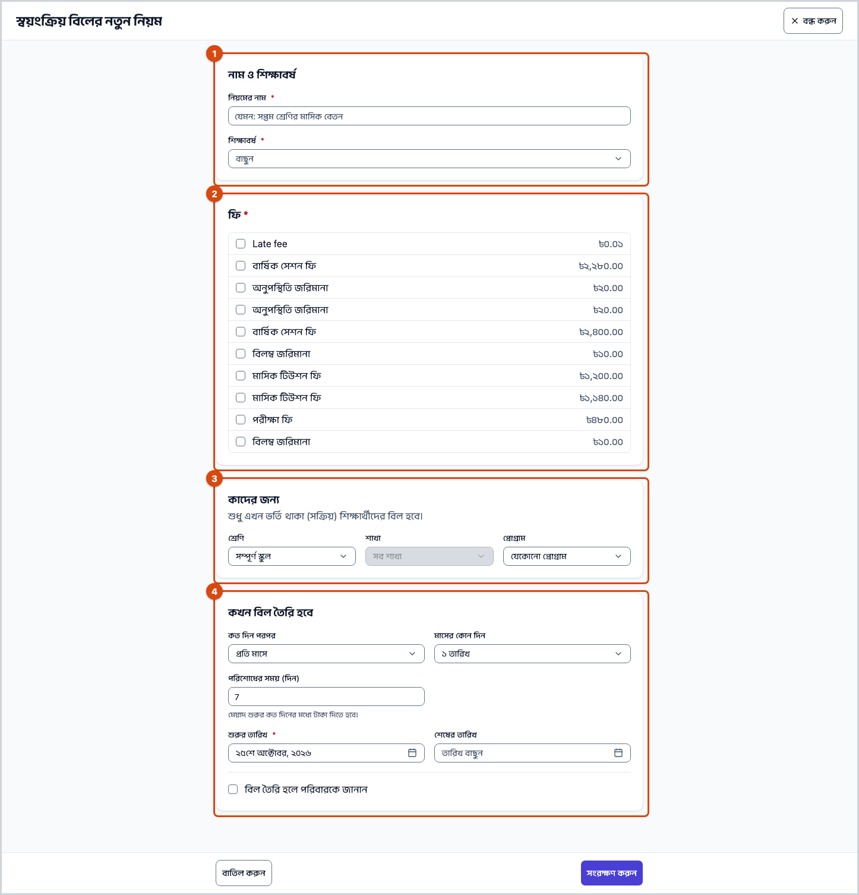
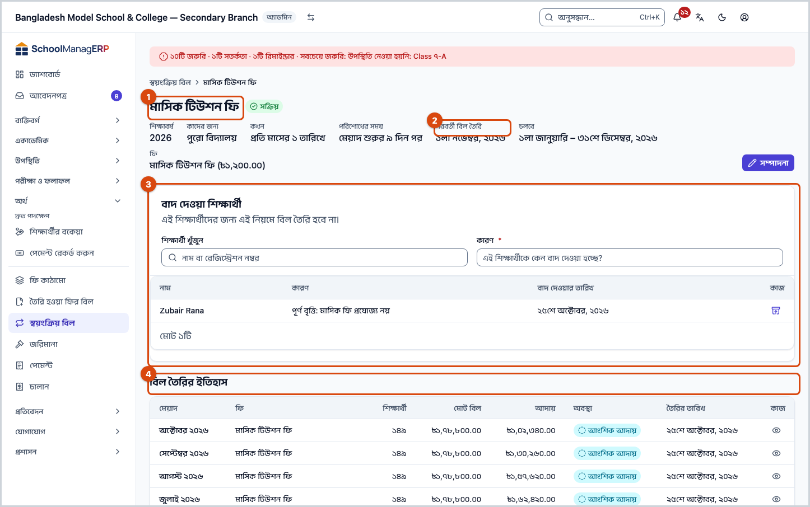

<!-- guide:meta
feature: finance.recurringSchedules
title: স্বয়ংক্রিয় বিলের নিয়ম
summary: প্রতি মাসের বা প্রতি সপ্তাহের নির্দিষ্ট দিনে সক্রিয় শিক্ষার্থীদের ফির বিল নিজে থেকে তৈরি করার নিয়ম দিন; কাউকে বাদ দিন, নিয়ম বন্ধ করুন বা নতুন শিক্ষাবর্ষে কপি করুন।
roles: [ADMIN, ACCOUNTANT]
sources:
  - client-admin/src/routes/_staff/fees/schedules/index.tsx
  - client-admin/src/routes/_staff/fees/schedules/$id.tsx
  - client-admin/src/routes/_staff/fees/schedules/-schedule-form-dialog.tsx
  - client-admin/src/routes/_staff/fees/schedules/-clone-dialog.tsx
  - client-admin/src/routes/_staff/fees/schedules/-exclusions-table.tsx
  - server/src/modules/fees/recurring-schedules.controller.ts
  - server/src/modules/fees/recurring-schedules.service.ts
  - server/src/modules/fees/fees-daily.scheduler.ts
  - server/src/modules/fees/dto/recurring-schedules.dto.ts
labels:
  [
    fees:schedules.*,
    nav:items.recurringSchedules,
    nav:items.scheduleDetail,
    nav:groups.finance,
  ]
helpIds:
  [
    finance.recurringSchedules,
    finance.recurringSchedules.action.add,
    finance.recurringSchedules.action.deactivate,
    finance.recurringSchedules.action.clone,
    finance.recurringSchedules.action.exclude,
    finance.recurringSchedules.field.rule,
    finance.recurringSchedules.field.dueDays,
    finance.recurringSchedules.field.audience,
  ]
devices: [desktop]
entry: [sidebar, palette]
keywords:
  [স্বয়ংক্রিয় বিল, নিয়ম, মাসিক বিল, সাপ্তাহিক বিল, সময়সূচী, বাদ দেওয়া, recurring, schedule, automatic billing, monthly]
appVersion: 0.1.0 (a25ab3344)
owner: tareq89
lastVerified: 2026-10-25
knownIssues: []
-->

# স্বয়ংক্রিয় বিলের নিয়ম

প্রতি মাসে বা প্রতি সপ্তাহে বিল যেন নিজে থেকে তৈরি হয়, তার নিয়ম দিন।

**যেতে হবে:** বাম মেনুতে **অর্থ → স্বয়ংক্রিয় বিল**। এই পাতার কাজ কম্পিউটারে করুন।
**শুরুর আগে:** আপনি অ্যাডমিন বা হিসাবরক্ষক হবেন। শিক্ষাবর্ষের [**ফি কাঠামো**](fee-structures.md) আগে থেকে থাকতে হবে।

একটি **নিয়ম** বলে: কোন শিক্ষাবর্ষে, কাদের জন্য, কোন ফি, আর কোন দিনে। নিয়মের দিন এলে অ্যাপ নিজে [**বিল তৈরি করুন**](generate-fees.md)-এর মতোই বিল তৈরি করে। শুধু সক্রিয় (এখন ভর্তি থাকা) শিক্ষার্থীদের বিল হয়। প্রতিটি মেয়াদে একবারই বিল হয়।

[নিয়ম যোগ করুন](#task-main) · [কাউকে বাদ দিন](#task-exclude) · [নিয়ম বন্ধ করুন](#task-deactivate) · [নতুন বর্ষে কপি করুন](#task-clone) · [সমস্যা ও সমাধান](#trouble)

**এই পাতায় যা আছে**

- [মাসিক বিলের নিয়ম যোগ করুন](#task-main)
- [নিয়ম সংরক্ষিত হয়েছে কি না বুঝবেন কীভাবে](#confirm)
- [অন্য পরিস্থিতিতে](#other)
  - [নিয়ম বদলান](#task-edit)
  - [একজন শিক্ষার্থীকে নিয়ম থেকে বাদ দিন](#task-exclude)
  - [নিয়ম বন্ধ বা আবার চালু করুন](#task-deactivate)
  - [নতুন শিক্ষাবর্ষে কপি করুন](#task-clone)
- [সমস্যা ও সমাধান](#trouble)
- [কে কী করতে পারেন](#roles)
- [আরও জানুন](#more)

---

## মাসিক বিলের নিয়ম যোগ করুন 

1. বাম মেনুতে **অর্থ** চাপুন, তারপর **স্বয়ংক্রিয় বিল** চাপুন।

   → **স্বয়ংক্রিয় বিল** তালিকা খোলে: **নাম**, **কাদের জন্য**, **কখন**, **পরবর্তী বিল তৈরি**, **শেষ বিল তৈরি**, **অবস্থা**।

2. উপরে **নিয়ম যোগ করুন** চাপুন।

   → **স্বয়ংক্রিয় বিলের নতুন নিয়ম** পাতা খোলে।

3. **নিয়মের নাম** লিখুন, যেমন `সপ্তম শ্রেণির মাসিক বেতন`।
4. **শিক্ষাবর্ষ** বেছে নিন।
5. **ফি** থেকে এক বা একাধিক ফি টিক দিন।
6. **কাদের জন্য** অংশে **শ্রেণি** বাছুন, অথবা **সম্পূর্ণ স্কুল** রেখে দিন। চাইলে **শাখা** আর **প্রোগ্রাম** দিয়ে আরও ছোট করুন।
7. **কখন বিল তৈরি হবে** অংশে **প্রতি মাসে** রাখুন। **মাসের কোন দিন** থেকে একটি তারিখ (১ থেকে ২৮) বা **শেষ দিন** বাছুন।
8. **পরিশোধের সময় (দিন)** দিন। শুরুতে ৯ থাকে, মানে মেয়াদ শুরুর ৯ দিন পরের মধ্যে টাকা দিতে হবে।
9. **শুরুর তারিখ** আর **শেষের তারিখ** দেখে নিন। শেষের তারিখ শিক্ষাবর্ষের শেষ দিনের পরে হতে পারে না।
10. পরিবারকে জানাতে না চাইলে **বিল তৈরি হলে পরিবারকে জানান** টিক তুলে দিন।

11. **সংরক্ষণ করুন** চাপুন।

    → পাতা বন্ধ হয়। তালিকায় নতুন নিয়ম আসে, **অবস্থা** **সক্রিয়**, আর **পরবর্তী বিল তৈরি**-তে পরের তারিখ।

> **মনে রাখুন:** নিয়ম চলে প্রতিদিন রাত ১২টা ৩০ মিনিটে (ঢাকার সময়)। তাই ৫ তারিখের নিয়মে বিল হয় ৫ তারিখের রাতের শুরুতে। আজই বিল দরকার হলে [**বিল তৈরি করুন**](generate-fees.md) দিয়ে নিজে তৈরি করুন; পরে নিয়ম চললে সেই মেয়াদে যাঁদের বিল আছে তাঁরা বাদ পড়েন।

---

## নিয়ম সংরক্ষিত হয়েছে কি না বুঝবেন কীভাবে 

| অবস্থা                       | কীভাবে বুঝবেন                                                     | এরপর কী                |
| ---------------------------- | ----------------------------------------------------------------- | ---------------------- |
| **শুধু স্ক্রিনে লেখা**       | নিয়মের পাতা খোলা; ছেড়ে যেতে চাইলে সতর্কবার্তা আসে               | **সংরক্ষণ করুন** চাপুন |
| **স্কুলের সিস্টেমে পৌঁছেছে** | পাতা বন্ধ হয়, আর তালিকায় নিয়মটি **সক্রিয়** অবস্থায় দেখা যায় | কাজ শেষ                |

এই পাতা কিছু ফোন বা কম্পিউটারে আলাদা করে রাখে না, তাই "এই ডিভাইসে সংরক্ষিত" অবস্থা নেই।

**বিল হয়েছে কি না দেখতে:** নিয়মের সারিতে **দেখুন** চাপুন। **বিল তৈরির ইতিহাস**-এ প্রতিটি দফা আসে। [**তৈরি হওয়া ফির বিল**](generate-fees.md#task-view) তালিকাতেও দফাটি থাকে, **কীভাবে তৈরি** = **স্বয়ংক্রিয় বিল**।

---

## অন্য পরিস্থিতিতে 

### নিয়ম বদলান 

1. তালিকায় নিয়মের সারিতে **সম্পাদনা** চাপুন।

   → **স্বয়ংক্রিয় বিলের নিয়ম সম্পাদনা** পাতা খোলে। **শিক্ষাবর্ষ** বন্ধ থাকে: **সংরক্ষণের পর শিক্ষাবর্ষ বদলানো যায় না।**

2. যা বদলাতে চান বদলান, তারপর **সংরক্ষণ করুন** চাপুন।

   → বদল শুধু পরের বিলে খাটে। আগে তৈরি হওয়া বিল বদলায় না।

**দেখুন** চাপলে **এখন কতজন পাবে** অংশে আসে **আজ … জন শিক্ষার্থীর জন্য প্রযোজ্য**। এটি সংরক্ষিত নিয়ম দেখায়, অসংরক্ষিত বদল নয়।

### একজন শিক্ষার্থীকে নিয়ম থেকে বাদ দিন 

যেমন, কোনো শিক্ষার্থী পরিবহন নেন না, তাই পরিবহন ফির নিয়ম থেকে তাঁকে বাদ দিন।

1. তালিকায় নিয়মের সারিতে **দেখুন** চাপুন।
2. **বাদ দেওয়া শিক্ষার্থী** অংশে **শিক্ষার্থী খুঁজুন** ঘরে নাম বা রেজিস্ট্রেশন নম্বর লিখে শিক্ষার্থী বাছুন।
3. **কারণ** লিখুন, তারপর **বাদ দিন** চাপুন।

   → শিক্ষার্থী তালিকায় আসে, পাশে **বাদ দেওয়ার তারিখ**। এই নিয়মে তাঁর আর বিল হয় না। আগের বিল থাকে।

আবার যুক্ত করতে শিক্ষার্থীর সারিতে **আবার যুক্ত করুন** চাপুন। পরের মেয়াদ থেকে আবার বিল হয়।

### নিয়ম বন্ধ বা আবার চালু করুন 

1. তালিকায় নিয়মের সারিতে **নিষ্ক্রিয় করুন** চাপুন।

   → **এই সময়সূচী নিষ্ক্রিয় করবেন?** জানালা আসে।

| জানালায় আপনি চাপলেন | কী হবে                                                               |
| -------------------- | -------------------------------------------------------------------- |
| **নিষ্ক্রিয় করুন**  | নতুন বিল তৈরি বন্ধ হয়। আগের বিল আর বাদ দেওয়া তালিকা যেমন ছিল থাকে। |
| **বাতিল**            | কিছুই বদলায় না।                                                     |

আবার চালু করতে **সক্রিয় করুন** চাপুন। পরের নির্ধারিত দিন থেকে আবার বিল হয়। এই পাতায় নিয়ম মোছার বোতাম নেই; দরকার না থাকলে নিষ্ক্রিয় করে রাখুন।

### নতুন শিক্ষাবর্ষে কপি করুন 

1. তালিকায় নিয়মের সারিতে **অন্য শিক্ষাবর্ষে কপি করুন** চাপুন।

   → **নিয়মটি অন্য শিক্ষাবর্ষে কপি করুন** জানালা খোলে।

2. **শিক্ষাবর্ষ** বেছে নিন, তারপর **কপি করুন** চাপুন।

   → নতুন বর্ষের পুরো সময়ের জন্য একটি নিয়ম তৈরি হয়, একই ফি, একই শিক্ষার্থী আর একই দিনে।

কপির আগে নতুন বর্ষে একই নামের শ্রেণি আর একই নাম ও ধরনের ফি কাঠামো তৈরি রাখুন। যে ফি নতুন বর্ষে মেলে না, সেটি কপি হয় না। শ্রেণি বা শাখা না মিললে নিয়মটি **নিষ্ক্রিয়** অবস্থায় তৈরি হয়; খুলে ঠিক করে **সক্রিয় করুন**। একই শিক্ষাবর্ষে কপি করা যায় না, কারণ তাতে একই শিক্ষার্থীর দুবার বিল হতো।

---

## সমস্যা ও সমাধান 

| আপনি যা দেখছেন                                        | কী করবেন                                                                                                                         | কে সাহায্য করতে পারেন |
| ----------------------------------------------------- | -------------------------------------------------------------------------------------------------------------------------------- | --------------------- |
| **নাম আবশ্যক**                                        | **নিয়মের নাম** লিখুন (১০০ অক্ষরের মধ্যে)।                                                                                       | —                     |
| **অন্তত একটি ফি নির্বাচন করুন**                       | **ফি** থেকে অন্তত একটি টিক দিন। ফাঁকা হলে আগে [**ফি কাঠামো**](fee-structures.md#task-main) যোগ করুন।                             | হিসাবরক্ষক            |
| **অন্তত একটি দিন নির্বাচন করুন**                      | **প্রতি সপ্তাহে** বাছলে **সপ্তাহের কোন দিন** থেকে অন্তত একটি দিন টিক দিন।                                                        | —                     |
| **পরিশোধের সময় ০ থেকে ৬০ দিনের মধ্যে হতে হবে**       | ০ থেকে ৬০-এর মধ্যে একটি সংখ্যা লিখুন।                                                                                            | —                     |
| **এই সময়সূচী সংরক্ষণ করা যায়নি। আবার চেষ্টা করুন।** | ইন্টারনেট দেখুন। শুরুর তারিখ শেষের তারিখের পরে নয়, আর শ্রেণি ও ফি একই শিক্ষাবর্ষের কি না দেখুন।                                 | অ্যাডমিন              |
| **নিয়মটি কপি করা যায়নি। আবার চেষ্টা করুন।**         | অন্য শিক্ষাবর্ষ বাছুন; একই বর্ষে কপি হয় না।                                                                                     | অ্যাডমিন              |
| **নিয়মটির অবস্থা বদলানো যায়নি। আবার চেষ্টা করুন।**  | ইন্টারনেট দেখে আবার চাপুন।                                                                                                       | অ্যাডমিন              |
| **এই নিয়মটি আর পাওয়া যায়নি।**                      | অন্য কেউ সরিয়ে থাকতে পারেন। তালিকা রিলোড করুন।                                                                                  | অ্যাডমিন              |
| **স্বয়ংক্রিয় বিলের নিয়ম লোড করা যায়নি**           | পাতা রিলোড করুন।                                                                                                                 | অ্যাডমিন              |
| নিয়মের দিন পেরিয়েছে, কিন্তু বিল হয়নি               | নিয়ম **সক্রিয়** কি না, আজ শুরু ও শেষের তারিখের মধ্যে কি না, আর আওতায় সক্রিয় শিক্ষার্থী আছে কি না দেখুন।                      | অ্যাডমিন              |
| একজন শিক্ষার্থীর বিল হয়নি                            | তিনি বাদ দেওয়া তালিকায় আছেন কি না, বা নিষ্ক্রিয় কি না দেখুন। দরকারে [**বিল তৈরি করুন**](generate-fees.md) দিয়ে নিজে বিল দিন। | হিসাবরক্ষক            |

---

## কে কী করতে পারেন 

| ভূমিকা                                                                               | নিয়ম দেখা | যোগ, বদল, বাদ দেওয়া, বন্ধ ও কপি |
| ------------------------------------------------------------------------------------ | ---------- | -------------------------------- |
| অ্যাডমিন                                                                             | হ্যাঁ      | হ্যাঁ                            |
| হিসাবরক্ষক                                                                           | হ্যাঁ      | হ্যাঁ                            |
| একাডেমিক কো-অর্ডিনেটর, শিক্ষক, অফিস সহকারী, পরীক্ষা নিয়ন্ত্রক, পরিচালনা পর্ষদ সদস্য | না         | না                               |

**অ্যাডমিন ও হিসাবরক্ষক:** দুজনেই এই পাতার সব কাজ করতে পারেন। এখানে কোনো অনুমোদন লাগে না, কারণ নিয়ম আগের বিলে হাত দেয় না।

অন্য ভূমিকার বাম মেনুতে **স্বয়ংক্রিয় বিল** থাকে না।

---

## আরও জানুন 

<strong>পাতার অংশগুলো</strong> — নিয়মের পাতা (দেখুন চাপলে)

1. নিয়মের নাম, **অবস্থা** আর **সম্পাদনা**।
2. তথ্য — **শিক্ষাবর্ষ**, **কাদের জন্য**, **কখন**, **পরিশোধের সময়**, **চলবে**, **ফি**, **পরবর্তী বিল তৈরি**।
3. **বাদ দেওয়া শিক্ষার্থী** — খোঁজার ঘর, **কারণ**, **বাদ দিন**; নিচে তালিকা।
4. **বিল তৈরির ইতিহাস** — এই নিয়মে তৈরি প্রতিটি দফা, পাশে **বিলগুলো দেখুন**।

<strong>ঘরগুলোর অর্থ</strong>

| ঘর                                       | অর্থ                                                                                             |
| ---------------------------------------- | ------------------------------------------------------------------------------------------------ |
| **নিয়মের নাম**                          | তালিকায় দেখানোর নাম; ১০০ অক্ষরের মধ্যে। আবশ্যক।                                                 |
| **শিক্ষাবর্ষ**                           | কোন বর্ষের নিয়ম। শুধু তৈরির সময় বাছা যায়।                                                     |
| **ফি**                                   | কোন ফি কাঠামোর বিল হবে। একই শিক্ষাবর্ষের হতে হবে। অন্তত একটি।                                    |
| **কাদের জন্য** (শ্রেণি, শাখা, প্রোগ্রাম) | কাদের বিল হবে। **সম্পূর্ণ স্কুল** মানে বর্ষের সব সক্রিয় শিক্ষার্থী। শাখা দিলে শ্রেণিও দিতে হয়। |
| **কত দিন পরপর**                          | **প্রতি মাসে** বা **প্রতি সপ্তাহে**।                                                             |
| **মাসের কোন দিন**                        | ১ থেকে ২৮ তারিখ, বা **শেষ দিন**। ২৯–৩১ নেই, যাতে প্রতি মাসেই দিনটি থাকে।                         |
| **সপ্তাহের কোন দিন**                     | এক বা একাধিক বার; প্রতি সপ্তাহে একবারই বিল হয়।                                                  |
| **পরিশোধের সময় (দিন)**                  | মেয়াদ শুরুর কত দিনের মধ্যে টাকা দিতে হবে; ০ থেকে ৬০, শুরুতে ৯।                                  |
| **শুরুর তারিখ** / **শেষের তারিখ**        | এই সময়ের মধ্যেই নিয়ম চলে। শেষের তারিখ শিক্ষাবর্ষের শেষ দিনের পরে নয়।                          |
| **বিল তৈরি হলে পরিবারকে জানান**          | টিক থাকলে বিল হলে পরিবার বার্তা পায়। শুরুতে টিক দেওয়া।                                         |

<strong>স্বয়ংক্রিয় বিল কীভাবে চলে</strong> — কখন, কাদের, আর কেন দুবার হয় না

<figure>
  
  <figcaption><em>স্বয়ংক্রিয় বিল কীভাবে চলে</em></figcaption>
</figure>

- **প্রতি মেয়াদে একবার:** অ্যাপ মনে রাখে কোন মেয়াদের বিল হয়ে গেছে। একই মাসে আবার চলে না।
- **আগের বিল থাকলে:** কোনো শিক্ষার্থীর ওই মেয়াদের একই ফির বিল আগে থেকে থাকলে (যেমন আপনি নিজে তৈরি করেছেন), তাঁর জন্য আবার হয় না।
- **টাকা:** বিলের পরিমাণ সেদিনের ফি কাঠামো থেকে আসে। শিক্ষার্থীর ছাড়ের নিয়ম থাকলে ছাড়ও বসে।
- **শুধু সক্রিয় শিক্ষার্থী:** নিষ্ক্রিয় বা বাদ দেওয়া শিক্ষার্থীর বিল হয় না।

<strong>ঘরগুলোর সংক্ষিপ্ত সাহায্য (? বোতাম)</strong>

<!-- guide:generated:fields:fees:rule,dueDays,audience -->

| ঘর                  | কী লিখবেন                                                                                   | বাধ্যতামূলক? |
| ------------------- | ------------------------------------------------------------------------------------------- | ------------ |
| কখন বিল তৈরি হবে    | প্রতি মাসে আপনার বাছা একটি দিনে (বা শেষ দিনে), অথবা প্রতি সপ্তাহে আপনার বাছা দিনগুলোতে।     | হ্যাঁ        |
| পরিশোধের সময় (দিন) | মেয়াদ শুরুর কত দিন পরে বিলের শেষ তারিখ। ০ থেকে ৬০-এর মধ্যে একটি সংখ্যা।                    | হ্যাঁ        |
| কাদের বিল হবে       | পুরো স্কুল, অথবা একটি শ্রেণি, শাখা বা প্রোগ্রাম। শুধু এখন ভর্তি থাকা শিক্ষার্থীদের বিল হয়। | না           |

<!-- /guide:generated -->

**সম্পর্কিত পাতা**

- [**ফি কাঠামো**](fee-structures.md) — নিয়মের ফি এখান থেকে আসে।
- [**বিল তৈরি করুন**](generate-fees.md) — এক মাসের বিল নিজে তৈরি করুন, আর দফাগুলো দেখুন।
- [**প্রোগ্রাম**](../people/programs.md) — প্রোগ্রাম দিয়ে নিয়মের আওতা ছোট করা যায়।
- [**শিক্ষার্থীর বকেয়া**](dues.md) — কে কত বকেয়া দিয়েছে দেখতে

---

_সংস্করণ ০.১.০ · শেষ যাচাই ২০২৬-১০-২৫_
