<!-- guide:meta
feature: help.cantSeeThis
title: আমি এটা দেখতে পাচ্ছি না কেন?
summary: মেনুতে পাতা নেই, তালিকা খালি বা উইজেট নেই? ভূমিকা, অনুমতি, শাখার দায়িত্ব, স্কুল, শিক্ষাবর্ষ আর ড্যাশবোর্ড সাজানো একে একে মিলিয়ে দেখুন।
roles: [TEACHER, ADMIN, EXECUTIVE, ACCOUNTANT, OFFICE_STAFF, EXAM_CONTROLLER, COMMITTEE, PARENT, STUDENT]
sources:
  - client-admin/src/nav-tree.ts
  - client-admin/src/routes/_staff.tsx
  - ui/src/components/tenant-bar.tsx
  - server/src/modules/classes/teacher-scope.service.ts
  - ui/src/i18n/locales/bn/common.json
  - ui/src/i18n/locales/bn/nav.json
  - ui/src/i18n/locales/bn/dashboard.json
labels: [common:accessDenied.*, nav:tenantBar.*, dashboard:states.allHidden.*]
helpIds: [help.cantSeeThis]
devices: [desktop, phone]
entry: [sidebar]
keywords:
  [দেখতে পাচ্ছি না, মেনুতে নেই, অনুমতি নেই, তালিকা খালি, শাখা দেখছি না, লুকানো, ভূমিকা, শিক্ষাবর্ষ, permission, access denied, missing menu, hidden]
appVersion: 0.1.0 (21aad534a)
owner: tareq89
lastVerified: 2026-10-25
knownIssues: []
-->

# আমি এটা দেখতে পাচ্ছি না কেন?

মেনুতে কোনো পাতা নেই, একটি বোতাম নেই, তালিকা খালি, বা ড্যাশবোর্ডে একটি উইজেট নেই? বেশির ভাগ সময় এটি ভুল নয়। অ্যাপ প্রত্যেককে শুধু তাঁর কাজের জিনিস দেখায়। নিচের প্রশ্নগুলো ক্রমে মিলিয়ে দেখুন। প্রথম যেটিতে "না" আসে, সেখানেই উত্তর।

<figure>
  
</figure>

**এই পাতায় যা আছে**

- [পাঁচ প্রশ্নে খুঁজে নিন](#steps)
- [কেন এমন হয়](#why)
- [আরও দেখুন](#more)

---

## পাঁচ প্রশ্নে খুঁজে নিন 

1. **ঠিক ভূমিকায় আছেন?**
   একজন মানুষের একই স্কুলে একাধিক ভূমিকা থাকতে পারে, যেমন শিক্ষক আর হিসাবরক্ষক। অ্যাপ শুধু এখন বাছা ভূমিকার পাতা দেখায়। <!-- source: client-admin/src/routes/_staff.tsx (activeRole); ui/src/i18n/locales/bn/nav.json tenantBar.switchRole -->
   - **না হলে:** উপরের **স্কুল বা ভূমিকা পরিবর্তন করুন** মেনু থেকে অন্য ভূমিকা বাছুন। কোন ভূমিকা কী দেখে: [ভূমিকা ও অনুমতি](../administration/roles.md#matrix)।
   - অভিভাবক বা শিক্ষার্থী হলে আপনি কর্মীদের পাতা দেখবেন না। কর্মীদের পাতার লিংক খুললে অ্যাপ আপনাকে নিজের পোর্টালে নিয়ে যায়। <!-- source: client-admin/src/routes/_staff.tsx (RequireRole) -->

2. **আপনার ভূমিকায় এই কাজের অনুমতি আছে?**
   মেনুর প্রায় প্রতিটি পাতার একটি অনুমতি লাগে। ভূমিকায় সেই অনুমতি না থাকলে পাতাটি মেনুতে আসেই না। ফোনের নিচের মেনুতেও একই নিয়ম। <!-- source: client-admin/src/nav-tree.ts (permission); client-admin/src/routes/_staff.tsx (hasPermission filter) --> লিংক দিয়ে সরাসরি খুললে লেখা আসে **এই পাতাটি দেখার অনুমতি আপনার নেই।** <!-- source: ui/src/i18n/locales/bn/common.json accessDenied.title -->
   - **না হলে:** স্কুলের অ্যাডমিনকে বলুন। প্রতিটি ভূমিকার অনুমতি ঠিক করা, নিজের মতো অনুমতি বানানো যায় না। দরকার হলে অ্যাডমিন আপনাকে অন্য ভূমিকা দেবেন। দেখুন: [ভূমিকা ও অনুমতি](../administration/roles.md)। <!-- source: docs/user-guide/bn/administration/roles.md#trouble -->

3. **শিক্ষক হলে, আপনাকে শাখার দায়িত্ব দেওয়া আছে?**
   শিক্ষক শুধু সেই শাখার শিক্ষার্থী, হাজিরা আর নম্বর দেখেন, যা তাঁকে দেওয়া হয়েছে। দায়িত্ব না থাকলে তালিকা খালি থাকে, হাজিরার পাতায় লেখা আসে **এখনো কোনো শাখা বরাদ্দ হয়নি**। <!-- source: server/src/modules/classes/teacher-scope.service.ts; docs/user-guide/bn/attendance/attendance.md#trouble -->
   - **না হলে:** অ্যাডমিন আপনাকে [শিক্ষককে শ্রেণি-শাখার দায়িত্ব দেওয়া](../people/teaching-assignments.md) পাতা থেকে শাখা দেবেন। দায়িত্বের শ্রেণিটি চলতি শিক্ষাবর্ষের হতে হবে। <!-- source: docs/user-guide/bn/people/teaching-assignments.md#after -->

4. **ঠিক স্কুল বাছা আছে?**
   প্রতিটি ব্রাঞ্চ অ্যাপে আলাদা একটি স্কুল। এক স্কুলের শিক্ষার্থী, ফি বা কর্মী অন্য স্কুলে দেখা যায় না। <!-- source: docs/user-guide/bn/admin/how-it-works.md#task-branches -->
   - **না হলে:** উপরের **স্কুল বা ভূমিকা পরিবর্তন করুন** মেনু থেকে ঠিক স্কুলটি বাছুন। বদলালে আগের স্কুলের খোলা পাতা বন্ধ হয়ে যায়। <!-- source: ui/src/i18n/locales/bn/nav.json tenantBar.confirmDescription; ui/src/components/tenant-bar.tsx --> বিস্তারিত: [একাধিক স্কুলে থাকলে](../start/sign-in.md#task-school), [স্কুল ও তার ব্রাঞ্চ](../admin/how-it-works.md#task-branches)।

5. **ঠিক শিক্ষাবর্ষ দেখছেন?**
   শ্রেণি, ফি কাঠামো, ভর্তি আর পরীক্ষা একটি শিক্ষাবর্ষের ভেতরে থাকে। তালিকা দেখার সময় অ্যাপ সাধারণত **চলমান** বর্ষটিই আগে বেছে রাখে। <!-- source: docs/user-guide/bn/academics/academic-years.md -->
   - **না হলে:** পাতায় **শিক্ষাবর্ষ** বাছার ঘর থাকলে (যেমন ফির বিল তৈরির পাতায়) সেখান থেকে ঠিক বর্ষটি বাছুন। <!-- source: docs/user-guide/bn/finance/generate-fees.md#trouble --> নতুন বছর শুরু হলে অ্যাডমিন নতুন বর্ষটি চলমান করবেন: [চলমান শিক্ষাবর্ষ বদলান](../academics/academic-years.md#task-current)।

**পাঁচটিই "হ্যাঁ", কিন্তু ড্যাশবোর্ডে একটি উইজেট নেই?**
আপনি নিজে হয়তো উইজেটটি লুকিয়েছিলেন। প্রতিটি ভূমিকার সাজানো আলাদা সেভ থাকে। <!-- source: docs/user-guide/bn/dashboard/customise.md#trouble --> সব লুকানো থাকলে লেখা আসে **সব উইজেট লুকানো**। <!-- source: ui/src/i18n/locales/bn/dashboard.json states.allHidden.title --> **সাজান** চেপে লুকানো তালিকা থেকে টিক দিন, তারপর **সেভ করুন**: [ড্যাশবোর্ড নিজের মতো সাজানো](../dashboard/customise.md#task-main)। উইজেটটি লুকানো তালিকাতেও না থাকলে সেটি আপনার ভূমিকার জন্য নয়। <!-- source: docs/user-guide/bn/dashboard/customise.md#trouble -->

**তবুও না মিটলে:** স্কুলের অ্যাডমিনকে জানান: কোন পাতা বা জিনিস খুঁজছেন, কোন ভূমিকায় আর কোন স্কুলে আছেন। [সমস্যা হলে কী করবেন](troubleshooting.md#help) দেখুন।

---

## কেন এমন হয় 

- **ভূমিকাই ঠিক করে কে কী দেখবেন।** অ্যাডমিন সব দেখেন। শিক্ষক নিজের শাখা, হিসাবরক্ষক ফি ও পেমেন্ট, অভিভাবক আর শিক্ষার্থী শুধু নিজেদের তথ্য। <!-- source: docs/user-guide/bn/admin/how-it-works.md#task-roles -->
- **এটি নিরাপত্তার জন্য।** অন্যের শাখার শিক্ষার্থী বা অন্য স্কুলের টাকার হিসাব কেউ ভুল করেও দেখেন না।
- **ভুল মনে হলে** নিজে কিছু বদলাবেন না। অ্যাডমিনকে বলুন। শব্দগুলোর মানে: [ভূমিকা](glossary.md#role), [শিক্ষকের দায়িত্ব](glossary.md#teacher-assignment), [শিক্ষাবর্ষ](glossary.md#academic-year)।

---

## আরও দেখুন 

- [সমস্যা হলে কী করবেন](troubleshooting.md): স্ক্রিনের বার্তা ধরে সমাধান।
- [ভূমিকা ও অনুমতি](../administration/roles.md): কোন ভূমিকা কী পারে।
- [শিক্ষককে শ্রেণি-শাখার দায়িত্ব দেওয়া](../people/teaching-assignments.md): শিক্ষক কোন শাখা দেখবেন।
- [যেকোনো পাতা খুঁজে পাওয়া](../start/find-anything.md): নাম লিখে পাতা খোলা।

---

_সংস্করণ ০.১.০ · শেষ যাচাই ২০২৬-১০-২৫_
