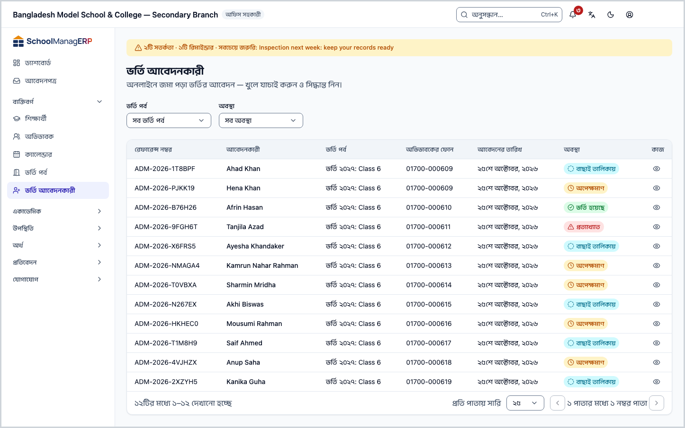

<!-- guide:meta
feature: people.admissionApplicants
title: ভর্তির আবেদন যাচাই ও ভর্তি করা
summary: অনলাইনে জমা পড়া ভর্তির আবেদন খুলে দেখুন, নথি মিলিয়ে নিন, বাছাই তালিকায় রাখুন, তারপর ভর্তি করুন বা প্রত্যাখ্যান করুন।
roles: [ADMIN, OFFICE_STAFF]
sources:
  - client-admin/src/routes/_staff/admissions/applicants/index.tsx
  - client-admin/src/routes/_staff/admissions/applicants/$applicantId.tsx
  - client-admin/src/features/admission/ApplicantList.tsx
  - client-admin/src/features/admission/ApplicantDetail.tsx
  - client-admin/src/features/admission/AdmitApplicantModal.tsx
  - client-admin/src/features/admission/EvaluateApplicantForm.tsx
  - client-admin/src/features/admission/applicantStatus.ts
  - server/src/modules/admission/applicant-review.controller.ts
  - server/src/modules/admission/applicant-review.service.ts
  - server/src/modules/admission/admission-notification.service.ts
labels:
  [
    admission-staff-applicants:list.*,
    admission-staff-applicants:detail.*,
    admission-staff-applicants:evaluate.*,
    admission-staff-applicants:admitModal.*,
    nav:items.admissionApplicants,
    nav:groups.people,
    common:accessDenied.*,
    common:actions.cancel,
    common:actions.retry,
    common:actions.moreActions,
  ]
helpIds:
  [
    people.admissionApplicants,
    people.admissionApplicants.action.shortlist,
    people.admissionApplicants.action.admit,
    people.admissionApplicants.action.reject,
    people.admissionApplicants.action.deleteDocuments,
    people.admissionApplicants.field.guardianChoice,
    people.admissionApplicants.field.notes,
  ]
devices: [desktop]
entry: [sidebar, palette, page:people.admissionIntakes]
keywords:
  [ভর্তি, আবেদনকারী, ভর্তির আবেদন, বাছাই তালিকা, ভর্তি করুন, প্রত্যাখ্যান, রেফারেন্স নম্বর, অভিভাবক, applicant, admission, shortlist, admit, reject]
appVersion: 0.1.0 (fb8af6c63)
owner: tareq89
lastVerified: 2026-10-24
knownIssues:
  - { id: list-no-search, checked: 2026-10-24, issue: null }
-->

# ভর্তির আবেদন যাচাই ও ভর্তি করা

অনলাইনে জমা পড়া আবেদন খুলে দেখুন, তারপর শিশুটিকে ভর্তি করুন বা আবেদন ফিরিয়ে দিন।

**যেতে হবে:** বাম মেনুতে **ব্যক্তিবর্গ → ভর্তি আবেদনকারী**। এই পাতার কাজ কম্পিউটারে করুন।
**শুরুর আগে:** আপনি অ্যাডমিন বা অফিস সহকারী হবেন ([কে কী করতে পারেন](#roles))। আবেদন আসে [ভর্তি পর্ব](admission-intakes.md) চলার সময় অভিভাবকের অনলাইন ফর্ম থেকে।

প্রতিটি আবেদনের একটি **অবস্থা** থাকে: **অপেক্ষমাণ** (নতুন), **বাছাই তালিকায়**, **ভর্তি হয়েছে** বা **প্রত্যাখ্যাত**। শেষের দুটি চূড়ান্ত; সেখান থেকে আর ফেরানো যায় না। **ভর্তি করুন** চাপলে একজন সত্যিকারের শিক্ষার্থী তৈরি হয়।

[আবেদন খুলে ভর্তি করুন](#task-main) · [বাছাই তালিকায় রাখুন](#task-shortlist) · [প্রত্যাখ্যান করুন](#task-reject) · [সমস্যা ও সমাধান](#trouble)

**এই পাতায় যা আছে**

- [এই পাতায় যেভাবে আসবেন](#arrive)
- [আবেদন খুলে ভর্তি করুন](#task-main)
- [ভর্তি হয়েছে কি না বুঝবেন কীভাবে](#confirm)
- [অন্য পরিস্থিতিতে](#other)
  - [তালিকা ছাঁকুন](#task-find)
  - [ফোন নম্বর আগের অভিভাবকের সঙ্গে মিললে](#task-guardian)
  - [বাছাই তালিকায় রাখুন](#task-shortlist)
  - [নোট যোগ করুন](#task-note)
  - [আবেদন প্রত্যাখ্যান করুন](#task-reject)
  - [প্রত্যাখ্যাত আবেদনের নথি মুছুন](#task-delete-docs)
  - [অভিভাবক কী জানতে পারেন](#task-notify)
- [সমস্যা ও সমাধান](#trouble)
- [কে কী করতে পারেন](#roles)
- [জানা সমস্যা](#known-issues)
- [আরও জানুন](#more)

---

## এই পাতায় যেভাবে আসবেন 

**বাম মেনু থেকে:** **ব্যক্তিবর্গ → ভর্তি আবেদনকারী** চাপুন। নিচের ধাপ ১ থেকে শুরু করুন।

**খোঁজার ঘর থেকে:** উপরের খোঁজার ঘরে (Ctrl+K) **ভর্তি আবেদনকারী** লিখে বেছে নিন। খোঁজার নিয়ম: [যেকোনো পাতা খুঁজে পাওয়া](../start/find-anything.md)।

**ভর্তি পর্বের পাতা থেকে:** [ভর্তি পর্ব](admission-intakes.md) তালিকায় সারির শেষে, বা পর্বের পাতার উপরে, **আবেদনকারী দেখুন** চাপুন। → এই পাতা খোলে, **ভর্তি পর্ব** ছাঁকনিতে সেই পর্বটি বাছা থাকে। ধাপ ২ থেকে শুরু করুন।

---

## আবেদন খুলে ভর্তি করুন 

1. বাম মেনুতে **ব্যক্তিবর্গ → ভর্তি আবেদনকারী** চাপুন।

   → উপরে **ভর্তি আবেদনকারী**, নিচে "অনলাইনে জমা পড়া ভর্তির আবেদন — খুলে যাচাই করুন ও সিদ্ধান্ত নিন।" তালিকার কলাম: **রেফারেন্স নম্বর**, **আবেদনকারী**, **ভর্তি পর্ব**, **অভিভাবকের ফোন**, **আবেদনের তারিখ**, **অবস্থা**। নতুন আবেদন উপরে থাকে।

2. যে আবেদন দেখবেন, তার সারির শেষে **দেখুন** চাপুন।

   → আবেদনের পাতা খোলে। উপরে শিশুর নাম, অবস্থার চিহ্ন, আর **রেফারেন্স নম্বর**, **আবেদনের তারিখ**, **ভর্তি পর্ব**।

3. **আবেদনকারী** কার্ডে তথ্য মিলিয়ে নিন: **জন্ম তারিখ**, **লিঙ্গ**, **অভিভাবকের নাম**, **অভিভাবকের ফোন**, **অভিভাবকের ইমেইল**, **বাড়ির ঠিকানা**। অভিভাবক যা দেননি, সেখানে লেখা **প্রদান করা হয়নি**।

4. **নথিপত্র** কার্ডে প্রতিটি নথির পাশে **খুলুন** চাপুন।

   → নথিটি নতুন ট্যাবে খোলে। কোনো নথি না থাকলে লেখা **কোনো নথি আপলোড করা হয়নি**।

<!-- image pending: img/people-admission-applicants-02.png — আবেদনের পাতা, উপরের তথ্য, তিনটি কার্ড ও কাজের বোতাম চিহ্নিত, অফিস সহকারী, desktop -->

5. উপরে **ভর্তি করুন** চাপুন।

   → **আবেদনকারী ভর্তি করুন** ঘর খোলে: "ভর্তি করলে একটি শিক্ষার্থী রেকর্ড তৈরি হয় এবং ফোন নম্বর দিয়ে একজন অভিভাবক লিঙ্ক বা তৈরি করা হয়।" নিচে **অভিভাবকের নাম** আর **অভিভাবকের ফোন**।

6. ঘরে কী লেখা আছে দেখুন:

   - "এই ফোন নম্বরের অভিভাবক আগে থেকে থাকলে, নতুন তৈরি না করে তাকে লিঙ্ক করা হবে।" → এই নম্বরে আগে কোনো অভিভাবক নেই। ধাপ ৭-এ যান।
   - **বিদ্যমান অভিভাবক: …** লেখা বাক্স → এই নম্বরে আগে থেকেই অভিভাবক আছেন। আগে [একটি বেছে নিন](#task-guardian), তারপর ধাপ ৭।

7. ঘরের **ভর্তি করুন** চাপুন।

   → ঘরে লেখা আসে **{নাম} ভর্তি হয়েছে।** **বন্ধ করুন** চাপুন। পাতায় অবস্থা হয় **ভর্তি হয়েছে**, আর কাজের বোতামগুলো সরে যায়।

| আপনি চাপলেন     | কী হবে                                                                                                                                         | ফেরানো যায়? |
| --------------- | ---------------------------------------------------------------------------------------------------------------------------------------------- | ------------ |
| **ভর্তি করুন**  | পর্বের শাখায় নতুন শিক্ষার্থী তৈরি হয়; রেজিস্ট্রেশন ও রোল নম্বর নিজে বসে; অভিভাবক যুক্ত বা তৈরি হন; অভিভাবকের মোবাইলে এসএমএস যায়           | না           |
| **বাতিল করুন**  | কিছুই বদলায় না                                                                                                                                | —            |

> **মনে রাখুন:** ভর্তি ফেরানো যায় না। ভুল করে ভর্তি হলে শিক্ষার্থীর প্রোফাইল থেকে ব্যবস্থা নিতে হবে: [শিক্ষার্থী](students.md)। আসন ভরে গেলে আর কাউকে ভর্তি করা যায় না; তখন [ভর্তি পর্ব](admission-intakes.md#task-edit)-এ **আসন সংখ্যা** বাড়াতে হবে। আবেদন **অপেক্ষমাণ** থাকলেও সরাসরি ভর্তি করা যায়; আগে বাছাই তালিকায় রাখা বাধ্যতামূলক নয়।

---

## ভর্তি হয়েছে কি না বুঝবেন কীভাবে 

সিদ্ধান্ত শুধু ইন্টারনেট থাকলে সংরক্ষিত হয়; ডিভাইসে জমিয়ে রেখে পরে পাঠানো যায় না।

| অবস্থা                       | কীভাবে বুঝবেন                                                       | এরপর কী                                             |
| ---------------------------- | ------------------------------------------------------------------- | --------------------------------------------------- |
| **শুধু স্ক্রিনে বদলেছে**     | **আবেদনকারী ভর্তি করুন** ঘর খোলা, **{নাম} ভর্তি হয়েছে।** আসেনি     | ঘরের **ভর্তি করুন** চাপুন                           |
| **স্কুলের সিস্টেমে পৌঁছেছে** | **{নাম} ভর্তি হয়েছে।** এসেছে, পাতায় অবস্থা **ভর্তি হয়েছে**       | শিক্ষার্থীর তালিকায় নামটি খুঁজে শ্রেণি দেখে নিন   |

**যাচাই করতে চাইলে:** [শিক্ষার্থী](students.md) পাতায় গিয়ে শিশুর নাম খুঁজুন; তিনি পর্বের শাখায় থাকবেন। **মূল্যায়নের ইতিহাস**-এও **ভর্তি করা হয়েছে** লেখা আসে।

**বার্তা না এলে:** ঘরে **আবেদনকারী ভর্তি করা যায়নি** দেখালে কিছুই তৈরি হয়নি; [সমস্যা ও সমাধান](#trouble) দেখুন।

---

## অন্য পরিস্থিতিতে 

### তালিকা ছাঁকুন 

তালিকার উপরে দুটি ঘর:

| ঘর              | কী বাছবেন                                                                                              |
| --------------- | ------------------------------------------------------------------------------------------------------ |
| **ভর্তি পর্ব**  | একটি পর্ব। না বাছলে **সব ভর্তি পর্ব**                                                                   |
| **অবস্থা**      | **অপেক্ষমাণ**, **বাছাই তালিকায়**, **ভর্তি হয়েছে** বা **প্রত্যাখ্যাত**। না বাছলে **সব অবস্থা**         |

কাজ শুরুর আগে **অবস্থা** থেকে **অপেক্ষমাণ** বাছলে শুধু যেগুলো এখনো দেখা হয়নি সেগুলো আসে। নাম দিয়ে খোঁজার ঘর নেই ([জানা সমস্যা](#known-issues))। কোনো আবেদন না থাকলে লেখা থাকে **এখনো কোনো আবেদন আসেনি**।

### ফোন নম্বর আগের অভিভাবকের সঙ্গে মিললে 

ভাইবোন আগে থেকে স্কুলে পড়লে প্রায়ই এমন হয়। অ্যাপ নিজে থেকে কিছু জোড়ে না; আপনাকে বেছে দিতে হয়।

1. **আবেদনকারী ভর্তি করুন** ঘরে বাক্সটি পড়ুন: **বিদ্যমান অভিভাবক: {নাম}, {ফোন}।** আর তাঁর সন্তানদের নাম (**সন্তান: …**), বা **এখনও কোনো সন্তান যুক্ত নেই।**

2. **এই ফোন নম্বর ইতিমধ্যে একজন অভিভাবকের**-এর নিচে একটি বাছুন:

   | বাছাই                                          | কখন বাছবেন                                               | কী হবে                                                       |
   | ---------------------------------------------- | -------------------------------------------------------- | ------------------------------------------------------------ |
   | **এই শিশুকে এই পরিবারের সঙ্গে যুক্ত করুন**     | বাক্সের নাম আর সন্তানেরা এই শিশুর পরিবারেরই              | নতুন শিক্ষার্থী সেই অভিভাবকের সঙ্গে যুক্ত হন                  |
   | **এই শিশুর জন্য নতুন অভিভাবক তৈরি করুন**       | একই নম্বর, কিন্তু অন্য পরিবার (যেমন আত্মীয়ের ফোন)      | আবেদনের নাম ও ফোন দিয়ে আলাদা নতুন অভিভাবক তৈরি হয়          |

   → একটি না বাছা পর্যন্ত **ভর্তি করুন** চাপা যায় না।

3. ঘরের **ভর্তি করুন** চাপুন।

আগের অভিভাবক খোঁজা না গেলে বাক্সে **আগের কোনো অভিভাবক আছে কি না দেখা যায়নি। ভর্তি করার আগে আবার চেষ্টা করুন।** দেখায়; পাশে **আবার চেষ্টা করুন** চাপুন। খোঁজা শেষ না হওয়া পর্যন্ত ভর্তি করা যায় না।

### বাছাই তালিকায় রাখুন 

ভর্তি পরীক্ষা বা সাক্ষাৎকারের জন্য যাঁদের ডাকবেন, তাঁদের আগে বাছাই তালিকায় রাখুন। বোতামটি শুধু **অপেক্ষমাণ** আবেদনে থাকে।

1. আবেদনের পাতার উপরে **বাছাই তালিকায় রাখুন** চাপুন।

   → একই নামের ঘর খোলে, তাতে **নোট** ঘর।

2. **নোট** ঘরে কারণ বা পরের ধাপ লিখুন, যেমন `শুক্রবার সকাল ১০টায় সাক্ষাৎকার`। নোট ছাড়া **সংরক্ষণ করুন** চাপা যায় না।

3. **সংরক্ষণ করুন** চাপুন।

   → ঘর বন্ধ হয়, অবস্থা হয় **বাছাই তালিকায়**, আর **মূল্যায়নের ইতিহাস**-এ **বাছাই তালিকায় রাখা হয়েছে** সহ নোটটি আসে। অভিভাবকের মোবাইলে এসএমএস যায়।

### নোট যোগ করুন 

অবস্থা না বদলে কিছু লিখে রাখতে (যেমন "অভিভাবককে ফোন করা হয়েছে"):

1. আবেদনের পাতার উপরে **আরও অ্যাকশন** মেনু খুলে **নোট যোগ করুন** চাপুন।
2. **নোট** লিখে **সংরক্ষণ করুন** চাপুন।

   → **মূল্যায়নের ইতিহাস**-এ **নোট** চিহ্ন দিয়ে লেখাটি আসে, সবচেয়ে নতুনটি উপরে। অভিভাবক কিছু জানতে পারেন না।

নোট শুধু **অপেক্ষমাণ** বা **বাছাই তালিকায়** অবস্থায় যোগ করা যায়।

### আবেদন প্রত্যাখ্যান করুন 

1. আবেদনের পাতার উপরে **আরও অ্যাকশন** মেনু খুলে **প্রত্যাখ্যান করুন** চাপুন।

   → **আবেদনকারী প্রত্যাখ্যান করুন** ঘর খোলে: "{নাম}-এর আবেদন গ্রহণ করা হয়নি বলে জানানো হবে। এটি আর ফেরানো যাবে না।"

2. চাইলে **কারণ (না দিলেও চলবে)** ঘরে কারণ লিখুন। কারণটি শুধু স্কুলের ভেতরে ইতিহাসে থাকে; অভিভাবক দেখেন না।

3. ঘরের **প্রত্যাখ্যান করুন** চাপুন।

| আপনি চাপলেন            | কী হবে                                                                                               | ফেরানো যায়? |
| ---------------------- | ---------------------------------------------------------------------------------------------------- | ------------ |
| **প্রত্যাখ্যান করুন**  | অবস্থা **প্রত্যাখ্যাত**; ইতিহাসে **প্রত্যাখ্যান করা হয়েছে**; অভিভাবকের মোবাইলে এসএমএস যায়          | না           |
| **বাতিল করুন**         | কিছুই বদলায় না                                                                                      | —            |

### প্রত্যাখ্যাত আবেদনের নথি মুছুন 

শিশুর জন্ম সনদ বা ছবি দরকার না হলে রেখে দেওয়া ঠিক নয়। প্রত্যাখ্যাত আবেদনে নথি থাকলে **নথিপত্র** কার্ডের নিচে **নথি মুছুন** বোতাম আসে।

1. **নথি মুছুন** চাপুন।

   → ঘরে লেখা: "বাতিল হওয়া এই আবেদনকারীর আপলোড করা সব নথি স্থায়ীভাবে মুছে যাবে। এটি ফেরানো যাবে না।"

2. ঘরের **নথি মুছুন** চাপুন।

   → সব নথি মুছে যায়; কার্ডে লেখা আসে **কোনো নথি আপলোড করা হয়নি**। আবেদনের বাকি তথ্য থাকে।

### অভিভাবক কী জানতে পারেন 

| আপনার সিদ্ধান্ত              | অভিভাবকের এসএমএস                                                         | অবস্থার পাতায় অভিভাবক দেখেন        |
| ---------------------------- | ------------------------------------------------------------------------ | ---------------------------------- |
| কিছু না (নতুন আবেদন)         | কিছু যায় না                                                             | **যাচাই চলছে**                     |
| **বাছাই তালিকায় রাখুন**     | আবেদন প্রাথমিকভাবে নির্বাচিত হয়েছে, পরের ধাপ জানানো হবে                | **তালিকায় আছে**                   |
| **ভর্তি করুন**               | ভর্তির জন্য নির্বাচিত, ভর্তি সম্পন্ন করতে স্কুল অফিসে যোগাযোগ করতে বলা হয় | **ভর্তি হয়েছে**                   |
| **প্রত্যাখ্যান করুন**        | এবার আবেদন সফল হয়নি                                                     | **গৃহীত হয়নি**                    |
| **নোট যোগ করুন**             | কিছু যায় না                                                             | বদলায় না                           |

স্কুলের এসএমএস ব্যালান্স না থাকলে বার্তা যায় না, কিন্তু সিদ্ধান্ত ঠিকই সংরক্ষিত হয়। অভিভাবক যেভাবে অবস্থা দেখেন: [অভিভাবক যেভাবে আবেদনের অবস্থা দেখেন](admission-intakes.md#task-status)।

<!-- unverified: whether staff can see a failed/unsent SMS for an admission decision anywhere in the communications log UI -->

---

## সমস্যা ও সমাধান 

| আপনি যা দেখছেন                                          | কী করবেন                                                                                                                                                       | কে সাহায্য করতে পারেন |
| ------------------------------------------------------- | -------------------------------------------------------------------------------------------------------------------------------------------------------------- | --------------------- |
| **এই পাতাটি দেখার অনুমতি আপনার নেই।**                   | আবেদনকারী শুধু অ্যাডমিন ও অফিস সহকারী দেখেন। **ড্যাশবোর্ডে ফিরে যান** চাপুন।                                                                                    | অ্যাডমিন              |
| **ভর্তি আবেদনকারী লোড করা যায়নি**                      | ইন্টারনেট দেখে পাতা রিলোড করুন।                                                                                                                                | অ্যাডমিন              |
| **আবেদনকারী লোড করা যায়নি**                            | **আবার চেষ্টা করুন** চাপুন। বারবার এলে তালিকায় ফিরে আবার খুলুন।                                                                                                | অ্যাডমিন              |
| **আবেদনকারী ভর্তি করা যায়নি**                          | পর্বের আসন ভরে গেছে কি না দেখুন ([ভর্তি পর্ব](admission-intakes.md#task-edit)-এ **আসন সংখ্যা** বাড়ান)। অন্য কেউ একই সময়ে সিদ্ধান্ত দিয়েছেন কি না দেখতে পাতা রিলোড করুন। অভিভাবক মেলানোর বাছাই বদলে গেলে ঘর বন্ধ করে আবার খুলুন। | অ্যাডমিন              |
| **আগের কোনো অভিভাবক আছে কি না দেখা যায়নি।…**           | পাশে **আবার চেষ্টা করুন** চাপুন।                                                                                                                                | অ্যাডমিন              |
| **মূল্যায়ন রেকর্ড করা যায়নি**                         | পাতা রিলোড করে অবস্থা দেখুন: অন্য কেউ এর মধ্যে ভর্তি বা প্রত্যাখ্যান করে থাকতে পারেন। না হলে আবার **সংরক্ষণ করুন**।                                             | অ্যাডমিন              |
| **আবেদনকারী প্রত্যাখ্যান করা যায়নি**                   | পাতা রিলোড করে অবস্থা দেখুন, তারপর আবার চেষ্টা করুন।                                                                                                           | অ্যাডমিন              |
| **নথিটি খোলা যায়নি। আবার চেষ্টা করুন।**                | আবার **খুলুন** চাপুন। ব্রাউজার নতুন ট্যাব আটকে দিচ্ছে কি না দেখুন।                                                                                             | অ্যাডমিন              |
| **নথি মুছা যায়নি। আবার চেষ্টা করুন।**                  | ইন্টারনেট দেখে আবার **নথি মুছুন** চাপুন।                                                                                                                       | অ্যাডমিন              |
| **বাছাই তালিকায় রাখুন** বোতাম নেই                     | আবেদনটি আর **অপেক্ষমাণ** নেই। বাছাই তালিকায় থাকা আবেদন সরাসরি **ভর্তি করুন** দিয়ে ভর্তি হয়।                                                                 | —                     |
| কোনো কাজের বোতামই নেই                                   | আবেদন **ভর্তি হয়েছে** বা **প্রত্যাখ্যাত**; এগুলো চূড়ান্ত।                                                                                                     | —                     |

---

## কে কী করতে পারেন 

| ভূমিকা                                                                               | তালিকা ও আবেদন দেখা | নোট, বাছাই, ভর্তি, প্রত্যাখ্যান | নথি মোছা |
| ------------------------------------------------------------------------------------ | ------------------- | ------------------------------ | -------- |
| অ্যাডমিন                                                                             | হ্যাঁ               | হ্যাঁ                          | হ্যাঁ    |
| অফিস সহকারী                                                                          | হ্যাঁ               | হ্যাঁ                          | হ্যাঁ    |
| একাডেমিক কো-অর্ডিনেটর, শিক্ষক, হিসাবরক্ষক, পরীক্ষা নিয়ন্ত্রক, পরিচালনা পর্ষদ সদস্য  | না                  | না                             | না       |

**অ্যাডমিন** আর **অফিস সহকারী** এই পাতায় হুবহু একই কাজ করতে পারেন। যাঁদের অনুমতি নেই, তাঁরা পাতাটি খুললে **এই পাতাটি দেখার অনুমতি আপনার নেই।** দেখেন, আর বাম মেনুতে **ভর্তি আবেদনকারী** থাকে না।

---

## জানা সমস্যা 

সংস্করণ ০.১.০-এ কোড দেখে যাচাই করা, ২০২৬-১০-২৪। অ্যাপে চালিয়ে দেখা হয়নি। ঠিক হলে এই অংশ থেকে সরিয়ে দেওয়া হবে।

| সমস্যা                                                                         | কার, কখন                              | তথ্য সংরক্ষিত? | আপাতত কী করবেন                                                                                       |
| ------------------------------------------------------------------------------ | ------------------------------------- | -------------- | ---------------------------------------------------------------------------------------------------- |
| তালিকায় নাম, রেফারেন্স নম্বর বা ফোন দিয়ে খোঁজার ঘর নেই                         | অভিভাবক ফোনে রেফারেন্স নম্বর বললে     | হ্যাঁ          | **ভর্তি পর্ব** আর **অবস্থা** দিয়ে তালিকা ছোট করুন, তারপর ব্রাউজারের Ctrl+F দিয়ে পাতায় খুঁজুন        |

---

## আরও জানুন 

<strong>পাতার অংশগুলো</strong> — আবেদনের পাতা, উপর থেকে নিচে

1. **নাম ও অবস্থা** — শিশুর নাম, অবস্থার চিহ্ন, **রেফারেন্স নম্বর**, **আবেদনের তারিখ**, **ভর্তি পর্ব**।
2. **কাজের বোতাম** — **বাছাই তালিকায় রাখুন** (শুধু অপেক্ষমাণ হলে), **ভর্তি করুন**, আর **আরও অ্যাকশন** মেনুতে **নোট যোগ করুন** ও **প্রত্যাখ্যান করুন**।
3. **আবেদনকারী** — শিশু ও অভিভাবকের তথ্য।
4. **নথিপত্র** — আপলোড করা নথি, প্রতিটির পাশে **খুলুন**।
5. **মূল্যায়নের ইতিহাস** — "নতুনগুলো আগে"; প্রতিটি সিদ্ধান্ত ও নোট, তারিখ-সময় সহ। কিছু না থাকলে **এখনো কোনো মূল্যায়ন রেকর্ড করা হয়নি**।

<!-- image pending: img/people-admission-applicants-03.png — আবেদনের পাতার পাঁচটি অংশ নম্বর দিয়ে চিহ্নিত, অফিস সহকারী, desktop -->

<strong>ঘরগুলোর অর্থ</strong>

<!-- guide:generated:fields:admission-staff-applicants -->

| ঘর                                   | কী লিখবেন                                                                                    | বাধ্যতামূলক?       |
| ------------------------------------ | -------------------------------------------------------------------------------------------- | ------------------ |
| নোট                                  | বাছাই বা নোটের কারণ, পরের ধাপ। শুধু স্কুলের ভেতরে ইতিহাসে থাকে।                              | হ্যাঁ              |
| কারণ (না দিলেও চলবে)                 | কেন প্রত্যাখ্যান। অভিভাবক দেখেন না।                                                          | না                 |
| এই ফোন নম্বর ইতিমধ্যে একজন অভিভাবকের | একই পরিবার হলে "যুক্ত করুন", অন্য পরিবার হলে "নতুন অভিভাবক তৈরি করুন"। শুধু নম্বর মিললে আসে। | হ্যাঁ, নম্বর মিললে |

<!-- /guide:generated -->

<strong>আবেদনের অবস্থা কীভাবে বদলায়</strong>

<figure>
  
  <figcaption><em>অপেক্ষমাণ থেকে ভর্তি বা প্রত্যাখ্যান</em></figcaption>
</figure>

- **ভর্তি হয়েছে** আর **প্রত্যাখ্যাত** চূড়ান্ত; সেখান থেকে কোনো বোতাম থাকে না।
- দুজন একই সময়ে একই আবেদনে সিদ্ধান্ত দিলে একজনেরটাই খাটে; অন্যজন ত্রুটির বার্তা পান।
- ভর্তি হওয়া শিক্ষার্থী বছরের হিসাবে [ভর্তি প্রতিবেদন](admission-reports.md)-এ ওঠেন।

<strong>পুরো কাজটি একসাথে</strong>

<!-- image pending: img/people-admission-applicants-flow.gif — আবেদন খোলা, নথি দেখা, বাছাই তালিকায় রাখা ও ভর্তি করা পর্যন্ত GIF, অফিস সহকারী, desktop -->

**সম্পর্কিত পাতা**

- [**ভর্তি পর্ব**](admission-intakes.md) — আসন, তারিখ আর অভিভাবকের অনলাইন ফর্ম।
- [**ভর্তি প্রতিবেদন**](admission-reports.md) — বছরে কতজন ভর্তি হলো, কতজন চলে গেল।

---

_সংস্করণ ০.১.০ · শেষ যাচাই ২০২৬-১০-২৪_
