<!-- guide:meta
feature: people.admissionClerkEntry
title: অফিসে আসা অভিভাবকের আবেদন তোলা
summary: অফিসে আসা অভিভাবকের জন্য কাগজপত্র ও ফিসহ ভর্তির আবেদন তুলুন আর রেফারেন্স নম্বর নিন।
roles: [ADMIN, OFFICE_STAFF]
sources:
  - client-admin/src/routes/_staff/admissions/applicants/new.tsx
  - client-admin/src/features/admission/desk/ClerkEntryPage.tsx
  - client-admin/src/features/admission/desk/ApplicantsPanel.tsx
labels: [admission-desk:clerk.*, admission-desk:applicantsPanel.newApplication]
helpIds: [people.admissionClerkEntry]
devices: [desktop]
entry: [page:people.admissionIntakes]
keywords: [অফিসে আবেদন, নতুন আবেদন, ভর্তি, রেফারেন্স নম্বর, walk-in, clerk entry]
appVersion: 0.1.0 (fb8af6c63)
owner: tareq89
lastVerified: 2026-11-16
knownIssues: []
-->

# অফিসে আসা অভিভাবকের আবেদন তোলা

যে অভিভাবক অনলাইনে আবেদন করতে পারেননি, তিনি অফিসে এলে আপনি তাঁর হয়ে একই আবেদন তুলে দেন।

**যেতে হবে:** **ব্যক্তিবর্গ → ভর্তি রাউন্ড** থেকে রাউন্ড খুলুন, তারপর **আবেদন** ধাপে **নতুন আবেদন** চাপুন। কম্পিউটারে করুন।
**শুরুর আগে:** আপনি অ্যাডমিন বা অফিস সহকারী হবেন ([কে কী করতে পারেন](#roles))। রাউন্ড আগে বানানো থাকতে হবে ([ভর্তি রাউন্ড](admission-intakes.md))। অভিভাবকের কাগজপত্র আর ফি-র রসিদ হাতে রাখুন।

ফর্মে ঠিক সেই ঘরগুলোই আসে যা রাউন্ড চেয়েছে। তাই দুই রাউন্ডে ফর্ম আলাদা হতে পারে।

[আবেদন তুলুন](#task-main) · [আরেকটি তুলুন](#task-another) · [সমস্যা ও সমাধান](#trouble)

<figure>
  
  <figcaption><em>অফিসের ডেস্ক থেকে ফি যাচাই পর্যন্ত</em></figcaption>
</figure>

---

## এখানে কীভাবে আসবেন 

**ভর্তি ডেস্ক থেকে:** [ভর্তি রাউন্ড](admission-intakes.md)-এর তালিকা থেকে রাউন্ড খুলুন। **আবেদন** ধাপে **নতুন আবেদন** চাপুন। রাউন্ড আগে থেকেই বাছা থাকে।

---

## আবেদন তুলুন 

1. **নতুন আবেদন** চাপুন। রাউন্ড বাছা না থাকলে **ভর্তি রাউন্ড** ঘর থেকে বাছুন।

   → **নতুন আবেদন** পাতা খোলে। সেই রাউন্ডের ঘরগুলো আসে, যেমন শিশুর নাম, জন্মতারিখ, লিঙ্গ আর অভিভাবকের ফোন।

2. ঘরগুলো পূরণ করুন। অভিভাবকের ফোন ১১ অঙ্কের, শুরু ০১ দিয়ে। ভুল ঘরের নিচে লেখা আসে, যেমন **এই ঘরটি পূরণ করতে হবে।**

3. রাউন্ড যে কাগজ চেয়েছে তা যোগ করুন (যেমন **ছবি**, **জন্মনিবন্ধন**)। অভিভাবক না আনলে **কাগজপত্র পরে দেব** টিক দিন।

4. রাউন্ডে ফি থাকলে **আবেদনের ফি** অংশ পূরণ করুন: **যেভাবে পাঠানো** (যেমন বিকাশ), **পেমেন্ট নম্বর (না থাকলে ফাঁকা)** আর **ফি জমার প্রমাণ (ছবি বা পিডিএফ)**।

   → পাঠানোর মাধ্যম আর প্রমাণ ছাড়া আবেদন সংরক্ষণ হয় না।

5. **আবেদন সংরক্ষণ করুন** চাপুন, অথবা যেকোনো ঘরে থেকে Ctrl আর Enter চাপুন।

   → লেখা আসে **আবেদন সংরক্ষণ হয়েছে। রেফারেন্স: …**। এই নম্বর অভিভাবককে দিন।

> **মনে রাখুন:** ফি যাচাই না হওয়া পর্যন্ত আবেদন কোনো তালিকায় যায় না: [আবেদনের ফি যাচাই](admission-fee-verify.md)।

---

## সংরক্ষণ হয়েছে কীভাবে বুঝবেন 

- **আবেদন সংরক্ষণ হয়েছে। রেফারেন্স: …** লেখায় রেফারেন্স নম্বর থাকে।
- আবেদনটি রাউন্ডের "আবেদন" ধাপে দেখা যায়। রাউন্ডে ফি থাকলে তা ফি-র সারিতে অপেক্ষা করে।

---

## অন্য পরিস্থিতিতে 

### আরেকটি আবেদন তুলুন 

**আরেকটি আবেদন লিখুন** চাপুন। ঘরগুলো খালি হয়, রাউন্ড একই থাকে।

### শেষ তারিখ পার হয়ে গেলে 

একটি টিক ঘরে লেখা আসে **শেষ তারিখ পার হয়ে গেছে। তবুও এই আবেদন নিন।** স্কুল আবেদন নিতে চাইলেই শুধু টিক দিন।

### পেমেন্ট নম্বর আগে ব্যবহার হলে 

লেখা আসে **এই পেমেন্ট নম্বর আগে একবার ব্যবহার হয়েছে। আবেদন সংরক্ষণ হয়েছে; ফি-র ফাইলটি ভালো করে দেখুন।** কিছু হারায়নি; ফি দেখার সময় প্রমাণটি ভালো করে দেখুন।

---

## সমস্যা ও সমাধান 

| আপনি যা দেখছেন | কী করবেন | কে সাহায্য করতে পারেন |
| --- | --- | --- |
| **আবেদন সংরক্ষণ করা গেল না। আবার চেষ্টা করুন।** | ইন্টারনেট দেখে আবার **আবেদন সংরক্ষণ করুন** চাপুন। | অ্যাডমিন |
| **এই ঘর এই রাউন্ডের অংশ নয়।** | ঠিক **ভর্তি রাউন্ড** বাছুন। | অ্যাডমিন |
| **এই ঘরটি ঠিক নেই। আবার দেখুন।** | ঘরের নিচের সাহায্যের লেখা পড়ে মান ঠিক করুন। | — |
| **নতুন আবেদন** বোতাম নেই | আপনার ভূমিকায় ভর্তি দেখার অনুমতি নেই। | অ্যাডমিন |

---

## কে কী করতে পারেন 

| ভূমিকা | আবেদন তোলা |
| --- | --- |
| অ্যাডমিন | হ্যাঁ |
| অফিস সহকারী | হ্যাঁ |
| অন্য ভূমিকা | না |

---

## আরও জানুন 

<strong>ওয়েবসাইটে একই আবেদন</strong>

অভিভাবক স্কুলের ওয়েবসাইটেও আবেদন করতে পারেন। দুই পথেই একই আবেদন আর একই রেফারেন্স নম্বর হয়: [ভর্তি রাউন্ড](admission-intakes.md#task-site)।

**সম্পর্কিত পাতা**

- [**ভর্তি রাউন্ড**](admission-intakes.md) — রাউন্ড বানান, ডেস্ক দেখুন।
- [**আবেদনের ফি যাচাই**](admission-fee-verify.md) — ফি আছে এমন আবেদনের পরের ধাপ।
- [**ভর্তি আবেদনকারী**](admission-applicants.md) — যাচাই ও ভর্তি।

---

_সংস্করণ ০.১.০ · শেষ যাচাই ২০২৬-১১-১৬_
