<!-- guide:meta
feature: people.admissionFeeVerify
title: আবেদনের ফি যাচাই
summary: আবেদনের ফি-র প্রমাণ খুলে দেখুন, তারপর ফি ঠিক আছে চাপুন অথবা কারণসহ ফেরত পাঠান, যাতে আবেদন তালিকায় যেতে পারে।
roles: [ADMIN, OFFICE_STAFF]
sources:
  - client-admin/src/features/admission/desk/FeeVerifyDialog.tsx
  - client-admin/src/features/admission/desk/ApplicantsPanel.tsx
  - client-admin/src/features/admission/hooks/useFeeProofAttachment.ts
labels: [admission-desk:fee.*, admission-desk:applicantsPanel.*, admission-desk:desk.facts.feePending]
helpIds: [people.admissionFeeVerify]
devices: [desktop]
entry: [page:people.admissionIntakes]
keywords: [ফি, ফি যাচাই, পেমেন্ট প্রমাণ, বিকাশ, নগদ, ভর্তি, fee check]
appVersion: 0.1.0 (fb8af6c63)
owner: tareq89
lastVerified: 2026-11-16
knownIssues: []
-->

# আবেদনের ফি যাচাই

ফি আছে এমন আবেদন, আপনি ফি ঠিক বলার আগে, কোনো তালিকায় যায় না। প্রতিটির জন্য এটি করুন।

**যেতে হবে:** **ব্যক্তিবর্গ → ভর্তি রাউন্ড** থেকে রাউন্ড খুলুন, তারপর **আবেদন** ধাপে **ফি দেখুন** চাপুন। কম্পিউটারে করুন।
**শুরুর আগে:** আপনি অ্যাডমিন বা অফিস সহকারী হবেন ([কে কী করতে পারেন](#roles))। মেলানোর জন্য আপনার বিকাশ, নগদ, রকেট বা ব্যাংকের হিসাব হাতের কাছে রাখুন।

[ফি দেখুন](#task-main) · [ফি ফেরত পাঠান](#task-back) · [সমস্যা ও সমাধান](#trouble)

<figure>
  
  <figcaption><em>ফি দেখার দুটি ফল</em></figcaption>
</figure>

---

## এখানে কীভাবে আসবেন 

**ভর্তি ডেস্ক থেকে:** [ভর্তি রাউন্ড](admission-intakes.md)-এর তালিকা থেকে রাউন্ড খুলুন। **ফি যাচাই বাকি** কার্ড বা **ফি দেখুন (৩)** বোতাম চাপলে **দেখার অপেক্ষায় থাকা ফি**-র সারি খোলে।

---

## ফি দেখুন 

1. সারিতে একটি লাইনের শেষে **দেখুন** চাপুন।

   → একটি জানালা খোলে: **…-এর ফি** আর **আবেদন …**। সেখানে **ফি**, **যেভাবে পাঠানো**, **পেমেন্ট নম্বর** আর প্রমাণ (**ফি জমার প্রমাণ**) থাকে।

2. প্রমাণ আর পেমেন্ট নম্বর আপনার নিজের হিসাবের সাথে মিলিয়ে দেখুন।

3. **ফি ঠিক আছে** চাপুন।

   → জানালা বন্ধ হয়। আবেদনের ফি এখন **ফি ঠিক** গোনা হয় এবং মেরিট তালিকায় যেতে পারে।

> **মনে রাখুন:** যে আবেদনের ফি ঠিক হয়নি, সে রোল নম্বর বা তালিকায় জায়গা পায় না।

---

## ঠিকমতো হলো কীভাবে বুঝবেন 

- লাইনটি সারি থেকে চলে যায়, আর ডেস্কে **ফি যাচাই বাকি** একটি কমে।
- [ভর্তি আবেদনকারী](admission-applicants.md) পাতায় **ফি** কলামে **ফি ঠিক** লেখা থাকে।

---

## অন্য পরিস্থিতিতে 

### ফি ফেরত পাঠান 

1. জানালায় **কারণ (ফেরত পাঠাতে হলে লিখুন)** ঘরে কারণ লিখুন। সর্বোচ্চ ৩০০ অক্ষর; পাতা গুনে দেখায়।
2. **ফেরত পাঠান** চাপুন।

   → আবেদনে লেখা থাকে **ফি ফেরত পাঠানো**, আর কারণটি ফি-র ইতিহাসে থাকে ([ভর্তি আবেদনকারী](admission-applicants.md))।

### পেমেন্ট নম্বর আগে দেখা গেছে 

জানালায় লেখা আসে **এই পেমেন্ট নম্বর আগে একবার ব্যবহার হয়েছে। ফাইলটি ভালো করে দেখুন।** একই রসিদ দুবার ব্যবহার হয়ে থাকতে পারে। প্রমাণ দেখে সিদ্ধান্ত নিন।

### ফাইল খোলে না 

জানালায় লেখা আসে **ফাইল খোলা গেল না।** জানালা বন্ধ করে আবার **দেখুন** চাপুন। তবুও না খুললে কারণ লিখে ফি ফেরত পাঠান, অথবা অভিভাবককে রসিদ আনতে বলুন।

---

## সমস্যা ও সমাধান 

| আপনি যা দেখছেন | কী করবেন | কে সাহায্য করতে পারেন |
| --- | --- | --- |
| **সংরক্ষণ করা গেল না। আবার চেষ্টা করুন।** | ইন্টারনেট দেখে আবার বোতাম চাপুন। | অ্যাডমিন |
| **ফাইল খোলা গেল না।** | আবার **দেখুন** চাপুন; না হলে কারণ লিখে ফি ফেরত পাঠান। | অ্যাডমিন |
| সারি খালি, তবু একটি আবেদন তালিকায় নেই | [ভর্তি আবেদনকারী](admission-applicants.md)-তে খুলে দেখুন; ফি-র প্রমাণ নাও থাকতে পারে (**ফির প্রমাণ নেই**)। | — |

---

## কে কী করতে পারেন 

| ভূমিকা | ফি যাচাই |
| --- | --- |
| অ্যাডমিন | হ্যাঁ |
| অফিস সহকারী | হ্যাঁ |
| অন্য ভূমিকা | না |

---

## আরও জানুন 

<strong>ফি কোথা থেকে আসে</strong>

ফি-র পরিমাণ আর পাঠানোর মাধ্যম রাউন্ড বানানোর সময় ঠিক হয় ([ভর্তি রাউন্ড](admission-intakes.md))। প্রমাণ দেন অনলাইনে অভিভাবক, অথবা ডেস্কে কর্মী ([অফিসে আসা অভিভাবকের আবেদন তোলা](admission-clerk-entry.md))।

**সম্পর্কিত পাতা**

- [**অফিসে আসা অভিভাবকের আবেদন তোলা**](admission-clerk-entry.md) — অফিসে ফি-র প্রমাণ যেখানে নেওয়া হয়।
- [**ভর্তি আবেদনকারী**](admission-applicants.md) — **ফি** কলাম আর ফি-র ইতিহাস।
- [**ভর্তি রাউন্ড**](admission-intakes.md) — ফি আর পাঠানোর মাধ্যম।
- [**ভর্তি ডেস্ক, পরীক্ষার নম্বর ও কাটঅফ**](admission-stages.md) — ফি-র পরের ধাপ।

---

_সংস্করণ ০.১.০ · শেষ যাচাই ২০২৬-১১-১৬_
