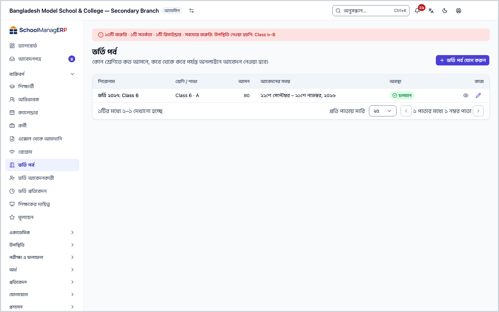
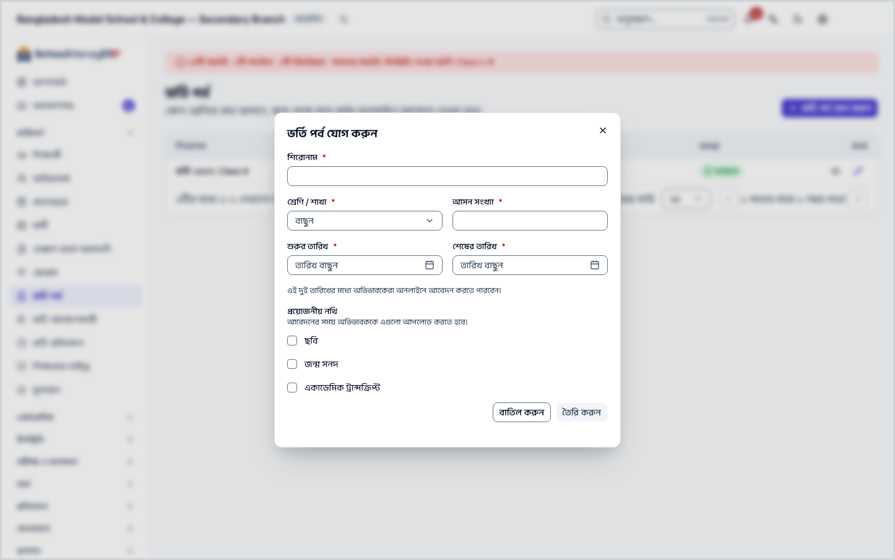
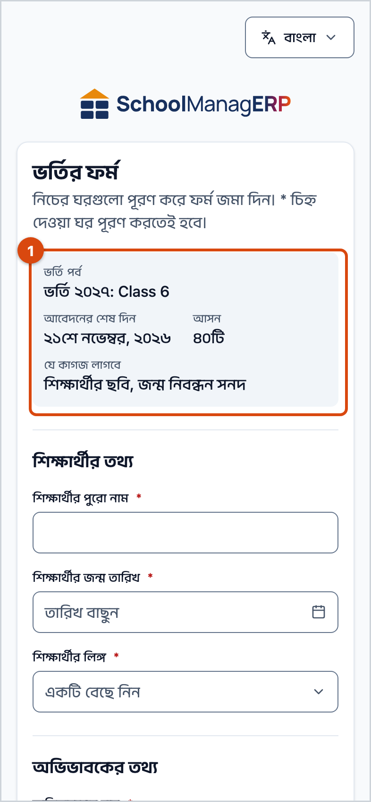
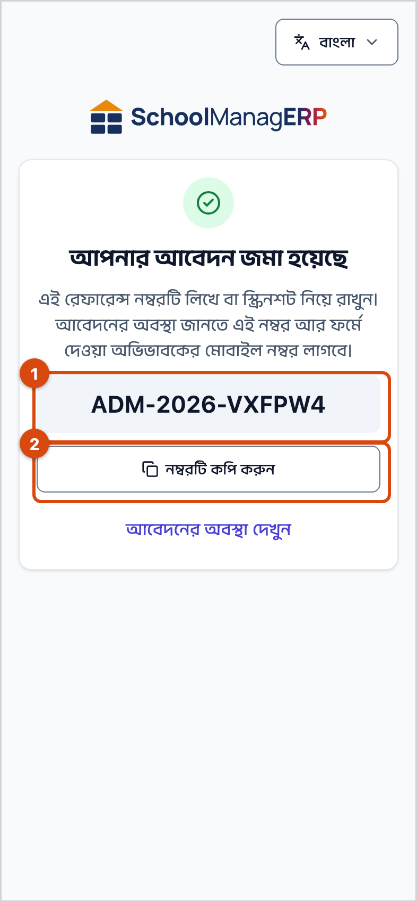
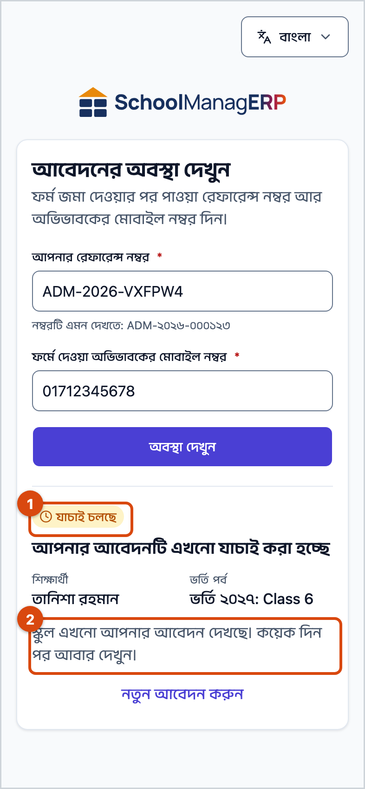

<!-- guide:meta
feature: people.admissionIntakes
title: ভর্তি পর্ব ও অনলাইন ভর্তির ফর্ম
summary: কোন শ্রেণিতে কত আসনে, কবে থেকে কবে পর্যন্ত অনলাইনে আবেদন নেওয়া হবে তা ঠিক করুন; অভিভাবক ফোন থেকে ফর্ম পূরণ করে রেফারেন্স নম্বর পান আর পরে আবেদনের অবস্থা দেখেন।
roles: [ADMIN, OFFICE_STAFF]
sources:
  - client-admin/src/routes/_staff/admissions/intakes/index.tsx
  - client-admin/src/routes/_staff/admissions/intakes/$intakeId.tsx
  - client-admin/src/routes/admission/$slug/index.tsx
  - client-admin/src/routes/admission/$slug/status.tsx
  - client-admin/src/features/admission/IntakeList.tsx
  - client-admin/src/features/admission/IntakeForm.tsx
  - client-admin/src/features/admission/PublicAdmissionForm.tsx
  - client-admin/src/features/admission/AdmissionConfirmation.tsx
  - server/src/modules/admission/intake.controller.ts
  - server/src/modules/admission/intake.service.ts
  - server/src/modules/admission/public-admission.controller.ts
  - server/src/modules/admission/admission-applicant.service.ts
labels:
  [
    admission-staff-intakes:list.*,
    admission-staff-intakes:createDialog.*,
    admission-staff-intakes:form.*,
    admission-staff-intakes:detail.*,
    admission-public:form.*,
    admission-public:confirmation.*,
    admission-public:status.*,
    nav:items.admissionIntakes,
    nav:groups.people,
    common:accessDenied.*,
    common:recordNotFound.*,
    common:actions.cancel,
  ]
helpIds:
  [
    people.admissionIntakes,
    people.admissionIntakes.action.add,
    people.admissionIntakes.field.classSection,
    people.admissionIntakes.field.seatCount,
    people.admissionIntakes.field.dates,
    people.admissionIntakes.field.requiredDocuments,
    people.admissionIntakes.section.publicForm,
    people.admissionIntakes.section.status,
  ]
devices: [desktop]
entry: [sidebar, palette]
keywords:
  [ভর্তি, ভর্তি পর্ব, অনলাইন ভর্তি, ভর্তির ফর্ম, আসন, আবেদন, রেফারেন্স নম্বর, আবেদনের অবস্থা, admission, intake, online admission, apply, seats, reference number]
appVersion: 0.1.0 (fb8af6c63)
owner: tareq89
lastVerified: 2026-10-24
knownIssues: []
-->

# ভর্তি পর্ব ও অনলাইন ভর্তির ফর্ম

একটি ভর্তি পর্ব খুলুন, যাতে অভিভাবকেরা ফোন থেকেই অনলাইনে ভর্তির আবেদন করতে পারেন।

**যেতে হবে:** বাম মেনুতে **ব্যক্তিবর্গ → ভর্তি পর্ব**। পর্ব তৈরির কাজ কম্পিউটারে করুন; অভিভাবকের ফর্ম ফোনে চলে।
**শুরুর আগে:** আপনি অ্যাডমিন বা অফিস সহকারী হবেন ([কে কী করতে পারেন](#roles))। যে শ্রেণি ও শাখায় ভর্তি নেবেন, সেটি আগে থেকে তৈরি থাকতে হবে।

**ভর্তি পর্ব** মানে এক দফা ভর্তি: কোন **শ্রেণি / শাখা**য়, কতটি **আসন**, আর কোন তারিখ থেকে কোন তারিখ পর্যন্ত আবেদন নেওয়া হবে। পর্ব চলার সময় অভিভাবক স্কুলের ভর্তির লিংক খুলে **ভর্তির ফর্ম** পূরণ করেন। জমা পড়া আবেদন যায় [ভর্তি আবেদনকারী](admission-applicants.md) পাতায়, সেখান থেকে ভর্তি করলে শিক্ষার্থী তৈরি হয়।

[ভর্তি পর্ব যোগ করুন](#task-main) · [পর্ব বদলান বা আগে বন্ধ করুন](#task-edit) · [অভিভাবক যেভাবে আবেদন করেন](#task-public) · [আবেদনের অবস্থা দেখা](#task-status) · [সমস্যা ও সমাধান](#trouble)

**এই পাতায় যা আছে**

- [ভর্তি পর্ব যোগ করুন](#task-main)
- [পর্ব তৈরি হয়েছে কি না বুঝবেন কীভাবে](#confirm)
- [অন্য পরিস্থিতিতে](#other)
  - [পর্বের তথ্য বদলান বা আগে বন্ধ করুন](#task-edit)
  - [একটি পর্বের আবেদনকারী দেখুন](#task-applicants)
  - [অভিভাবক যেভাবে ফোন থেকে আবেদন করেন](#task-public)
  - [অভিভাবক যেভাবে আবেদনের অবস্থা দেখেন](#task-status)
  - [আবেদন থেকে ভর্তি হওয়া শিক্ষার্থী](#task-flow)
- [সমস্যা ও সমাধান](#trouble)
- [কে কী করতে পারেন](#roles)
- [আরও জানুন](#more)

---

## ভর্তি পর্ব যোগ করুন 

1. বাম মেনুতে **ব্যক্তিবর্গ → ভর্তি পর্ব** চাপুন। খোঁজার ঘরে (Ctrl+K) **ভর্তি পর্ব** লিখেও আসা যায়।

   → উপরে **ভর্তি পর্ব** শিরোনাম, নিচে "কোন শ্রেণিতে কত আসনে, কবে থেকে কবে পর্যন্ত অনলাইনে আবেদন নেওয়া হবে।" তালিকার কলাম: **শিরোনাম**, **শ্রেণি / শাখা**, **আসন**, **আবেদনের সময়**, **অবস্থা**। কোনো পর্ব না থাকলে লেখা থাকে **এখনো কোনো ভর্তি পর্ব নেই**।

2. উপরে **ভর্তি পর্ব যোগ করুন** চাপুন।

   → **ভর্তি পর্ব যোগ করুন** ঘর খোলে। তারকা (\*) দেওয়া ঘরগুলো পূরণ করতেই হবে।

3. **শিরোনাম** ঘরে এমন নাম দিন যা অভিভাবক দেখে চিনবেন, যেমন `ষষ্ঠ শ্রেণি ভর্তি ২০২৭`।

   → অভিভাবকের ফর্মে আর আবেদনের অবস্থার পাতায় এই নামটিই দেখা যায়।

4. **শ্রেণি / শাখা** থেকে যে শাখায় ভর্তি নেবেন, সেটি বাছুন।

   → ভর্তি করলে শিক্ষার্থী সরাসরি এই শাখায় যোগ হন। এক পর্বে একটিই শাখা; দুই শাখায় নিতে চাইলে দুটি পর্ব খুলুন।

5. **আসন সংখ্যা** দিন (১ বা তার বেশি)।

   → যতজন **ভর্তি হয়েছে**, তা এই সংখ্যায় পৌঁছালে পর্বটি অভিভাবকের ফর্ম থেকে সরে যায়, আর এর বেশি কাউকে ভর্তি করা যায় না।

6. **শুরুর তারিখ** আর **শেষের তারিখ** বাছুন।

   → "এই দুই তারিখের মধ্যে অভিভাবকেরা অনলাইনে আবেদন করতে পারবেন।" শেষের দিনটিও ধরা হয়। শেষের তারিখ শুরুর আগে দিলে **শেষের তারিখ শুরুর তারিখের আগে হতে পারবে না।** দেখায়।

7. **প্রয়োজনীয় নথি**-তে যেগুলো লাগবে তাতে টিক দিন: **ছবি**, **জন্ম সনদ**, **একাডেমিক ট্রান্সক্রিপ্ট**। কিছু না লাগলে সব ফাঁকা রাখুন।

   → টিক দেওয়া প্রতিটি নথি অভিভাবককে ফর্মের সঙ্গে আপলোড করতেই হবে।

8. **তৈরি করুন** চাপুন। সব বাধ্যতামূলক ঘর ঠিকমতো না দিলে বোতামটি চাপা যায় না।

   → ঘর বন্ধ হয়, আর তালিকায় নতুন পর্ব দেখা যায়। আজকের তারিখ শুরু আর শেষের মধ্যে পড়লে **অবস্থা** হয় **চলমান**, নইলে **বন্ধ**।

> **মনে রাখুন:** পর্ব **চলমান** হলেই অভিভাবক আবেদন করতে পারেন, কিন্তু তাঁকে স্কুলের ভর্তির লিংকটি জানাতে হবে। লিংকের গড়ন `…/admission/<স্কুলের-লিংক-নাম>`। লিংকটি কপি করতে পর্বের তালিকার উপরে **পাবলিক লিংক কপি করুন** চাপুন; **ভর্তির পাবলিক লিংক কপি হয়েছে।** বার্তা আসে।

---

## পর্ব তৈরি হয়েছে কি না বুঝবেন কীভাবে 

পর্বের তথ্য শুধু ইন্টারনেট থাকলে সংরক্ষিত হয়; ডিভাইসে জমিয়ে রেখে পরে পাঠানো যায় না।

| অবস্থা                       | কীভাবে বুঝবেন                                       | এরপর কী                      |
| ---------------------------- | --------------------------------------------------- | ---------------------------- |
| **শুধু স্ক্রিনে বদলেছে**     | ঘর খোলা, তথ্য লেখা, কিন্তু **তৈরি করুন** চাপা হয়নি | **তৈরি করুন** চাপুন          |
| **স্কুলের সিস্টেমে পৌঁছেছে** | ঘর বন্ধ হয়েছে, তালিকায় নতুন পর্বের সারি আছে       | অভিভাবকদের ভর্তির লিংক জানান |

**যাচাই করতে চাইলে:** পাতা রিলোড করুন। পর্বটি তালিকায় থাকলে সিস্টেমে আছে। অভিভাবকের চোখে দেখতে নিজের ফোনে ভর্তির লিংক খুলুন: **চলমান** পর্বটি সেখানে দেখা যাওয়ার কথা।

**বার্তা না এলে:** ঘরে **ভর্তি পর্ব তৈরি করা যায়নি** দেখালে লেখা তথ্য ঘরেই থাকে; ইন্টারনেট দেখে আবার **তৈরি করুন** চাপুন।

---

## অন্য পরিস্থিতিতে 

### পর্বের তথ্য বদলান বা আগে বন্ধ করুন 

1. তালিকায় পর্বের সারির শেষে **সম্পাদনা** চাপুন।

   → পর্বের পাতা খোলে। উপরে পর্বের নাম, পাশে **চলমান** বা **বন্ধ**, নিচে কতটি আবেদন জমা পড়েছে (যেমন "১২টি আবেদন জমা পড়েছে")। তার নিচে **পর্বের তথ্য** কার্ডে তৈরির সময়ের একই ঘরগুলো।

2. যা বদলাতে চান বদলান, তারপর **সংরক্ষণ করুন** চাপুন।

   → **সংরক্ষণ হয়েছে** বার্তা আসে। **বাতিল করুন** চাপলে কিছু না বদলে তালিকায় ফেরেন।

**আগে বন্ধ করতে:** **চলমান** পর্বের পাতায় **এখনই বন্ধ করুন** চাপুন। **এই ভর্তি পর্ব এখনই বন্ধ করবেন?** ঘরে লেখা থাকে: "আজ থেকে পাবলিক ফর্মে এই পর্বের আবেদন নেওয়া বন্ধ হবে। যে আবেদন আগেই জমা হয়েছে তা থাকবে।" ঘরে **এখনই বন্ধ করুন** চাপুন। → **ভর্তি পর্ব বন্ধ হয়েছে।** বার্তা আসে, অবস্থা **বন্ধ** হয়, আর পর্বটি অভিভাবকের ফর্ম থেকে সরে যায়। **পর্ব বন্ধ করা যায়নি। আবার চেষ্টা করুন।** এলে ইন্টারনেট দেখে আবার চাপুন।

> **মনে রাখুন:** পর্ব মুছে ফেলার ব্যবস্থা নেই। **প্রয়োজনীয় নথি** বদলালে তা পরের আবেদনগুলোর ওপর খাটে; আগে জমা পড়া আবেদন যেমন আছে তেমনই থাকে।

<!-- unverified: editing required documents affects only later submissions — inferred from the submit path checking the intake's current list; not run in the app -->

### একটি পর্বের আবেদনকারী দেখুন 

তালিকায় সারির শেষে **আবেদনকারী দেখুন** চাপুন (পর্বের পাতার উপরেও একই বোতাম)। → [ভর্তি আবেদনকারী](admission-applicants.md) পাতা খোলে, **ভর্তি পর্ব** ছাঁকনিতে এই পর্বটি আগে থেকেই বাছা থাকে।

### অভিভাবক যেভাবে ফোন থেকে আবেদন করেন 

এই অংশ অভিভাবকের চোখে লেখা, যাতে অফিস থেকে ফোনে তাঁকে বুঝিয়ে দিতে পারেন। ফর্মের জন্য সাইন ইন লাগে না।

1. অভিভাবক স্কুলের ভর্তির লিংক ফোনে খোলেন।

   → **ভর্তির ফর্ম** শিরোনাম, নিচে "নিচের ঘরগুলো পূরণ করে ফর্ম জমা দিন। \* চিহ্ন দেওয়া ঘর পূরণ করতেই হবে।"

   - কোনো পর্ব চলমান না থাকলে, বা সব আসন ভরে গেলে: **এই স্কুলে এখন নতুন ভর্তি নেওয়া হচ্ছে না।** আর "পরে আবার দেখুন বা স্কুলে যোগাযোগ করুন।"
   - লিংক ভুল হলে: **এই স্কুলটি খুঁজে পাওয়া যায়নি। লিংকটি আবার চেক করুন।**

2. একটির বেশি পর্ব চলমান থাকলে **আপনি কোন ভর্তির জন্য আবেদন করছেন?** থেকে একটি বাছেন। একটিই থাকলে সেটি নিজে থেকে বাছা থাকে।

   → একটি ধূসর বাক্সে দেখা যায় **আবেদনের শেষ দিন**, **আসন** (মোট আসন, খালি আসন নয়) আর **যে কাগজ লাগবে**।

3. **শিক্ষার্থীর তথ্য** অংশে **শিক্ষার্থীর পুরো নাম**, **শিক্ষার্থীর জন্ম তারিখ** আর **শিক্ষার্থীর লিঙ্গ** (**ছেলে**, **মেয়ে**, **অন্যান্য**) দেন।

4. **অভিভাবকের তথ্য** অংশে **অভিভাবকের নাম** আর **অভিভাবকের মোবাইল নম্বর** দেন। ইমেইল আর বাসার ঠিকানা না দিলেও চলে।

   → মোবাইলের নিচে লেখা: "এই নম্বর দিয়েই পরে আবেদনের অবস্থা দেখবেন।" ভুল নম্বরে **সঠিক মোবাইল নম্বর দিন, যেমন ০১৭১১-০০০০০৪।** দেখায়। আবেদনের খবর এসএমএসে এই নম্বরেই যায়।

5. পর্বে নথি চাওয়া থাকলে **কাগজপত্র** অংশে প্রতিটির জন্য **ফাইল বাছুন** চেপে ছবি (JPG, PNG) বা PDF দেন। ভুল ফাইল সরাতে ফাইলের পাশের সরানোর বোতাম।

   → নথি বাদ গেলে সেই ঘরের নিচে **এই ফাইলটি দিন।** দেখায়। প্রতিটি ফাইল সর্বোচ্চ ৫ MB।

6. নিচের রোবট-যাচাইয়ের বাক্সটি শেষ করেন। তারপর **ফর্ম জমা দিন** চাপেন।

   → কোনো ঘর বাদ থাকলে পাতা প্রথম ভুল ঘরে চলে যায়। যাচাই বাদ থাকলে **উপরের যাচাইটি সম্পূর্ণ করুন।** দেখায়।

7. জমা হলে **আপনার আবেদন জমা হয়েছে** পাতা আসে, মাঝখানে বড় করে রেফারেন্স নম্বর।

   → "এই রেফারেন্স নম্বরটি লিখে বা স্ক্রিনশট নিয়ে রাখুন।" **নম্বরটি কপি করুন** চাপলে **কপি হয়েছে!** দেখায়। নিচে **আবেদনের অবস্থা দেখুন** লিংক।

> **মনে রাখুন:** একই শিশুর জন্য (একই পর্ব, একই মোবাইল, একই নাম ও জন্ম তারিখ) দ্বিতীয়বার জমা দিলে নতুন আবেদন তৈরি হয় না; ফর্মে দেখায় **এই আবেদনটি নেওয়া যায়নি। এই শিশুর জন্য আগে আবেদন করে থাকলে রেফারেন্স নম্বর নিয়ে স্কুলে যোগাযোগ করুন।** অভিভাবককে আগের রেফারেন্স নম্বর দিয়ে স্কুলে যোগাযোগ করতে বলুন।

### অভিভাবক যেভাবে আবেদনের অবস্থা দেখেন 

1. অভিভাবক জমার পাতার **আবেদনের অবস্থা দেখুন** চাপেন, বা ফর্মের নিচের **আগে আবেদন করেছেন? অবস্থা দেখুন** লিংক। কোনো রাউন্ড খোলা না থাকলে ফর্ম ও এই লিংক দেখা যায় না; তখন অভিভাবককে সরাসরি ঠিকানা দিন: `https://<আপনার স্কুলের ঠিকানা>/admission/<school>/status`।

   → **আবেদনের অবস্থা দেখুন** পাতা খোলে। জমার পাতা থেকে এলে রেফারেন্স নম্বর আগে থেকেই বসানো থাকে।

2. **আপনার রেফারেন্স নম্বর** আর **ফর্মে দেওয়া অভিভাবকের মোবাইল নম্বর** দিয়ে **অবস্থা দেখুন** চাপেন।

   → নিচে একটি কার্ডে অবস্থা, শিক্ষার্থীর নাম, ভর্তি পর্ব, আর এরপর কী করবেন:

   | চিহ্ন            | লেখা                               | এরপর                                                         |
   | ---------------- | ---------------------------------- | ------------------------------------------------------------ |
   | **যাচাই চলছে**   | আপনার আবেদনটি এখনো যাচাই করা হচ্ছে | স্কুল এখনো আপনার আবেদন দেখছে। কয়েক দিন পর আবার দেখুন।       |
   | **তালিকায় আছে** | আপনার সন্তান তালিকায় রাখা হয়েছে  | স্কুল শিগগির আপনার সাথে যোগাযোগ করবে। মোবাইল ফোন কাছে রাখুন। |
   | **ভর্তি হয়েছে** | আপনার সন্তান ভর্তি হয়েছে          | ভর্তির বাকি কাজের জন্য স্কুলে যোগাযোগ করুন।                  |
   | **গৃহীত হয়নি**  | এবার আপনার আবেদনটি গৃহীত হয়নি     | কোনো প্রশ্ন থাকলে স্কুলে যোগাযোগ করুন।                       |

   নম্বর বা মোবাইল না মিললে **এই রেফারেন্স নম্বর আর মোবাইল নম্বরে কোনো আবেদন পাওয়া যায়নি। দুটোই আবার দেখে নিন।** কোনটি ভুল, তা বলা হয় না; এটি ইচ্ছা করেই, যাতে অন্য কেউ নম্বর আন্দাজ করে খুঁজতে না পারেন।

স্টাফ নোট বা প্রত্যাখ্যানের কারণ অভিভাবক এই পাতায় দেখেন না।

### আবেদন থেকে ভর্তি হওয়া শিক্ষার্থী 

1. অভিভাবক ফর্ম জমা দেন। → আবেদনটি [ভর্তি আবেদনকারী](admission-applicants.md) তালিকায় **অপেক্ষমাণ** হিসেবে আসে।
2. অফিস আবেদন খুলে দেখে **বাছাই তালিকায় রাখুন**, **ভর্তি করুন** বা **প্রত্যাখ্যান করুন**। প্রতিবার অভিভাবকের মোবাইলে এসএমএস যায় (স্কুলের এসএমএস ব্যালান্স থাকলে)।
3. **ভর্তি করুন** চাপলে পর্বের শাখায় একজন নতুন শিক্ষার্থী তৈরি হয়, রেজিস্ট্রেশন ও রোল নম্বর নিজে থেকে বসে, আর অভিভাবক যুক্ত বা তৈরি হন। তাঁকে [শিক্ষার্থী](students.md) তালিকায় পাওয়া যায়।
4. বছরের হিসাবে কতজন অনলাইনে ভর্তি হলো, তা [ভর্তি প্রতিবেদন](admission-reports.md)-এ দেখা যায়।

---

## সমস্যা ও সমাধান 

| আপনি যা দেখছেন                                                                                              | কী করবেন                                                                                                                                   | কে সাহায্য করতে পারেন |
| ----------------------------------------------------------------------------------------------------------- | ------------------------------------------------------------------------------------------------------------------------------------------ | --------------------- |
| **এই পাতাটি দেখার অনুমতি আপনার নেই।**                                                                       | ভর্তি পর্ব শুধু অ্যাডমিন ও অফিস সহকারী দেখেন। **ড্যাশবোর্ডে ফিরে যান** চাপুন।                                                              | অ্যাডমিন              |
| **ভর্তি পর্ব লোড করা যায়নি**                                                                               | ইন্টারনেট দেখে পাতা রিলোড করুন।                                                                                                            | অ্যাডমিন              |
| **ভর্তি পর্ব তৈরি করা যায়নি**                                                                              | ইন্টারনেট দেখে আবার **তৈরি করুন** চাপুন। তালিকায় পর্বটি এসে গেছে কি না আগে দেখে নিন।                                                      | অ্যাডমিন              |
| **ভর্তি পর্ব সংরক্ষণ করা যায়নি**                                                                           | ইন্টারনেট দেখে আবার **সংরক্ষণ করুন** চাপুন। ঘরের লেখা থেকে যায়।                                                                           | অ্যাডমিন              |
| **এই তথ্য খুঁজে পাওয়া যায়নি**                                                                             | পর্বটির লিংক পুরোনো বা ভুল। **ফিরে যান** চেপে তালিকা থেকে খুলুন।                                                                           | অ্যাডমিন              |
| **শ্রেণি / শাখা** তালিকায় শাখাটি নেই                                                                       | শাখাটি আগে তৈরি করুন, তারপর আবার পর্ব খুলুন।                                                                                               | অ্যাডমিন              |
| **তৈরি করুন** চাপা যাচ্ছে না                                                                                | সব তারকা দেওয়া ঘর পূরণ করুন; **আসন সংখ্যা** ১ বা বেশি; শেষের তারিখ শুরুর আগে নয়।                                                         | —                     |
| অভিভাবক বলছেন **এই স্কুলে এখন নতুন ভর্তি নেওয়া হচ্ছে না।**                                                 | পর্বের **অবস্থা** **চলমান** কি না দেখুন। চলমান হলে আসন ভরে গেছে কি না দেখুন (**ভর্তি হয়েছে** সংখ্যা = আসন); দরকারে **আসন সংখ্যা** বাড়ান। | অফিস সহকারী           |
| অভিভাবক বলছেন **এই স্কুলটি খুঁজে পাওয়া যায়নি। লিংকটি আবার চেক করুন।**                                     | লিংকের স্কুলের-নাম অংশে বানান ভুল। সঠিক লিংক আবার পাঠান।                                                                                   | অ্যাডমিন              |
| অভিভাবক বলছেন **এই আবেদনটি নেওয়া যায়নি। এই শিশুর জন্য আগে আবেদন করে থাকলে …**                             | তিনি এই শিশুর জন্য আগেই আবেদন করেছেন। রেফারেন্স নম্বর দিয়ে আবেদনকারী তালিকায় খুঁজুন।                                                     | অফিস সহকারী           |
| অভিভাবক বলছেন **এই ভর্তি রাউন্ডে এখন আবেদন নেওয়া হচ্ছে না।** বা **এই ভর্তি রাউন্ডে আর কোনো আসন খালি নেই।** | পর্বের শেষ দিন বা আসন শেষ হয়ে গেছে। পর্বের **অবস্থা** আর **আসন সংখ্যা** দেখুন।                                                            | অফিস সহকারী           |
| অভিভাবক বলছেন **ফর্মটি জমা দেওয়া যায়নি। আপনার দেওয়া তথ্য আবার দেখে নিন।**                                | লেখা তথ্য আর ইন্টারনেট দেখে আবার জমা দিতে বলুন।                                                                                            | অফিস সহকারী           |
| অভিভাবক বলছেন **রোবট-যাচাইটি সফল হয়নি। নিচের যাচাইটি আবার শেষ করে ফর্ম জমা দিন।**                          | তিনি যাচাইয়ের বাক্সটি আবার শেষ করে **ফর্ম জমা দিন** চাপবেন। লেখা তথ্য হারায় না।                                                          | —                     |
| অভিভাবক বলছেন **এখন আবেদন জমা দেওয়া যাচ্ছে না। কিছুক্ষণ পরে আবার চেষ্টা করুন।**                            | সাইটের যাচাই-ব্যবস্থা এখন চলছে না; ফর্ম ঠিক করে লাভ নেই। সহায়তায় জানান।                                                                  | সহায়তা দল            |
| অভিভাবক বলছেন **এই রেফারেন্স নম্বর আর মোবাইল নম্বরে কোনো আবেদন পাওয়া যায়নি।**                             | ফর্মে দেওয়া মোবাইলটিই দিতে বলুন। আবেদনকারী তালিকায় রেফারেন্স নম্বর মিলিয়ে দেখুন।                                                        | অফিস সহকারী           |

---

## কে কী করতে পারেন 

| ভূমিকা                                                                              | পর্ব দেখা | পর্ব যোগ ও সম্পাদনা | ভর্তির ফর্ম পূরণ        |
| ----------------------------------------------------------------------------------- | --------- | ------------------- | ----------------------- |
| অ্যাডমিন                                                                            | হ্যাঁ     | হ্যাঁ               | —                       |
| অফিস সহকারী                                                                         | হ্যাঁ     | হ্যাঁ               | —                       |
| একাডেমিক কো-অর্ডিনেটর, শিক্ষক, হিসাবরক্ষক, পরীক্ষা নিয়ন্ত্রক, পরিচালনা পর্ষদ সদস্য | না        | না                  | —                       |
| অভিভাবক বা যে কেউ (সাইন ইন ছাড়া)                                                   | না        | না                  | হ্যাঁ, পর্ব চলমান থাকলে |

**অ্যাডমিন** আর **অফিস সহকারী** এই পাতায় হুবহু একই জিনিস দেখেন ও করেন। যাঁদের অনুমতি নেই, তাঁরা পাতাটি খুললে **এই পাতাটি দেখার অনুমতি আপনার নেই।** দেখেন, আর বাম মেনুতে **ভর্তি পর্ব** থাকে না।

---

## আরও জানুন 

<strong>পাতার অংশগুলো</strong> — উপর থেকে নিচে

1. **ভর্তি পর্ব** — শিরোনাম ও তার নিচের ছোট লেখা।
2. **ভর্তি পর্ব যোগ করুন** — পাতার উপরের বোতাম।
3. **তালিকা** — **শিরোনাম**, **শ্রেণি / শাখা**, **আসন**, **আবেদনের সময়**, **অবস্থা**; প্রতি সারির শেষে **আবেদনকারী দেখুন** ও **সম্পাদনা**।

<strong>ঘরগুলোর অর্থ</strong>

<!-- guide:generated:fields:admission-staff-intakes -->

| ঘর                  | কী লিখবেন                                                                                        | বাধ্যতামূলক? |
| ------------------- | ------------------------------------------------------------------------------------------------ | ------------ |
| শিরোনাম             | অভিভাবক যে নামে পর্বটি চিনবেন, যেমন ষষ্ঠ শ্রেণি ভর্তি ২০২৭।                                      | হ্যাঁ        |
| শ্রেণি / শাখা       | যে শাখায় ভর্তি হবে। ভর্তি করলে শিক্ষার্থী এই শাখায় যোগ হন।                                     | হ্যাঁ        |
| আসন সংখ্যা          | কতজন ভর্তি করা যাবে। এতজন ভর্তি হয়ে গেলে পর্ব ফর্ম থেকে সরে যায়। আবেদনের সংখ্যা এতে আটকায় না। | হ্যাঁ        |
| শুরুর তারিখ         | যেদিন থেকে আবেদন নেওয়া হবে।                                                                     | হ্যাঁ        |
| শেষের তারিখ         | আবেদনের শেষ দিন; দিনটিও ধরা হয়। শুরুর তারিখের আগে হতে পারে না।                                  | হ্যাঁ        |
| প্রয়োজনীয় নথি     | ছবি, জন্ম সনদ, একাডেমিক ট্রান্সক্রিপ্ট থেকে যেগুলো অভিভাবককে আপলোড করতেই হবে।                    | না           |
| খোলা ও বন্ধের তারিখ | আবেদন খোলা থাকার প্রথম ও শেষ দিন। দুই দিনই ধরা হয়; শেষ দিন শুরুর দিনের আগে হতে পারে না।         | হ্যাঁ        |

<!-- /guide:generated -->

অভিভাবকের ফর্মের ঘর:

<!-- guide:generated:fields:admission-public -->

| ঘর                                | কী লিখবেন                                                                 | বাধ্যতামূলক?       |
| --------------------------------- | ------------------------------------------------------------------------- | ------------------ |
| আপনি কোন ভর্তির জন্য আবেদন করছেন? | যে পর্বে আবেদন। একটিই চলমান থাকলে নিজে থেকে বাছা থাকে।                    | হ্যাঁ              |
| শিক্ষার্থীর পুরো নাম              | শিশুর পুরো নাম।                                                           | হ্যাঁ              |
| শিক্ষার্থীর জন্ম তারিখ            | শিশুর জন্ম তারিখ।                                                         | হ্যাঁ              |
| শিক্ষার্থীর লিঙ্গ                 | ছেলে, মেয়ে বা অন্যান্য।                                                  | হ্যাঁ              |
| অভিভাবকের নাম                     | যিনি আবেদন করছেন।                                                         | হ্যাঁ              |
| অভিভাবকের মোবাইল নম্বর            | সঠিক মোবাইল নম্বর। এসএমএস আর অবস্থা দেখা দুটোই এই নম্বরে।                 | হ্যাঁ              |
| অভিভাবকের ইমেইল (না দিলেও চলবে)   | সঠিক ইমেইল ঠিকানা।                                                        | না                 |
| বাসার ঠিকানা (না দিলেও চলবে)      | বাসার ঠিকানা। ভর্তি হলে শিক্ষার্থীর ঠিকানায় যায়।                        | না                 |
| কাগজপত্র                          | পর্বে চাওয়া প্রতিটি নথির জন্য একটি ছবি (JPG, PNG) বা PDF, সর্বোচ্চ ৫ MB। | পর্বে চাওয়া থাকলে |

<!-- /guide:generated -->

<strong>অনলাইন ভর্তি কীভাবে কাজ করে</strong> — পর্ব খোলা থেকে শিক্ষার্থী পর্যন্ত

<figure>
  
  <figcaption><em>পর্ব খোলা থেকে ভর্তি হওয়া শিক্ষার্থী</em></figcaption>
</figure>

- পর্ব **চলমান** কি না তা ঠিক হয় শুধু তারিখ দিয়ে, স্কুলের নিজের দিন ধরে।
- আসন গোনা হয় **ভর্তি হয়েছে** এমন আবেদন দিয়ে, জমা পড়া আবেদন দিয়ে নয়। তাই আসনের চেয়ে বেশি আবেদন আসতে পারে।
- আবেদনের প্রতিটি সিদ্ধান্ত এসএমএসে অভিভাবককে জানানো হয়: [ভর্তি আবেদনকারী](admission-applicants.md)।

<strong>পুরো কাজটি একসাথে</strong>

<!-- image pending: img/people-admission-intakes-flow.gif — পর্ব যোগ থেকে অভিভাবকের ফোনে আবেদন জমা পর্যন্ত GIF, অ্যাডমিন ও অতিথি -->

**সম্পর্কিত পাতা**

- [**ভর্তি আবেদনকারী**](admission-applicants.md) — জমা পড়া আবেদন যাচাই করে ভর্তি বা প্রত্যাখ্যান করুন।
- [**ভর্তি প্রতিবেদন**](admission-reports.md) — বছরে কতজন ভর্তি হলো, কতজন চলে গেল।

---

_সংস্করণ ০.১.০ · শেষ যাচাই ২০২৬-১০-২৪_
