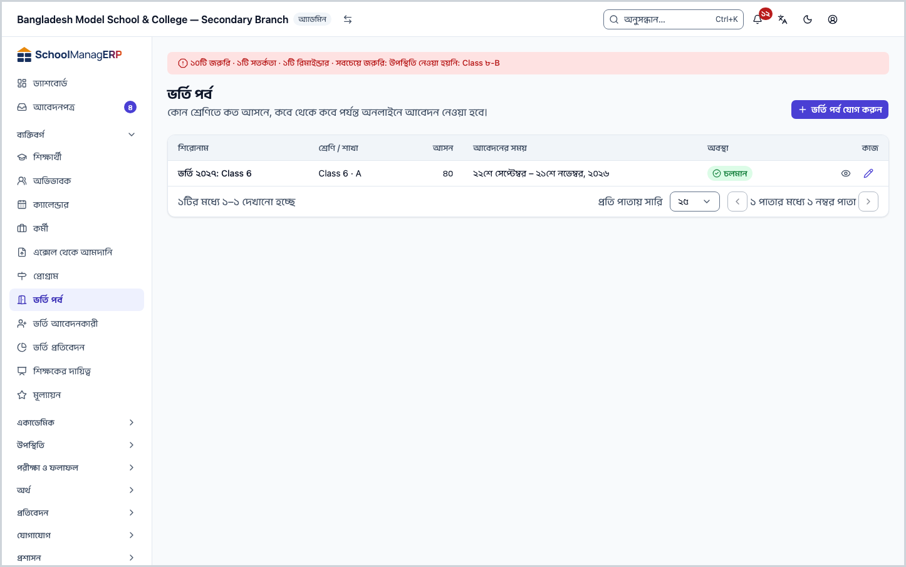

<!-- guide:meta
feature: people.admissionIntakes
title: ভর্তি রাউন্ড ও অনলাইন ভর্তির ফর্ম
summary: কোন শ্রেণিতে কত আসনে, কবে থেকে কবে পর্যন্ত অনলাইনে আবেদন নেওয়া হবে তা ঠিক করুন; অভিভাবক ফোন থেকে ফর্ম পূরণ করে রেফারেন্স নম্বর পান আর পরে আবেদনের অবস্থা দেখেন।
roles: [ADMIN, OFFICE_STAFF]
sources:
  - site/src/pages/[lang]/admission.astro
  - site/src/pages/[lang]/admission-status.astro
  - site/src/pages/[lang]/admission-result.astro
  - site/src/pages/[lang]/admission-lists.astro
  - site/src/islands/admission-form.ts
  - server/src/modules/admission/applicant-review.service.ts
  - site/src/islands/admission-result.ts
  - site/src/themes/basic/AdmissionRibbon.astro
  - client-admin/src/routes/_staff/admissions/intakes/index.tsx
  - client-admin/src/routes/_staff/admissions/intakes/$intakeId.tsx
  - client-admin/src/routes/admission/$slug/index.tsx
  - client-admin/src/routes/admission/$slug/status.tsx
  - client-admin/src/features/admission/IntakeList.tsx
  - client-admin/src/features/admission/IntakeForm.tsx
  - client-admin/src/features/admission/PublicAdmissionForm.tsx
  - client-admin/src/features/admission/AdmissionConfirmation.tsx
  - server/src/modules/admission/intake.controller.ts
  - server/src/modules/admission/intake.service.ts
  - server/src/modules/admission/public-admission.controller.ts
  - server/src/modules/admission/admission-applicant.service.ts
labels:
  [
    admission-staff-intakes:list.*,
    admission-desk:wizard.*,
    admission-staff-intakes:form.*,
    admission-staff-intakes:detail.*,
    admission-public:form.*,
    admission-public:confirmation.*,
    admission-public:status.*,
    nav:items.admissionIntakes,
    nav:groups.people,
    common:accessDenied.*,
    common:recordNotFound.*,
    common:actions.cancel,
  ]
helpIds:
  [
    people.admissionIntakes,
    people.admissionIntakes.action.add,
    people.admissionIntakes.field.classSection,
    people.admissionIntakes.field.seatCount,
    people.admissionIntakes.field.dates,
    people.admissionIntakes.field.requiredDocuments,
  ]
devices: [desktop]
entry: [sidebar, palette]
keywords:
  [ভর্তি, ভর্তি রাউন্ড, অনলাইন ভর্তি, ভর্তির ফর্ম, আসন, আবেদন, রেফারেন্স নম্বর, আবেদনের অবস্থা, admission, intake, online admission, apply, seats, reference number]
appVersion: 0.1.0 (fb8af6c63)
owner: tareq89
lastVerified: 2026-10-24
knownIssues: []
-->

# ভর্তি রাউন্ড ও অনলাইন ভর্তির ফর্ম

একটি ভর্তি রাউন্ড খুলুন, যাতে অভিভাবকেরা ফোন থেকেই অনলাইনে ভর্তির আবেদন করতে পারেন।

**যেতে হবে:** বাম মেনুতে **ব্যক্তিবর্গ → ভর্তি রাউন্ড**। রাউন্ড তৈরির কাজ কম্পিউটারে করুন; অভিভাবকের ফর্ম ফোনে চলে।
**শুরুর আগে:** আপনি অ্যাডমিন বা অফিস সহকারী হবেন ([কে কী করতে পারেন](#roles))। যে শ্রেণি ও শাখায় ভর্তি নেবেন, সেটি আগে থেকে তৈরি থাকতে হবে।

**ভর্তি রাউন্ড** মানে এক দফা ভর্তি: কোন **শ্রেণি / শাখা**য়, কতটি **আসন**, আর কোন তারিখ থেকে কোন তারিখ পর্যন্ত আবেদন নেওয়া হবে। রাউন্ড চলার সময় অভিভাবক স্কুলের ভর্তির লিংক খুলে **ভর্তির ফর্ম** পূরণ করেন। জমা পড়া আবেদন যায় [ভর্তি আবেদনকারী](admission-applicants.md) পাতায়, সেখান থেকে ভর্তি করলে শিক্ষার্থী তৈরি হয়।

[ভর্তি রাউন্ড যোগ করুন](#task-main) · [রাউন্ড বদলান বা আগে বন্ধ করুন](#task-edit) · [সমস্যা ও সমাধান](#trouble)

**এই পাতায় যা আছে**

- [ভর্তি রাউন্ড যোগ করুন](#task-main)
- [রাউন্ড তৈরি হয়েছে কি না বুঝবেন কীভাবে](#confirm)
- [অন্য পরিস্থিতিতে](#other)
  - [রাউন্ডের তথ্য বদলান বা আগে বন্ধ করুন](#task-edit)
  - [একটি রাউন্ডের আবেদনকারী দেখুন](#task-applicants)
  - [স্কুলের ওয়েবসাইটে: আবেদন, অবস্থা, ফল ও তালিকা](#task-site)
  - [ফর্মে ছবির সম্মতি: রাজি / রাজি নই](#task-photo-choice)
  - [আবেদন থেকে ভর্তি হওয়া শিক্ষার্থী](#task-flow)
- [সমস্যা ও সমাধান](#trouble)
- [কে কী করতে পারেন](#roles)
- [আরও জানুন](#more)

---

## ভর্তি রাউন্ড যোগ করুন 

1. বাম মেনুতে **ব্যক্তিবর্গ → ভর্তি রাউন্ড** চাপুন। খোঁজার ঘরে (Ctrl+K) **ভর্তি রাউন্ড** লিখেও আসা যায়।

   → উপরে **ভর্তি রাউন্ড** শিরোনাম। তালিকার কলাম: **শিরোনাম**, **ক্লাস**, **আসন**, **ধরন**, **আবেদনের সময়**, **অবস্থা**। কোনো রাউন্ড না থাকলে লেখা থাকে **এখনও কোনো ভর্তি রাউন্ড নেই**। সারির **ডেস্ক খুলুন** চাপলে সেই রাউন্ডের ডেস্ক খোলে।

2. উপরে **ভর্তি রাউন্ড যোগ করুন** চাপুন।

   → চার ধাপের নতুন রাউন্ডের পাতা খোলে। সব ঘর আগে থেকে ভরা, তাই কিছু না লিখেও **এগিয়ে যান** চাপা যায়।

3. ধাপ ১, **ক্লাস ও ধরন**: **ক্লাস** আর **শিক্ষাবর্ষ** বাছুন, তারপর ছয়টির একটি ধরন বাছুন (**শুধু আবেদন**, **লিখিত পরীক্ষা**, **লিখিত ও মৌখিক**, **লটারি**, **আগে এলে আগে**, **জিপিএ মেরিট**)।

   → রাউন্ডের নাম ক্লাস আর বছর থেকে হয়, যেমন "ক্লাস ৬ ভর্তি ২০২৭"। ক্লাস না বাছলে **ক্লাস বেছে নিন।** দেখায় আর **এগিয়ে যান** চাপা যায় না।

4. ধাপ ২, **আসন ও তারিখ**: **আসন সংখ্যা**, **আবেদন শুরু** আর **আবেদনের শেষ তারিখ** দিন; চাইলে **রোল নম্বরের শুরু** দিন।

   → এই দুই তারিখের মধ্যে অভিভাবক অনলাইনে আবেদন করতে পারবেন; শেষ দিনটিও ধরা হয়। শেষ তারিখ শুরুর আগে দিলে **শেষ তারিখ শুরুর আগে হতে পারবে না।** দেখায়।

5. ধাপ ৩, **ফি ও ফর্ম**: ফি না থাকলে **ফি** ঘর ফাঁকা রাখুন, থাকলে টাকায় লিখুন (দশমিকের পরে সর্বোচ্চ দুই অঙ্ক)। **পাঠানোর মাধ্যম** বাছুন। **ফর্মে কোন ঘর থাকবে**-তে বাছা ধরনের ঘরগুলোতে আগে থেকেই টিক দেওয়া; আরও টিক দিন বা তুলে দিন।

   → ফি ঠিক আছে কি না আপনি যাচাই করবেন; যাচাই না হওয়া পর্যন্ত আবেদন কোনো তালিকায় যাবে না।

6. ধাপ ৪, **প্রকাশ**: ফল কীভাবে জানানো হবে বাছুন (**স্কুলের ওয়েবসাইটে তালিকা**, **এসএমএস**, **রোল ও ফোন দিয়ে ফল দেখা**, **কল-তালিকা**) আর রাউন্ড **ওয়েবসাইটে সবসময় দেখান** কি না, নাকি শুধু চলার সময়। **ওয়েবসাইটে কোথায় দেখাবে ঠিক করুন** চাপলে ওয়েবসাইটের সম্পাদনা খোলে।

7. **রাউন্ড তৈরি করুন** চাপুন।

   → রাউন্ডের ডেস্ক খোলে। না হলে **রাউন্ড তৈরি করা যায়নি। আবার চেষ্টা করুন।** দেখায়; লেখা তথ্য থেকে যায়।

> **মনে রাখুন:** স্কুলের ওয়েবসাইট প্রকাশিত না থাকলে অনলাইনে আবেদন নেওয়া যায় না। ফর্মের লিংক হলো স্কুলের ওয়েবসাইটের ঠিকানার পরে `/admission`। ওয়েবসাইট প্রকাশিত না থাকলে তালিকায় কপির বোতামের জায়গায় **ফর্ম চালু করতে স্কুলের সাইট প্রকাশ করুন** দেখায়; প্রকাশিত হলে **ফর্মের লিংক কপি করুন** চাপুন, **ভর্তির ফর্মের লিংক কপি হয়েছে।** বার্তা আসে। পুরনো সম্পাদনার পাতায় এখনও তারিখ আর আসন বদলানো যায়; সেখানকার **ডেস্কে যান** চাপলে ডেস্ক খোলে।

---

## রাউন্ড তৈরি হয়েছে কি না বুঝবেন কীভাবে 

রাউন্ডের তথ্য শুধু ইন্টারনেট থাকলে সংরক্ষিত হয়; ডিভাইসে জমিয়ে রেখে পরে পাঠানো যায় না।

| অবস্থা                       | কীভাবে বুঝবেন                                           | এরপর কী                      |
| ---------------------------- | ------------------------------------------------------- | ---------------------------- |
| **শুধু স্ক্রিনে বদলেছে**     | পাতা খোলা, তথ্য লেখা, কিন্তু **রাউন্ড তৈরি করুন** চাপা হয়নি | **রাউন্ড তৈরি করুন** চাপুন   |
| **স্কুলের সিস্টেমে পৌঁছেছে** | রাউন্ডের ডেস্ক খুলেছে, তালিকায় নতুন রাউন্ডের সারি আছে  | অভিভাবকদের ভর্তির লিংক জানান |

**যাচাই করতে চাইলে:** ভর্তি রাউন্ডের তালিকা রিলোড করুন। রাউন্ডটি তালিকায় থাকলে সিস্টেমে আছে।

**বার্তা না এলে:** **রাউন্ড তৈরি করা যায়নি। আবার চেষ্টা করুন।** দেখালে লেখা তথ্য পাতাতেই থাকে; ইন্টারনেট দেখে আবার **রাউন্ড তৈরি করুন** চাপুন।

---

## অন্য পরিস্থিতিতে 

### রাউন্ডের তথ্য বদলান বা আগে বন্ধ করুন 

1. তালিকায় রাউন্ডের সারির শেষে **সম্পাদনা** চাপুন।

   → রাউন্ডের পাতা খোলে। উপরে রাউন্ডের নাম, পাশে **চলমান** বা **বন্ধ**, নিচে কতটি আবেদন জমা পড়েছে (যেমন "১২টি আবেদন জমা পড়েছে")। তার নিচে **রাউন্ডের তথ্য** কার্ডে তৈরির সময়ের একই ঘরগুলো।

2. যা বদলাতে চান বদলান, তারপর **সংরক্ষণ করুন** চাপুন।

   → **সংরক্ষণ হয়েছে** বার্তা আসে। **বাতিল করুন** চাপলে কিছু না বদলে তালিকায় ফেরেন।

**আগে বন্ধ করতে:** **চলমান** রাউন্ডের পাতায় **এখনই বন্ধ করুন** চাপুন। **এই ভর্তি রাউন্ড এখনই বন্ধ করবেন?** ঘরে লেখা থাকে: "আজ থেকে ফর্মে এই রাউন্ডের আবেদন নেওয়া বন্ধ হবে। যে আবেদন আগেই জমা হয়েছে তা থাকবে।" ঘরে **এখনই বন্ধ করুন** চাপুন। → **ভর্তি রাউন্ড বন্ধ হয়েছে।** বার্তা আসে, অবস্থা **বন্ধ** হয়, আর রাউন্ডটি অভিভাবকের ফর্ম থেকে সরে যায়। **রাউন্ড বন্ধ করা যায়নি। আবার চেষ্টা করুন।** এলে ইন্টারনেট দেখে আবার চাপুন।

> **মনে রাখুন:** রাউন্ড মুছে ফেলার ব্যবস্থা নেই। **প্রয়োজনীয় নথি** বদলালে তা পরের আবেদনগুলোর ওপর খাটে; আগে জমা পড়া আবেদন যেমন আছে তেমনই থাকে।

<!-- unverified: editing required documents affects only later submissions — inferred from the submit path checking the intake's current list; not run in the app -->

### একটি রাউন্ডের আবেদনকারী দেখুন 

তালিকায় রাউন্ডের সারির শেষে **সম্পাদনা** চাপুন, তারপর রাউন্ডের পাতার উপরে **আবেদনকারী দেখুন** চাপুন। (ডেস্কের **আবেদনকারী** ধাপেও এই রাউন্ডের আবেদনকারীর তালিকা আছে।) → [ভর্তি আবেদনকারী](admission-applicants.md) পাতা খোলে, **ভর্তি রাউন্ড** ছাঁকনিতে এই রাউন্ডটি আগে থেকেই বাছা থাকে।

### স্কুলের ওয়েবসাইটে: আবেদন, অবস্থা, ফল ও তালিকা 

স্কুলের পাবলিক ওয়েবসাইটে ভর্তির জন্য চারটি পাতা আছে। কোনোটিতেই সাইন-ইন লাগে না। সব পাতা বাংলা ও ইংরেজিতে চলে (`/bn/…` ও `/en/…`)।

| পাতা | ঠিকানার শেষে | কে ব্যবহার করেন | কী হয় |
| ---- | ------------ | ---------------- | ------ |
| ভর্তির আবেদন | `/admission` | অভিভাবক | চালু **ভর্তি রাউন্ড** দেখায়। অভিভাবক একটি বেছে ফর্ম পূরণ করে জমা দেন। |
| আবেদনের অবস্থা | `/admission-status` | অভিভাবক | **রেফারেন্স নম্বর** + **আবেদনে দেওয়া ফোন** → **অবস্থা দেখুন**। |
| ভর্তির ফল দেখুন | `/admission-result` | অভিভাবক | **রোল নম্বর** + **আবেদনে দেওয়া ফোন** → **ফল দেখুন**। |
| ভর্তির তালিকা | `/admission-lists` | যে কেউ | প্রকাশ হওয়া তালিকা দেখায়। **রোল নম্বর** সবসময় দেখা যায়। রাউন্ডের **নাম প্রকাশ** চালু থাকলে নামও দেখা যায়। |

1. অভিভাবক `/admission` খোলেন। একাধিক রাউন্ড চালু থাকলে যেটিতে আবেদন করবেন, তার নিচে **বেছে নিন** চাপেন।

   → ওই রাউন্ডের ফর্ম খোলে। ঘরগুলো সেই রাউন্ড যা চায় সেগুলোই, তাই দুই রাউন্ডে ফর্ম আলাদা হতে পারে। জরুরি ঘর ফাঁকা থাকলে বা ভুল হলে লাল লেখা আসে, যেমন **এটি দিতে হবে** বা **মোবাইল নম্বর ঠিক নেই (যেমন ০১৭…)**।

2. রাউন্ডে ফি থাকলে **ফি** বাক্সে লেখা থাকে "ফি … টাকা। টাকা পাঠিয়ে নিচের তথ্য দিন, স্কুল ফি যাচাই করবে।" অভিভাবক **যেভাবে পাঠিয়েছেন** (বিকাশ, নগদ, রকেট বা ব্যাংক) বাছেন, **যে নম্বর বা ট্রানজেকশন আইডি থেকে পাঠিয়েছেন** লেখেন, আর **স্ক্রিনশট বা রসিদ** (ছবি বা পিডিএফ, ৫ এমবির মধ্যে) দেন।

   → পাঠানোর মাধ্যম ও স্ক্রিনশট বা রসিদ না দিলে ফর্ম বলে **ফি পাঠানোর মাধ্যম ও স্ক্রিনশট বা রসিদ দিতে হবে।**

3. **আবেদন জমা দিন** চাপেন।

   → পাতায় লেখা আসে **আপনার আবেদন জমা হয়েছে। আপনার রেফারেন্স নম্বর:** আর নম্বরটি বড় করে দেখায়। **এটা লিখে রাখুন। অবস্থা দেখতে এই নম্বর ও আপনার ফোন নম্বর লাগবে।** **আবেদনের অবস্থা দেখুন** লিংক `/admission-status` খোলে। রাউন্ডে ফি থাকলে: **স্কুল আপনার ফি যাচাই করবে। যাচাই শেষ হলে জানানো হবে।**

4. পরে `/admission-status` পাতায় অভিভাবক রেফারেন্স নম্বর ও ফোন দিয়ে **অবস্থা দেখুন** চাপেন।

   → এক লাইনে "<নাম>, আপনার আবেদনের অবস্থা: …"। অবস্থার কথাগুলো: **যাচাই চলছে**, **বাছাই হয়েছে**, **ভর্তি হয়েছে**, **আবেদন গ্রহণ হয়নি**, **ফি যাচাই বাকি**, **ভর্তির সুযোগ এসেছে**, **অপেক্ষা-তালিকায় আছেন**, **ভর্তির সময় শেষ**।

5. স্কুল ফল প্রকাশ করলে `/admission-result` পাতায় অভিভাবক **রোল নম্বর** ও **আবেদনে দেওয়া ফোন** দিয়ে **ফল দেখুন** চাপেন।

   → **ধাপের ফল** দেখা যায় (প্রতি ধাপে **পাস** বা **পাস করেননি**), আর "আপনি মেরিট তালিকায় … নম্বরে আছেন।" বা "আপনি অপেক্ষা-তালিকা …-এ … নম্বরে আছেন।", সঙ্গে **ভর্তির শেষ তারিখ**। কিছু প্রকাশ না হলে: **এখনও কোনো ধাপের ফল প্রকাশ হয়নি।**

6. ফলের নিচে **প্রবেশপত্র ছাপুন** চাপলে ছাপার দৃশ্য ও ব্রাউজারের ছাপার ঘর খোলে।

   → **প্রবেশপত্র**-এ থাকে **নাম**, **অভিভাবক**, **জন্ম তারিখ**, **ভর্তি রাউন্ড**, প্রতি ধাপের **তারিখ**, **সময়**, **স্থান**, আর একটি ফাঁকা **ছবি** বাক্স। স্কুল পরীক্ষার সময় না দিলে: **পরীক্ষার সময় এখনও জানানো হয়নি।**

7. `/admission-lists` পাতায় যে কেউ প্রতি রাউন্ডের প্রকাশিত **মেরিট তালিকা**, **অপেক্ষা-তালিকা ১/২/৩** ও **কল-তালিকা** দেখেন, সঙ্গে **ভর্তির শেষ তারিখ**। প্রতিটি স্থানে শুধু রোল নম্বর। কিছু প্রকাশ না হলে: **এখনও কোনো তালিকা প্রকাশ হয়নি**। **নাম দেখতে রোল ও ফোন দিন** লিংক `/admission-result`-এ নিয়ে যায়।

> **মনে রাখুন:** রোল নম্বর বা ফোন ভুল হলে একই উত্তর আসে, **মিলছে না। আবার দেখুন।** তাই কেউ আন্দাজে খুঁজতে পারে না। কোনো রাউন্ড না থাকলে: **এখনও কোনো ভর্তি রাউন্ড নেই**। এই পাতাগুলো পেতে আগে ওয়েবসাইট [প্রকাশ](../administration/website.md#task-publish) করতে হয়।

<!-- unverified: not run in the app; written from the site pages and their texts -->

### ফর্মে ছবির সম্মতি: রাজি / রাজি নই 

স্কুলের ওয়েবসাইটের ভর্তির ফর্মের শেষের দিকে একটি প্রশ্ন আছে: **আপনার সন্তানের ছবি স্কুল রাখতে ও ছাপতে পারবে?** এর উত্তর বেছে নিতেই হয়।

1. **রাজি** বা **রাজি নই** বাছুন।

   → কিছু না বাছলে **জমা দিন** চাপলে লাল লেখা আসে: **একটি বেছে নিন।** আবেদন জমা হয় না।

2. **রাজি নই** বাছলে ছবির ঘরটি লুকিয়ে যায়। তখন ছবি দিতে হয় না। আবার **রাজি** বাছলে ঘরটি ফিরে আসে।

আবেদন থেকে শিক্ষার্থী তৈরি হলে (**ভর্তি করুন** চাপলে) এই উত্তর শিক্ষার্থীর **ছবির সম্মতি**-তে চলে যায়: **রাজি** হলে **দিয়েছেন**, **রাজি নই** হলে **দেননি**। পুরোনো আবেদনে উত্তর না থাকলে **জানা নেই** বসে। এটি পরে [শিক্ষার্থীর প্রোফাইলে](students.md#task-photo-consent) বদলানো যায়।

<!-- unverified: not run in the app; written from the screen code and texts -->

### আবেদন থেকে ভর্তি হওয়া শিক্ষার্থী 

1. অভিভাবক ফর্ম জমা দেন। → আবেদনটি [ভর্তি আবেদনকারী](admission-applicants.md) তালিকায় **অপেক্ষমাণ** হিসেবে আসে।
2. অফিস আবেদন খুলে দেখে **বাছাই তালিকায় রাখুন**, **ভর্তি করুন** বা **প্রত্যাখ্যান করুন**। প্রতিবার অভিভাবকের মোবাইলে এসএমএস যায় (স্কুলের এসএমএস ব্যালান্স থাকলে)।
3. **ভর্তি করুন** চাপলে রাউন্ডের শাখায় একজন নতুন শিক্ষার্থী তৈরি হয়, রেজিস্ট্রেশন ও রোল নম্বর নিজে থেকে বসে, আর অভিভাবক যুক্ত বা তৈরি হন। তাঁকে [শিক্ষার্থী](students.md) তালিকায় পাওয়া যায়। আবেদনকারীর ছবির সম্মতির উত্তরও শিক্ষার্থীর কাছে চলে যায় ([দেখুন](#task-photo-choice))।
4. বছরের হিসাবে কতজন অনলাইনে ভর্তি হলো, তা [ভর্তি প্রতিবেদন](admission-reports.md)-এ দেখা যায়।

---

## সমস্যা ও সমাধান 

| আপনি যা দেখছেন                                                                                              | কী করবেন                                                                                                                                   | কে সাহায্য করতে পারেন |
| ----------------------------------------------------------------------------------------------------------- | ------------------------------------------------------------------------------------------------------------------------------------------ | --------------------- |
| **এই পাতাটি দেখার অনুমতি আপনার নেই।**                                                                       | ভর্তি রাউন্ড শুধু অ্যাডমিন ও অফিস সহকারী দেখেন। **ড্যাশবোর্ডে ফিরে যান** চাপুন।                                                              | অ্যাডমিন              |
| **ভর্তি রাউন্ড লোড করা যায়নি**                                                                               | ইন্টারনেট দেখে পাতা রিলোড করুন।                                                                                                            | অ্যাডমিন              |
| **ভর্তি রাউন্ড তৈরি করা যায়নি**                                                                              | ইন্টারনেট দেখে আবার **তৈরি করুন** চাপুন। তালিকায় রাউন্ডটি এসে গেছে কি না আগে দেখে নিন।                                                      | অ্যাডমিন              |
| **ভর্তি রাউন্ড সংরক্ষণ করা যায়নি**                                                                           | ইন্টারনেট দেখে আবার **সংরক্ষণ করুন** চাপুন। ঘরের লেখা থেকে যায়।                                                                           | অ্যাডমিন              |
| **এই তথ্য খুঁজে পাওয়া যায়নি**                                                                             | রাউন্ডটির লিংক পুরোনো বা ভুল। **ফিরে যান** চেপে তালিকা থেকে খুলুন।                                                                           | অ্যাডমিন              |
| **শ্রেণি / শাখা** তালিকায় শাখাটি নেই                                                                       | শাখাটি আগে তৈরি করুন, তারপর আবার রাউন্ড খুলুন।                                                                                               | অ্যাডমিন              |
| **তৈরি করুন** চাপা যাচ্ছে না                                                                                | সব তারকা দেওয়া ঘর পূরণ করুন; **আসন সংখ্যা** ১ বা বেশি; শেষের তারিখ শুরুর আগে নয়।                                                         | —                     |
| অভিভাবক বলছেন **এই স্কুলে এখন নতুন ভর্তি নেওয়া হচ্ছে না।**                                                 | রাউন্ডের **অবস্থা** **চলমান** কি না দেখুন। চলমান হলে আসন ভরে গেছে কি না দেখুন (**ভর্তি হয়েছে** সংখ্যা = আসন); দরকারে **আসন সংখ্যা** বাড়ান। | অফিস সহকারী           |
| অভিভাবক বলছেন **এই স্কুলটি খুঁজে পাওয়া যায়নি। লিংকটি আবার চেক করুন।**                                     | লিংকের স্কুলের-নাম অংশে বানান ভুল। সঠিক লিংক আবার পাঠান।                                                                                   | অ্যাডমিন              |
| অভিভাবক বলছেন **এই আবেদনটি নেওয়া যায়নি। এই শিশুর জন্য আগে আবেদন করে থাকলে …**                             | তিনি এই শিশুর জন্য আগেই আবেদন করেছেন। রেফারেন্স নম্বর দিয়ে আবেদনকারী তালিকায় খুঁজুন।                                                     | অফিস সহকারী           |
| অভিভাবক বলছেন **এই ভর্তি রাউন্ডে এখন আবেদন নেওয়া হচ্ছে না।** বা **এই ভর্তি রাউন্ডে আর কোনো আসন খালি নেই।** | রাউন্ডের শেষ দিন বা আসন শেষ হয়ে গেছে। রাউন্ডের **অবস্থা** আর **আসন সংখ্যা** দেখুন।                                                            | অফিস সহকারী           |
| অভিভাবক বলছেন **ফর্মটি জমা দেওয়া যায়নি। আপনার দেওয়া তথ্য আবার দেখে নিন।**                                | লেখা তথ্য আর ইন্টারনেট দেখে আবার জমা দিতে বলুন।                                                                                            | অফিস সহকারী           |
| অভিভাবক বলছেন **রোবট-যাচাইটি সফল হয়নি। নিচের যাচাইটি আবার শেষ করে ফর্ম জমা দিন।**                          | তিনি যাচাইয়ের বাক্সটি আবার শেষ করে **ফর্ম জমা দিন** চাপবেন। লেখা তথ্য হারায় না।                                                          | —                     |
| অভিভাবক বলছেন **এখন আবেদন জমা দেওয়া যাচ্ছে না। কিছুক্ষণ পরে আবার চেষ্টা করুন।**                            | সাইটের যাচাই-ব্যবস্থা এখন চলছে না; ফর্ম ঠিক করে লাভ নেই। সহায়তায় জানান।                                                                  | সহায়তা দল            |
| অভিভাবক বলছেন **এই রেফারেন্স নম্বর আর মোবাইল নম্বরে কোনো আবেদন পাওয়া যায়নি।**                             | ফর্মে দেওয়া মোবাইলটিই দিতে বলুন। আবেদনকারী তালিকায় রেফারেন্স নম্বর মিলিয়ে দেখুন।                                                        | অফিস সহকারী           |
| একজন অভিভাবক বললেন **ফাইলে ক্ষতিকর কিছু পাওয়া গেছে, অন্য ফাইল দিন** | ফাইলটি জমা হয়নি। অন্য একটি ফাইল দিতে বলুন। | — |
| একজন অভিভাবক বললেন **এখন ফাইল পরীক্ষা করা যাচ্ছে না, একটু পরে আবার চেষ্টা করুন** | ফাইলটি জমা হয়নি। একটু পরে আবার পাঠাতে বলুন। বারবার হলে সহায়তা দলকে জানান। | সহায়তা দল |

---

## কে কী করতে পারেন 

| ভূমিকা                                                                              | রাউন্ড দেখা | রাউন্ড যোগ ও সম্পাদনা | ভর্তির ফর্ম পূরণ        |
| ----------------------------------------------------------------------------------- | --------- | ------------------- | ----------------------- |
| অ্যাডমিন                                                                            | হ্যাঁ     | হ্যাঁ               | —                       |
| অফিস সহকারী                                                                         | হ্যাঁ     | হ্যাঁ               | —                       |
| একাডেমিক কো-অর্ডিনেটর, শিক্ষক, হিসাবরক্ষক, পরীক্ষা নিয়ন্ত্রক, পরিচালনা পর্ষদ সদস্য | না        | না                  | —                       |
| অভিভাবক বা যে কেউ (সাইন ইন ছাড়া)                                                   | না        | না                  | হ্যাঁ, রাউন্ড চলমান থাকলে |

**অ্যাডমিন** আর **অফিস সহকারী** এই পাতায় হুবহু একই জিনিস দেখেন ও করেন। যাঁদের অনুমতি নেই, তাঁরা পাতাটি খুললে **এই পাতাটি দেখার অনুমতি আপনার নেই।** দেখেন, আর বাম মেনুতে **ভর্তি রাউন্ড** থাকে না।

---

## আরও জানুন 

<strong>পাতার অংশগুলো</strong> — উপর থেকে নিচে

1. **ভর্তি রাউন্ড** — শিরোনাম ও তার নিচের ছোট লেখা।
2. **ভর্তি রাউন্ড যোগ করুন** — পাতার উপরের বোতাম।
3. **তালিকা** — **শিরোনাম**, **শ্রেণি / শাখা**, **আসন**, **আবেদনের সময়**, **অবস্থা**; প্রতি সারির শেষে **ডেস্ক খুলুন** ও **সম্পাদনা**।

<strong>ঘরগুলোর অর্থ</strong>

<!-- guide:generated:fields:admission-staff-intakes -->

| ঘর                  | কী লিখবেন                                                                                          | বাধ্যতামূলক? |
| ------------------- | -------------------------------------------------------------------------------------------------- | ------------ |
| শিরোনাম             | অভিভাবক যে নামে রাউন্ডটি চিনবেন, যেমন ষষ্ঠ শ্রেণি ভর্তি ২০২৭।                                      | হ্যাঁ        |
| শ্রেণি / শাখা       | যে শাখায় ভর্তি হবে। ভর্তি করলে শিক্ষার্থী এই শাখায় যোগ হন।                                       | হ্যাঁ        |
| আসন সংখ্যা          | কতজন ভর্তি করা যাবে। এতজন ভর্তি হয়ে গেলে রাউন্ড ফর্ম থেকে সরে যায়। আবেদনের সংখ্যা এতে আটকায় না। | হ্যাঁ        |
| শুরুর তারিখ         | যেদিন থেকে আবেদন নেওয়া হবে।                                                                       | হ্যাঁ        |
| শেষের তারিখ         | আবেদনের শেষ দিন; দিনটিও ধরা হয়। শুরুর তারিখের আগে হতে পারে না।                                    | হ্যাঁ        |
| প্রয়োজনীয় নথি     | ছবি, জন্ম সনদ, একাডেমিক ট্রান্সক্রিপ্ট থেকে যেগুলো অভিভাবককে আপলোড করতেই হবে।                      | না           |
| খোলা ও বন্ধের তারিখ | আবেদন খোলা থাকার প্রথম ও শেষ দিন। দুই দিনই ধরা হয়; শেষ দিন শুরুর দিনের আগে হতে পারে না।           | হ্যাঁ        |

<!-- /guide:generated -->

অভিভাবকের ফর্মের ঘর:

<!-- guide:generated:fields:admission-public -->

| ঘর                                | কী লিখবেন                                                                 | বাধ্যতামূলক?       |
| --------------------------------- | ------------------------------------------------------------------------- | ------------------ |
| আপনি কোন ভর্তির জন্য আবেদন করছেন? | যে পর্বে আবেদন। একটিই চলমান থাকলে নিজে থেকে বাছা থাকে।                    | হ্যাঁ              |
| শিক্ষার্থীর পুরো নাম              | শিশুর পুরো নাম।                                                           | হ্যাঁ              |
| শিক্ষার্থীর জন্ম তারিখ            | শিশুর জন্ম তারিখ।                                                         | হ্যাঁ              |
| শিক্ষার্থীর লিঙ্গ                 | ছেলে, মেয়ে বা অন্যান্য।                                                  | হ্যাঁ              |
| অভিভাবকের নাম                     | যিনি আবেদন করছেন।                                                         | হ্যাঁ              |
| অভিভাবকের মোবাইল নম্বর            | সঠিক মোবাইল নম্বর। এসএমএস আর অবস্থা দেখা দুটোই এই নম্বরে।                 | হ্যাঁ              |
| অভিভাবকের ইমেইল (না দিলেও চলবে)   | সঠিক ইমেইল ঠিকানা।                                                        | না                 |
| বাসার ঠিকানা (না দিলেও চলবে)      | বাসার ঠিকানা। ভর্তি হলে শিক্ষার্থীর ঠিকানায় যায়।                        | না                 |
| কাগজপত্র                          | পর্বে চাওয়া প্রতিটি নথির জন্য একটি ছবি (JPG, PNG) বা PDF, সর্বোচ্চ ৫ MB। | পর্বে চাওয়া থাকলে |

<!-- /guide:generated -->

<strong>অনলাইন ভর্তি কীভাবে কাজ করে</strong> — রাউন্ড খোলা থেকে শিক্ষার্থী পর্যন্ত

<figure>
  
  <figcaption><em>রাউন্ড খোলা থেকে ভর্তি হওয়া শিক্ষার্থী</em></figcaption>
</figure>

- রাউন্ড **চলমান** কি না তা ঠিক হয় শুধু তারিখ দিয়ে, স্কুলের নিজের দিন ধরে।
- আসন গোনা হয় **ভর্তি হয়েছে** এমন আবেদন দিয়ে, জমা পড়া আবেদন দিয়ে নয়। তাই আসনের চেয়ে বেশি আবেদন আসতে পারে।
- আবেদনের প্রতিটি সিদ্ধান্ত এসএমএসে অভিভাবককে জানানো হয়: [ভর্তি আবেদনকারী](admission-applicants.md)।

**সম্পর্কিত পাতা**

- [**অফিসে আসা অভিভাবকের আবেদন তোলা**](admission-clerk-entry.md) — অফিসে আসা অভিভাবকের আবেদন তুলুন।
- [**আবেদনের ফি যাচাই**](admission-fee-verify.md) — ফি ঠিক বলুন বা ফেরত পাঠান।
- [**ভর্তি আবেদনকারী**](admission-applicants.md) — জমা পড়া আবেদন যাচাই করে ভর্তি বা প্রত্যাখ্যান করুন।
- [**ভর্তি প্রতিবেদন**](admission-reports.md) — বছরে কতজন ভর্তি হলো, কতজন চলে গেল।
- [**ভর্তি ডেস্ক, পরীক্ষার নম্বর ও কাটঅফ**](admission-stages.md) — রাউন্ড ধাপে ধাপে চালান।
- [**স্কুলের ওয়েবসাইটে ভর্তি**](../administration/admission-widgets.md) — ওয়েবসাইটের অংশ চালু করুন।

---

_সংস্করণ ০.১.০ · শেষ যাচাই ২০২৬-১০-২৪_
