<!-- guide:meta
feature: people.admissionLists
title: মেরিট ও অপেক্ষা-তালিকা
summary: মেরিট তালিকা বানান, আসন খালি থাকলে অপেক্ষা-তালিকা চালু করুন, ফোন করুন আর শাখা দিয়ে ভর্তি করুন।
roles: [ADMIN, OFFICE_STAFF]
sources:
  - client-admin/src/features/admission/desk/ListsPanel.tsx
  - client-admin/src/features/admission/desk/ListBuildDialog.tsx
  - client-admin/src/features/admission/desk/CallListDialog.tsx
labels: [admission-lists:panel.*, admission-lists:card.*, admission-lists:actions.*, admission-lists:build.*, admission-lists:call.*, admission-lists:confirm.*, admission-lists:reasons.*]
helpIds: [people.admissionLists]
devices: [desktop]
entry: [page:people.admissionStages]
keywords: [মেরিট তালিকা, অপেক্ষা-তালিকা, কল-তালিকা, ভর্তি, আসন, প্রস্তাব, শেষ তারিখ]
appVersion: 0.1.0 (fb8af6c63)
owner: tareq89
lastVerified: 2026-11-16
knownIssues: []
-->

# মেরিট ও অপেক্ষা-তালিকা

মেরিট তালিকার লোকেরা প্রথমে আসনের প্রস্তাব পান। শেষ তারিখের পরও আসন খালি থাকলে আপনি অপেক্ষা-তালিকা চালু করেন, এভাবে চলে।

**যেতে হবে:** **ব্যক্তিবর্গ → ভর্তি রাউন্ড** থেকে রাউন্ড খুলুন, তারপর **মেরিট তালিকা** বা **অপেক্ষা-তালিকা** ধাপ। কম্পিউটারে করুন।
**শুরুর আগে:** আপনি অ্যাডমিন বা অফিস সহকারী হবেন ([কে কী করতে পারেন](#roles))। ফি যাচাই আর পরীক্ষার ধাপ শেষ হতে হবে ([ভর্তি ডেস্ক](admission-stages.md))।

[মেরিট তালিকা বানান](#task-main) · [অপেক্ষা-তালিকা চালু করুন](#task-waiting) · [ফোন করুন](#task-call) · [সমস্যা ও সমাধান](#trouble)

<figure>
  
  <figcaption><em>মেরিট তালিকা থেকে অপেক্ষা-তালিকা</em></figcaption>
</figure>

---

## এখানে কীভাবে আসবেন 

[ডেস্ক](admission-stages.md)-এ **মেরিট তালিকা বানান** কার্ড এই ধাপ খোলে।

---

## মেরিট তালিকা বানান 

1. **মেরিট তালিকা বানান** চাপুন। একটি জানালা খোলে।
2. **এই তালিকায় আসন** লিখুন (খালি আসনের বেশি নয়) আর **ভর্তির শেষ তারিখ** বাছুন।
3. **কীভাবে বাছাই হবে** বাছুন: **মেরিট অনুযায়ী**, **আগে এলে আগে**, **নিজে বাছাই** বা **ফিল্টার**।

   - **নিজে বাছাই:** যাঁদের নেবেন টিক দিন, তারপর তীর চিহ্ন দিয়ে ক্রম ঠিক করুন।
   - **ফিল্টার:** **কোটা** (যেমন **মুক্তিযোদ্ধার সন্তান**), **সর্বনিম্ন নম্বর** বা **লিঙ্গ** বাছুন।

4. **তালিকা বানান** চাপুন।

   → "তালিকা বানানো হয়েছে। … জন যোগ হয়েছে।" **মেরিট তালিকা** কার্ডে **আসন**, **শেষ তারিখ**, আর **প্রস্তাব দেওয়া**, **ভর্তি হয়েছে**, **মেয়াদ শেষ**, **অপেক্ষায়**, **খালি আসন** সংখ্যা দেখায়।

শুধু যাঁদের ফি ঠিক, তাঁদেরই যোগ করা যায়।

---

## ঠিকমতো হলো কীভাবে বুঝবেন 

- কার্ডে **আসন: …** আর **এই তালিকায় যারা আছেন** নিচে প্রত্যেকের **নং …** দেখায়।
- ডেস্কে কার্ড **ফল প্রকাশ করুন**-এ যায়, পরে **অপেক্ষা-তালিকা … চালু করুন**-এ আসতে পারে।

---

## অন্য পরিস্থিতিতে 

### অপেক্ষা-তালিকা চালু করুন 

1. **নতুন অপেক্ষা-তালিকা** চেপে মেরিট তালিকার মতোই বানান।
2. সময় এলে **চালু করুন** চাপুন, তারপর **হ্যাঁ, এগিয়ে যান**।

   → "তালিকা চালু হয়েছে।" তালিকার সবাইকে ভর্তির প্রস্তাব যায়।

এখনই না পারলে পাতা কারণ বলে: "আগের তালিকার শেষ তারিখ … পার হলে এই তালিকা চালু করা যাবে।" বা "কোনো আসন খালি নেই, তাই কাউকে প্রস্তাব দেওয়া যাবে না।"

### মেয়াদ শেষ চিহ্নিত করুন 

তালিকার শেষ তারিখের পর **মেয়াদ শেষ চিহ্নিত করুন** চাপুন, তারপর **হ্যাঁ, এগিয়ে যান**। যাঁদের প্রস্তাব দেওয়া হয়েছিল কিন্তু ভর্তি হননি, তাঁদের প্রস্তাব বাতিল হয়। আসন পরের অপেক্ষা-তালিকার জন্য খালি হয়।

### ফোন করুন 

তালিকায় **কল-তালিকা** চাপুন। **নাম**, **ফোন** আর **রোল** দেখায়। নম্বর চেপে ফোন করুন, **ফোন করা হয়েছে** টিক দিন, আর **নোট** লিখুন।

### তালিকা থেকে ভর্তি করুন 

একজনের পাশে **ভর্তি করুন** চেপে শাখা বাছুন: [ভর্তি আবেদনকারী](admission-applicants.md)।

---

## সমস্যা ও সমাধান 

| আপনি যা দেখছেন | কী করবেন | কে সাহায্য করতে পারেন |
| --- | --- | --- |
| **আসন ১ থেকে …-এর মধ্যে হতে হবে।** | খালি আসনের মধ্যে একটি সংখ্যা লিখুন। | — |
| **শেষ তারিখ বাছুন।** | **ভর্তির শেষ তারিখ** বাছুন। | — |
| **অন্তত একজনকে বাছুন।** | **নিজে বাছাই**-এ কাউকে টিক দিন। | — |
| **এখন কাউকে যোগ করা যাবে না।** | ফি আর পরীক্ষার ধাপ দেখুন। | — |
| **কাজটি করা যায়নি। আবার চেষ্টা করুন।** | ইন্টারনেট দেখে আবার চেষ্টা করুন। | অ্যাডমিন |

---

## কে কী করতে পারেন 

| ভূমিকা | তালিকা বানানো ও চালু করা |
| --- | --- |
| অ্যাডমিন | হ্যাঁ |
| অফিস সহকারী | হ্যাঁ |
| অন্য ভূমিকা | না |

---

## আরও জানুন 

<strong>মেরিট অনুযায়ী না লটারির ক্রম</strong>

**মেরিট অনুযায়ী** বাছলে তালিকা নম্বর ধরে হয়। [লটারি](admission-lottery.md)-র রাউন্ডে তা লটারি নম্বর ধরে হয়।

**সম্পর্কিত পাতা**

- [**ভর্তি ডেস্ক, পরীক্ষার নম্বর ও কাটঅফ**](admission-stages.md) — রাউন্ডের সব ধাপ।
- [**ভর্তির ফল প্রকাশ**](admission-publish.md) — অভিভাবকদের জানান।
- [**ভর্তি আবেদনকারী**](admission-applicants.md) — একজনকে ভর্তি করুন।
- [**ভর্তির লটারি**](admission-lottery.md) — লটারির রাউন্ডের ক্রম।

---

_সংস্করণ ০.১.০ · শেষ যাচাই ২০২৬-১১-১৬_
