<!-- guide:meta
feature: people.admissionLottery
title: ভর্তির লটারি
summary: অ্যাপে একবার লটারি করুন, অথবা বাইরে বানানো এক্সেল তালিকা আপলোড করুন, যাতে প্রতিজন আবেদনকারীর লটারি নম্বর হয়।
roles: [ADMIN, OFFICE_STAFF]
sources:
  - client-admin/src/features/admission/desk/LotteryPanel.tsx
  - client-admin/src/features/admission/desk/LotteryImportDialog.tsx
labels: [admission-stages:lottery.*, admission-stages:lotteryImport.*]
helpIds: [people.admissionLottery]
devices: [desktop]
entry: [page:people.admissionStages]
keywords: [লটারি, লটারি নম্বর, আপলোড, এক্সেল, ভর্তি, draw]
appVersion: 0.1.0 (fb8af6c63)
owner: tareq89
lastVerified: 2026-11-16
knownIssues: []
-->

# ভর্তির লটারি

আসনের চেয়ে আবেদনকারী বেশি আর স্কুল লটারিতে ঠিক করলে, লটারির ধাপে প্রতিজন একটি নম্বর পায়। মেরিট তালিকা সেই ক্রমে হয়।

**যেতে হবে:** **ব্যক্তিবর্গ → ভর্তি রাউন্ড** থেকে রাউন্ড খুলুন, তারপর **লটারি** ধাপ। কম্পিউটারে করুন।
**শুরুর আগে:** আপনি অ্যাডমিন বা অফিস সহকারী হবেন ([কে কী করতে পারেন](#roles))। সব ফি যাচাই হতে হবে: [আবেদনের ফি যাচাই](admission-fee-verify.md)। রাউন্ডের ধরন **লটারি** হতে হবে।

[অ্যাপে লটারি করুন](#task-main) · [তালিকা আপলোড করুন](#task-upload) · [সমস্যা ও সমাধান](#trouble)

<figure>
  
  <figcaption><em>ক্রম পাওয়ার দুই উপায়</em></figcaption>
</figure>

---

## এখানে কীভাবে আসবেন 

[ডেস্ক](admission-stages.md)-এ **লটারি করুন** কার্ড এই ধাপ খোলে।

---

## অ্যাপে লটারি করুন 

1. **অ্যাপে লটারি করুন** কার্ডে **লটারি করুন** চাপুন।

   → প্রশ্ন আসে: **লটারি করবেন?** "মোট … জন আবেদনকারী আছে। এটা একবারই করা যায়, আবার করা যাবে না।"

2. **এখনই করুন** চাপুন।

   → পাতায় লেখা আসে **লটারি হয়ে গেছে** আর "… জনের লটারি নম্বর হয়েছে।" তালিকায় **লটারি নম্বর**, **রোল** আর **নাম** থাকে।

> **মনে রাখুন:** লটারি একবারই করা যায়। এরপর পাতায় লেখা থাকে **লটারি হয়ে গেছে। আর করা যাবে না।**

---

## ঠিকমতো হলো কীভাবে বুঝবেন 

তালিকা ভরে যায়, আর ডেস্কের কার্ড **মেরিট তালিকা বানান**-এ যায়।

---

## অন্য পরিস্থিতিতে 

### বাইরের তালিকা আপলোড করুন 

1. **তালিকা আপলোড করুন** চাপুন। **লটারির তালিকা আপলোড** জানালা খোলে।
2. **ফাইল বাছুন** চেপে একটি এক্সেল ফাইল (.xlsx, ৫ এমবির মধ্যে) নিন। কলাম: `rank`, আর `reference_number` বা `roll_number`। এই ধাপের প্রতিজন আবেদনকারী একবার করে থাকবেন।
3. **ফাইল দেখুন** চাপুন।

   → "… সারি পড়া হয়েছে।" আর **ফাইল ঠিক আছে। তালিকা সংরক্ষণ করুন।** ঠিক না হলে জানালায় **এগুলো ঠিক করে আবার আপলোড করুন** লেখা আসে, প্রতিটি সারি ধরে।

4. **তালিকা সংরক্ষণ করুন** চাপুন।

   → অ্যাপে লটারি করার মতোই ফল হয়।

---

## সমস্যা ও সমাধান 

| আপনি যা দেখছেন | কী করবেন | কে সাহায্য করতে পারেন |
| --- | --- | --- |
| **এই আবেদনকারী এই ধাপে নেই** | সারিটি বাদ দিন, বা তাঁর ফি দেখুন। | — |
| **এই আবেদনকারী ফাইলে একাধিকবার আছে** | একটি সারি রাখুন। | — |
| **লটারি নম্বর ১ থেকে আবেদনকারীর সংখ্যার মধ্যে একটি পূর্ণসংখ্যা হতে হবে** | নম্বর ঠিক করুন। | — |
| **দুইজনের লটারি নম্বর একই** | প্রত্যেককে আলাদা নম্বর দিন। | — |
| **এই ধাপের কিছু আবেদনকারী ফাইলে নেই** | বাদ পড়া আবেদনকারীদের যোগ করুন। | — |
| **দেখা ফাইলটি আর নেই। ফাইল আবার দেখুন।** | আবার **ফাইল দেখুন** চাপুন। | — |
| **এই ধাপ লটারির নয়।** | ঠিক ধাপ খুলুন। | অ্যাডমিন |
| **লটারি করতে বা তালিকা আপলোড করতে কম্পিউটারে খুলুন।** | কম্পিউটার ব্যবহার করুন। | — |

---

## কে কী করতে পারেন 

| ভূমিকা | লটারি বা আপলোড |
| --- | --- |
| অ্যাডমিন | হ্যাঁ |
| অফিস সহকারী | হ্যাঁ |
| অন্য ভূমিকা | না |

---

## আরও জানুন 

<strong>কেন একবারই</strong>

অভিভাবকদের জানানোর পর আবার লটারি করলে ক্রম বদলে যেতে পারে। তাই অ্যাপ একবারই লটারি করতে দেয়। স্কুল অ্যাপের বাইরে সবার সামনে লটারি করে থাকলে তবেই তালিকা আপলোড করুন।

**সম্পর্কিত পাতা**

- [**ভর্তি ডেস্ক, পরীক্ষার নম্বর ও কাটঅফ**](admission-stages.md) — রাউন্ডের সব ধাপ।
- [**মেরিট ও অপেক্ষা-তালিকা**](admission-lists.md) — পরের ধাপ।

---

_সংস্করণ ০.১.০ · শেষ যাচাই ২০২৬-১১-১৬_
