<!-- guide:meta
feature: people.admissionPublish
title: ভর্তির ফল প্রকাশ
summary: মেরিট বা অপেক্ষা-তালিকা স্কুলের ওয়েবসাইটে প্রকাশ করুন, রাউন্ডে থাকলে কল-তালিকা ও এসএমএসসহ, আর ঠিক করুন নাম দেখাবে কি না।
roles: [ADMIN, OFFICE_STAFF]
sources:
  - client-admin/src/features/admission/desk/PublicationPanel.tsx
  - client-admin/src/features/admission/desk/AdmissionDesk.tsx
labels: [admission-lists:publish.*, admission-desk:panels.publication]
helpIds: [people.admissionPublish]
devices: [desktop]
entry: [page:people.admissionStages]
keywords: [প্রকাশ, ফল, এসএমএস, ক্রেডিট, নাম, ওয়েবসাইট, কল-তালিকা]
appVersion: 0.1.0 (fb8af6c63)
owner: tareq89
lastVerified: 2026-11-16
knownIssues: []
-->

# ভর্তির ফল প্রকাশ

প্রকাশ করলে অভিভাবকেরা ফল জানতে পারেন। তালিকা ঠিক থাকলে তবেই করুন।

**যেতে হবে:** **ব্যক্তিবর্গ → ভর্তি রাউন্ড** থেকে রাউন্ড খুলুন, তারপর **ভর্তি** ধাপ (**অনলাইনে প্রকাশ**)। কম্পিউটারে করুন।
**শুরুর আগে:** আপনি অ্যাডমিন বা অফিস সহকারী হবেন ([কে কী করতে পারেন](#roles))। তালিকা বানানো থাকতে হবে: [মেরিট ও অপেক্ষা-তালিকা](admission-lists.md)। এসএমএস পাঠাতে চাইলে ক্রেডিট দেখুন: [এসএমএস প্যাকেজ](../administration/sms-packages.md)।

[তালিকা প্রকাশ করুন](#task-main) · [নাম দেখান](#task-names) · [সমস্যা ও সমাধান](#trouble)

<figure>
  
  <figcaption><em>প্রকাশ করলে কী হয়</em></figcaption>
</figure>

---

## এখানে কীভাবে আসবেন 

[ডেস্ক](admission-stages.md)-এ **ফল প্রকাশ করুন** কার্ড এই ধাপ খোলে।

---

## তালিকা প্রকাশ করুন 

1. তালিকাটি খুঁজুন। প্রতিটিতে **প্রকাশিত** বা **প্রকাশ হয়নি** আর কোন পথে মানুষের কাছে যায় তা থাকে: **সাইট**, **ফোন** (কল-তালিকা, রাউন্ডে থাকলে), **SMS পাঠান**।
2. রাউন্ড এসএমএস পাঠালে, যাঁরা বাছাই হননি তাঁদেরও জানাতে চাইলেই শুধু **যারা বাছাই হয়নি তাদেরও SMS দিন** টিক দিন।
3. **প্রকাশ করুন** চাপুন।

   → প্রশ্ন আসে **… প্রকাশ করবেন?** আর "…টা SMS ≈ … ক্রেডিট"। ক্রেডিট কম হলে: "ক্রেডিট যথেষ্ট নয়: দরকার …, আছে …।" এসএমএস না গেলে: **কোনো SMS যাবে না।**

4. আবার **প্রকাশ করুন** চাপুন।

   → "প্রকাশ হয়েছে। …টা SMS গেছে।" তালিকায় **প্রকাশিত** লেখা থাকে।

---

## ঠিকমতো হলো কীভাবে বুঝবেন 

- তালিকায় **প্রকাশিত** লেখা থাকে।
- স্কুলের ওয়েবসাইটে `/admission-lists` পাতায় তা রোল নম্বরসহ দেখা যায় ([স্কুলের ওয়েবসাইটে ভর্তি](../administration/admission-widgets.md))।

---

## অন্য পরিস্থিতিতে 

### নাম দেখান 

**নাম সহ তালিকা** চালু করুন। পাতা সতর্ক করে: "এগুলো শিশুদের নাম। পাবলিক সাইট খুললে যে কেউ দেখতে পাবে। স্কুল সত্যিই চাইলে তবেই চালু করুন।" বন্ধ রাখলে শুধু রোল নম্বর দেখায়।

### সাইটে কেমন দেখাবে 

**সাইটে কেমন দেখাবে** এখন ধূসর: "পাবলিক তালিকার পাতা এখনো তৈরি হয়নি।" স্কুলের ওয়েবসাইট খুলে দেখুন।

---

## সমস্যা ও সমাধান 

| আপনি যা দেখছেন | কী করবেন | কে সাহায্য করতে পারেন |
| --- | --- | --- |
| **ক্রেডিট যথেষ্ট নয় …** | ক্রেডিট কিনুন, অথবা SMS-এর টিক তুলে দিন। | অ্যাডমিন |
| **SMS গোনা হচ্ছে…** থেকেই যায় | পাতা রিলোড করুন। | অ্যাডমিন |
| **প্রকাশ করা যায়নি। আবার চেষ্টা করুন।** | ইন্টারনেট দেখে আবার চেষ্টা করুন। | অ্যাডমিন |
| **পাতাটি লোড করা যায়নি। আবার চেষ্টা করুন।** | পাতা রিলোড করুন। | অ্যাডমিন |

---

## কে কী করতে পারেন 

| ভূমিকা | প্রকাশ |
| --- | --- |
| অ্যাডমিন | হ্যাঁ |
| অফিস সহকারী | হ্যাঁ |
| অন্য ভূমিকা | না |

---

## আরও জানুন 

<strong>অভিভাবক কী দেখেন</strong>

তাঁরা স্কুলের ওয়েবসাইটে তালিকা আর নিজের ফল দেখেন: [ভর্তি রাউন্ড](admission-intakes.md#task-site)।

**সম্পর্কিত পাতা**

- [**মেরিট ও অপেক্ষা-তালিকা**](admission-lists.md) — আগে তালিকা বানান।
- [**স্কুলের ওয়েবসাইটে ভর্তি**](../administration/admission-widgets.md) — ওয়েবসাইটের অংশ চালু করুন।
- [**ভর্তি ডেস্ক, পরীক্ষার নম্বর ও কাটঅফ**](admission-stages.md) — রাউন্ডের সব ধাপ।

---

_সংস্করণ ০.১.০ · শেষ যাচাই ২০২৬-১১-১৬_
