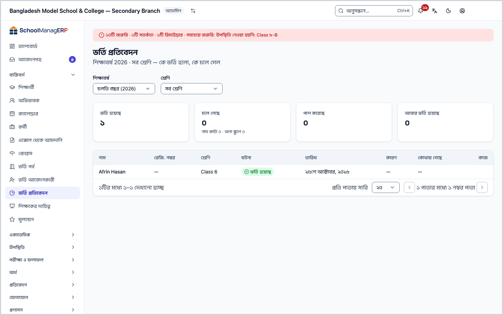

<!-- guide:meta
feature: people.admissionReports
title: ভর্তি প্রতিবেদন
summary: একটি শিক্ষাবর্ষে কতজন অনলাইনে ভর্তি হলো, কতজনের নাম কাটা হলো বা অন্য স্কুলে গেল, কতজন পাশ করল আর কতজন আবার ভর্তি হলো, তা শ্রেণি ধরে দেখুন।
roles: [ADMIN, EXECUTIVE]
sources:
  - client-admin/src/routes/_staff/admissions/reports/index.tsx
  - client-admin/src/features/admission/AdmissionReports.tsx
  - server/src/modules/admission/admission-reports.controller.ts
  - server/src/modules/admission/admission-reports.service.ts
labels:
  [
    admission-reports:*,
    nav:items.admissionReports,
    nav:groups.people,
    common:accessDenied.*,
  ]
helpIds:
  [
    people.admissionReports,
    people.admissionReports.field.academicYear,
    people.admissionReports.field.class,
  ]
devices: [desktop]
entry: [sidebar, palette]
keywords:
  [ভর্তি প্রতিবেদন, ভর্তি, নাম কাটা, অন্য স্কুলে গেছে, পাশ করেছে, আবার ভর্তি, শিক্ষাবর্ষ, admission report, withdrawn, transferred, graduated, readmitted]
appVersion: 0.1.0 (fb8af6c63)
owner: tareq89
lastVerified: 2026-10-24
knownIssues:
  - { id: admitted-online-only, checked: 2026-10-24, issue: 2881 }
  - { id: filters-not-in-url, checked: 2026-10-24, issue: 2882 }
-->

# ভর্তি প্রতিবেদন

একটি শিক্ষাবর্ষে কে ভর্তি হলো আর কে চলে গেল, তা এক পাতায় গুনে দেখুন।

**যেতে হবে:** বাম মেনুতে **ব্যক্তিবর্গ → ভর্তি প্রতিবেদন**। এই পাতা কম্পিউটারে দেখুন।
**শুরুর আগে:** আপনি অ্যাডমিন বা একাডেমিক কো-অর্ডিনেটর হবেন ([কে কী করতে পারেন](#roles))। এই পাতা শুধু দেখার; এখান থেকে কিছু বদলায় না।

প্রতিবেদনে দুই জায়গার তথ্য মেলে: [ভর্তি আবেদনকারী](admission-applicants.md) পাতা থেকে যাঁরা **ভর্তি হয়েছে**, আর [শিক্ষার্থী](students.md) প্রোফাইলে লেখা স্কুল ছাড়া বা আবার ভর্তির ঘটনা। হাতে যোগ করা বা এক্সেল থেকে আমদানি করা শিক্ষার্থী **ভর্তি হয়েছে** সংখ্যায় ওঠেন না ([জানা সমস্যা](#known-issues))।

[বছরের হিসাব দেখুন](#task-main) · [একটি শ্রেণি ধরে দেখুন](#task-class) · [সমস্যা ও সমাধান](#trouble)

**এই পাতায় যা আছে**

- [বছরের হিসাব দেখুন](#task-main)
- [সংখ্যা ঠিক আছে কি না কীভাবে বুঝবেন](#confirm)
- [অন্য পরিস্থিতিতে](#other)
  - [একটি শ্রেণি ধরে দেখুন](#task-class)
  - [আগের শিক্ষাবর্ষ দেখুন](#task-year)
  - [তালিকা থেকে শিক্ষার্থীর পাতায় যান](#task-student)
  - [৫০০-র বেশি ঘটনা থাকলে](#task-truncated)
- [সমস্যা ও সমাধান](#trouble)
- [কে কী করতে পারেন](#roles)
- [জানা সমস্যা](#known-issues)
- [আরও জানুন](#more)

---

## বছরের হিসাব দেখুন 

1. বাম মেনুতে **ব্যক্তিবর্গ → ভর্তি প্রতিবেদন** চাপুন। খোঁজার ঘরে (Ctrl+K) **ভর্তি প্রতিবেদন** লিখেও আসা যায়।

   → উপরে **ভর্তি প্রতিবেদন**, নিচে যেমন "শিক্ষাবর্ষ ২০২৬ · সব শ্রেণি — কে ভর্তি হলো, কে চলে গেল"। চলতি শিক্ষাবর্ষ আর সব শ্রেণি আগে থেকেই বাছা থাকে।

2. চারটি সংখ্যার কার্ড পড়ুন:

   | কার্ড                 | কী গোনা হয়                                                                                         |
   | --------------------- | --------------------------------------------------------------------------------------------------- |
   | **ভর্তি হয়েছে**      | এই বছরের শ্রেণিতে অনলাইন আবেদন থেকে যাঁদের **ভর্তি করুন** দিয়ে ভর্তি করা হয়েছে                    |
   | **চলে গেছে**          | যাঁদের নাম কাটা হয়েছে আর যাঁরা অন্য স্কুলে গেছেন; নিচে আলাদা করে লেখা "নাম কাটা ৩ · অন্য স্কুলে ২" |
   | **পাশ করেছে**         | যাঁদের প্রোফাইলে পড়া শেষের তথ্য লেখা হয়েছে                                                        |
   | **আবার ভর্তি হয়েছে** | স্কুল ছাড়ার পর যাঁদের **পুনরায় ভর্তি** করা হয়েছে                                                 |

3. নিচের তালিকায় প্রতিটি ঘটনা এক সারিতে, নতুনটি উপরে: **নাম**, **রেজি. নম্বর**, **শ্রেণি**, **ঘটনা**, **তারিখ**, **কারণ**, **কোথায় গেছে**।

   → **ঘটনা** কলামে **ভর্তি হয়েছে**, **নাম কাটা হয়েছে**, **অন্য স্কুলে গেছে**, **পাশ করেছে** বা **আবার ভর্তি হয়েছে**। যে ঘর খালি, সেখানে **—**। অনলাইনে ভর্তির সারিতে **রেজি. নম্বর**, **কারণ**, **কোথায় গেছে** সবসময় **—**।

এই বছরে কিছু না ঘটলে লেখা থাকে **এই বছরে কোনো তথ্য নেই**: "এই বছরে কেউ ভর্তি হলে, চলে গেলে বা পাশ করলে এখানে দেখা যাবে।"

> **মনে রাখুন:** প্রতিবেদনের সংখ্যা ঠিক রাখতে স্কুল ছাড়ার তথ্য শিক্ষার্থীর প্রোফাইলে **ছাড়ার তথ্য লিখুন** দিয়ে লিখতে হয়: [শিক্ষার্থী](students.md)।

---

## সংখ্যা ঠিক আছে কি না কীভাবে বুঝবেন 

- উপরের লাইনে আপনার বাছা শিক্ষাবর্ষ আর শ্রেণির নাম লেখা থাকে, যেমন "শিক্ষাবর্ষ ২০২৬ · সব শ্রেণি"। অন্য বছর বা শ্রেণির নাম দেখলে **শিক্ষাবর্ষ** বা **শ্রেণি** ঘর বদলে নিন।
- **চলে গেছে** কার্ডে সংখ্যার নিচে দুই ভাগ আলাদা লেখা থাকে, "নাম কাটা ৩ · অন্য স্কুলে ২"। দুই ভাগ মিলে কার্ডের সংখ্যা হয়।
- তালিকায় কারও চলে যাওয়া না থাকলে বুঝতে হবে শিক্ষার্থীর প্রোফাইলে **ছাড়ার তথ্য লিখুন** দিয়ে তা লেখা হয়নি। সেখানে গিয়ে লিখুন।

---

## অন্য পরিস্থিতিতে 

### একটি শ্রেণি ধরে দেখুন 

1. উপরের **শ্রেণি** ঘর থেকে একটি শ্রেণি বাছুন। না বাছলে **সব শ্রেণি**।

   → কার্ড আর তালিকা দুটোই শুধু সেই শ্রেণির হয়। শিরোনামের নিচের লেখায় শ্রেণির নাম আসে।

### আগের শিক্ষাবর্ষ দেখুন 

1. **শিক্ষাবর্ষ** ঘর থেকে বছর বাছুন। প্রথম বিকল্পটি **চলতি বছর (…)**।

   → শিক্ষাবর্ষ বদলালে **শ্রেণি** বাছাই মুছে **সব শ্রেণি** হয়ে যায়, কারণ প্রতিটি শ্রেণি একটি বছরেরই।

### তালিকা থেকে শিক্ষার্থীর পাতায় যান 

স্কুল ছাড়া, পাশ বা আবার ভর্তির সারির শেষে **শিক্ষার্থী দেখুন** চাপুন। → [শিক্ষার্থী](students.md)র প্রোফাইল খোলে। অনলাইনে ভর্তির সারিতে এই বোতাম থাকে না; শিক্ষার্থীর তালিকায় নাম দিয়ে খুঁজুন। শিক্ষার্থী দেখার অনুমতি না থাকলেও বোতামটি থাকে না।

### ৫০০-র বেশি ঘটনা থাকলে 

তালিকার নিচে লেখা আসে: "শুধু প্রথম ৫০০টি তথ্য দেখানো হচ্ছে। তালিকা ছোট করতে একটি শ্রেণি বেছে নিন।" তখন **শ্রেণি** থেকে একটি শ্রেণি বাছুন। উপরের চারটি সংখ্যা তবুও পুরো বছরের।

---

## সমস্যা ও সমাধান 

| আপনি যা দেখছেন                              | কী করবেন                                                                                                         | কে সাহায্য করতে পারেন |
| ------------------------------------------- | ---------------------------------------------------------------------------------------------------------------- | --------------------- |
| **এই পাতাটি দেখার অনুমতি আপনার নেই।**       | প্রতিবেদন শুধু অ্যাডমিন ও একাডেমিক কো-অর্ডিনেটর দেখেন। **ড্যাশবোর্ডে ফিরে যান** চাপুন।                           | অ্যাডমিন              |
| **প্রতিবেদন আনা যায়নি**                    | ইন্টারনেট দেখে পাতা রিলোড করুন।                                                                                  | অ্যাডমিন              |
| **এই বছরে কোনো তথ্য নেই**                   | ঠিক শিক্ষাবর্ষ বাছা আছে কি না দেখুন। শ্রেণি বাছা থাকলে **সব শ্রেণি** করুন।                                       | —                     |
| **ভর্তি হয়েছে** সংখ্যা আসল ভর্তির চেয়ে কম | এটি শুধু অনলাইন আবেদন থেকে ভর্তি গোনে। হাতে যোগ বা আমদানি করা শিক্ষার্থী এতে নেই ([জানা সমস্যা](#known-issues))। | —                     |
| কেউ স্কুল ছেড়েছেন, কিন্তু তালিকায় নেই     | তাঁর প্রোফাইলে **ছাড়ার তথ্য লিখুন** দিয়ে তথ্য লেখা হয়েছে কি না দেখুন: [শিক্ষার্থী](students.md)।              | অফিস সহকারী           |
| পাতা রিলোড করার পর ছাঁকনি আগের মতো নেই      | ছাঁকনি পাতার ঠিকানায় থাকে না; আবার বাছুন ([জানা সমস্যা](#known-issues))।                                        | —                     |

---

## কে কী করতে পারেন 

| ভূমিকা                                                                    | প্রতিবেদন দেখা | **শিক্ষার্থী দেখুন** বোতাম |
| ------------------------------------------------------------------------- | -------------- | -------------------------- |
| অ্যাডমিন                                                                  | হ্যাঁ          | হ্যাঁ                      |
| একাডেমিক কো-অর্ডিনেটর                                                     | হ্যাঁ          | হ্যাঁ                      |
| অফিস সহকারী, শিক্ষক, হিসাবরক্ষক, পরীক্ষা নিয়ন্ত্রক, পরিচালনা পর্ষদ সদস্য | না             | —                          |

**অ্যাডমিন** আর **একাডেমিক কো-অর্ডিনেটর** একই প্রতিবেদন দেখেন। অফিস সহকারী আবেদন যাচাই ও ভর্তি করতে পারলেও এই প্রতিবেদন দেখতে পান না। যাঁদের অনুমতি নেই, তাঁরা পাতাটি খুললে **এই পাতাটি দেখার অনুমতি আপনার নেই।** দেখেন, আর বাম মেনুতে **ভর্তি প্রতিবেদন** থাকে না।

---

## জানা সমস্যা 

সংস্করণ ০.১.০-এ কোড দেখে যাচাই করা, ২০২৬-১০-২৪। অ্যাপে চালিয়ে দেখা হয়নি। ঠিক হলে এই অংশ থেকে সরিয়ে দেওয়া হবে।

| সমস্যা                                                                                                        | কার, কখন                                | তথ্য সংরক্ষিত? | আপাতত কী করবেন                                                         |
| ------------------------------------------------------------------------------------------------------------- | --------------------------------------- | -------------- | ---------------------------------------------------------------------- |
| **ভর্তি হয়েছে** শুধু অনলাইন আবেদন থেকে ভর্তি গোনে; হাতে যোগ বা এক্সেল থেকে আমদানি করা শিক্ষার্থী গোনা হয় না | যে স্কুল অনলাইন ভর্তি ছাড়াও ভর্তি নেয় | হ্যাঁ          | মোট শিক্ষার্থী জানতে [শিক্ষার্থী](students.md) তালিকা শ্রেণি ধরে দেখুন |
| **শিক্ষাবর্ষ** আর **শ্রেণি** বাছাই পাতা রিলোড বা লিংক শেয়ার করলে হারিয়ে যায়                                | যে কেউ, রিলোড করলে                      | —              | রিলোডের পর আবার বাছুন                                                  |

---

## আরও জানুন 

<strong>পাতার অংশগুলো</strong> — উপর থেকে নিচে

1. **ভর্তি প্রতিবেদন** — শিরোনাম, নিচে বাছা শিক্ষাবর্ষ ও শ্রেণি।
2. **ছাঁকনি** — **শিক্ষাবর্ষ**, **শ্রেণি**।
3. **মোট সংখ্যা** — চারটি কার্ড: **ভর্তি হয়েছে**, **চলে গেছে**, **পাশ করেছে**, **আবার ভর্তি হয়েছে**।
4. **তালিকা** — প্রতি ঘটনার এক সারি; শেষে **শিক্ষার্থী দেখুন**।

<strong>ঘরগুলোর অর্থ</strong>

<!-- guide:generated:fields:admission-reports -->

| ঘর         | কী লিখবেন                                                     | বাধ্যতামূলক?                    |
| ---------- | ------------------------------------------------------------- | ------------------------------- |
| শিক্ষাবর্ষ | যে বছরের হিসাব দেখবেন। না বাছলে চলতি বছর।                     | না, চলতি বছর আগে থেকে বাছা থাকে |
| শ্রেণি     | একটি শ্রেণি; না বাছলে সব শ্রেণি। শিক্ষাবর্ষ বদলালে মুছে যায়। | না                              |

<!-- /guide:generated -->

<strong>সংখ্যাগুলো কোথা থেকে আসে</strong>

<figure>
  
  <figcaption><em>দুই জায়গার তথ্য মিলে প্রতিবেদন</em></figcaption>
</figure>

- **ভর্তি হয়েছে** আসে [ভর্তি আবেদনকারী](admission-applicants.md) থেকে; তারিখ হলো যেদিন **ভর্তি করুন** চাপা হয়েছে।
- বাকি ঘটনা আসে শিক্ষার্থীর প্রোফাইলের **ছাড়ার তথ্য লিখুন** আর **পুনরায় ভর্তি** থেকে: [শিক্ষার্থী](students.md)।
- বছর ঠিক হয় শ্রেণির শিক্ষাবর্ষ দিয়ে, ঘটনার তারিখ দিয়ে নয়।

**সম্পর্কিত পাতা**

- [**ভর্তি আবেদনকারী**](admission-applicants.md) — অনলাইন আবেদন যাচাই করে ভর্তি করুন; এখানকার **ভর্তি হয়েছে** সংখ্যা সেখান থেকে আসে।
- [**ভর্তি পর্ব**](admission-intakes.md) — কোন শ্রেণিতে কত আসনে অনলাইন ভর্তি।

---

_সংস্করণ ০.১.০ · শেষ যাচাই ২০২৬-১০-২৪_
