<!-- guide:meta
feature: people.admissionStages
title: ভর্তি ডেস্ক, পরীক্ষার নম্বর ও কাটঅফ
summary: একটি ভর্তি রাউন্ডকে ডেস্কে ধাপে ধাপে চালান, রোল নম্বর দিন, পরীক্ষার নম্বর তুলুন আর ঠিক করুন কারা পরের ধাপে যাবে।
roles: [ADMIN, OFFICE_STAFF]
sources:
  - client-admin/src/routes/_staff/admissions/rounds/$roundId.tsx
  - client-admin/src/features/admission/desk/AdmissionDesk.tsx
  - client-admin/src/features/admission/desk/DeskStepper.tsx
  - client-admin/src/features/admission/desk/next-action.ts
  - client-admin/src/features/admission/desk/StagePanel.tsx
  - client-admin/src/features/admission/desk/StageScoreGrid.tsx
  - client-admin/src/features/admission/desk/CutoffPreview.tsx
labels: [admission-desk:desk.*, admission-stages:header.*, admission-stages:grid.*, admission-stages:cutoff.*]
helpIds: [people.admissionStages]
devices: [desktop]
entry: [page:people.admissionIntakes]
keywords: [ভর্তি ডেস্ক, নম্বর, লিখিত পরীক্ষা, মৌখিক, জিপিএ, রোল নম্বর, কাটঅফ, ধাপ]
appVersion: 0.1.0 (fb8af6c63)
owner: tareq89
lastVerified: 2026-11-16
knownIssues: []
-->

# ভর্তি ডেস্ক, পরীক্ষার নম্বর ও কাটঅফ

প্রতিটি রাউন্ডের একটি ডেস্ক আছে। সেখানে ধাপগুলো পরপর দেখায়, আর একটি বড় কার্ড বলে এখন কী করতে হবে।

**যেতে হবে:** **ব্যক্তিবর্গ → ভর্তি রাউন্ড** থেকে রাউন্ডটি চাপুন। কম্পিউটারে করুন, কারণ নম্বর তুলতে বড় পর্দা লাগে।
**শুরুর আগে:** আপনি অ্যাডমিন বা অফিস সহকারী হবেন ([কে কী করতে পারেন](#roles))। আগে ফি যাচাই করুন: [আবেদনের ফি যাচাই](admission-fee-verify.md)।

[ডেস্ক পড়ুন](#task-main) · [রোল নম্বর দিন](#task-rolls) · [নম্বর তুলুন](#task-marks) · [কারা পরের ধাপে যাবে ঠিক করুন](#task-cutoff) · [সমস্যা ও সমাধান](#trouble)

<figure>
  
  <figcaption><em>রাউন্ডের ধাপগুলো</em></figcaption>
</figure>

---

## এখানে কীভাবে আসবেন 

[ভর্তি রাউন্ড](admission-intakes.md) খুলে একটি রাউন্ড চাপুন। নতুন রাউন্ড বানালে তার ডেস্ক নিজেই খোলে।

---

## ডেস্ক পড়ুন 

1. উপরে রাউন্ডের নাম, **চলমান** বা **বন্ধ**, আর চারটি সংখ্যা: **আবেদনকারী**, **ফি যাচাই বাকি**, **আসন**, **খালি আসন**।

2. তার নিচে একটি বড় কার্ড আর একটি বোতাম। রাউন্ড এগোলে কার্ড বদলায়:

   | কার্ডে লেখা | মানে |
   | --- | --- |
   | **আবেদন এখনও আসেনি** | কেউ আবেদন করেনি। লিংক জানান বা [আবেদন তুলুন](admission-clerk-entry.md)। |
   | **…টা ফি যাচাই বাকি** | [ফি যাচাই করুন](admission-fee-verify.md)। এর আগে আবেদন কোনো তালিকায় যায় না। |
   | **নম্বর তুলুন** | কোনো পরীক্ষার ধাপ শেষ হয়নি: তার নম্বর তুলুন। |
   | **লটারি করুন** | [লটারি](admission-lottery.md) এখনও হয়নি। |
   | **মেরিট তালিকা বানান** | সব পরীক্ষার ধাপ শেষ: [মেরিট ও অপেক্ষা-তালিকা](admission-lists.md)। |
   | **অপেক্ষা-তালিকা … চালু করুন** | আগের তালিকার শেষ তারিখ পার হয়েছে, আসন খালি। |
   | **ফল প্রকাশ করুন** | তালিকা ঠিক: [প্রকাশ](admission-publish.md)। |

3. **ধাপ** সারিতে আছে **আবেদন**, প্রতিটি পরীক্ষার একটি ধাপ (**লিখিত পরীক্ষা**, **মৌখিক পরীক্ষা**, **জিপিএ**, **লটারি** বা **আগে এলে আগে**), তারপর **মেরিট তালিকা**, **অপেক্ষা-তালিকা** আর **ভর্তি**। ধাপ চাপলে তা খোলে; **পরবর্তী** পরের ধাপে যায়। ফোনে লেখা থাকে "ধাপ ২/৬"।

   → নিচে সেই ধাপের অংশ খোলে। ঠিকানার শেষে `?step=…` থাকে, তাই ধাপটি বুকমার্ক করা যায়।

---

## ধাপ শেষ হয়েছে কীভাবে বুঝবেন 

- যে পরীক্ষার ধাপের কাটঅফ নিশ্চিত হয়েছে, সেখানে লেখা থাকে **পরের ধাপের তালিকা নিশ্চিত হয়েছে**।
- বড় কার্ড পরের কাজে চলে যায়।

---

## অন্য পরিস্থিতিতে 

### রোল নম্বর দিন 

1. পরীক্ষার ধাপ খুলুন। **রোল দিন** ঘরে বাছুন: **আবেদনের সময় অনুযায়ী** বা **নাম অনুযায়ী**।
2. **রোল তৈরি করুন** চাপুন।

   → **… জনকে রোল দেওয়া হয়েছে।** যাঁদের ফি ঠিক, সবাই একটি করে পান। সবার থাকলে: **সবার রোল আগেই দেওয়া আছে।**

একই ধাপে **তারিখ**, **শুরুর সময়** আর **স্থান** লিখে **সংরক্ষণ করুন** চাপুন, তাহলে প্রবেশপত্রে তা আসে।

### নম্বর তুলুন 

1. **এই পরীক্ষার নম্বর** তালিকায় প্রতিজনের **নম্বর (… এর মধ্যে)** ঘরে নম্বর লিখুন, অথবা **অনুপস্থিত** টিক দিন। যে এখনও এই ধাপে আসেনি, সে তালিকায় নেই; তখন লেখা থাকে **এখনও কেউ এই ধাপে আসেনি। ফি যাচাইয়ের পর রোল তৈরি করুন।**
2. **নম্বর সংরক্ষণ করুন** চাপুন।

   → **… জনের নম্বর সংরক্ষণ হয়েছে।** কাটঅফ হলে কলামে **পাশ** বা **পাশ করেনি** দেখায়।

লাল ঘর মানে ভুল, যেমন পূর্ণমানের বেশি বা দুই ঘরের বেশি দশমিক; ঠিক করে তবে **নম্বর সংরক্ষণ করুন** চাপুন। আগে সংরক্ষণ করা নম্বর মুছে ফেলা যায় না: নতুন নম্বর লিখুন বা **অনুপস্থিত** বাছুন।

### কারা পরের ধাপে যাবে ঠিক করুন 

1. **কারা পরের ধাপে যাবে** অংশে **বাছাইয়ের উপায়** বাছুন: **সেরা কত জন** বা **সর্বনিম্ন নম্বর**, তারপর **মান** লিখুন।
2. **ফল দেখুন** চাপুন।

   → "… জন ওঠে, … জন বাদ", শেষ যে ওঠে তার নম্বর আর কতজনের নম্বর একই। **যারা ওঠে** আর **যারা বাদ** দুই তালিকায় নাম দেখায়।

3. একজনকে বদলাতে **যোগ করুন** বা **বাদ দিন** চাপুন। তারা **হাতে যোগ করা** বা **হাতে বাদ দেওয়া** দেখায়; **ফিরিয়ে নিন** দিয়ে ফেরানো যায়।
4. **নিশ্চিত করুন** চাপুন।

   → "… জন উঠেছে, … জন বাদ গেছে।" আর **পরের ধাপের তালিকা নিশ্চিত হয়েছে**।

কারও নম্বর না থাকলে লেখা আসে: নম্বর সংরক্ষণ করুন বা অনুপস্থিত বাছুন, তারপর আবার চেষ্টা করুন।

---

## সমস্যা ও সমাধান 

| আপনি যা দেখছেন | কী করবেন | কে সাহায্য করতে পারেন |
| --- | --- | --- |
| **রাউন্ড লোড করা যায়নি। আবার চেষ্টা করুন।** | পাতা রিলোড করুন। | অ্যাডমিন |
| **কম্পিউটারে খুলুন। নম্বর তুলতে বড় পর্দা লাগে।** | কম্পিউটার ব্যবহার করুন। | — |
| **নম্বর ০ থেকে … এর মধ্যে হতে হবে।** | লাল ঘর ঠিক করুন। | — |
| **আগে লাল ঘরগুলো ঠিক করুন।** | সব লাল ঘর ঠিক করে **নম্বর সংরক্ষণ করুন**। | — |
| **এই মানে কেউ ওঠে না।** | **মান** কমিয়ে আবার **ফল দেখুন**। | — |
| **রোল তৈরি করা যায়নি। আবার চেষ্টা করুন।** | ইন্টারনেট দেখে আবার চাপুন। | অ্যাডমিন |

---

## কে কী করতে পারেন 

| ভূমিকা | ডেস্ক ব্যবহার |
| --- | --- |
| অ্যাডমিন | হ্যাঁ |
| অফিস সহকারী | হ্যাঁ |
| অন্য ভূমিকা | না |

---

## আরও জানুন 

<strong>রাউন্ডে কোন পরীক্ষার ধাপ থাকে</strong>

রাউন্ড বানানোর সময় ধরন বাছলে ধাপ ঠিক হয়: **শুধু আবেদন**-এ কোনো ধাপ নেই, **লিখিত ও মৌখিক**-এ দুটি, **জিপিএ মেরিট** এসএসসি জিপিএ ধরে, **লটারি**-তে [লটারি](admission-lottery.md)। দেখুন [ভর্তি রাউন্ড](admission-intakes.md)।

**সম্পর্কিত পাতা**

- [**ভর্তি রাউন্ড**](admission-intakes.md) — রাউন্ড বানান, ধরন বাছুন।
- [**আবেদনের ফি যাচাই**](admission-fee-verify.md) — নম্বরের আগে।
- [**ভর্তির লটারি**](admission-lottery.md) — লটারির ধাপ।
- [**মেরিট ও অপেক্ষা-তালিকা**](admission-lists.md) — শেষ পরীক্ষার পরে।
- [**ভর্তির ফল প্রকাশ**](admission-publish.md) — শেষ ধাপ।

---

_সংস্করণ ০.১.০ · শেষ যাচাই ২০২৬-১১-১৬_
