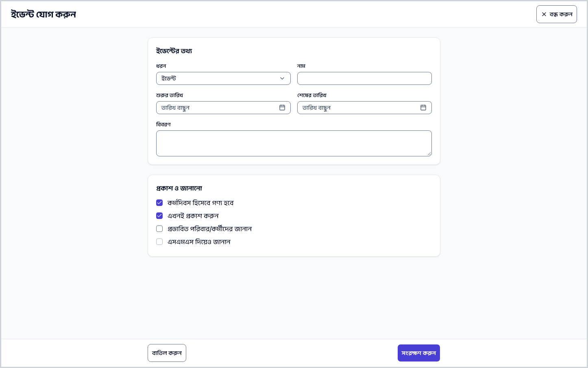
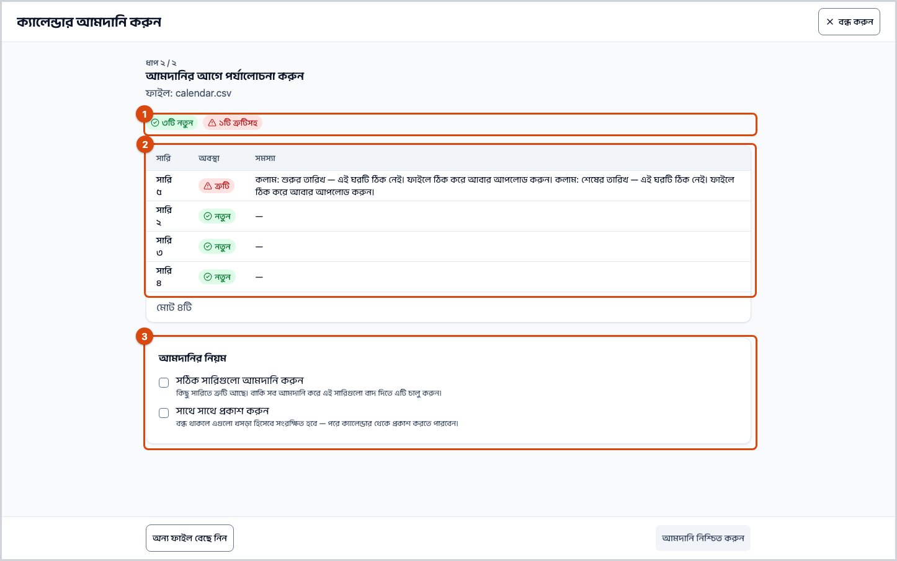
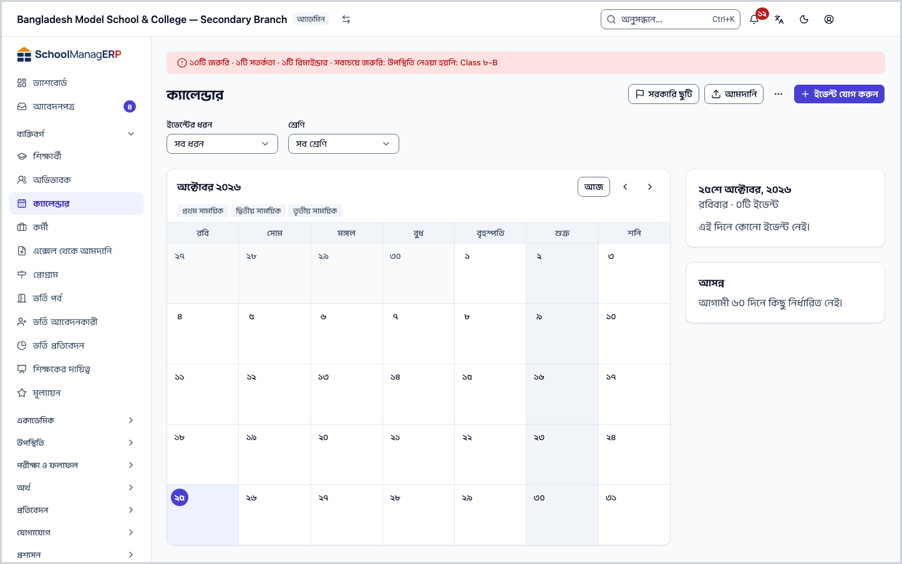

<!-- guide:meta
feature: people.calendar
title: ক্যালেন্ডারে ছুটি ও অনুষ্ঠান দেখা, যোগ করা ও নিজের ফোনে নেওয়া
summary: স্কুলের ছুটি, পরীক্ষা, সভা ও অনুষ্ঠান একটি মাসের ক্যালেন্ডারে দেখুন; অ্যাডমিন এগুলো যোগ করেন, ফাইল থেকে আনেন, আগের বছর থেকে কপি করেন; সবাই নিজের ফোনের ক্যালেন্ডার অ্যাপে সাবস্ক্রাইব করতে পারেন।
roles: [ADMIN, ACCOUNTANT, TEACHER, EXECUTIVE, OFFICE_STAFF, EXAM_CONTROLLER, COMMITTEE]
sources:
  - client-admin/src/routes/_staff/calendar/index.tsx
  - client-admin/src/routes/_staff/calendar/import.tsx
  - client-admin/src/routes/_staff/calendar/-event-form-dialog.tsx
  - client-admin/src/routes/_staff/calendar/-event-details-sheet.tsx
  - client-admin/src/routes/_staff/calendar/-government-holidays-dialog.tsx
  - client-admin/src/routes/_staff/calendar/-clone-dialog.tsx
  - client-admin/src/routes/_staff/calendar/-filters.tsx
  - client-admin/src/routes/_staff/calendar/-upcoming-panel.tsx
  - client-admin/src/routes/_staff/calendar/-import-dropzone.tsx
  - client-admin/src/routes/_staff/calendar/-import-preview-table.tsx
  - client-admin/src/components/calendar-feed-card.tsx
  - server/src/modules/calendar/calendar-events.service.ts
  - server/src/modules/calendar/calendar-visibility.util.ts
  - server/src/modules/calendar/calendar-import.service.ts
  - server/src/modules/calendar/calendar-export.service.ts
  - server/src/modules/calendar/calendar-feed.service.ts
  - server/src/modules/calendar/public-holidays.service.ts
labels:
  [
    calendar:page.*,
    calendar:filters.*,
    calendar:types.*,
    calendar:eventForm.*,
    calendar:eventDetails.*,
    calendar:governmentHolidaysDialog.*,
    calendar:upcomingPanel.*,
    calendarImport:step1.*,
    calendarImport:step2.*,
    calendarImport:step3.*,
    calendarImport:success.*,
    calendarImport:clone.*,
    calendarImport:toolbar.*,
    calendarImport:columns.*,
    calendarFeed:card.*,
    calendarFeed:field.*,
    calendarFeed:regenerate.*,
    calendarFeed:howTo.*,
    nav:items.calendar,
    nav:groups.people,
  ]
helpIds:
  [
    people.calendar,
    people.calendar.action.addEvent,
    people.calendar.action.publish,
    people.calendar.action.delete,
    people.calendar.action.import,
    people.calendar.action.regenerateFeed,
    people.calendar.field.countsAsWorkingDay,
    people.calendar.field.notify,
    people.calendar.field.lateReason,
    people.calendar.action.governmentHolidays,
    people.calendar.action.clone,
  ]
devices: [desktop]
entry: [sidebar, palette]
keywords:
  [ক্যালেন্ডার, ছুটি, সরকারি ছুটি, ইভেন্ট, অনুষ্ঠান, পরীক্ষার তারিখ, কর্মদিবস, আমদানি, সাবস্ক্রাইব, calendar, holiday, event, import, subscribe, feed]
appVersion: 0.1.0 (5f7194a2e)
owner: tareq89
lastVerified: 2026-10-24
knownIssues: []
-->

# ক্যালেন্ডারে ছুটি ও অনুষ্ঠান দেখা, যোগ করা ও নিজের ফোনে নেওয়া

এই পাতায় আপনি স্কুলের ছুটি, পরীক্ষা, সভা ও অনুষ্ঠান একটি মাসের ক্যালেন্ডারে দেখতে পারবেন। অ্যাডমিন সেগুলো যোগ ও বদলাতে পারেন। আর সবাই নিজের ফোনের ক্যালেন্ডার অ্যাপে এই ক্যালেন্ডার সাবস্ক্রাইব করতে পারেন।

**যেতে হবে:** বাম মেনুতে **ব্যক্তিবর্গ → ক্যালেন্ডার**। এই পাতার কাজ কম্পিউটারে করুন। উপরের খোঁজার ঘরে (Ctrl+K) **ক্যালেন্ডারে ইভেন্ট যোগ করুন**, **সরকারি ছুটি যোগ করুন**, **অন্য বছরের ক্যালেন্ডার কপি করুন** বা **ক্যালেন্ডার আমদানি করুন** লিখেও সরাসরি যাওয়া যায় (শুধু অ্যাডমিন)। খোঁজার নিয়ম: [যেকোনো পাতা খুঁজে পাওয়া](../start/find-anything.md)।
**শুরুর আগে:** ইভেন্ট যোগ করতে আপনি স্কুলের অ্যাডমিন হবেন ([কে কী করতে পারেন](#roles)), আর স্কুলে চলতি শিক্ষাবর্ষ ঠিক করা থাকবে। ইভেন্টের তারিখ সেই শিক্ষাবর্ষের ভেতরে হতে হয়।

**ক্যালেন্ডার** মানে স্কুলের সব তারিখের একটি তালিকা। প্রতিটি **ইভেন্ট** (ছুটি, পরীক্ষা, সভা, সময়সীমা বা অনুষ্ঠান) একটি নাম আর এক বা একাধিক দিন নিয়ে। আরও একটি বিষয় মনে রাখুন: প্রতিটি ইভেন্টে ঠিক করা থাকে সেই দিনটি **কর্মদিবস** কি না। ছুটির দিনটি কর্মদিবস নয়, তাই সেদিন হাজিরা নেওয়া যায় না ([ছুটি কীভাবে হাজিরা আর রুটিনে কাজ করে](#task-offdays))।

[ইভেন্ট যোগ করুন](#task-main) · [সরকারি ছুটি যোগ করুন](#task-holidays) · [ফাইল থেকে আমদানি](#task-import) · [নিজের ফোনে নিন](#task-feed) · [সমস্যা ও সমাধান](#trouble)

**এই পাতায় যা আছে**

- [ইভেন্ট যোগ করুন](#task-main)
- [ইভেন্ট যোগ হয়েছে কি না বুঝবেন কীভাবে](#confirm)
- [অন্য পরিস্থিতিতে](#other)
  - [ক্যালেন্ডার দেখুন ও ছাঁকুন](#task-view)
  - [সরকারি ছুটি যোগ করুন](#task-holidays)
  - [ইভেন্ট বদলান, প্রকাশ করুন বা মুছুন](#task-edit)
  - [আগে পেরিয়ে যাওয়া দিনের ছুটি যোগ করুন](#task-past)
  - [ফাইল থেকে আমদানি করুন](#task-import)
  - [আগের বছরের ক্যালেন্ডার নতুন বছরে কপি করুন](#task-clone)
  - [ক্যালেন্ডার রপ্তানি করুন](#task-export)
  - [নিজের ফোনের ক্যালেন্ডার অ্যাপে সাবস্ক্রাইব করুন](#task-feed)
  - [ছুটি কীভাবে হাজিরা আর রুটিনে কাজ করে](#task-offdays)
- [সমস্যা ও সমাধান](#trouble)
- [কে কী করতে পারেন](#roles)
- [আরও জানুন](#more)

---

## ইভেন্ট যোগ করুন 

একটি ছুটি, পরীক্ষা, সভা বা অনুষ্ঠান ক্যালেন্ডারে তুলতে এটি করুন। (শুধু অ্যাডমিন করতে পারেন।)

1. বাম মেনুতে **ব্যক্তিবর্গ → ক্যালেন্ডার** চাপুন।

   → উপরে **ক্যালেন্ডার** শিরোনাম আর তার নিচে এই মাসের ক্যালেন্ডার। ডান পাশে নির্বাচিত দিনের ইভেন্ট আর **আসন্ন** তালিকা।

2. পাতার উপরে **ইভেন্ট যোগ করুন** চাপুন।

   → একটি পুরো পাতা খোলে, শিরোনাম **ইভেন্ট যোগ করুন**। দুটি অংশ: **ইভেন্টের তথ্য** আর **প্রকাশ ও জানানো**।

3. **ধরন** ঘর থেকে একটি বেছে নিন: **ছুটি**, **পরীক্ষা**, **ইভেন্ট**, **সভা**, **সময়সীমা** বা **ক্ষতিপূরক স্কুল দিবস**।

   → শুরুতে **ইভেন্ট** বাছা থাকে। **ছুটি** বাছলে নিচের **কর্মদিবস হিসেবে গণ্য হবে** ঘরের টিক নিজে থেকে উঠে যায়; বাকি ধরনে টিক থাকে। **ক্ষতিপূরক স্কুল দিবস** বাছলে টিকটি সবসময় দেওয়া থাকে, আর বদলানো যায় না।

4. **নাম** ঘরে ইভেন্টের নাম লিখুন, যেমন "বার্ষিক ক্রীড়া প্রতিযোগিতা"।

   → ঘরটি বাধ্যতামূলক। ফাঁকা রেখে এগোলে **নাম আবশ্যক।** দেখায়।

5. **শুরুর তারিখ** আর **শেষের তারিখ** বাছুন। এক দিনের ইভেন্ট হলে দুটিতে একই তারিখ দিন।

   → শেষের তারিখ শুরুর আগের কোনো দিন বাছা যায় না। শুরুর তারিখ পেরিয়ে গেলে [আগে পেরিয়ে যাওয়া দিনের ছুটি যোগ করুন](#task-past) দেখুন।

6. দরকার হলে **বিবরণ** লিখুন। এটি ইভেন্ট খুললে দেখা যায়।

7. **প্রকাশ ও জানানো** অংশ দেখুন:

   | ঘর                                 | কখন টিক দেবেন                                                                             |
   | ---------------------------------- | ----------------------------------------------------------------------------------------- |
   | **কর্মদিবস হিসেবে গণ্য হবে**       | দিনটিতে স্কুল চলবে। টিক তুলে দিলে দিনটি বন্ধের দিন, হাজিরা নেওয়া যাবে না                 |
   | **এখনই প্রকাশ করুন**               | টিক দেওয়া থাকে। টিক তুলে দিলে ইভেন্ট **খসড়া** থাকে, কেউ দেখে না, পরে প্রকাশ করতে পারবেন |
   | **প্রভাবিত পরিবার/কর্মীদের জানান** | ইভেন্ট দেখতে পাবেন এমন সবার কাছে বিজ্ঞপ্তি যাবে                                           |
   | **এসএমএস দিয়েও জানান**            | শুধু আগের ঘরে টিক থাকলে বাছা যায়। অভিভাবকদের ফোনে এসএমএস যাবে                            |

8. **সংরক্ষণ করুন** চাপুন।

   → পাতা বন্ধ হয়, আর ক্যালেন্ডারে ইভেন্টটি সেই দিনগুলোতে দেখা যায়। **এখনই প্রকাশ করুন** বন্ধ রাখলে ঘরের পাশে **খসড়া** চিহ্ন থাকে।

> **মনে রাখুন:** **সংরক্ষণ করুন** না চাপা পর্যন্ত কিছুই সিস্টেমে যায় না। **খসড়া** ইভেন্ট শুধু অ্যাডমিন দেখেন; এটি কর্মদিবসের হিসাবে ধরা হয় না, কাউকে জানানোও হয় না। **জানান** টিকটি ইভেন্ট সংরক্ষণ বা বদলানোর সময়ই কাজ করে।

**বিজ্ঞপ্তি কাদের কাছে যায়:** **প্রভাবিত পরিবার/কর্মীদের জানান** টিক দিলে যে সব কর্মী ও অভিভাবক ইভেন্টটি দেখতে পান, তাঁদের কাছে বিজ্ঞপ্তি যায়। **এসএমএস দিয়েও জানান** দিলে অভিভাবকদের ফোনে এসএমএসও যায়, এর জন্য স্কুলের এসএমএস ক্রেডিট খরচ হতে পারে।

---

## ইভেন্ট যোগ হয়েছে কি না বুঝবেন কীভাবে 

ক্যালেন্ডারের তথ্য শুধু ইন্টারনেট থাকলে সংরক্ষিত হয়; এই পাতার কাজ ফোনে বা কম্পিউটারে জমিয়ে রেখে পরে পাঠানো যায় না। তাই **এই ডিভাইসে সংরক্ষিত** অবস্থা এখানে নেই।

| অবস্থা                       | কীভাবে বুঝবেন                                               | এরপর কী                                                  |
| ---------------------------- | ----------------------------------------------------------- | -------------------------------------------------------- |
| **শুধু স্ক্রিনে বদলেছে**     | পাতা খোলা, তথ্য লেখা, কিন্তু পাতা বন্ধ হয়নি                | **সংরক্ষণ করুন** চাপুন                                   |
| **স্কুলের সিস্টেমে পৌঁছেছে** | পাতা বন্ধ হয়েছে, আর ক্যালেন্ডারে সেই দিনে ইভেন্ট দেখা যায় | কাজ শেষ। **খসড়া** চিহ্ন থাকলে [প্রকাশ করুন](#task-edit) |

**যাচাই করতে চাইলে:** ক্যালেন্ডারে সেই মাসে যান আর দিনটিতে চাপুন। ডান পাশে সেই দিনের ইভেন্টের তালিকায় নামটি এলে সিস্টেমে আছে। নামে চাপলে ইভেন্টের তথ্য দেখা যায়।

**বার্তা না এলে:** [সমস্যা ও সমাধান](#trouble) দেখুন। পাতার লেখা তখনও পাতায়ই থাকে; কিছু হারায় না।

---

## অন্য পরিস্থিতিতে 

### ক্যালেন্ডার দেখুন ও ছাঁকুন 

এটি সবাই করতে পারেন।

1. বাম মেনুতে **ব্যক্তিবর্গ → ক্যালেন্ডার** চাপুন।

   → মাসের ঘরগুলো দেখায়। সাপ্তাহিক ছুটির দিনগুলোর ঘর আলাদা রঙে থাকে (স্কুলের উপরে ঠিক করা সাপ্তাহিক ছুটি অনুযায়ী; না থাকলে শুক্র আর শনি)। শিক্ষাবর্ষের টার্মগুলো মাসের ঘরের উপরে ফিতার মতো দেখায়।

2. অন্য মাসে যেতে মাসের নামের পাশের তীরে চাপুন।

   → ঠিকানায় মাস বসে যায়, তাই লিংক পাঠিয়ে কাউকে একই মাস দেখানো যায়।

3. কোনো দিনে চাপুন।

   → ডান পাশে ওই দিনের ইভেন্টগুলো দেখায়, আর কিছু না থাকলে **এই দিনে কোনো ইভেন্ট নেই।**

4. কোনো ইভেন্টের নামে চাপুন।

   → একটি ছোট ঘর খোলে: ইভেন্টের নাম, **ধরন**, তারিখ, আর বিবরণ থাকলে সেটি। অ্যাডমিন হলে নিচে **মুছুন**, **প্রকাশ করুন**, **সম্পাদনা** বোতাম দেখেন।

5. ছাঁকতে চাইলে উপরের ঘরগুলো ব্যবহার করুন:

   | ঘর               | কী বাছবেন                                                                                              |
   | ---------------- | ------------------------------------------------------------------------------------------------------ |
   | **ইভেন্টের ধরন** | একটি ধরন, যেমন **ছুটি**। না বাছলে **সব ধরন**                                                           |
   | **শ্রেণি**       | একটি শ্রেণি। না বাছলে **সব শ্রেণি**। (শুধু সেই শ্রেণির জন্য নির্দিষ্ট করা ইভেন্ট ও সবার ইভেন্ট দেখায়) |

**ডান পাশের আসন্ন তালিকা:** **আসন্ন** কার্ডে সর্বোচ্চ পাঁচটি প্রকাশিত ইভেন্ট থাকে, আর উপরে "পরবর্তী ছুটি: {নাম} · {সংখ্যা} দিনে" (আজই হলে "আজ")।

> **মনে রাখুন:** আপনি কোন ইভেন্ট দেখবেন তা ভূমিকা অনুযায়ী ঠিক হয়। শিক্ষক শুধু সবার জন্য আর কর্মীদের জন্য ইভেন্ট, আর নিজের পড়ানো শ্রেণির ইভেন্ট দেখেন। **খসড়া** ইভেন্ট শুধু অ্যাডমিন দেখেন।

### সরকারি ছুটি যোগ করুন 

সরকারি ছুটির তালিকা একবারে ক্যালেন্ডারে তুলতে এটি করুন। (শুধু অ্যাডমিন।)

1. ক্যালেন্ডারে সেই বছরের কোনো মাস খুলুন। তারপর পাতার উপরে **সরকারি ছুটি** চাপুন।

   → একটি পুরো পাতা খোলে, শিরোনাম **সরকারি ছুটি**। লেখা থাকে "প্রকাশিত জাতীয় ক্যালেন্ডার থেকে এই বছরের প্রস্তাবিত ছুটি।" নিচে প্রতিটি ছুটির নাম আর তারিখের পাশে একটি টিক-ঘর। তালিকা সেই মাসের বছরের জন্য আসে, তাই আগে সঠিক বছরের মাস খুলুন। কিছু না থাকলে **কোনো প্রস্তাবিত ছুটি নেই** দেখায়।

2. যে ছুটিগুলো যোগ করবেন তাদের টিক দিন।

   → যেগুলো ক্যালেন্ডারে আগেই আছে সেগুলো টিক দেওয়া আর ধূসর অবস্থায় **ইতিমধ্যে যোগ করা হয়েছে** চিহ্নসহ দেখায়, সেগুলো আর বদলানো যায় না। (একই তারিখে আগে থেকে কোনো ছুটি থাকলেই "আগে যোগ করা" ধরা হয়, নাম মিলুক বা না মিলুক।)

3. নিচের বোতামে চাপুন। বোতামে লেখা থাকে "{সংখ্যা}টি যোগ করুন"।

   → পাতা বন্ধ হয়, আর ছুটিগুলো ক্যালেন্ডারে এসে যায়।

| আপনি চাপলেন                      | কী হবে                                                                                                        | জমা হলো? |
| -------------------------------- | ------------------------------------------------------------------------------------------------------------- | -------- |
| **{সংখ্যা}টি যোগ করুন**          | বাছা ছুটিগুলো ছুটি ধরনের ইভেন্ট হয়ে যায়, কর্মদিবস নয়, আর সঙ্গে সঙ্গে প্রকাশিত হয়। কাউকে বিজ্ঞপ্তি যায় না | হ্যাঁ    |
| **বাতিল করুন** (কিছু বাছা থাকলে) | **পরিবর্তনগুলো বাদ দেবেন?** ঘর খোলে                                                                           | না       |

> **মনে রাখুন:** যে ছুটির তারিখ পেরিয়ে গেছে, তার পাশে **তারিখ পেরিয়ে গেছে** লেখা থাকে আর টিক দেওয়া যায় না। সেটি আলাদা করে যোগ করুন: [আগে পেরিয়ে যাওয়া দিনের ছুটি যোগ করুন](#task-past)।

### ইভেন্ট বদলান, প্রকাশ করুন বা মুছুন 

1. ক্যালেন্ডারে ইভেন্টের নামে চাপুন।

   → ইভেন্টের ঘর খোলে। নিচে তিনটি বোতাম আসতে পারে: **মুছুন**, **প্রকাশ করুন** (শুধু **খসড়া** হলে), **সম্পাদনা**।

2. **সম্পাদনা** চাপুন, ঘরগুলো বদলান, তারপর **সংরক্ষণ করুন** চাপুন।

   → **ইভেন্ট সম্পাদনা করুন** পাতা খোলে, ঘরগুলো যোগ করার পাতারই মতো (**এখনই প্রকাশ করুন** ছাড়া)। সংরক্ষণ হলে পাতা বন্ধ হয়। **প্রভাবিত পরিবার/কর্মীদের জানান** টিক দিলে এই বদলের খবর যায়।

3. **খসড়া** ইভেন্ট চালু করতে ঘরে **প্রকাশ করুন** চাপুন।

   → ইভেন্টটি সবার দেখার মতো হয়, আর **খসড়া** চিহ্ন চলে যায়।

4. ইভেন্ট ক্যালেন্ডার থেকে সরাতে **মুছুন** চাপুন।

   → **ইভেন্ট মুছে ফেলবেন?** ঘর খোলে, লেখা থাকে "{নাম} ক্যালেন্ডার থেকে মুছে যাবে। এটি আর ফেরানো যাবে না।"

| আপনি চাপলেন     | কী হবে                                                | জমা হলো? |
| --------------- | ----------------------------------------------------- | -------- |
| **মুছুন**       | ইভেন্টটি ক্যালেন্ডার থেকে চলে যায়, আর ফেরানো যায় না | হ্যাঁ    |
| **প্রকাশ করুন** | খসড়া ইভেন্ট প্রকাশিত হয়                             | হ্যাঁ    |
| ঘর বন্ধ করা     | কিছুই বদলায় না                                       | না       |

> **মনে রাখুন:** শেষের তারিখ পেরিয়ে গেছে এমন ইভেন্ট আর বদলানো বা মোছা যায় না। ঘরে লেখা থাকে "এই ইভেন্টটি অতীতের, এটি আর সম্পাদনা করা যাবে না।" তখন **মুছুন** আর **সম্পাদনা** বোতাম থাকে না। একটি ইভেন্টকে কর্মদিবস থেকে বন্ধের দিনে বদলাতে চাইলে সেই দিনগুলোতে কোনো শ্রেণির হাজিরা আগে নেওয়া থাকলে সংরক্ষণ আটকে যায় ([সমস্যা ও সমাধান](#trouble))।

### আগে পেরিয়ে যাওয়া দিনের ছুটি যোগ করুন 

হরতাল বা হঠাৎ বন্ধের মতো কোনো ছুটি আগে ক্যালেন্ডারে ওঠেনি, পরে মনে হলো। তখন দিনটি পেরিয়ে গেলেও ছুটি হিসেবে যোগ করা যায়, কিন্তু শর্ত আছে।

1. পাতার উপরে **ইভেন্ট যোগ করুন** চাপুন।

2. **ধরন** **ছুটি** (বা যেকোনো ধরনে **কর্মদিবস হিসেবে গণ্য হবে** টিক তুলে) বাছুন, নাম ও পেরিয়ে যাওয়া তারিখ দিন।

   → একটি নতুন ঘর আসে: **কেন দেরিতে যোগ করা হচ্ছে?** নিচে লেখা: "এই দিনটি পেরিয়ে গেছে। ওই দিন কোনো উপস্থিতি নেওয়া না হয়ে থাকলেই কেবল এটি যোগ করা যাবে।" এই অবস্থায় **এখনই প্রকাশ করুন** আর **প্রভাবিত পরিবার/কর্মীদের জানান** বন্ধ হয়ে যায়: ইভেন্ট সঙ্গে সঙ্গে প্রকাশিত হয়, কাউকে জানানো হয় না।

3. **কেন দেরিতে যোগ করা হচ্ছে?** ঘরে অন্তত ৩ অক্ষরের একটি কারণ লিখুন।

   → কারণ কম হলে **কমপক্ষে ৩ অক্ষরের একটি কারণ লিখুন।** দেখায়।

4. **সংরক্ষণ করুন** চাপুন।

   → ছুটিটি ক্যালেন্ডারে আসে। ওই দিনগুলোর কোনো শ্রেণির বা কর্মীর হাজিরার খাতায় আগেই নম্বর থাকলে **এই দিনগুলোর একটিতে ইতিমধ্যে উপস্থিতি নেওয়া হয়েছে।** দেখায়, আর ছুটি যোগ হয় না।

> **মনে রাখুন:** পেরিয়ে যাওয়া দিনে শুধু বন্ধের দিন (কর্মদিবস নয়) যোগ করা যায়। পেরিয়ে যাওয়া দিনে সাধারণ ইভেন্ট যোগ করতে গেলে **এই ইভেন্টটি অতীতের, এটি আর পরিবর্তন করা যাবে না।** দেখায়।

### ফাইল থেকে আমদানি করুন 

অনেক ইভেন্ট একসঙ্গে তুলতে একটি এক্সেল বা সিএসভি ফাইল ব্যবহার করুন। (শুধু অ্যাডমিন।) আগে একটি প্রিভিউ দেখা যায়, আর **আমদানি নিশ্চিত করুন** না চাপা পর্যন্ত কিছুই লেখা হয় না।

1. ক্যালেন্ডারের উপরে **আমদানি** চাপুন।

   → **ক্যালেন্ডার আমদানি করুন** পাতা খোলে। উপরে "ধাপ ১ / ২", শিরোনাম **একটি স্প্রেডশিট আপলোড করুন**।

2. **টেমপ্লেট ডাউনলোড করুন** চাপুন। ফাইলটি খুলুন, আপনার ইভেন্টগুলো এক সারিতে একটি করে লিখুন, আর সংরক্ষণ করুন।

   → টেমপ্লেটের প্রথম সারিতে কলামের নাম থাকে, নিচে দুটি উদাহরণ সারি। কলামগুলোর মানে: [আমদানির ফাইলের কলাম](#import-columns)।

3. **ফাইল বেছে নিন** চাপুন আর ফাইলটি দিন। শুধু `.xlsx` বা `.csv` চলে, আর আকার ২ এমবি-র কম হতে হবে।

   → ফাইলের নাম দেখায়। ফাইল বড় হলে **ফাইলটি বড় — ২ এমবি'র কম আকারের ফাইল বেছে নিন**, ধরন ভুল হলে **এই ফাইলের ধরন সমর্থিত নয় — .xlsx বা .csv ফাইল বেছে নিন** দেখায়।

4. **ফাইল যাচাই করুন** চাপুন।

   → "আপনার ফাইল যাচাই করা হচ্ছে…" লেখা আসে, তারপর পাতা "ধাপ ২ / ২"-এ যায়: **আমদানির আগে পর্যালোচনা করুন**। উপরে রঙিন চিহ্নে হিসাব: **{সংখ্যা}টি নতুন**, **{সংখ্যা}টি হালনাগাদ**, **{সংখ্যা}টি অপরিবর্তিত**, **{সংখ্যা}টি ত্রুটিসহ**। নিচে প্রতিটি সারির **সারি**, **অবস্থা**, **সমস্যা**। ত্রুটির সারি আগে থাকে।

5. ত্রুটির সারি থাকলে প্রতিটির **সমস্যা** ঘরে লেখা থাকে "কলাম: {কলামের নাম} — এই ঘরটি ঠিক নেই। ফাইলে ঠিক করে আবার আপলোড করুন।" **অন্য ফাইল বেছে নিন** চেপে ফাইলটি ঠিক করে আবার দিন। **আমদানির নিয়ম** অংশের **সঠিক সারিগুলো আমদানি করুন** টিকের ওপর ভরসা করবেন না: একটিও ত্রুটির সারি থাকলে স্কুলের সিস্টেম ফাইলটি নেয় না, আমদানি ব্যর্থ দেখায়।

6. **আমদানির নিয়ম** অংশে **সাথে সাথে প্রকাশ করুন** ঠিক করুন। টিক না দিলে সব ইভেন্ট **খসড়া** হিসেবে থাকে ("বন্ধ থাকলে এগুলো খসড়া হিসেবে সংরক্ষিত হবে — পরে ক্যালেন্ডার থেকে প্রকাশ করতে পারবেন।")।

7. **আমদানি নিশ্চিত করুন** চাপুন।

   → **আমদানি সম্পন্ন হয়েছে** দেখায়, আর নিচে "{সংখ্যা}টি অনুষ্ঠান প্রকাশিত হয়েছে।" বা "{সংখ্যা}টি অনুষ্ঠান খসড়া হিসেবে সংরক্ষিত হয়েছে।" তারপর **ক্যালেন্ডারে দেখুন** চাপুন, অথবা আরেকটি ফাইল দিতে **আরেকটি ফাইল আমদানি করুন** চাপুন।

| আপনি চাপলেন              | কী হবে                                                                                | জমা হলো? |
| ------------------------ | ------------------------------------------------------------------------------------- | -------- |
| **আমদানি নিশ্চিত করুন**  | নতুন ইভেন্ট তৈরি হয়, মিলে যাওয়া ইভেন্ট হালনাগাদ হয়, অপরিবর্তিত ইভেন্টে হাত পড়ে না | হ্যাঁ    |
| **অন্য ফাইল বেছে নিন**   | প্রিভিউ চলে যায়, প্রথম ধাপে ফেরা যায়। কিছুই লেখা হয়নি                              | না       |
| ঘরের উপরের **বন্ধ করুন** | ক্যালেন্ডারে ফিরে যায়, কিছুই লেখা হয় না                                             | না       |

**নতুন, হালনাগাদ, অপরিবর্তিত কীভাবে ঠিক হয়:** একই **নাম** আর একই **শুরুর তারিখ**-এর ইভেন্ট আগে থেকে থাকলে সারিটি আগেরটিকে মেলে। তখন কিছু বদলালে **হালনাগাদ**, না বদলালে **অপরিবর্তিত**। মিল না পেলে **নতুন**। তাই একই ফাইল দ্বিতীয়বার দিলে ইভেন্ট দ্বিগুণ হয় না।

**আরও নিয়ম:** যে সারির শেষের তারিখ আজকের আগে, সেটি ত্রুটি হিসেবে আসে, কারণ পেরিয়ে যাওয়া ইভেন্ট আমদানি করা যায় না। প্রিভিউ প্রায় ৩০ মিনিট থাকে; এর পরে **আমদানি নিশ্চিত করুন** চাপলে **আমদানি ব্যর্থ হয়েছে** আসে। তখন ফাইলটি আবার যাচাই করুন।

### আমদানির ফাইলের কলাম 

<!-- verified from server/src/modules/calendar/import/calendar-import-rows.util.ts -->

| কলাম                     | কী লিখবেন                                                                                     | বাধ্যতামূলক? |
| ------------------------ | --------------------------------------------------------------------------------------------- | ------------ |
| `type`                   | `HOLIDAY`, `EXAM`, `EVENT`, `MEETING`, `DEADLINE` বা `MAKEUP_DAY` (ইংরেজিতে)                  | হ্যাঁ        |
| `name`                   | ইভেন্টের নাম, সর্বোচ্চ ১২০ অক্ষর                                                              | হ্যাঁ        |
| `start_date`             | শুরুর তারিখ, `২০২৬-০৩-২৬`-এর মতো নয়, `2026-03-26` আকারে (বছর-মাস-দিন)                        | হ্যাঁ        |
| `end_date`               | শেষের তারিখ, একই আকারে। শুরুর তারিখের আগে হলে ত্রুটি                                          | হ্যাঁ        |
| `start_time`, `end_time` | সময়, `09:00` আকারে                                                                           | না           |
| `counts_as_working_day`  | `TRUE` বা `FALSE` (`YES`/`NO`, `1`/`0`-ও চলে)। ফাঁকা রাখলে `FALSE` ধরা হয়, অর্থাৎ বন্ধের দিন | না           |
| `audience`               | `ALL` (সবার জন্য) বা `STAFF` (শুধু কর্মীদের জন্য)। ফাঁকা রাখলে `ALL`                          | না           |
| `classes`                | শ্রেণির নাম কমা দিয়ে, যেমন `Class 8, Class 9`। ফাঁকা রাখলে সব শ্রেণি                         | না           |
| `description`            | বিবরণ                                                                                         | না           |

> **সাবধান:** আমদানির ফাইলে `counts_as_working_day` ফাঁকা রাখলে সারিটি বন্ধের দিন ধরা হয়, ইভেন্ট যোগ করার পাতার উল্টো (সেখানে শুধু ছুটি ধরনেই বন্ধের দিন)। পরীক্ষা বা সভার সারিতে ঘরটিতে `TRUE` লিখুন, নইলে সেই দিনে হাজিরা নেওয়া যাবে না।

### আগের বছরের ক্যালেন্ডার নতুন বছরে কপি করুন 

নতুন শিক্ষাবর্ষে আগের বছরের পরীক্ষা, সভা ও অনুষ্ঠানগুলো ফের লিখতে না হয়, তার জন্য। (শুধু অ্যাডমিন।) সরকারি ছুটি কপি হয় না; সেটি [সরকারি ছুটি যোগ করুন](#task-holidays) দিয়ে আলাদা যোগ করুন।

1. পাতার উপরের **আরও অ্যাকশন** মেনু খুলে **অন্য বছর থেকে ক্লোন করুন** চাপুন।

   → একটি ঘর খোলে, শিরোনাম **অন্য বছর থেকে ক্লোন করুন**। লেখা থাকে "আগের একটি শিক্ষাবর্ষের অনুষ্ঠান নতুন বছরে কপি করুন। ছুটির দিনগুলো ডিফল্টভাবে বাদ থাকে।"

2. **যেখান থেকে কপি করবেন** ঘরে আগের বছর, আর **যেখানে কপি করবেন** ঘরে নতুন বছর বাছুন।

   → দুটি আলাদা বছর না বাছলে পরের বোতাম বন্ধ থাকে।

3. **ক্লোন প্রিভিউ দেখুন** চাপুন।

   → ঘর বন্ধ হয়, আর **ক্যালেন্ডার আমদানি করুন** পাতা সরাসরি "ধাপ ২ / ২"-এ খোলে। কপি করা ইভেন্টগুলো **নতুন** হিসেবে প্রিভিউয়ে দেখা যায়।

4. এখান থেকে [ফাইল থেকে আমদানি করুন](#task-import)-এর ধাপ ৫-৭ করুন।

> **মনে রাখুন:** **আমদানি নিশ্চিত করুন** না চাপা পর্যন্ত কিছুই কপি হয় না। প্রতিটি ইভেন্টের তারিখ দুই বছরের শুরুর তারিখের ব্যবধান ধরে এগিয়ে যায়। নতুন বছরের সীমার বাইরে পড়লে সেই ইভেন্ট বাদ যায়। শুধু আগের বছরের প্রকাশিত ইভেন্ট কপি হয়; **খসড়া** ইভেন্ট ও ছুটি কপি হয় না।

### ক্যালেন্ডার রপ্তানি করুন 

1. পাতার উপরের **আরও অ্যাকশন** মেনু খুলে **রপ্তানি** চাপুন। (শুধু অ্যাডমিন; চলতি শিক্ষাবর্ষ ঠিক করা না থাকলে বোতাম পাওয়া যায় না।)

   → চলতি শিক্ষাবর্ষের ইভেন্ট নিয়ে একটি এক্সেল (`.xlsx`) ফাইল নামে। ফাইলটি আমদানির টেমপ্লেটের একই কলামে সাজানো, তাই বদলে আবার আমদানি করা যায়।

### নিজের ফোনের ক্যালেন্ডার অ্যাপে সাবস্ক্রাইব করুন 

স্কুলের ছুটি ও অনুষ্ঠান নিজের ফোনের ক্যালেন্ডারে নিজে থেকে আপডেট হতে চাইলে এটি করুন। এটি সবাই করতে পারেন। লিংকটি এই পাতায় নয়, **নিরাপত্তা** পাতায় আছে।

1. উপরে ডান দিকের **অ্যাকাউন্ট মেনু** থেকে **নিরাপত্তা** চাপুন। অ্যাকাউন্ট মেনুর বিস্তারিত: [নিজের অ্যাকাউন্ট](../start/account.md)।

   → পাতায় **ক্যালেন্ডার সাবস্ক্রাইব করুন** নামে একটি কার্ড আছে। লেখা থাকে "মেয়াদের তারিখ, ছুটি ও অনুষ্ঠান দেখতে এবং স্বয়ংক্রিয় আপডেট পেতে আপনার ক্যালেন্ডার অ্যাপে এই লিংকটি যোগ করুন।"

2. **আপনার ব্যক্তিগত সাবস্ক্রাইব লিংক** ঘরের পাশে **কপি করুন** চাপুন।

   → **কপি হয়েছে** বার্তা আসে। লিংকটি ঘরে ঢাকা (তারকা চিহ্নে) থাকে; দেখতে চাইলে **দেখান**, আবার ঢাকতে **লুকান** চাপুন। কপি না হলে **লিংক কপি করা যায়নি। ম্যানুয়ালি সিলেক্ট করে কপি করুন।** আসে।

3. কার্ডের নিচের **কীভাবে সাবস্ক্রাইব করবেন** অংশ দেখে আপনার অ্যাপে লিংকটি দিন:

   - **Google Calendar:** "Other calendars" → "+" → "From URL" এ গিয়ে লিংকটি পেস্ট করুন।
   - **Apple Calendar:** File → "New Calendar Subscription" এ গিয়ে লিংকটি পেস্ট করুন।
   - **Outlook:** "Add calendar" → "Subscribe from web" এ গিয়ে লিংকটি পেস্ট করুন।

   → অ্যাপটি লিংক থেকে ইভেন্টগুলো এনে নিজে নিজে সময় সময় আপডেট করে।

**লিংক বদলাতে চাইলে** (যেমন লিংকটি ভুল জায়গায় পড়ে গেলে):

1. কার্ডের নিচে **লিংক নতুন করে তৈরি করুন** চাপুন।

   → **সাবস্ক্রাইব লিংক নতুন করে তৈরি করবেন?** ঘর খোলে। লেখা থাকে "আপনার পুরনো লিংক সঙ্গে সঙ্গে কাজ করা বন্ধ করে দেবে। যেসব ক্যালেন্ডার অ্যাপ এখনও পুরনো লিংক ব্যবহার করছে, সেগুলোতে নতুন লিংক দিতে হবে।"

| আপনি চাপলেন            | কী হবে                                                                                  | জমা হলো? |
| ---------------------- | --------------------------------------------------------------------------------------- | -------- |
| **নতুন করে তৈরি করুন** | নতুন লিংক বসে, পুরোনোটি সঙ্গে সঙ্গে বন্ধ হয়। আপনার সব ক্যালেন্ডার অ্যাপে নতুন লিংক দিন | হ্যাঁ    |
| **বাতিল**              | কিছুই বদলায় না                                                                         | না       |

**লিংকে কী কী আসে:** লিংক থেকে আপনার ক্যালেন্ডারে আসে আজ থেকে ৯০ দিন আগে থেকে ৪০০ দিন পরের মধ্যে আপনি যে প্রকাশিত ইভেন্ট দেখতে পান (ক্যালেন্ডারে যা দেখেন, ঠিক তাই), আর শিক্ষাবর্ষের টার্ম। **খসড়া** ইভেন্ট আসে না।

> **সাবধান:** এই লিংক আপনার একার। যে কেউ লিংকটি পেলে আপনি যা দেখেন তা দেখতে পারবে। তাই কাউকে পাঠাবেন না।

### ছুটি কীভাবে হাজিরা আর রুটিনে কাজ করে 

ক্যালেন্ডারের একটি ছুটি বা বন্ধের দিন কয়েকটি জায়গায় নিজে থেকে কাজ করে। আপনাকে আলাদা কিছু করতে হয় না।

<figure>
  
  <figcaption><em>ক্যালেন্ডারের বন্ধের দিন কোথায় কাজ করে</em></figcaption>
</figure>

- **হাজিরা:** বন্ধের দিনে হাজিরার খাতায় হাজিরা নেওয়া যায় না ([উপস্থিতি নেওয়া](../attendance/attendance.md))। পাতায় "এই দিন স্কুল বন্ধ" দেখায়।
- **হাজিরার হিসাব:** উপস্থিতির শতকরা হিসাবে বন্ধের দিনগুলো মোট কর্মদিবসে ধরা হয় না।
- **অনুপস্থিতির বার্তা:** বন্ধের দিনে অনুপস্থিতির নোটিশ অভিভাবকদের কাছে যায় না।
- **রুটিন:** বন্ধের দিনে [রুটিনে কোনো ক্লাস ধরা হয় না](../academics/routine-builder.md)।
- **উল্টো দিক:** যে দিনে কোনো শ্রেণির বা কর্মীর হাজিরার খাতায় নম্বর আছে, সে দিনকে বন্ধের দিন করা যায় না ([সমস্যা ও সমাধান](#trouble))। তাই ছুটি আগে ক্যালেন্ডারে তুলুন, তারপর হাজিরা শুরু হবে।

---

## সমস্যা ও সমাধান 

| আপনি যা দেখছেন                                                 | কী করবেন                                                                                                                          | কে সাহায্য করতে পারেন |
| -------------------------------------------------------------- | --------------------------------------------------------------------------------------------------------------------------------- | --------------------- |
| **ক্যালেন্ডার লোড করা যায়নি। আবার চেষ্টা করুন।**              | ইন্টারনেট দেখে আবার চেষ্টা করুন চাপুন বা পাতা রিলোড করুন।                                                                         | অ্যাডমিন              |
| **নাম আবশ্যক।**                                                | **নাম** ঘরে ইভেন্টের নাম লিখুন।                                                                                                   | অ্যাডমিন              |
| **শেষের তারিখ শুরুর তারিখের সমান বা পরে হতে হবে।**             | দুটি তারিখ ঠিক করে আবার **সংরক্ষণ করুন** চাপুন। তারিখ না বাছলেও এটি আসে।                                                          | অ্যাডমিন              |
| **এই তারিখগুলো চলতি শিক্ষাবর্ষের বাইরে।**                      | তারিখ ঠিক শিক্ষাবর্ষের ভেতরে দিন। নতুন শিক্ষাবর্ষ থাকলে আগে তা তৈরি করুন।                                                         | অ্যাডমিন              |
| **এই ইভেন্টটি অতীতের, এটি আর পরিবর্তন করা যাবে না।**           | পেরিয়ে যাওয়া দিনের সাধারণ ইভেন্ট যোগ বা বদলানো যায় না। শুধু বন্ধের দিন যোগ করা যায় ([পেরিয়ে যাওয়া দিনের ছুটি](#task-past))। | অ্যাডমিন              |
| **কমপক্ষে ৩ অক্ষরের একটি কারণ লিখুন।**                         | **কেন দেরিতে যোগ করা হচ্ছে?** ঘরে কারণ লিখুন।                                                                                     | অ্যাডমিন              |
| **এই দিনগুলোর একটিতে ইতিমধ্যে উপস্থিতি নেওয়া হয়েছে।**        | ওই তারিখে কোনো শ্রেণির বা কর্মীর হাজিরা জমা আছে, তাই দিনটিকে বন্ধের দিন করা যায় না। তারিখ বদলান, বা আগে হাজিরা ঠিক করুন।         | অ্যাডমিন              |
| **নির্বাচিত শ্রেণিগুলোর একটি সঠিক নয়।**                       | ইভেন্টটি অন্য শিক্ষাবর্ষের শ্রেণির সঙ্গে জড়ানো। শ্রেণি আবার বেছে নিন।                                                            | অ্যাডমিন              |
| **ক্ষতিপূরক স্কুল দিবস সবসময় কর্মদিবস হিসেবে গণ্য হয়।**      | এই ধরনে **কর্মদিবস হিসেবে গণ্য হবে** টিক তোলা যায় না। বন্ধের দিন চাইলে অন্য ধরন বাছুন।                                           | অ্যাডমিন              |
| **এই ইভেন্টটি সংরক্ষণ করা যায়নি। আবার চেষ্টা করুন।**          | ইন্টারনেট দেখে আবার **সংরক্ষণ করুন** চাপুন। পাতার লেখা থেকে যায়।                                                                 | অ্যাডমিন              |
| **কাজটি সম্পন্ন করা যায়নি। আবার চেষ্টা করুন।** (ইভেন্টের ঘরে) | মোছা বা প্রকাশের সময় এসেছে। ইন্টারনেট দেখে আবার চেষ্টা করুন। খসড়ার তারিখ পেরিয়ে গেলে প্রকাশ হয় না।                            | অ্যাডমিন              |
| **ছুটিগুলো যোগ করা যায়নি। আবার চেষ্টা করুন।**                 | ইন্টারনেট দেখুন।                                                                                                                  | অ্যাডমিন              |
| **কোনো প্রস্তাবিত ছুটি নেই**                                   | সেই বছরের জাতীয় ছুটির তালিকা এখনো প্রকাশিত হয়নি। ইভেন্ট যোগ করুন দিয়ে নিজে যোগ করুন।                                           | অ্যাডমিন              |
| **আপলোড ব্যর্থ হয়েছে**                                        | ফাইলটি `.xlsx` বা `.csv` কি না, আর কলামের নাম টেমপ্লেটের মতো কি না দেখুন। ইন্টারনেটও দেখুন।                                       | অ্যাডমিন              |
| **আমদানি ব্যর্থ হয়েছে**                                       | ইন্টারনেট দেখুন। প্রিভিউ ৩০ মিনিটের বেশি পুরোনো হলে ফাইলটি আবার যাচাই করুন।                                                       | অ্যাডমিন              |
| **ক্লোন ব্যর্থ হয়েছে**                                        | দুটি আলাদা বছর বেছেছেন কি না আর ইন্টারনেট দেখুন।                                                                                  | অ্যাডমিন              |
| **আপনার সাবস্ক্রাইব লিংক লোড করা যায়নি।**                     | কার্ডের **আবার চেষ্টা করুন** চাপুন।                                                                                               | যে কেউ                |
| **লিংক নতুন করে তৈরি করা যায়নি। আবার চেষ্টা করুন।**           | ইন্টারনেট দেখে আবার চাপুন।                                                                                                        | যে কেউ                |

---

## কে কী করতে পারেন 

| ভূমিকা                                                                                   | ক্যালেন্ডার দেখতে                                                        | ইভেন্ট যোগ, বদল, মুছতে, আমদানি, রপ্তানি, কপি | নিজের ফোনে সাবস্ক্রাইব করতে |
| ---------------------------------------------------------------------------------------- | ------------------------------------------------------------------------ | -------------------------------------------- | --------------------------- |
| অ্যাডমিন                                                                                 | হ্যাঁ, **খসড়া**সহ সবকিছু                                                | হ্যাঁ                                        | হ্যাঁ                       |
| শিক্ষক                                                                                   | হ্যাঁ, সবার জন্য আর কর্মীদের জন্য ইভেন্ট, আর নিজের পড়ানো শ্রেণির ইভেন্ট | না                                           | হ্যাঁ                       |
| হিসাবরক্ষক, একাডেমিক কো-অর্ডিনেটর, অফিস সহকারী, পরীক্ষা নিয়ন্ত্রক, পরিচালনা পর্ষদ সদস্য | হ্যাঁ, শুধু প্রকাশিত ইভেন্ট                                              | না                                           | হ্যাঁ                       |

যাঁদের ইভেন্ট বদলানোর অনুমতি নেই, তাঁদের কাছে **সরকারি ছুটি**, **আমদানি**, **ইভেন্ট যোগ করুন** ও অন্য বোতাম পাতায় দেখাই যায় না। অভিভাবক আর শিক্ষার্থী নিজেদের পোর্টালে ক্যালেন্ডার দেখেন; সেই পাতা আলাদা: [**ক্যালেন্ডার**](../portal/calendar.md)।

---

## আরও জানুন 

<strong>পাতার অংশগুলো</strong> — উপর থেকে নিচে

1. **ক্যালেন্ডার** — শিরোনাম, আর অ্যাডমিনের জন্য বোতামগুলো: **সরকারি ছুটি**, **আমদানি**, **ইভেন্ট যোগ করুন**, আর **আরও অ্যাকশন** মেনুতে **অন্য বছর থেকে ক্লোন করুন** ও **রপ্তানি**।
2. **ছাঁকনি** — **ইভেন্টের ধরন** আর **শ্রেণি**।
3. **মাসের ঘর** — সপ্তাহের দিনের নাম (**রবি** থেকে **শনি**), টার্মের ফিতা, সাপ্তাহিক ছুটির রঙ, প্রতিটি দিনে ইভেন্টের নাম। একদিনে বেশি হলে "+{সংখ্যা} আরও"।
4. **নির্বাচিত দিনের তালিকা** — ওই দিনের সব ইভেন্ট।
5. **আসন্ন** — পরবর্তী পাঁচটি ইভেন্ট আর পরবর্তী ছুটির তারিখ।

<strong>ইভেন্টের ধরন</strong>

| ধরন                      | কর্মদিবস কি না (শুরুতে)      | কখন বাছবেন                                         |
| ------------------------ | ---------------------------- | -------------------------------------------------- |
| **ছুটি**                 | না, বন্ধের দিন               | জাতীয় ছুটি, ঈদের ছুটি, হঠাৎ বন্ধ                  |
| **পরীক্ষা**              | হ্যাঁ                        | পরীক্ষার দিন; স্কুল চলে                            |
| **ইভেন্ট**               | হ্যাঁ                        | ক্রীড়া, বার্ষিক অনুষ্ঠান                          |
| **সভা**                  | হ্যাঁ                        | অভিভাবক সভা, কর্মী সভা                             |
| **সময়সীমা**             | হ্যাঁ                        | ফি, ফরম বা ফল জমার শেষ তারিখ                       |
| **ক্ষতিপূরক স্কুল দিবস** | সবসময় হ্যাঁ, বদলানো যায় না | কোনো বন্ধের ক্ষতি পুষিয়ে অতিরিক্ত স্কুল দিন রাখলে |

<strong>ঘরগুলোর অর্থ</strong>

<!-- guide:generated:fields:calendar -->

| ঘর                             | কী লিখবেন                                                                                                                                              | বাধ্যতামূলক?          |
| ------------------------------ | ------------------------------------------------------------------------------------------------------------------------------------------------------ | --------------------- |
| ধরন                            | ছুটি, পরীক্ষা, ইভেন্ট, সভা, সময়সীমা বা ক্ষতিপূরক স্কুল দিবস। শুরুতে ইভেন্ট। ধরন বদলালে কর্মদিবসের টিকও বদলায়, যদি আপনি আগে নিজে টিক না ছুঁয়ে থাকেন। | হ্যাঁ                 |
| নাম                            | ইভেন্টের নাম, যেমন "ঈদুল ফিতরের ছুটি"।                                                                                                                 | হ্যাঁ                 |
| শুরুর তারিখ                    | ইভেন্ট শুরুর দিন। চলতি শিক্ষাবর্ষের ভেতরে হতে হয়।                                                                                                     | হ্যাঁ                 |
| শেষের তারিখ                    | ইভেন্ট শেষের দিন। এক দিনের হলে শুরুর তারিখের সমান।                                                                                                     | হ্যাঁ                 |
| কেন দেরিতে যোগ করা হচ্ছে?      | শুরুর তারিখ পেরিয়ে গেলে ও দিনটি বন্ধের দিন হলে আসে। অন্তত ৩ অক্ষর, সর্বোচ্চ ৫০০।                                                                      | হ্যাঁ, তখন            |
| বিবরণ                          | ইভেন্টের ছোট বর্ণনা। মুক্ত লেখা।                                                                                                                       | না                    |
| কর্মদিবস হিসেবে গণ্য হবে       | টিক থাকলে দিনটিতে স্কুল চলে। টিক না থাকলে বন্ধের দিন, হাজিরা নেওয়া যায় না। ছুটি ধরনে শুরুতে টিক থাকে না; অন্য ধরনে থাকে।                             | না                    |
| এখনই প্রকাশ করুন               | শুধু যোগ করার সময়। টিক থাকলে সবাই দেখে। না থাকলে খসড়া।                                                                                               | না, শুরুতে টিক দেওয়া |
| প্রভাবিত পরিবার/কর্মীদের জানান | টিক দিলে যাঁরা ইভেন্টটি দেখতে পান তাঁদের বিজ্ঞপ্তি যায়।                                                                                               | না                    |
| এসএমএস দিয়েও জানান            | অভিভাবকদের ফোনে এসএমএসও যায়। আগের ঘরে টিক না দিলে এটি বন্ধ থাকে।                                                                                      | না                    |

<!-- /guide:generated -->

<strong>ক্যালেন্ডার কীভাবে কাজ করে</strong> — ইভেন্ট থেকে বন্ধের দিন, তারপর হাজিরা ও রুটিন

<figure>
  
  <figcaption><em>ইভেন্ট যোগ থেকে সবার দেখা পর্যন্ত</em></figcaption>
</figure>

- ইভেন্ট যোগ করার চারটি পথ: একটি করে লিখে, সরকারি ছুটির তালিকা থেকে, ফাইল থেকে, আর আগের বছর থেকে কপি করে।
- খসড়া ইভেন্ট শুধু অ্যাডমিন দেখেন আর কর্মদিবসের হিসাবে ধরা হয় না। প্রকাশ করলে সবার কাছে পৌঁছায়।
- প্রতিটি ইভেন্টে "কর্মদিবস কি না" ঠিক করা থাকে; হাজিরা আর রুটিন সেটি দেখে চলে।

<strong>পুরো কাজটি একসাথে</strong>

<!-- image pending: ইভেন্ট যোগ থেকে প্রকাশ ও ক্যালেন্ডারে দেখা পর্যন্ত GIF, অ্যাডমিন, desktop -->

<!-- image pending: ফাইল থেকে আমদানি, প্রিভিউ থেকে নিশ্চিত করা পর্যন্ত GIF, অ্যাডমিন, desktop -->

**সম্পর্কিত পাতা**

- [**ক্যালেন্ডার**](../portal/calendar.md) — অভিভাবক ও শিক্ষার্থী ক্যালেন্ডার যেভাবে দেখেন।

---

_সংস্করণ ০.১.০ · শেষ যাচাই ২০২৬-১০-২৪_
