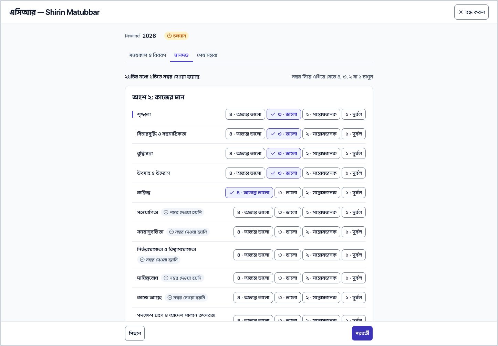
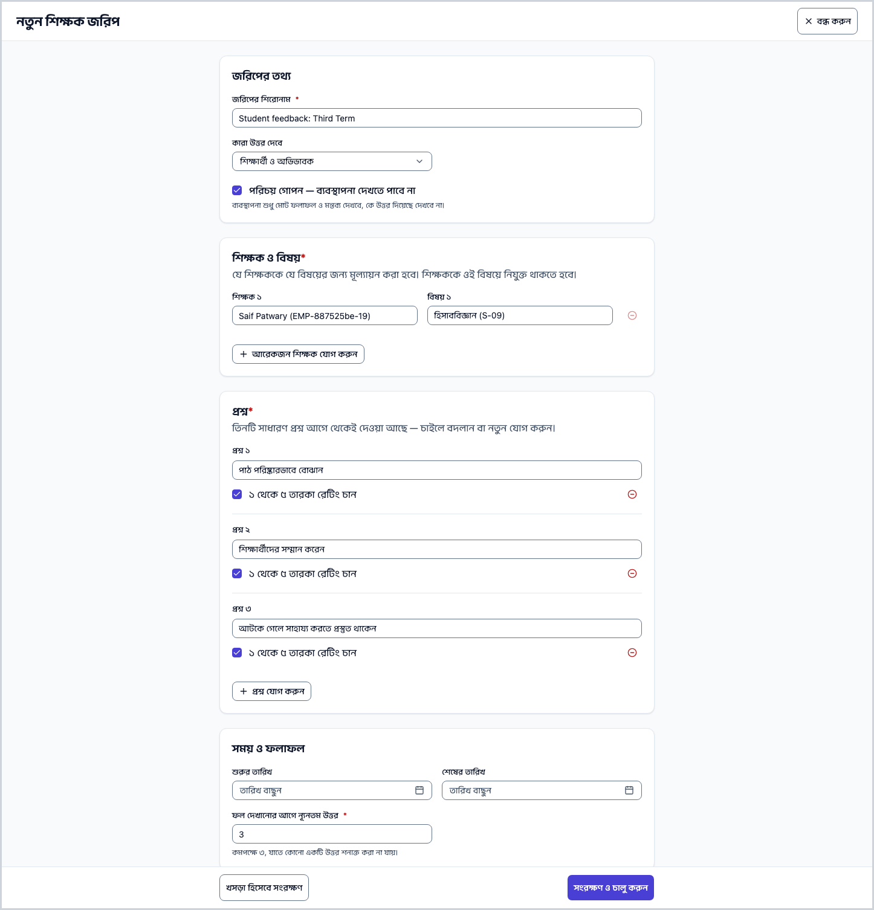
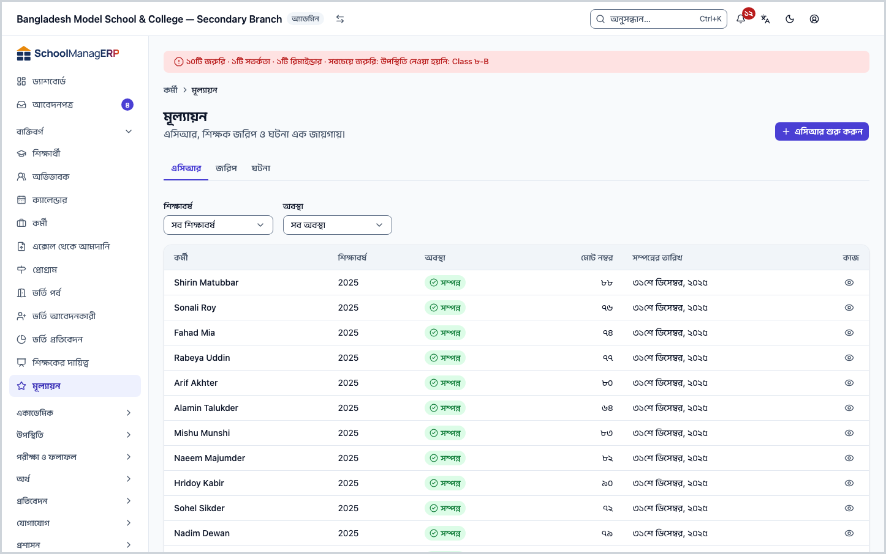

<!-- guide:meta
feature: people.evaluations
title: মূল্যায়ন: এসিআর, শিক্ষক জরিপ ও ঘটনা
summary: কর্মীর বার্ষিক গোপনীয় প্রতিবেদন (এসিআর) লিখুন, শিক্ষার্থী ও অভিভাবকদের কাছে শিক্ষক জরিপ চালান, আর কর্মীর ঘটনা জানান। এই পাতা সবার জন্য নয়।
roles: [ADMIN, COMMITTEE]
sources:
  - client-admin/src/routes/_staff/staff/evaluations.tsx
  - client-admin/src/routes/_staff/staff/evaluations_.surveys.$surveyId.tsx
  - client-admin/src/routes/_staff/staff/$userId_.acr.$assessmentId.tsx
  - client-admin/src/routes/_staff/staff/-evaluations/acr-register.tsx
  - client-admin/src/routes/_staff/staff/-evaluations/surveys-list.tsx
  - client-admin/src/routes/_staff/staff/-evaluations/survey-form-dialog.tsx
  - client-admin/src/routes/_staff/staff/-evaluations/survey-results.tsx
  - client-admin/src/routes/_staff/staff/-evaluations/incidents-list.tsx
  - client-admin/src/routes/_staff/staff/-acr/acr-form.tsx
  - client-admin/src/routes/_staff/staff/-detail/start-acr-dialog.tsx
  - client-admin/src/routes/_staff/staff/-detail/report-incident-dialog.tsx
  - server/src/modules/acr/acr-assessments.controller.ts
  - server/src/modules/surveys/surveys.controller.ts
labels: [evaluations:*, performance:*]
helpIds:
  [
    people.evaluations,
    people.evaluations.action.startAcr,
    people.evaluations.action.completeAcr,
    people.evaluations.action.reopenAcr,
    people.evaluations.action.publishSurvey,
    people.evaluations.action.closeSurvey,
    people.evaluations.action.reportIncident,
    people.evaluations.field.anonymous,
    people.evaluations.field.minResponses,
    people.evaluations.field.targets,
    people.evaluations.action.newSurvey,
  ]
devices: [desktop]
entry: [sidebar, palette]
keywords:
  [মূল্যায়ন, এসিআর, বার্ষিক গোপনীয় প্রতিবেদন, শিক্ষক জরিপ, জরিপ, ঘটনা, কর্মী মূল্যায়ন, evaluations, ACR, survey, incident, performance]
appVersion: 0.1.0 (5f7194a2e)
owner: tareq89
lastVerified: 2026-10-24
knownIssues: []
-->

# মূল্যায়ন: এসিআর, শিক্ষক জরিপ ও ঘটনা

কর্মীদের কাজ মূল্যায়নের তিনটি জিনিস এক পাতায়: **এসিআর** (বার্ষিক গোপনীয় প্রতিবেদন, নম্বর দিয়ে), **জরিপ** (শিক্ষার্থী ও অভিভাবকের মতামত), আর **ঘটনা** (কারও আচরণ, অনুপস্থিতি, অভিযোগ বা প্রশংসার রেকর্ড)।

**যেতে হবে:** বাম মেনুতে **ব্যক্তিবর্গ → মূল্যায়ন**। এই পাতার কাজ কম্পিউটারে করুন।
**শুরুর আগে:** পাতাটি শুধু অ্যাডমিন (দেখা ও লেখা) আর পরিচালনা পর্ষদ সদস্য (শুধু দেখা) পান। নিচের "কে কী দেখে" ছবিটি আগে দেখে নিন ([কে কী করতে পারেন](#roles))। এসিআর শুরু করতে কর্মী আগে [কর্মী](staff.md) তালিকায় থাকতে হবে, আর স্কুলের **সেটিংস** পাতার "এসিআরের মানদণ্ড" অংশে মানদণ্ড একবার সংরক্ষণ করা থাকতে হবে।

[এসিআর শুরু করুন](#task-main) · [জরিপ চালু করুন](#task-survey) · [ঘটনা জানান](#task-incident) · [ফল দেখুন](#task-results) · [সমস্যা ও সমাধান](#trouble)

**এই পাতায় যা আছে**

- [এই পাতায় যেভাবে আসবেন](#arrive)
- [এসিআর শুরু করুন ও লিখুন](#task-main)
- [এসিআর সম্পন্ন হয়েছে কি না বুঝবেন কীভাবে](#confirm)
- [অন্য পরিস্থিতিতে](#other)
  - [এসিআর তালিকা খুঁজুন ও খুলুন](#task-find)
  - [সম্পন্ন এসিআর আবার খুলুন বা প্রিন্ট করুন](#task-reopen)
  - [শিক্ষক জরিপ চালু করুন](#task-survey)
  - [জরিপ বন্ধ করুন ও ফল দেখুন](#task-results)
  - [ঘটনা জানান](#task-incident)
  - [ঘটনা প্রত্যাহার করুন](#task-withdraw)
- [সমস্যা ও সমাধান](#trouble)
- [কে কী করতে পারেন](#roles)
- [আরও জানুন](#more)

---

## এই পাতায় যেভাবে আসবেন 

**বাম মেনু থেকে:** **ব্যক্তিবর্গ → মূল্যায়ন** চাপুন। নিচের ধাপ ১ থেকে শুরু করুন।

**খোঁজার ঘর থেকে:** উপরের খোঁজার ঘরে (Ctrl+K) **এসিআর শুরু করুন**, **ঘটনা জানান** বা **শিক্ষক জরিপ চালু করুন** লিখে বেছে নিন। → মূল্যায়ন পাতা খোলে, আর সংশ্লিষ্ট ঘর বা ফর্ম নিজে থেকে খোলা থাকে। খোঁজার নিয়ম: [যেকোনো পাতা খুঁজে পাওয়া](../start/find-anything.md)।

**কর্মীর পাতা থেকে:** কর্মীর নিজের পাতায় এসিআর ও ঘটনার ট্যাব আছে; সেখান থেকেও এসিআর শুরু করা ও ঘটনা জানানো যায় ([কর্মী](staff.md))।

---

## এসিআর শুরু করুন ও লিখুন 

প্রতিটি কর্মীর জন্য প্রতি শিক্ষাবর্ষে একটি এসিআর। যিনি শুরু করেন, তিনিই এসিআরের মূল্যায়নকারী।

1. বাম মেনুতে **ব্যক্তিবর্গ → মূল্যায়ন** চাপুন।

   → উপরে **মূল্যায়ন** শিরোনাম, নিচে "এসিআর, শিক্ষক জরিপ ও ঘটনা এক জায়গায়।" তিনটি ট্যাব: **এসিআর**, **জরিপ**, **ঘটনা**। প্রথম ট্যাবে **এসিআর তালিকা** দেখায়।

2. পাতার উপরে **এসিআর শুরু করুন** চাপুন।

   → একটি ঘর খোলে, শিরোনাম **এসিআর শুরু করুন**। (বোতামটি শুধু অ্যাডমিনের জন্য; ট্যাব বদলালে বোতামও বদলে যায়।)

3. **কর্মী** ঘর থেকে যাঁর এসিআর করবেন তাঁকে বাছুন। নাম লিখে খুঁজতে পারেন।

   → ঘরটি বাধ্যতামূলক। না বাছলে **একজন কর্মী বেছে নিন।** দেখায়।

4. **শিক্ষাবর্ষ** বাছুন।

   → ঘরটি বাধ্যতামূলক। না বাছলে **একটি শিক্ষাবর্ষ বেছে নিন।** দেখায়।

5. **এসিআর শুরু করুন** চাপুন।

   → ঘর বন্ধ হয়, আর এসিআরের পূর্ণ পাতা খোলে। এই কর্মীর এই বছরের এসিআর আগে থেকে থাকলে **এই কর্মীর জন্য এই বছরের এসিআর আগেই আছে।** দেখায়।

6. **ধাপ ১: সময়কাল ও বিবরণ** পাতায় **সময়কাল শুরু**, **সময়কাল শেষ**, **চাকরির মেয়াদ** ও **দায়িত্বের বিবরণ** ভরুন, তারপর **পরের** ধাপে যান।

   → ওপরে **ধাপ ১ / ৩** ধরনের গণনা থাকে। যা লিখবেন তা নিজে নিজেই সংরক্ষিত হয়; কোণে **সংরক্ষণ হচ্ছে…**, তারপর **সংরক্ষিত** দেখায়।

7. **ধাপ ২: মানদণ্ড** পাতায় একটি একটি করে মানদণ্ডে নম্বর দিন: **৪ অত্যন্ত ভালো**, **৩ ভালো**, **২ সন্তোষজনক**, **১ দুর্বল**।

   → নম্বরের বোতামে চাপ দিন, অথবা কিবোর্ডে ৪, ৩, ২ বা ১ চাপুন: নম্বর বসে আর পরের মানদণ্ডে চলে যায়। **আগের মানদণ্ড** ও **পরের মানদণ্ড** বোতামে পেছনে-সামনে যেতে পারেন। মানদণ্ডগুলো দুই অংশে: **অংশ ২: কাজের মান** ও **অংশ ৩: ব্যক্তিগত গুণাবলি**।

8. **ধাপ ৩: শেষ মন্তব্য** পাতায় **বিশেষ যোগ্যতা**, **সততা ও সুনাম**, **পদোন্নতির যোগ্য** (**হ্যাঁ** বা **না**), **প্রয়োজনীয় প্রশিক্ষণ** ও **সুপারিশ** ভরুন।

9. **এসিআর সম্পন্ন করুন** চাপুন। (কিবোর্ডে Ctrl+Enter-ও চলে।)

   → সব মানদণ্ডে নম্বর দেওয়া থাকলে এসিআর **সম্পন্ন** হয়, **মোট নম্বর** দেখায় (সব মানদণ্ডের নম্বরের যোগফল), আর পাতা শুধু পড়ার মতো হয়ে যায়। কোনো মানদণ্ড বাকি থাকলে **সম্পন্ন করার আগে সব মানদণ্ডে নম্বর দিন।** দেখায়, আর সেটি **নম্বর দেওয়া হয়নি** চিহ্নে থাকে।

> **মনে রাখুন:** সম্পন্ন করার আগে পর্যন্ত এসিআর **চলমান**; নম্বর ও লেখা নিজে সংরক্ষিত হলেও সম্পন্ন চাপা পর্যন্ত তা চূড়ান্ত হয় না। শুধু যিনি এসিআর শুরু করেছেন, তিনিই এটি লিখতে ও সম্পন্ন করতে পারেন। অন্য অ্যাডমিন চাইলে সম্পন্ন এসিআর [আবার খুলতে](#task-reopen) পারেন। কেউ নিজের এসিআর খুলতে পারেন না। (সার্ভারের কোড দেখে যাচাই করা।)

---

## এসিআর সম্পন্ন হয়েছে কি না বুঝবেন কীভাবে 

এসিআরের তথ্য শুধু ইন্টারনেট থাকলে সংরক্ষিত হয়; এই পাতার কাজ জমিয়ে রেখে পরে পাঠানো যায় না। তাই **এই ডিভাইসে সংরক্ষিত** অবস্থা এখানে নেই। (কোড দেখে যাচাই করা, অ্যাপে চালিয়ে দেখা হয়নি।)

| অবস্থা                      | কীভাবে বুঝবেন                                                          | এরপর কী                                         |
| --------------------------- | ---------------------------------------------------------------------- | ----------------------------------------------- |
| **শুধু স্ক্রিনে বদলেছে**    | কোণে **সংরক্ষণ হচ্ছে…**; সংরক্ষণ করা যায়নি জানালে "আবার চেষ্টা চলছে…" | ইন্টারনেট দেখুন; **সংরক্ষিত** আসা পর্যন্ত থাকুন |
| **সিস্টেমে পৌঁছেছে, চলমান** | **সংরক্ষিত** দেখায়; তালিকায় অবস্থা **চলমান**                         | **এসিআর সম্পন্ন করুন** চাপুন                    |
| **সম্পন্ন**                 | তালিকায় অবস্থা **সম্পন্ন**, **মোট নম্বর** ও সম্পন্নের তারিখ আছে       | কাজ শেষ                                         |

**যাচাই করতে চাইলে:** পাতা রিলোড করে **এসিআর তালিকা**য় সারিটি দেখুন।

**বার্তা না এলে:** [সমস্যা ও সমাধান](#trouble) দেখুন।

---

## অন্য পরিস্থিতিতে 

### এসিআর তালিকা খুঁজুন ও খুলুন 

1. **এসিআর** ট্যাবে যান। উপরের **শিক্ষাবর্ষ** ও **অবস্থা** ঘর দিয়ে ছাঁকুন (**সব শিক্ষাবর্ষ**, **সব অবস্থা** মানে ছাঁকনি নেই)।

   → তালিকায় **কর্মী**, **শিক্ষাবর্ষ**, **অবস্থা**, **মোট নম্বর**, **সম্পন্নের তারিখ**। চলমান এসিআরে নম্বর ও তারিখের জায়গায় "—"।

2. সারির শেষে **খুলুন** চাপুন।

   → এসিআরের পাতা খোলে। **বন্ধ করুন** চাপলে যে পাতা থেকে এসেছিলেন সেখানে ফেরা যায়। ফেরার মতো পাতা না থাকলে ওই কর্মীর নিজের পাতা খোলে।

> **মনে রাখুন:** ছাঁকনি শুধু কী দেখবেন তা বদলায়, কোনো এসিআর বদলায় না।

### সম্পন্ন এসিআর আবার খুলুন বা প্রিন্ট করুন 

1. সম্পন্ন এসিআর খুলুন।

   → "এই এসিআর সম্পন্ন হয়েছে। পরিবর্তন করতে আবার খুলুন।" লেখা থাকে। সব মানদণ্ড একসঙ্গে পড়ার মতো দেখায়।

2. **আবার খুলুন** চাপুন।

   → এসিআর আবার **চলমান** হয়, আর লেখা যায়। তারপর আগের মতো **এসিআর সম্পন্ন করুন** চাপতে হবে।

3. প্রিন্ট করতে সম্পন্ন এসিআরের পাতায় **এসিআর প্রিন্ট করুন** চাপুন। (বোতামটি শুধু সম্পন্ন এসিআরে আছে।)

> **সাবধান:** আবার খুললে এসিআর চূড়ান্ত থাকে না। দরকার না হলে খুলবেন না। কারও এসিআর **আবার খুলুন** চাপতে পারেন যেকোনো অ্যাডমিন, কিন্তু লিখে সম্পন্ন করতে পারেন শুধু মূল মূল্যায়নকারী।

> **মনে রাখুন:** এসিআরে কোন মানদণ্ড থাকবে তা স্কুলের **সেটিংস** পাতার "এসিআরের মানদণ্ড" অংশে ঠিক হয়। বদলালে নতুন সংস্করণ হয়, আর শুধু নতুন এসিআরে লাগে; আগে শুরু হওয়া এসিআর নিজের পুরনো মানদণ্ডেই থাকে।

### শিক্ষক জরিপ চালু করুন 

জরিপে শিক্ষার্থী বা অভিভাবকেরা পোর্টালে শিক্ষকদের নিয়ে মতামত দেন।

1. **জরিপ** ট্যাব খুলুন। পাতার উপরে **নতুন জরিপ** চাপুন।

   → **নতুন শিক্ষক জরিপ** নামে একটি পূর্ণ পাতার ফর্ম খোলে। তিনটি সাধারণ প্রশ্ন আগে থেকে লেখা থাকে।

2. **জরিপের শিরোনাম** লিখুন।

   → ঘরটি বাধ্যতামূলক। না লিখলে **শিরোনাম লিখুন।** দেখায়।

3. **শিক্ষক ও বিষয়** অংশে একজন **শিক্ষক** ও তাঁর একটি **বিষয়** বাছুন। আরও শিক্ষক যোগ করতে **আরেকজন শিক্ষক যোগ করুন** চাপুন।

   → শিক্ষককে ওই বিষয়ে নিযুক্ত থাকতে হবে। নিযুক্ত না থাকলে **একজন শিক্ষক বাছাই করা বিষয়ে নিযুক্ত নন। শিক্ষক বা বিষয় বদলান।** দেখায়; তখন [শিক্ষকের দায়িত্ব](teaching-assignments.md) পাতায় তাঁকে বিষয়টি দিন। একই শিক্ষক ও বিষয় দুবার দেওয়া যায় না।

4. **প্রশ্ন** অংশে প্রশ্ন বদলান বা **প্রশ্ন যোগ করুন** চাপুন। প্রতিটি প্রশ্নে লেখা থাকতে হবে। **১ থেকে ৫ তারকা রেটিং চান** টিক দিলে উত্তরদাতা তারকাও দিতে পারেন।

5. **কারা উত্তর দেবে** বাছুন: **শিক্ষার্থী**, **অভিভাবক** বা **শিক্ষার্থী ও অভিভাবক** (আগে থেকে শেষটি বাছা)।

6. **পরিচয় গোপন — ব্যবস্থাপনা দেখতে পাবে না** ঘরটি ঠিক করুন। আগে থেকে টিক দেওয়া থাকে।

   → টিক থাকলে ব্যবস্থাপনা শুধু মোট ফল ও মন্তব্য দেখে, কে উত্তর দিয়েছেন দেখে না। টিক তুললে ফর্মে লেখা থাকে: "ব্যবস্থাপনা শুধু মোট হিসাব ও মন্তব্য দেখবে। উত্তরদাতাদের বলা হবে না যে উত্তর বেনামি।" নাম কখনো দেখায় না।

7. দরকারে **শুরুর তারিখ** ও **শেষের তারিখ** দিন (শেষের তারিখ শুরুর পরে হতে হবে), আর **ফল দেখানোর আগে ন্যূনতম উত্তর** ঠিক করুন।

   → ন্যূনতম উত্তর আগে থেকে ৩। ৩-এর কম দেওয়া যায় না, যাতে কোনো একটি উত্তর শনাক্ত করা না যায়।

8. **খসড়া হিসেবে সংরক্ষণ** বা **সংরক্ষণ ও চালু করুন** চাপুন।

   → খসড়া হলে জরিপ তালিকায় **খসড়া** অবস্থায় আসে, কেউ উত্তর দিতে পারে না। চালু করলে **চালু** হয় আর উত্তরদাতারা পোর্টালে দেখেন। কিছু ঘর ভুল থাকলে **জরিপ সংরক্ষণ হয়নি: {n}টি ঘর ঠিক করুন।** দেখায়।

> **মনে রাখুন:** খসড়া জরিপ চালু করতে তালিকা থেকে জরিপটি খুলে **চালু করুন** চাপুন। চালু হওয়া জরিপের প্রশ্ন বা শিক্ষক এই পাতা থেকে বদলানোর বোতাম কোড দেখে পাওয়া যায়নি।

### জরিপ বন্ধ করুন ও ফল দেখুন 

1. **জরিপ** ট্যাবের তালিকায় (**শিরোনাম**, **কারা উত্তর দেবে**, **অবস্থা**, **শেষ হবে**) সারির শেষে **খুলুন** চাপুন।

   → জরিপের পাতা খোলে। উপরে অবস্থা (**খসড়া**, **চালু** বা **বন্ধ**)।

2. খসড়া হলে **চালু করুন** চাপুন। চালু থাকলে যখন সময় হবে **জরিপ বন্ধ করুন** চাপুন।

   → বন্ধ করার আগে **জরিপ বন্ধ করবেন?** জিজ্ঞেস করে: "“{title}” বন্ধ হলে আর কেউ উত্তর দিতে পারবে না। এটি আবার চালু করা যাবে না।"

3. বন্ধ জরিপে **ফলাফল** অংশ দেখুন।

   → প্রতিটি শিক্ষক-বিষয়ের জন্য উত্তরের সংখ্যা, আর প্রতিটি প্রশ্নের তারকার গড় ও মন্তব্য দেখায়। উত্তর ন্যূনতম সংখ্যার কম হলে **অপেক্ষায়** চিহ্ন আর "আরও উত্তরের অপেক্ষায় (৩টির মধ্যে ২টি)।" দেখায়। জরিপ খোলা থাকলে প্রতিটি কার্ডে **বন্ধ হওয়ার পরে** চিহ্ন আর "জরিপ বন্ধ হলে ফলাফল দেখা যাবে।" দেখায়।

> **সাবধান:** জরিপ বন্ধ করলে আর চালু করা যায় না। ফল বন্ধ হওয়ার পরেই দেখা যায়, যাতে চালু থাকতে থাকতে কারও উত্তর আন্দাজ করা না যায়। এই নিয়ম অ্যাডমিনের জন্যও। শিক্ষক নিজে যে জরিপের লক্ষ্য, সেটির ফল ওই শিক্ষকের কাছে পাওয়া যায় না। (সার্ভারের কোড দেখে যাচাই করা।)

### ঘটনা জানান 

1. **ঘটনা** ট্যাব খুলুন। পাতার উপরে **ঘটনা জানান** চাপুন।

   → একটি ঘর খোলে, শিরোনাম **ঘটনা জানান**।

2. **কর্মী** বাছুন (নাম লিখে খুঁজতে পারেন), **ধরন** বাছুন (**আচরণ**, **অনুপস্থিতি**, **অভিযোগ**, **প্রশংসা**, **অন্যান্য**), আর **গুরুত্ব** (**কম**, **মাঝারি**, **বেশি**)।

   → প্রতিটি ঘর বাধ্যতামূলক।

3. **তারিখ** দিন। আজকের পরের তারিখ দেওয়া যায় না।

   → ভবিষ্যতের তারিখ হলে **তারিখ ভবিষ্যতের হতে পারবে না।** দেখায়।

4. **কী ঘটেছে** ঘরে বিবরণ লিখুন, তারপর **জানান** চাপুন।

   → ঘর বন্ধ হয়, আর "ঘটনাটি জানানো হয়েছে।" দেখায়। ঘটনা তালিকায় আসে: **কর্মী**, **ধরন**, **গুরুত্ব**, **তারিখ**, **বিবরণ**। উপরে **ধরন** ও **গুরুত্ব** দিয়ে ছাঁকা যায়।

### ঘটনা প্রত্যাহার করুন 

ভুল ঘটনা মোছা যায় না, প্রত্যাহার করা যায়। এটি মূল্যায়ন পাতার তালিকায় নয়, সংশ্লিষ্ট কর্মীর নিজের পাতার **ঘটনা** ট্যাবে।

1. [কর্মী](staff.md) তালিকা থেকে ওই কর্মীর পাতা খুলে **ঘটনা** ট্যাবে যান।

2. ঘটনার সারিতে **প্রত্যাহার** চাপুন।

   → **এই ঘটনাটি প্রত্যাহার করবেন?** ঘর খোলে: "এটি তালিকা ও পারফরম্যান্স পাতা থেকে সরে যাবে। অডিটের জন্য রেকর্ডটি থেকে যাবে।"

3. **কেন প্রত্যাহার করা হচ্ছে?** ঘরে কারণ লিখুন (বাধ্যতামূলক), তারপর **ঘটনা প্রত্যাহার করুন** চাপুন।

   → "ঘটনা প্রত্যাহার করা হয়েছে" দেখায়, আর ঘটনাটি তালিকা থেকে সরে যায়।

---

## সমস্যা ও সমাধান 

| আপনি যা দেখছেন                                                            | কী করবেন                                                                                           | কে সাহায্য করতে পারেন |
| ------------------------------------------------------------------------- | -------------------------------------------------------------------------------------------------- | --------------------- |
| **এই পাতাটি দেখার অনুমতি আপনার নেই।**                                     | পাতাটি শুধু অ্যাডমিন ও পর্ষদ সদস্যের ([কে কী করতে পারেন](#roles))। **ড্যাশবোর্ডে ফিরে যান** চাপুন। | অ্যাডমিন              |
| **এসিআর তালিকা লোড করা যায়নি।**                                          | ইন্টারনেট দেখে পাতা রিলোড করুন।                                                                    | অ্যাডমিন              |
| **কোনো এসিআর নেই** / "এই ফিল্টারে এখনো কোনো এসিআর নেই।"                   | **শিক্ষাবর্ষ** ও **অবস্থা** ছাঁকনি সরিয়ে দেখুন।                                                   | অ্যাডমিন              |
| **আগে এসিআর-এর মানদণ্ড সংরক্ষণ করুন, তারপর এসিআর শুরু করুন।**             | **সেটিংস** পাতার "এসিআরের মানদণ্ড" অংশে মানদণ্ড সংরক্ষণ করে আবার **এসিআর শুরু করুন** চাপুন।        | অ্যাডমিন              |
| **এই কর্মীর জন্য এই বছরের এসিআর আগেই আছে।**                               | তালিকায় ওই কর্মী ও বছর খুঁজে **খুলুন** চাপুন। নতুন করে শুরু করা যায় না।                          | অ্যাডমিন              |
| **এসিআর শুরু করা যায়নি।**                                                | ইন্টারনেট দেখে আবার চেষ্টা করুন।                                                                   | অ্যাডমিন              |
| **এই এসিআর লোড করা যায়নি।**                                              | ইন্টারনেট দেখে **আবার চেষ্টা করুন** চাপুন। নিজের এসিআর খুলতে চাইলেও এটি আসতে পারে।                 | অ্যাডমিন              |
| **সম্পন্ন করার আগে সব মানদণ্ডে নম্বর দিন।**                               | **নম্বর দেওয়া হয়নি** চিহ্ন থাকা মানদণ্ডে ৪, ৩, ২ বা ১ দিন।                                       | অ্যাডমিন              |
| **এসিআর সম্পন্ন করা যায়নি।**                                             | **সংরক্ষিত** দেখিয়ে আবার চেষ্টা করুন। যিনি শুরু করেননি, তিনি সম্পন্ন করতে পারেন না।               | অ্যাডমিন              |
| **এসিআর আবার খোলা যায়নি।**                                               | ইন্টারনেট দেখে আবার **আবার খুলুন** চাপুন।                                                          | অ্যাডমিন              |
| **সংরক্ষণ করা যায়নি। আবার চেষ্টা চলছে…**                                 | ইন্টারনেট দেখুন। পাতা বন্ধ করবেন না; **সংরক্ষিত** আসা পর্যন্ত অপেক্ষা করুন।                        | অ্যাডমিন              |
| **জরিপ সংরক্ষণ হয়নি: {n}টি ঘর ঠিক করুন।**                                | লাল বার্তার ঘরগুলো ঠিক করুন, তারপর আবার সংরক্ষণ করুন।                                              | অ্যাডমিন              |
| **কমপক্ষে একজন শিক্ষক ও বিষয় যোগ করুন।**                                 | **শিক্ষক ও বিষয়** অংশে একটি সারি পূরণ করুন।                                                       | অ্যাডমিন              |
| **একজন শিক্ষক বাছাই করা বিষয়ে নিযুক্ত নন। শিক্ষক বা বিষয় বদলান।**       | [শিক্ষকের দায়িত্ব](teaching-assignments.md) পাতায় বিষয়টি দিন, নইলে অন্য বিষয় বাছুন।            | অ্যাডমিন              |
| **ন্যূনতম উত্তর ৩ বা তার বেশি হতে হবে।**                                  | **ফল দেখানোর আগে ন্যূনতম উত্তর** ৩ বা বেশি করুন।                                                   | অ্যাডমিন              |
| **শেষের তারিখ শুরুর তারিখের পরে হতে হবে।**                                | তারিখ ঠিক করুন।                                                                                    | অ্যাডমিন              |
| **জরিপ চালু করা যায়নি।** / **জরিপ বন্ধ করা যায়নি।**                     | ইন্টারনেট দেখে আবার চেষ্টা করুন।                                                                   | অ্যাডমিন              |
| **ফলাফল লোড করা যায়নি।**                                                 | পাতা রিলোড করুন। আপনি যে জরিপের শিক্ষক-লক্ষ্য, তার ফল আসবে না।                                     | অ্যাডমিন              |
| **একজন কর্মী বেছে নিন।** / **একটি ধরন বেছে নিন।** / **গুরুত্ব বেছে নিন।** | ঘরগুলো বেছে নিন।                                                                                   | অ্যাডমিন              |
| **কী ঘটেছে তা লিখুন।**                                                    | **কী ঘটেছে** ঘরে বিবরণ লিখুন।                                                                      | অ্যাডমিন              |
| **তারিখ ভবিষ্যতের হতে পারবে না।**                                         | আজকের বা আগের তারিখ দিন।                                                                           | অ্যাডমিন              |
| **ঘটনাটি জানানো যায়নি।** / **ঘটনাটি প্রত্যাহার করা যায়নি।**             | ইন্টারনেট দেখে আবার চেষ্টা করুন।                                                                   | অ্যাডমিন              |
| **একটি কারণ লিখুন।**                                                      | প্রত্যাহারের **কেন প্রত্যাহার করা হচ্ছে?** ঘরে কারণ লিখুন।                                         | অ্যাডমিন              |

---

## কে কী করতে পারেন 

| ভূমিকা                                                                            | তিন ট্যাব ও এসিআর, জরিপের ফল দেখতে | এসিআর শুরু ও লেখা, জরিপ তৈরি ও চালু-বন্ধ, ঘটনা জানাতে |
| --------------------------------------------------------------------------------- | ---------------------------------- | ----------------------------------------------------- |
| অ্যাডমিন                                                                          | হ্যাঁ                              | হ্যাঁ (এসিআর লেখা শুধু যিনি শুরু করেছেন)              |
| পরিচালনা পর্ষদ সদস্য                                                              | হ্যাঁ                              | না (বোতামগুলো দেখায় না)                              |
| শিক্ষক, হিসাবরক্ষক, অফিস সহকারী, পরীক্ষা নিয়ন্ত্রক, পরিচালনা সদস্য (এক্সিকিউটিভ) | না                                 | না                                                    |

যাঁদের অনুমতি নেই, তাঁরা পাতাটি খুললে **এই পাতাটি দেখার অনুমতি আপনার নেই।** দেখেন, আর বাম মেনুতেও **মূল্যায়ন** থাকে না। কেউ নিজের এসিআর খুলতে পারেন না। জরিপের উত্তর দেন শিক্ষার্থী ও অভিভাবক পোর্টালে।

---

## আরও জানুন 

<strong>পাতার অংশগুলো</strong> — উপর থেকে নিচে

1. **মূল্যায়ন** — শিরোনাম ও তার নিচের ছোট লেখা।
2. **এসিআর শুরু করুন** / **নতুন জরিপ** / **ঘটনা জানান** — উপরের একটি বোতাম; যে ট্যাবে আছেন সেটির কাজ (শুধু অ্যাডমিন দেখেন)।
3. **ট্যাব** — **এসিআর**, **জরিপ**, **ঘটনা**।
4. **তালিকা** — এসিআর: **কর্মী**, **শিক্ষাবর্ষ**, **অবস্থা**, **মোট নম্বর**, **সম্পন্নের তারিখ**; জরিপ: **শিরোনাম**, **কারা উত্তর দেবে**, **অবস্থা**, **শেষ হবে**; ঘটনা: **কর্মী**, **ধরন**, **গুরুত্ব**, **তারিখ**, **বিবরণ**।

<strong>ঘরগুলোর অর্থ</strong>

<!-- guide:generated:fields:evaluations -->

| ঘর                                                          | কী লিখবেন                                                                            | বাধ্যতামূলক?             |
| ----------------------------------------------------------- | ------------------------------------------------------------------------------------ | ------------------------ |
| কর্মী                                                       | যাঁর এসিআর বা ঘটনা। নাম লিখে খুঁজুন।                                                 | হ্যাঁ                    |
| শিক্ষাবর্ষ                                                  | যে বছরের এসিআর। এক কর্মীর এক বছরে একটিই।                                             | হ্যাঁ                    |
| সময়কাল শুরু, সময়কাল শেষ                                   | এসিআর যে সময়ের কাজ নিয়ে।                                                           | না                       |
| চাকরির মেয়াদ                                               | কর্মী কত দিন কাজ করছেন, মুক্ত লেখা।                                                  | না                       |
| দায়িত্বের বিবরণ                                            | কর্মীর দায়িত্ব কী, মুক্ত লেখা।                                                      | না                       |
| মানদণ্ডের নম্বর                                             | প্রতিটিতে ৪ অত্যন্ত ভালো, ৩ ভালো, ২ সন্তোষজনক বা ১ দুর্বল। সম্পন্ন করতে সবগুলো লাগে। | হ্যাঁ, সম্পন্ন করার সময় |
| বিশেষ যোগ্যতা, সততা ও সুনাম, প্রয়োজনীয় প্রশিক্ষণ, সুপারিশ | শেষ ধাপের মুক্ত লেখা।                                                                | না                       |
| পদোন্নতির যোগ্য                                             | **হ্যাঁ** বা **না**।                                                                 | না                       |
| জরিপের শিরোনাম                                              | জরিপের নাম।                                                                          | হ্যাঁ                    |
| শিক্ষক, বিষয়                                               | কোন শিক্ষককে কোন বিষয়ের জন্য মূল্যায়ন। শিক্ষককে ওই বিষয়ে নিযুক্ত থাকতে হবে।       | হ্যাঁ, অন্তত একটি জোড়া  |
| প্রশ্ন                                                      | উত্তরদাতাদের প্রশ্ন। তারকা রেটিং চাইলে টিক দিন।                                      | হ্যাঁ, অন্তত একটি        |
| কারা উত্তর দেবে                                             | শিক্ষার্থী, অভিভাবক বা দুজনই।                                                        | হ্যাঁ                    |
| পরিচয় গোপন                                                 | টিক থাকলে কে উত্তর দিয়েছেন আপনারা দেখেন না। আগে থেকে টিক।                           | না                       |
| শুরুর তারিখ, শেষের তারিখ                                    | জরিপ কবে থেকে কবে। শেষের তারিখ শুরুর পরে।                                            | না                       |
| ফল দেখানোর আগে ন্যূনতম উত্তর                                | এর কম উত্তরে ফল দেখায় না। কমপক্ষে ৩, আগে থেকে ৩।                                    | হ্যাঁ                    |
| ধরন                                                         | আচরণ, অনুপস্থিতি, অভিযোগ, প্রশংসা বা অন্যান্য।                                       | হ্যাঁ                    |
| গুরুত্ব                                                     | কম, মাঝারি বা বেশি।                                                                  | হ্যাঁ                    |
| তারিখ                                                       | ঘটনা কবে ঘটেছে। আজকের পরের নয়।                                                      | হ্যাঁ                    |
| কী ঘটেছে                                                    | ঘটনার বিবরণ।                                                                         | হ্যাঁ                    |
| কেন প্রত্যাহার করা হচ্ছে?                                   | ঘটনা প্রত্যাহারের কারণ।                                                              | হ্যাঁ                    |

<!-- /guide:generated -->

<strong>মূল্যায়ন কীভাবে কাজ করে</strong> — এসিআর, জরিপ ও ঘটনার ধাপ

<figure>
  
  <figcaption><em>এসিআর, জরিপ ও ঘটনার ধাপ</em></figcaption>
</figure>

- কর্মীর নিজের পাতাতেও তাঁর এসিআরের ইতিহাস ও ঘটনা দেখা যায়: [কর্মী](staff.md)।
- জরিপের উত্তর শিক্ষার্থী ও অভিভাবকেরা পোর্টালে দেন; সেই পাতা এই গাইডে আলাদা।
- জরিপে শিক্ষক বাছতে হলে তাঁকে আগে বিষয়ে নিযুক্ত করতে হয়: [শিক্ষকের দায়িত্ব](teaching-assignments.md)।

<strong>পুরো কাজটি একসাথে</strong>

<!-- image pending: এসিআর শুরু থেকে সম্পন্ন করা পর্যন্ত GIF, অ্যাডমিন, desktop -->

**সম্পর্কিত পাতা**

- [**কর্মী যোগ করা ও পরিচালনা**](staff.md) — কর্মীর পাতায় তাঁর এসিআরের ইতিহাস ও ঘটনা।
- [**শিক্ষকের দায়িত্ব**](teaching-assignments.md) — জরিপে শিক্ষক-বিষয়ের জোড়ার জন্য নিযুক্তি।
- [**জরিপ (অভিভাবক ও শিক্ষার্থী)**](../portal/surveys.md) — অভিভাবক ও শিক্ষার্থী যেখানে জরিপ পূরণ করেন।

---

_সংস্করণ ০.১.০ · শেষ যাচাই ২০২৬-১০-২৪_
