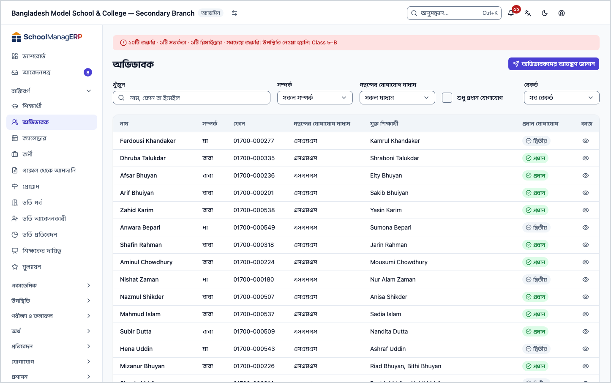
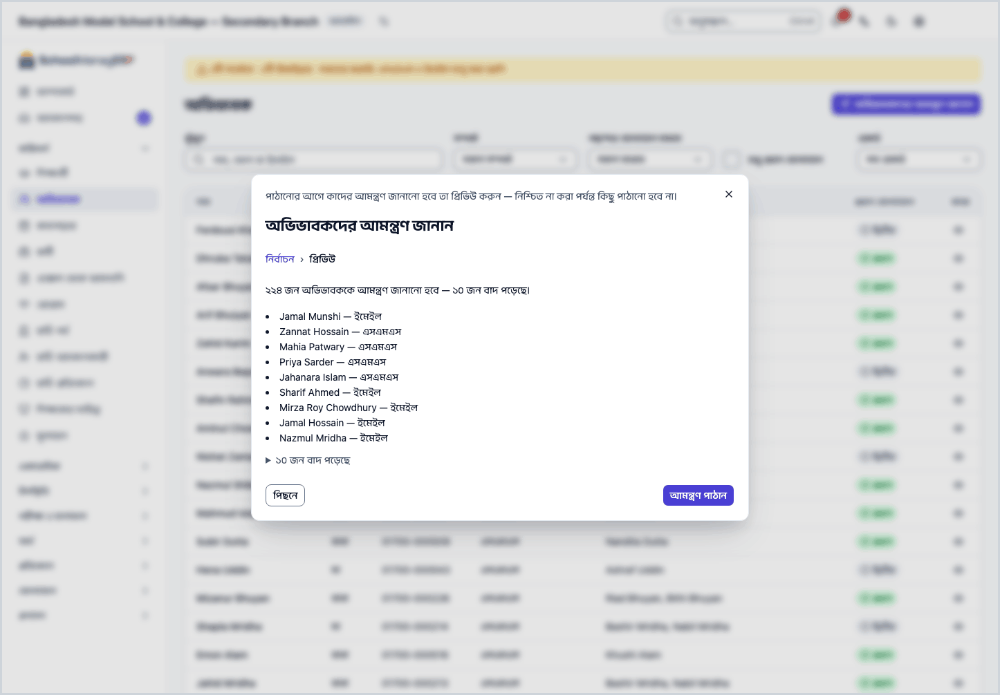
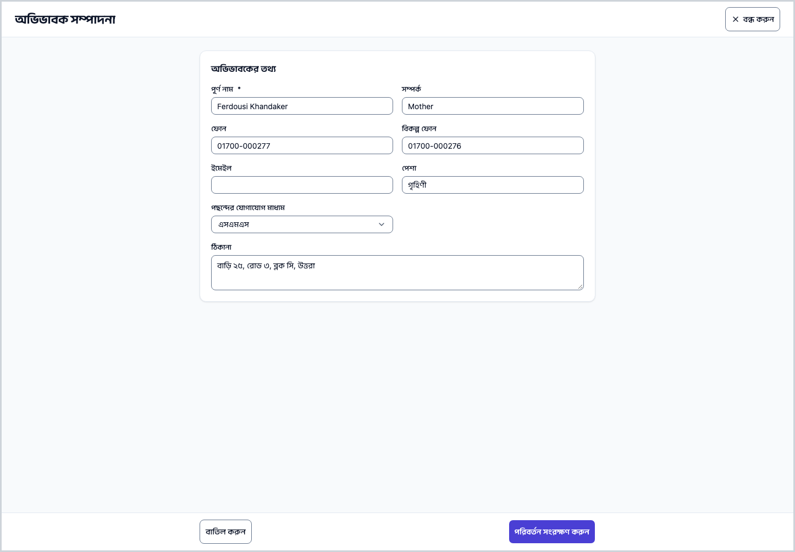

<!-- guide:meta
feature: people.guardians
title: অভিভাবকের তথ্য দেখা, ঠিক করা ও আমন্ত্রণ পাঠানো
summary: অভিভাবকের তালিকা থেকে একজনকে খুঁজে তাঁর যোগাযোগের তথ্য ঠিক করুন, কোন শিক্ষার্থী তাঁর সঙ্গে যুক্ত তা বদলান, আর সবাইকে একসঙ্গে অ্যাপে ঢোকার আমন্ত্রণ পাঠান।
roles: [ADMIN, ACCOUNTANT, TEACHER, OFFICE_STAFF]
sources:
  - client-admin/src/routes/_staff/guardians/index.tsx
  - client-admin/src/routes/_staff/guardians/$guardianId.tsx
  - client-admin/src/routes/_staff/guardians/-edit-guardian-dialog.tsx
  - client-admin/src/routes/_staff/guardians/-invite-guardians-dialog.tsx
  - client-admin/src/routes/_staff/guardians/-student-picker.tsx
  - client-admin/src/routes/_staff/guardians/-relationship-label.ts
  - client-admin/src/routes/_staff/guardians/-detail/information-tab.tsx
  - client-admin/src/routes/_staff/guardians/-detail/linked-students-tab.tsx
  - client-admin/src/routes/_staff/guardians/-detail/communication-tab.tsx
  - client-admin/src/routes/_staff/guardians/-detail/payments-tab.tsx
  - server/src/modules/students/students.controller.ts
  - server/src/modules/students/students.service.ts
  - server/src/modules/account-access/guardian-provisioning.service.ts
labels:
  [
    guardians:list.*,
    guardians:filters.*,
    guardians:preferredCommunicationOptions.*,
    guardians:detail.*,
    guardians:editDialog.*,
    guardians:studentPicker.*,
    guardians:invite.*,
    nav:items.guardians,
    nav:groups.people,
    common:enums.relationship.*,
    common:status.guardian.*,
  ]
helpIds:
  [
    people.guardians,
    people.guardians.action.invite,
    people.guardians.action.editLinkedStudents,
    people.guardians.action.recordPayment,
    people.guardians.field.relationship,
    people.guardians.field.phone,
    people.guardians.field.preferredCommunication,
  ]
devices: [desktop]
entry: [sidebar, palette, dashboard:guardians-incomplete, dashboard:setup-checklist]
keywords:
  [অভিভাবক, বাবা, মা, আমন্ত্রণ, যোগাযোগ, ফোন, অসম্পূর্ণ, প্রধান যোগাযোগ, guardian, parent, invite, contact, incomplete]
appVersion: 0.1.0 (5f7194a2e)
owner: tareq89
lastVerified: 2026-10-24
knownIssues: []
-->

# অভিভাবকের তথ্য দেখা, ঠিক করা ও আমন্ত্রণ পাঠানো

এই পাতায় আপনি অভিভাবকের তথ্য দেখতে ও ঠিক করতে পারবেন, কোন শিক্ষার্থী কোন অভিভাবকের সঙ্গে যুক্ত তা বদলাতে পারবেন, আর অভিভাবকদের অ্যাপে ঢোকার আমন্ত্রণ পাঠাতে পারবেন।

**যেতে হবে:** বাম মেনুতে **ব্যক্তিবর্গ → অভিভাবক**। এই পাতার কাজ কম্পিউটারে করুন।
**শুরুর আগে:** অভিভাবক আগে থেকে তালিকায় থাকতে হবে। নতুন অভিভাবক এখানে যোগ হয় না; শিক্ষার্থী যোগ করার সময় যোগ হয় ([শিক্ষার্থী যোগ করা ও পরিচালনা](students.md))। আমন্ত্রণ পাঠাতে আপনি স্কুলের অ্যাডমিন হবেন ([কে কী করতে পারেন](#roles))।

**অভিভাবক** মানে শিক্ষার্থীর বাবা, মা বা যিনি তার দেখাশোনা করেন। এই পাতায় তাঁদের একটি তালিকা আছে। একজনের নামে চাপলে তাঁর নিজের পাতা খোলে, সেখানে তাঁর তথ্য, তাঁর সন্তানেরা, তাঁকে পাঠানো বার্তা আর তাঁর সন্তানদের পেমেন্ট দেখা যায়। অভিভাবকের **অ্যাকাউন্ট** আলাদা জিনিস: অ্যাকাউন্ট থাকলে তিনি নিজে অ্যাপে ঢুকে সন্তানের হাজিরা, ফি ও বার্তা দেখতে পারেন। আমন্ত্রণ পাঠালেই সেই অ্যাকাউন্ট চালু করার লিংক যায়।

[আমন্ত্রণ পাঠান](#task-main) · [খুঁজুন ও ছাঁকুন](#task-find) · [তথ্য ঠিক করুন](#task-edit) · [শিক্ষার্থী যুক্ত করুন বা সরান](#task-students) · [সমস্যা ও সমাধান](#trouble)

**এই পাতায় যা আছে**

- [এই পাতায় যেভাবে আসবেন](#arrive)
- [অভিভাবকদের আমন্ত্রণ পাঠান](#task-main)
- [আমন্ত্রণ গেছে কি না বুঝবেন কীভাবে](#confirm)
- [অন্য পরিস্থিতিতে](#other)
  - [তালিকায় খুঁজুন ও ছাঁকুন](#task-find)
  - [অসম্পূর্ণ তথ্য ঠিক করুন](#task-incomplete)
  - [অভিভাবকের তথ্য ঠিক করুন](#task-edit)
  - [যুক্ত শিক্ষার্থী বদলান](#task-students)
  - [পেমেন্ট রেকর্ড করুন](#task-payment)
  - [অভিভাবকের পাতা: ট্যাবগুলো](#task-detail)
- [সমস্যা ও সমাধান](#trouble)
- [কে কী করতে পারেন](#roles)
- [আরও জানুন](#more)

---

## এই পাতায় যেভাবে আসবেন 

**বাম মেনু থেকে:** **ব্যক্তিবর্গ → অভিভাবক** চাপুন। নিচের ধাপ ১ থেকে শুরু করুন।

**খোঁজার ঘর থেকে:** উপরের খোঁজার ঘরে (Ctrl+K) **অভিভাবকদের আমন্ত্রণ জানান** লিখে বেছে নিন (শুধু অ্যাডমিন দেখেন)। → অভিভাবক তালিকা খোলে, আর আমন্ত্রণের ঘরটি আগে থেকেই খোলা থাকে। নিচের ধাপ ৩ থেকে শুরু করুন। খোঁজার নিয়ম: [যেকোনো পাতা খুঁজে পাওয়া](../start/find-anything.md)।

**ড্যাশবোর্ডের অভিভাবকের তথ্য অসম্পূর্ণ কার্ড থেকে (অফিস সহকারী):**

1. ড্যাশবোর্ডে **অভিভাবকের তথ্য অসম্পূর্ণ** কার্ডে কতজনের তথ্য বাকি তা দেখুন। কার্ডের মানে: [ড্যাশবোর্ডের কার্ডগুলো](../dashboard/widgets.md)।
2. কার্ডের নিচের লিংকে চাপুন। → অভিভাবক তালিকা খোলে, আর **রেকর্ড** ঘরে **শুধু অসম্পূর্ণ রেকর্ড** আগে থেকে বাছা থাকে। এরপর [অসম্পূর্ণ তথ্য ঠিক করুন](#task-incomplete) দেখুন।

**নতুন স্কুলের সেটআপ তালিকা থেকে (অ্যাডমিন):**

1. ড্যাশবোর্ডের সেটআপ তালিকায় **অভিভাবকদের ডাকুন** বেছে নিন। স্কুল সাজানোর বাকি ধাপ: [স্কুল তৈরি করা ও সেটআপ উইজার্ড](../admin/create-school.md)।
2. → অভিভাবক তালিকা খোলে, আর আমন্ত্রণের ঘরটি আগে থেকেই খোলা থাকে। নিচের ধাপ ৩ থেকে শুরু করুন।

---

## অভিভাবকদের আমন্ত্রণ পাঠান 

শিক্ষার্থী যোগ করার পর অভিভাবকদের অ্যাপে ঢোকার ব্যবস্থা করতে এটি করুন। পাঠানোর আগে একটি প্রিভিউ দেখা যায়, আর **আমন্ত্রণ পাঠান** না চাপা পর্যন্ত কিছুই যায় না।

1. বাম মেনুতে **ব্যক্তিবর্গ → অভিভাবক** চাপুন।

   → উপরে **অভিভাবক** শিরোনাম। নিচে অভিভাবকদের তালিকা: **নাম**, **সম্পর্ক**, **ফোন**, **পছন্দের যোগাযোগ মাধ্যম**, **যুক্ত শিক্ষার্থী**, **প্রধান যোগাযোগ**।

2. পাতার উপরে **অভিভাবকদের আমন্ত্রণ জানান** চাপুন। (বোতামটি শুধু অ্যাডমিন দেখেন।)

   → একটি ঘর খোলে, শিরোনাম **অভিভাবকদের আমন্ত্রণ জানান**। লেখা থাকে: "পাঠানোর আগে কাদের আমন্ত্রণ জানানো হবে তা প্রিভিউ করুন — নিশ্চিত না করা পর্যন্ত কিছু পাঠানো হবে না।" প্রথম ধাপের নাম **নির্বাচন**।

3. ঘরে লেখা দেখুন: **এই স্কুলের সক্রিয় অ্যাকাউন্ট নেই এমন প্রতিটি অভিভাবক প্রিভিউ করা হবে।** তারপর **আমন্ত্রণ প্রিভিউ করুন** চাপুন।

   → ঘর দ্বিতীয় ধাপ **প্রিভিউ**-তে যায়। লেখা আসে "{সংখ্যা} জন অভিভাবককে আমন্ত্রণ জানানো হবে — {সংখ্যা} জন বাদ পড়েছে।" নিচে যাঁদের আমন্ত্রণ যাবে তাঁদের নাম, আর নামের পাশে কোন মাধ্যমে যাবে (ইমেইল বা এসএমএস)। যাঁরা বাদ পড়েছেন, তাঁদের তালিকা "বাদ পড়েছে" লেখাটি চাপলে খোলে, প্রতিজনের পাশে কারণ লেখা।

4. তালিকা দেখে নিন। কেউ বাদ পড়লে কারণ বুঝতে নিচের তালিকা দেখুন: [কেন বাদ পড়েন](#skip-reasons)।

5. ঠিক থাকলে **আমন্ত্রণ পাঠান** চাপুন।

   → পাঠানো শুরু হয়। লেখা আসে "পাঠানো হচ্ছে… {মোট}টির মধ্যে {সংখ্যা}টি এখনো চলমান।" শেষ হলে লেখা বদলে হয় "সম্পন্ন — {সংখ্যা}টি পাঠানো হয়েছে, {সংখ্যা}টি ব্যর্থ, {সংখ্যা}টি বাদ পড়েছে।" তারপর **বন্ধ করুন** চাপুন।

> **মনে রাখুন:** **আমন্ত্রণ পাঠান** চাপার আগে কিছুই যায় না। এই ঘরে আলাদা করে কয়েকজনকে বাছার উপায় নেই: সব যোগ্য অভিভাবক একসঙ্গে প্রিভিউতে আসেন। পাঠানোর পর ঘর বন্ধ করলেও কাজ চলতে থাকে।

**কোন মাধ্যমে আমন্ত্রণ যায়:** অভিভাবকের ইমেইল থাকলে ইমেইলে, না থাকলে ফোনে এসএমএসে। অভিভাবকের **পছন্দের যোগাযোগ মাধ্যম** ঘরটি এখানে কাজে লাগে না; সেটি অন্য বার্তার জন্য।

**যাঁর আগে থেকেই অ্যাকাউন্ট আছে:** একই ইমেইল বা ফোনে আগে থেকে পাসওয়ার্ডসহ অ্যাকাউন্ট থাকলে তাঁকে আমন্ত্রণের বদলে যোগদানের অনুরোধ পাঠানো হয়। প্রিভিউয়ে তিনি আমন্ত্রণ-তালিকায় থাকেন, কিন্তু শেষের "পাঠানো হয়েছে" সংখ্যায় তাঁকে ধরা হয় না।

### কেন বাদ পড়েন 

| প্রিভিউয়ে যা লেখা থাকে                                         | মানে                                             | কী করবেন                                                                  |
| --------------------------------------------------------------- | ------------------------------------------------ | ------------------------------------------------------------------------- |
| **কোনো ফোন বা ইমেইল নেই**                                       | আমন্ত্রণ পাঠানোর ঠিকানা নেই                      | [অভিভাবকের তথ্য ঠিক করুন](#task-edit) দিয়ে ফোন বা ইমেইল দিন              |
| **ইতিমধ্যে সক্রিয় অ্যাকাউন্ট আছে**                             | তিনি আগেই অ্যাপে ঢুকতে পারেন                     | কিছু করতে হবে না                                                          |
| **ইতিমধ্যে একটি মুলতুবি আমন্ত্রণ আছে**                          | আগের আমন্ত্রণের লিংকের মেয়াদ এখনো শেষ হয়নি     | আগেরটির জন্য অপেক্ষা করুন                                                 |
| **ফোন বা ইমেইলটি অন্য একটি অ্যাকাউন্টের, যেটি যাচাই করা হয়নি** | ওই ঠিকানা অন্য কারও অ্যাকাউন্টে আছে, যাচাই হয়নি | ঠিকানাটি ঠিক আছে কি না দেখুন, তারপর [অভিভাবকের তথ্য ঠিক করুন](#task-edit) |
| **বিজ্ঞপ্তি থেকে অপ্ট-আউট করেছেন**                              | অভিভাবক বার্তা নিতে চান না বলে জানিয়েছেন        | তাঁর অনুমতি ছাড়া আমন্ত্রণ যাবে না                                        |

---

## আমন্ত্রণ গেছে কি না বুঝবেন কীভাবে 

আমন্ত্রণ পাঠানোর কাজ ইন্টারনেট ছাড়া হয় না; ফোনে বা কম্পিউটারে জমিয়ে রেখে পরে পাঠানো যায় না। তাই **এই ডিভাইসে সংরক্ষিত** অবস্থা এখানে নেই।

| অবস্থা                       | কীভাবে বুঝবেন                                             | এরপর কী                                                    |
| ---------------------------- | --------------------------------------------------------- | ---------------------------------------------------------- |
| **শুধু স্ক্রিনে বদলেছে**     | প্রিভিউ দেখা যাচ্ছে, কিন্তু **আমন্ত্রণ পাঠান** চাপা হয়নি | **আমন্ত্রণ পাঠান** চাপুন                                   |
| **স্কুলের সিস্টেমে পৌঁছেছে** | "পাঠানো হচ্ছে…" বা "সম্পন্ন — …" লেখা দেখা যায়           | লেখা "সম্পন্ন" হওয়া পর্যন্ত অপেক্ষা করুন, তারপর বন্ধ করুন |

**যাচাই করতে চাইলে:** অভিভাবকের নামে চাপুন, তারপর **যোগাযোগের ইতিহাস** ট্যাব খুলুন। পাঠানো বার্তার সারি সেখানে দেখা যায়: **তারিখ**, **মাধ্যম**, **প্রাপক**, **অবস্থা**। সারিটি আসতে একটু সময় লাগতে পারে।

**ব্যর্থ হলে:** ফল-লেখায় "{সংখ্যা}টি ব্যর্থ" দেখালে সেই অভিভাবকের তথ্য (ইমেইল বা ফোন) ঠিক আছে কি না দেখুন। ঠিক করে আবার প্রিভিউ থেকে পাঠান; যাঁরা আগেই পেয়েছেন তাঁরা "মুলতুবি আমন্ত্রণ" হিসেবে বাদ পড়বেন, তাই দ্বিতীয়বার যাবে না।

---

## অন্য পরিস্থিতিতে 

### তালিকায় খুঁজুন ও ছাঁকুন 

1. অভিভাবক তালিকার উপরের **খুঁজুন** ঘরে নাম, ফোন বা ইমেইল লিখুন।

   → লেখা থামালে একটু পরে তালিকা ছোট হয়। কিছু না মিললে **কোনো অভিভাবক পাওয়া যায়নি** দেখায়, আর নিচে লেখা থাকে "শিক্ষার্থী যোগ করার সময় তার অভিভাবক যোগ করলে এখানে দেখা যাবে।"

2. আরও ছাঁকতে চাইলে ঘরগুলো ব্যবহার করুন:

   | ঘর                         | কী বাছবেন                                                                                     |
   | -------------------------- | --------------------------------------------------------------------------------------------- |
   | **সম্পর্ক**                | একটি সম্পর্ক, যেমন **বাবা**। না বাছলে **সকল সম্পর্ক**                                         |
   | **পছন্দের যোগাযোগ মাধ্যম** | **এসএমএস**, **হোয়াটসঅ্যাপ**, **ইমেইল**, **ফোন কল** বা **মেসেঞ্জার**। না বাছলে **সকল মাধ্যম** |
   | **শুধু প্রধান যোগাযোগ**    | টিক দিলে শুধু যাঁদের **প্রধান** চিহ্ন আছেন তাঁরা দেখায়                                       |
   | **রেকর্ড**                 | **শুধু অসম্পূর্ণ রেকর্ড** বাছলে শুধু অসম্পূর্ণ তথ্যের অভিভাবক। না বাছলে **সব রেকর্ড**         |

3. কলামের নামে (**নাম**) চাপলে নাম অনুযায়ী সাজানো হয়।

> **মনে রাখুন:** ছাঁকনি শুধু দেখার জন্য। এতে কারও তথ্য বদলায় না। **সম্পর্ক** ছাঁকনিতে শুধু বাবা, মা, ভাই, বোন, দাদা/নানা, দাদি/নানি, চাচা/মামা, চাচি/খালা আর অন্যান্য আছে। কেউ সম্পর্কের ঘরে অন্য কিছু লিখে রাখলে সেটি তালিকায় যেমন লেখা তেমনই দেখায়, কিন্তু এই ছাঁকনিতে ধরা পড়ে না।

### অসম্পূর্ণ তথ্য ঠিক করুন 

যে অভিভাবকের নাম বা সম্পর্ক ফাঁকা, অথবা ফোন আর বিকল্প ফোন দুটোই নেই, তাঁর তথ্য অসম্পূর্ণ ধরা হয়। ফোন ছাড়া তাঁকে বার্তা পাঠানো যায় না।

1. **রেকর্ড** ঘর থেকে **শুধু অসম্পূর্ণ রেকর্ড** বাছুন। (ড্যাশবোর্ডের কার্ড থেকে এলে এটি আগে থেকেই বাছা থাকে।)

   → শুধু অসম্পূর্ণ তথ্যের অভিভাবকেরা দেখায়, প্রত্যেকের সারিতে **দেখুন**।

2. একজনের সারিতে **দেখুন** চাপুন, তারপর [অভিভাবকের তথ্য ঠিক করুন](#task-edit)-এর ধাপগুলো করুন।

3. সবাইকে ঠিক করা হলে আবার তালিকা খুলুন। তালিকা ফাঁকা হলে **কোনো অভিভাবক পাওয়া যায়নি** দেখায়।

### অভিভাবকের তথ্য ঠিক করুন 

1. অভিভাবক তালিকায় নামের সারির শেষে **দেখুন** চাপুন।

   → অভিভাবকের পাতা খোলে। উপরে নাম, **প্রধান** বা **দ্বিতীয়** চিহ্ন, আর চারটি তথ্য: সম্পর্ক, ফোন, পছন্দের যোগাযোগ মাধ্যম, যুক্ত শিক্ষার্থী কত জন।

2. পাতার উপরে **সম্পাদনা** চাপুন।

   → **অভিভাবক সম্পাদনা** পাতা খোলে। নিচে আটটি ঘর।

3. যে ঘর বদলাতে চান বদলান: **পূর্ণ নাম**, **সম্পর্ক**, **ফোন**, **ইমেইল**, **বিকল্প ফোন**, **পেশা**, **পছন্দের যোগাযোগ মাধ্যম**, **ঠিকানা**। ফোন নম্বর ইংরেজি অঙ্কে লিখুন।

   → **পূর্ণ নাম** ফাঁকা রেখে এগোলে **পূর্ণ নাম আবশ্যক।** দেখায়। অন্য ঘর ফাঁকা করলে সেই তথ্য মুছে যায়।

4. **পরিবর্তন সংরক্ষণ করুন** চাপুন।

   → পাতা বন্ধ হয়, আর অভিভাবকের পাতায় নতুন তথ্য দেখা যায়।

| আপনি চাপলেন                           | কী হবে                                                                                                                     | জমা হলো? |
| ------------------------------------- | -------------------------------------------------------------------------------------------------------------------------- | -------- |
| **পরিবর্তন সংরক্ষণ করুন**             | নতুন তথ্য সংরক্ষিত হয়, পাতা বন্ধ হয়                                                                                      | হ্যাঁ    |
| **বাতিল করুন** (কিছু বদলানো না থাকলে) | কিছুই বদলায় না, পাতা বন্ধ হয়                                                                                             | না       |
| **বাতিল করুন** (কিছু বদলানো থাকলে)    | **পরিবর্তনগুলো বাদ দেবেন?** ঘর খোলে। **পরিবর্তন বাদ দিন** চাপলে বদল মুছে যায়, **সম্পাদনা চালিয়ে যান** চাপলে পাতায় ফেরেন | না       |

**যে অভিভাবক নিজে সাইন ইন করেন:** তাঁর অ্যাকাউন্ট থাকলে **ফোন** ও **ইমেইল** ঘর বদলানো যায় না; ঘরে শুধু তথ্য দেখায়, আর লেখা থাকে "এই অভিভাবক এই ফোন ও ইমেইল দিয়ে সাইন ইন করেন। অভিভাবক নিজের অ্যাকাউন্ট থেকে এগুলো বদলাবেন, অথবা একজন অ্যাডমিন তাঁর ইউজার সম্পাদনা করবেন।" অ্যাডমিন কর্মীর ফোন বদলাতে চাইলে দেখুন [কর্মী যোগ করা ও পরিচালনা](staff.md)।

> **মনে রাখুন:** **প্রধান** বা **দ্বিতীয়** চিহ্নটি এই পাতা থেকে বদলানো যায় না।

### যুক্ত শিক্ষার্থী বদলান 

একজন অভিভাবকের একাধিক সন্তান থাকতে পারে। কোন শিক্ষার্থী কার সঙ্গে যুক্ত, তা এখানে ঠিক হয়।

1. অভিভাবকের পাতায় **যুক্ত শিক্ষার্থী** ট্যাব খুলুন।

   → **যুক্ত শিক্ষার্থী** শিরোনাম, আর নিচে লেখা "এই অভিভাবক যাদের দেখাশোনা করেন।" তালিকায় প্রতিজনের **নাম**, **শ্রেণি**, **রোল**, **রেজিস্ট্রেশন নম্বর**। কেউ না থাকলে **এখনো কোনো শিক্ষার্থী যুক্ত করা হয়নি।** দেখায়।

2. **যুক্ত শিক্ষার্থী সম্পাদনা করুন** চাপুন।

   → ঐ নামের একটি ঘর খোলে। উপরে এখন যুক্ত শিক্ষার্থীদের তালিকা, প্রত্যেকের পাশে **সরান**। নিচে **শিক্ষার্থী খুঁজুন** ঘর।

3. শিক্ষার্থী যোগ করতে ঘরে নাম বা রেজিস্ট্রেশন নম্বর লিখে ফলাফল থেকে বেছে নিন। কাউকে সরাতে তাঁর পাশের **সরান** চাপুন।

   → কিছু না মিললে **কোনো শিক্ষার্থী পাওয়া যায়নি।** দেখায়।

4. **সংরক্ষণ করুন** চাপুন।

   → ঘর বন্ধ হয়, আর তালিকা নতুন শিক্ষার্থীদের নিয়ে বদলে যায়।

| আপনি চাপলেন      | কী হবে                                                                        | জমা হলো? |
| ---------------- | ----------------------------------------------------------------------------- | -------- |
| **সংরক্ষণ করুন** | তালিকার ঠিক এই শিক্ষার্থীরাই এখন যুক্ত থাকে; যাঁকে সরিয়েছেন তিনি আর থাকেন না | হ্যাঁ    |
| **বাতিল**        | কিছুই বদলায় না                                                               | না       |

> **মনে রাখুন:** **সংরক্ষণ করুন** পুরো তালিকাটি বদলে দেয়, শুধু বদলগুলো নয়। তাই সরানোর আগে দেখে নিন কাকে রাখছেন। শিক্ষার্থীকে সরালে শিক্ষার্থী বা তাঁর অভিভাবকের তথ্য মোছা হয় না; শুধু যুক্ততা যায়।

যুক্ত শিক্ষার্থীর সারিতে **দেখুন** চাপলে সেই শিক্ষার্থীর পাতা খোলে: [শিক্ষার্থী যোগ করা ও পরিচালনা](students.md)।

### পেমেন্ট রেকর্ড করুন 

অভিভাবক টাকা দিলে অভিভাবকের পাতা থেকেই পেমেন্ট রেকর্ড শুরু করা যায়। (বোতামটি শুধু অ্যাডমিন ও হিসাবরক্ষক দেখেন।)

1. অভিভাবকের পাতার উপরে [**পেমেন্ট রেকর্ড করুন**](../finance/record-payment.md) চাপুন।

   → পেমেন্ট রেকর্ডের পাতা খোলে, আর এই অভিভাবকের সন্তানদের নিয়ে সাজানো থাকে। বাকি ধাপ: [পেমেন্ট রেকর্ডের পাতা](../finance/record-payment.md)।

2. রেকর্ড হয়ে গেলে অভিভাবকের পাতায় ফিরে **পেমেন্টের ইতিহাস** ট্যাব খুলুন। নতুন পেমেন্টটি তালিকার উপরে থাকে।

### অভিভাবকের পাতা: ট্যাবগুলো 

অভিভাবকের পাতার উপরে নাম, **প্রধান** বা **দ্বিতীয়** চিহ্ন, আর চারটি তথ্য। নিচে চারটি ট্যাব:

| ট্যাব                | কী আছে                                                                                                                                 |
| -------------------- | -------------------------------------------------------------------------------------------------------------------------------------- |
| **তথ্য**             | **যোগাযোগের তথ্য**: ফোন, বিকল্প ফোন, ইমেইল, পেশা, পছন্দের যোগাযোগ মাধ্যম, ঠিকানা। ফাঁকা ঘরে "—" দেখায়                                 |
| **যুক্ত শিক্ষার্থী** | সন্তানদের তালিকা। এখান থেকেই [যুক্ত শিক্ষার্থী বদলান](#task-students)                                                                  |
| **যোগাযোগের ইতিহাস** | এই অভিভাবককে সরাসরি পাঠানো বার্তা: **তারিখ**, **মাধ্যম**, **প্রাপক**, **অবস্থা**। শুধু দেখার জন্য                                      |
| **পেমেন্টের ইতিহাস** | এই অভিভাবকের যেকোনো সন্তানের পেমেন্ট: **তারিখ**, **শিক্ষার্থী**, **পরিমাণ**, **পদ্ধতি**, **রেফারেন্স**। প্রতি সারিতে **পেমেন্ট দেখুন** |

উপরের **বার্তা** বোতাম (অ্যাডমিন, হিসাবরক্ষক, অফিস সহকারী) এই অভিভাবকের বার্তা নিয়ে [বার্তার তালিকা](../communications/message-log.md#task-scoped) খোলে; সেখানে প্রতিটি বার্তা পুরোটা খুলে দেখা যায়।

ট্যাবের ঠিকানা এই পাতার লিংকে থাকে, তাই কাউকে সরাসরি "যুক্ত শিক্ষার্থী" ট্যাবে পাঠানো যায়।

---

## সমস্যা ও সমাধান 

| আপনি যা দেখছেন                                              | কী করবেন                                                                                                                                                     | কে সাহায্য করতে পারেন             |
| ----------------------------------------------------------- | ------------------------------------------------------------------------------------------------------------------------------------------------------------ | --------------------------------- |
| **অভিভাবকের তথ্য লোড করা যায়নি**                           | ইন্টারনেট দেখে পাতা রিলোড করুন।                                                                                                                              | অ্যাডমিন                          |
| **অভিভাবকের তথ্য লোড করা যায়নি।** (অভিভাবকের পাতায়)       | **আবার চেষ্টা করুন** চাপুন।                                                                                                                                  | অ্যাডমিন                          |
| **এটি দেখার অনুমতি আপনার নেই।**                             | আপনার ভূমিকায় এই তথ্য দেখার অধিকার নেই। যেমন অফিস সহকারী **পেমেন্টের ইতিহাস** ট্যাব দেখতে পান না। ([কে কী করতে পারেন](#roles))                              | অ্যাডমিন                          |
| **এই তথ্য খুঁজে পাওয়া যায়নি**                             | অভিভাবককে মুছে ফেলা হয়ে থাকতে পারে, অথবা লিংকটি ভুল। **ফিরে যান** চাপুন। শিক্ষক হলে যে অভিভাবকের কোনো সন্তান আপনার শাখায় নেই, তাঁর পাতাও এই বার্তা দেখায়। | অ্যাডমিন                          |
| **পূর্ণ নাম আবশ্যক।**                                       | **পূর্ণ নাম** ঘরে নাম লিখুন।                                                                                                                                 | অ্যাডমিন, হিসাবরক্ষক, অফিস সহকারী |
| **অভিভাবকের তথ্য হালনাগাদ করা যায়নি। আবার চেষ্টা করুন।**   | ইন্টারনেট দেখে আবার **পরিবর্তন সংরক্ষণ করুন** চাপুন। ঘরের লেখা থেকে যায়। ফোন বা ইমেইল যে অভিভাবক নিজে সাইন ইনে ব্যবহার করেন, তা বদলাতে চাইলেও এটি আসে।      | অ্যাডমিন                          |
| **যুক্ত শিক্ষার্থী হালনাগাদ করা যায়নি। আবার চেষ্টা করুন।** | ইন্টারনেট দেখে আবার **সংরক্ষণ করুন** চাপুন।                                                                                                                  | অ্যাডমিন                          |
| **আমন্ত্রণ প্রিভিউ করা যায়নি। আবার চেষ্টা করুন।**          | ইন্টারনেট দেখে আবার **আমন্ত্রণ প্রিভিউ করুন** চাপুন।                                                                                                         | অ্যাডমিন                          |
| **আমন্ত্রণ পাঠানো যায়নি। আবার চেষ্টা করুন।**               | ইন্টারনেট দেখে আবার **আমন্ত্রণ পাঠান** চাপুন। যাঁদের আমন্ত্রণ আগেই গেছে, তাঁরা দ্বিতীয়বার পাবেন না।                                                         | অ্যাডমিন                          |
| **কোনো অভিভাবক পাওয়া যায়নি**                              | ছাঁকনি সরিয়ে দিন। তালিকা সত্যিই ফাঁকা হলে আগে [শিক্ষার্থী যোগ করুন](students.md)। শিক্ষক হলে শুধু আপনার শাখার শিক্ষার্থীদের অভিভাবক আসেন।                   | অ্যাডমিন                          |

---

## কে কী করতে পারেন 

| ভূমিকা         | তালিকা ও অভিভাবকের পাতা দেখতে                                                                                                                         | তথ্য ও যুক্ত শিক্ষার্থী বদলাতে | আমন্ত্রণ পাঠাতে | পেমেন্ট রেকর্ড করতে | **পেমেন্টের ইতিহাস** ট্যাব দেখতে   |
| -------------- | ----------------------------------------------------------------------------------------------------------------------------------------------------- | ------------------------------ | --------------- | ------------------- | ---------------------------------- |
| অ্যাডমিন       | হ্যাঁ, সব অভিভাবক                                                                                                                                     | হ্যাঁ                          | হ্যাঁ           | হ্যাঁ               | হ্যাঁ                              |
| হিসাবরক্ষক     | হ্যাঁ, সব অভিভাবক                                                                                                                                     | হ্যাঁ                          | না              | হ্যাঁ               | হ্যাঁ                              |
| অফিস সহকারী    | হ্যাঁ, সব অভিভাবক                                                                                                                                     | হ্যাঁ                          | না              | না                  | না ("এটি দেখার অনুমতি আপনার নেই।") |
| শিক্ষক         | শুধু নিজের শাখার শিক্ষার্থীদের অভিভাবক; অন্যদের পাতা খুললে **এই তথ্য খুঁজে পাওয়া যায়নি** দেখায়। অভিভাবকের পাতায় শুধু নিজের শাখার সন্তানেরা দেখায় | না                             | না              | না                  | হ্যাঁ, শুধু নিজের শাখার সন্তানদের  |
| অন্য সব ভূমিকা | মেনুতে **অভিভাবক** থাকে না                                                                                                                            | না                             | না              | না                  | না                                 |

শিক্ষক বা অফিস সহকারীর ভূমিকায় যে বোতামের অনুমতি নেই, সেটি পাতায় দেখাই যায় না।

---

## আরও জানুন 

<strong>পাতার অংশগুলো</strong> — উপর থেকে নিচে

1. **অভিভাবক** — শিরোনাম।
2. **অভিভাবকদের আমন্ত্রণ জানান** — পাতার উপরের বোতাম (শুধু অ্যাডমিন)।
3. **ছাঁকনির সারি** — **খুঁজুন**, **সম্পর্ক**, **পছন্দের যোগাযোগ মাধ্যম**, **শুধু প্রধান যোগাযোগ**, **রেকর্ড**।
4. **তালিকা** — **নাম**, **সম্পর্ক**, **ফোন**, **পছন্দের যোগাযোগ মাধ্যম**, **যুক্ত শিক্ষার্থী**, **প্রধান যোগাযোগ**; প্রতি সারির শেষে **দেখুন**। **যুক্ত শিক্ষার্থী** ঘরে প্রথম দুজনের নাম, বাকিদের সংখ্যা ("+২ জন")।

<strong>ঘরগুলোর অর্থ</strong>

<!-- guide:generated:fields:guardians -->

| ঘর                     | কী লিখবেন                                                                                                                                                                    | বাধ্যতামূলক? |
| ---------------------- | ---------------------------------------------------------------------------------------------------------------------------------------------------------------------------- | ------------ |
| পূর্ণ নাম              | অভিভাবকের পুরো নাম।                                                                                                                                                          | হ্যাঁ        |
| সম্পর্ক                | শিক্ষার্থীর সঙ্গে সম্পর্ক, যেমন বাবা, মা, চাচা। যা লিখবেন তাই থাকে; তালিকার ছাঁকনিতে শুধু বাবা, মা, ভাই, বোন, দাদা/নানা, দাদি/নানি, চাচা/মামা, চাচি/খালা, অন্যান্য ধরা পড়ে। | না           |
| ফোন                    | ইংরেজি অঙ্কে, যেমন 01712345678। ইমেইল না থাকলে আমন্ত্রণ এই নম্বরে এসএমএসে যায়। অভিভাবক নিজে সাইন ইন করলে এখান থেকে বদলানো যায় না।                                          | না           |
| ইমেইল                  | আমন্ত্রণ আগে এখানে যায়। অভিভাবক নিজে সাইন ইন করলে এখান থেকে বদলানো যায় না।                                                                                                 | না           |
| বিকল্প ফোন             | দ্বিতীয় নম্বর। ফোন না থাকলেও এটি থাকলে তথ্য অসম্পূর্ণ ধরা হয় না।                                                                                                           | না           |
| পেশা                   | অভিভাবকের কাজ। মুক্ত লেখা।                                                                                                                                                   | না           |
| পছন্দের যোগাযোগ মাধ্যম | এসএমএস, হোয়াটসঅ্যাপ, ইমেইল, ফোন কল বা মেসেঞ্জার। না বাছলে এসএমএস থাকে। আমন্ত্রণ পাঠানোর মাধ্যম এটি ঠিক করে না।                                                              | না           |
| ঠিকানা                 | অভিভাবকের ঠিকানা। মুক্ত লেখা।                                                                                                                                                | না           |

<!-- /guide:generated -->

<strong>অভিভাবক কীভাবে কাজ করে</strong> — শিক্ষার্থী থেকে অভিভাবক, তারপর অ্যাকাউন্ট

<figure>
  
  <figcaption><em>শিক্ষার্থী থেকে অভিভাবকের অ্যাকাউন্ট পর্যন্ত</em></figcaption>
</figure>

- অভিভাবক তৈরি হয় শিক্ষার্থীর সঙ্গে। এই পাতায় নতুন অভিভাবক তৈরি হয় না, শুধু যাঁরা আছেন তাঁদের তথ্য ঠিক হয়।
- বার্তা পাঠানোর জন্য অভিভাবকের ফোন লাগে। তাই ফোন না থাকলে তথ্য অসম্পূর্ণ ধরা হয়।
- অ্যাকাউন্ট চালু হলে অভিভাবক নিজের সন্তানের হাজিরা, ফি আর বার্তা অ্যাপে দেখেন। তার আগে তিনি শুধু বার্তা পান।

<strong>পুরো কাজটি একসাথে</strong>

<!-- image pending: আমন্ত্রণ প্রিভিউ থেকে পাঠানো পর্যন্ত GIF, অ্যাডমিন, desktop -->

**সম্পর্কিত পাতা**

- [**শিক্ষার্থী যোগ করা ও তাদের তথ্য দেখা**](students.md) — অভিভাবক যে শিক্ষার্থীদের সাথে যুক্ত, তাদের যোগ ও সম্পাদনা।
- [**ফি রিমাইন্ডার**](../communications/fee-reminders.md) — একজন শিক্ষার্থীর অভিভাবকদের, বা একসাথে সর্বোচ্চ ৫০০ জন শিক্ষার্থীর অভিভাবকদের বকেয়ার কথা মনে করিয়ে দিন.
- [**বার্তা পাঠান**](../communications/send-message.md) — একজন শিক্ষার্থীর একজন অভিভাবককে এসএমএস, হোয়াটসঅ্যাপ বা ইমেইলে নিজের লেখা বার্তা পাঠান.
- [**সারসংক্ষেপ**](../portal/overview.md) — অভিভাবকের প্রথম পাতা।
- [**অ্যাকাউন্ট (অভিভাবক ও শিক্ষার্থী)**](../portal/account.md) — অভিভাবক নিজের অ্যাকাউন্ট যেভাবে সামলান।

---

_সংস্করণ ০.১.০ · শেষ যাচাই ২০২৬-১০-২৪_
