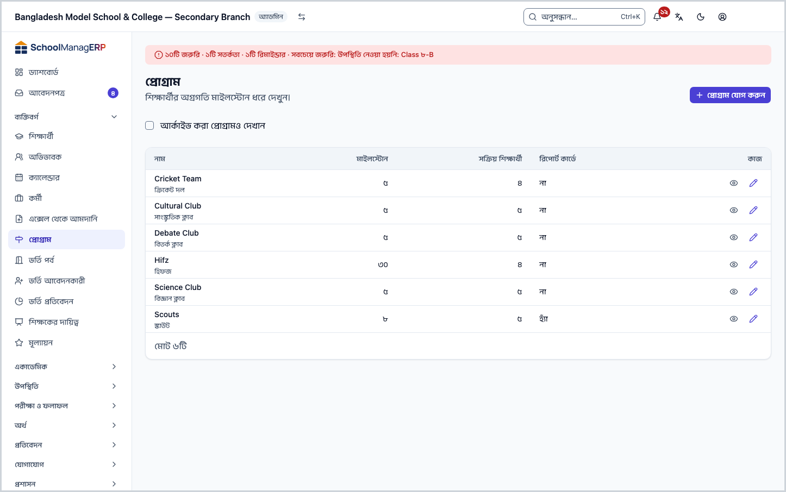
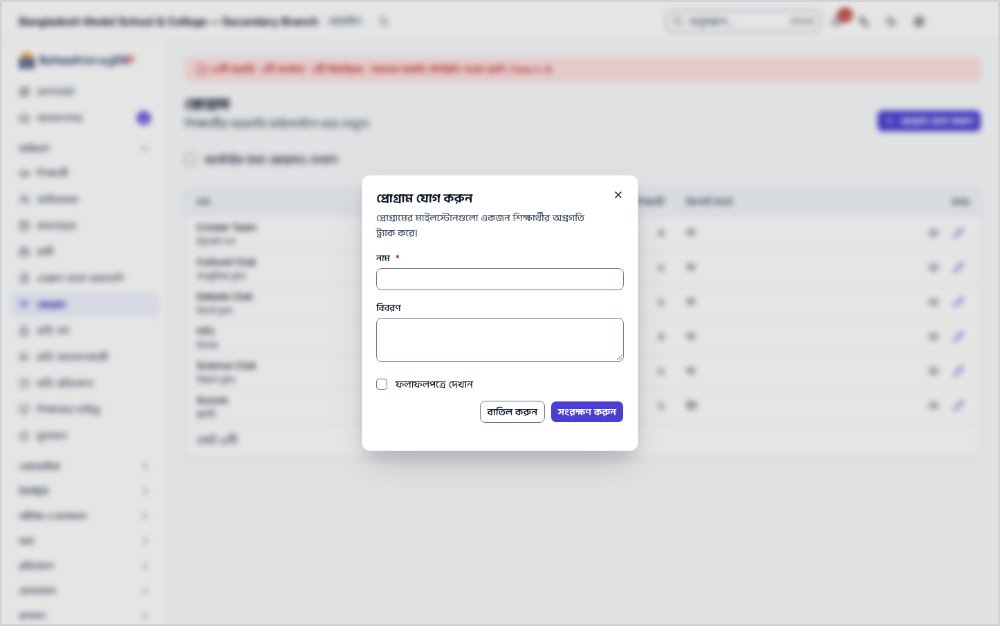
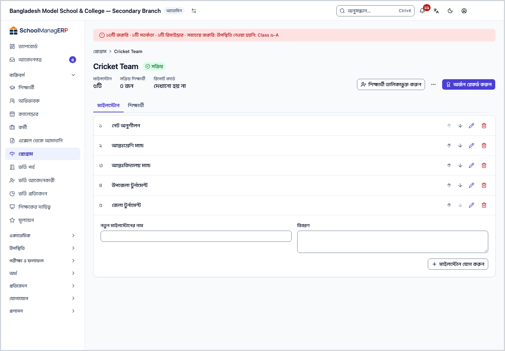
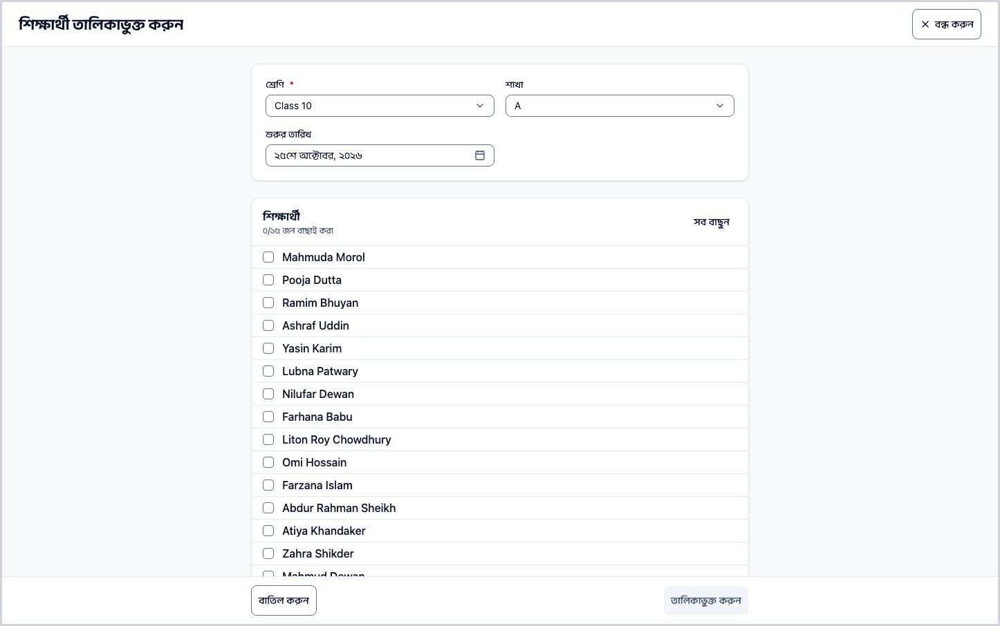
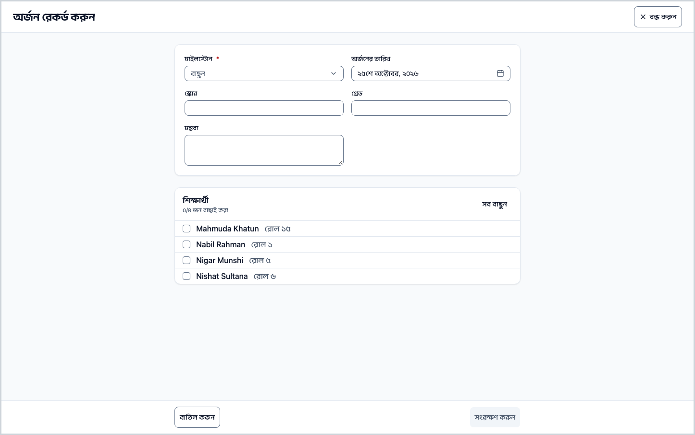

<!-- guide:meta
feature: people.programs
title: প্রোগ্রাম ও মাইলস্টোন
summary: হিফজ, ক্লাব বা কোর্সের মতো প্রোগ্রাম যোগ করুন, মাইলস্টোন ঠিক করুন, শিক্ষার্থী তালিকাভুক্ত করুন আর প্রতিটি অর্জন রেকর্ড করে অগ্রগতি দেখুন।
roles: [ADMIN, TEACHER, EXECUTIVE]
sources:
  - client-admin/src/routes/_staff/programs/index.tsx
  - client-admin/src/routes/_staff/programs/$programId.tsx
  - client-admin/src/routes/_staff/programs/-program-form-dialog.tsx
  - client-admin/src/routes/_staff/programs/-milestone-editor.tsx
  - client-admin/src/routes/_staff/programs/-students-tab.tsx
  - client-admin/src/routes/_staff/programs/-enrol-dialog.tsx
  - client-admin/src/routes/_staff/programs/-record-dialog.tsx
  - server/src/modules/programs/programs.controller.ts
  - server/src/modules/programs/program-enrollments.controller.ts
labels: [programs:*]
helpIds:
  [
    people.programs,
    people.programs.action.enrol,
    people.programs.action.record,
    people.programs.action.delete,
    people.programs.action.removeMilestone,
    people.programs.field.showOnReportCard,
    people.programs.field.score,
  ]
devices: [desktop]
entry: [sidebar, palette]
keywords:
  [প্রোগ্রাম, মাইলস্টোন, হিফজ, ক্লাব, কোর্স, অর্জন, তালিকাভুক্ত, অগ্রগতি, programs, milestone, hifz, enrol, achievement, program, club, track]
appVersion: 0.1.0 (5f7194a2e)
owner: tareq89
lastVerified: 2026-10-24
knownIssues: []
-->

# প্রোগ্রাম ও মাইলস্টোন

নিয়মিত ক্লাসের বাইরের কাজ, যেমন হিফজ, ক্লাব বা কোনো কোর্স, ধাপে ধাপে এগোয়। একটি **প্রোগ্রাম** বানিয়ে তার ধাপগুলোকে **মাইলস্টোন** হিসেবে সাজান, তারপর প্রতিটি শিক্ষার্থীর কোন ধাপ কবে পার হলো তা রেকর্ড করুন।

**যেতে হবে:** বাম মেনুতে **ব্যক্তিবর্গ → প্রোগ্রাম**। এই পাতার কাজ কম্পিউটারে করুন।
**শুরুর আগে:** প্রোগ্রাম বানাতে ও শিক্ষার্থী তালিকাভুক্ত করতে অ্যাডমিন বা পরিচালনা সদস্য হতে হয়। অর্জন রেকর্ড করতে পারেন শিক্ষকও ([কে কী করতে পারেন](#roles))। যাঁদের তালিকাভুক্ত করবেন, তাঁদের আগে [শিক্ষার্থী](students.md) তালিকায় থাকতে হবে।

এক প্রোগ্রামে অনেক মাইলস্টোন থাকে, আর এক মাইলস্টোনে প্রতিজন শিক্ষার্থীর একটি অর্জন রেকর্ড হয়। যে শিক্ষার্থী যত মাইলস্টোন পার করেছেন, তাঁর অগ্রগতি তত বাড়ে (যেমন ৩ / ৫)।

[প্রোগ্রাম যোগ করুন](#task-main) · [শিক্ষার্থী তালিকাভুক্ত করুন](#task-enrol) · [অর্জন রেকর্ড করুন](#task-record) · [সম্পন্ন বা প্রত্যাহার](#task-status) · [সমস্যা ও সমাধান](#trouble)

**এই পাতায় যা আছে**

- [এই পাতায় যেভাবে আসবেন](#arrive)
- [প্রোগ্রাম যোগ করুন](#task-main)
- [প্রোগ্রাম তৈরি হয়েছে কি না বুঝবেন কীভাবে](#confirm)
- [অন্য পরিস্থিতিতে](#other)
  - [শিক্ষার্থী তালিকাভুক্ত করুন](#task-enrol)
  - [অর্জন রেকর্ড করুন](#task-record)
  - [শিক্ষার্থীকে সম্পন্ন বা প্রত্যাহার করুন](#task-status)
  - [মাইলস্টোন বদলান, সাজান বা সরান](#task-milestone)
  - [প্রোগ্রামের নাম বদলান](#task-edit)
  - [প্রোগ্রাম আর্কাইভ করুন বা মুছুন](#task-archive)
- [সমস্যা ও সমাধান](#trouble)
- [কে কী করতে পারেন](#roles)
- [জানা সমস্যা](#known-issues)
- [আরও জানুন](#more)

---

## এই পাতায় যেভাবে আসবেন 

**বাম মেনু থেকে:** **ব্যক্তিবর্গ → প্রোগ্রাম** চাপুন। নিচের ধাপ ১ থেকে শুরু করুন।

**খোঁজার ঘর থেকে:** উপরের খোঁজার ঘরে (Ctrl+K) **প্রোগ্রাম যোগ করুন**, **শিক্ষার্থী তালিকাভুক্ত করুন** বা **অর্জন রেকর্ড করুন** লিখে বেছে নিন। → প্রোগ্রামের তালিকা খোলে, আর সংশ্লিষ্ট ঘরটি নিজে থেকে খোলা থাকে। খোঁজার নিয়ম: [যেকোনো পাতা খুঁজে পাওয়া](../start/find-anything.md)।

**শিক্ষার্থীর পাতা থেকে:** শিক্ষার্থীর পাতার **প্রোগ্রাম** ট্যাবে সেই শিক্ষার্থীর প্রোগ্রামগুলো দেখা যায়। শিক্ষার্থী নিয়ে কাজ: [শিক্ষার্থী](students.md)।

---

## প্রোগ্রাম যোগ করুন 

1. বাম মেনুতে **ব্যক্তিবর্গ → প্রোগ্রাম** চাপুন।

   → উপরে **প্রোগ্রাম** শিরোনাম, তার নিচে "শিক্ষার্থীর অগ্রগতি মাইলস্টোন ধরে দেখুন।" নিচে তালিকা: **নাম**, **মাইলস্টোন**, **সক্রিয় শিক্ষার্থী**, **রিপোর্ট কার্ডে**।

2. পাতার উপরে **প্রোগ্রাম যোগ করুন** চাপুন। (তালিকা ফাঁকা থাকলে একই নামের বোতাম মাঝখানেও থাকে।)

   → একটি ঘর খোলে, শিরোনাম **প্রোগ্রাম যোগ করুন**: "প্রোগ্রামের মাইলস্টোনগুলো একজন শিক্ষার্থীর অগ্রগতি ট্র্যাক করে।"

3. **নাম** ঘরে প্রোগ্রামের নাম লিখুন, যেমন "হিফজ"।

   → ঘরটি বাধ্যতামূলক। ফাঁকা রাখলে **প্রোগ্রামের একটি নাম লিখুন।** দেখায়। নাম সর্বোচ্চ ২০০ অক্ষরের হতে পারে।

4. চাইলে **বিবরণ** ঘরে এক-দুই লাইন লিখুন।

   → বিবরণ তালিকায় নামের নিচে ছোট করে দেখায়।

5. যে প্রোগ্রামের অগ্রগতি ফলাফলপত্রে ছাপাতে চান, সেটির **ফলাফলপত্রে দেখান** ঘরে টিক দিন।

   → টিক না দিলে প্রোগ্রামটি ফলাফলপত্রে আসে না। তালিকায় **রিপোর্ট কার্ডে** কলামে **হ্যাঁ** বা **না** দেখায়।

6. ঘরের নিচে **সংরক্ষণ করুন** চাপুন।

   → ঘরটি বন্ধ হয়, আর নতুন প্রোগ্রাম তালিকায় আসে। এখনও এতে মাইলস্টোন নেই, তাই **মাইলস্টোন** কলামে ০ দেখায়।

7. তালিকায় প্রোগ্রামের নামে চাপুন।

   → প্রোগ্রামের পাতা খোলে। উপরে নাম, অবস্থা (**সক্রিয়**), আর তিনটি তথ্য: **মাইলস্টোন**, **সক্রিয় শিক্ষার্থী**, **রিপোর্ট কার্ডে**। নিচে দুটি ট্যাব: **মাইলস্টোন** আর **শিক্ষার্থী**।

8. **মাইলস্টোন** ট্যাবের নিচের **নতুন মাইলস্টোনের নাম** ঘরে প্রথম ধাপের নাম লিখুন। চাইলে **বিবরণ**ও দিন। তারপর **মাইলস্টোন যোগ করুন** চাপুন।

   → মাইলস্টোন ক্রমিক তালিকায় যোগ হয়। এভাবে একে একে সব ধাপ যোগ করুন। মাইলস্টোন না থাকলে ট্যাবে **অগ্রগতি দেখতে মাইলস্টোন যোগ করুন** লেখা দেখায়, আর শিক্ষার্থীদের অগ্রগতির দণ্ডও আসে না।

> **মনে রাখুন:** **সংরক্ষণ করুন** আর **মাইলস্টোন যোগ করুন** না চাপা পর্যন্ত কিছুই জমা হয় না। প্রোগ্রাম বানালেই কাজ শেষ নয়: এখন [শিক্ষার্থী তালিকাভুক্ত করুন](#task-enrol), তারপর [অর্জন রেকর্ড করুন](#task-record)।

---

## প্রোগ্রাম তৈরি হয়েছে কি না বুঝবেন কীভাবে 

প্রোগ্রামের তথ্য শুধু ইন্টারনেট থাকলে সংরক্ষিত হয়; এই পাতার কাজ ফোনে বা কম্পিউটারে জমিয়ে রেখে পরে পাঠানো যায় না। তাই **এই ডিভাইসে সংরক্ষিত** অবস্থা এখানে নেই। (কোড দেখে যাচাই করা, অ্যাপে চালিয়ে দেখা হয়নি।)

| অবস্থা                       | কীভাবে বুঝবেন                              | এরপর কী                                  |
| ---------------------------- | ------------------------------------------ | ---------------------------------------- |
| **শুধু স্ক্রিনে বদলেছে**     | ঘর খোলা, তথ্য লেখা, কিন্তু ঘর বন্ধ হয়নি   | **সংরক্ষণ করুন** চাপুন                   |
| **স্কুলের সিস্টেমে পৌঁছেছে** | ঘর বন্ধ হয়েছে, আর তালিকায় নতুন নামটি আছে | কাজ শেষ। এবার মাইলস্টোন ও শিক্ষার্থী দিন |

**যাচাই করতে চাইলে:** পাতা রিলোড করুন। প্রোগ্রাম তালিকায় নামটি এলে সিস্টেমে আছে। প্রোগ্রামের পাতায় **মাইলস্টোন** তথ্যে সংখ্যাটি মিলিয়ে দেখুন।

**বার্তা না এলে:** [সমস্যা ও সমাধান](#trouble) দেখুন। ঘরে লেখা তথ্য তখনও ঘরেই থাকে; কিছু হারায় না।

---

## অন্য পরিস্থিতিতে 

### শিক্ষার্থী তালিকাভুক্ত করুন 

শিক্ষার্থী তালিকাভুক্ত না হলে তাঁর অর্জন রেকর্ড করা যায় না। একসঙ্গে একটি শ্রেণি বা শাখার অনেককে তালিকাভুক্ত করা যায়।

1. প্রোগ্রামের পাতার উপরে **শিক্ষার্থী তালিকাভুক্ত করুন** চাপুন। (শিক্ষার্থী ট্যাব ফাঁকা থাকলে একই নামের বোতাম সেখানেও থাকে।)

   → একটি পূর্ণ পাতার ফর্ম খোলে, শিরোনাম **শিক্ষার্থী তালিকাভুক্ত করুন**। প্রোগ্রামের পাতা থেকে খুললে প্রোগ্রামটি আগে থেকে বাছা থাকে। খোঁজার ঘর থেকে খুললে আগে **প্রোগ্রাম** ঘরে প্রোগ্রাম বাছুন।

2. **শ্রেণি** ঘর থেকে শ্রেণি বাছুন।

   → ঘরটি বাধ্যতামূলক। শ্রেণি না বাছা পর্যন্ত নিচে **শিক্ষার্থী দেখতে আগে শ্রেণি বাছুন।** লেখা থাকে।

3. দরকার হলে **শাখা** বাছুন। শুধু একটি শাখার শিক্ষার্থী দেখতে এটি দিন।

   → **শিক্ষার্থী** তালিকায় সেই শ্রেণির (বা শাখার) সবার নাম আসে, আর **{n}/{m} জন বাছাই করা** গণনা দেখায়।

4. **শুরুর তারিখ** ঠিক করুন। আজকের তারিখ আগে থেকেই দেওয়া থাকে।

5. যাঁদের নেবেন তাঁদের নামে টিক দিন। সবাইকে নিতে **সব বাছুন**, উল্টোটা করতে **সব বাদ দিন** চাপুন।

   → **তালিকাভুক্ত করুন** বোতাম তখনই চালু হয় যখন প্রোগ্রাম আর অন্তত একজন শিক্ষার্থী বাছা হয়েছে।

6. **তালিকাভুক্ত করুন** চাপুন।

   → ফর্ম বন্ধ হয়, শিক্ষার্থীরা প্রোগ্রামের **শিক্ষার্থী** ট্যাবে আসেন। কেউ আগেই **সক্রিয়** থাকলে তাঁকে বাদ দেওয়া হয়: তখন ফর্ম খোলা থাকে, "{n} জন শিক্ষার্থী আগেই তালিকাভুক্ত, বাদ দেওয়া হয়েছে।" বার্তা দেখায়, আর বাকিরা তালিকাভুক্ত হন। এরপর **বাতিল করুন** চেপে ফর্ম বন্ধ করুন।

> **মনে রাখুন:** একই শিক্ষার্থী একই প্রোগ্রামে একসঙ্গে একবারই **সক্রিয়** থাকতে পারেন। (সার্ভারের কোড দেখে যাচাই করা।)

### অর্জন রেকর্ড করুন 

একটি মাইলস্টোন একসঙ্গে অনেক শিক্ষার্থীর জন্য রেকর্ড করা যায়।

1. প্রোগ্রামের পাতার উপরে **অর্জন রেকর্ড করুন** চাপুন। কোনো শিক্ষার্থীর সারির বোতাম **{নাম}-এর অর্জন রেকর্ড করুন** চাপলে সেই শিক্ষার্থী আগে থেকে বাছা থাকে।

   → একটি পূর্ণ পাতার ফর্ম খোলে, শিরোনাম **অর্জন রেকর্ড করুন**। খোঁজার ঘর থেকে খুললে আগে **প্রোগ্রাম** ঘরে প্রোগ্রাম বাছুন।

2. **মাইলস্টোন** ঘর থেকে যে ধাপ পার হয়েছে সেটি বাছুন।

   → ঘরটি বাধ্যতামূলক।

3. **শিক্ষার্থী** তালিকায় যাঁরা ধাপটি পার করেছেন, তাঁদের টিক দিন।

   → এখানে শুধু **সক্রিয়** শিক্ষার্থী আসেন। কেউ না থাকলে "এই প্রোগ্রামে কোনো সক্রিয় শিক্ষার্থী নেই।" দেখায়।

4. **অর্জনের তারিখ** ঠিক করুন। আজকের তারিখ আগে থেকে দেওয়া থাকে।

5. চাইলে **স্কোর**, **গ্রেড** ও **মন্তব্য** দিন।

   → স্কোর সংখ্যায় লিখতে হয়, দশমিকের পর সর্বোচ্চ দুই অঙ্ক, আর ৯৯৯৯.৯৯-এর বেশি নয়। বাংলা অঙ্ক চলে। ভুল হলে **নম্বর সংখ্যায় লিখুন।** দেখায়।

6. **সংরক্ষণ করুন** চাপুন।

   → ফর্ম বন্ধ হয়। শিক্ষার্থীর সারির অগ্রগতি দণ্ড বাড়ে (যেমন ২ / ৫ থেকে ৩ / ৫)। একই শিক্ষার্থীর একই মাইলস্টোন আবার রেকর্ড করলে আগের অর্জন নতুন তথ্যে বদলে যায়, দুটি হয় না। (সার্ভারের কোড দেখে যাচাই করা: একসঙ্গে সর্বোচ্চ ৫০০ জন।)

> **মনে রাখুন:** **সংরক্ষণ করুন** না চাপা পর্যন্ত কিছু জমা হয় না। তথ্য লেখার পর **বাতিল করুন** চাপলে সিস্টেম **পরিবর্তনগুলো বাদ দেবেন?** জিজ্ঞেস করে। তখন **সম্পাদনা চালিয়ে যান** চাপলে লেখা থেকে যায়, **পরিবর্তন বাদ দিন** চাপলে মুছে যায়।

### শিক্ষার্থীকে সম্পন্ন বা প্রত্যাহার করুন 

1. প্রোগ্রামের পাতায় **শিক্ষার্থী** ট্যাব খুলুন।

   → তালিকায় প্রতিজনের নাম, রোল, আর (মাইলস্টোন থাকলে) অগ্রগতি দণ্ড। উপরে **অবস্থা** ঘরে **সক্রিয়**, **সম্পন্ন** বা **প্রত্যাহৃত** বেছে সেই অবস্থার শিক্ষার্থীদের দেখতে পারেন।

2. যাঁর অবস্থা বদলাতে চান, তাঁর সারির মেনু থেকে বাছুন:

   | মেনুর লেখা                      | কখন আসে                                | কী হয়                         |
   | ------------------------------- | -------------------------------------- | ------------------------------ |
   | **সম্পন্ন হিসেবে চিহ্নিত করুন** | **সক্রিয়** তালিকায়                   | শিক্ষার্থী **সম্পন্ন** হন      |
   | **প্রত্যাহার করুন**             | **সক্রিয়** তালিকায়                   | শিক্ষার্থী **প্রত্যাহৃত** হন   |
   | **পুনরায় সক্রিয় করুন**        | **সম্পন্ন** বা **প্রত্যাহৃত** তালিকায় | শিক্ষার্থী আবার **সক্রিয়** হন |

   → সব মাইলস্টোন অর্জিত হলে **সম্পন্ন হিসেবে চিহ্নিত করুন**-এর জায়গায় লেখা থাকে **সব মাইলস্টোন অর্জিত হয়েছে — সম্পন্ন হিসেবে চিহ্নিত করবেন?** এই মেনুগুলো শুধু যাঁরা প্রোগ্রাম পরিচালনা করতে পারেন (অ্যাডমিন, পরিচালনা সদস্য), তাঁদের দেখায়।

> **মনে রাখুন:** অবস্থা বদলালে অর্জনের রেকর্ড মোছে না। অর্জন রেকর্ড করার বোতাম শুধু **সক্রিয়** তালিকার সারিতে আছে। (সার্ভারের কোড দেখে যাচাই করা।)

### মাইলস্টোন বদলান, সাজান বা সরান 

প্রোগ্রামের পাতার **মাইলস্টোন** ট্যাবে প্রতিটি মাইলস্টোনের পাশে এই বোতাম আছে (যাঁরা প্রোগ্রাম পরিচালনা করতে পারেন, তাঁদের জন্য):

- **মাইলস্টোন উপরে নিন** ও **মাইলস্টোন নিচে নিন** দিয়ে ক্রম বদলান। প্রথমটির উপরে বা শেষটির নিচে যাওয়া যায় না।
- **মাইলস্টোন সম্পাদনা করুন** দিয়ে নাম ও বিবরণ বদলান।
- **মাইলস্টোন সরান** দিয়ে সরান। তখন **মাইলস্টোন সরাবেন?** জিজ্ঞেস করে। ওই মাইলস্টোনে অর্জন রেকর্ড থাকলে সেখানে লেখা থাকে: "এই মাইলস্টোনে {n}টি অর্জন রেকর্ড করা আছে। এটি সরালে সেই রেকর্ডও মুছে যাবে।"

> **সাবধান:** মাইলস্টোন সরালে তার সব অর্জনের রেকর্ড মুছে যায়, আর ফেরানো যায় না। যদি শুধু নাম ভুল হয়, **মাইলস্টোন সম্পাদনা করুন** চাপুন।

### প্রোগ্রামের নাম বদলান 

1. তালিকায় প্রোগ্রামের সারির শেষে **প্রোগ্রাম সম্পাদনা করুন** চাপুন। প্রোগ্রামের পাতা থেকেও একই নামের বোতাম আছে।

   → ঘরটি খোলে, ভেতরে বর্তমান নাম, বিবরণ ও **ফলাফলপত্রে দেখান**।

2. বদলে **সংরক্ষণ করুন** চাপুন।

   → ঘর বন্ধ হয়। এই নামে আগেই প্রোগ্রাম থাকলে **এই নামে আগেই একটি প্রোগ্রাম আছে** দেখায়।

### প্রোগ্রাম আর্কাইভ করুন বা মুছুন 

প্রোগ্রামের পাতার উপরের বোতাম থেকে:

- **আর্কাইভ করুন** (বা আর্কাইভ থাকলে **আর্কাইভ থেকে ফেরান**): আর্কাইভ করলে প্রোগ্রাম সাধারণ তালিকা থেকে সরে যায়। আবার দেখতে তালিকার উপরের **আর্কাইভ করা প্রোগ্রামও দেখান** ঘরে টিক দিন। তখন **অবস্থা** কলাম আসে, আর আর্কাইভ করা প্রোগ্রামে **আর্কাইভড** চিহ্ন থাকে। কোনো তথ্য মোছে না।
- **মুছে ফেলুন**: তারপর **প্রোগ্রাম মুছবেন?** জিজ্ঞেস করে: "এই প্রোগ্রাম মুছবেন? এটি ফেরানো যাবে না।" এই বোতাম তখনই দেখায় যখন প্রোগ্রামে কোনো সক্রিয় শিক্ষার্থী নেই। আগে কোনো শিক্ষার্থী তালিকাভুক্ত হয়ে থাকলে (সম্পন্ন বা প্রত্যাহৃতও) মোছা যায় না, **এই প্রোগ্রামে শিক্ষার্থী তালিকাভুক্ত আছে — মোছার বদলে আর্কাইভ করুন।** দেখায়। তখন আর্কাইভ করুন। (সার্ভারের কোড দেখে যাচাই করা।)

> **সাবধান:** মুছলে প্রোগ্রাম আর ফেরে না। পরে দরকার হতে পারে মনে হলে আর্কাইভ করুন।

---

## সমস্যা ও সমাধান 

| আপনি যা দেখছেন                                                          | কী করবেন                                                                                           | কে সাহায্য করতে পারেন |
| ----------------------------------------------------------------------- | -------------------------------------------------------------------------------------------------- | --------------------- |
| **এই পাতাটি দেখার অনুমতি আপনার নেই।**                                   | এই পাতা সবার জন্য নয় ([কে কী করতে পারেন](#roles))। **ড্যাশবোর্ডে ফিরে যান** চাপুন।                | অ্যাডমিন              |
| **প্রোগ্রাম লোড করা যায়নি**                                            | ইন্টারনেট দেখে পাতা রিলোড করুন।                                                                    | অ্যাডমিন              |
| **এই প্রোগ্রাম দেখার অনুমতি আপনার নেই**                                 | প্রোগ্রামের পাতায় এটি এলে নিজের ভূমিকা দেখুন; অ্যাডমিনকে জানান।                                   | অ্যাডমিন              |
| **প্রোগ্রামের একটি নাম লিখুন।**                                         | **নাম** ঘরে নাম লিখুন।                                                                             | অ্যাডমিন              |
| **নাম সর্বোচ্চ ২০০ অক্ষরের হতে পারে।**                                  | নাম ছোট করুন।                                                                                      | অ্যাডমিন              |
| **এই নামে আগেই একটি প্রোগ্রাম আছে**                                     | তালিকায় (আর্কাইভ করা প্রোগ্রামসহ) নামটি খুঁজুন। অন্য নাম দিন, অথবা আর্কাইভ থেকে ফেরান।            | অ্যাডমিন              |
| **প্রোগ্রাম সংরক্ষণ করা যায়নি**                                        | ইন্টারনেট দেখে আবার **সংরক্ষণ করুন** চাপুন। ঘরের লেখা থেকে যায়।                                   | অ্যাডমিন              |
| **মাইলস্টোন সংরক্ষণ করা যায়নি। আবার চেষ্টা করুন।**                     | ইন্টারনেট দেখে আবার চাপুন।                                                                         | অ্যাডমিন              |
| **শিক্ষার্থীদের তালিকাভুক্ত করা যায়নি**                                | ইন্টারনেট দেখে আবার চেষ্টা করুন।                                                                   | অ্যাডমিন              |
| **অর্জন রেকর্ড করা যায়নি**                                             | ইন্টারনেট দেখে আবার চেষ্টা করুন।                                                                   | অ্যাডমিন              |
| **নম্বর সংখ্যায় লিখুন।**                                               | **স্কোর** ঘরে শুধু সংখ্যা লিখুন (যেমন ৮৫ বা ৮৫.৫)।                                                 | অ্যাডমিন              |
| **শিক্ষার্থীর অবস্থা বদলানো যায়নি। আবার চেষ্টা করুন।**                 | ইন্টারনেট দেখে আবার চেষ্টা করুন। শিক্ষার্থী ইতিমধ্যে অন্য সারিতে **সক্রিয়** থাকলে সেটি আগে দেখুন। | অ্যাডমিন              |
| **প্রোগ্রামের অবস্থা বদলানো যায়নি। আবার চেষ্টা করুন।**                 | ইন্টারনেট দেখে আবার **আর্কাইভ করুন** চাপুন।                                                        | অ্যাডমিন              |
| **এই প্রোগ্রামে শিক্ষার্থী তালিকাভুক্ত আছে — মোছার বদলে আর্কাইভ করুন।** | **আর্কাইভ করুন** চাপুন।                                                                            | অ্যাডমিন              |
| **প্রোগ্রাম মোছা যায়নি। আবার চেষ্টা করুন।**                            | ইন্টারনেট দেখে আবার চেষ্টা করুন।                                                                   | অ্যাডমিন              |
| তালিকায় প্রোগ্রামটি নেই                                                | সেটি আর্কাইভ করা হতে পারে। **আর্কাইভ করা প্রোগ্রামও দেখান** ঘরে টিক দিন।                           | অ্যাডমিন              |

---

## কে কী করতে পারেন 

| ভূমিকা                       | তালিকা ও পাতা দেখতে                            | প্রোগ্রাম, মাইলস্টোন, তালিকাভুক্তি ও অবস্থা বদলাতে | অর্জন রেকর্ড করতে |
| ---------------------------- | ---------------------------------------------- | -------------------------------------------------- | ----------------- |
| অ্যাডমিন                     | হ্যাঁ                                          | হ্যাঁ                                              | হ্যাঁ             |
| পরিচালনা সদস্য (এক্সিকিউটিভ) | হ্যাঁ                                          | হ্যাঁ                                              | হ্যাঁ             |
| শিক্ষক                       | হ্যাঁ                                          | না                                                 | হ্যাঁ             |
| হিসাবরক্ষক ও অন্য কর্মী      | না                                             | না                                                 | না                |
| অভিভাবক ও শিক্ষার্থী         | স্টাফ পাতা নয়, পোর্টালে নিজের প্রোগ্রাম দেখেন | না                                                 | না                |

শিক্ষকের জন্য কোড দেখে কোনো শ্রেণি-শাখার সীমা পাওয়া যায়নি: শিক্ষক সব প্রোগ্রাম ও সেগুলোর সব সক্রিয় শিক্ষার্থী দেখেন ও তাঁদের অর্জন রেকর্ড করতে পারেন। (অ্যাপে চালিয়ে দেখা হয়নি।)

যাঁদের অনুমতি নেই, তাঁরা পাতাটি খুললে **এই পাতাটি দেখার অনুমতি আপনার নেই।** দেখেন, আর বাম মেনুতেও **প্রোগ্রাম** থাকে না।

---

## জানা সমস্যা 

সংস্করণ ০.১.০-এ কোড দেখে যাচাই করা, ২০২৬-১০-২৪। অ্যাপে চালিয়ে দেখা হয়নি।

এই পাতায় এখন কোনো জানা সমস্যা নেই।

---

## আরও জানুন 

<strong>পাতার অংশগুলো</strong> — উপর থেকে নিচে

1. **প্রোগ্রাম** — শিরোনাম ও তার নিচের ছোট লেখা।
2. **প্রোগ্রাম যোগ করুন** — উপরের বোতাম।
3. **আর্কাইভ করা প্রোগ্রামও দেখান** — ছাঁকনির টিক ঘর।
4. **তালিকা** — **নাম**, **মাইলস্টোন**, **সক্রিয় শিক্ষার্থী**, **রিপোর্ট কার্ডে** (আর্কাইভ দেখালে **অবস্থা**); প্রতি সারির শেষে **দেখুন** ও **প্রোগ্রাম সম্পাদনা করুন**।

প্রোগ্রামের পাতায়: উপরে **নাম**, **অবস্থা**, তিন তথ্য; বোতাম **অর্জন রেকর্ড করুন**, **শিক্ষার্থী তালিকাভুক্ত করুন**, **প্রোগ্রাম সম্পাদনা করুন**, **আর্কাইভ করুন**, **মুছে ফেলুন**; নিচে ট্যাব **মাইলস্টোন** ও **শিক্ষার্থী**।

<strong>ঘরগুলোর অর্থ</strong>

<!-- guide:generated:fields:programs -->

| ঘর                   | কী লিখবেন                                                                   | বাধ্যতামূলক?      |
| -------------------- | --------------------------------------------------------------------------- | ----------------- |
| নাম                  | প্রোগ্রামের নাম, সর্বোচ্চ ২০০ অক্ষর। স্কুলে একই নামে দুটি প্রোগ্রাম হয় না। | হ্যাঁ             |
| বিবরণ                | প্রোগ্রামটি কী, তার এক-দুই লাইন। মাইলস্টোনেও বিবরণ দেওয়া যায়।             | না                |
| ফলাফলপত্রে দেখান     | টিক দিলে প্রোগ্রামের অগ্রগতি ফলাফলপত্রে আসে।                                | না                |
| নতুন মাইলস্টোনের নাম | প্রোগ্রামের একটি ধাপের নাম, যেমন "সুরা বাকারা"।                             | হ্যাঁ             |
| শ্রেণি               | যে শ্রেণির শিক্ষার্থী তালিকাভুক্ত করবেন।                                    | হ্যাঁ             |
| শাখা                 | শ্রেণির একটি শাখা; না দিলে পুরো শ্রেণির শিক্ষার্থী আসে।                     | না                |
| শুরুর তারিখ          | কবে থেকে শিক্ষার্থী প্রোগ্রামে। আগে থেকে আজকের তারিখ দেওয়া।                | না                |
| শিক্ষার্থী           | যাঁদের তালিকাভুক্ত করবেন বা যাঁদের অর্জন রেকর্ড করবেন, তাঁদের টিক।          | হ্যাঁ, অন্তত একজন |
| মাইলস্টোন            | কোন ধাপের অর্জন রেকর্ড হচ্ছে।                                               | হ্যাঁ             |
| অর্জনের তারিখ        | কবে ধাপটি পার হলো। আগে থেকে আজকের তারিখ দেওয়া।                             | না                |
| স্কোর                | সংখ্যায়, দশমিকের পর সর্বোচ্চ দুই অঙ্ক, ৯৯৯৯.৯৯-এর বেশি নয়।                | না                |
| গ্রেড                | যেমন A+ বা "ভালো"। মুক্ত লেখা।                                              | না                |
| মন্তব্য              | শিক্ষকের ছোট মন্তব্য। মুক্ত লেখা।                                           | না                |

<!-- /guide:generated -->

<strong>প্রোগ্রাম কীভাবে কাজ করে</strong> — তৈরি থেকে অগ্রগতি, আর শিক্ষার্থীর অবস্থা

<figure>
  
  <figcaption><em>প্রোগ্রাম তৈরি থেকে অগ্রগতি দেখা</em></figcaption>
</figure>

<figure>
  
  <figcaption><em>শিক্ষার্থীর প্রোগ্রাম-অবস্থা</em></figcaption>
</figure>

- প্রোগ্রামের অগ্রগতি দেখা যায় প্রোগ্রামের **শিক্ষার্থী** ট্যাবে আর শিক্ষার্থীর নিজের পাতার **প্রোগ্রাম** ট্যাবে: [শিক্ষার্থী](students.md)।
- **ফলাফলপত্রে দেখান** টিক থাকা প্রোগ্রাম ফলাফলপত্রে ও পোর্টালে (অভিভাবক ও শিক্ষার্থীর **প্রোগ্রাম** পাতা) আসে। (ফলাফলপত্র ও পোর্টালের কোড এই পাতার ভিতরে যাচাই করা হয়নি।)

<strong>পুরো কাজটি একসাথে</strong>

<!-- image pending: প্রোগ্রাম যোগ থেকে অর্জন রেকর্ড করা পর্যন্ত GIF, অ্যাডমিন, desktop -->

**সম্পর্কিত পাতা**

- [**শিক্ষার্থী**](students.md) — শিক্ষার্থী যোগ করুন, আর তাঁর পাতায় তাঁর প্রোগ্রাম দেখুন।
- [**স্বয়ংক্রিয় বিলের নিয়ম**](../finance/recurring-schedules.md) — প্রতি মাসের বা প্রতি সপ্তাহের নির্দিষ্ট দিনে সক্রিয় শিক্ষার্থীদের ফির বিল নিজে থেকে তৈরি করার নিয়ম দিন.
- [**প্রোগ্রাম (অভিভাবক ও শিক্ষার্থী)**](../portal/programs.md) — অভিভাবক ও শিক্ষার্থী প্রোগ্রাম যেভাবে দেখেন।

---

_সংস্করণ ০.১.০ · শেষ যাচাই ২০২৬-১০-২৪_
