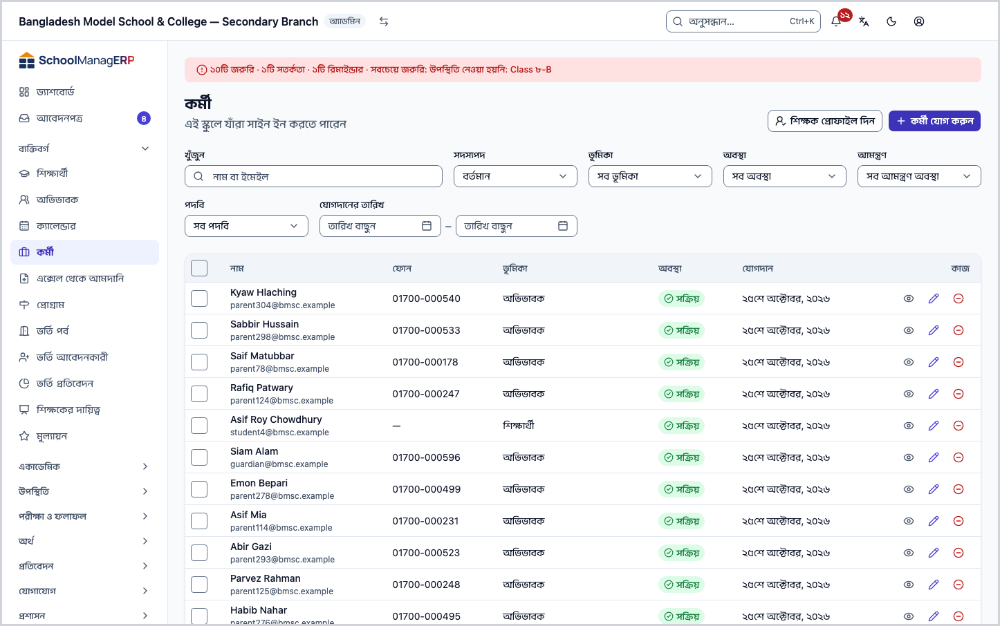
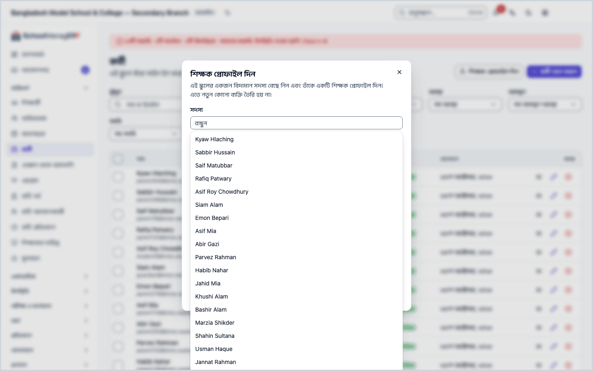
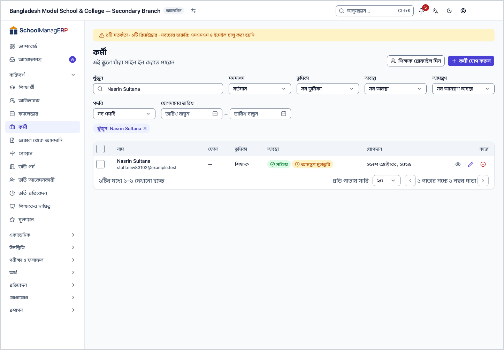

<!-- guide:meta
feature: people.staff
title: কর্মী যোগ করা ও পরিচালনা
summary: স্কুলের কর্মী যোগ করুন, তাঁদের যোগাযোগ বদলান, আমন্ত্রণ পাঠান, শিক্ষক প্রোফাইল দিন, আর কাউকে স্কুল থেকে সরান বা ফিরিয়ে আনুন।
roles: [ADMIN]
sources:
  - client-admin/src/routes/_staff/staff/index.tsx
  - client-admin/src/routes/_staff/staff/$userId.tsx
  - client-admin/src/routes/_staff/staff/-add-user-dialog.tsx
  - client-admin/src/routes/_staff/staff/-edit-user-dialog.tsx
  - client-admin/src/routes/_staff/staff/-promote-teacher-dialog.tsx
  - client-admin/src/routes/_staff/staff/-edit-teacher-dialog.tsx
  - client-admin/src/routes/_staff/staff/-remove-member-dialog.tsx
  - client-admin/src/routes/_staff/staff/-restore-member-dialog.tsx
  - client-admin/src/routes/_staff/staff/-detail/invitation-card.tsx
  - client-admin/src/routes/_staff/staff/-detail/reset-password-dialog.tsx
  - client-admin/src/routes/_staff/staff/-detail/profile-tab.tsx
  - client-admin/src/routes/_staff/staff/-detail/teaching-assignments-tab.tsx
  - server/src/modules/users/users.controller.ts
  - server/src/modules/users/users.service.ts
labels:
  [
    staff:list.*,
    staff:filters.*,
    staff:former.*,
    staff:roles.*,
    staff:roleDescriptions.*,
    staff:addUser.*,
    staff:editUser.*,
    staff:teacherForm.*,
    staff:removeMember.*,
    staff:resetDialog.*,
    staff:detail.*,
    nav:items.staff,
    nav:groups.people,
    common:status.user.*,
    common:status.invitation.*,
    common:accessDenied.*,
    onboardingPeople:heading,
    onboardingPeople:byHand,
  ]
helpIds:
  [
    people.staff,
    people.staff.action.add,
    people.staff.action.remove,
    people.staff.action.resetPassword,
    people.staff.action.promoteTeacher,
    people.staff.field.role,
    people.staff.field.employeeId,
    people.staff.field.designations,
    people.staff.action.edit,
  ]
devices: [desktop]
entry: [sidebar, palette, page:admin.createSchool]
keywords:
  [কর্মী, শিক্ষক, স্টাফ, কর্মী যোগ, আমন্ত্রণ, ভূমিকা, শিক্ষক প্রোফাইল, প্রাক্তন, staff, add staff, invite, remove, restore]
appVersion: 0.1.0 (e81ef857f)
owner: tareq89
lastVerified: 2026-10-24
knownIssues: []
-->

# কর্মী যোগ করা ও পরিচালনা

স্কুলে যাঁরা সাইন ইন করতে পারেন, তাঁদের যোগ করুন, তাঁদের তথ্য বদলান, আর দরকার হলে স্কুল থেকে সরান বা ফিরিয়ে আনুন।

**যেতে হবে:** বাম মেনুতে **ব্যক্তিবর্গ → কর্মী**। এই পাতার কাজ কম্পিউটারে করুন।
**শুরুর আগে:** আপনি স্কুলের অ্যাডমিন হবেন ([কে কী করতে পারেন](#roles))। যাঁকে যোগ করবেন, তাঁর অন্তত একটি ইমেইল বা ফোন নম্বর হাতে রাখুন, কারণ সেখানেই সাইন ইনের আমন্ত্রণ যায়।

এই পাতায় **কর্মী তালিকা** নিয়ে কাজ। তালিকায় শিক্ষক, হিসাবরক্ষক, অফিস সহকারী, অ্যাডমিনসহ স্কুলের সব কর্মী থাকেন। প্রতিজনের একটি **ভূমিকা** থাকে (যেমন শিক্ষক বা হিসাবরক্ষক), আর ভূমিকাই ঠিক করে তিনি অ্যাপে কী কী দেখবেন ও করবেন। এখান থেকে ভূমিকা বদলানো যায় না। ভূমিকা ঠিক করা হয় যোগ করার সময়।

[কর্মী যোগ করুন](#task-main) · [খুঁজুন ও ছাঁকুন](#task-find) · [শিক্ষক প্রোফাইল দিন](#task-teacher) · [স্কুল থেকে সরান](#task-remove) · [সমস্যা ও সমাধান](#trouble)

**এই পাতায় যা আছে**

- [এই পাতায় যেভাবে আসবেন](#arrive)
- [কর্মী যোগ করুন](#task-main)
- [কর্মী যোগ হয়েছে কি না বুঝবেন কীভাবে](#confirm)
- [অন্য পরিস্থিতিতে](#other)
  - [তালিকায় খুঁজুন ও ছাঁকুন](#task-find)
  - [যোগাযোগের তথ্য বদলান](#task-edit)
  - [শিক্ষক প্রোফাইল দিন](#task-teacher)
  - [আমন্ত্রণ আবার পাঠান বা প্রত্যাহার করুন](#task-invite)
  - [পাসওয়ার্ড রিসেট করুন](#task-reset)
  - [স্কুল থেকে সরান](#task-remove)
  - [প্রাক্তন কর্মীকে ফিরিয়ে আনুন](#task-restore)
  - [কর্মীর আইডি কার্ড প্রিন্ট করুন](#task-print)
  - [কর্মীর পাতা: ট্যাবগুলো](#task-detail)
- [সমস্যা ও সমাধান](#trouble)
- [কে কী করতে পারেন](#roles)
- [আরও জানুন](#more)

---

## এই পাতায় যেভাবে আসবেন 

**বাম মেনু থেকে:** **ব্যক্তিবর্গ → কর্মী** চাপুন। নিচের ধাপ ১ থেকে শুরু করুন।

**খোঁজার ঘর থেকে:** উপরের খোঁজার ঘরে (Ctrl+K) **কর্মী যোগ করুন** বা **কর্মীকে শিক্ষক করুন** লিখে বেছে নিন। → কর্মী তালিকা খোলে, আর সংশ্লিষ্ট ঘরটি নিজে থেকে খোলা থাকে (**কর্মী যোগ করুন** বা **শিক্ষক প্রোফাইল দিন**)। খোঁজার নিয়ম: [যেকোনো পাতা খুঁজে পাওয়া](../start/find-anything.md)।

**নতুন স্কুলের সেটআপ উইজার্ড থেকে:**

1. উইজার্ডের **আপনার মানুষদের যোগ করুন** ধাপে **শিক্ষক ও কর্মী** কার্ডের **একজন একজন করে যোগ করুন** চাপুন। উইজার্ডের বাকি ধাপ: [স্কুল তৈরি করা ও সেটআপ উইজার্ড](../admin/create-school.md)।
2. → কর্মী তালিকা খোলে, আর **কর্মী যোগ করুন** ঘরটি আগে থেকেই খোলা থাকে। নিচের ধাপ ৩ থেকে শুরু করুন।

---

## কর্মী যোগ করুন 

1. বাম মেনুতে **ব্যক্তিবর্গ → কর্মী** চাপুন।

   → উপরে **কর্মী** শিরোনাম, তার নিচে "এই স্কুলে যাঁরা সাইন ইন করতে পারেন"। নিচে কর্মীদের তালিকা: **নাম**, **ফোন**, **ভূমিকা**, **অবস্থা**, **যোগদান**।

2. পাতার উপরে **কর্মী যোগ করুন** চাপুন।

   → একটি ঘর খোলে, শিরোনাম **কর্মী যোগ করুন**: "একটি অ্যাকাউন্ট তৈরি করুন এবং এই স্কুলে প্রবেশাধিকার দিন।"

3. **পূর্ণ নাম** ঘরে ব্যক্তির পুরো নাম লিখুন।

   → ঘরটি বাধ্যতামূলক। ফাঁকা রাখলে **ব্যক্তির পূর্ণ নাম লিখুন।** দেখায়।

4. **ইমেইল** বা **ফোন** (দুটোই দিলে ভালো) লিখুন। ফোন নম্বর ইংরেজি অঙ্কে লিখুন, যেমন `01712345678`।

   → আমন্ত্রণ এই ঠিকানায় যাবে। অন্তত একটি দিন; দুটোই খালি থাকলে দেখায় **আমন্ত্রণ পাঠাতে একটি ইমেইল বা ফোন নম্বর লিখুন।** আর কাউকে যোগ করা হয় না।

5. **ভূমিকা** ঘর থেকে **একটি ভূমিকা বেছে নিন** চাপুন, তারপর তালিকা থেকে বেছে নিন।

   → তালিকায় প্রতিটি ভূমিকার নিচে এক লাইনে লেখা থাকে সে কী করতে পারে, যেমন শিক্ষকের জন্য "নিজের শ্রেণি ও শাখা: উপস্থিতি, বাড়ির কাজ আর নম্বর।" ভূমিকা না বেছে এগোলে **একটি ভূমিকা বেছে নিন।** দেখায়।

6. ঘরের নিচে **কর্মী যোগ করুন** চাপুন।

   → ঘরটি বন্ধ হয়, আর নতুন কর্মী তালিকায় দেখা যায়। তাঁর **অবস্থা** ঘরে **সক্রিয়** আর **আমন্ত্রণ মুলতুবি** দুটি চিহ্ন থাকে। এ সময় তাঁর ইমেইলে বা ফোনে অ্যাকাউন্ট চালু করার লিংক চলে যায়। লিংক ৭ দিন চলে।

> **মনে রাখুন:** **কর্মী যোগ করুন** না চাপা পর্যন্ত কিছুই সিস্টেমে যায় না। কর্মী যোগ হলেই কাজ শেষ নয়: শিক্ষক হলে [শিক্ষক প্রোফাইল দিন](#task-teacher), তারপর [শিক্ষকের দায়িত্ব](teaching-assignments.md) পাতায় শাখা দিন; নইলে তিনি কোনো শাখা দেখবেন না।

**যদি আগে থেকেই অ্যাকাউন্ট থাকে:** একই ইমেইল বা ফোনে অন্য স্কুলে বা আগে অ্যাকাউন্ট থাকলে **এই ইমেইল দিয়ে ইতিমধ্যে একজন ব্যবহারকারী আছে।** (ফোনের বেলায় ফোনের ঘরের নিচে) অথবা **এই ব্যক্তির ইতিমধ্যে একটি অ্যাকাউন্ট আছে। বরং তাঁকে যোগদানের অনুরোধ পাঠান।** দেখায়। তখন:

| আপনি চাপলেন                          | কী হবে                                                                                                | জমা হলো?                                          |
| ------------------------------------ | ----------------------------------------------------------------------------------------------------- | ------------------------------------------------- |
| **যোগদানের অনুরোধ পাঠান**            | তাঁর কাছে অনুরোধ যায়। **অনুরোধ পাঠানো হয়েছে। তিনি গ্রহণ করলে যুক্ত হবেন।** বার্তা আসে, ঘর বন্ধ হয়। | হ্যাঁ, অনুরোধ; তিনি গ্রহণ না করা পর্যন্ত কর্মী নন |
| ইমেইল বা ফোন বদলে **কর্মী যোগ করুন** | অন্য ঠিকানা দিয়ে নতুন করে চেষ্টা হয়; আগের বার্তা সরে যায়।                                          | হ্যাঁ, নতুন অ্যাকাউন্ট                            |
| **বাতিল করুন**                       | কিছুই বদলায় না।                                                                                      | না                                                |

অনুরোধ শুধু তখনই কারও কাছে যায়, যখন ওই ইমেইল বা ফোন সেই অ্যাকাউন্টে যাচাই করা আছে। মিল না পেলেও একই বার্তা আসে। তাই বার্তা দেখেই বোঝা যায় না অনুরোধ কারও কাছে পৌঁছাল কি না। ব্যক্তিকে জানিয়ে রাখুন যে তিনি অনুরোধটি গ্রহণ করবেন, আর কিছুদিন পর তালিকায় তাঁকে দেখুন।

যিনি আগে থেকেই আপনার স্কুলের কর্মী, তাঁর বেলায় **এই ব্যক্তি ইতিমধ্যে আপনার কর্মী তালিকায় আছেন।** দেখায়।

---

## কর্মী যোগ হয়েছে কি না বুঝবেন কীভাবে 

কর্মীর তথ্য শুধু ইন্টারনেট থাকলে সংরক্ষিত হয়; এই পাতার কাজ ফোনে বা কম্পিউটারে জমিয়ে রেখে পরে পাঠানো যায় না। তাই **এই ডিভাইসে সংরক্ষিত** অবস্থা এখানে নেই।

| অবস্থা                       | কীভাবে বুঝবেন                              | এরপর কী                                   |
| ---------------------------- | ------------------------------------------ | ----------------------------------------- |
| **শুধু স্ক্রিনে বদলেছে**     | ঘর খোলা, তথ্য লেখা, কিন্তু ঘর বন্ধ হয়নি   | **কর্মী যোগ করুন** চাপুন                  |
| **স্কুলের সিস্টেমে পৌঁছেছে** | ঘর বন্ধ হয়েছে, আর তালিকায় নতুন নামটি আছে | কাজ শেষ। আমন্ত্রণ ৭ দিনের মধ্যে নিতে বলুন |

**যাচাই করতে চাইলে:** পাতা রিলোড করুন, তারপর **খুঁজুন** ঘরে নামটি লিখুন। তালিকায় এলে সিস্টেমে আছে। কর্মীর নামে চাপলে তাঁর পাতায় **আমন্ত্রণ** অবস্থা দেখা যায়।

**বার্তা না এলে:** [সমস্যা ও সমাধান](#trouble) দেখুন। ঘরে লেখা তথ্য তখনও ঘরেই থাকে; কিছু হারায় না।

---

## অন্য পরিস্থিতিতে 

### তালিকায় খুঁজুন ও ছাঁকুন 

1. কর্মী তালিকার উপরের **খুঁজুন** ঘরে নাম বা ইমেইল লিখুন।

   → লেখা থামালে একটু পরে তালিকা ছোট হয়। কিছু না মিললে **কোনো ব্যবহারকারী পাওয়া যায়নি** দেখায়।

2. আরও ছাঁকতে চাইলে ঘরগুলো ব্যবহার করুন:

   | ঘর                 | কী বাছবেন                                                                                                                 |
   | ------------------ | ------------------------------------------------------------------------------------------------------------------------- |
   | **সদস্যপদ**        | **বর্তমান** (সাধারণ) বা **প্রাক্তন** (যাঁদের স্কুল থেকে সরানো হয়েছে)                                                     |
   | **ভূমিকা**         | একটি ভূমিকা, যেমন **শিক্ষক**। না বাছলে **সব ভূমিকা**                                                                      |
   | **অবস্থা**         | **সক্রিয়**, **নিষ্ক্রিয়** বা **স্থগিত**                                                                                 |
   | **আমন্ত্রণ**       | **আমন্ত্রণ মুলতুবি**, **আমন্ত্রণের মেয়াদ শেষ**, **সক্রিয় করা হয়েছে** ইত্যাদি। কে এখনো সাইন ইন করেননি তা এখানে ধরা পড়ে |
   | **পদবি**           | একটি পদবি। না বাছলে **সব পদবি**                                                                                           |
   | **যোগদানের তারিখ** | **যোগদান থেকে** আর **যোগদান পর্যন্ত** দুটি তারিখ                                                                          |

3. কলামের নামে (**নাম**, **যোগদান**, **অবস্থা**) চাপলে সেই অনুযায়ী সাজানো হয়।

> **মনে রাখুন:** ছাঁকনি শুধু দেখার জন্য। এতে কারও তথ্য বদলায় না।

### যোগাযোগের তথ্য বদলান 

1. কর্মী তালিকায় কর্মীর সারির শেষে **সম্পাদনা** চাপুন। (কর্মীর পাতায় গেলে উপরে **সম্পাদনা করুন**।)

   → **ব্যবহারকারী সম্পাদনা করুন** ঘর খোলে। লেখা থাকে, এখানে ভূমিকা বা অবস্থা বদলানো যায় না।

2. **পূর্ণ নাম**, **ইমেইল** বা **ফোন** বদলান। ফোন ফাঁকা করলে ফোন মুছে যায়।

   → ইমেইল ও ফোনের নিচে লেখা থাকে: **এটি পরিবর্তন করলে এটি অযাচাইকৃত হয়ে যাবে।** কর্মীর পাতায় তখন **যাচাই হয়নি** দেখায়।

3. **পরিবর্তন সংরক্ষণ করুন** চাপুন।

   → ঘর বন্ধ হয়। যদি ব্যক্তি অন্য স্কুলেরও সদস্য হন, একটি বার্তা আসে: **এই ব্যক্তি অন্য একটি স্কুলেরও সদস্য। নতুন যোগাযোগ অনুমোদনের জন্য আমরা তাঁকে একটি লিংক পাঠিয়েছি; তিনি অনুমোদন করলেই কেবল এটি পরিবর্তন হবে।** তখন পুরোনো ঠিকানাই থাকে, যতক্ষণ না তিনি অনুমোদন দেন।

যে কর্মীর ইমেইল আছে, তাঁর ইমেইল ঘর খালি করা যায় না: **ইমেইল খালি রাখা যাবে না।** দেখায়।

### শিক্ষক প্রোফাইল দিন 

**ভূমিকা শিক্ষক** বেছে কর্মী যোগ করলেও আলাদা **শিক্ষক প্রোফাইল** নিজে থেকে তৈরি হয় না। প্রোফাইল ছাড়া তাঁকে [শিক্ষকের দায়িত্ব](teaching-assignments.md) পাতায় শাখা দেওয়া যায় না। (এক্সেল থেকে [আমদানি](staff-import.md) করলে শিক্ষকের প্রোফাইল নিজে থেকে তৈরি হয়।) প্রোফাইল দিলে নতুন কোনো ব্যক্তি তৈরি হয় না, আর তাঁর ভূমিকা বদলায় না।

1. কর্মী তালিকার উপরে **শিক্ষক প্রোফাইল দিন** চাপুন।

   → **শিক্ষক প্রোফাইল দিন** ঘর খোলে।

2. **সদস্য** ঘর থেকে কর্মীকে বেছে নিন।

   → যাঁদের প্রোফাইল আগেই আছে, তাঁরা তালিকায় আসেন না। কাউকে না পেলে লেখা দেখায় **শিক্ষক প্রোফাইল নেই এমন কোনো সদস্য মেলেনি**।

3. **কর্মী আইডি** লিখুন। এটি স্কুলে একজনের একটি, অন্যজনের সঙ্গে মিলবে না।

4. দরকার হলে **পদবি** (যেমন **সহকারী শিক্ষক**), **বিষয়ের বিশেষত্ব**, **যোগদানের তারিখ** দিন। এগুলো না দিলেও চলে।

5. **শিক্ষক প্রোফাইল দিন** চাপুন।

   → ঘর বন্ধ হয়। কর্মীর পাতায় **শিক্ষক প্রোফাইল** কার্ড আর **শিক্ষকের দায়িত্ব** ট্যাব দেখা যায়।

> **মনে রাখুন:** অ্যাডমিন, হিসাবরক্ষক বা একাডেমিক কো-অর্ডিনেটরের আগে থেকেই কর্মী আইডি থাকে। তাঁদের প্রোফাইল দিলে সেই আইডিই থেকে যায়, আপনার লেখা আইডি বসে না।

প্রোফাইলের তথ্য পরে বদলাতে কর্মীর পাতার **প্রোফাইল** ট্যাবে **শিক্ষক প্রোফাইল** কার্ডের **সম্পাদনা** চাপুন। খোলা ঘরের শিরোনাম **শিক্ষক প্রোফাইল সম্পাদনা করুন**; বদলে **পরিবর্তন সংরক্ষণ করুন** চাপুন।

### আমন্ত্রণ আবার পাঠান বা প্রত্যাহার করুন 

যতক্ষণ কেউ অ্যাকাউন্ট চালু না করেন, তাঁর পাতার উপরে আমন্ত্রণের একটি কার্ড থাকে।

1. কর্মীর নামে চাপুন। **প্রোফাইল** ট্যাবের উপরে কার্ড দেখুন।

   → কার্ডের শিরোনাম তাঁর অবস্থা: **আমন্ত্রণ মুলতুবি**, **আমন্ত্রণের মেয়াদ শেষ** বা **আমন্ত্রণ প্রত্যাহার করা হয়েছে**, নিচে বুঝিয়ে লেখা। অ্যাকাউন্ট চালু হয়ে গেলে কার্ডটি আর থাকে না।

2. নতুন লিংক পাঠাতে **আমন্ত্রণ আবার পাঠান** চাপুন।

   → **{নাম}-কে আমন্ত্রণ পুনরায় পাঠানো হয়েছে।** দেখায়। আগের লিংক আর কাজ করে না।

3. লিংকটি বন্ধ করতে **আমন্ত্রণ প্রত্যাহার** চাপুন (শুধু **আমন্ত্রণ মুলতুবি** বা **আমন্ত্রণের মেয়াদ শেষ** অবস্থায় বোতামটি থাকে)।

   → **এই আমন্ত্রণ প্রত্যাহার করবেন?** ঘর খোলে।

| আপনি চাপলেন             | কী হবে                                                                                                                                   | জমা হলো? |
| ----------------------- | ---------------------------------------------------------------------------------------------------------------------------------------- | -------- |
| **আমন্ত্রণ প্রত্যাহার** | বর্তমান লিংক কাজ করা বন্ধ হয়। **{নাম}-এর আমন্ত্রণ প্রত্যাহার করা হয়েছে।** দেখায়। নতুন লিংক ছাড়া তিনি অ্যাকাউন্ট চালু করতে পারবেন না। | হ্যাঁ    |
| **বাতিল করুন**          | কিছুই বদলায় না।                                                                                                                         | না       |

### পাসওয়ার্ড রিসেট করুন 

কেউ পাসওয়ার্ড ভুলে গেলে বা অ্যাকাউন্ট নিয়ে সন্দেহ হলে এটি করুন। নিজের পাসওয়ার্ড এখান থেকে রিসেট করা যায় না; সে বোতামটি নিজের পাতায় দেখায় না।

1. কর্মীর পাতার উপরে **পাসওয়ার্ড রিসেট করুন** চাপুন।

   → **পাসওয়ার্ড রিসেট করবেন?** ঘর খোলে। লেখা থাকে: তিনি একটি নতুন সাইন-ইন কোড পাবেন, আর এখন যেসব ডিভাইসে সাইন ইন করা আছে সেগুলো থেকে সাইন আউট হয়ে যাবেন। তাঁর ফোন থাকলে **তার ফোনে একটি কোড এসএমএস করা হবে।**; ফোন না থাকলে **তার ইমেইলে একটি রিসেট লিংক পাঠানো হবে।**

2. ঘরের **পাসওয়ার্ড রিসেট করুন** চাপুন।

   → ঘর বন্ধ হয়, আর **{নাম}-কে পাসওয়ার্ড রিসেট পাঠানো হয়েছে।** বার্তা আসে।

| আপনি চাপলেন               | কী হবে                                            | জমা হলো? |
| ------------------------- | ------------------------------------------------- | -------- |
| **পাসওয়ার্ড রিসেট করুন** | কোড বা লিংক যায়; তিনি সব ডিভাইস থেকে সাইন আউট হন | হ্যাঁ    |
| **বাতিল করুন**            | কিছুই বদলায় না                                   | না       |

ফোন বা ইমেইল কিছুই না থাকলে ঘরে **এই ব্যবহারকারীর কোনো ফোন বা ইমেইল নেই — রিসেট পাঠানো যাবে না।** দেখায়, আর বোতাম বন্ধ থাকে। আগে [যোগাযোগের তথ্য বদলান](#task-edit)।

### স্কুল থেকে সরান 

কেউ স্কুল ছেড়ে গেলে তাঁকে সরান। এতে তাঁর অ্যাকাউন্ট মুছে যায় না; শুধু এই স্কুলে ঢোকার অধিকার যায়।

1. কর্মী তালিকায় কর্মীর সারির শেষে **স্কুল থেকে সরান** চাপুন। (কর্মীর পাতায় উপরেও একই নামের বোতাম আছে।)

   → **এই স্কুল থেকে সরান** ঘর খোলে। লেখা থাকে: তিনি এই স্কুলে প্রবেশাধিকার হারাবেন; তাঁর অ্যাকাউন্ট ও ইতিহাস থেকে যাবে; অন্য স্কুলের সদস্যপদে কোনো প্রভাব পড়বে না; পরে **প্রাক্তন** ফিল্টার থেকে ফিরিয়ে আনা যাবে।

2. **প্রবেশাধিকার সরান** চাপুন।

   → ঘর বন্ধ হয়, আর কর্মী **বর্তমান** তালিকা থেকে সরে যান। কর্মীর পাতা থেকে সরালে আপনি কর্মী তালিকায় ফিরে যান।

| আপনি চাপলেন           | কী হবে                                                                                  | জমা হলো? |
| --------------------- | --------------------------------------------------------------------------------------- | -------- |
| **প্রবেশাধিকার সরান** | কর্মী এই স্কুলে ঢোকার অধিকার হারান; অ্যাকাউন্ট ও ইতিহাস থাকে; **প্রাক্তন** তালিকায় যান | হ্যাঁ    |
| **বাতিল করুন**        | কিছুই বদলায় না                                                                         | না       |

> **মনে রাখুন:** সরালে তাঁর শিক্ষক প্রোফাইল মোছা হয় না; শুধু এই স্কুলে প্রবেশাধিকার যায়। শিক্ষকের জায়গায় অন্যজনকে দায়িত্ব দিতে [শিক্ষকের দায়িত্ব](teaching-assignments.md) পাতা দেখুন।

নিজেকে সরানো যায় না: **আপনি নিজের অ্যাকাউন্ট এই স্কুল থেকে সরাতে পারবেন না।** দেখায়, আর বোতাম বন্ধ থাকে। স্কুলের একমাত্র অ্যাডমিনকেও সরানো যায় না: **এই স্কুলে আপনিই একমাত্র অ্যাডমিন। আগে অন্য কাউকে অ্যাডমিন করুন।**

### প্রাক্তন কর্মীকে ফিরিয়ে আনুন 

1. কর্মী তালিকার **সদস্যপদ** ঘর থেকে **প্রাক্তন** বেছে নিন।

   → তালিকায় শুধু যাঁদের সরানো হয়েছে। **অবস্থা** ঘরে লেখা থাকে **{তারিখ} তারিখে ছেড়েছেন**। কেউ না থাকলে **কোনো প্রাক্তন কর্মী নেই**।

2. সারির শেষে **ফিরিয়ে আনুন** চাপুন।

   → **ফিরিয়ে আনুন** ঘর খোলে: "{নাম}-কে কি এই স্কুলে ফিরিয়ে আনবেন? তিনি আবার প্রবেশাধিকার পাবেন।"

3. ঘরের **ফিরিয়ে আনুন** চাপুন।

   → **{নাম} ফিরে এসেছেন।** বার্তা আসে, আর তিনি প্রাক্তন তালিকা থেকে সরে যান।

| আপনি চাপলেন      | কী হবে                                             | জমা হলো? |
| ---------------- | -------------------------------------------------- | -------- |
| **ফিরিয়ে আনুন** | তিনি আবার প্রবেশাধিকার পান; বর্তমান তালিকায় ফেরেন | হ্যাঁ    |
| **বাতিল করুন**   | কিছুই বদলায় না                                    | না       |

### কর্মীর আইডি কার্ড প্রিন্ট করুন 

1. কর্মী তালিকায় (**বর্তমান** দেখার সময়) প্রতিটি সারির পাশের টিক-ঘরে টিক দিয়ে কর্মীদের বেছে নিন। সবাইকে একবারে বাছতে সারির শিরোনামের টিক-ঘর ব্যবহার করুন (**এই পাতার সব সারি নির্বাচন করুন**)।

   → **আইডি কার্ড প্রিন্ট (২)** এর মতো বোতাম আসে; ভেতরের সংখ্যা বাছা কর্মীর সংখ্যা। বাছা বাদ দিতে **নির্বাচন বাতিল** চাপুন।

2. **আইডি কার্ড প্রিন্ট (সংখ্যা)** চাপুন।

   → প্রিন্টের প্রিভিউ পাতা খোলে। বাকি ধাপ: [কর্মীর আইডি কার্ড](../administration/print-templates/id-cards.md)।

### কর্মীর পাতা: ট্যাবগুলো 

তালিকায় কর্মীর নামে বা **দেখুন**-এ চাপলে তাঁর পাতা খোলে। উপরে নাম, অবস্থা, ভূমিকা, এই স্কুলে যোগদানের তারিখ ও সর্বশেষ সাইন ইন (না করলে **এখনও করেননি**)। নিচে ট্যাব:

| ট্যাব                                 | কী আছে                                                                                                                      |
| ------------------------------------- | --------------------------------------------------------------------------------------------------------------------------- |
| **প্রোফাইল**                          | যোগাযোগ (ইমেইল, ফোন, যাচাই হয়েছে কি না), অ্যাকাউন্ট তৈরির তারিখ, শিক্ষক হলে **শিক্ষক প্রোফাইল** কার্ড, আর আমন্ত্রণের কার্ড |
| **অনুমতি**                            | তাঁর ভূমিকায় কী কী করা যায়, গোষ্ঠী ধরে। শুধু দেখার জন্য; ব্যক্তি ধরে বদলানো যায় না                                       |
| **শিক্ষকের দায়িত্ব**                 | শুধু শিক্ষক প্রোফাইল থাকলে। কোন শ্রেণি-শাখায় কোন দায়িত্ব, আর **শিক্ষক দায়িত্ব দিন** / **দায়িত্ব থেকে সরান**             |
| **এইচআর রেকর্ড**                      | কর্মীর ব্যক্তিগত ও চাকরির তথ্য                                                                                              |
| **এসিআর**, **ঘটনা**, **পারফরম্যান্স** | কর্মী মূল্যায়ন                                                                                                             |
| **ডকুমেন্ট**                          | কর্মীর ছবি, আইডি কার্ড প্রিন্ট ও আগের প্রিন্টের তালিকা                                                                      |
| **উপস্থিতি ও ছুটি**                   | কর্মীর হাজিরা ও ছুটির হিসাব                                                                                                 |
| **আবেদন**                             | কর্মীর নামে জমা পড়া আবেদন                                                                                                  |
| **লগইন ইতিহাস**                       | কখন, কোন আইপি ও ডিভাইস থেকে সাইন ইন হয়েছে                                                                                  |

কোন ট্যাব দেখা যাবে, তা আপনার অনুমতির ওপর নির্ভর করে। সব শিক্ষকের দায়িত্ব এক জায়গায় দেখতে ও বদলাতে [শিক্ষকের দায়িত্ব](teaching-assignments.md) পাতা দেখুন।

---

## সমস্যা ও সমাধান 

| আপনি যা দেখছেন                                                                                                           | কী করবেন                                                                                                                                | কে সাহায্য করতে পারেন |
| ------------------------------------------------------------------------------------------------------------------------ | --------------------------------------------------------------------------------------------------------------------------------------- | --------------------- |
| **এই পাতাটি দেখার অনুমতি আপনার নেই।**                                                                                    | কর্মী পাতা শুধু অ্যাডমিন দেখেন। **ড্যাশবোর্ডে ফিরে যান** চাপুন।                                                                         | অ্যাডমিন              |
| **ব্যবহারকারী লোড করা যায়নি। আবার চেষ্টা করুন।**                                                                        | ইন্টারনেট দেখে পাতা রিলোড করুন।                                                                                                         | অ্যাডমিন              |
| **ব্যবহারকারী যোগ করা যায়নি। আবার চেষ্টা করুন।**                                                                        | ইন্টারনেট দেখুন। নামটি ইতিমধ্যে তালিকায় এসেছে কি না দেখে নিন; এসে থাকলে আবার যোগ করবেন না।                                             | অ্যাডমিন              |
| **এই ইমেইল দিয়ে ইতিমধ্যে একজন ব্যবহারকারী আছে।**                                                                        | ইমেইলের বানান দেখুন। ঠিক থাকলে ব্যক্তির আগে থেকেই অ্যাকাউন্ট আছে; যোগদানের অনুরোধ পাঠান।                                                | অ্যাডমিন              |
| **এই ব্যক্তি ইতিমধ্যে আপনার কর্মী তালিকায় আছেন।**                                                                       | তালিকায় **খুঁজুন** দিয়ে নামটি দেখুন। আর যোগ করতে হবে না।                                                                              | অ্যাডমিন              |
| **আমন্ত্রণ পাঠাতে একটি ইমেইল বা ফোন নম্বর লিখুন।**                                                                       | **ইমেইল** বা **ফোন** লিখে আবার **কর্মী যোগ করুন** চাপুন।                                                                                | অ্যাডমিন              |
| **একটি ভূমিকা বেছে নিন।**                                                                                                | **ভূমিকা** ঘর থেকে একটি বেছে নিন।                                                                                                       | অ্যাডমিন              |
| **পরিবর্তন সংরক্ষণ করা যায়নি। আবার চেষ্টা করুন।**                                                                       | ইন্টারনেট দেখে আবার **পরিবর্তন সংরক্ষণ করুন** চাপুন। ঘরের লেখা থেকে যায়।                                                               | অ্যাডমিন              |
| **এই স্কুলে এই কর্মী আইডি ইতিমধ্যে ব্যবহৃত হচ্ছে।**                                                                      | অন্য একটি **কর্মী আইডি** লিখুন।                                                                                                         | অ্যাডমিন              |
| **এই ব্যক্তির ইতিমধ্যে একটি শিক্ষক প্রোফাইল রয়েছে।**                                                                    | নতুন করে দিতে হবে না। কর্মীর পাতার **শিক্ষক প্রোফাইল** কার্ডে **সম্পাদনা** চাপুন।                                                       | অ্যাডমিন              |
| **এই ব্যক্তি তার কর্মী আইডি রাখবেন, কিন্তু অন্য একজন শিক্ষক সেই আইডি ব্যবহার করছেন। আগে সেই শিক্ষকের কর্মী আইডি বদলান।** | যে শিক্ষক আইডিটি ব্যবহার করছেন, তাঁর পাতার **শিক্ষক প্রোফাইল** কার্ডে **সম্পাদনা** চাপুন, **কর্মী আইডি** বদলান, তারপর আবার চেষ্টা করুন। | অ্যাডমিন              |
| **এই ব্যক্তি এই স্কুলের সদস্য নন।**                                                                                      | তালিকা রিলোড করুন। তিনি সরানো হয়ে থাকলে আগে [ফিরিয়ে আনুন](#task-restore)।                                                             | অ্যাডমিন              |
| **এই সদস্যকে সরানো যায়নি। আবার চেষ্টা করুন।**                                                                           | ইন্টারনেট দেখে আবার **প্রবেশাধিকার সরান** চাপুন।                                                                                        | অ্যাডমিন              |
| **এঁকে ফিরিয়ে আনা যায়নি। আবার চেষ্টা করুন।**                                                                           | ইন্টারনেট দেখে আবার **ফিরিয়ে আনুন** চাপুন।                                                                                             | অ্যাডমিন              |
| **আমন্ত্রণ পুনরায় পাঠানো যায়নি। আবার চেষ্টা করুন।**                                                                    | তাঁর ইমেইল বা ফোন আছে কি না দেখুন ([যোগাযোগের তথ্য বদলান](#task-edit)), তারপর আবার **আমন্ত্রণ আবার পাঠান**।                             | অ্যাডমিন              |
| **এই পাসওয়ার্ড রিসেট করা যায়নি। আবার চেষ্টা করুন।**                                                                    | ইন্টারনেট দেখে আবার **পাসওয়ার্ড রিসেট করুন** চাপুন।                                                                                    | অ্যাডমিন              |
| তালিকায় কর্মীটি নেই                                                                                                     | **সদস্যপদ** দেখুন: তিনি **প্রাক্তন** হতে পারেন। আর অন্য ছাঁকনি চালু থাকলে সরিয়ে দিন।                                                   | অ্যাডমিন              |

---

## কে কী করতে পারেন 

| ভূমিকা                                                                                           | তালিকা ও কর্মীর পাতা দেখতে | কর্মী যোগ, সম্পাদনা, রিসেট, শিক্ষক প্রোফাইল | স্কুল থেকে সরাতে ও ফিরিয়ে আনতে          |
| ------------------------------------------------------------------------------------------------ | -------------------------- | ------------------------------------------- | ---------------------------------------- |
| অ্যাডমিন                                                                                         | হ্যাঁ                      | হ্যাঁ (নিজের পাসওয়ার্ড রিসেট নয়)          | হ্যাঁ (নিজেকে বা একমাত্র অ্যাডমিনকে নয়) |
| একাডেমিক কো-অর্ডিনেটর, শিক্ষক, হিসাবরক্ষক, অফিস সহকারী, পরীক্ষা নিয়ন্ত্রক, পরিচালনা পর্ষদ সদস্য | না                         | না                                          | না                                       |

যাঁদের অনুমতি নেই, তাঁরা পাতাটি খুললে **এই পাতাটি দেখার অনুমতি আপনার নেই।** দেখেন, আর বাম মেনুতেও **কর্মী** থাকে না।

---

## আরও জানুন 

<strong>পাতার অংশগুলো</strong> — উপর থেকে নিচে

1. **কর্মী** — শিরোনাম ও তার নিচের ছোট লেখা।
2. **শিক্ষক প্রোফাইল দিন** ও **কর্মী যোগ করুন** — পাতার উপরের দুটি বোতাম।
3. **ছাঁকনির সারি** — **খুঁজুন**, **সদস্যপদ**, **ভূমিকা**, **অবস্থা**, **আমন্ত্রণ**, **পদবি**, **যোগদানের তারিখ**।
4. **তালিকা** — **নাম**, **ফোন**, **ভূমিকা**, **অবস্থা**, **যোগদান**; প্রতি সারির শেষে **দেখুন**, **সম্পাদনা**, **স্কুল থেকে সরান**।

<strong>ঘরগুলোর অর্থ</strong>

<!-- guide:generated:fields:staff -->

| ঘর                      | কী লিখবেন                                                                                                       | বাধ্যতামূলক?                   |
| ----------------------- | --------------------------------------------------------------------------------------------------------------- | ------------------------------ |
| পূর্ণ নাম               | ব্যক্তির পুরো নাম।                                                                                              | হ্যাঁ                          |
| ইমেইল                   | যেখানে আমন্ত্রণ যাবে। একই ইমেইলে আগে অ্যাকাউন্ট থাকলে যোগদানের অনুরোধ পাঠাতে হয়।                               | না, তবে ইমেইল বা ফোন, একটি দিন |
| ফোন                     | ইংরেজি অঙ্কে, যেমন 01712345678। ইমেইল না দিলে আমন্ত্রণ ফোনে যায়।                                               | না, তবে ইমেইল বা ফোন, একটি দিন |
| ভূমিকা                  | শিক্ষক, হিসাবরক্ষক, অফিস সহকারী ইত্যাদি। ভূমিকা ঠিক করে ব্যক্তি অ্যাপে কী দেখবেন। এখান থেকে পরে বদলানো যায় না। | হ্যাঁ                          |
| সদস্য (শিক্ষক প্রোফাইল) | যাঁকে শিক্ষক প্রোফাইল দেবেন। আগে থেকে প্রোফাইল থাকলে তালিকায় আসেন না।                                          | হ্যাঁ                          |
| কর্মী আইডি              | স্কুলে এই শিক্ষকের নিজের আইডি; দুজনের এক হবে না। আগে থেকে কর্মী আইডি থাকলে সেটিই থাকে।                          | হ্যাঁ                          |
| পদবি                    | শ্রেণি শিক্ষক, বিষয় শিক্ষক, প্রধান শিক্ষক, সহকারী শিক্ষক, অধ্যক্ষ, উপাধ্যক্ষ, সমন্বয়ক থেকে এক বা একাধিক।      | না                             |
| বিষয়ের বিশেষত্ব        | যে বিষয়ে শিক্ষক দক্ষ, যেমন গণিত। মুক্ত লেখা।                                                                   | না                             |
| যোগদানের তারিখ          | কবে স্কুলে যোগ দিয়েছেন।                                                                                        | না                             |

<!-- /guide:generated -->

<strong>কর্মী কীভাবে কাজ করে</strong> — যোগ থেকে সাইন ইন, তারপর ভূমিকা অনুযায়ী পাতা

<figure>
  
  <figcaption><em>কর্মী যোগ থেকে ভূমিকা অনুযায়ী পাতা</em></figcaption>
</figure>

- ভূমিকাই ঠিক করে কর্মী কী দেখবেন। শিক্ষক নিজের শাখার কাজ দেখেন, হিসাবরক্ষক ফি ও টাকার কাজ। কোন ভূমিকা কী দেখে: [স্কুলের সব কিছু কীভাবে জোড়া লাগে](../admin/how-it-works.md)।
- শিক্ষক সত্যি শাখা দেখেন তখনই, যখন তাঁকে [শিক্ষকের দায়িত্ব](teaching-assignments.md) পাতায় শাখা দেওয়া হয়। তারপর তিনি সেই শাখার [হাজিরা](../attendance/attendance.md) নিতে পারেন।
- আমন্ত্রণ আসে ইমেইলে বা ফোনে। অ্যাকাউন্ট চালু হলে আমন্ত্রণের কার্ড আর থাকে না।

<strong>পুরো কাজটি একসাথে</strong>

<!-- image pending: কর্মী যোগ থেকে শিক্ষক প্রোফাইল দেওয়া পর্যন্ত GIF, অ্যাডমিন, desktop -->

**সম্পর্কিত পাতা**

- [**এক্সেল থেকে আমদানি**](staff-import.md) — অনেক কর্মীকে একসঙ্গে যোগ করুন।
- [**শিক্ষকের দায়িত্ব**](teaching-assignments.md) — শিক্ষককে শ্রেণি-শাখা ও বিষয় দিন।
- [**কর্মীর উপস্থিতি ও ছুটি**](../attendance/staff-attendance.md) — কর্মীর উপস্থিতি ও ছুটি।
- [**মূল্যায়ন: এসিআর, শিক্ষক জরিপ ও ঘটনা**](evaluations.md) — কর্মীর মূল্যায়ন।
- [**কার্যক্রমের রেকর্ড**](../administration/audit-logs.md) — স্কুলে কে, কখন, কী তৈরি করেছেন, বদলেছেন বা মুছেছেন, আর কে সাইন ইন করেছেন, তা নতুন থেকে পুরোনো ক্রমে দেখুন.
- [**পরিচয়পত্র, সনদ ও পরীক্ষার কাগজ ছাপা**](../administration/print-templates.md) — তৈরি নকশা থেকে প্রিন্টের নকশা বানান, প্রকাশ করুন আর ডিফল্ট করুন.
- [**আইডি কার্ড ছাপা**](../administration/print-templates/id-cards.md) — একজন, কয়েকজন বা পুরো শাখার আইডি কার্ড ছাপুন.
- [**ভূমিকা ও অনুমতি**](../administration/roles.md) — স্কুলের প্রতিটি কর্মী-ভূমিকা কী দেখতে ও করতে পারে, এক পাতায় পাশাপাশি দেখুন। পাতাটি শুধু দেখার জন্য.

---

_সংস্করণ ০.১.০ · শেষ যাচাই ২০২৬-১০-২৪_
