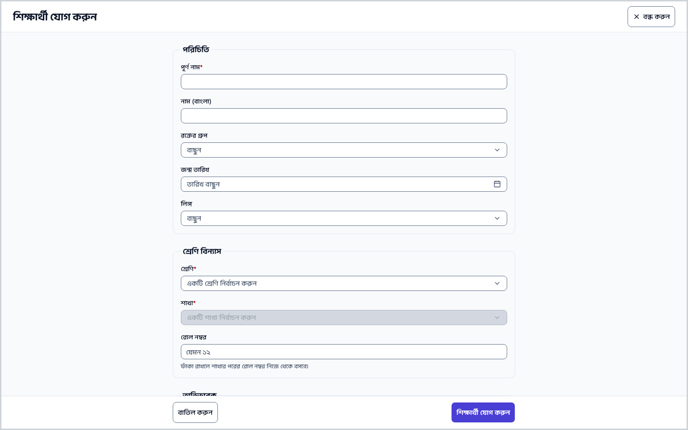
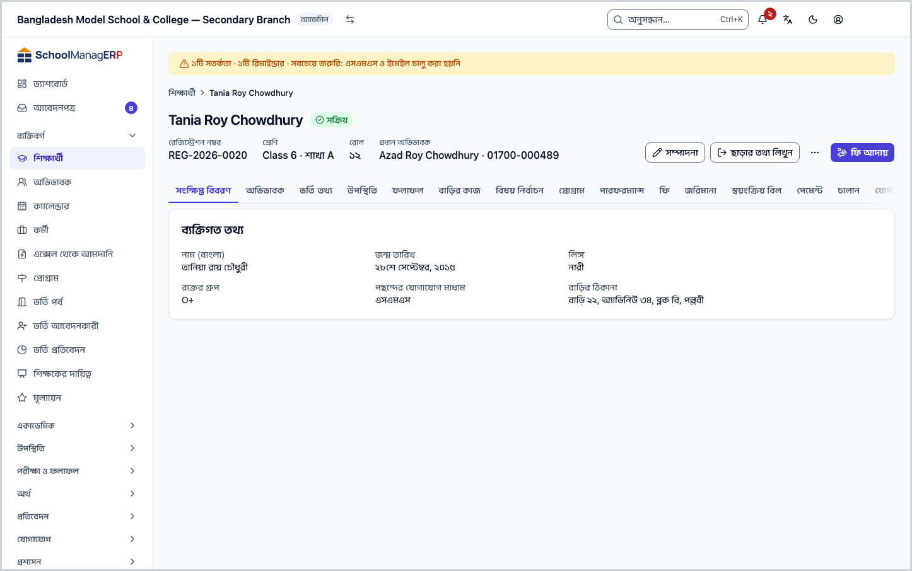

<!-- guide:meta
feature: people.students
title: শিক্ষার্থী যোগ করা ও তাদের তথ্য দেখা
summary: নতুন শিক্ষার্থী যোগ করুন, একসাথে অনেককে আমদানি করুন, আর প্রত্যেকের প্রোফাইল থেকে শ্রেণি, অভিভাবক, ফি, নোট ও স্কুল ছাড়ার তথ্য সামলান।
roles: [ADMIN, ACCOUNTANT, TEACHER, EXECUTIVE, OFFICE_STAFF, EXAM_CONTROLLER]
sources:
  - client-admin/src/routes/_staff/students/index.tsx
  - client-admin/src/routes/_staff/students/new.tsx
  - client-admin/src/routes/_staff/students/$studentId.tsx
  - client-admin/src/routes/_staff/students/$studentId_.edit.tsx
  - client-admin/src/routes/_staff/students/-student-form.tsx
  - client-admin/src/routes/_staff/students/-student-form-schema.ts
  - client-admin/src/routes/_staff/students/-guardian-picker.tsx
  - client-admin/src/routes/_staff/students/-bulk-photo-dialog.tsx
  - client-admin/src/routes/_staff/students/-send-reminder-dialog.tsx
  - client-admin/src/routes/_staff/students/import.tsx
  - client-admin/src/routes/_staff/students/-import/template.ts
  - client-admin/src/routes/_staff/students/-detail/*.tsx
  - server/src/modules/students
labels:
  [
    students:*,
    student-lifecycle:*,
    student-notes:*,
    student-records:*,
    studentImport:*,
    bulkImport:*,
    nav:groups.people,
    nav:items.students,
    common:status.enrollment.*,
    common:actions.cancel,
    common:actions.close,
    trial:seatLimit.*,
    trial:import.backToSetup,
    backup:migrateWholeSchool,
    exams:detail.tabs.results,
    exams:detail.tabs.fourthSubject,
    programs:detail.tabs.programs,
    performance:title,
  ]
helpIds:
  [
    people.students,
    people.students.action.add,
    people.students.action.import,
    people.students.action.recordLeaving,
    people.students.action.readmit,
    people.students.action.delete,
    people.students.action.printIdCard,
    people.students.action.collectFees,
    people.students.action.sendReminder,
    people.students.field.rollNumber,
    people.students.field.bloodGroup,
    people.students.field.preferredCommunication,
  ]
devices: [desktop]
entry: [sidebar, palette, page:welcome]
keywords:
  [
    শিক্ষার্থী,
    ছাত্র,
    ছাত্রী,
    ভর্তি,
    প্রোফাইল,
    আমদানি,
    স্কুল ছাড়া,
    পুনরায় ভর্তি,
    রোল নম্বর,
    student,
    pupil,
    admission,
    profile,
    import,
    readmit,
    withdraw,
    transfer,
  ]
appVersion: 0.1.0 (e81ef857f)
owner: tareq89
lastVerified: 2026-10-24
knownIssues: []
-->

# শিক্ষার্থী যোগ করা ও তাদের তথ্য দেখা

নতুন শিক্ষার্থী যোগ করুন, একসাথে অনেককে আমদানি করুন, আর প্রত্যেকের প্রোফাইল থেকে তাঁর সব তথ্য দেখুন ও সামলান।

**যেতে হবে:** বাম মেনুতে **ব্যক্তিবর্গ → শিক্ষার্থী**। এই পাতা কম্পিউটারের জন্য লেখা।
**শুরুর আগে:** স্কুলে অন্তত একটি [শ্রেণি](../help/glossary.md#class) আর তার একটি [শাখা](../help/glossary.md#section) থাকতে হবে। না থাকলে [স্কুল সাজানোর ক্রম](../admin/setup-order.md) দেখুন।

প্রত্যেক শিক্ষার্থীর একটি **প্রোফাইল** থাকে। প্রোফাইল হলো তাঁর নিজের পাতা: উপরে নাম, রেজিস্ট্রেশন নম্বর, শ্রেণি ও রোল, আর নিচে ট্যাবে ভাগ করা সব তথ্য (অভিভাবক, উপস্থিতি, ফি, নোট ইত্যাদি)। এই পাতার বাকি সব জায়গায় "প্রোফাইল" বলতে এটিই বোঝানো হয়েছে।

[একজন শিক্ষার্থী যোগ করুন](#task-main) · [অনেককে আমদানি](#task-import) · [স্কুল ছাড়ার তথ্য](#task-leave) · [সমস্যা ও সমাধান](#trouble)

**এই পাতায় যা আছে**

- [এই পাতায় যেভাবে আসবেন](#arrive)
- [একজন শিক্ষার্থী যোগ করুন](#task-main)
- [শিক্ষার্থী যোগ হয়েছে কি না বুঝবেন কীভাবে](#confirm)
- [অন্য পরিস্থিতিতে](#other)
  - [শিক্ষার্থী খুঁজুন ও বাছাই করুন](#task-find)
  - [শিক্ষার্থীর তথ্য বদলান](#task-edit)
  - [প্রোফাইল পাতা ও ট্যাবগুলো](#task-profile)
  - [অভিভাবক যুক্ত করুন](#task-guardians)
  - [ফি আদায় ও রিমাইন্ডার](#task-fees)
  - [শ্রেণি বা শাখা বদলান](#task-move)
  - [স্কুল ছাড়ার তথ্য লিখুন](#task-leave)
  - [আবার ভর্তি করুন](#task-readmit)
  - [নোট লিখুন](#task-notes)
  - [পারিবারিক, স্বাস্থ্য ও পাবলিক পরীক্ষার তথ্য](#task-records)
  - [ছবি, আইডি কার্ড ও কাগজপত্র](#task-documents)
  - [অনেকের ছবি একসাথে আপলোড](#task-photos)
  - [অনেক শিক্ষার্থী একসাথে আমদানি](#task-import)
  - [শিক্ষার্থী মুছে ফেলুন](#task-delete)
- [সমস্যা ও সমাধান](#trouble)
- [কে কী করতে পারেন](#roles)
- [আরও জানুন](#more)

---

## এই পাতায় যেভাবে আসবেন 

**বাম মেনু থেকে:** **ব্যক্তিবর্গ → শিক্ষার্থী**। শিক্ষার্থীর তালিকা খোলে; নিচের ধাপ ১ থেকে শুরু করুন।

**খোঁজ থেকে:** উপরের [খোঁজার ঘরে (Ctrl+K)](../help/glossary.md#palette) "শিক্ষার্থী" লিখে **শিক্ষার্থী** বেছে নিন। তালিকা খোলে।

**স্কুল সাজানোর ধাপ ৫ থেকে**

1. নতুন স্কুল সাজানোর সময় শিক্ষার্থীর ধাপে আছেন — কোথা থেকে এল: [স্কুল সাজানোর ক্রম, ধাপ ৫](../admin/setup-order.md#step-5)।
2. সেখান থেকে শিক্ষার্থী আমদানির লিংকে চাপুন। → **শিক্ষার্থী আমদানি** পাতা খোলে। উপরে **সাজানোয় ফিরে যান** লিংক থাকে। আমদানির ধাপগুলো [এখানে](#task-import)।
3. কাজ শেষে **সাজানোয় ফিরে যান** চাপুন। → আবার সাজানোর পাতায় ফিরবেন।

---

## একজন শিক্ষার্থী যোগ করুন 

1. বাম মেনুতে **ব্যক্তিবর্গ** চাপুন, তারপর ভেতরের **শিক্ষার্থী** চাপুন।

   → শিক্ষার্থীর তালিকা আসবে।

2. উপরে ডান দিকে **শিক্ষার্থী যোগ করুন** চাপুন।

   → **শিক্ষার্থী যোগ করুন** ফর্ম খোলে। ফর্মে চারটি অংশ: **পরিচিতি**, **শ্রেণি বিন্যাস**, **অভিভাবক**, **পছন্দসমূহ**।

3. **পরিচিতি** অংশে **পূর্ণ নাম** লিখুন। এটিই একমাত্র বাধ্যতামূলক নাম। চাইলে **নাম (বাংলা)**, **রক্তের গ্রুপ**, **জন্ম তারিখ** ও **লিঙ্গ** দিন।

4. **শ্রেণি বিন্যাস** অংশে **শ্রেণি** বাছুন, তারপর **শাখা** বাছুন। শ্রেণি না বাছলে শাখার ঘর খোলে না। **রোল নম্বর** ফাঁকা রাখতে পারেন।

   → রোল ফাঁকা রাখলে শাখার পরের রোল নম্বর নিজে থেকে বসবে।

5. **অভিভাবক** অংশে **অভিভাবক খুঁজুন** ঘরে নাম বা ফোন নম্বর লিখুন, আর তালিকা থেকে বেছে নিন। না পেলে **নতুন অভিভাবক যোগ করুন** চাপুন। বিস্তারিত: [অভিভাবক যুক্ত করুন](#task-guardians)।

   → যাঁকে বাছলেন, তিনি **যুক্ত অভিভাবক**-এর নিচে আসবেন।

6. **পছন্দসমূহ** অংশে **পছন্দের যোগাযোগ মাধ্যম** দেখে নিন (শুরুতে **এসএমএস** বাছা থাকে)। চাইলে **বাড়ির ঠিকানা** লিখুন।

7. নিচে **শিক্ষার্থী যোগ করুন** চাপুন।

   → কোনো আলাদা বার্তা আসে না। অ্যাপ সোজা নতুন শিক্ষার্থীর প্রোফাইল খুলে দেয়। সেখানে উপরে তাঁর নাম আর নতুন **রেজিস্ট্রেশন নম্বর** দেখবেন।

> **মনে রাখুন:** শেষ ধাপের **শিক্ষার্থী যোগ করুন** চাপলে তবেই শিক্ষার্থী ও অভিভাবকের সংযোগ স্কুলের সিস্টেমে যায়। তবে **অভিভাবক যোগ করুন** দিয়ে নতুন অভিভাবক বানালে তা সঙ্গে সঙ্গে সংরক্ষিত হয়, ফর্ম ছেড়ে গেলেও থেকে যায়। রেজিস্ট্রেশন নম্বর আপনাকে লিখতে হয় না; সিস্টেম নিজে বানায়।

---

## শিক্ষার্থী যোগ হয়েছে কি না বুঝবেন কীভাবে 

| অবস্থা                       | কীভাবে বুঝবেন                                                                                                                                                       | এরপর কী                        |
| ---------------------------- | ------------------------------------------------------------------------------------------------------------------------------------------------------------------- | ------------------------------ |
| **শুধু স্ক্রিনে বদলেছে**     | ফর্মে লিখেছেন, কিন্তু এখনো জমা দেননি। পরে এই ডিভাইসে ফর্মটি আবার খুললে উপরে **এই ফর্মের একটি অসংরক্ষিত খসড়া রয়েছে।** দেখাতে পারে, সাথে **খসড়া পুনরুদ্ধার করুন**। | **শিক্ষার্থী যোগ করুন** চাপুন। |
| **স্কুলের সিস্টেমে পৌঁছেছে** | অ্যাপ নতুন শিক্ষার্থীর প্রোফাইল খুলেছে, উপরে রেজিস্ট্রেশন নম্বর আছে।                                                                                                | কাজ শেষ।                       |

ইন্টারনেট ছাড়া শিক্ষার্থী জমা রাখার কোনো ব্যবস্থা এই ফর্মে নেই। তাই মাঝের অবস্থাটি ("এই ডিভাইসে সংরক্ষিত") এখানে ঘটে না।

**যাচাই করতে চাইলে:** **ব্যক্তিবর্গ → শিক্ষার্থী** খুলে **খুঁজুন** ঘরে নামটি লিখুন। তালিকায় নামটি এলে শিক্ষার্থী সিস্টেমে আছেন।

**প্রোফাইল না খুললে:** ফর্মের নিচে লাল লেখা দেখুন, আর [সমস্যা ও সমাধান](#trouble) মিলিয়ে নিন। ফর্মে লেখা তথ্য তখনো স্ক্রিনে থাকে।

**জমা না দিয়ে পাতা ছাড়তে চাইলে** অ্যাপ জিজ্ঞেস করে **সংরক্ষণ না করে ছেড়ে যাবেন?**

| আপনি চাপলেন                 | কী হবে                                             | জমা হলো?     |
| --------------------------- | -------------------------------------------------- | ------------ |
| **এই পাতায় থাকুন**         | ফর্মেই থাকবেন, লেখা সব থাকে।                       | না, এখনো নয় |
| **সংরক্ষণ ছাড়া ছেড়ে যান** | পাতা ছেড়ে যাবেন; অসংরক্ষিত পরিবর্তন হারিয়ে যাবে। | না           |

---

## অন্য পরিস্থিতিতে 

### শিক্ষার্থী খুঁজুন ও বাছাই করুন 

1. তালিকার উপরে **খুঁজুন** ঘরে নাম, রোল বা রেজিস্ট্রেশন নম্বর লিখুন।

   → তালিকা ছোট হয়ে শুধু মিলে যাওয়া শিক্ষার্থী দেখায়।

2. দরকার হলে ফিল্টার দিন: **শ্রেণি**, **শাখা**, **অবস্থা**, **লিঙ্গ**, **জন্ম তারিখ** (থেকে–পর্যন্ত)। স্কুলে দুই বা তার বেশি [শিফট](../help/glossary.md#shift) বা [ভার্সন](../help/glossary.md#version) থাকলে **শিফট** আর **ভার্সন** ফিল্টারও আসে।
3. **কলাম** চাপলে কোন কলাম দেখাবেন বাছতে পারেন। **জন্ম তারিখ**, **লিঙ্গ**, **ঠিকানা** ও **পছন্দের যোগাযোগ মাধ্যম** শুরুতে লুকানো থাকে।
4. **রেজিস্ট্রেশন নম্বর** বা **নাম** কলাম ধরে সাজাতে পারেন (ঊর্ধ্বক্রমে বা নিম্নক্রমে)।
5. বাম পাশের ঘরে টিক দিয়ে কয়েকজনকে বাছুন।

   → উপরে কয়েকটি বোতাম আসে: **রিমাইন্ডার পাঠান**, **আইডি কার্ড প্রিন্ট (N)**, **সিএসভি এক্সপোর্ট** আর **নির্বাচন বাতিল**। আপনার ভূমিকায় যা চলে, শুধু সেগুলোই দেখাবে।

ফিল্টারে **শ্রেণি** আর **শাখা** দুটোই বাছলে উপরে **পুরো (শাখার নাম)-এর আইডি কার্ড প্রিন্ট** বোতাম আসে। এতে পুরো শাখার কার্ড একবারে প্রিন্ট হয়।

তালিকার প্রতিটি সারির শেষে **দেখুন** (প্রোফাইল খোলে), **সম্পাদনা** আর **ফি আদায়** থাকে।

### শিক্ষার্থীর তথ্য বদলান 

1. তালিকার সারিতে **সম্পাদনা** চাপুন, অথবা প্রোফাইলের উপরে **সম্পাদনা** চাপুন।

   → **শিক্ষার্থী সম্পাদনা** ফর্ম খোলে, আগের তথ্য বসানো।

2. যা বদলাতে চান, বদলান।
3. **পরিবর্তন সংরক্ষণ করুন** চাপুন। কিছু না বদলালে বোতামটি চাপা যায় না।

   → অ্যাপ প্রোফাইলে ফিরে যায়, নতুন তথ্য সহ।

না বদলে বেরোতে **বাতিল করুন** চাপুন। কিছু বদলে থাকলে অ্যাপ আগের মতো **সংরক্ষণ না করে ছেড়ে যাবেন?** জিজ্ঞেস করে ([সিদ্ধান্তের টেবিল](#confirm))।

### প্রোফাইল পাতা ও ট্যাবগুলো 

তালিকায় নামে বা **দেখুন**-এ চাপলে প্রোফাইল খোলে।

- **উপরের সারি:** **রেজিস্ট্রেশন নম্বর**, **শ্রেণি** (শ্রেণি · শাখা), **রোল**, আর **প্রধান অভিভাবক** (নাম ও ফোন)।
- **অবস্থা:** নামের পাশে একটি চিহ্ন — **সক্রিয়**, **নিষ্ক্রিয়**, **স্থানান্তরিত** বা **উত্তীর্ণ**।
- **কাজের বোতাম:** **সম্পাদনা**, **ছাড়ার তথ্য লিখুন** বা **পুনরায় ভর্তি**, **ফি আদায়**, **রিমাইন্ডার পাঠান**, **আইডি কার্ড প্রিন্ট**, **মুছে ফেলুন**। আপনার ভূমিকায় যা চলে, শুধু সেগুলো দেখা যায় ([কে কী করতে পারেন](#roles))।

ট্যাবগুলো এই ক্রমে থাকে:

| ট্যাব                                 | কী দেখায়                                                                                                                        |
| ------------------------------------- | -------------------------------------------------------------------------------------------------------------------------------- |
| **সংক্ষিপ্ত বিবরণ**                   | **ব্যক্তিগত তথ্য**: জন্ম তারিখ, লিঙ্গ, বাংলা নাম, রক্তের গ্রুপ, ঠিকানা, পছন্দের যোগাযোগ মাধ্যম।                                  |
| **অভিভাবক**                           | যুক্ত অভিভাবকেরা: নাম, সম্পর্ক, ফোন, ইমেইল, কে **প্রধান যোগাযোগ**।                                                               |
| **ভর্তি তথ্য**                        | **ভর্তির ইতিহাস**: কোন শিক্ষাবর্ষে কোন শ্রেণিতে। এখান থেকে **শ্রেণি পরিবর্তন** ([দেখুন](#task-move))।                            |
| **উপস্থিতি**                          | মাস ধরে হাজিরা: উপস্থিত, অনুপস্থিত, দেরি, ছুটি, আর উপস্থিতির হার।                                                                |
| **ফলাফল**                             | যত পরীক্ষার ফল আছে, প্রকাশিত হোক বা না হোক। যে ফল এখনো প্রকাশ হয়নি, তা আলাদা করে চিহ্নিত থাকে।                                  |
| **বাড়ির কাজ**                        | মোট বাড়ির কাজ, কতটি সম্পন্ন, কতটি বকেয়া, আর সম্পন্নের হার।                                                                     |
| **বিষয় নির্বাচন**                    | শ্রেণিতে যে ঐচ্ছিক বিষয় (যেমন চতুর্থ বিষয়) আছে, তার মধ্যে একটি বেছে দেওয়া।                                                    |
| **প্রোগ্রাম**                         | যে প্রোগ্রামে নথিভুক্ত, তার অগ্রগতি আর মাইলস্টোন।                                                                                |
| **পারফরম্যান্স**                      | নম্বর থেকে তৈরি একটি সারসংক্ষেপ। শুধু যাঁরা নম্বর দেখতে পারেন, তাঁরা এই ট্যাব পান।                                               |
| **ফি**                                | মোট বিল, মোট পরিশোধিত, বকেয়া; **খোলা বিল**, **জমা টাকা**, **ইতিহাস** ও **ডিসকাউন্ট**।                                           |
| [**জরিমানা**](../finance/fines.md)    | এই শিক্ষার্থীর সব [জরিমানা](../help/glossary.md#fine)।                                                                           |
| **স্বয়ংক্রিয় বিল**                  | কোন নিয়মিত বিলের তালিকায় তিনি আছেন, কোনটি থেকে বাদ।                                                                            |
| [**পেমেন্ট**](../finance/payments.md) | যত টাকা নেওয়া হয়েছে, তারিখ ও পদ্ধতি সহ।                                                                                        |
| [**চালান**](../finance/invoices.md)   | ইস্যু করা চালান; **প্রিন্ট** করা যায়।                                                                                           |
| **যোগাযোগ**                           | অভিভাবককে পাঠানো বার্তা ও রিমাইন্ডার।                                                                                            |
| **নোট**                               | কর্মীদের নিজেদের নোট ([দেখুন](#task-notes))। নোট দেখার অনুমতি না থাকলে ট্যাবটি থাকে না।                                          |
| **রেকর্ড**                            | পারিবারিক, স্বাস্থ্য ও পাবলিক পরীক্ষার তথ্য ([দেখুন](#task-records))। রেকর্ড দেখার অনুমতি না থাকলে থাকে না।                      |
| **কাগজপত্র**                          | ছবি, আইডি কার্ড, সনদ ও প্রিন্ট করা কাগজের তালিকা ([দেখুন](#task-documents))। প্রিন্ট, সনদ বা প্রিন্টের ইতিহাস দেখার অনুমতি লাগে। |
| **আবেদন**                             | এই শিক্ষার্থীর জন্য জমা পড়া আবেদন। আবেদন সামলানোর অনুমতি না থাকলে থাকে না।                                                      |
| **কার্যক্রম**                         | এই শিক্ষার্থীর তথ্যে কে কবে কী বদলেছেন।                                                                                          |

### অভিভাবক যুক্ত করুন 

1. শিক্ষার্থী যোগ বা সম্পাদনার ফর্মে **অভিভাবক** অংশে যান।
2. **অভিভাবক খুঁজুন** ঘরে নাম বা ফোন নম্বর লিখুন। তালিকা থেকে তাঁকে বাছুন।

   → তিনি **যুক্ত অভিভাবক**-এর নিচে আসেন। ভুল হলে নামের পাশের সরানোর বোতাম চাপুন।

3. খুঁজে না পেলে **নতুন অভিভাবক যোগ করুন** চাপুন। **অভিভাবকের পূর্ণ নাম** (বাধ্যতামূলক), **শিক্ষার্থীর সাথে অভিভাবকের সম্পর্ক**, **অভিভাবকের ফোন**, **অভিভাবকের ইমেইল** লিখে **অভিভাবক যোগ করুন** চাপুন।
4. ফর্মের শেষ বোতাম (**শিক্ষার্থী যোগ করুন** বা **পরিবর্তন সংরক্ষণ করুন**) চাপুন। এর আগে অভিভাবক শিক্ষার্থীর সাথে যুক্ত হন না।

   → প্রোফাইলের **অভিভাবক** ট্যাবে তাঁকে দেখবেন।

অভিভাবকের নিজের পাতা (**অভিভাবক**) এখনো এই গাইডে লেখা হয়নি।

### ফি আদায় ও রিমাইন্ডার 

- **ফি আদায়:** তালিকার সারিতে বা প্রোফাইলের উপরে **ফি আদায়** চাপুন। → টাকা নেওয়ার পাতা খোলে, এই শিক্ষার্থী আগে থেকেই বাছা। বাকি কাজ [**পেমেন্ট**](../finance/payments.md) পাতায়।
- **কত [বকেয়া](../help/glossary.md#dues):** প্রোফাইলের **ফি** ট্যাব দেখুন (সব শিক্ষার্থীর হিসাব [**শিক্ষার্থীর বকেয়া**](../finance/dues.md) পাতায়)।
- **রিমাইন্ডার পাঠান:** প্রোফাইলে, অথবা তালিকায় কয়েকজনকে বেছে **রিমাইন্ডার পাঠান** চাপুন। **বার্তা** লিখে **পাঠান** চাপুন। → **N জন অভিভাবকের কাছে রিমাইন্ডার পাঠানো হয়েছে।** বার্তা আসে। একবারে কতজনকে পাঠানো যায়, তার সীমা আছে; বেশি বাছলে ডায়ালগেই তা লেখা থাকে।

### শ্রেণি বা শাখা বদলান 

শুধু **সক্রিয়** শিক্ষার্থীর জন্য, আর শুধু যাঁরা শিক্ষার্থী সম্পাদনা করতে পারেন।

1. প্রোফাইলে **ভর্তি তথ্য** ট্যাব খুলুন। **শ্রেণি পরিবর্তন** চাপুন।
2. নতুন **শাখা** বাছুন। অন্য **শ্রেণি**-তে নিতে পারেন শুধু অ্যাডমিন; অন্যরা দেখবেন **অন্য শ্রেণিতে নিতে শুধু অ্যাডমিন পারেন; প্রমোশন ব্যবহার করুন।**

   → শাখাটি পূর্ণ হলে সতর্কবার্তা আসে, তবু এগোতে পারেন।

3. **স্থানান্তর করুন** চাপুন।

   → **ভর্তির ইতিহাস**-এ নতুন শ্রেণি · শাখা দেখা যায়।

বছর শেষে পুরো শ্রেণিকে ওপরে তোলার কাজ হয় [**প্রমোশন**](../exams-results/promotion.md) পাতায়।

### স্কুল ছাড়ার তথ্য লিখুন 

শিক্ষার্থী নাম কাটালে, অন্য স্কুলে গেলে বা পড়া শেষ করলে এটি লিখুন। শুধু **সক্রিয়** শিক্ষার্থীর জন্য।

1. প্রোফাইলের উপরে **ছাড়ার তথ্য লিখুন** চাপুন।

   → **স্কুল ছাড়ার তথ্য লিখুন** ডায়ালগ খোলে। বকেয়া থাকলে উপরে লেখা থাকে কত টাকা বাকি; তবু এগোতে পারেন।

2. **ছাড়ার ধরন** বাছুন: **নাম কাটা হয়েছে**, **অন্য স্কুলে গেছে** অথবা **পড়া শেষ করেছে**।
3. **তারিখ** দিন। আজকের পরের তারিখ দেওয়া যায় না।
4. **অন্য স্কুলে গেছে** বাছলে **নতুন স্কুল** ঘর আসে; চাইলে নাম লিখুন।
5. **কারণ** লিখুন (বাধ্যতামূলক)। **মন্তব্য (ইচ্ছা হলে)** খালি রাখা যায়।
6. **সংরক্ষণ করুন** চাপুন (বা Ctrl+Enter)।

   → অবস্থা বদলে যায়: **নাম কাটা হয়েছে** হলে **নিষ্ক্রিয়**, **অন্য স্কুলে গেছে** হলে **স্থানান্তরিত**, **পড়া শেষ করেছে** হলে **উত্তীর্ণ**। উপরের বোতাম **ছাড়ার তথ্য লিখুন** থেকে বদলে **পুনরায় ভর্তি** হয়।

এরপর থেকে তাঁর নামে নতুন ফির বিল তৈরি হয় না, কারণ বিল শুধু সক্রিয় শিক্ষার্থীর নামে হয়। কিন্তু যা আগে থেকে বাকি, তা বকেয়া হয়েই থাকে, যতক্ষণ না কেউ মওকুফ করেন।

ছাড়ার তারিখের পরে শেষ তারিখ এমন বিল থাকলে ডায়ালগ বন্ধ হয় না; দেখায় **ছাড়ার তারিখের পরের বিল**, সাথে **আপনি মাফ না করা পর্যন্ত এই বিলগুলো বাকি থাকবে।**

| আপনি চাপলেন        | কী হবে                                                   | জমা হলো?                           |
| ------------------ | -------------------------------------------------------- | ---------------------------------- |
| **বন্ধ করুন**      | ডায়ালগ বন্ধ হয়, প্রোফাইলে থাকেন।                       | হ্যাঁ, ছাড়ার তথ্য আগেই জমা হয়েছে |
| **ফি ট্যাব খুলুন** | প্রোফাইলের **ফি** ট্যাব খোলে; সেখানে বিল মওকুফ করা যায়। | হ্যাঁ, ছাড়ার তথ্য আগেই জমা হয়েছে |

### আবার ভর্তি করুন 

যে শিক্ষার্থী সক্রিয় নন, তিনি ফিরে এলে:

1. প্রোফাইলের উপরে **পুনরায় ভর্তি** চাপুন।

   → **আবার ভর্তি করুন** ডায়ালগ খোলে।

2. **তারিখ** দিন (আজকের পরের নয়)। **শ্রেণি** আর **শাখা** বাছুন।
3. চাইলে **কারণ (ইচ্ছা হলে)** আর **মন্তব্য (ইচ্ছা হলে)** লিখুন।
4. **ভর্তি করুন** চাপুন।

   → অবস্থা আবার **সক্রিয়** হয়, আর উপরের বোতাম আবার **ছাড়ার তথ্য লিখুন** হয়।

ট্রায়াল স্কুলে শিক্ষার্থীর সীমা পূর্ণ থাকলে আবার ভর্তি করা যায় না। তখন ডায়ালগে শুধু **সংরক্ষণ করা যায়নি। আবার চেষ্টা করুন।** দেখায় ([সমস্যা ও সমাধান](#trouble))।

### নোট লিখুন 

নোট শুধু কর্মীরা দেখেন; অভিভাবক দেখেন না।

1. প্রোফাইলে **নোট** ট্যাব খুলুন। **নোট যোগ করুন** চাপুন।
2. **নোট** ঘরে লিখুন (সর্বোচ্চ ২০০০ অক্ষর)। চাইলে **রেটিং (ঐচ্ছিক)**-এ ১ থেকে ৫ তারা দিন; একই তারায় আবার চাপলে রেটিং উঠে যায়।
3. **নোট সেভ করুন** চাপুন (বা Ctrl+Enter)।

   → নোটটি তালিকায় আসে, লেখকের নাম সহ।

সেভ করার পর নোট বদলানো যায় না। ভুল হলে মুছে নতুন লিখুন। নোটের পাশের মোছার বোতাম (**নোট মুছুন**) দেখা যায় শুধু নোটের লেখক আর অ্যাডমিনের কাছে। চাপলে আসে **এই নোট মুছবেন?**

| আপনি চাপলেন    | কী হবে                              | জমা হলো?         |
| -------------- | ----------------------------------- | ---------------- |
| **বাতিল করুন** | কিছুই হয় না, নোট থাকে।             | না               |
| **মুছুন**      | নোটটি মুছে যায়; আর ফেরানো যায় না। | হ্যাঁ, মুছে গেছে |

### পারিবারিক, স্বাস্থ্য ও পাবলিক পরীক্ষার তথ্য 

প্রোফাইলের **রেকর্ড** ট্যাবে তিনটি অংশ:

- **পারিবারিক ও স্বাস্থ্য তথ্য:** **ধর্ম**, **জন্ম নিবন্ধন নম্বর**, **পিতার নাম**, **মাতার নাম**, **স্বাস্থ্য সম্পর্কিত নোট**। লিখে **সংরক্ষণ করুন** চাপুন। → **তথ্য সংরক্ষণ করা হয়েছে।**
- **পাবলিক পরীক্ষা:** পিএসসি, জেএসসি, এসএসসি, দাখিল, এইচএসসি, আলিম। **পরীক্ষা যোগ করুন** চাপুন, তারপর **পরীক্ষার ধরন**, **বোর্ড**, **রোল নম্বর**, **রেজিস্ট্রেশন নম্বর**, **জিপিএ**, **পাসের সাল** লিখে **সংরক্ষণ করুন**। সারির **সম্পাদনা** বা **মুছুন** দিয়ে বদলানো বা মোছা যায়।
- **শিক্ষার্থীর অবস্থার ইতিহাস:** কবে স্কুল ছেড়েছেন, কবে আবার ভর্তি হয়েছেন — কারণ, গন্তব্য ও মন্তব্য সহ। এটি নিজে থেকে লেখা হয়।

লেখার অনুমতি না থাকলে আপনি শুধু পড়তে পারবেন, কোনো বোতাম দেখবেন না।

### ছবি, আইডি কার্ড ও কাগজপত্র 

প্রোফাইলের **কাগজপত্র** ট্যাবে:

- **ছবি:** **ছবি আপলোড করুন** (বা **ছবি বদলান**)। পাসপোর্ট ছবির মতো পরিষ্কার ছবি দিন, মুখ মাঝখানে। → **ছবি সংরক্ষণ হয়েছে**। এই বোতাম শুধু যাঁরা শিক্ষার্থী সম্পাদনা করতে পারেন, তাঁরা দেখেন।
- **আইডি কার্ড প্রিন্ট:** প্রিন্টের আগে দেখার পাতা খোলে। বিস্তারিত: [আইডি কার্ড প্রিন্ট](../administration/print-templates/id-cards.md)। প্রোফাইলের উপরের **আইডি কার্ড প্রিন্ট** বোতামও একই কাজ করে।
- **সনদ ইস্যু করুন** আর **প্রিন্ট করা ডকুমেন্ট**: এই শিক্ষার্থীর জন্য কোন কাগজ আগে প্রিন্ট হয়েছে, তার তালিকা।

### অনেকের ছবি একসাথে আপলোড 

1. তালিকার উপরের আরও-বোতামের মেনু থেকে **ছবি আপলোড** চাপুন।

   → **শিক্ষার্থীদের ছবি আপলোড** ডায়ালগ খোলে।

2. প্রতিটি ছবির নাম শিক্ষার্থীর রেজিস্ট্রেশন নম্বর দিন, যেমন `2024-0153.jpg`।
3. **ছবি বাছুন** বা **ফোল্ডার বাছুন** চাপুন। তারপর **N টি ছবি আপলোড করুন** চাপুন।

   → শেষে তিনটি ভাগ দেখায়: **মিলেছে**, **মেলে এমন শিক্ষার্থী নেই**, **পড়া যায়নি**। না-মেলা তালিকা **তালিকা কপি করুন** দিয়ে কপি করা যায়।

মাঝপথে থেমে গেলেও এ পর্যন্ত পাঠানো ছবিগুলো সংরক্ষিত থাকে।

### অনেক শিক্ষার্থী একসাথে আমদানি 

1. তালিকার উপরে **শিক্ষার্থী আমদানি** চাপুন।

   → **শিক্ষার্থী আমদানি** পাতা খোলে, তিন ধাপে।

2. **১. টেমপ্লেট ডাউনলোড করুন** — **টেমপ্লেট ডাউনলোড করুন** চাপুন। ফাইলে ১৩টি কলাম। প্রতি সারিতে একজন শিক্ষার্থী লিখুন। প্রথম সারির শিরোনাম বদলাবেন না, আর ২ নম্বর উদাহরণ সারিটি মুছে ফেলুন। কোন কলামে কী লিখবেন, তা **কোন কলামে কী লিখবেন** চাপলে দেখা যায় (নিচে [আরও জানুন](#more)-এও আছে)।
3. **২. আপনার ফাইল আপলোড করুন** — **ফাইল বাছাই করুন** চাপুন। CSV বা XLSX, সর্বোচ্চ ৫ মেগাবাইট, প্রতি ফাইলে ২,০০০ শিক্ষার্থী।

   → **ফাইল পাওয়া গেছে। এখন যাচাই করা হচ্ছে।** তারপর **সংরক্ষণের আগে দেখে নিন**: কতজন তৈরি হবে, প্রথম কয়েকটি সারি, আর **সমস্যাযুক্ত সারি**-র টেবিল।

4. সমস্যার সারি থাকলে **সমস্যার সারিগুলো ডাউনলোড করুন (CSV)** চাপুন, নিজের ফাইলে ঠিক করুন, আবার আপলোড করুন। কোনো সারিতে **ত্রুটি** থাকলে ইমপোর্ট নিশ্চিত করা যায় না: সব ত্রুটির সারি ঠিক করুন বা মুছুন, তারপর আবার আপলোড করুন। **সতর্কতা** শুধু জানিয়ে রাখে।
5. সব ঠিক মনে হলে **N জন শিক্ষার্থী আমদানি করুন** চাপুন। উপরে লেখা সময়ের মধ্যে চাপুন (**…-এর মধ্যে সংরক্ষণ করুন, নইলে আবার আপলোড করতে হবে**)।

   → **৩. ফলাফল**: **N জন শিক্ষার্থীর সবাই আমদানি হয়েছে।** অথবা কতজন হয়েছে আর কতটি সারিতে সমস্যা ছিল।

6. চাইলে **এখনই আমদানি করা শিক্ষার্থীদের অভিভাবকদের আমন্ত্রণ জানান** বেছে নিন। শেষে **শিক্ষার্থী তালিকায় যান** বা **আরেকটি ফাইল আমদানি করুন**।

রেজিস্ট্রেশন নম্বর লিখে দিলে তা যাচাই করে রাখা হয়; ঘর খালি থাকলে সিস্টেম নিজে নম্বর বানায়। পুরো স্কুলের তথ্য একসাথে আনার বড় ফাইলের লিংক (**পুরো স্কুল স্থানান্তর করছেন?**) শুধু ব্যাকআপ সামলানোর অনুমতি থাকলে দেখা যায়।

| আপনি চাপলেন                     | কী হবে                                   | জমা হলো? |
| ------------------------------- | ---------------------------------------- | -------- |
| **N জন শিক্ষার্থী আমদানি করুন** | ভালো সারিগুলো শিক্ষার্থী হিসেবে যোগ হয়। | হ্যাঁ    |
| **বাতিল করুন**                  | পাতা বন্ধ হয়; কেউ যোগ হয় না।           | না       |

### শিক্ষার্থী মুছে ফেলুন 

শুধু অ্যাডমিন এটি পারেন। যিনি স্কুল ছেড়েছেন, তাঁকে মোছার বদলে [স্কুল ছাড়ার তথ্য লিখুন](#task-leave)।

1. প্রোফাইলের উপরে **মুছে ফেলুন** চাপুন।

   → লাল ডায়ালগ **শিক্ষার্থী মুছে ফেলুন** আসে: শিক্ষার্থী সক্রিয় তালিকা থেকে সরবেন; সাপোর্ট ফিরিয়ে আনতে পারে, কিন্তু অ্যাপ থেকে নয়।

| আপনি চাপলেন    | কী হবে                                                                                                     | জমা হলো?   |
| -------------- | ---------------------------------------------------------------------------------------------------------- | ---------- |
| **বাতিল করুন** | কিছুই হয় না।                                                                                              | না         |
| **মুছে ফেলুন** | শিক্ষার্থী মুছে যায়, অ্যাপ তালিকায় ফিরে যায়। ফি বাকি বা জমা টাকা থাকলে মোছা হয় না (নিচে বার্তা দেখুন)। | হ্যাঁ / না |

---

## সমস্যা ও সমাধান 

| আপনি যা দেখছেন                                                                                                                               | কী করবেন                                                                                                                                                                                       | কে সাহায্য করতে পারেন                                                  |
| -------------------------------------------------------------------------------------------------------------------------------------------- | ---------------------------------------------------------------------------------------------------------------------------------------------------------------------------------------------- | ---------------------------------------------------------------------- |
| **শিক্ষার্থীদের তথ্য লোড করা যায়নি**                                                                                                        | ইন্টারনেট দেখুন, তারপর পাতা আবার খুলুন।                                                                                                                                                        | অ্যাডমিন                                                               |
| **কোনো শিক্ষার্থী পাওয়া যায়নি**, সাথে **এ বছর আপনি যে শাখায় পড়ান, শুধু সেই শাখার শিক্ষার্থী এখানে দেখা যায়। …**                         | আপনি শিক্ষক, আর এ বছর কোনো শাখা আপনার নামে নেই।                                                                                                                                                | অ্যাডমিন ([শিক্ষকের দায়িত্ব](../help/glossary.md#teacher-assignment)) |
| শিক্ষক হিসেবে একজন শিক্ষার্থীর প্রোফাইল "খুঁজে পাওয়া যায়নি" দেখায়                                                                         | তিনি আপনার পড়ানো শাখায় নেই। শিক্ষক শুধু নিজের শাখার শিক্ষার্থী দেখেন।                                                                                                                        | অ্যাডমিন                                                               |
| **শিক্ষার্থীর তথ্য লোড করা যায়নি।**                                                                                                         | **আবার চেষ্টা করুন** চাপুন।                                                                                                                                                                    | অ্যাডমিন                                                               |
| **এটি দেখার অনুমতি আপনার নেই।**                                                                                                              | আপনার ভূমিকায় এই প্রোফাইল দেখা যায় না।                                                                                                                                                       | অ্যাডমিন                                                               |
| **পূর্ণ নাম আবশ্যক।**                                                                                                                        | **পূর্ণ নাম** ঘরে নাম লিখুন।                                                                                                                                                                   | —                                                                      |
| **একটি শ্রেণি ও শাখা নির্বাচন করুন।**                                                                                                        | আগে **শ্রেণি**, তারপর **শাখা** বাছুন।                                                                                                                                                          | —                                                                      |
| **রোল নম্বর অবশ্যই একটি ধনাত্মক পূর্ণসংখ্যা হতে হবে।**                                                                                       | ১, ২, ৩-এর মতো পূর্ণ সংখ্যা দিন, বা ঘর ফাঁকা রাখুন।                                                                                                                                            | —                                                                      |
| রোল নম্বর ওই শাখায় আগে থেকে আছে বলে জমা হয় না                                                                                              | অন্য রোল দিন, বা ঘর ফাঁকা রাখুন (পরের রোল নিজে বসবে)।                                                                                                                                          | —                                                                      |
| **বাংলা নাম সর্বোচ্চ ২০০ অক্ষরের হতে পারে।**                                                                                                 | বাংলা নাম ছোট করুন।                                                                                                                                                                            | —                                                                      |
| **তালিকা থেকে একটি রক্তের গ্রুপ বেছে নিন।**                                                                                                  | তালিকা থেকে বাছুন, বা **দেওয়া নেই** রাখুন।                                                                                                                                                    | —                                                                      |
| **অভিভাবক যোগ করা যায়নি। তথ্য দেখে আবার চেষ্টা করুন।**                                                                                      | নাম ও ফোন নম্বর ঠিক আছে কি না দেখুন।                                                                                                                                                           | —                                                                      |
| **শিক্ষার্থীর সীমা শেষ** (যোগ করার সময়)                                                                                                     | ট্রায়াল স্কুলের শিক্ষার্থী সংখ্যা পূর্ণ। **আরও শিক্ষার্থী যোগ করতে আমাদের সঙ্গে কথা বলুন।**                                                                                                   | অ্যাডমিন                                                               |
| **একটি তারিখ বেছে নিন।** / **তারিখ আজকের পরে হতে পারবে না।**                                                                                 | আজ বা আগের একটি তারিখ দিন।                                                                                                                                                                     | —                                                                      |
| **একটি কারণ লিখুন।**                                                                                                                         | স্কুল ছাড়ার **কারণ** লিখুন।                                                                                                                                                                   | —                                                                      |
| **শ্রেণি ও শাখা বেছে নিন।**                                                                                                                  | আবার ভর্তির জন্য শ্রেণি ও শাখা বাছুন।                                                                                                                                                          | —                                                                      |
| **সংরক্ষণ করা যায়নি। আবার চেষ্টা করুন।** (স্কুল ছাড়া বা আবার ভর্তি)                                                                        | আবার চাপুন। আবার ভর্তিতে বারবার আসলে ট্রায়াল স্কুলের শিক্ষার্থী সীমা পূর্ণ হতে পারে।                                                                                                          | অ্যাডমিন                                                               |
| **এই শিক্ষার্থীর ফি বাকি আছে বা ওয়ালেটে টাকা আছে। আগে স্কুল ছাড়ার তথ্য লিখুন, নয়তো টাকার হিসাব মিটিয়ে নিন।**                             | মুছবেন না; [স্কুল ছাড়ার তথ্য লিখুন](#task-leave)।                                                                                                                                             | হিসাবরক্ষক                                                             |
| **শিক্ষার্থীকে মুছে ফেলা যায়নি। আবার চেষ্টা করুন।**                                                                                         | আবার চেষ্টা করুন।                                                                                                                                                                              | অ্যাডমিন                                                               |
| **শিক্ষার্থীকে স্থানান্তর করা যায়নি। আবার চেষ্টা করুন।**                                                                                    | আবার চেষ্টা করুন।                                                                                                                                                                              | অ্যাডমিন                                                               |
| **নোট সেভ করা যায়নি। আবার চেষ্টা করুন।**                                                                                                    | লেখা মুছবেন না; আবার **নোট সেভ করুন** চাপুন।                                                                                                                                                   | —                                                                      |
| **এই ফাইলের ধরন সমর্থিত নয় — একটি .csv বা .xlsx ফাইল বেছে নিন**                                                                             | এক্সেল থেকে CSV বা XLSX হিসেবে সেভ করুন।                                                                                                                                                       | —                                                                      |
| **ফাইলটি অনেক বড় — একটি ছোট ফাইল বেছে নিন**                                                                                                 | ফাইল ভাগ করুন (৫ মেগাবাইট, ২,০০০ জনের মধ্যে)।                                                                                                                                                  | —                                                                      |
| **সময় শেষ — আবার আপলোড করুন**                                                                                                               | একই ফাইল আবার আপলোড করে তাড়াতাড়ি নিশ্চিত করুন।                                                                                                                                               | —                                                                      |
| **আমদানি ব্যর্থ হয়েছে।**                                                                                                                    | ফাইল আবার আপলোড করুন।                                                                                                                                                                          | অ্যাডমিন                                                               |
| **ফাইলটি পড়া যায়নি। …**, **কিছু কলাম নেই। নমুনা ফাইলের কলামগুলো ব্যবহার করুন।**, **ফাইলে সারি অনেক বেশি। …** বা **ফাইলে কোনো সারি নেই। …** | পুরো ফাইলটিই যাচাই করা যায়নি। বাক্যে যা বলা আছে তা-ই করুন: .xlsx বা .csv হিসেবে আবার সংরক্ষণ করুন, প্রথম সারির শিরোনাম টেমপ্লেটের মতো রাখুন, বা ফাইল ছোট ছোট ভাগ করুন। তারপর আবার আপলোড করুন। | —                                                                      |
| **রিমাইন্ডার পাঠানো যায়নি। কিছুই পাঠানো হয়নি — আবার চেষ্টা করুন।**                                                                         | আবার পাঠান।                                                                                                                                                                                    | —                                                                      |
| **রিমাইন্ডার গেছে কি না নিশ্চিত হওয়া যায়নি। …**                                                                                            | আবার পাঠানোর আগে **যোগাযোগ** ট্যাব দেখুন, যেন দুবার না যায়।                                                                                                                                   | —                                                                      |
| কোনো বোতাম বা ট্যাব দেখছি না (যেমন **শিক্ষার্থী যোগ করুন**, **নোট**, **মুছে ফেলুন**)                                                         | আপনার ভূমিকায় সেটি নেই। [কে কী করতে পারেন](#roles) দেখুন।                                                                                                                                     | অ্যাডমিন                                                               |

---

## কে কী করতে পারেন 

| ভূমিকা                | তালিকা ও প্রোফাইল দেখা        | যোগ ও সম্পাদনা | আমদানি | স্কুল ছাড়া / আবার ভর্তি | নোট   | রেকর্ড      | ফি আদায় | রিমাইন্ডার | আইডি কার্ড প্রিন্ট | মুছে ফেলা |
| --------------------- | ----------------------------- | -------------- | ------ | ------------------------ | ----- | ----------- | -------- | ---------- | ------------------ | --------- |
| অ্যাডমিন              | হ্যাঁ                         | হ্যাঁ          | হ্যাঁ  | হ্যাঁ                    | হ্যাঁ | পড়া ও লেখা | হ্যাঁ    | হ্যাঁ      | হ্যাঁ              | হ্যাঁ     |
| হিসাবরক্ষক            | হ্যাঁ                         | হ্যাঁ          | হ্যাঁ  | না                       | না    | না          | হ্যাঁ    | হ্যাঁ      | হ্যাঁ              | না        |
| শিক্ষক                | শুধু এ বছর নিজের পড়ানো শাখার | না             | না     | না                       | হ্যাঁ | শুধু পড়া   | না       | না         | না                 | না        |
| একাডেমিক কো-অর্ডিনেটর | হ্যাঁ                         | না             | হ্যাঁ  | হ্যাঁ                    | হ্যাঁ | পড়া ও লেখা | না       | না         | না                 | না        |
| অফিস সহকারী           | হ্যাঁ                         | হ্যাঁ          | হ্যাঁ  | না                       | না    | পড়া ও লেখা | না       | হ্যাঁ      | হ্যাঁ              | না        |
| পরীক্ষা নিয়ন্ত্রক    | হ্যাঁ                         | না             | না     | না                       | না    | না          | না       | না         | হ্যাঁ              | না        |

- অন্য **শ্রেণি**-তে নেওয়া (শ্রেণি পরিবর্তন) শুধু অ্যাডমিন পারেন; সম্পাদনার অনুমতি থাকলে অন্যরা শুধু **শাখা** বদলাতে পারেন।
- **সনদ ইস্যু করুন** পারেন অ্যাডমিন, একাডেমিক কো-অর্ডিনেটর ও অফিস সহকারী।
- **রেকর্ড** ট্যাবের পারিবারিক ও স্বাস্থ্য তথ্য (ধর্ম, জন্ম নিবন্ধন, পিতা-মাতার নাম, স্বাস্থ্য) লিখতে পারেন অ্যাডমিন, একাডেমিক কো-অর্ডিনেটর ও অফিস সহকারী। হিসাবরক্ষক শিক্ষার্থী যোগ করলেও এগুলো লিখতে পারেন না।
- নোট মুছতে পারেন নোটের লেখক বা অ্যাডমিন।

---

## আরও জানুন 

<strong>প্রোফাইল পাতার অংশগুলো</strong> — কী কোথায়

1. **নাম ও অবস্থা** — শিক্ষার্থীর নাম, পাশে **সক্রিয়** / **নিষ্ক্রিয়** / **স্থানান্তরিত** / **উত্তীর্ণ**।
2. **তথ্যের সারি** — **রেজিস্ট্রেশন নম্বর**, **শ্রেণি**, **রোল**, **প্রধান অভিভাবক**।
3. **কাজের বোতাম** — **সম্পাদনা**, **ছাড়ার তথ্য লিখুন** বা **পুনরায় ভর্তি**, **ফি আদায়**, আর বাকিগুলো আরও-বোতামের মেনুতে।
4. **ট্যাবের সারি** — [প্রোফাইল পাতা ও ট্যাবগুলো](#task-profile) দেখুন।
5. **ট্যাবের ভেতরের তথ্য।**

<strong>কি-বোর্ড শর্টকাট</strong> (কম্পিউটারে)

| কি             | কোথায়                               | কাজ            |
| -------------- | ------------------------------------ | -------------- |
| `Ctrl + Enter` | **নোট যোগ করুন** ডায়ালগে            | নোট সেভ        |
| `Ctrl + Enter` | **স্কুল ছাড়ার তথ্য লিখুন** ডায়ালগে | সংরক্ষণ        |
| `Ctrl + K`     | যেকোনো পাতায়                        | খোঁজার ঘর খোলে |

<strong>ঘরগুলোর অর্থ</strong>

<!-- fields table: hand-written; wave close registers fields:students in guide-gen and swaps in the generated markers -->

| ঘর                          | কী লিখবেন                                                                                                       | বাধ্যতামূলক? |
| --------------------------- | --------------------------------------------------------------------------------------------------------------- | ------------ |
| পূর্ণ নাম                   | শিক্ষার্থীর পুরো নাম।                                                                                           | হ্যাঁ        |
| নাম (বাংলা)                 | বাংলায় নাম, সর্বোচ্চ ২০০ অক্ষর। আইডি কার্ডে ছাপা হয়।                                                          | না           |
| রক্তের গ্রুপ                | A+, A-, B+, B-, AB+, AB-, O+, O- থেকে একটি, অথবা **দেওয়া নেই**।                                                | না           |
| জন্ম তারিখ                  | ক্যালেন্ডার থেকে তারিখ।                                                                                         | না           |
| লিঙ্গ                       | **পুরুষ**, **নারী** বা **অন্যান্য**।                                                                            | না           |
| শ্রেণি                      | চলতি বছরের একটি শ্রেণি।                                                                                         | হ্যাঁ        |
| শাখা                        | বাছা শ্রেণির একটি শাখা।                                                                                         | হ্যাঁ        |
| রোল নম্বর                   | ধনাত্মক পূর্ণ সংখ্যা, শাখায় আর কারও নয়। ফাঁকা রাখলে শাখার পরের রোল নিজে বসে।                                  | না           |
| অভিভাবক                     | খুঁজে যুক্ত করুন, বা নতুন যোগ করুন।                                                                             | না           |
| পছন্দের যোগাযোগ মাধ্যম      | **এসএমএস** (শুরুতে বাছা), **হোয়াটসঅ্যাপ**, **ইমেইল**, **ফোন কল** বা **মেসেঞ্জার**। স্কুলের বার্তা এই পথে যায়। | না           |
| বাড়ির ঠিকানা               | শিক্ষার্থীর বাসার ঠিকানা।                                                                                       | না           |
| ছাড়ার ধরন                  | **নাম কাটা হয়েছে**, **অন্য স্কুলে গেছে** বা **পড়া শেষ করেছে**।                                                | হ্যাঁ        |
| তারিখ (ছাড়া / আবার ভর্তি)  | আজ বা তার আগের দিন।                                                                                             | হ্যাঁ        |
| নতুন স্কুল                  | শুধু **অন্য স্কুলে গেছে** বাছলে আসে।                                                                            | না           |
| কারণ (স্কুল ছাড়া)          | কেন ছাড়ছেন।                                                                                                    | হ্যাঁ        |
| কারণ / মন্তব্য (আবার ভর্তি) | ইচ্ছা হলে।                                                                                                      | না           |

**আমদানির টেমপ্লেটের কলাম**

| কলাম                      | কী লিখবেন                                                     | বাধ্যতামূলক? |
| ------------------------- | ------------------------------------------------------------- | ------------ |
| `student_name`            | শিক্ষার্থীর পূর্ণ নাম, যেমন আরিফা খাতুন।                      | হ্যাঁ        |
| `class`                   | চলতি শিক্ষাবর্ষে বিদ্যমান একটি শ্রেণির নাম, যেমন Class 5।     | হ্যাঁ        |
| `section`                 | সেই শ্রেণির একটি শাখা, যেমন A।                                | হ্যাঁ        |
| `roll`                    | একটি পূর্ণসংখ্যা, শাখার মধ্যে অনন্য।                          | না           |
| `registration_number`     | লিখলে যাচাই করে রাখা হয়; খালি থাকলে সিস্টেম বানায়।          | না           |
| `guardian1_name`          | প্রধান অভিভাবকের পূর্ণ নাম।                                   | হ্যাঁ        |
| `guardian1_phone`         | বাংলাদেশি মোবাইল নম্বর, যেমন 01712345678 বা +8801712345678।   | হ্যাঁ        |
| `guardian1_email`         | একটি ইমেইল ঠিকানা।                                            | না           |
| `guardian2_name`          | দ্বিতীয় অভিভাবকের নাম। একজন থাকলে ফাঁকা রাখুন।               | না           |
| `guardian2_phone`         | দ্বিতীয় অভিভাবকের নাম থাকলে আবশ্যক।                          | না           |
| `guardian2_email`         | দ্বিতীয় অভিভাবকের ইমেইল।                                     | না           |
| `home_address`            | শিক্ষার্থীর বাসার ঠিকানা।                                     | না           |
| `preferred_communication` | SMS, WHATSAPP, EMAIL, PHONE_CALL, MESSENGER — এর যেকোনো একটি। | না           |

<strong>শিক্ষার্থী পাতা কীভাবে কাজ করে</strong> — তালিকা থেকে প্রোফাইল, প্রোফাইল থেকে কাজ

<figure>
  
  <figcaption><em>তালিকা → প্রোফাইল → কাজ</em></figcaption>
</figure>

- তালিকায় খুঁজে বা ফিল্টার দিয়ে শিক্ষার্থী বের করুন; নতুন কেউ এলে এখান থেকেই যোগ বা আমদানি করুন।
- প্রোফাইলে একজন শিক্ষার্থীর সব তথ্য, ট্যাবে ভাগ করা।
- ফি, প্রিন্ট আর বার্তার কাজ প্রোফাইলের বোতাম থেকে নিজ নিজ পাতায় নিয়ে যায়।

<strong>শিক্ষার্থীর অবস্থা কীভাবে বদলায়</strong> — স্কুল ছাড়া আর আবার ভর্তি

<figure>
  
  <figcaption><em>সক্রিয় → ছাড়ার তিন ধরন → পুনরায় ভর্তি → সক্রিয়</em></figcaption>
</figure>

- শুধু **সক্রিয়** শিক্ষার্থী স্কুল ছাড়তে পারেন; শুধু অন্য তিন অবস্থার কাউকে আবার ভর্তি করা যায়।
- **সক্রিয়** না থাকলে নতুন ফির বিল হয় না; পুরনো বকেয়া থেকে যায়।
- প্রতিটি বদল **রেকর্ড** ট্যাবের **শিক্ষার্থীর অবস্থার ইতিহাস**-এ লেখা থাকে।

<strong>ঘরগুলোর সংক্ষিপ্ত সাহায্য (? বোতাম)</strong>

<!-- guide:generated:fields:students -->

| ঘর                     | কী লিখবেন                                                             | বাধ্যতামূলক? |
| ---------------------- | --------------------------------------------------------------------- | ------------ |
| রোল নম্বর              | একটি ধনাত্মক পূর্ণ সংখ্যা। ফাঁকা রাখলে শাখার পরের রোল নম্বর বসে।      | না           |
| রক্তের গ্রুপ           | তালিকা থেকে একটি বাছুন, বা "দেওয়া নেই" রাখুন।                        | না           |
| পছন্দের যোগাযোগ মাধ্যম | এসএমএস, হোয়াটসঅ্যাপ, ইমেইল, ফোন কল বা মেসেঞ্জার। শুরুতে এসএমএস থাকে। | না           |

<!-- /guide:generated -->

**সম্পর্কিত পাতা**

- [**শিক্ষার্থীর বকেয়া**](../finance/dues.md) — কে কত বকেয়া দিয়েছে দেখতে।
- [**পেমেন্ট**](../finance/payments.md) — পেমেন্ট, রসিদ ও বাতিল।
- [**শিক্ষার্থীদের প্রমোশন**](../exams-results/promotion.md) — বছর শেষে পুরো শ্রেণি ওপরে তোলা।
- [**স্কুল সাজানোর ক্রম**](../admin/setup-order.md) — ধাপ ৫-এ শিক্ষার্থী যোগ বা আমদানি করা হয়।
- [**আইডি কার্ড প্রিন্ট**](../administration/print-templates/id-cards.md) — তালিকা বা প্রোফাইল থেকে আইডি কার্ড।
- [**উপস্থিতি নেওয়া**](../attendance/attendance.md) — এখানে যোগ করা শিক্ষার্থীরা রোল অনুযায়ী হাজিরার খাতায় আসেন।
- [**অভিভাবকের তথ্য দেখা, ঠিক করা ও আমন্ত্রণ পাঠানো**](guardians.md) — শিক্ষার্থীর সাথে যুক্ত অভিভাবকদের পাতা।
- [**শিক্ষার্থীর বকেয়া**](../finance/dues.md) ও [**পেমেন্ট**](../finance/payments.md) — ফি আদায়ের পাতা।
- **প্রমোশন** — বছর শেষে শ্রেণি বদল।
- [**শ্রেণি, শাখা ও বিষয় সাজানো**](../academics/classes.md) — শিক্ষার্থী যে শ্রেণি-শাখায় ভর্তি হয়, সেটি বানানো।
- [**নিজের শ্রেণির খবর এক পাতায় দেখা**](../academics/my-class.md) — শিক্ষক এক পাতায় নিজের শাখার শিক্ষার্থী দেখেন।
- [**উপস্থিতির খাতা**](../attendance/attendance-register.md) — এক শাখার শিক্ষার্থীদের এক মাসের উপস্থিতি।
- [**উপস্থিতি প্রতিবেদন**](../attendance/attendance-reports.md) — শিক্ষার্থীদের উপস্থিতির সংখ্যা।
- [**প্রোগ্রাম ও মাইলস্টোন**](programs.md) — শিক্ষার্থীদের প্রোগ্রামে রাখা ও মাইলস্টোন দেখা।
- [**পরিচয়পত্র, সনদ ও পরীক্ষার কাগজ ছাপা**](../administration/print-templates.md) — তৈরি নকশা থেকে প্রিন্টের নকশা বানান, প্রকাশ করুন আর ডিফল্ট করুন.
- [**সনদ দেওয়া**](../administration/print-templates/certificates.md) — ক্রমিক নম্বরসহ শিক্ষার্থীর সনদ দিন, ডুপ্লিকেট হিসেবে আবার ছাপুন, আর বাতিল করলে কিউআর চেকে বাতিল দেখায়।
- [**আবেদনপত্র**](../applications/applications.md) — ছুটি, ফি মওকুফ, ছাড়পত্র, প্রশংসাপত্র, শাখা বদলসহ স্কুলের আবেদন জমা দিন, অভিভাবকের কাগজের আবেদন অ্যাপে তুলুন।
- [**শিক্ষার্থীদের প্রমোশন**](../exams-results/promotion.md) — প্রকাশিত ফলাফল দেখে একটি শ্রেণির শিক্ষার্থীদের নতুন শিক্ষাবর্ষে পরের শ্রেণিতে তুলুন।
- [**ফলাফল প্রক্রিয়া ও প্রকাশ**](../exams-results/results.md) — জমা দেওয়া নম্বর থেকে পরীক্ষার ফলাফল তৈরি করুন, দেখে প্রকাশ করুন, অভিভাবকদের এসএমএস পাঠান, দরকারে পুনরায় খুলুন।
- [**শিক্ষার্থীর বকেয়া**](../finance/dues.md) — কোন শিক্ষার্থীর কত টাকা বাকি তা এক তালিকায় দেখুন, মেয়াদোত্তীর্ণদের আলাদা করুন, তারপর সেখান থেকেই ফি আদায় করুন।
- [**ফির বিল তৈরি করা**](../finance/generate-fees.md) — একটি মাস বা সপ্তাহের জন্য বাছাই করা শিক্ষার্থীদের ফির বিল একসাথে তৈরি করুন.
- [**প্রিন্ট ও ডকুমেন্ট**](../reports/printables.md) — কী ছাপা হয়েছে, কোন সনদ ইস্যু হয়েছে আর কী ছাপা বাকি, তা তিনটি ট্যাবে দেখুন.

---

_সংস্করণ ০.১.০ · শেষ যাচাই ২০২৬-১০-২৪_
