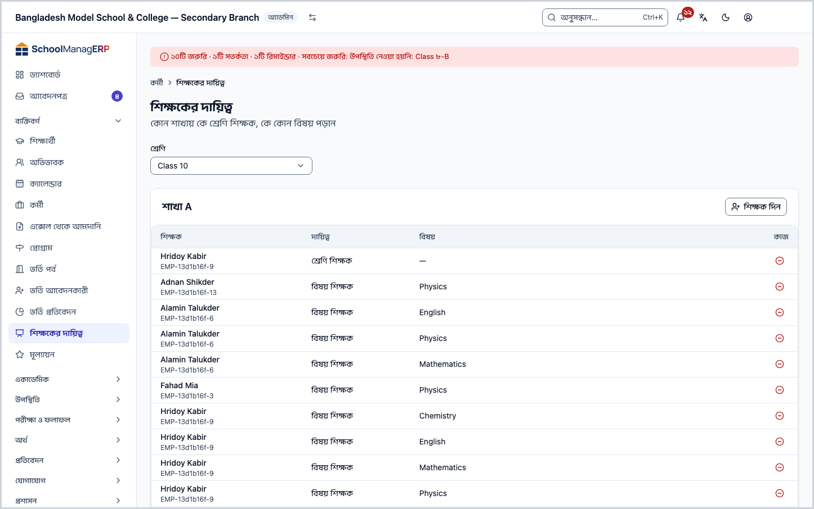
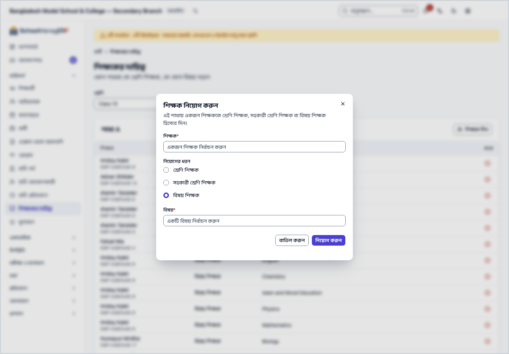
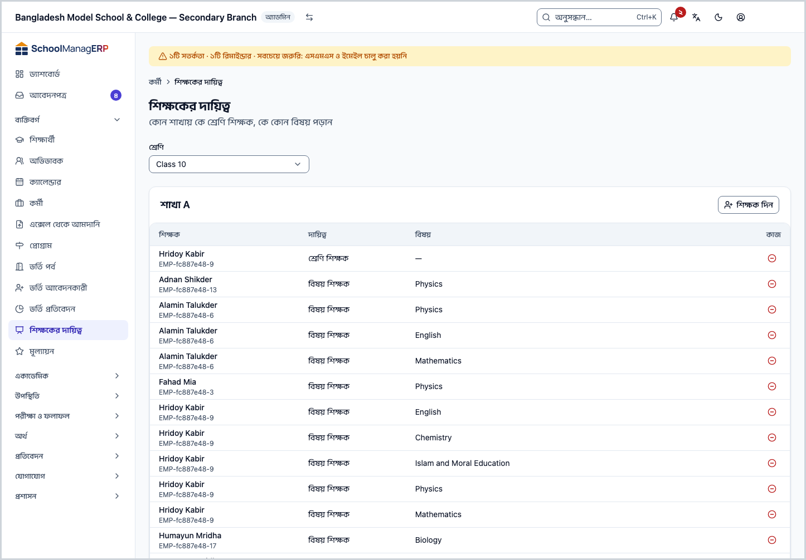

<!-- guide:meta
feature: people.teachingAssignments
title: শিক্ষককে শ্রেণি-শাখার দায়িত্ব দেওয়া
summary: কোন শাখায় কে শ্রেণি শিক্ষক, কে সহকারী, আর কে কোন বিষয় পড়ান, তা ঠিক করুন; এতেই শিক্ষক নিজের শাখা দেখতে পান।
roles: [ADMIN]
sources:
  - client-admin/src/routes/_staff/staff/teaching-assignments.tsx
  - client-admin/src/routes/_staff/classes/-assign-teacher-dialog.tsx
  - client-admin/src/routes/_staff/staff/-detail/teaching-assignments-tab.tsx
  - server/src/modules/classes/classes.service.ts
  - server/src/modules/classes/teacher-scope.service.ts
  - server/src/modules/exams/marks-authorization.util.ts
  - server/src/modules/attendance/attendance-access.service.ts
labels:
  [
    teacherAssignments:*,
    classes:assignTeacherForm.*,
    classes:assignmentType.*,
    classes:assignDialog.*,
    staff:detail.teachingAssignments.*,
    nav:items.teachingAssignments,
    nav:groups.people,
    common:accessDenied.*,
  ]
helpIds:
  [
    people.teachingAssignments,
    people.teachingAssignments.action.assign,
    people.teachingAssignments.action.unassign,
    people.teachingAssignments.field.assignmentType,
  ]
devices: [desktop]
entry: [sidebar, palette]
keywords:
  [শিক্ষকের দায়িত্ব, শ্রেণি শিক্ষক, বিষয় শিক্ষক, সহকারী শ্রেণি শিক্ষক, শাখা, নিয়োগ, teaching assignment, class teacher, subject teacher, assign]
appVersion: 0.1.0 (e81ef857f)
owner: tareq89
lastVerified: 2026-10-24
knownIssues: []
-->

# শিক্ষককে শ্রেণি-শাখার দায়িত্ব দেওয়া

কোন শাখায় কে শ্রেণি শিক্ষক, কে সহকারী শ্রেণি শিক্ষক, আর কে কোন বিষয় পড়ান, তা এখানে ঠিক করুন। এই দায়িত্বই ঠিক করে শিক্ষক অ্যাপে কোন শাখা দেখবেন।

**যেতে হবে:** বাম মেনুতে **ব্যক্তিবর্গ → শিক্ষকের দায়িত্ব**। এই পাতার কাজ কম্পিউটারে করুন।
**শুরুর আগে:** আপনি স্কুলের অ্যাডমিন হবেন ([কে কী করতে পারেন](#roles))। শ্রেণি ও শাখা তৈরি থাকতে হবে ([স্কুল সাজানোর ক্রম](../admin/setup-order.md))। শিক্ষকের **শিক্ষক প্রোফাইল** থাকতে হবে; না থাকলে আগে [শিক্ষক প্রোফাইল দিন](staff.md#task-teacher)।

প্রতিটি শাখার একটি **দায়িত্বের তালিকা** থাকে। তালিকার প্রতি সারিতে একজন শিক্ষক আর তাঁর দায়িত্ব। দায়িত্ব তিন রকম: **শ্রেণি শিক্ষক**, **সহকারী শ্রেণি শিক্ষক**, **বিষয় শিক্ষক** (সঙ্গে বিষয়)। এই পাতায় সেই তালিকাই বানাবেন।

[দায়িত্ব দিন](#task-main) · [দায়িত্ব থেকে সরান](#task-unassign) · [শ্রেণি শিক্ষক বদলান](#task-replace) · [সমস্যা ও সমাধান](#trouble)

**এই পাতায় যা আছে**

- [শিক্ষককে শাখার দায়িত্ব দিন](#task-main)
- [দায়িত্ব দেওয়া হয়েছে কি না বুঝবেন কীভাবে](#confirm)
- [অন্য পরিস্থিতিতে](#other)
  - [শ্রেণি শিক্ষক বদলান](#task-replace)
  - [দায়িত্ব থেকে সরান](#task-unassign)
  - [একজন শিক্ষকের সব দায়িত্ব দেখুন বা দিন](#task-teacher)
- [শিক্ষক এরপর কী দেখেন](#after)
- [সমস্যা ও সমাধান](#trouble)
- [কে কী করতে পারেন](#roles)
- [আরও জানুন](#more)

---

## শিক্ষককে শাখার দায়িত্ব দিন 

1. বাম মেনুতে **ব্যক্তিবর্গ → শিক্ষকের দায়িত্ব** চাপুন।

   → উপরে **শিক্ষকের দায়িত্ব** শিরোনাম, নিচে "কোন শাখায় কে শ্রেণি শিক্ষক, কে কোন বিষয় পড়ান" লেখা। তার নিচে **শ্রেণি** ঘর, আর সেই শ্রেণির প্রতিটি শাখার জন্য একটি কার্ড: **শাখা ক**, **শাখা খ**, ইত্যাদি। প্রথম শ্রেণিটি নিজে থেকে বাছা থাকে।

2. **শ্রেণি** ঘর থেকে যে শ্রেণির শাখায় দায়িত্ব দেবেন, সেটি বেছে নিন।

   → সেই শ্রেণির শাখাগুলোর কার্ড আসে। প্রতিটি কার্ডে **শিক্ষক**, **দায়িত্ব**, **বিষয়** কলাম। কেউ না থাকলে **এখনও কেউ নেই** আর "এই শাখায় এখনও কোনো শিক্ষককে দায়িত্ব দেওয়া হয়নি।"

3. যে শাখায় দেবেন, তার কার্ডের **শিক্ষক দিন** চাপুন।

   → **শিক্ষক নিয়োগ করুন** ঘর খোলে: "এই শাখায় একজন শিক্ষককে শ্রেণি শিক্ষক, সহকারী শ্রেণি শিক্ষক বা বিষয় শিক্ষক হিসেবে দিন।"

4. **শিক্ষক** ঘর থেকে শিক্ষককে বেছে নিন।

   → তালিকায় প্রতিটি নামের পাশে বন্ধনীতে কর্মী আইডি থাকে। শুধু শিক্ষক প্রোফাইল আছে এমন কর্মীরাই আসেন।

5. **নিয়োগের ধরন** থেকে একটি বেছে নিন: **শ্রেণি শিক্ষক**, **সহকারী শ্রেণি শিক্ষক** বা **বিষয় শিক্ষক**। আগে থেকে **শ্রেণি শিক্ষক** বাছা থাকে।

   → **বিষয় শিক্ষক** বাছলে নিচে **বিষয়** ঘর আসে। অন্য দুটিতে আসে না।

6. **বিষয় শিক্ষক** হলে **বিষয়** ঘর থেকে বিষয় বেছে নিন।

   → তালিকায় শুধু চালু বিষয়, নামের পাশে কোড। বাংলায় খুললে বাংলা নাম।

7. ঘরের নিচে **নিয়োগ করুন** চাপুন।

   → ঘর বন্ধ হয়, আর শাখার কার্ডের তালিকায় নতুন সারি আসে। তালিকায় আগে **শ্রেণি শিক্ষক**, তারপর **সহকারী শ্রেণি শিক্ষক**, তারপর **বিষয় শিক্ষক**।

> **মনে রাখুন:** **নিয়োগ করুন** না চাপা পর্যন্ত কিছুই সিস্টেমে যায় না। ঘরে কিছু লিখে বন্ধ করতে গেলে অ্যাপ আগে জিজ্ঞেস করে লেখা ফেলে দেবেন কি না; চাইলে ফিরে এসে চালিয়ে যেতে পারেন।

কোনো সারি ভুল ঘরে বা ভুল শিক্ষককে হয়ে গেলে [দায়িত্ব থেকে সরান](#task-unassign) আর আবার দিন।

---

## দায়িত্ব দেওয়া হয়েছে কি না বুঝবেন কীভাবে 

এই কাজ ইন্টারনেট ছাড়া হয় না। তাই **এই ডিভাইসে সংরক্ষিত** অবস্থা এখানে নেই।

| অবস্থা                       | কীভাবে বুঝবেন                                            | এরপর কী               |
| ---------------------------- | -------------------------------------------------------- | --------------------- |
| **শুধু স্ক্রিনে বদলেছে**     | ঘর খোলা, শিক্ষক ও ধরন বাছা, কিন্তু ঘর বন্ধ হয়নি         | **নিয়োগ করুন** চাপুন |
| **স্কুলের সিস্টেমে পৌঁছেছে** | ঘর বন্ধ হয়েছে, আর শাখার তালিকায় শিক্ষকের নতুন সারি আছে | কাজ শেষ               |

**যাচাই করতে চাইলে:** পাতা রিলোড করুন, একই **শ্রেণি** বেছে শাখার কার্ডে সারিটি দেখুন। অথবা [কর্মী যোগ করা ও পরিচালনা](staff.md) পাতা থেকে ওই শিক্ষকের পাতা খুলে **শিক্ষকের দায়িত্ব** ট্যাবে দেখুন।

**বার্তা না এলে:** [সমস্যা ও সমাধান](#trouble) দেখুন। ঘরে বাছা তথ্য ঘরেই থাকে; কিছু হারায় না।

---

## অন্য পরিস্থিতিতে 

### শ্রেণি শিক্ষক বদলান 

একটি শাখায় একজনই **শ্রেণি শিক্ষক** থাকেন। নতুন একজনকে **শ্রেণি শিক্ষক** করলে আগের জন আপনা-আপনি সরে যান।

1. শাখার কার্ডে **শিক্ষক দিন** চাপুন। **নিয়োগের ধরন** **শ্রেণি শিক্ষক** রাখুন।
2. **শিক্ষক** ঘর থেকে নতুন শিক্ষককে বাছুন।

   → ঘরে একটি সতর্কবার্তা আসে: **{নাম} আর শ্রেণি শিক্ষক থাকবেন না, তাঁর জায়গায় নতুন শিক্ষক হবেন**।

3. **নিয়োগ করুন** চাপুন।

| আপনি চাপলেন     | কী হবে                                                                                                    | জমা হলো? |
| --------------- | --------------------------------------------------------------------------------------------------------- | -------- |
| **নিয়োগ করুন** | আগের শ্রেণি শিক্ষক এই শাখার শ্রেণি শিক্ষকের দায়িত্ব হারান; নতুনজন পান। আগের জনের অন্য দায়িত্ব বদলায় না | হ্যাঁ    |
| **বাতিল করুন**  | কিছুই বদলায় না                                                                                           | না       |

> **মনে রাখুন:** যিনি ওই শাখায় আগে **সহকারী শ্রেণি শিক্ষক** ছিলেন, তাঁকে **শ্রেণি শিক্ষক** করলে তাঁর সহকারীর সারিটি সরে গিয়ে শুধু শ্রেণি শিক্ষকের সারি থাকে।

### দায়িত্ব থেকে সরান 

1. শাখার কার্ডে শিক্ষকের সারির শেষে **দায়িত্ব থেকে সরান** চাপুন।

   → **দায়িত্ব থেকে সরাবেন?** ঘর খোলে: "{শিক্ষকের নাম}-কে শাখা {শাখার নাম}-এর দায়িত্ব থেকে সরানো হবে।"

2. **সরান** চাপুন।

   → ঘর বন্ধ হয়, আর সারিটি তালিকা থেকে চলে যায়। ওই শাখায় শিক্ষকের আর কোনো দায়িত্ব না থাকলে শাখাটি তাঁর নিজের তালিকা থেকে চলে যায়, প্রবেশাধিকারও থাকে না। প্রবেশাধিকার বন্ধ করতে ওই শাখায় তাঁর সব দায়িত্ব সরান।

| আপনি চাপলেন | কী হবে                                                 | জমা হলো? |
| ----------- | ------------------------------------------------------ | -------- |
| **সরান**    | এই একটি দায়িত্ব সরে যায়; শিক্ষকের অন্য দায়িত্ব থাকে | হ্যাঁ    |
| **বাতিল**   | কিছুই বদলায় না                                        | না       |

> **মনে রাখুন:** এতে শিক্ষকের প্রোফাইল বা স্কুলে থাকার অধিকার যায় না; শুধু সেই শাখার দায়িত্ব সরে।

### একজন শিক্ষকের সব দায়িত্ব দেখুন বা দিন 

এক শিক্ষকের সব শ্রেণি-শাখা একসঙ্গে দেখতে:

1. বাম মেনুতে **ব্যক্তিবর্গ → কর্মী** চাপুন, তারপর শিক্ষকের নামে চাপুন।

   → তাঁর পাতা খোলে। শিক্ষক প্রোফাইল থাকলে **শিক্ষকের দায়িত্ব** ট্যাব থাকে।

2. **শিক্ষকের দায়িত্ব** ট্যাব চাপুন।

   → "এই শিক্ষককে যেসব শ্রেণি ও শাখায় নিয়োগ দেওয়া হয়েছে" তালিকা: **শ্রেণি ও শাখা** ("শ্রেণি · শাখা" আকারে), **দায়িত্ব**, **বিষয়**। কিছু না থাকলে **এখনও কোনো দায়িত্ব নেই**।

3. নতুন দায়িত্ব দিতে **শিক্ষক দায়িত্ব দিন** চাপুন।

   → **শিক্ষক নিয়োগ করুন** ঘর খোলে। এখানে শিক্ষক আগে থেকে ঠিক, তাই **শিক্ষক** ঘর নেই। তার বদলে **শ্রেণি** ও **শাখা** বাছতে হয় (শাখা বাছা যায় শ্রেণি বাছার পর)। বাকি ধাপ উপরের ধাপ ৫ থেকে।

4. সরাতে সারির শেষে **দায়িত্ব থেকে সরান** চাপুন, তারপর ঘরে **সরান**।

   → ঘরের লেখা: "{শ্রেণি · শাখা}-এর দায়িত্ব থেকে এই শিক্ষককে সরানো হবে।" সরে গেলে সারিটি তালিকা থেকে যায়। না গেলে **দায়িত্বটি সরানো যায়নি। আবার চেষ্টা করুন।**

---

## শিক্ষক এরপর কী দেখেন 

দায়িত্ব দিলে শিক্ষকের অ্যাপে এই বদলগুলো হয়। এগুলো কোড দেখে যাচাই করা।

| শিক্ষক কী করেন                               | দায়িত্ব অনুযায়ী নিয়ম                                                                                                                               |
| -------------------------------------------- | ----------------------------------------------------------------------------------------------------------------------------------------------------- |
| [হাজিরা নেওয়া](../attendance/attendance.md) | যে শাখা তাঁকে দেওয়া হয়েছে, শুধু সেই শাখার হাজিরা                                                                                                    |
| শিক্ষার্থীর তালিকা দেখা                      | শুধু তাঁর শাখাগুলোর শিক্ষার্থী। দায়িত্ব না থাকলে তালিকা খালি                                                                                         |
| নম্বর লেখা                                   | শুধু **বিষয় শিক্ষক** হিসেবে নির্দিষ্ট বিষয়ের নম্বর। **শ্রেণি শিক্ষক** ও **সহকারী শ্রেণি শিক্ষক** শাখার সব বিষয়ের নম্বর দেখতে পারেন, লিখতে পারেন না |

**একটি শর্ত:** শিক্ষকের কাজে আসে চলতি শিক্ষাবর্ষের শ্রেণির দায়িত্ব। (নম্বরের বেলায় একটি ব্যতিক্রম আছে: আগের বছরের শ্রেণিতে খসড়া পরীক্ষা থাকলে তা-ও চলে।) এই পাতার **শ্রেণি** ঘরের তালিকায় শিক্ষাবর্ষ লেখা থাকে না; কোনো শ্রেণি চলতি বছরের কি না আগে দেখে নিন, নইলে দায়িত্ব দিয়েও শিক্ষক কিছু দেখবেন না। (অ্যাপে এখনো চালিয়ে দেখা হয়নি; কোড থেকে নেওয়া।)

অ্যাডমিন এসব নিয়ম পার হয়ে সব শাখা দেখতে ও কাজ করতে পারেন।

---

## সমস্যা ও সমাধান 

| আপনি যা দেখছেন                                                        | কী করবেন                                                                                                                                                 | কে সাহায্য করতে পারেন |
| --------------------------------------------------------------------- | -------------------------------------------------------------------------------------------------------------------------------------------------------- | --------------------- |
| **এই পাতাটি দেখার অনুমতি আপনার নেই।**                                 | শুধু অ্যাডমিন এই পাতা দেখেন। **ড্যাশবোর্ডে ফিরে যান** চাপুন।                                                                                             | অ্যাডমিন              |
| **এখনও কোনো শ্রেণি নেই**                                              | **শ্রেণি যোগ করুন** চাপুন। শ্রেণি ও শাখা আগে তৈরি করুন ([স্কুল সাজানোর ক্রম](../admin/setup-order.md))।                                                  | অ্যাডমিন              |
| **শ্রেণির তালিকা লোড করতে ব্যর্থ হয়েছে।**                            | ইন্টারনেট দেখে **আবার চেষ্টা করুন** চাপুন।                                                                                                               | অ্যাডমিন              |
| **এই শাখার শিক্ষকদের তালিকা আনা যায়নি।**                             | **আবার চেষ্টা করুন** চাপুন।                                                                                                                              | অ্যাডমিন              |
| **শিক্ষক আবশ্যক**                                                     | **শিক্ষক** ঘর থেকে একজনকে বাছুন।                                                                                                                         | অ্যাডমিন              |
| **বিষয় আবশ্যক**                                                      | **বিষয় শিক্ষক** বাছলে **বিষয়**ও বাছতে হয়।                                                                                                             | অ্যাডমিন              |
| **শ্রেণি আবশ্যক** বা **শাখা আবশ্যক**                                  | শিক্ষকের পাতা থেকে দেওয়ার সময় আগে **শ্রেণি**, তারপর **শাখা** বাছুন।                                                                                    | অ্যাডমিন              |
| **এই শিক্ষক ইতিমধ্যে এই শাখার শ্রেণি শিক্ষক বা সহকারী শ্রেণি শিক্ষক** | সেই শাখায় তিনি আগেই আছেন। **সহকারী শ্রেণি শিক্ষক** করতে চাইলে আগে তাঁর বর্তমান দায়িত্ব সরান। উল্টো, **শ্রেণি শিক্ষক** করলে সহকারীর সারি নিজে সরে যায়। | অ্যাডমিন              |
| **এই শিক্ষক ইতিমধ্যে এই শাখায় এই বিষয়ের জন্য নিয়োজিত আছেন**        | একই বিষয়ে একই শাখায় দুবার দেওয়া যায় না। তালিকায় সারিটি আছে কি না দেখুন।                                                                             | অ্যাডমিন              |
| **শিক্ষক নিয়োগ করতে ব্যর্থ হয়েছে**                                  | ইন্টারনেট দেখে আবার **নিয়োগ করুন** চাপুন।                                                                                                               | অ্যাডমিন              |
| **সরানো যায়নি। আবার চেষ্টা করুন।**                                   | ইন্টারনেট দেখে আবার **দায়িত্ব থেকে সরান** চাপুন। সারিটি তালিকায় থেকে গেলে সরানো হয়নি।                                                                 | অ্যাডমিন              |
| **শিক্ষক** ঘরে একজনকে খুঁজে পাচ্ছেন না                                | তাঁর শিক্ষক প্রোফাইল নেই। [শিক্ষক প্রোফাইল দিন](staff.md#task-teacher)।                                                                                  | অ্যাডমিন              |
| শিক্ষক বলছেন তিনি কোনো শাখা দেখছেন না                                 | **শিক্ষকের দায়িত্ব** ট্যাবে তাঁর সারি আছে কি না দেখুন; আর শ্রেণিটি চলতি শিক্ষাবর্ষের কি না ([শর্ত](#after))।                                            | অ্যাডমিন              |

কোনো পাতা বা বোতাম দেখতে না পেলে দেখুন [আমি এটা দেখতে পাচ্ছি না কেন?](../help/cant-see-this.md)।

---

## কে কী করতে পারেন 

| ভূমিকা                                                                                           | পাতা দেখতে ও দায়িত্ব দিতে-সরাতে |
| ------------------------------------------------------------------------------------------------ | -------------------------------- |
| অ্যাডমিন                                                                                         | হ্যাঁ                            |
| একাডেমিক কো-অর্ডিনেটর, শিক্ষক, হিসাবরক্ষক, অফিস সহকারী, পরীক্ষা নিয়ন্ত্রক, পরিচালনা পর্ষদ সদস্য | না                               |

যাঁদের অনুমতি নেই, তাঁরা পাতাটি খুললে **এই পাতাটি দেখার অনুমতি আপনার নেই।** দেখেন, আর বাম মেনুতে **শিক্ষকের দায়িত্ব** থাকে না।

---

## আরও জানুন 

<strong>পাতার অংশগুলো</strong> — উপর থেকে নিচে

1. **শিক্ষকের দায়িত্ব** — শিরোনাম ও ছোট লেখা।
2. **শ্রেণি** — কোন শ্রেণির শাখাগুলো দেখবেন।
3. **শাখার কার্ড** — প্রতি শাখার নাম (যেমন **শাখা ক**) ও **শিক্ষক দিন** বোতাম।
4. **দায়িত্বের তালিকা** — **শিক্ষক** (নাম ও কর্মী আইডি), **দায়িত্ব**, **বিষয়**; প্রতি সারির শেষে **দায়িত্ব থেকে সরান**।

<strong>ঘরগুলোর অর্থ</strong>

<!-- guide:generated:fields:teacherAssignments -->

| ঘর           | কী লিখবেন                                                                                                                          | বাধ্যতামূলক?                            |
| ------------ | ---------------------------------------------------------------------------------------------------------------------------------- | --------------------------------------- |
| শ্রেণি       | কোন শ্রেণির শাখাগুলো দেখবেন। শিক্ষকের পাতা থেকে দেওয়ার সময়ও এটি বাছতে হয়।                                                       | হ্যাঁ (শিক্ষকের পাতা থেকে দেওয়ার সময়) |
| শাখা         | শিক্ষকের পাতা থেকে দেওয়ার সময় কোন শাখা। শ্রেণি বাছার পর বাছা যায়।                                                               | হ্যাঁ (শিক্ষকের পাতা থেকে দেওয়ার সময়) |
| শিক্ষক       | যাঁকে দায়িত্ব দেবেন। নামের পাশে কর্মী আইডি। শুধু শিক্ষক প্রোফাইল আছে এমন কর্মী।                                                   | হ্যাঁ                                   |
| নিয়োগের ধরন | **শ্রেণি শিক্ষক** (শাখায় একজনই; নতুন করলে আগের জন সরে), **সহকারী শ্রেণি শিক্ষক**, বা **বিষয় শিক্ষক** (একটি বিষয়ের)।             | হ্যাঁ, আগে থেকে **শ্রেণি শিক্ষক** বাছা  |
| বিষয়        | শুধু **বিষয় শিক্ষক** হলে, কোন বিষয়। চালু বিষয়ের মধ্য থেকে।                                                                      | হ্যাঁ, **বিষয় শিক্ষক**-এর জন্য         |
| ধরন          | **শ্রেণি সমন্বয়ক** শ্রেণির সব বিষয় দেখেন। **বিষয় সমন্বয়ক** শুধু একটি বিষয় দেখেন। দুজনেই শুধু দেখেন; নম্বর বা হাজিরা বদলান না। | বিষয় বাছাই থেকে ঠিক হয়                |
| শ্রেণি       | এ বছরের এক বা একাধিক শ্রেণি। সমন্বয়ক প্রতিটি শ্রেণির সব শাখা দেখেন।                                                               | হ্যাঁ                                   |
| বিষয়        | **শ্রেণি সমন্বয়কের** জন্য খালি রাখুন। **বিষয় সমন্বয়কের** জন্য একটি বিষয় বাছুন।                                                 | না                                      |

<!-- /guide:generated -->

<strong>শিক্ষকের দায়িত্ব কীভাবে কাজ করে</strong> — শিক্ষক প্রোফাইল থেকে শিক্ষকের পাতা পর্যন্ত

<figure>
  
  <figcaption><em>কর্মী থেকে দায়িত্ব, দায়িত্ব থেকে শিক্ষকের পাতা</em></figcaption>
</figure>

- দায়িত্ব না দিলে শিক্ষক কোনো শাখা দেখেন না, যদিও তিনি কর্মী তালিকায় আছেন।
- দায়িত্ব বদলালে শিক্ষক পাতা নতুন করে খুললে বদল দেখেন; তাঁকে আলাদা করে কিছু করতে হয় না।
- কর্মী যোগ ও শিক্ষক প্রোফাইল: [কর্মী যোগ করা ও পরিচালনা](staff.md#more)। অনেক শিক্ষককে একসঙ্গে: [এক্সেল থেকে কর্মী যোগ করা](staff-import.md)।

<strong>পুরো কাজটি একসাথে</strong>

<!-- image pending: শ্রেণি বাছা থেকে শিক্ষক দেওয়া ও সরানো পর্যন্ত GIF, অ্যাডমিন, desktop -->

**সম্পর্কিত পাতা**

- [**কর্মী যোগ করা ও পরিচালনা**](staff.md) — কর্মী যোগ করুন ও শিক্ষক প্রোফাইল দিন; এখানকার দায়িত্ব সেখান থেকেও দেখা যায়।
- [**এক্সেল থেকে কর্মী যোগ করা**](staff-import.md) — একসঙ্গে অনেক শিক্ষক যোগ করুন, তারপর এখানে দায়িত্ব দিন।
- [**শ্রেণির সাপ্তাহিক রুটিন সাজানো**](../academics/routine-builder.md) — এখানে দেওয়া দায়িত্ব দেখে রুটিনের খালি ঘর পূরণ হয়; দায়িত্ব ছাড়া শিক্ষক বসালে সতর্কতা আসে।
- [**শ্রেণি, শাখা ও বিষয় সাজানো**](../academics/classes.md) — যেখানে শ্রেণি, শাখা ও বিষয় বানানো হয়।
- [**বাড়ির কাজ দেওয়া**](../academics/homework.md) — এখানে যে শাখা দেওয়া আছে, শিক্ষক শুধু সেই শাখায় বাড়ির কাজ দিতে পারেন।
- [**সিলেবাস ও পাঠ পরিকল্পনা**](../academics/syllabus.md) — পাঠ পরিকল্পনা এখানকার দায়িত্ব অনুসরণ করে।
- [**উপস্থিতির খাতা**](../attendance/attendance-register.md) — খাতায় শিক্ষক কোন শাখা দেখেন।
- [**মূল্যায়ন: এসিআর, শিক্ষক জরিপ ও ঘটনা**](evaluations.md) — যে শিক্ষকের এই দায়িত্ব, তাঁর মূল্যায়ন।
- [**উপস্থিতি নেওয়া**](../attendance/attendance.md) — এখানে যে শাখা দেওয়া হয়, তার উপস্থিতি নেওয়া হয়।
- [**ভূমিকা ও অনুমতি**](../administration/roles.md) — স্কুলের প্রতিটি কর্মী-ভূমিকা কী দেখতে ও করতে পারে, এক পাতায় পাশাপাশি দেখুন। পাতাটি শুধু দেখার জন্য.
- [**আবেদনপত্র**](../applications/applications.md) — ছুটি, ফি মওকুফ, ছাড়পত্র, প্রশংসাপত্র, শাখা বদলসহ স্কুলের আবেদন জমা দিন, অভিভাবকের কাগজের আবেদন অ্যাপে তুলুন।
- [**পরীক্ষার নম্বর দেওয়া ও জমা দেওয়া**](../exams-results/marks-entry.md) — পরীক্ষা বেছে নিজের শাখা ও বিষয়ের নম্বর তালিকা খুলুন, প্রতিটি শিক্ষার্থীর নম্বর বা অনুপস্থিত/মওকুফ লিখুন, তারপর তালিকা জমা দিন।

---

_সংস্করণ ০.১.০ · শেষ যাচাই ২০২৬-১০-২৪_
