<!-- guide:meta
feature: platformOwner.announcements
title: স্কুলগুলোতে ঘোষণা পাঠানো
summary: অনেক স্কুলের অ্যাডমিনের জন্য একটি বার্তা লিখুন, কতজন পাবেন দেখুন, অন্য মালিকের সম্মতি নিন এবং আগে কী পাঠানো হয়েছে পড়ুন।
roles: [SUPER_ADMIN]
sources:
  - client-admin/src/routes/_platform/announcements/
labels: [platformAnnouncements:*]
helpIds: [platformOwner.announcements]
devices: [desktop]
entry: [sidebar, palette]
keywords: [ঘোষণা, ব্যানার, এসএমএস, ইমেইল, সম্মতি, announcement, banner, sms, email, approval]
appVersion: 0.1.0 (485d3ac71)
owner: tareq89
lastVerified: 2026-11-12
knownIssues: []
-->

# স্কুলগুলোতে ঘোষণা পাঠানো

অনেক স্কুলের অ্যাডমিনকে জরুরি কথা একবারেই জানান।

**যেতে হবে:** কনসোলের বাম মেনুতে **ঘোষণা**।
**শুরুর আগে:** প্ল্যাটফর্ম মালিক হোন। অন্য মালিককে সম্মতি দিতে পারতে হবে ([মালিককে আটকে দেওয়া ও অনুমতি](lock-and-approvals.md))।

[পাঠান](#task-main) · [পাঠানোর পরে](#task-wait) · [সমস্যা ও সমাধান](#trouble)

**এই পাতায় যা আছে**

- [পাঠান](#task-main)
- [কাজ হয়েছে কি না বুঝবেন কীভাবে](#confirm)
- [অন্য পরিস্থিতিতে](#other)
  - [পাঠানোর পরে](#task-wait)
  - [কী পাঠানো হয়েছে পড়ুন](#task-list)
- [সমস্যা ও সমাধান](#trouble)
- [কে কী করতে পারেন](#roles)
- [আরও জানুন](#more)

---

## পাঠান 

1. **ঘোষণা** খুলুন। **নতুন ঘোষণা**-র নিচে **কাদের পাঠাবেন** বাছুন: **শুধু চালু স্কুল**, **শুধু স্থগিত স্কুল** বা **সব স্কুল**।
2. **ধরন** বাছুন: **অনুস্মারক** বা **সতর্কতা**।
3. **শিরোনাম** ও **বার্তা** লিখুন। গণনায় দেখা যায় কত অক্ষর লেখা হলো।
4. **কোন মাধ্যমে**-র নিচে অ্যাপের ব্যানার সবসময় চালু থাকে। চাইলে **এসএমএস** বা **ইমেইল** টিক দিন।

   → **স্কুল: (সংখ্যা)। অ্যাডমিন: (সংখ্যা)।** লাইনে দেখা যায় কারা পাবেন। কোনো স্কুল না মিললে লেখা আসে কিছু পাঠানো হবে না।

5. **পাঠান** চাপুন।

   → "পাঠানোর আগে অন্য মালিককে রাজি হতে হবে।"

<figure>
  
  <figcaption><em>ঘোষণা কীভাবে স্কুলে পৌঁছায়</em></figcaption>
</figure>

---

## কাজ হয়েছে কি না বুঝবেন কীভাবে 

| যা দেখবেন                                         | এর মানে          | এরপর                       |
| ------------------------------------------------- | ---------------- | -------------------------- |
| **অন্য মালিকের রাজি হওয়ার অপেক্ষায়।**           | এখনও কিছু যায়নি | অন্য মালিককে রাজি হতে বলুন |
| **অন্য মালিক রাজি হয়েছেন।**                      | এখন পাঠাতে পারেন | **এখন পাঠান** চাপুন        |
| **পাঠানো হয়েছে: (সংখ্যা)টি স্কুল, (সংখ্যা) জন।** | কাজ শেষ          | দরকারে **আরেকটি লিখুন**    |

---

## অন্য পরিস্থিতিতে 

### পাঠানোর পরে 

অন্য মালিক **অনুমতির অনুরোধ** থেকে রাজি হন ([কীভাবে](lock-and-approvals.md#task-approve))। তিনি রাজি হলে **এখন পাঠান** চাপুন। অনুরোধ ফিরিয়ে নিতে **বাতিল করুন** চাপুন। অন্য মালিক রাজি না হলে বা সময় শেষ হলে কিছুই যায় না; পাতায় কারণ লেখা আসে। অপেক্ষার সময় পাতা ছেড়ে গেলে বা রিলোড করলে অনুরোধটি এই ব্রাউজার ট্যাবে থেকে যায়: **ঘোষণা**-য় ফিরলে তা চলতে থাকে, আর যে অনুরোধে আগেই সম্মতি দেওয়া হয়েছে তা পাতা খুললেই পাঠানো হয়।

### কী পাঠানো হয়েছে পড়ুন 

**পাঠানো ঘোষণা**-য় **তারিখ**, **শিরোনাম**, কতগুলো স্কুলে **পৌঁছেছে** ("(সংখ্যা) / (মোট) স্কুল") আর যিনি পাঠিয়েছেন তাঁর নাম থাকে। একবারে ২৫টি দেখায়; পুরোনোগুলো পড়তে টেবিলের নিচে **পরের** ও **আগের** চাপুন।

---

## সমস্যা ও সমাধান 

| যা দেখবেন                                  | কী করবেন                | কে সাহায্য করবেন |
| ------------------------------------------ | ----------------------- | ---------------- |
| **শিরোনাম লিখুন।** / **বার্তা লিখুন।**     | খালি ঘরটি পূরণ করুন     | —                |
| **কোনো স্কুল মেলেনি। কিছু পাঠানো হবে না।** | **কাদের পাঠাবেন** বদলান | —                |
| **গুনতে পারিনি। আবার চেষ্টা করুন।**        | **আবার গুনুন** চাপুন    | —                |
| **অনুরোধের সময় শেষ। কিছু পাঠানো হয়নি।**  | আবার লিখে পাঠান         | অন্য মালিক       |

---

## কে কী করতে পারেন 

| ভূমিকা                                    | ঘোষণা                              |
| ----------------------------------------- | ---------------------------------- |
| প্ল্যাটফর্ম মালিক                         | লিখে পাঠান; অন্য মালিক রাজি হন     |
| স্কুলের অ্যাডমিন ও অন্য সব স্কুলের ভূমিকা | অ্যাক্সেস নেই; শুধু ব্যানারে পড়েন |

---

## আরও জানুন 

<strong>অন্য মালিককে কেন রাজি হতে হয়?</strong>

একটি বার্তা অনেক স্কুলে পৌঁছায়। আগে দ্বিতীয় একজন দেখে নেন, যাতে একটি ভুল বা একটি চুরি যাওয়া অ্যাকাউন্ট দিয়ে তা পাঠানো না যায়।

**সম্পর্কিত পাতা**

- [**স্কুল নিয়ন্ত্রণ ও অডিট**](school-control.md) — **ঘোষণা পাঠানো** অডিটে লেখা হয়।

---

_সংস্করণ 0.1.0 · সর্বশেষ যাচাই 2026-11-12_
