<!-- guide:meta
feature: platformOwner.lockAndApprovals
title: মালিককে আটকে দেওয়া ও অনুমতি
summary: অন্য প্ল্যাটফর্ম মালিককে আটকে দিন বা খুলে দিন, ঝুঁকির কাজে অন্য মালিকের অনুমতি নিন, আর সাইন-ইন ও আটকে দেওয়ার ইতিহাস দেখুন।
roles: [SUPER_ADMIN]
sources:
  - client-admin/src/routes/_platform/platform-owners/index.tsx
  - client-admin/src/features/cockpit/owners/owners-tab.tsx
  - client-admin/src/features/cockpit/owners/approvals-tab.tsx
  - client-admin/src/features/cockpit/owners/history-tab.tsx
labels: [platformOwners:*]
helpIds: [platformOwner.lockAndApprovals]
devices: [desktop, phone]
entry: [sidebar, palette]
keywords: [মালিককে আটকে দিন, খুলে দিন, অনুমতি, অন্য মালিক, ইতিহাস, lock owner, unlock, approval]
appVersion: 0.1.0 (acd66b46d)
owner: tareq89
lastVerified: 2026-11-12
knownIssues: []
-->

# মালিককে আটকে দেওয়া ও অনুমতি

দুই মালিককে একে অপরের ভুল থেকে, আর চুরি যাওয়া অ্যাকাউন্ট থেকে নিরাপদ রাখুন।

**যেতে হবে:** কনসোলের বাম মেনুতে **প্ল্যাটফর্ম মালিক**।
**শুরুর আগে:** প্ল্যাটফর্ম মালিক হোন এবং দুই ধাপে সাইন-ইন চালু রাখুন ([জরুরি কোড ও দুই ধাপে সাইন-ইন](recovery-codes.md))।

সিস্টেমে দুজন প্ল্যাটফর্ম মালিক থাকেন। একটি অ্যাকাউন্ট চুরি গেলে বা একজন মালিক চলে গেলে অন্যজন সেটি **আটকে** দিতে পারেন: অ্যাকাউন্টটি সঙ্গে সঙ্গে সাইন-আউট হয় আর খুলে না দেওয়া পর্যন্ত ঢুকতে পারে না। ঝুঁকির কিছু কাজে আগে অন্য মালিকের **অনুমতি**ও লাগতে পারে।

[আটকে দিন বা খুলে দিন](#task-main) · [অনুরোধে অনুমতি দিন](#task-approve) · [অনুমতি নেওয়া চালু বা বন্ধ](#task-switch) · [ইতিহাস দেখুন](#task-history) · [সমস্যা ও সমাধান](#trouble)

**এই পাতায় যা আছে**

- [আটকে দিন বা খুলে দিন](#task-main)
- [কাজ হয়েছে কি না বুঝবেন কীভাবে](#confirm)
- [অন্য পরিস্থিতিতে](#other)
  - [অনুরোধে অনুমতি দিন বা না করুন](#task-approve)
  - [অনুমতি নেওয়া চালু বা বন্ধ](#task-switch)
  - [ইতিহাস দেখুন](#task-history)
- [সমস্যা ও সমাধান](#trouble)
- [কে কী করতে পারেন](#roles)
- [আরও জানুন](#more)

---

## আটকে দিন বা খুলে দিন 

1. **প্ল্যাটফর্ম মালিক** খুলে **মালিক** ট্যাবে যান। প্রতিটি মালিকের পাশে **সক্রিয়** বা **আটকানো**, শেষ সাইন-ইন, আর দুই ধাপ চালু কি না দেখা যায়।
2. অন্য মালিকের সারিতে **আটকে দিন** চাপুন।
3. "তাঁর সাইন-ইন সঙ্গে সঙ্গে বন্ধ হয়ে যাবে।" পড়ে অথেন্টিকেটর অ্যাপের কোড লিখে নিশ্চিত করুন।

   → "… -কে আটকে দেওয়া হয়েছে।" সারিতে **আটকানো** আর কে আটকেছেন তা দেখা যায়।

ফিরিয়ে নিতে সারিতে **খুলে দিন** চেপে কোড দিয়ে নিশ্চিত করুন। তিনি আবার সাইন-ইন করতে পারবেন।

<figure>
  
  <figcaption><em>অনুমতিসহ ও অনুমতি ছাড়া আটকে দেওয়া</em></figcaption>
</figure>

---

## কাজ হয়েছে কি না বুঝবেন কীভাবে 

| যা দেখবেন                                   | এর মানে                             | এরপর                                                 |
| ------------------------------------------- | ----------------------------------- | ---------------------------------------------------- |
| সারিতে **আটকানো**                           | সেই মালিক সাইন-আউট ও বন্ধ           | নিরাপদ হলে খুলে দিন                                  |
| **অন্য মালিকের অনুমতির জন্য অপেক্ষা চলছে।** | অনুমতি নেওয়া চালু; এখনও কিছু হয়নি | অন্য মালিককে অনুমতি দিতে বলুন, তারপর কাজটি আবার করুন |
| **ইতিহাস**-এ **মালিককে আটকে দেওয়া হয়েছে** | আটকানো কে, কখন করলেন তা লেখা হয়েছে | —                                                    |

---

## অন্য পরিস্থিতিতে 

### অনুরোধে অনুমতি দিন বা না করুন 

1. **অনুমতির অনুরোধ** ট্যাব খুলুন। অনুরোধে লেখা থাকে কী চাওয়া হয়েছে ("একজন মালিককে আটকে দেওয়া", "একজন মালিককে খুলে দেওয়া", "অনুমতি নেওয়া বন্ধ করা", "নতুন জরুরি কোড বানানো") আর **অনুরোধ করেছেন** কে।
2. **অনুমতি দিন** বা **না করুন** চাপুন, আর নিজের কোড দিয়ে নিশ্চিত করুন।

   → এরপর যিনি চেয়েছিলেন তিনি কাজটি আবার করলে হয়ে যাবে। সিদ্ধান্তের আগে অনুরোধ **অপেক্ষায়**, পরে **অনুমতি দেওয়া হয়েছে**, **না করা হয়েছে**, **সম্পন্ন** বা **মেয়াদ শেষ**।

নিজের অনুরোধে নিজে অনুমতি দেওয়া যায় না।

### অনুমতি নেওয়া চালু বা বন্ধ 

**অনুমতির অনুরোধ** ট্যাবে সুইচ **আগে অন্য মালিকের অনুমতি নিন** **চালু** বা **বন্ধ** থাকে। চালু থাকলে এবং দুজনেই সক্রিয় থাকলে ঝুঁকির কাজে অন্য মালিকের সম্মতি লাগে। **চালু** করতে শুধু আপনার কোড লাগে। **বন্ধ** করতে আগে অন্য মালিকের সম্মতি লাগে।

### ইতিহাস দেখুন 

**ইতিহাস** ট্যাবে নতুন থেকে পুরোনো ক্রমে দেখা যায়: **সাইন-ইন করেছেন**, **সাইন-ইন ব্যর্থ**, **মালিককে আটকে দেওয়া হয়েছে**, **মালিকের আটকানো খোলা হয়েছে**, **অথেনটিকেটর চালু হয়েছে**, **রিকভারি কোড ব্যবহার হয়েছে**, **রিকভারি কোড নতুন করে তৈরি হয়েছে**, অনুমতির এন্ট্রি আর **পাসওয়ার্ড রিসেট হয়েছে**; সঙ্গে **কে** আর **কখন**। পুরোনোগুলো দেখতে **আরও দেখুন** চাপুন। চেনেন না এমন কোনো সাইন-ইন সন্দেহ হলে এখানে দেখুন।

---

## সমস্যা ও সমাধান 

| যা দেখবেন                                                                          | কী করবেন                                          | কে সাহায্য করবেন |
| ---------------------------------------------------------------------------------- | ------------------------------------------------- | ---------------- |
| **নিজেকে আটকে দেওয়া যায় না।**                                                    | আটকে দেওয়া শুধু অন্য মালিকের জন্য                | —                |
| **ইনি শেষ সক্রিয় মালিক, তাই আটকে দেওয়া যাবে না।**                                | সিস্টেম সবসময় একজন মালিককে সক্রিয় রাখে          | —                |
| **কাজটি করা গেল না। আবার চেষ্টা করুন।**                                            | কোডটি নতুন কি না দেখে আবার চেষ্টা করুন            | —                |
| **অনুরোধটি বাতিল বা মেয়াদোত্তীর্ণ হয়েছে। নতুন অনুরোধ পাঠাতে আবার নিশ্চিত করুন।** | কাজটি নতুন করে শুরু করুন                          | —                |
| আপনাকে আটকে দেওয়া হয়েছে                                                          | অন্য মালিককে আপনার সারিতে **খুলে দিন** চাপতে বলুন | অন্য মালিক       |

---

## কে কী করতে পারেন 

| ভূমিকা                                  | আটকে দেওয়া, খুলে দেওয়া, অনুমতি |
| --------------------------------------- | -------------------------------- |
| প্ল্যাটফর্ম মালিক                       | হ্যাঁ, শুধু অন্য মালিকের জন্য    |
| স্কুলের অ্যাডমিন ও অন্য সব স্কুল-ভূমিকা | প্রবেশ নেই                       |

---

## আরও জানুন 

<strong>আটকে দিতে অনুমতি লাগে কেন?</strong>

আটকে দেওয়া শক্তিশালী কাজ: এতে কারও সেশন শেষ হয়ে যায়। এক মালিকের ফোন আর পাসওয়ার্ড চোরের হাতে গেলে সে আসল অন্য মালিককে বাইরে ফেলে দিতে পারত। অনুমতি চালু থাকলে দ্বিতীয় একজনকে আগে রাজি হতে হয়।

**সম্পর্কিত পাতা**

- [**প্ল্যাটফর্ম মালিকের সাইন-ইন**](sign-in.md) — আটকানো মালিক সাইন-ইনে কীভাবে বাধা পান।
- [**জরুরি কোড ও দুই ধাপে সাইন-ইন**](recovery-codes.md) — নতুন কোড বানাতেও অনুমতি লাগতে পারে।

---

_সংস্করণ 0.1.0 · সর্বশেষ যাচাই 2026-11-12_
