<!-- guide:meta
feature: platformOwner.loginAs
title: স্কুলের কারও হিসেবে ঢোকা
summary: স্কুলের কারও হিসেবে ঢুকে তাঁকে সাহায্য করুন, কারণ লিখুন, স্কুল চাইলে অনুমোদনের অপেক্ষা করুন এবং কাজ শেষে বেরিয়ে আসুন।
roles: [SUPER_ADMIN]
sources:
  - client-admin/src/routes/_platform/schools/$schoolId.tsx
  - client-admin/src/features/cockpit/login-as/
  - client-admin/src/features/support-access/
  - client-admin/src/routes/_platform/users/
labels: [loginAs:*, supportBanner:*]
helpIds: [platformOwner.loginAs]
devices: [desktop]
entry: [sidebar, palette]
keywords: [হিসেবে ঢুকুন, জরুরি প্রবেশ, শুধু দেখা, সহায়তা, login as, support, emergency access, view only]
appVersion: 0.1.0 (485d3ac71)
owner: tareq89
lastVerified: 2026-11-12
knownIssues: []
-->

# স্কুলের কারও হিসেবে ঢোকা

স্কুলের একজনের চোখে স্কুলটি খুলুন, যাতে কী ভুল হয়েছে খুঁজে পান।

**যেতে হবে:** কনসোলের বাম মেনুতে **স্কুল**, তারপর স্কুলটি চাপুন। **ব্যবহারকারী** থেকেও শুরু করা যায়।
**শুরুর আগে:** প্ল্যাটফর্ম মালিক হোন এবং দুই ধাপে সাইন-ইন চালু রাখুন ([জরুরি কোড ও দুই ধাপে সাইন-ইন](recovery-codes.md))। অথেন্টিকেটর অ্যাপ হাতের কাছে রাখুন।

প্রতিটি স্কুল নিজে ঠিক করে বিডডালয় সহায়তা ঢুকতে পারবে কি না: **অনুমতি আছে**, **প্রতিবার জিজ্ঞাসা করুন** বা **বন্ধ**। এরপর আপনি কী করবেন তা এই বাছাইয়ের ওপর নির্ভর করে। আপনি যা করেন সবই স্কুলের তালিকায় এবং [অডিটে](school-control.md#task-audit) লেখা থাকে।

[হিসেবে ঢুকুন](#task-main) · [স্কুলের তিন বাছাই](#task-states) · [জরুরি প্রবেশ](#task-emergency) · [শেষ করুন](#task-end) · [সমস্যা ও সমাধান](#trouble)

**এই পাতায় যা আছে**

- [হিসেবে ঢুকুন](#task-main)
- [কাজ হয়েছে কি না বুঝবেন কীভাবে](#confirm)
- [অন্য পরিস্থিতিতে](#other)
  - [স্কুলের তিন বাছাই](#task-states)
  - [জরুরি প্রবেশ](#task-emergency)
  - [স্কুল কী দেখে](#task-school)
  - [শেষ করুন](#task-end)
- [সমস্যা ও সমাধান](#trouble)
- [কে কী করতে পারেন](#roles)
- [আরও জানুন](#more)

---

## হিসেবে ঢুকুন 

1. বাম মেনুতে **স্কুল** চাপুন, তারপর স্কুলটি চাপুন।

   → স্কুলের পাতা খোলে। ট্যাবগুলো: **সারসংক্ষেপ**, **মানুষ**, **সহায়তা প্রবেশ**, **নোট** ও **স্বাস্থ্য**।

2. উপরে **হিসেবে ঢুকুন** চাপুন।

   → **হিসেবে ঢুকুন - (স্কুলের নাম)** বাক্স খোলে। ভূমিকা **অ্যাডমিন** আগে থেকেই বাছা থাকে, আর যাঁকে বাছা যায় এমন প্রথম ব্যক্তিও বাছা থাকে।

3. অন্য কারও হিসেবে ঢুকতে চাইলে **ভূমিকা** বদলান, তারপর **ব্যক্তি**-র নিচে নাম বাছুন। খুঁজতে **নাম দিয়ে খুঁজুন**-এ লিখুন। যাঁর লগইন অ্যাকাউন্ট নেই বা যিনি সক্রিয় নন, তাঁর নাম ধূসর থাকে, বাছা যায় না।
4. **কারণ** লিখুন। **সহায়তার অনুরোধ**, **ত্রুটি যাচাই** বা **সেটআপে সাহায্য** চেপে আরও কথা যোগ করতে পারেন। স্কুল কোনো নোট রাখলে তা উপরে **স্কুলের নোট** নামে দেখা যায়।
5. শুধু দেখতে চাইলে **শুধু দেখা (কিছু বদলানো যাবে না)** টিক দিন। তারপর **হিসেবে ঢুকুন** চাপুন এবং চাইলে অথেন্টিকেটর অ্যাপের কোড লিখুন।

   → স্কুলের ভেতরে একটি নতুন ট্যাব খোলে, ওপরে একটি ব্যানার থাকে।

<figure>
  
  <figcaption><em>হিসেবে ঢুকুন চাপা থেকে স্কুল খোলা পর্যন্ত</em></figcaption>
</figure>

---

## কাজ হয়েছে কি না বুঝবেন কীভাবে 

| যা দেখবেন                                                      | এর মানে                                                | এরপর                                  |
| -------------------------------------------------------------- | ------------------------------------------------------ | ------------------------------------- |
| নতুন ট্যাবে ব্যানার "বিডডালয় সাপোর্ট, (নাম) হিসেবে, (ভূমিকা)" | আপনি স্কুলের ভেতরে                                     | কাজ করুন, শেষে **শেষ করুন** চাপুন     |
| **অনুমোদনের অপেক্ষায়**                                        | স্কুল প্রতিবার জিজ্ঞাসা করে; অ্যাডমিনদের জানানো হয়েছে | অপেক্ষা করুন; নিচে দেখুন              |
| **এই স্কুল বিডডালয় সহায়তা প্রবেশের অনুমতি দেয়নি।**          | স্কুল **বন্ধ** বেছেছে                                  | [জরুরি প্রবেশ](#task-emergency) দেখুন |

---

## অন্য পরিস্থিতিতে 

### স্কুলের তিন বাছাই 

| স্কুলের বাছাই              | **হিসেবে ঢুকুন** চাপলে কী হয়                                                                                                                                           |
| -------------------------- | ----------------------------------------------------------------------------------------------------------------------------------------------------------------------- |
| **অনুমতি আছে**             | কোড দেওয়ার পর স্কুল সঙ্গে সঙ্গে নতুন ট্যাবে খোলে।                                                                                                                      |
| **প্রতিবার জিজ্ঞাসা করুন** | বাক্সে লেখা আসে **অনুমোদনের অপেক্ষায়। আমরা স্কুলের অ্যাডমিনদের জানিয়েছি।** আর **বাকি সময় ২৪ ঘণ্টা**। অ্যাডমিন অনুমোদন দিলে স্কুল খোলে। ফিরিয়ে নিতে **বাতিল** চাপুন। |
| **বন্ধ**                   | বাক্সে লেখা আসে "এই স্কুল বিডডালয় সহায়তা প্রবেশের অনুমতি দেয়নি।" তখন শুধু [জরুরি প্রবেশ](#task-emergency) বাকি থাকে।                                                 |

স্কুলের বাছাই স্কুলের **সহায়তা প্রবেশ** ট্যাবেও দেখা যায়, সঙ্গে শেষ ২০টি প্রবেশ। এটি শুধু স্কুলের অ্যাডমিন বদলাতে পারেন; আপনি পারেন না।

### জরুরি প্রবেশ 

**বন্ধ** করা কোনো স্কুলের সত্যিই সাহায্য দরকার হলে তবেই এটি ব্যবহার করুন।

1. বাক্সে **জরুরি প্রবেশ** চাপুন।

   → "জরুরি প্রবেশে শুধু দেখা যায় এবং অন্য মালিকের সম্মতি লাগে।"

2. ব্যক্তিকে বাছুন, তারপর **কেন এটি জরুরি?** প্রশ্নের উত্তর লিখুন।
3. **হিসেবে ঢুকুন** চাপুন এবং কোড দিয়ে নিশ্চিত করুন।

   → **অন্য মালিকের সম্মতির অপেক্ষায়।** অন্য মালিক রাজি হলে স্কুল খোলে, শুধু দেখার জন্য।

স্কুলের অ্যাডমিনদের সঙ্গে সঙ্গে জানানো হয়, আর তাঁদের তালিকায় প্রবেশটি **জরুরি** নামে দেখা যায়।

### স্কুল কী দেখে 

আপনি ভেতরে থাকলে স্কুল ব্যানার দেখে: "বিডডালয় সাপোর্ট, (নাম) হিসেবে, (ভূমিকা)"। আপনি বেছে থাকলে সঙ্গে **শুধু দেখা** লেখা থাকে। সময় শেষ হওয়ার ৫ মিনিট আগে লেখা আসে "আর ৫ মিনিট বাকি। বিডডালয় সাপোর্ট বন্ধ হয়ে যাবে।", তারপর "আর ১ মিনিট বাকি।" স্কুলের অ্যাডমিন **সেটিংস → বিডডালয় সহায়তা প্রবেশ**-এ প্রবেশটি দেখেন: কে, কখন, কেন, সাধারণ না জরুরি, আর কয়টি পরিবর্তন হয়েছে ([স্কুলের অ্যাডমিনের পাতা](../administration/support-access.md))।

### শেষ করুন 

ব্যানারে **শেষ করুন** চাপুন। ট্যাবটি নিজে থেকেই বন্ধ হয়ে যায়। ব্রাউজার ট্যাবটি বন্ধ না করলে লেখা আসে "বিডডালয় সাপোর্ট শেষ হয়েছে। আপনি এই ট্যাবটি বন্ধ করতে পারেন।" স্কুলের অ্যাডমিনও শেষ করতে পারেন, আর সময় ফুরালে নিজে থেকেই শেষ হয়। আগে ব্যবহার হয়ে যাওয়া লিংকে লেখা আসে "এই লিংকটি আগেই ব্যবহার করা হয়েছে অথবা সময় শেষ হয়ে গেছে"; তখন আবার **হিসেবে ঢুকুন** চাপুন।

---

## সমস্যা ও সমাধান 

| যা দেখবেন                                                           | কী করবেন                                            | কে সাহায্য করবেন |
| ------------------------------------------------------------------- | --------------------------------------------------- | ---------------- |
| **এই স্কুলে কোনো সক্রিয় অ্যাডমিন নেই। আগে একজনকে আমন্ত্রণ জানান।** | **অ্যাডমিন আমন্ত্রণ** চাপুন, তারপর আবার চেষ্টা করুন | —                |
| **লগইন অ্যাকাউন্ট নেই। এঁকে বাছা যাবে না।**                         | অন্য একজনকে বাছুন; এঁর লগইন কখনও হয়নি              | —                |
| **কমপক্ষে …টি অক্ষর লিখুন।**                                        | কারণ আরেকটু বড় করে লিখুন                           | —                |
| **শুরু করা যায়নি। আবার চেষ্টা করুন।**                              | কোডটি নতুন কি না দেখুন, আবার **হিসেবে ঢুকুন** চাপুন | —                |
| অনুরোধের সময় শেষ হয়ে গেছে                                         | **হিসেবে ঢুকুন** চেপে আবার চান                      | স্কুলের অ্যাডমিন |

---

## কে কী করতে পারেন 

| ভূমিকা                                    | হিসেবে ঢোকা                                     |
| ----------------------------------------- | ----------------------------------------------- |
| প্ল্যাটফর্ম মালিক                         | হ্যাঁ, প্রতিবার কোড দিয়ে                       |
| স্কুলের অ্যাডমিন ও অন্য সব স্কুলের ভূমিকা | ঢুকতে পারেন না; স্কুলের বাছাই অ্যাডমিন ঠিক করেন |

---

## আরও জানুন 

<strong>প্রতিবার কারণ ও কোড কেন লাগে?</strong>

কারও হিসেবে ঢোকা বড় ক্ষমতা। কারণ ও কোড নিশ্চিত করে যে সত্যিই আপনি ঢুকছেন, আর প্রবেশটি স্কুলের পড়ার জন্য লেখা থাকে। আপনি যা করেন তার কিছুই স্কুলের কাছ থেকে লুকানো থাকে না।

**সম্পর্কিত পাতা**

- [**স্কুল নিয়ন্ত্রণ ও অডিট**](school-control.md) — ট্যাব, ট্রায়াল, নাম বদল, আর্কাইভ ও হিসেবে ঢোকার তালিকা।
- [**বিডডালয় সহায়তা প্রবেশ (স্কুলের অ্যাডমিন)**](../administration/support-access.md) — স্কুলের অ্যাডমিন কী দেখেন ও ঠিক করেন।

---

_সংস্করণ 0.1.0 · সর্বশেষ যাচাই 2026-11-12_
