<!-- guide:meta
feature: platformOwner.schoolControl
title: স্কুল নিয়ন্ত্রণ, অপারেশন, ব্যবহারকারী ও অডিট
summary: একটি স্কুলকে এক নজরে দেখুন, তার ট্রায়াল বাড়ান, নাম বদলান বা আর্কাইভ করুন, আটকে থাকা অ্যাডমিনকে সাহায্য করুন, কিউ দেখুন, সব স্কুলে একজনকে খুঁজুন এবং অডিট খুঁজুন।
roles: [SUPER_ADMIN]
sources:
  - client-admin/src/routes/_platform/schools/$schoolId.tsx
  - client-admin/src/features/cockpit/school-360/
  - client-admin/src/features/cockpit/school-controls/
  - client-admin/src/features/cockpit/school-support/
  - client-admin/src/routes/_platform/operations/
  - client-admin/src/routes/_platform/users/
  - client-admin/src/routes/_platform/audit/
labels: [school360:*, schoolControl:*, schoolSupport:*, platformOperations:*, platformUsers:*, platformAudit:*]
helpIds: [platformOwner.schoolControl]
devices: [desktop]
entry: [sidebar, palette]
keywords: [স্কুল নিয়ন্ত্রণ, ট্রায়াল, নাম বদল, আর্কাইভ, কিউ, ব্যবহারকারী, অডিট, school 360, trial, rename, archive, queues, users, audit]
appVersion: 0.1.0 (485d3ac71)
owner: tareq89
lastVerified: 2026-11-12
knownIssues: []
-->

# স্কুল নিয়ন্ত্রণ, অপারেশন, ব্যবহারকারী ও অডিট

একটি স্কুল কেমন চলছে দেখুন, স্কুল নিজে যা ঠিক করতে পারে না তা ঠিক করুন, আর কী ঘটেছে পড়ুন।

**যেতে হবে:** **স্কুল**, তারপর স্কুলটি; অথবা কনসোলের বাম মেনুতে **অপারেশন**, **ব্যবহারকারী** ও **অডিট**।
**শুরুর আগে:** প্ল্যাটফর্ম মালিক হোন এবং দুই ধাপে সাইন-ইন চালু রাখুন ([জরুরি কোড ও দুই ধাপে সাইন-ইন](recovery-codes.md))। কিছু কাজে অথেন্টিকেটর কোড চাওয়া হয়।

[স্কুল দেখুন](#task-main) · [স্কুল নিয়ন্ত্রণ](#task-controls) · [অপারেশন](#task-operations) · [ব্যবহারকারী](#task-users) · [অডিট](#task-audit) · [সমস্যা ও সমাধান](#trouble)

**এই পাতায় যা আছে**

- [স্কুল দেখুন](#task-main)
- [কাজ হয়েছে কি না বুঝবেন কীভাবে](#confirm)
- [অন্য পরিস্থিতিতে](#other)
  - [স্কুল নিয়ন্ত্রণ: ট্রায়াল, নাম বদল, আর্কাইভ, আটকে থাকা অ্যাডমিন](#task-controls)
  - [অপারেশন: কিউ, সিস্টেম ও রিস্টোর লক](#task-operations)
  - [ব্যবহারকারী: সব স্কুলে একজনকে খুঁজুন](#task-users)
  - [অডিট: কী ঘটেছে](#task-audit)
- [সমস্যা ও সমাধান](#trouble)
- [কে কী করতে পারেন](#roles)
- [আরও জানুন](#more)

---

## স্কুল দেখুন 

1. **স্কুল** চাপুন, তারপর স্কুলটি চাপুন।
2. **সারসংক্ষেপ** ট্যাবে "এক নজরে" পড়ুন: **অ্যাডমিন**, **ভূমিকা অনুযায়ী মানুষ**, **এসএমএস ব্যালেন্স**, **ফাইলের আকার**, **খোলা সতর্কতা**, **শেষ সক্রিয়** ও **সাম্প্রতিক পরিবর্তন**। "হিসেবে ঢুকুন"-এর ভেতরে হওয়া পরিবর্তনের পাশে লেখা থাকে "হিসেবে ঢুকে"।
3. অন্য ট্যাব চাপুন: **মানুষ** (ভূমিকা অনুযায়ী মানুষ), **সহায়তা প্রবেশ** (স্কুলের বাছাই ও শেষ ২০টি প্রবেশ), **নোট** বা **স্বাস্থ্য** (খোলা সতর্কতা, তার মাত্রাসহ)।

   → প্রতিটি ট্যাব নিজের অংশ দেখায়। কোনোটি না খুললে **আবার চেষ্টা করুন** চাপুন।

**নোট:** **নতুন নোট**-এ লিখুন (সর্বোচ্চ ২০০০ অক্ষর) আর **নোট যোগ করুন** চাপুন। কেউ "হিসেবে ঢুকুন" চাপলে নোটটি দেখা যায়। মুছতে **নোট মুছুন** চাপুন।

<figure>
  
  <figcaption><em>একটি স্কুলে আপনি কী করতে পারেন</em></figcaption>
</figure>

---

## কাজ হয়েছে কি না বুঝবেন কীভাবে 

| যা দেখবেন                                                     | এর মানে                  | এরপর |
| ------------------------------------------------------------- | ------------------------ | ---- |
| **ট্রায়াল বাড়ানো হয়েছে।** / **স্কুলের নাম বদলানো হয়েছে।** | পরিবর্তন সংরক্ষিত হয়েছে | —    |
| **স্কুল আর্কাইভ করা হয়েছে।**                                 | স্কুলের কাজ বন্ধ হয়েছে  | —    |
| [**অডিট**](#task-audit)-এ নতুন সারি                           | কাজটি লেখা হয়েছে        | —    |

---

## অন্য পরিস্থিতিতে 

### স্কুল নিয়ন্ত্রণ: ট্রায়াল, নাম বদল, আর্কাইভ, আটকে থাকা অ্যাডমিন 

স্কুলের পাতার ওপরে **স্কুল নিয়ন্ত্রণ** বোতামে চারটি কাজ আছে।

- **ট্রায়াল বাড়ান।** **আসন সংখ্যা** (১ থেকে ১,০০,০০০), **কত মাসের জন্য** (১ থেকে ২৪) ও অন্তত ১০ অক্ষরের **কারণ** লিখুন। **ট্রায়াল বাড়ান** চাপুন।
- **স্কুলের নাম বদলান।** **নতুন নাম** ও **কারণ** (অন্তত ৫ অক্ষর) লিখুন। **নাম বদলান** চাপুন, তারপর কোড দিয়ে নিশ্চিত করুন।
- **স্কুল আর্কাইভ করুন।** স্কুলের কাজ বন্ধ হবে, তাই আগে একটি কপি নামান। ধাপ ১-এ লেখা থাকে কী কী থাকবে: শিক্ষার্থী ও অভিভাবক, শিক্ষক ও কর্মী, ফি, পেমেন্ট ও চালান, উপস্থিতি, পরীক্ষা ও ফলাফল। ধাপ ২: **কপি তৈরি করুন**, তারপর **কপি নামান**। ধাপ ৩: কারণ লিখে **আর্কাইভ করুন** চাপুন, তারপর কোড দিয়ে নিশ্চিত করুন। কপি না নামানো পর্যন্ত আর্কাইভ করা যায় না।
- **অ্যাডমিনকে রিসেট লিংক পাঠান** (যে অ্যাডমিন ঢুকতে পারছেন না তাঁর জন্য)। একজন অ্যাডমিন বেছে **পাসওয়ার্ড বদলের লিংক পাঠান** চাপুন; লিংক ইমেইলে বা এসএমএসে যায়। চাইলে **আরেকজন অ্যাডমিন আমন্ত্রণ করুন** বা **স্কুলের সবাইকে লগ আউট করুন** (কোড দিয়ে নিশ্চিত) ও করতে পারেন।

### অপারেশন: কিউ, সিস্টেম ও রিস্টোর লক 

**অপারেশন** চাপুন। **সিস্টেম**-এ সংস্করণ, সর্বশেষ ডেটাবেস পরিবর্তন, আর ডেটাবেস ও রেডিস **ঠিক আছে** না **বন্ধ** তা দেখা যায়। কিছু বন্ধ থাকলে লেখা আসে "স্কুলগুলো এখন ঠিকমতো কাজ নাও করতে পারে।" **কিউ**-তে প্রতিটি কিউর অপেক্ষমাণ ও ব্যর্থ কাজ থাকে। সারিতে **ব্যর্থগুলো আবার চালান** চাপলে ব্যর্থ কাজ আবার চলে। **রিস্টোর লক**-এ রিস্টোর হতে থাকা স্কুল **লেখা বন্ধ** লেখাসহ থাকে। কোনো রিস্টোর চলছে না দেখে নিয়ে তবেই **ছেড়ে দিন** চাপুন।

### ব্যবহারকারী: সব স্কুলে একজনকে খুঁজুন 

**ব্যবহারকারী** চাপুন এবং ফোন নম্বর বা ইমেইলের কমপক্ষে ৩ অক্ষর লিখুন। প্রতিটি ফলাফলে তাঁর স্কুল ও ভূমিকা, সর্বশেষ ঢোকা, আর প্রযোজ্য হলে **তালা দেওয়া** বা **লগইন অ্যাকাউন্ট নেই** দেখা যায়। সারিতে একটি স্কুল ও ভূমিকার জন্য **হিসেবে ঢুকুন** চাপতে পারেন, অথবা **সব জায়গা থেকে বের করুন** (কোড দিয়ে নিশ্চিত) চেপে তাঁর সব সেশন শেষ করতে পারেন।

### অডিট: কী ঘটেছে 

**অডিট** চাপুন। **সব কাজ** ট্যাবে যে কেউ যে কোনো স্কুলে যা করেছে তা নতুন আগে দেখা যায়। **স্কুল**, **কাজের ধরন**, **কে** ও তারিখ দিয়ে ছাঁটুন, আর আবার শুরু করতে **সব বাছাই মুছুন** চাপুন। **হিসেবে ঢোকার তালিকা** ট্যাবে প্রতিটি প্রবেশের একটি সারি আছে: কে, কার হিসেবে, কারণ, শুরু, সময় ও কত বদল হয়েছে। সারিতে **এর সব কাজ দেখুন** চাপলে ওই প্রবেশে যা যা হয়েছে সব দেখা যায়।

---

## সমস্যা ও সমাধান 

| যা দেখবেন                                             | কী করবেন                           | কে সাহায্য করবেন |
| ----------------------------------------------------- | ---------------------------------- | ---------------- |
| **১ থেকে ১,০০,০০০ এর মধ্যে একটি পূর্ণ সংখ্যা লিখুন।** | সীমার মধ্যে পূর্ণ সংখ্যা দিন       | —                |
| **কারণ অন্তত ১০ অক্ষরে লিখুন।**                       | কারণ বড় করে লিখুন                 | —                |
| **আর্কাইভ করতে আগে কপিটি নামান।**                     | ধাপ ২ শেষ করুন, তারপর আর্কাইভ করুন | —                |
| **খোঁজা যায়নি। আবার চেষ্টা করুন।**                   | পুরো ফোন নম্বর বা ইমেইল লিখে দেখুন | —                |
| **অপারেশনের তথ্য আনা যায়নি। আবার চেষ্টা করুন।**      | এক মিনিট পরে পাতাটি আবার খুলুন     | —                |

---

## কে কী করতে পারেন 

| ভূমিকা                                    | এই পাতাগুলো   |
| ----------------------------------------- | ------------- |
| প্ল্যাটফর্ম মালিক                         | হ্যাঁ         |
| স্কুলের অ্যাডমিন ও অন্য সব স্কুলের ভূমিকা | অ্যাক্সেস নেই |

---

## আরও জানুন 

<strong>আর্কাইভের আগে কপি কেন লাগে?</strong>

আর্কাইভ করা স্কুলের কাজ বন্ধ হয়ে যায়। কপি থাকলে স্কুলের তথ্য হারায় না।

**সম্পর্কিত পাতা**

- [**স্কুলের কারও হিসেবে ঢোকা**](login-as.md) — **হিসেবে ঢুকুন** বোতাম।
- [**ঘোষণা**](announcements.md) — সব স্কুলে একটি বার্তা পাঠান।

---

_সংস্করণ 0.1.0 · সর্বশেষ যাচাই 2026-11-12_
