<!-- guide:meta
feature: platformOwner.signIn
title: প্ল্যাটফর্ম মালিকের সাইন-ইন
summary: পাসওয়ার্ড আর দ্বিতীয় ধাপ দিয়ে প্ল্যাটফর্ম মালিকের কনসোলে ঢুকুন; প্রথমবার পাসওয়ার্ড বানানো, নতুন ডিভাইস, আর ফোন হারালে কী করবেন।
roles: [SUPER_ADMIN]
sources:
  - client-admin/src/routes/sign-in.tsx
  - client-admin/src/routes/sign-in.forgot.tsx
  - client-admin/src/routes/sign-in.reset.tsx
  - client-admin/src/features/cockpit/sign-in/cockpit-sign-in-card.tsx
  - client-admin/src/features/cockpit/sign-in/password-step.tsx
  - client-admin/src/features/cockpit/sign-in/code-step.tsx
  - client-admin/src/features/cockpit/sign-in/device-step.tsx
  - client-admin/src/features/cockpit/use-idle-timer.ts
labels: [cockpit:*]
helpIds: [platformOwner.signIn]
devices: [desktop, phone]
entry: [page:platformOwner.signIn]
keywords: [প্ল্যাটফর্ম মালিক, মালিকের সাইন-ইন, অথেন্টিকেটর, পাসওয়ার্ড ভুলে গেছি, নতুন ডিভাইস, platform owner, cockpit]
appVersion: 0.1.0 (acd66b46d)
owner: tareq89
lastVerified: 2026-11-12
knownIssues: []
-->

# প্ল্যাটফর্ম মালিকের সাইন-ইন

পাসওয়ার্ড আর আরও একটি কোড দিয়ে প্ল্যাটফর্ম মালিকের কনসোলে ঢুকুন।

**যেতে হবে:** কনসোলের নিজস্ব ওয়েব ঠিকানায় (কোনো স্কুলের ঠিকানায় নয়)। ঠিকানাটি সিস্টেমের মালিক আপনাকে দেবেন।
**শুরুর আগে:** আপনি প্ল্যাটফর্মের মালিক হবেন, সিস্টেমে আপনার ইমেইল আর ফোন নম্বর দেওয়া থাকবে, আর ফোনে একটি অথেন্টিকেটর অ্যাপ থাকবে ([কীভাবে আসবেন](#arrive))।

প্ল্যাটফর্ম মালিকের কনসোলে পুরো সিস্টেমের মালিকেরা কাজ করেন: স্কুল, প্ল্যান আর মালিকদের নিজেদের বিষয়। এটি স্কুলের অ্যাপ থেকে আলাদা ঠিকানা, আর স্কুলের লগইন এখানে চলে না। প্রতিটি সাইন-ইনে **দুটি প্রমাণ** লাগে: আপনার পাসওয়ার্ড, আর একটি কোড যা শুধু আপনার ফোন বানাতে পারে। এই দ্বিতীয় প্রমাণকে বলে **দ্বিতীয় ধাপ**।

[সাইন-ইন করুন](#task-main) · [প্রথমবার: পাসওয়ার্ড ও দ্বিতীয় ধাপ ঠিক করা](#task-first) · [নতুন ডিভাইস](#task-device) · [ফোন হারালে](#task-lost) · [সমস্যা ও সমাধান](#trouble)

**এই পাতায় যা আছে**

- [এই পাতায় যেভাবে আসবেন](#arrive)
- [সাইন-ইন করুন](#task-main)
- [ঢুকেছেন কি না বুঝবেন কীভাবে](#confirm)
- [অন্য পরিস্থিতিতে](#other)
  - [প্রথমবার: পাসওয়ার্ড ও দ্বিতীয় ধাপ ঠিক করা](#task-first)
  - [নতুন ফোন বা কম্পিউটার](#task-device)
  - [ফোন হারালে](#task-lost)
- [সমস্যা ও সমাধান](#trouble)
- [কে কী করতে পারেন](#roles)
- [আরও জানুন](#more)

---

## এই পাতায় যেভাবে আসবেন 

- কনসোলের ঠিকানা খুললে **প্ল্যাটফর্ম মালিকের সাইন-ইন** কার্ড দেখা যায়।
- কনসোল আপনাকে সাইন-আউট করলেও এই কার্ডে ফিরে আসবেন, যেমন ৩০ মিনিট কিছু না করলে (এক মিনিট আগে সতর্কবার্তা আসে)।

---

## সাইন-ইন করুন 

1. **ইমেইল বা ফোন নম্বর** ঘরে ইমেইল বা ফোন নম্বর, আর **পাসওয়ার্ড** ঘরে পাসওয়ার্ড লিখুন। **পরের ধাপ** চাপুন।

   → কার্ডে এবার লেখা আসে **অথেন্টিকেটর অ্যাপের কোড দিন**।

2. ফোনে অথেন্টিকেটর অ্যাপ খুলে এই অ্যাকাউন্টটি খুঁজুন, আর **অথেন্টিকেটর অ্যাপের ৬ সংখ্যার কোড** ঘরে কোডটি লিখুন। **সাইন-ইন করুন** চাপুন।

   → আপনি কনসোলে ঢুকে যাবেন।

প্রতিটি কোড একবারই চলে। অ্যাপে যদি এইমাত্র ব্যবহার করা কোডই দেখায়, পরের কোডের জন্য অপেক্ষা করুন (প্রতি ৩০ সেকেন্ডে বদলায়)।

<figure>
  
  <figcaption><em>প্ল্যাটফর্ম মালিকের সাইন-ইনের দুটি প্রমাণ</em></figcaption>
</figure>

---

## ঢুকেছেন কি না বুঝবেন কীভাবে 

| যা দেখবেন                                                  | এর মানে                                    | এরপর                                                     |
| ---------------------------------------------------------- | ------------------------------------------ | -------------------------------------------------------- |
| কনসোল, আপনার নামসহ                                         | আপনি সাইন-ইন হয়েছেন                       | কাজ করুন                                                 |
| **কোড মেলেনি। কোডটি দেখে আবার চেষ্টা করুন।**               | অ্যাপের কোড ভুল ছিল বা আগেই ব্যবহার হয়েছে | পরের কোডের জন্য অপেক্ষা করে সেটি লিখুন                   |
| **সাইন-ইন হয়নি। যা লিখেছেন দেখে নিয়ে আবার চেষ্টা করুন।** | ইমেইল, ফোন বা পাসওয়ার্ড ভুল               | দেখে নিয়ে আবার চেষ্টা করুন। কার্ড কখনও বলে না কোনটি ভুল |

---

## অন্য পরিস্থিতিতে 

### প্রথমবার: পাসওয়ার্ড ও দ্বিতীয় ধাপ ঠিক করা 

পাসওয়ার্ড কেউ আপনাকে দেয় না। আপনি নিজে বানান:

1. সাইন-ইন কার্ডে **পাসওয়ার্ড ভুলে গেছেন?** চাপুন। ইমেইল লিখে **লিংক পাঠান** চাপুন।

   → "ইমেইলটি কোনো মালিকের হলে নতুন পাসওয়ার্ড দেওয়ার লিংক পাঠানো হচ্ছে।" লিংকটি ইমেইলে আসে।

2. লিংক খুলুন, **নতুন পাসওয়ার্ড দিন** পাতায় পাসওয়ার্ড বেছে **পাসওয়ার্ড সেভ করুন** চাপুন।

   → "আপনার নতুন পাসওয়ার্ড সেভ হয়েছে। সেটি দিয়ে সাইন-ইন করুন।"

3. পাসওয়ার্ড দিয়ে সাইন-ইন করুন। কার্ডে লেখা আসে **দুই ধাপে সাইন-ইন চালু করুন**, আর বলে যে **এসএমএসে একটি এবং ইমেইলে একটি কোড** পাঠানো হয়েছে। দুটোই লিখে এগোন।

4. অথেন্টিকেটর অ্যাপ যোগ করুন: অ্যাপ দিয়ে ছবিটি স্ক্যান করুন (ফোনে **অথেন্টিকেটর অ্যাপ খুলুন** চাপুন), তারপর অ্যাপে দেখানো ৬ সংখ্যার কোড লিখে **পরের ধাপ** চাপুন।

5. আপনার **দশটি জরুরি কোড** সংরক্ষণ করুন: **কপি** বা **ডাউনলোড** চাপুন, ফোন থেকে আলাদা দুটি নিরাপদ জায়গায় রাখুন, **আমি সংরক্ষণ করেছি** টিক দিয়ে **শেষ করুন** চাপুন। কোডগুলো শুধু এখনই দেখানো হয়। বিস্তারিত: [জরুরি কোড ও দুই ধাপে সাইন-ইন](recovery-codes.md)।

### নতুন ফোন বা কম্পিউটার 

পাসওয়ার্ড আর অ্যাপের কোড (বা জরুরি কোড) দেওয়ার পর নতুন ডিভাইসে আরেকটি যাচাই চায়। কার্ডে লেখা আসে **নতুন ডিভাইস যাচাই**: "আমরা এসএমএসে একটি এবং ইমেইলে একটি কোড পাঠিয়েছি। দুটোই দিন।"

1. **এসএমএসের কোড** আর **ইমেইলের কোড** লিখুন।
2. নিজের কম্পিউটারে **এই ডিভাইসটি মনে রাখুন** টিক দিন, তাহলে পরের বার শুধু অ্যাপের কোড চাইবে।

অন্যের সঙ্গে ব্যবহার করা কম্পিউটারে টিক দেবেন না।

### ফোন হারালে 

1. কোডের ধাপে **জরুরি কোড ব্যবহার করুন** চাপুন।
2. সংরক্ষণ করা কোডগুলোর একটি **জরুরি কোড** ঘরে লিখে সাইন-ইন করুন। প্রতিটি জরুরি কোড একবারই চলে।
3. নতুন ডিভাইসে কার্ড এরপর এসএমএসের কোড আর ইমেইলের কোড চায় ([নতুন ডিভাইস যাচাই](#task-device))। সেগুলো না পেলে অন্য মালিককে জানান। সার্ভার যিনি চালান তিনি আপনার দ্বিতীয় ধাপ রিসেট করে দিতে পারেন।
4. হারানো ফোনের অথেন্টিকেটর তখনও বহাল থাকে, নতুন জরুরি কোড দিয়ে তা বদলানো যায় না। সার্ভার যিনি চালান তাঁকে দ্বিতীয় ধাপ রিসেট করতে বলুন (নিচে), তারপর আবার ঠিক করুন।

ফোন **এবং** জরুরি কোড দুটোই হারালে কোনো পর্দা সাহায্য করতে পারে না। অন্য মালিককে জানান। সার্ভার যিনি চালান তিনি আপনার দ্বিতীয় ধাপ রিসেট করে দিতে পারেন; তখন পাসওয়ার্ড দিয়ে ঢুকে আবার ঠিক করবেন (নতুন এসএমএস ও ইমেইলের কোড, নতুন অথেন্টিকেটর, নতুন জরুরি কোড)।

---

## সমস্যা ও সমাধান 

| যা দেখবেন                                                                 | কী করবেন                                                                                    | কে সাহায্য করবেন |
| ------------------------------------------------------------------------- | ------------------------------------------------------------------------------------------- | ---------------- |
| **অনেকবার চেষ্টা হয়েছে। একটু অপেক্ষা করে আবার চেষ্টা করুন।**             | কয়েক মিনিট অপেক্ষা করে আবার চেষ্টা করুন                                                    | —                |
| **একটি কোড মেলেনি। দুটো কোডই দেখে নিয়ে আবার চেষ্টা করুন।** (নতুন ডিভাইস) | এসএমএসের আর ইমেইলের দুটো কোডই দেখুন। নতুন করে শুরু করতে **আবার শুরু করুন** চাপুন            | —                |
| **লিংক পাঠান**-এর পর ইমেইল আসেনি                                          | ইমেইলটি কোনো মালিকের হতে হবে। স্প্যাম দেখুন, তারপর অন্য মালিককে ঠিকানাটি মিলিয়ে দেখতে বলুন | অন্য মালিক       |
| **এই লিংকটি কাজ করছে না**                                                 | লিংকটি পুরোনো বা ব্যবহৃত। **নতুন লিংক নিন** চাপুন                                           | —                |
| আধঘণ্টা চুপ থাকার পর সাইন-আউট হয়েছেন                                     | এটি স্বাভাবিক। আবার সাইন-ইন করুন                                                            | —                |

---

## কে কী করতে পারেন 

| ভূমিকা                                  | এই সাইন-ইন                                                                     |
| --------------------------------------- | ------------------------------------------------------------------------------ |
| প্ল্যাটফর্ম মালিক                       | হ্যাঁ                                                                          |
| স্কুলের অ্যাডমিন ও অন্য সব স্কুল-ভূমিকা | না। তাঁরা স্কুলের নিজস্ব সাইন-ইন ব্যবহার করেন ([সাইন-ইন](../start/sign-in.md)) |

---

## আরও জানুন 

<strong>কেন দুই ধাপ?</strong>

শুধু পাসওয়ার্ড চুরি হয়ে যেতে পারে। কোডটি আসে এমন অ্যাপ থেকে যা শুধু আপনার ফোনে আছে, তাই পাসওয়ার্ড জানলেও চোর ঢুকতে পারে না। নতুন ডিভাইসে আরও দুটি কোড (এসএমএস ও ইমেইল) লাগে, তাই পাসওয়ার্ড চুরি আর অ্যাপ কপি করেও কাজ হয় না।

**সম্পর্কিত পাতা**

- [**জরুরি কোড ও দুই ধাপে সাইন-ইন**](recovery-codes.md) — কোড চালু করা, রাখা ও নতুন করা।
- [**মালিককে আটকে দেওয়া ও অনুমতি**](lock-and-approvals.md) — দুই মালিক একে অপরের জন্য কী করতে পারেন।

---

_সংস্করণ 0.1.0 · সর্বশেষ যাচাই 2026-11-12_
