<!-- guide:meta
feature: portal.account
title: অ্যাকাউন্ট (অভিভাবক ও শিক্ষার্থী)
summary: নিজের নাম, ফোন, ইমেইল আর পাসওয়ার্ড বদলান, হারানো ফোন থেকে সাইন আউট করুন, ভাষা বদলান। নতুন ফোন বা ইমেইল যাচাই না হওয়া পর্যন্ত পুরনোটাই থাকে।
roles: [PARENT, STUDENT]
sources:
  - client-admin/src/routes/portal.tsx
  - client-admin/src/routes/portal/account.tsx
  - client-admin/src/routes/verify-email.tsx
  - server/src/modules/account-access/contact-change.service.ts
  - server/src/modules/students/students.controller.ts
  - server/src/modules/students/dto/students.dto.ts
  - server/src/modules/auth/auth.service.ts
labels:
  [
    portal:account.*,
    auth:sessions.*,
    auth:verifyEmail.*,
    signInMethods:*,
    push:settings.*,
    calendarFeed:card.*,
    nav:items.portalAccount,
    nav:items.more,
    nav:userMenu.*,
    nav:language.*,
  ]
helpIds: [portal.account]
devices: [phone]
entry: [sidebar, palette, menu]
keywords: [অ্যাকাউন্ট, প্রোফাইল, পাসওয়ার্ড, ডিভাইস, সাইন আউট, ফোন বদল, ইমেইল বদল, ভাষা, account, profile, password, devices, sign out, change phone]
appVersion: 0.1.0 (cba7dfad7)
owner: tareq89
lastVerified: 2026-10-25
knownIssues: []
-->

# অ্যাকাউন্ট (অভিভাবক ও শিক্ষার্থী)

নিজের নাম, যোগাযোগ, পাসওয়ার্ড আর সাইন-ইন করা ডিভাইস এক পাতায়।

**যেতে হবে:** ফোনে নিচের বারের **আরও** → **অ্যাকাউন্ট**। অথবা ওপরে ডানের **অ্যাকাউন্ট মেনু** → **নিরাপত্তা**।
**শুরুর আগে:** ফোন বা ইমেইল বদলাতে বর্তমান পাসওয়ার্ড লাগে।

[হারানো ফোন থেকে সাইন আউট](#task-main) · [ফোন বা ইমেইল বদলান](#task-contact) · [সমস্যা ও সমাধান](#trouble)

**এই পাতায় যা আছে**

- [এই পাতায় যেভাবে আসবেন](#arrive)
- [হারানো ফোন থেকে সাইন আউট](#task-main)
- [ফোন বা ইমেইল বদলান](#task-contact)
- [অন্য পরিস্থিতিতে](#other)
  - [নাম বদলান](#task-profile)
  - [স্কুল আপনার ফোন বা ইমেইল বদলাতে চাইলে](#task-approve)
  - [স্কুলের বার্তা কোন নম্বরে যায় (অভিভাবক)](#task-guardian)
  - [পাসওয়ার্ড বদলান](#task-password)
  - [ভাষা বদলান](#task-language)
  - [এই ফোন থেকে সাইন আউট](#task-signout)
- [সমস্যা ও সমাধান](#trouble)
- [কে কী করতে পারেন](#roles)
- [আরও জানুন](#more)

---

## এই পাতায় যেভাবে আসবেন 

**ফোনে:** নিচের বারের **আরও** → **অ্যাকাউন্ট**। অথবা ওপরে ডানের **অ্যাকাউন্ট মেনু** → **নিরাপত্তা**।

**কম্পিউটারে:** বাম মেনুর **অ্যাকাউন্ট**।

পাতায় ওপর থেকে নিচে কার্ডগুলো: **প্রোফাইল**, **ইমেইল ও ফোন**, **যোগাযোগ নম্বর** (শুধু অভিভাবক), **পাসওয়ার্ড পরিবর্তন করুন**, **সাইন ইনের উপায়**, **পুশ নোটিফিকেশন**, নোটিফিকেশনের পছন্দ, **ডিভাইসসমূহ**, **ক্যালেন্ডার সাবস্ক্রাইব করুন**, আর সবশেষে **সাইন আউট** বোতাম।

---

## হারানো ফোন থেকে সাইন আউট 

ফোন হারালে অন্য ফোন বা কম্পিউটার থেকে সেটি সাইন আউট করুন।

1. অন্য কোনো ফোন বা কম্পিউটারে সাইন ইন করে **অ্যাকাউন্ট** পাতা খুলুন।

2. নিচে **ডিভাইসসমূহ** কার্ডে যান।

   → যে ডিভাইসগুলোতে আপনি সাইন ইন আছেন, তার তালিকা। এখনকারটির পাশে **এই ডিভাইস**, তারপর সবচেয়ে সাম্প্রতিক। প্রথমে ৫টি দেখায়; বেশি থাকলে **সব ৮টি ডিভাইস দেখুন** চাপুন।

<!-- image pending: img/portal-account-01-devices.png (width 300) — ফোনে ডিভাইসসমূহ কার্ড: ১ এই ডিভাইস, ২ অন্য ডিভাইসের সাইন আউট, ৩ সব জায়গা থেকে সাইন আউট -->

3. হারানো ফোনের সারিতে **সাইন আউট** চাপুন।

   → **সেই ডিভাইসটি সাইন আউট করা হয়েছে।** সারিটি তালিকা থেকে সরে যায়।

কোনটি হারানো ফোন বুঝতে না পারলে **সব জায়গা থেকে সাইন আউট** চাপুন, তারপর প্রশ্নে আবার **সব জায়গা থেকে সাইন আউট**। এই ফোনসহ সব জায়গা থেকে সাইন আউট হবে। আবার সাইন ইন করতে হবে।

> **মনে রাখুন:** কেউ পাসওয়ার্ড জেনে গেছে মনে হলে পাসওয়ার্ডও বদলান ([পাসওয়ার্ড বদলান](#task-password))।

---

## ফোন বা ইমেইল বদলান 

এই ফোন বা ইমেইল দিয়ে আপনি সাইন ইন করেন আর পাসওয়ার্ড ভুলে গেলে কোড পান।

1. **ইমেইল ও ফোন** কার্ডে যে সারি বদলাবেন, তার **পরিবর্তন করুন** চাপুন। খালি থাকলে বোতামের নাম **যোগ করুন**।

2. নতুন নম্বর বা ইমেইল লিখুন। **বর্তমান পাসওয়ার্ড** লিখুন। **চালিয়ে যান** চাপুন।

<!-- image pending: img/portal-account-02-contact.png (width 300) — ফোনে ফোন নম্বর পরিবর্তন করুন: ১ নতুন ফোন নম্বর, ২ বর্তমান পাসওয়ার্ড, ৩ চালিয়ে যান -->

3. **ফোন হলে:** নতুন নম্বরে ৬ সংখ্যার কোড যায়। **যাচাইকরণ কোড** ঘরে লিখে **নিশ্চিত করুন** চাপুন।

   → **প্রোফাইল হালনাগাদ হয়েছে**। সারিতে নতুন নম্বর, পাশে **যাচাইকৃত**।

4. **ইমেইল হলে:** **আপনার ইনবক্স দেখুন** আসে। **সম্পন্ন** চাপুন। তারপর নতুন ইমেইলে আসা লিংকে চাপুন।

   → **/verify-email** পাতা খোলে: **আপনার যোগাযোগের তথ্য হালনাগাদ করা হয়েছে।** **সাইন ইন করুন** চেপে আবার সাইন ইন করুন।

| অবস্থা               | কী থাকে অ্যাকাউন্টে                    | কতক্ষণ                                  |
| -------------------- | -------------------------------------- | --------------------------------------- |
| কোড বা লিংক পাঠানো   | **পুরনো** ফোন বা ইমেইল, কিছুই বদলায়নি | ফোনের কোড ৫ মিনিট, ইমেইলের লিংক ১ ঘণ্টা |
| কোড বা লিংক দিয়েছেন | **নতুন** ফোন বা ইমেইল, **যাচাইকৃত**    | —                                       |
| সময় পেরিয়ে গেছে    | **পুরনো**টাই থাকে                      | আবার **পরিবর্তন করুন** চাপুন            |

নতুন নম্বর ভুল লিখলে ভয় নেই। কোড না দিলে কিছুই বদলায় না।

---

## ঠিক পাতায় আছেন কি না বুঝবেন যেভাবে 

ঠিক পাতায় থাকলে ওপর থেকে নিচে কার্ডগুলো এই ক্রমে দেখবেন: **প্রোফাইল**, **ইমেইল ও ফোন**, **যোগাযোগ নম্বর** (শুধু অভিভাবক), **পাসওয়ার্ড পরিবর্তন করুন**, **সাইন ইনের উপায়**, **পুশ নোটিফিকেশন**, নোটিফিকেশনের পছন্দ, **ডিভাইসসমূহ**, **ক্যালেন্ডার সাবস্ক্রাইব করুন**, আর সবশেষে **সাইন আউট** বোতাম। ফোন বা ইমেইল বদলালে নতুনটি যাচাই না হওয়া পর্যন্ত পুরনোটি থাকে।

---

## অন্য পরিস্থিতিতে 

### নাম বদলান 

**প্রোফাইল** কার্ডে **পূর্ণ নাম** বদলে **পরিবর্তন সংরক্ষণ করুন** চাপুন। → **প্রোফাইল হালনাগাদ হয়েছে**। নাম ১০০ অক্ষরের মধ্যে হতে হবে, খালি রাখা যায় না।

### স্কুল আপনার ফোন বা ইমেইল বদলাতে চাইলে 

আপনার অ্যাকাউন্ট একাধিক স্কুলে থাকলে (যেমন দুই সন্তান দুই স্কুলে), কোনো এক স্কুল একা আপনার ফোন বা ইমেইল বদলাতে পারে না। বদলটি **অপেক্ষায়** থাকে, যতক্ষণ না **আপনি নিজে** অনুমোদন করেন।

1. আপনার **এখনকার** ইমেইল বা ফোনে আসা লিংকে চাপুন।

   → **/verify-email** পাতা খোলে: **(স্কুলের নাম) আপনার যোগাযোগের তথ্য পরিবর্তন করতে চায়**, সঙ্গে নতুন ইমেইল বা ফোন। শুধু লিংক খুললে কিছু বদলায় না।

2. আপনি চাইলে **অনুমোদন করুন** চাপুন। না চাইলে **প্রত্যাখ্যান করুন**।

3. **অনুমোদন করুন** চাপলে নতুন ঠিকানায় ৬ সংখ্যার কোড যায়। কোড লিখে **নিশ্চিত করুন** চাপুন।

   → **আপনার যোগাযোগের তথ্য হালনাগাদ করা হয়েছে।** কোড না দেওয়া পর্যন্ত কিছুই বদলায় না।

- **কে অনুমোদন করেন:** শুধু আপনি, যার অ্যাকাউন্ট। স্কুলের অ্যাডমিন নন।
- **যা অপেক্ষায় থাকে:** নতুন ফোন বা ইমেইল। ততদিন পুরনোটা দিয়েই সাইন ইন হয়।
- **অন্য স্কুল:** তাদের অ্যাডমিনদের জানানো হয় যে বদলের অনুরোধ এসেছে। নতুন নম্বর বা ইমেইল তাদের দেখানো হয় না।
- লিংক ৭২ ঘণ্টা কাজ করে। **প্রত্যাখ্যান করুন** চাপলে কিছু বদলায় না, আর যে স্কুল চেয়েছিল তাকে জানানো হয়।

আপনার অ্যাকাউন্ট শুধু এক স্কুলে থাকলে অ্যাডমিনের বদল সঙ্গে সঙ্গে হয়, আর নতুন ফোন বা ইমেইল **যাচাই হয়নি** দেখায়। বিস্তারিত: [নিজের অ্যাকাউন্ট](../start/account.md#task-contact)।

### স্কুলের বার্তা কোন নম্বরে যায় (অভিভাবক) 

শুধু অভিভাবকের পাতায় **যোগাযোগ নম্বর** কার্ড থাকে। এই নম্বরগুলোতে ফি রিমাইন্ডার কল ও টেক্সট যায়।

- **ফোন** আর **ইমেইল** এখানে বদলানো যায় না। ওপরের **ইমেইল ও ফোন** থেকে বদলান; স্কুলের বার্তাও নতুন নম্বরে যাবে।
- **বিকল্প ফোন**, **পছন্দের যোগাযোগ মাধ্যম** আর **ফি রিমাইন্ডার ও নোটিফিকেশন গ্রহণ করুন** এখানে বদলে **পরিবর্তন সংরক্ষণ করুন** চাপুন। → **যোগাযোগের তথ্য হালনাগাদ হয়েছে**।
- বিকল্প ফোন একটি বৈধ বাংলাদেশি মোবাইল নম্বর হতে হবে।

### পাসওয়ার্ড বদলান 

1. **পাসওয়ার্ড পরিবর্তন করুন** কার্ডে **বর্তমান পাসওয়ার্ড**, **নতুন পাসওয়ার্ড** আর **নতুন পাসওয়ার্ড নিশ্চিত করুন** লিখুন।

2. **পাসওয়ার্ড পরিবর্তন করুন** চাপুন।

   → **পাসওয়ার্ড পরিবর্তিত হয়েছে**। অন্য সব ডিভাইস থেকে সাইন আউট হয়ে যায়। এই ডিভাইসে সাইন ইন থাকে।

নতুন পাসওয়ার্ড দুর্বল হলে কার্ডের তালিকায় কোন নিয়ম মেলেনি তা দেখায়। আপনি অন্য কোনো স্কুলে শিক্ষক বা কর্মী হলে কর্মীদের কড়া নিয়ম খাটে।

### ভাষা বদলান 

**ফোনে:** ওপরে ডানের **অ্যাকাউন্ট মেনু** → **ভাষা**। **কম্পিউটারে:** ওপরের বারের **ভাষা পরিবর্তন করুন** বোতাম। পুরো নিয়ম: [ভাষা বদলানো](../start/language.md)।

### এই ফোন থেকে সাইন আউট 

পাতার একদম নিচে **সাইন আউট** চাপুন। → **সাইন ইন** পাতায় ফিরে যান। পরিবারের সবাই একই ফোন ব্যবহার করলে কাজ শেষে এটি চাপুন।

---

## সমস্যা ও সমাধান 

| আপনি যা দেখছেন                                                                       | কী করবেন                                                                                            | কে সাহায্য করতে পারেন |
| ------------------------------------------------------------------------------------ | --------------------------------------------------------------------------------------------------- | --------------------- |
| **সেই পাসওয়ার্ডটি সঠিক নয়**                                                        | বর্তমান পাসওয়ার্ড আবার লিখুন। মনে না থাকলে সাইন আউট করে **পাসওয়ার্ড ভুলে গেছেন?** দিয়ে নতুন নিন। | —                     |
| **সেই ইমেইল বা ফোন নম্বর ইতিমধ্যে ব্যবহৃত হচ্ছে**                                    | এটি অন্য একটি অ্যাকাউন্টে আছে। অন্য নম্বর দিন, বা স্কুলকে জানান।                                    | স্কুলের অ্যাডমিন      |
| **আপনার অ্যাকাউন্টে কোনো পাসওয়ার্ড নেই — এটি পরিবর্তনের জন্য একজন অ্যাডমিনকে বলুন** | আগে **সাইন ইনের উপায়** কার্ডে পাসওয়ার্ড দিন, অথবা অ্যাডমিনকে বলুন।                                | স্কুলের অ্যাডমিন      |
| **কোডটি ভুল অথবা মেয়াদোত্তীর্ণ**                                                    | কোড আবার দেখুন। ৫ মিনিট পেরোলে আবার **পরিবর্তন করুন** চাপুন।                                        | —                     |
| **এই লিংকের মেয়াদ শেষ হয়ে গেছে অথবা এটি আগেই ব্যবহৃত হয়েছে।**                     | অ্যাকাউন্ট পাতা থেকে আবার বদলের অনুরোধ করুন।                                                        | —                     |
| **অনেকবার ভুল কোড দেওয়া হয়েছে।** (অনুমোদনের পাতায়)                                | ১৫ মিনিট অপেক্ষা করুন, তারপর লিংকটি আবার খুলুন।                                                     | —                     |
| **ডিভাইসটি সাইন আউট করা যায়নি। আবার চেষ্টা করুন।**                                  | নেট দেখে আবার চাপুন, না হলে **সব জায়গা থেকে সাইন আউট**।                                            | —                     |
| **যোগাযোগ নম্বর** কার্ড নেই                                                          | কার্ডটি শুধু অভিভাবকের। শিক্ষার্থীর অ্যাকাউন্টে আসে না।                                             | —                     |

---

## কে কী করতে পারেন 

| কাজ                                                        | অভিভাবক      | শিক্ষার্থী   |
| ---------------------------------------------------------- | ------------ | ------------ |
| নাম, ফোন, ইমেইল, পাসওয়ার্ড বদলানো                         | হ্যাঁ, নিজের | হ্যাঁ, নিজের |
| ডিভাইস সাইন আউট                                            | হ্যাঁ, নিজের | হ্যাঁ, নিজের |
| **যোগাযোগ নম্বর** (বিকল্প ফোন, পছন্দের মাধ্যম, রিমাইন্ডার) | হ্যাঁ        | না           |
| অন্য কারও অ্যাকাউন্ট বদলানো                                | না           | না           |

প্রতিটি মানুষ শুধু নিজের অ্যাকাউন্ট দেখেন ও বদলান। স্কুলের অ্যাডমিন অভিভাবকের তথ্য বদলান [**অভিভাবক**](../people/guardians.md) পাতায়।

---

## আরও জানুন 

<strong>নতুন ফোন বা ইমেইল কখন বসে</strong>

<figure>
  
</figure>

- যেকোনো পথে, যাচাই শেষ না হওয়া পর্যন্ত পুরনো ফোন বা ইমেইলই থাকে।

**সম্পর্কিত পাতা**

- [**নিজের অ্যাকাউন্ট**](../start/account.md) — সাইন আউট, সাইন ইনের উপায়, স্কুল বদলানো।
- [**ভাষা বদলানো**](../start/language.md)
- [**সতর্কতা ও বিজ্ঞপ্তি**](notifications.md) — কোন বিজ্ঞপ্তি পাবেন।
- [**অভিভাবক**](../people/guardians.md) — স্কুলের দিকে অভিভাবকের তথ্য।

---

_সংস্করণ ০.১.০ · শেষ যাচাই ২০২৬-১০-২৫_
