<!-- guide:meta
feature: portal.applications
title: আবেদন (অভিভাবক ও শিক্ষার্থী)
summary: সন্তানের ছুটি, ফি মওকুফ, প্রশংসাপত্র, ছাড়পত্র, পরিচয়পত্র বা সাধারণ চিঠির আবেদন ফোন থেকে জমা দিন, আর আবেদন কোন ধাপে আছে দেখুন। সিদ্ধান্তের আগে নিজের আবেদন তুলে নেওয়া যায়।
roles: [PARENT, STUDENT]
sources:
  - client-admin/src/routes/portal.tsx
  - client-admin/src/routes/portal/applications/index.tsx
  - client-admin/src/routes/portal/applications/new.tsx
  - client-admin/src/routes/portal/applications/$applicationId.tsx
  - client-admin/src/features/applications/forms/registry.ts
  - shared/src/enums/applications.ts
  - server/src/modules/applications/applications.controller.ts
  - server/src/modules/applications/applications.service.ts
  - server/src/modules/applications/application-notify.service.ts
labels:
  [
    portalApplications:*,
    applications:types.*,
    applications:statuses.*,
    applications:addressees.*,
    applicationsDetail:actions.*,
    applicationsDetail:facts.*,
    applicationForms:fields.*,
    applicationsNew:attachments.*,
    nav:items.portalApplications,
    nav:items.more,
  ]
helpIds:
  [
    portal.applications,
    portal.applications.action.submit,
    portal.applications.action.withdraw,
    portal.applications.field.type,
    portal.applications.field.addressee,
    portal.applications.field.attachments,
  ]
devices: [phone]
entry: [sidebar, palette]
keywords:
  [আবেদন, ছুটির আবেদন, ফি মওকুফ, প্রশংসাপত্র, ছাড়পত্র, টিসি, পরিচয়পত্র, অভিভাবক, application, leave, waiver, testimonial]
appVersion: 0.1.0 (cba7dfad7)
owner: tareq89
lastVerified: 2026-10-25
knownIssues: []
-->

# আবেদন (অভিভাবক ও শিক্ষার্থী)

সন্তানের জন্য স্কুলে আবেদন করুন, আর আবেদন কোথায় আছে দেখুন।

**যেতে হবে:** ফোনে নিচের বারের **আরও** → **আবেদন**। কম্পিউটারে বাম মেনুর **আবেদন**।
**শুরুর আগে:** আপনার অ্যাকাউন্ট স্কুলে অন্তত একজন শিক্ষার্থীর সঙ্গে যুক্ত থাকতে হবে। শিক্ষার্থী নিজে সাইন ইন করলে শুধু নিজের জন্য আবেদন করতে পারে।

প্রতিটি আবেদনের একটি **ধরন** আছে। ধরন ঠিক করে আবেদনটি স্কুলের কার কাছে যাবে। যেমন ছুটির আবেদন যায় শ্রেণি শিক্ষকের কাছে। ছাড়পত্র যায় আগে শ্রেণি শিক্ষক, পরে শিক্ষার্থীর নথি দেখেন এমন কর্মীর কাছে। এক ধাপ পার হয়ে পরের ধাপে গেলে আপনার কাছে আলাদা বিজ্ঞপ্তি আসে না; পাতায় **ধাপ** বদলে যায়। আপনি সিদ্ধান্ত দেন না; শুধু জমা দেন, দেখেন, আর দরকার হলে তুলে নেন।

[আবেদন জমা দিন](#task-main) · [আবেদন তুলে নিন](#task-withdraw) · [সমস্যা ও সমাধান](#trouble)

**এই পাতায় যা আছে**

- [এই পাতায় যেভাবে আসবেন](#arrive)
- [আবেদন জমা দিন](#task-main)
- [আবেদন জমা হয়েছে কি না বুঝবেন কীভাবে](#confirm)
- [অন্য পরিস্থিতিতে](#other)
  - [একাধিক সন্তান থাকলে](#task-child)
  - [আবেদন কোথায় আছে দেখুন](#task-follow)
  - [আবেদন তুলে নিন](#task-withdraw)
  - [ফাইল ওঠেনি](#task-upload)
- [কে কোন আবেদন দেখেন](#visibility)
- [সমস্যা ও সমাধান](#trouble)
- [কে কী করতে পারেন](#roles)
- [আরও জানুন](#more)

---

## এই পাতায় যেভাবে আসবেন 

**ফোনে:** নিচের বারের **আরও** চাপুন → **আবেদন**। নিচের বারে সরাসরি আবেদন নেই।

**কম্পিউটারে:** বাম মেনুর **আবেদন**।

**খুঁজে:** উপরের খোঁজার বোতাম চেপে "আবেদন" লিখুন ([**যেকোনো পাতা খুঁজে পাওয়া**](../start/find-anything.md))।

---

## আবেদন জমা দিন 

1. **আবেদন** পাতায় **নতুন আবেদন** চাপুন।

   → **নতুন আবেদন** পাতা খোলে। উপরে লেখা থাকে **ধাপ ১ / ৪**।

<!-- image pending: img/portal-applications-01-list.png (width 300) — ফোনে আবেদনের তালিকা: ১ নতুন আবেদন বোতাম, ২ একটি আবেদনের কার্ড ও তার অবস্থা -->

2. **কিসের জন্য আবেদন করতে চান?** থেকে একটি ধরন চাপুন, তারপর **পরবর্তী**।

   → **তথ্য** ধাপ খোলে। ঘরগুলো ধরন অনুযায়ী বদলায় ([ঘরের তালিকা](#fields))।

3. ঘরগুলো পূরণ করুন। **সাধারণ আবেদন** হলে আগে **চিঠিটি কার কাছে যাবে?** থেকে **শ্রেণি শিক্ষক**, **প্রধান শিক্ষক** বা **অফিস** বাছুন। তারপর **পরবর্তী**।

   → ভুল থাকলে ঘরের নিচে লাল লেখায় কারণ আসে। ঠিক থাকলে **সংযুক্তি** ধাপ খোলে।

4. দরকার হলে **ফাইল যুক্ত করুন** চেপে ডাক্তারের কাগজ বা অন্য প্রমাণ দিন। না লাগলে সরাসরি **পরবর্তী**।

   → **চিঠি দেখুন** ধাপ খোলে। স্কুলে যে চিঠি যাবে, তার খসড়া আর একটি **সারসংক্ষেপ** দেখায়।

5. চিঠি পড়ে নিন। সব ঠিক থাকলে **আবেদন জমা দিন** চাপুন।

   → **আবেদন জমা হয়েছে · ২০২৬/১২** ধরনের বার্তা আসে, আর আবেদনটির পাতা খোলে। অবস্থা **অপেক্ষমাণ**।

<!-- image pending: img/portal-applications-02-preview.png (width 300) — ফোনে শেষ ধাপ: ১ চিঠির খসড়া, ২ সারসংক্ষেপ, ৩ আবেদন জমা দিন -->

> **মনে রাখুন:** জমার পর আবেদনের লেখা আর বদলানো যায় না। ভুল হলে [তুলে নিন](#task-withdraw), তারপর নতুন করে জমা দিন।

---

## আবেদন জমা হয়েছে কি না বুঝবেন কীভাবে 

| অবস্থা                    | কীভাবে বুঝবেন                                                    | এরপর কী                                        |
| ------------------------- | ---------------------------------------------------------------- | ---------------------------------------------- |
| **অপেক্ষমাণ**             | কার্ডে লেখা **এখন আছে: শ্রেণি শিক্ষক** ধরনের লাইন।               | অপেক্ষা করুন। চাইলে তুলে নিতে পারেন।           |
| **বিবেচনাধীন**            | স্কুল আবেদনটি আপাতত ধরে রেখেছে।                                  | অপেক্ষা করুন। চাইলে তুলে নিতে পারেন।           |
| **অনুমোদিত**              | কার্ডে **সিদ্ধান্ত হয়েছে** আর তারিখ। পাতায় কে সিদ্ধান্ত দিলেন। | কাজ শেষ। ছুটি হলে হাজিরায় নিজে থেকে বসে যায়। |
| **নামঞ্জুর**              | একই রকম, লাল চিহ্নে। **কার্যক্রম** অংশে কারণ লেখা থাকতে পারে।    | দরকার হলে নতুন আবেদন করুন বা স্কুলে কথা বলুন।  |
| **প্রত্যাহার করা হয়েছে** | আপনি বা যিনি জমা দিয়েছিলেন, তিনি তুলে নিয়েছেন।                 | কিছু করার নেই।                                 |
| **বাতিল**                 | অনুমোদিত ছুটি পরে স্কুল বাতিল করেছে।                             | স্কুলে জিজ্ঞেস করুন।                           |

**যাচাই করতে চাইলে:** **আবেদন** পাতায় ফিরে যান। নতুন আবেদনটি তালিকার সবার উপরে থাকে, পাশে নম্বর আর **আপনি জমা দিয়েছেন** লেখা।

---

## অন্য পরিস্থিতিতে 

### একাধিক সন্তান থাকলে 

**আবেদন** পাতার উপরে সন্তান বাছার তালিকা আসে। যে সন্তানের জন্য আবেদন, আগে তাকে বাছুন। তারপর **নতুন আবেদন** চাপুন। আবেদন সেই সন্তানের নামেই যায়।

### আবেদন কোথায় আছে দেখুন 

1. **আবেদন** পাতায় আবেদনের কার্ড চাপুন।

   → আবেদনের পাতা খোলে। উপরে **নম্বর**, **জমা**, **আবেদনকারী**, আর **ধাপ** বা **সিদ্ধান্ত**।

2. নিচের **কার্যক্রম** অংশে দেখুন কে কবে কী করেছেন। এখানে **মন্তব্য লিখুন** ঘরে স্কুলকে কিছু জানাতেও পারেন।

চিঠি কাগজে লাগলে পাতার **প্রিন্ট** চাপুন।

<!-- image pending: img/portal-applications-03-detail.png (width 300) — ফোনে আবেদনের পাতা: ১ অবস্থা, ২ ধাপ, ৩ কার্যক্রম, ৪ তুলে নিন -->

### আবেদন তুলে নিন 

শুধু যিনি আবেদনটি জমা দিয়েছেন, তিনিই তুলে নিতে পারেন। আর শুধু সিদ্ধান্তের আগে (অবস্থা **অপেক্ষমাণ** বা **বিবেচনাধীন**)।

1. আবেদনের পাতা খুলুন।
2. **তুলে নিন** চাপুন, তারপর নিশ্চিত করুন।

   → অবস্থা হয় **প্রত্যাহার করা হয়েছে**। বোতামটি আর থাকে না।

অন্য অভিভাবক বা স্কুল অফিস যে আবেদন জমা দিয়েছেন, তাতে **তুলে নিন** বোতাম আসে না।

### ফাইল ওঠেনি 

জমার সময় নেট চলে গেলে বার্তা আসে **আপনার আবেদন জমা হয়েছে, কিন্তু একটি ফাইল ওঠেনি।** আবেদন কিন্তু জমা হয়ে গেছে। **আবার ফাইল যুক্ত করুন** চাপুন, অথবা **আবেদনটি খুলুন** চেপে আবেদন দেখুন। আবার জমা দেবেন না, তাতে দুটি আবেদন হবে।

---

## কে কোন আবেদন দেখেন 

- **অভিভাবক** নিজের যুক্ত সন্তানের সব আবেদন দেখেন। অন্য অভিভাবক জমা দিলেও, বা স্কুল অফিস কাগজের আবেদন তুলে দিলেও। কার্ডে লেখা থাকে কে জমা দিয়েছেন: **আপনি জমা দিয়েছেন**, **রহিমা খাতুন জমা দিয়েছেন**, বা **স্কুলে কাগজে জমা**।
- **শিক্ষার্থী** নিজের বিষয়ে সব আবেদন দেখে, অভিভাবক জমা দিলেও।
- **স্কুলে** আবেদনটি দেখেন যাঁর কাছে সিদ্ধান্ত যায় (যেমন শ্রেণি শিক্ষক), আর একাডেমিক কো-অর্ডিনেটর ও যাঁদের সব আবেদন দেখার অনুমতি আছে।
- **মন্তব্য** যাঁরা আবেদনটি দেখতে পান, সবাই পড়তে পারেন। আলাদা গোপন মন্তব্য নেই।
- **বিজ্ঞপ্তি:** অবস্থা বদলালে (অনুমোদন, নামঞ্জুর, বিবেচনাধীন, প্রত্যাহার) যিনি জমা দিয়েছেন, শিক্ষার্থী নিজে আর তার অ্যাকাউন্টধারী সব অভিভাবক ফোনে পুশ বিজ্ঞপ্তি পান (ফোনে বিজ্ঞপ্তি চালু থাকলে)। স্কুল চালু রাখলে শেষ সিদ্ধান্তে অভিভাবকের ফোনে এসএমএসও যায়। আপনার মন্তব্যের খবর যায় শুধু স্কুলের যাঁদের আবেদনে যুক্ত করা আছে, তাঁদের কাছে।

---

## সমস্যা ও সমাধান 

| আপনি যা দেখছেন                                                                        | কী করবেন                                                                                                             | কে সাহায্য করতে পারেন |
| ------------------------------------------------------------------------------------- | -------------------------------------------------------------------------------------------------------------------- | --------------------- |
| **আপনার সঙ্গে এখনও কোনো শিক্ষার্থী যুক্ত নেই**                                        | স্কুল অফিসে আপনার সন্তানকে আপনার অ্যাকাউন্টে যুক্ত করতে বলুন। তারপর **আবার দেখুন** চাপুন।                            | স্কুল অফিস            |
| শাখা পরিবর্তন, পুনরায় ভর্তি বা খাতা পুনর্নিরীক্ষার ধরন নেই                           | এগুলো এখানে আসে না। স্কুল অফিসে কাগজে আবেদন দিন; অফিস তা অ্যাপে তুলে দেবে, আর আপনি এখানে দেখতে পাবেন।                | স্কুল অফিস            |
| **এই শিক্ষার্থীর শাখায় এখনও শ্রেণি শিক্ষক নেই। অন্য বরাবর বেছে নিন বা অফিসে জানান।** | শাখায় শ্রেণি শিক্ষক নেই, তাই তাঁর বরাবর আবেদন যায় না। অন্য কাউকে বরাবর বেছে নিন, বা অফিসকে একজন ঠিক করে দিতে বলুন। | স্কুল অফিস            |
| **তুলে নিন** বোতাম নেই                                                                | হয় আবেদনে সিদ্ধান্ত হয়ে গেছে, নয়তো অন্য কেউ জমা দিয়েছেন। যিনি জমা দিয়েছেন, তাঁকে বলুন বা স্কুলে জানান।          | যিনি জমা দিয়েছেন     |
| **আবেদনটি পাওয়া যায়নি।**                                                            | আবেদনটি আপনার সন্তানের নয়, বা লিংক ভুল। **আবেদনের তালিকায় ফিরুন** চাপুন।                                           | —                     |
| ফাইল নেয় না                                                                          | শুধু পিডিএফ, জেপিজি বা পিএনজি। প্রতিটি ৫ এমবির কম, মোট ৩টি।                                                          | —                     |

---

## কে কী করতে পারেন 

| ভূমিকা     | জমা দিতে পারেন             | দেখতে পারেন             | তুলে নিতে পারেন                   | সিদ্ধান্ত দিতে পারেন |
| ---------- | -------------------------- | ----------------------- | --------------------------------- | -------------------- |
| অভিভাবক    | হ্যাঁ, যুক্ত সন্তানের জন্য | যুক্ত সন্তানের সব আবেদন | নিজের জমা দেওয়া, সিদ্ধান্তের আগে | না                   |
| শিক্ষার্থী | হ্যাঁ, নিজের জন্য          | নিজের বিষয়ে সব আবেদন   | নিজের জমা দেওয়া, সিদ্ধান্তের আগে | না                   |

স্কুলের কর্মীরা কীভাবে সিদ্ধান্ত দেন, তা [**আবেদনপত্র**](../applications/applications.md) পাতায়।

---

## আরও জানুন 

<strong>কোন আবেদন কোন পথে যায়</strong>

<figure>
  
</figure>

| ধরন                    | কার কাছে যায়                                        |
| ---------------------- | ---------------------------------------------------- |
| শিক্ষার্থীর ছুটি       | শ্রেণি শিক্ষক                                        |
| ফি মওকুফ               | শ্রেণি শিক্ষক, তারপর ফি দেখেন এমন কর্মী              |
| প্রশংসাপত্র            | শ্রেণি শিক্ষক, তারপর একাডেমিক কো-অর্ডিনেটর           |
| ছাড়পত্র (টিসি)        | শ্রেণি শিক্ষক, তারপর শিক্ষার্থীর নথি দেখেন এমন কর্মী |
| পরিচয়পত্র পুনর্মুদ্রণ | অফিস কর্মী বা একাডেমিক কো-অর্ডিনেটর                  |
| সাধারণ আবেদন           | আপনি যাঁকে বেছেছেন                                   |

অনুমোদিত ছুটি হাজিরায় নিজে থেকে বসে। অনুমোদিত ফি মওকুফ ফিতে নিজে থেকে বসে।

<strong>প্রতিটি ঘরে কী লিখবেন</strong>

<!-- guide:generated:fields:portalApplications -->

| ঘর                                | কী লিখবেন                                                                                                             | বাধ্যতামূলক?        |
| --------------------------------- | --------------------------------------------------------------------------------------------------------------------- | ------------------- |
| আবেদনের ধরন                       | কিসের আবেদন। এখানে শুধু শিক্ষার্থীর ছয়টি ধরন আসে: ছুটি, ফি মওকুফ, প্রশংসাপত্র, ছাড়পত্র, পরিচয়পত্র আর সাধারণ আবেদন। | হ্যাঁ               |
| চিঠিটি কার কাছে যাবে?             | শুধু সাধারণ আবেদনে আসে: শ্রেণি শিক্ষক, প্রধান শিক্ষক বা অফিস। নির্দিষ্ট কোনো কর্মীকে বাছা যায় না।                    | সাধারণ আবেদনে হ্যাঁ |
| ছুটির কারণ                        | শিক্ষার্থীর ছুটিতে: অসুস্থতা, পারিবারিক বা অন্য কারণ।                                                                 | হ্যাঁ               |
| শুরুর তারিখ                       | ছুটির প্রথম দিন। আগের তারিখের ছুটির জন্যও আবেদন করা যায়।                                                             | হ্যাঁ               |
| শেষের তারিখ                       | ছুটির শেষ দিন। শুরুর তারিখের সমান বা পরে হতে হবে।                                                                     | হ্যাঁ               |
| বিস্তারিত                         | ছুটির কারণ খুলে লিখুন, ৩ থেকে ১০০০ অক্ষর।                                                                             | হ্যাঁ               |
| মওকুফের ধরন                       | শতাংশ, নাকি নির্দিষ্ট টাকা মওকুফ চান।                                                                                 | হ্যাঁ               |
| শতাংশ (১ থেকে ১০০) / টাকার পরিমাণ | শতাংশে ১ থেকে ১০০; টাকায় শূন্যের বেশি, দশমিকের পর সর্বোচ্চ ২ অঙ্ক।                                                   | হ্যাঁ               |
| যেসব ফিতে প্রযোজ্য                | কোন কোন ফিতে মওকুফ চান। ফাঁকা রাখলে সব ফিতে।                                                                          | না                  |
| কবে থেকে (ঐচ্ছিক)                 | মওকুফ কবে থেকে চান। ফাঁকা রাখা যায়।                                                                                  | না                  |
| কবে পর্যন্ত (ঐচ্ছিক)              | মওকুফ কবে পর্যন্ত চান। শুরুর তারিখের সমান বা পরে।                                                                     | না                  |
| উদ্দেশ্য                          | প্রশংসাপত্র কী কাজে লাগবে, যেমন কলেজে ভর্তি; ৩ থেকে ৩০০ অক্ষর।                                                        | হ্যাঁ               |
| ছেড়ে যাওয়ার তারিখ               | শিক্ষার্থী কবে স্কুল ছাড়বে।                                                                                          | হ্যাঁ               |
| কোথায় যাচ্ছে (ঐচ্ছিক)            | নতুন স্কুলের নাম বা জায়গা, ২০০ অক্ষরের মধ্যে।                                                                        | না                  |
| কারণ                              | ফি মওকুফ, ছাড়পত্র বা পরিচয়পত্রের কারণ, ৩ থেকে ১০০০ অক্ষর।                                                           | হ্যাঁ               |
| আবেদনের বিষয়                     | সাধারণ আবেদনের এক লাইনের বিষয়, ৩ থেকে ২০০ অক্ষর।                                                                     | হ্যাঁ               |
| আবেদনের বক্তব্য                   | সাধারণ আবেদনের মূল কথা, ৩ থেকে ৫০০০ অক্ষর।                                                                            | হ্যাঁ               |
| সংযুক্তি (ঐচ্ছিক)                 | সর্বোচ্চ ৩টি ফাইল, প্রতিটি ৫ এমবি পর্যন্ত। পিডিএফ, জেপিজি বা পিএনজি।                                                  | না                  |

<!-- /guide:generated -->

**সম্পর্কিত পাতা**

- [**আবেদনপত্র**](../applications/applications.md) — স্কুলের কর্মীরা কীভাবে আবেদনে সিদ্ধান্ত দেন।
- [**সারসংক্ষেপ**](overview.md) — অভিভাবকের প্রথম পাতা।
- [**সতর্কতা ও বিজ্ঞপ্তি**](notifications.md) — স্কুলের অন্য সতর্কতা আর রিমাইন্ডার।
- [**নিজের অ্যাকাউন্ট**](../start/account.md) — নাম, ফোন আর পাসওয়ার্ড।

---

_সংস্করণ ০.১.০ · শেষ যাচাই ২০২৬-১০-২৫_
