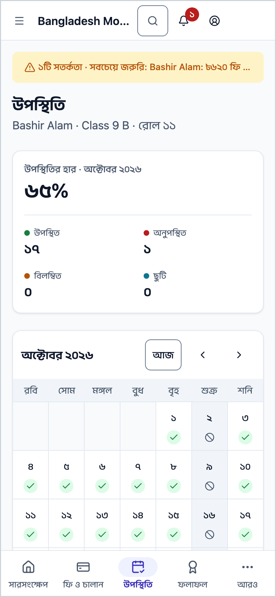
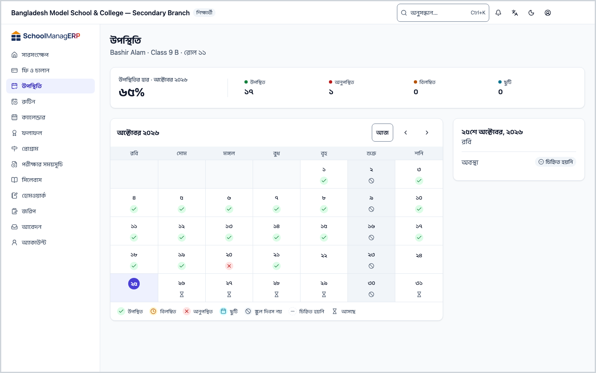

<!-- guide:meta
feature: portal.attendance
title: উপস্থিতি
summary: সন্তান মাসের কোন দিন স্কুলে এসেছে, কোন দিন আসেনি, দেরি করেছে বা ছুটিতে ছিল, ক্যালেন্ডারে দেখুন; সঙ্গে মাসের উপস্থিতির হার।
roles: [PARENT, STUDENT]
sources:
  - client-admin/src/routes/portal/attendance.tsx
  - client-admin/src/routes/portal/-arrival-notice-card.tsx
  - server/src/modules/attendance/attendance-summary.controller.ts
  - server/src/modules/attendance/attendance-summary.service.ts
  - server/src/modules/attendance/dto/attendance-summary.dto.ts
  - server/src/modules/students/family-access.service.ts
labels:
  [
    portal:attendance.*,
    portal:attendanceGrid.*,
    portal:empty.*,
    portal:arrivalNotice.*,
    nav:items.portalAttendance,
  ]
helpIds:
  [
    portal.attendance,
    portal.attendance.action.pickDay,
    portal.attendance.action.changeMonth,
  ]
devices: [phone, desktop]
entry: [sidebar]
keywords:
  [উপস্থিতি, অনুপস্থিত, বিলম্বিত, ছুটি, উপস্থিতির হার, হাজিরা, attendance, absent, late, leave, rate]
appVersion: 0.1.0 (978d9b96a)
owner: tareq89
lastVerified: 2026-10-25
knownIssues: []
-->

# উপস্থিতি

সন্তান এ মাসে কবে স্কুলে এসেছে আর কবে আসেনি, দিন ধরে দেখুন।

**যেতে হবে:** ফোনে নিচের সারিতে **উপস্থিতি**। কম্পিউটারে বাম মেনুতে **উপস্থিতি**। [**সারসংক্ষেপ**](overview.md)-এর **এ মাসের উপস্থিতি** কার্ডে **পুরো উপস্থিতি** চাপলেও আসে।
**শুরুর আগে:** স্কুল অফিস আপনাকে সন্তানের সঙ্গে যুক্ত করে থাকবে। শিক্ষক উপস্থিতি নিলে তবেই এখানে দিন ভরে।

এই পাতা শুধু দেখার। কোনো দিনের উপস্থিতি ভুল মনে হলে স্কুলকে জানান।

[মাস দেখুন](#task-main) · [একটি দিন](#task-day) · [অন্য মাস](#task-month) · [সমস্যা ও সমাধান](#trouble)

**এই পাতায় যা আছে**

- [এ মাসের উপস্থিতি দেখুন](#task-main)
- [ঠিক দেখছেন কি না বুঝবেন কীভাবে](#confirm)
- [অন্য পরিস্থিতিতে](#other)
  - [একটি দিনের বিবরণ দেখুন](#task-day)
  - [অন্য মাস দেখুন](#task-month)
  - [অন্য সন্তানের উপস্থিতি দেখুন](#task-pick)
- [সমস্যা ও সমাধান](#trouble)
- [কে কী করতে পারেন](#roles)
- [আরও জানুন](#more)

---

## এ মাসের উপস্থিতি দেখুন 

1. ফোনে নিচের সারিতে **উপস্থিতি** চাপুন।

   → উপরের কার্ডে **উপস্থিতির হার · …** (মাসের নাম) আর বড় অক্ষরে শতকরা হার। নিচে চার ঘরে দিনের সংখ্যা: **উপস্থিত**, **অনুপস্থিত**, **বিলম্বিত**, **ছুটি**।

2. নিচে মাসের ক্যালেন্ডার দেখুন। প্রতিটি দিনের রং বলে সেদিন কী হয়েছিল।

> **মনে রাখুন:** মাসে কোনো দিনই চিহ্নিত না হলে হারের জায়গায় শুধু একটি ড্যাশ (—) আর লেখা **এই মাসে পর্যাপ্ত রেকর্ড চিহ্নিত হয়নি**। এর মানে ০% নয়; শিক্ষক এখনো উপস্থিতি নেননি।

---

## ঠিক দেখছেন কি না বুঝবেন কীভাবে 

ক্যালেন্ডারের প্রতিটি দিন এর একটি:

| যা লেখা            | মানে                                      |
| ------------------ | ----------------------------------------- |
| **উপস্থিত**        | সেদিন স্কুলে এসেছে                        |
| **বিলম্বিত**       | এসেছে, তবে দেরিতে                         |
| **অনুপস্থিত**      | আসেনি                                     |
| **ছুটি**           | ছুটিতে ছিল                                |
| **স্কুল দিবস নয়** | ছুটির দিন বা সাপ্তাহিক বন্ধ               |
| **চিহ্নিত হয়নি**  | স্কুলের দিন, কিন্তু উপস্থিতি নেওয়া হয়নি |
| **আসছে**           | সামনের দিন                                |

**হার কীভাবে হয়:** উপস্থিত দিন ÷ গোনার দিন × ১০০। দেরিতে আসা দিন উপস্থিত ধরা হবে কি না, ছুটির দিন গোনা হবে কি না, আর ভাগ হবে সব স্কুলের দিনে নাকি শুধু চিহ্নিত দিনে — এগুলো আপনার স্কুল নিজের নিয়মে ঠিক করে। তাই দুই স্কুলে একই দিনের হিসাবে হার আলাদা হতে পারে।

---

## অন্য পরিস্থিতিতে 

### একটি দিনের বিবরণ দেখুন 

1. ক্যালেন্ডারে একটি দিন চাপুন।

   → নিচে ঐ দিনের বিবরণ: **অবস্থা**; দেরি হলে **বিলম্বের মিনিট**; শিক্ষক কিছু লিখে থাকলে **মন্তব্য**; ছুটির দিন হলে **ছুটি** আর ছুটির নাম।

চলতি মাসে শুরুতে আজকের দিনটি বাছা থাকে। অন্য মাসে কিছু বাছা থাকে না, লেখা থাকে **দিনের বিবরণ দেখতে ক্যালেন্ডারে একটি দিন বাছুন**।

### অন্য মাস দেখুন 

ক্যালেন্ডারের মাথায় তীর চেপে আগের বা পরের মাসে যান। হার আর চার ঘরের সংখ্যাও ঐ মাসের হিসাবে বদলায়। ঐ মাসে কোনো রেকর্ড না থাকলে লেখা **এই মাসের কোনো উপস্থিতি রেকর্ড এখনও নেই।**

### অন্য সন্তানের উপস্থিতি দেখুন 

একাধিক সন্তান হলে উপরে **একজন শিক্ষার্থী বাছুন** সারিতে নাম চাপুন। এক সন্তান হলে এই সারি আসে না।

### সন্তান স্কুলে পৌঁছালে বার্তা পান 

শুধু অভিভাবকের জন্য। স্কুল পৌঁছানোর খবর চালু করলেই কেবল পাতার ওপরের দিকে **পৌঁছানোর খবর** কার্ডটি দেখা যায়।

1. **পৌঁছানোর খবর** কার্ডে সন্তানের নামের পাশে **চাই** সুইচটি চালু করুন।

   → নামের পাশে **শিক্ষকের অপেক্ষায়** চিহ্ন আসে। শ্রেণি শিক্ষককে আপনার অনুরোধ নিশ্চিত করতে হবে।

2. সুইচের নিচে **অ্যাপে** বা **SMS-এ** বাছুন। স্কুল SMS-এর অনুমতি না দিলে **SMS-এ** বাছা যায় না, আর লেখা থাকে **আপনার স্কুল এটা শুধু অ্যাপে পাঠায়**।

   **অ্যাপে** বাছলে আর আপনার অ্যাকাউন্টের কোনো ফোনে অ্যাপ না থাকলে দেখবেন **আপনার অ্যাকাউন্টের কোনো ফোনে এখনো অ্যাপ নেই — SMS বাছুন বা অ্যাপ ইনস্টল করুন।** ঠিক করতে **অ্যাপে বার্তা চালু করুন** চাপুন।

3. শিক্ষক নিশ্চিত করলে চিহ্ন বদলে হয় **একবার** (একটি বার্তা যাবে, তারপর বন্ধ) বা **প্রতিদিন** (স্কুলের প্রতিদিন একটি বার্তা)। **একবার**-এর বার্তা চলে গেলে চিহ্নে লেখা থাকে **হয়ে গেছে**।

বন্ধ করতে **চাই** সুইচটি বন্ধ করুন। চিহ্নে **অ্যাডমিন ঠিক করেছেন** লেখা থাকলে স্কুলই এটা ঠিক করে দিয়েছে, এখান থেকে সুইচ চালু বা বন্ধ করা যাবে না। অ্যাডমিন আপনার জন্য চালু করে দিলে লেখা আসে **অ্যাডমিন এটা চালু করেছেন। কীভাবে পাঠানো হবে, তা আপনি বাছতে পারেন।** তখনও **অ্যাপে** বা **SMS-এ** বাছা যায়। কোনো বদল সংরক্ষণ না হলে দেখবেন **সংরক্ষণ করা যায়নি। আবার চেষ্টা করুন।**

---

## সমস্যা ও সমাধান 

| আপনি যা দেখছেন                                 | কী করবেন                                                           | কে সাহায্য করতে পারেন |
| ---------------------------------------------- | ------------------------------------------------------------------ | --------------------- |
| **এই মাসে পর্যাপ্ত রেকর্ড চিহ্নিত হয়নি**      | শিক্ষক উপস্থিতি নিলে দেখাবে। কয়েক দিন পর আবার দেখুন।              | শ্রেণি শিক্ষক         |
| **এই শিক্ষার্থীর উপস্থিতি লোড করা যায়নি।** …  | ইন্টারনেট দেখে **আবার চেষ্টা করুন** চাপুন।                         | —                     |
| কোনো দিনের অবস্থা ভুল মনে হচ্ছে                | শ্রেণি শিক্ষক বা স্কুল অফিসকে জানান; এখান থেকে বদলানো যায় না।     | শ্রেণি শিক্ষক         |
| **আপনার সঙ্গে এখনও কোনো শিক্ষার্থী যুক্ত নেই** | স্কুল অফিসকে সন্তান যুক্ত করতে বলুন, তারপর **আবার দেখুন** চাপুন।   | স্কুল অফিস            |
| আজ অনুপস্থিত, আগে থেকে জানাতে চান              | [**সারসংক্ষেপ**](overview.md#task-tell)-এ **স্কুলকে জানান** চাপুন। | —                     |

---

## কে কী করতে পারেন 

| ভূমিকা     | উপস্থিতি দেখা        | বদলানো |
| ---------- | -------------------- | ------ |
| অভিভাবক    | শুধু যুক্ত সন্তানদের | না     |
| শিক্ষার্থী | শুধু নিজের           | না     |

**অভিভাবক:** স্কুল অফিস যে সন্তানদের আপনার সঙ্গে যুক্ত করেছে, শুধু তাদের উপস্থিতি দেখেন, শুধু এই স্কুলে। অন্য কোনো শিক্ষার্থীর উপস্থিতি চাইলে সার্ভার দেয় না।

**শিক্ষার্থী:** শুধু নিজের উপস্থিতি দেখেন।

উপস্থিতি নেন শিক্ষক, [**উপস্থিতি নেওয়া**](../attendance/attendance.md) পাতা থেকে।

---

## আরও জানুন 

<strong>পাতার অংশগুলো</strong> — উপস্থিতি

1. **উপস্থিতি** শিরোনাম, নিচে সন্তানের নাম · শ্রেণি · রোল; একাধিক সন্তান হলে **একজন শিক্ষার্থী বাছুন**।
2. **উপস্থিতির হার** কার্ড আর **উপস্থিত**, **অনুপস্থিত**, **বিলম্বিত**, **ছুটি**।
3. মাসের ক্যালেন্ডার, মাথায় মাস বদলানোর তীর।
4. বাছা দিনের বিবরণ।

<strong>উপস্থিতি কীভাবে কাজ করে</strong>

<figure>
  
  <figcaption><em>উপস্থিতির পথ, শিক্ষকের খাতা থেকে আপনার ফোনে</em></figcaption>
</figure>

- **দিনের অবস্থা:** শিক্ষক যা চিহ্নিত করেছেন, ঠিক তা-ই।
- **হার:** স্কুলের উপস্থিতির নিয়মে হিসাব হয়; ভাগ করার মতো দিন না থাকলে হার দেখায় না।
- **মাস:** ক্যালেন্ডারের মাসের প্রথম দিন থেকে শেষ দিন পর্যন্ত।

**সম্পর্কিত পাতা**

- [**সারসংক্ষেপ**](overview.md) — আজ স্কুলে এসেছে কি না, এক নজরে।
- [**ফি ও চালান**](fees.md) — মাসভিত্তিক ফির হিসাব।
- [**রুটিন**](routine.md) — আজ আর সামনের দিনের ক্লাস।
- [**ক্যালেন্ডার**](calendar.md) — ছুটি আর স্কুলের অনুষ্ঠান।
- [**পরীক্ষার সময়সূচি**](exam-schedule.md) — পরীক্ষার দিন আর প্রবেশপত্র।
- [**ফলাফল**](results.md) — প্রকাশিত পরীক্ষার ফল।
- [**উপস্থিতি নেওয়া**](../attendance/attendance.md) — শিক্ষক যেখানে উপস্থিতি নেন।
