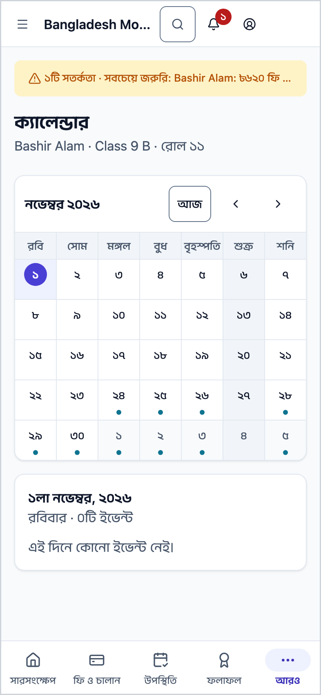
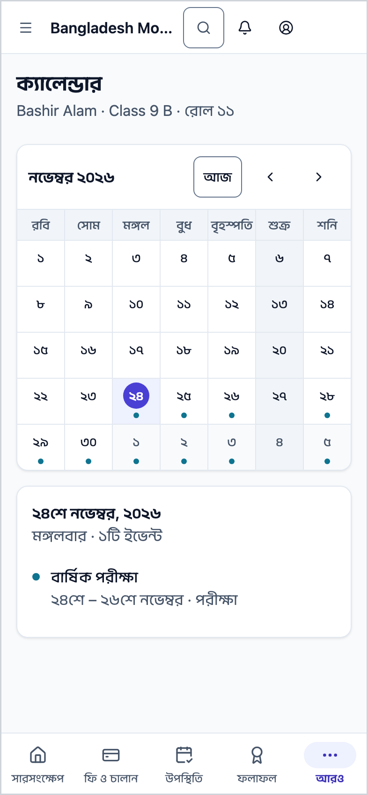

<!-- guide:meta
feature: portal.calendar
title: ক্যালেন্ডার
summary: সন্তানের শ্রেণির জন্য স্কুলের ছুটি, পরীক্ষা, অনুষ্ঠান, সভা আর সময়সীমা মাসের ক্যালেন্ডারে দেখুন; একটি দিন চাপলে সেদিনের সব খবর।
roles: [PARENT, STUDENT]
sources:
  - client-admin/src/routes/portal/calendar.tsx
  - server/src/modules/calendar/calendar-events.controller.ts
  - server/src/modules/calendar/calendar-events.service.ts
  - server/src/modules/calendar/calendar-visibility.util.ts
  - server/src/modules/students/family-access.service.ts
labels:
  [
    portal:calendar.*,
    portal:empty.*,
    portal:children.*,
    nav:items.portalCalendar,
    nav:items.more,
  ]
helpIds:
  [
    portal.calendar,
    portal.calendar.action.pickDay,
    portal.calendar.action.changeMonth,
  ]
devices: [phone]
entry: [sidebar]
keywords:
  [ক্যালেন্ডার, ছুটি, ছুটির তালিকা, পরীক্ষা, অনুষ্ঠান, সভা, সময়সীমা, calendar, holiday, event, exam, meeting]
appVersion: 0.1.0 (978d9b96a)
owner: tareq89
lastVerified: 2026-10-25
knownIssues: []
-->

# ক্যালেন্ডার

স্কুল কবে বন্ধ, কবে পরীক্ষা বা অনুষ্ঠান, মাস ধরে দেখুন।

**যেতে হবে:** ফোনে নিচের সারিতে **আরও** চাপুন, তারপর **ক্যালেন্ডার**। কম্পিউটারে বাম মেনুতে **ক্যালেন্ডার**। [**সারসংক্ষেপ**](overview.md)-এর **পরের ছুটি** কার্ডে **ক্যালেন্ডার দেখুন** চাপলেও আসে।
**শুরুর আগে:** স্কুল অফিস আপনাকে সন্তানের সঙ্গে যুক্ত করে থাকবে, আর স্কুল ক্যালেন্ডারে খবর প্রকাশ করে থাকবে।

এই পাতা শুধু দেখার। এখান থেকে কিছু যোগ বা বদল করা যায় না।

[মাস দেখুন](#task-main) · [একটি দিন](#task-day) · [অন্য মাস](#task-month) · [সমস্যা ও সমাধান](#trouble)

**এই পাতায় যা আছে**

- [এ মাসের ক্যালেন্ডার দেখুন](#task-main)
- [ঠিক দেখছেন কি না বুঝবেন কীভাবে](#confirm)
- [অন্য পরিস্থিতিতে](#other)
  - [একটি দিনের খবর দেখুন](#task-day)
  - [অন্য মাস দেখুন](#task-month)
  - [অন্য সন্তানের ক্যালেন্ডার দেখুন](#task-pick)
- [সমস্যা ও সমাধান](#trouble)
- [কে কী করতে পারেন](#roles)
- [আরও জানুন](#more)

---

## এ মাসের ক্যালেন্ডার দেখুন 

1. ফোনে নিচের সারিতে **আরও** চাপুন, তারপর **ক্যালেন্ডার**।

   → চলতি মাসের ক্যালেন্ডার খোলে। উপরে সন্তানের নাম · শ্রেণি · রোল।

2. যে দিনে কিছু আছে, ফোনে সেই দিনের ঘরে ছোট বিন্দু থাকে; কম্পিউটারে ঘরেই খবরের নাম লেখা থাকে। এক দিনে বেশি খবর থাকলে লেখা থাকে, যেমন **+২ আরও**।
3. ক্যালেন্ডারের নিচে আজকের দিনের খবর দেখুন।

> **মনে রাখুন:** স্কুলের সাপ্তাহিক বন্ধের দিন আর সপ্তাহ কোন দিন থেকে শুরু, তা আপনার স্কুলের নিয়ম মেনে দেখায়।

---

## ঠিক দেখছেন কি না বুঝবেন কীভাবে 

প্রতিটি খবরের পাশে তার ধরন লেখা থাকে:

| যা লেখা                       | মানে                                         |
| ----------------------------- | -------------------------------------------- |
| **ছুটি**                      | স্কুল বন্ধ                                    |
| **পরীক্ষা**                   | পরীক্ষার দিন                                  |
| **ইভেন্ট**                    | স্কুলের অনুষ্ঠান                              |
| **সভা**                       | সভা, যেমন অভিভাবক সভা                        |
| **সময়সীমা**                   | কোনো কিছু জমা দেওয়ার শেষ দিন                 |
| **ক্ষতিপূরক স্কুল দিবস**       | বন্ধের দিনেও ক্লাস হবে, আগের ছুটি পুষিয়ে নিতে |

কয়েক দিনের খবর (যেমন এক সপ্তাহের ছুটি) প্রতিটি দিনেই দেখায়।

এখানে শুধু সেই খবর আসে যা স্কুল প্রকাশ করেছে আর সবার জন্য রেখেছে। শুধু কর্মীদের জন্য রাখা খবর (যেমন শিক্ষকদের সভা) এখানে আসে না।

---

## অন্য পরিস্থিতিতে 

### একটি দিনের খবর দেখুন 

1. ক্যালেন্ডারে একটি দিন চাপুন।

   → নিচে ঐ দিনের সব খবর, প্রতিটির নাম আর ধরন।

চলতি মাসে শুরুতে আজকের দিনটি বাছা থাকে; অন্য মাসে মাসের ১ তারিখ। পাশের মাসের কোনো দিন চাপলে ক্যালেন্ডার সেই মাসে চলে যায়, দিনটিও বাছা থাকে।

### অন্য মাস দেখুন 

ক্যালেন্ডারের মাথায় তীর চেপে আগের বা পরের মাসে যান। ফোনের পেছনে যাওয়ার বোতাম চাপলে আগের দেখা মাসে ফেরেন।

### অন্য সন্তানের ক্যালেন্ডার দেখুন 

একাধিক সন্তান হলে উপরে **একজন শিক্ষার্থী বেছে নিন** সারিতে নাম চাপুন। সন্তান বদলালে তার শ্রেণির খবর আসে, কারণ এক শ্রেণির পরীক্ষা অন্য শ্রেণির সঙ্গে নাও মিলতে পারে। এক সন্তান হলে এই সারি আসে না।

এই পাতায় শুধু সেই খবর দেখায়, যা স্কুল সন্তানের শ্রেণির সঙ্গে যুক্ত করেছে। কোনো শ্রেণি না বেছে যোগ করা খবর (যেমন পুরো স্কুলের জন্য লেখা ছুটি, যাতে কোনো শ্রেণি বাছা নেই) এখানে দেখায় না।

---

## সমস্যা ও সমাধান 

| আপনি যা দেখছেন                                                  | কী করবেন                                                              | কে সাহায্য করতে পারেন |
| --------------------------------------------------------------- | --------------------------------------------------------------------- | --------------------- |
| **স্কুলের ক্যালেন্ডার লোড করা যায়নি।** …                          | ইন্টারনেট দেখে **আবার চেষ্টা করুন** চাপুন।                             | —                     |
| **আপনার সঙ্গে এখনও কোনো শিক্ষার্থী যুক্ত নেই**                   | স্কুল অফিসকে সন্তান যুক্ত করতে বলুন, তারপর **আবার দেখুন** চাপুন।        | স্কুল অফিস            |
| শোনা কোনো ছুটি বা অনুষ্ঠান ক্যালেন্ডারে নেই                      | স্কুল হয়তো এখনো প্রকাশ করেনি, বা সন্তানের শ্রেণির সঙ্গে যুক্ত করেনি। স্কুল অফিসে জিজ্ঞেস করুন। | স্কুল অফিস            |
| ক্যালেন্ডার ফাঁকা                                                | অন্য মাসে দেখুন; এ মাসে হয়তো কোনো খবর নেই।                            | —                     |

---

## কে কী করতে পারেন 

| ভূমিকা      | ক্যালেন্ডার দেখা                                   | বদলানো |
| ----------- | ------------------------------------------------- | ------ |
| অভিভাবক     | বাছা যুক্ত সন্তানের শ্রেণির সঙ্গে যুক্ত খবর      | না     |
| শিক্ষার্থী   | নিজের শ্রেণির সঙ্গে যুক্ত খবর                    | না     |

**অভিভাবক:** শুধু এই স্কুলের প্রকাশিত খবর দেখেন। কোনো খবর নির্দিষ্ট শ্রেণির জন্য হলে, শুধু তখনই দেখেন যখন আপনার যুক্ত কোনো সন্তান ঐ শ্রেণিতে পড়ে। শুধু কর্মীদের খবর কখনো দেখেন না।

**শিক্ষার্থী:** একই নিয়ম, শুধু নিজের শ্রেণি ধরে।

খবর যোগ আর প্রকাশ করে স্কুল, [**ক্যালেন্ডারে ছুটি ও অনুষ্ঠান দেখা, যোগ করা ও নিজের ফোনে নেওয়া**](../people/calendar.md) পাতা থেকে।

---

## আরও জানুন 

<strong>পাতার অংশগুলো</strong> — ক্যালেন্ডার

1. **ক্যালেন্ডার** শিরোনাম, নিচে সন্তানের নাম · শ্রেণি · রোল; একাধিক সন্তান হলে **একজন শিক্ষার্থী বেছে নিন**।
2. মাসের ক্যালেন্ডার, মাথায় মাস বদলানোর তীর।
3. বাছা দিনের খবর।

<strong>ক্যালেন্ডার কীভাবে কাজ করে</strong>

<figure>
  
  <figcaption><em>ক্যালেন্ডারের পথ, স্কুলের খবর থেকে আপনার ফোনে</em></figcaption>
</figure>

- **কোন খবর:** শুধু প্রকাশিত। খসড়া খবর পরিবার দেখে না।
- **কার জন্য:** শুধু বাছা সন্তানের শ্রেণির সঙ্গে যুক্ত খবর। কোনো শ্রেণির সঙ্গে যুক্ত নয় এমন খবর এখানে আসে না।
- **মাস:** মাসের আগে-পরের এক সপ্তাহসহ আনা হয়, যাতে পাশের মাসের দিনগুলোতেও খবর দেখায়।

**সম্পর্কিত পাতা**

- [**সারসংক্ষেপ**](overview.md) — পরের ছুটি কত দিন পর, এক নজরে।
- [**ফি ও চালান**](fees.md) — মাসভিত্তিক ফির হিসাব।
- [**উপস্থিতি**](attendance.md) — মাসের প্রতিটি দিনের উপস্থিতি।
- [**রুটিন**](routine.md) — আজ আর সামনের দিনের ক্লাস।
- [**পরীক্ষার সময়সূচি**](exam-schedule.md) — পরীক্ষার দিন আর প্রবেশপত্র।
- [**ফলাফল**](results.md) — প্রকাশিত পরীক্ষার ফল।
- [**ক্যালেন্ডারে ছুটি ও অনুষ্ঠান দেখা, যোগ করা ও নিজের ফোনে নেওয়া**](../people/calendar.md) — স্কুল যেখানে খবর যোগ করে।
