<!-- guide:meta
feature: portal.examSchedule
title: পরীক্ষার সময়সূচি
summary: সন্তানের শ্রেণির প্রতিটি পরীক্ষার দিন, সময়, বিষয় আর স্থান দেখুন; পরের পরীক্ষা আলাদা করে; আর সামনের পরীক্ষার প্রবেশপত্র নিজেই প্রিন্ট করুন।
roles: [PARENT, STUDENT]
sources:
  - client-admin/src/routes/portal/exam-schedule.tsx
  - client-admin/src/routes/portal/-admit-card-panel.tsx
  - client-admin/src/routes/portal/-admit-card-print.ts
  - server/src/modules/exams/exam-schedules.controller.ts
  - server/src/modules/exams/exam-schedules.service.ts
  - server/src/modules/print/exam-documents/family-admit-card.controller.ts
  - server/src/modules/print/exam-documents/family-admit-card.service.ts
  - server/src/modules/students/family-access.service.ts
labels:
  [
    portal:examSchedule.*,
    portal:empty.*,
    portal:children.*,
    portal:fees.pickerLabel,
    nav:items.portalExamSchedule,
    nav:items.more,
  ]
helpIds:
  [
    portal.examSchedule,
    portal.examSchedule.action.printAdmitCard,
  ]
devices: [phone]
entry: [sidebar]
keywords:
  [পরীক্ষার সময়সূচি, পরীক্ষার রুটিন, প্রবেশপত্র, এডমিট কার্ড, পরীক্ষা কবে, আসন, exam schedule, exam routine, admit card, print]
appVersion: 0.1.0 (978d9b96a)
owner: tareq89
lastVerified: 2026-10-25
knownIssues: []
-->

# পরীক্ষার সময়সূচি

কোন পরীক্ষা কবে, কখন, কোথায়, আর প্রবেশপত্র প্রিন্ট।

**যেতে হবে:** ফোনে নিচের সারিতে **আরও** চাপুন, তারপর **পরীক্ষার সময়সূচি**। কম্পিউটারে বাম মেনুতে **পরীক্ষার সময়সূচি**।
**শুরুর আগে:** স্কুল অফিস আপনাকে সন্তানের সঙ্গে যুক্ত করে থাকবে, আর স্কুল পরীক্ষার পুরো সময়সূচি তৈরি করে থাকবে।

সময়সূচি শুধু দেখার। প্রবেশপত্র এখান থেকে প্রিন্ট করা যায়।

[সময়সূচি দেখুন](#task-main) · [প্রবেশপত্র প্রিন্ট](#task-admit) · [বোতাম নেই কেন](#admit-missing) · [সমস্যা ও সমাধান](#trouble)

**এই পাতায় যা আছে**

- [পরীক্ষার সময়সূচি দেখুন](#task-main)
- [ঠিক দেখছেন কি না বুঝবেন কীভাবে](#confirm)
- [অন্য পরিস্থিতিতে](#other)
  - [প্রবেশপত্র প্রিন্ট করুন](#task-admit)
  - [প্রবেশপত্রের বোতাম নেই, বা প্রিন্ট হচ্ছে না](#admit-missing)
  - [অন্য সন্তানের সময়সূচি দেখুন](#task-pick)
- [সমস্যা ও সমাধান](#trouble)
- [কে কী করতে পারেন](#roles)
- [আরও জানুন](#more)

---

## পরীক্ষার সময়সূচি দেখুন 

1. ফোনে নিচের সারিতে **আরও** চাপুন, তারপর **পরীক্ষার সময়সূচি**।

   → সবার উপরে **পরবর্তী পরীক্ষা** কার্ড: বিষয়, পরীক্ষার নাম, তারিখ, সময়, আর স্থান দেওয়া থাকলে স্থান। পরীক্ষাটি আজ হলে পাশে লেখা **আজ**।

2. নিচে নামুন। প্রতিটি পরীক্ষার আলাদা কার্ড, মাথায় পরীক্ষার নাম আর প্রথম থেকে শেষ দিন।
3. কার্ডের প্রতিটি সারিতে **তারিখ**, **সময়**, **বিষয়**, **স্থান**। সারি তারিখ আর শুরুর সময় ধরে সাজানো।

<!-- image pending: পরীক্ষার সময়সূচি, একটি সামনের পরীক্ষা; ১ · পরবর্তী পরীক্ষা ২ · প্রবেশপত্র অংশ ৩ · বিষয়ের সারি; অভিভাবক, phone -->

> **মনে রাখুন:** কোনো পরীক্ষা এখানে আসে কেবল যখন স্কুল তার সব বিষয়ের দিন-সময় ঠিক করে ফেলেছে। অর্ধেক ঠিক হওয়া সময়সূচি দেখায় না, তাই যা দেখছেন তা পুরো সময়সূচি।

---

## ঠিক দেখছেন কি না বুঝবেন কীভাবে 

- যে বিষয়ের পরীক্ষা শেষ, তার সারি হালকা রঙে আর পাশে লেখা **শেষ হয়েছে**। আগের দিনের পরীক্ষা, বা আজকের যে পরীক্ষার শেষ সময় পার হয়েছে, দুটোই শেষ ধরা হয়।
- আজকের যে পরীক্ষা এখনো শেষ হয়নি, তার সারি রং দিয়ে আলাদা করা।
- বিষয়ের নাম ঠিক না থাকলে লেখা **বিষয় ঠিক করা হয়নি**।
- সব পরীক্ষা শেষ হয়ে গেলে **পরবর্তী পরীক্ষা** কার্ড আসে না।
- শুধু সন্তানের এখনকার শ্রেণির পরীক্ষা দেখায়।

---

## অন্য পরিস্থিতিতে 

### প্রবেশপত্র প্রিন্ট করুন 

1. যে পরীক্ষার প্রবেশপত্র দরকার, তার কার্ডে যান। মাথার নিচে লেখা **প্রবেশপত্র তৈরি।** **প্রিন্টের জন্য একটি পাতা খুলবে। প্রিন্ট করুন বা ফোনে সেভ রাখুন।**
2. **প্রবেশপত্র প্রিন্ট করুন** চাপুন।

   → নতুন একটি পাতা খোলে, A4 মাপে প্রবেশপত্র। প্রিন্টার থাকলে প্রিন্ট করুন; ফোনে থাকলে PDF হিসেবে সেভ করে রাখুন।

3. কিছু না খুললে দেখুন উপরে লেখা এসেছে কি না **এই সাইটের পপ-আপ চালু করে আবার চেষ্টা করুন।** ব্রাউজারে এই সাইটের পপ-আপ চালু করে আবার চাপুন।

<!-- image pending: পরীক্ষার সময়সূচি, প্রবেশপত্র তৈরি অংশ আর প্রবেশপত্র প্রিন্ট করুন বোতাম; শিক্ষার্থী, phone -->

> **মনে রাখুন:** প্রতিবার প্রিন্ট চাপলে স্কুলের খাতায় একটি কপি হিসেবে লেখা থাকে। দরকার ছাড়া বারবার চাপবেন না; খুব ঘন ঘন চাপলে কিছুক্ষণ অপেক্ষা করতে হতে পারে।

### প্রবেশপত্রের বোতাম নেই, বা প্রিন্ট হচ্ছে না 

**বোতাম একেবারেই নেই:** প্রবেশপত্রের অংশ শুধু সেই পরীক্ষার কার্ডে আসে যার অন্তত একটি বিষয়ের পরীক্ষা এখনো শেষ হয়নি। পুরো পরীক্ষা শেষ হয়ে গেলে অংশটি আর দেখায় না।

**বোতাম আছে, চাপলে অন্য লেখা আসে:** স্কুলের সার্ভার প্রিন্টের আগে কয়েকটি জিনিস দেখে।

| চাপার পর যা দেখছেন                                    | কেন                                                                                       | কী করবেন                                                         |
| ----------------------------------------------------- | ----------------------------------------------------------------------------------------- | ---------------------------------------------------------------- |
| **প্রবেশপত্র এখনো তৈরি হয়নি।**                         | স্কুল এই পরীক্ষার সিট প্ল্যান এখনো প্রকাশ করেনি, বা তাতে সন্তানের আসন নেই                  | পরে আবার দেখুন, বা স্কুল অফিসে জিজ্ঞেস করুন                       |
| **প্রবেশপত্র এখন প্রিন্ট করা যাচ্ছে না**                | স্কুল নিয়ম রেখেছে, বকেয়া থাকলে প্রবেশপত্র দেওয়া হবে না, আর সন্তানের নামে বকেয়া আছে         | **বকেয়া দেখুন ও পরিশোধ করুন** চাপুন; শোধ হলে **আবার চেষ্টা করুন** |
| **প্রবেশপত্র প্রিন্ট করা যায়নি। আবার চেষ্টা করুন।**      | অন্য কোনো সমস্যা, যেমন স্কুল এখনো প্রবেশপত্রের নকশা ঠিক করেনি, বা সংযোগ কেটে গেছে          | আবার চাপুন; বারবার হলে স্কুল অফিসে জানান                         |
| **এই সাইটের পপ-আপ চালু করে আবার চেষ্টা করুন।**          | ব্রাউজার প্রবেশপত্রের নতুন পাতা খুলতে দেয়নি | ব্রাউজারের সেটিংসে এই সাইটের পপ-আপ চালু করে আবার চাপুন |

বকেয়ার লেখায় সাধারণত সন্তানের নাম আর মোট বকেয়ার অঙ্কও থাকে। স্কুলের ফোন নম্বর দেওয়া থাকলে **অফিসে ফোন করুন (…)** বোতামও আসে। বকেয়া যে কোনো অঙ্কের হোক, শূন্যের বেশি হলেই এই নিয়ম খাটে; স্কুল এই নিয়ম বন্ধ রাখলে বকেয়া দেখা হয় না।

### অন্য সন্তানের সময়সূচি দেখুন 

একাধিক সন্তান হলে উপরের সারিতে নাম চাপুন। সন্তান বদলালে প্রবেশপত্রের অংশ আবার শুরু থেকে **প্রবেশপত্র তৈরি।** দেখায়। এক সন্তান হলে এই সারি আসে না।

---

## সমস্যা ও সমাধান 

| আপনি যা দেখছেন                                                | কী করবেন                                                              | কে সাহায্য করতে পারেন |
| ------------------------------------------------------------- | --------------------------------------------------------------------- | --------------------- |
| **এখনও কোনো পরীক্ষার সময়সূচি নেই**                             | স্কুল পুরো সময়সূচি ঠিক করলে আসবে। পরে আবার দেখুন।                       | স্কুল অফিস            |
| **পরীক্ষার সময়সূচি লোড করা যায়নি।** …                          | ইন্টারনেট দেখে **আবার চেষ্টা করুন** চাপুন।                             | —                     |
| **আপনার সঙ্গে এখনও কোনো শিক্ষার্থী যুক্ত নেই**                 | স্কুল অফিসকে সন্তান যুক্ত করতে বলুন, তারপর **আবার দেখুন** চাপুন।        | স্কুল অফিস            |
| শোনা একটি পরীক্ষা তালিকায় নেই                                 | তার সব বিষয়ের সময় এখনো ঠিক হয়নি। স্কুল অফিসে জিজ্ঞেস করুন।           | স্কুল অফিস            |
| প্রবেশপত্রের বোতাম নেই বা অন্য লেখা আসে                        | [উপরের তালিকা](#admit-missing) দেখুন।                                 | স্কুল অফিস            |
| বকেয়া শোধ করেছেন, তবু প্রবেশপত্র আটকে আছে                     | স্কুল টাকা রেকর্ড করলে তবেই খোলে। রসিদ নিয়ে অফিসে যোগাযোগ করুন।       | হিসাবরক্ষক            |

---

## কে কী করতে পারেন 

| ভূমিকা      | সময়সূচি দেখা            | প্রবেশপত্র প্রিন্ট       |
| ----------- | ----------------------- | ----------------------- |
| অভিভাবক     | শুধু যুক্ত সন্তানদের     | শুধু যুক্ত সন্তানদের     |
| শিক্ষার্থী   | শুধু নিজের              | শুধু নিজের              |

**অভিভাবক:** স্কুল অফিস যে সন্তানদের আপনার সঙ্গে যুক্ত করেছে, শুধু তাদের সময়সূচি আর প্রবেশপত্র পান, শুধু এই স্কুলে। অন্য কোনো শিক্ষার্থীর জন্য চাইলে সার্ভার দেয় না।

**শিক্ষার্থী:** শুধু নিজের।

কর্মীরা এই পাতা থেকে প্রবেশপত্র প্রিন্ট করতে পারেন না; তাঁরা পরীক্ষার পাতা থেকে করেন। সিট প্ল্যান প্রকাশ হয় [**সিট প্ল্যান তৈরি ও প্রকাশ**](../exams-results/seat-plans.md) পাতা থেকে।

---

## আরও জানুন 

<strong>পাতার অংশগুলো</strong> — পরীক্ষার সময়সূচি

1. **পরীক্ষার সময়সূচি** শিরোনাম, নিচে সন্তানের নাম · শ্রেণি · রোল; একাধিক সন্তান হলে নাম বাছার সারি।
2. **পরবর্তী পরীক্ষা** কার্ড (কম্পিউটারে ডান পাশে)।
3. প্রতি পরীক্ষার কার্ড: নাম, দিনের সীমা, প্রবেশপত্রের অংশ (পরীক্ষা বাকি থাকলে), আর বিষয়ের সারি।

<!-- image pending: পরীক্ষার সময়সূচি, তিনটি অংশ নম্বর দিয়ে চিহ্নিত, একটি সারিতে শেষ হয়েছে; অভিভাবক, phone -->

<strong>পরীক্ষার সময়সূচি কীভাবে কাজ করে</strong>

<figure>
  
  <figcaption><em>সময়সূচি থেকে প্রবেশপত্র পর্যন্ত পথ</em></figcaption>
</figure>

- **কোন পরীক্ষা দেখায়:** সন্তানের শ্রেণির, যার নম্বর থাকা প্রতিটি বিষয়ের দিন-সময় ঠিক হয়েছে।
- **প্রবেশপত্রের শর্ত, ক্রমানুসারে:** (১) আপনি সন্তানের সঙ্গে যুক্ত; (২) এই পরীক্ষার একটি প্রকাশিত সিট প্ল্যানে সন্তানের আসন আছে; (৩) স্কুল বকেয়ার নিয়ম চালু রাখলে সন্তানের মোট বকেয়া শূন্য; (৪) স্কুল প্রবেশপত্রের একটি মূল নকশা ঠিক করেছে।
- **কাগজ:** A4, এক পাতায় দুটি প্রবেশপত্র।

**সম্পর্কিত পাতা**

- [**সারসংক্ষেপ**](overview.md) — বকেয়া আর আজকের খবর, এক নজরে।
- [**ফি ও চালান**](fees.md) — বকেয়া দেখে শোধের খবর।
- [**উপস্থিতি**](attendance.md) — মাসের প্রতিটি দিনের উপস্থিতি।
- [**রুটিন**](routine.md) — আজ আর সামনের দিনের ক্লাস।
- [**ক্যালেন্ডার**](calendar.md) — ছুটি আর স্কুলের অনুষ্ঠান।
- [**ফলাফল**](results.md) — প্রকাশিত পরীক্ষার ফল।
- [**সিট প্ল্যান তৈরি ও প্রকাশ**](../exams-results/seat-plans.md) — স্কুল যেখানে আসন ঠিক করে।
