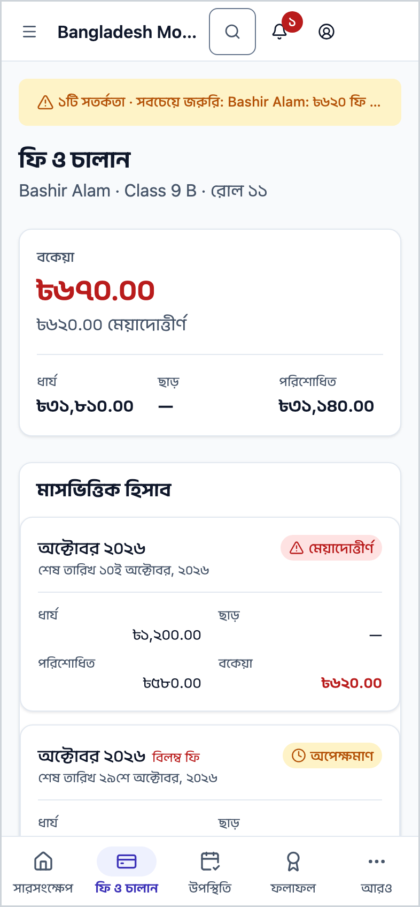
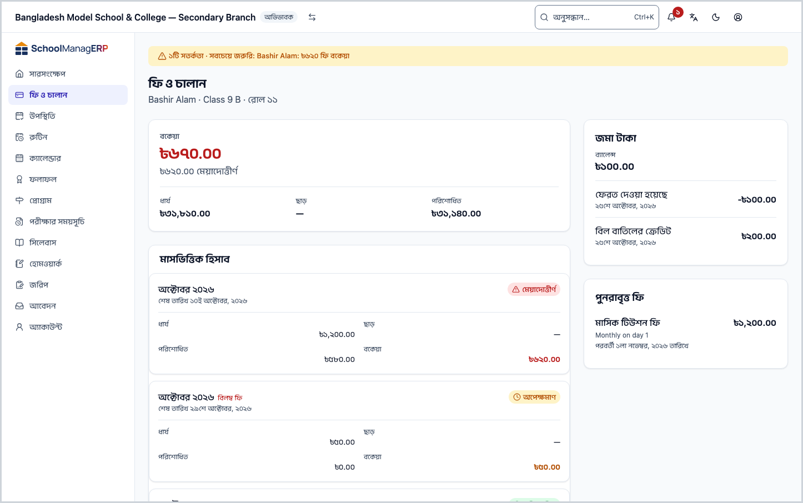

<!-- guide:meta
feature: portal.fees
title: ফি ও চালান
summary: আপনার সন্তানের ফি মাস ধরে দেখুন — কত ধার্য, কত ছাড়, কত পরিশোধিত, কত বকেয়া — সঙ্গে জরিমানা, জমা টাকা, পুনরাবৃত্ত ফি আর চালান প্রিন্ট।
roles: [PARENT, STUDENT]
sources:
  - client-admin/src/routes/portal/fees.tsx
  - server/src/modules/fees/fees.controller.ts
  - server/src/modules/fees/fees.service.ts
  - server/src/modules/fees/fines/fines.controller.ts
  - server/src/modules/fees/wallet.controller.ts
  - server/src/modules/fees/recurring-schedules.controller.ts
  - server/src/modules/invoices/invoices.controller.ts
  - server/src/modules/students/family-access.service.ts
labels:
  [
    portal:fees.*,
    portal:hero.nothingDue,
    portal:hero.overdueAmount,
    portal:hero.lastPaid,
    portal:hero.dueOn,
    portal:empty.*,
    nav:items.portalFees,
    common:walletTransactionKind.*,
  ]
helpIds:
  [
    portal.fees,
    portal.fees.action.print,
    portal.fees.action.pickStudent,
  ]
devices: [phone, desktop]
entry: [sidebar]
keywords:
  [ফি, চালান, বকেয়া, ধার্য, ছাড়, পরিশোধিত, জরিমানা, জমা টাকা, প্রিন্ট, রসিদ, fees, invoice, outstanding, print, wallet, fine]
appVersion: 0.1.0 (978d9b96a)
owner: tareq89
lastVerified: 2026-10-25
knownIssues: []
-->

# ফি ও চালান

সন্তানের প্রতিটি মাসের ফি, কত দেওয়া হয়েছে আর কত বাকি, এক পাতায় দেখুন।

**যেতে হবে:** ফোনে নিচের সারিতে **ফি ও চালান**। কম্পিউটারে বাম মেনুতে **ফি ও চালান**। [**সারসংক্ষেপ**](overview.md) থেকে **ফি-এর বিস্তারিত দেখুন** চাপলেও আসে।
**শুরুর আগে:** স্কুল অফিস আপনার অ্যাকাউন্ট সন্তানের সঙ্গে যুক্ত করে থাকতে হবে। স্কুল ফি ধার্য না করলে মাসের হিসাব ফাঁকা থাকে।

এই পাতা শুধু দেখার। এখান থেকে টাকা দেওয়া যায় না; টাকা দিতে হয় স্কুলে। স্কুল টাকা রেকর্ড করলে এখানে হিসাব নিজে থেকে বদলায়।

[হিসাব দেখুন](#task-main) · [চালান প্রিন্ট](#task-print) · [সন্তান বদলান](#task-pick) · [সমস্যা ও সমাধান](#trouble)

**এই পাতায় যা আছে**

- [সন্তানের ফির হিসাব দেখুন](#task-main)
- [ঠিক দেখছেন কি না বুঝবেন কীভাবে](#confirm)
- [অন্য পরিস্থিতিতে](#other)
  - [অন্য সন্তানের ফি দেখুন](#task-pick)
  - [চালান প্রিন্ট করুন](#task-print)
  - [জরিমানা দেখুন](#task-fines)
  - [জমা টাকা আর পুনরাবৃত্ত ফি](#task-wallet)
- [সমস্যা ও সমাধান](#trouble)
- [কে কী করতে পারেন](#roles)
- [আরও জানুন](#more)

---

## সন্তানের ফির হিসাব দেখুন 

1. ফোনে নিচের সারিতে **ফি ও চালান** চাপুন।

   → পাতার মাথায় সন্তানের নাম, শ্রেণি, শাখা আর রোল। প্রথম কার্ডে **বকেয়া**: বড় অক্ষরে মোট বাকি টাকা, কিছু বাকি না থাকলে **কোনো বকেয়া নেই**।

2. **বকেয়া**-র নিচে তিনটি সংখ্যা দেখুন: **ধার্য**, **ছাড়**, **পরিশোধিত**।
3. নিচে নামুন **মাসভিত্তিক হিসাব** অংশে।

   → প্রতিটি মাস আলাদা, নতুন মাস আগে। প্রতি মাসে **ধার্য**, **ছাড়**, **পরিশোধিত**, **বকেয়া** আর **অবস্থা**; নিচে **শেষ তারিখ …**।

> **মনে রাখুন:** পুরো শোধ করা মাসও তালিকায় থাকে, বকেয়া ঘরে ০, যাতে কত ধার্য হয়েছিল তা দেখতে পান।

---

## ঠিক দেখছেন কি না বুঝবেন কীভাবে 

| সংখ্যা            | কীভাবে হিসাব হয়                                                                 |
| ----------------- | -------------------------------------------------------------------------------- |
| **ধার্য**          | সন্তানের সব বিলের মোট টাকার যোগফল                                                 |
| **ছাড়**           | সব বিলে দেওয়া ছাড়ের যোগফল। ছাড় না থাকলে শুধু একটি ড্যাশ (—)                       |
| **পরিশোধিত**      | সব বিলে জমা পড়া টাকার যোগফল                                                       |
| **বকেয়া**         | **ধার্য** − **পরিশোধিত** − **ছাড়**                                                |

**বকেয়া**-র নিচে আরেকটি লাইন থাকতে পারে:

- **… মেয়াদোত্তীর্ণ** — যেসব বিলের শেষ তারিখ পার হয়েছে আর টাকা বাকি, তাদের বাকির যোগফল।
- কিছু মেয়াদোত্তীর্ণ না থাকলে **সর্বশেষ পরিশোধ …** — শেষ সফল পরিশোধের তারিখ।

**অবস্থা** ঘরে:

| যা লেখা           | মানে                                                         |
| ----------------- | ------------------------------------------------------------ |
| **পরিশোধিত**      | ঐ মাসের পুরো টাকা দেওয়া হয়েছে                               |
| **মেয়াদোত্তীর্ণ** | শেষ তারিখ পার হয়েছে, টাকা এখনো বাকি                          |
| **আংশিক পরিশোধিত**| কিছু টাকা পড়েছে, পুরোটা নয়                                  |
| **অপেক্ষমাণ**     | এখনো কোনো টাকা পড়েনি, শেষ তারিখও পার হয়নি                    |

শেষ তারিখের দিনটি এখনো মেয়াদোত্তীর্ণ নয়, পরদিন থেকে। দেরির জন্য স্কুল আলাদা বিল করলে মাসের পাশে লেখা **বিলম্ব ফি**।

স্কুল কোনো বিল মওকুফ করলে মওকুফের টাকা **ছাড়**-এর ঘরে যোগ হয়, তাই **বকেয়া**য় তা আর যোগ হয় না।

---

## অন্য পরিস্থিতিতে 

### অন্য সন্তানের ফি দেখুন 

একাধিক সন্তান হলে পাতার মাথায় **একজন শিক্ষার্থী বাছুন** সারিতে সবার নাম থাকে। যার ফি দেখতে চান, তার নাম চাপুন। পুরো পাতা তার হিসাবে বদলে যায়। এক সন্তান হলে এই সারি আসে না।

### চালান প্রিন্ট করুন 

1. নিচে নামুন **চালান** অংশে। চালানগুলো **নতুন থেকে পুরনো**: **চালান নম্বর**, **ইস্যুর তারিখ**, **পরিমাণ**, **অবস্থা**।
2. যে চালান দরকার, তার পাশে **প্রিন্ট করুন** চাপুন।

   → প্রিন্টযোগ্য চালান খোলে। সেখান থেকে প্রিন্ট করুন বা ফোনে রেখে দিন।

সর্বোচ্চ ১০০টি সাম্প্রতিক চালান দেখায়। এর বেশি থাকলে উপরে লেখা থাকে কতগুলোর মধ্যে কতগুলো দেখানো হচ্ছে; পুরনো চালানের জন্য স্কুল অফিসে যোগাযোগ করুন।

### জরিমানা দেখুন 

সন্তানের কোনো জরিমানা থাকলে **জরিমানা** অংশ আসে। প্রতিটিতে নাম, স্কুল লিখে থাকলে **কারণ** আর ঘটনার তারিখ, জরিমানার টাকা আর অবস্থা (যেমন **অপেক্ষমাণ**, **পরিশোধিত** বা **মওকুফ**)। জরিমানার বিল বাকি থাকলে উপরের **বকেয়া**-তেও যোগ হয়।

### জমা টাকা আর পুনরাবৃত্ত ফি 

- **জমা টাকা** — আগে বেশি দেওয়া টাকা সন্তানের নামে জমা থাকলে এই কার্ড আসে। **ব্যালেন্স** আর সর্বশেষ পাঁচটি লেনদেন দেখায়। টাকা নেওয়ার সময় স্কুল এই টাকা দিয়ে বিল শোধ করে।
- **পুনরাবৃত্ত ফি** — স্কুল নিয়ম করে প্রতি মেয়াদে যে ফি বসায় (যেমন মাসিক বেতন), তার নাম, টাকা, কত দিন পরপর, আর **পরবর্তী … তারিখে**।

দুটি কার্ডই শুধু তখন আসে যখন দেখানোর কিছু থাকে।

---

## সমস্যা ও সমাধান 

| আপনি যা দেখছেন                                                         | কী করবেন                                                                 | কে সাহায্য করতে পারেন |
| ---------------------------------------------------------------------- | ------------------------------------------------------------------------ | --------------------- |
| **এখনও কোনো মাস নেই**                                                  | স্কুল এখনো ফি ধার্য করেনি। ধার্য হলে এখানে দেখাবে।                         | হিসাবরক্ষক            |
| **এই ফি-গুলো লোড করা যায়নি।** …                                        | ইন্টারনেট দেখে **আবার চেষ্টা করুন** চাপুন।                                | —                     |
| **প্রিন্টযোগ্য চালানটি খোলা যায়নি। আবার চেষ্টা করুন।**                   | আবার **প্রিন্ট করুন** চাপুন।                                              | —                     |
| টাকা দিয়েছেন, তবু বকেয়া কমেনি                                          | স্কুল টাকা রেকর্ড করলে তবেই কমে। রসিদ নিয়ে অফিসে যোগাযোগ করুন।           | হিসাবরক্ষক            |
| **আপনার সঙ্গে এখনও কোনো শিক্ষার্থী যুক্ত নেই**                          | স্কুল অফিসকে সন্তান যুক্ত করতে বলুন, তারপর **আবার দেখুন** চাপুন।           | স্কুল অফিস            |
| পুরনো চালান খুঁজে পাচ্ছেন না                                            | ১০০টির বেশি হলে পুরনোগুলো এখানে আসে না। স্কুল অফিসে চান।                  | হিসাবরক্ষক            |

---

## কে কী করতে পারেন 

| ভূমিকা      | ফির হিসাব দেখা           | চালান প্রিন্ট | টাকা দেওয়া |
| ----------- | ------------------------ | ------------- | ----------- |
| অভিভাবক     | শুধু যুক্ত সন্তানদের      | হ্যাঁ         | না          |
| শিক্ষার্থী   | শুধু নিজের               | হ্যাঁ         | না          |

**অভিভাবক:** স্কুল অফিস যে সন্তানদের আপনার সঙ্গে যুক্ত করেছে, শুধু তাদের ফি, চালান, জরিমানা আর জমা টাকা দেখেন, শুধু এই স্কুলে। ঠিকানায় অন্য কোনো শিক্ষার্থীর পরিচয় বসালেও সার্ভার তথ্য দেয় না।

**শিক্ষার্থী:** শুধু নিজের হিসাব দেখেন।

স্কুলের ভেতরের তথ্য (যেমন কে টাকা নিয়েছেন) এই পাতায় আসে না।

---

## আরও জানুন 

<strong>পাতার অংশগুলো</strong> — ফি ও চালান

1. **ফি ও চালান** শিরোনাম, নিচে সন্তানের নাম · শ্রেণি · রোল; একাধিক সন্তান হলে **একজন শিক্ষার্থী বাছুন**।
2. **বকেয়া** কার্ড, সঙ্গে **ধার্য**, **ছাড়**, **পরিশোধিত**।
3. **মাসভিত্তিক হিসাব**।
4. **জরিমানা** (থাকলে)।
5. **চালান**, প্রতিটির পাশে **প্রিন্ট করুন**।
6. পাশে বা নিচে **জমা টাকা** আর **পুনরাবৃত্ত ফি** (থাকলে)।

<strong>ফির হিসাব কীভাবে কাজ করে</strong>

<figure>
  
  <figcaption><em>ফির পথ, ধার্য থেকে বকেয়া</em></figcaption>
</figure>

- **প্রতি মাসের বকেয়া:** ধার্য − ছাড় − পরিশোধিত। পাতার উপরের **বকেয়া** সব মাসের যোগফল।
- **সব মাস আসে:** বাকি আছে এমন মাসই শুধু নয়, শোধ হওয়া মাসও।
- **পরিশোধের খবর:** শুধু সফল পরিশোধ দিয়ে **সর্বশেষ পরিশোধ** লেখা হয়; ফেরত আসা চেক গোনা হয় না।
- **সারসংক্ষেপের সঙ্গে পার্থক্য:** [**সারসংক্ষেপ**](overview.md)-এর **এই মাসে বাকি** শুধু এ মাসের আর আগের বাকি বিল দেখায়; এখানে পুরো ইতিহাস।

**সম্পর্কিত পাতা**

- [**সতর্কতা ও বিজ্ঞপ্তি (অভিভাবক ও শিক্ষার্থী)**](notifications.md) — বকেয়া ফির সতর্কতা।
- [**হিসাব দেখুন ও প্রিন্ট করুন**](statement.md) — তারিখ ধরে প্রতিটি বিল ও জমা, প্রতিটির পরে কত বাকি; প্রিন্ট বা সেভ করা যায়।

- [**সারসংক্ষেপ**](overview.md) — মোট বকেয়া আর এই মাসে কত দিতে হবে।
- [**উপস্থিতি**](attendance.md) — মাসের প্রতিটি দিনের উপস্থিতি।
- [**রুটিন**](routine.md) — আজ আর সামনের দিনের ক্লাস।
- [**ক্যালেন্ডার**](calendar.md) — ছুটি আর স্কুলের অনুষ্ঠান।
- [**পরীক্ষার সময়সূচি**](exam-schedule.md) — পরীক্ষার দিন আর প্রবেশপত্র।
- [**ফলাফল**](results.md) — প্রকাশিত পরীক্ষার ফল।
- [**শিক্ষার্থীর বকেয়া**](../finance/dues.md) — স্কুলের হিসাবরক্ষক যেখানে বকেয়া দেখেন।
- [**জরিমানা**](../finance/fines.md) — স্কুল যেখানে জরিমানা বসায়।
