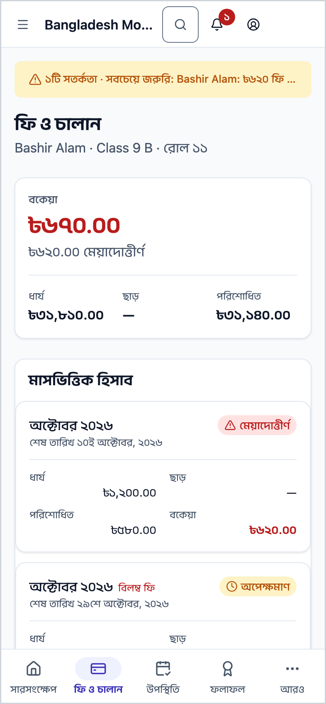
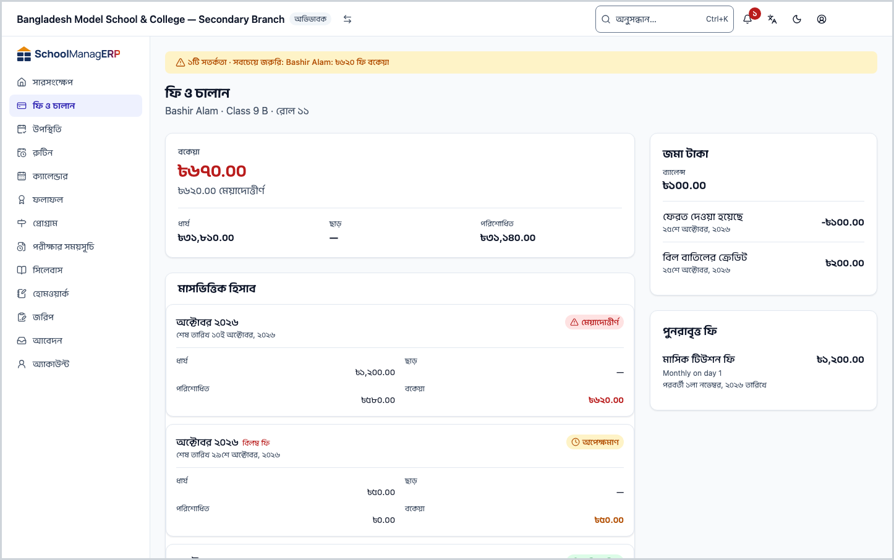

<!-- guide:meta
feature: portal.fees
title: ফি ও চালান
summary: সন্তানের ফি মাস ধরে দেখুন, বিকাশে বিল দিন বা পেমেন্টের প্রমাণ পাঠান, স্কুল নিশ্চিত না করা পর্যন্ত প্রমাণের অবস্থা দেখুন, আর চালান প্রিন্ট করুন।
roles: [PARENT, STUDENT]
sources:
  - client-admin/src/routes/portal/fees.tsx
  - client-admin/src/routes/portal/fees_/pay.tsx
  - client-admin/src/routes/portal/fees_/pay_/result.tsx
  - client-admin/src/routes/portal/-my-proofs-tab.tsx
  - client-admin/src/routes/portal/-pay-line.tsx
  - server/src/modules/payment-submissions/proof-submissions.controller.ts
  - server/src/modules/payment-submissions/online-payments.controller.ts
  - server/src/modules/fees/fees.controller.ts
  - server/src/modules/fees/fees.service.ts
  - server/src/modules/fees/fines/fines.controller.ts
  - server/src/modules/fees/wallet.controller.ts
  - server/src/modules/fees/recurring-schedules.controller.ts
  - server/src/modules/invoices/invoices.controller.ts
  - server/src/modules/students/family-access.service.ts
labels:
  [
    portal:fees.*,
    portal:hero.nothingDue,
    portal:hero.overdueAmount,
    portal:hero.lastPaid,
    portal:hero.dueOn,
    portal:empty.*,
    portal:proofs.*,
    portal:fees.dueThisMonth,
    portalPay:*,
    nav:items.portalFees,
    common:walletTransactionKind.*,
  ]
helpIds:
  [
    portal.fees,
    portal.fees.action.print,
    portal.fees.action.pickStudent,
  ]
devices: [phone, desktop]
entry: [sidebar, page:portal.overview]
keywords:
  [ফি, চালান, বকেয়া, ধার্য, ছাড়, পরিশোধিত, জরিমানা, জমা টাকা, প্রিন্ট, রসিদ, fees, invoice, outstanding, print, wallet, fine, পরিশোধ, বিকাশ, পেমেন্টের প্রমাণ, লেনদেন নম্বর, TrxID, pay, bKash, payment proof]
appVersion: 0.1.0 (4fa6d3d1b)
owner: tareq89
lastVerified: 2026-11-15
knownIssues: []
-->

# ফি ও চালান

সন্তানের প্রতিটি মাসের ফি, কত দেওয়া হয়েছে আর কত বাকি, এক পাতায় দেখুন।

**যেতে হবে:** ফোনে নিচের সারিতে **ফি ও চালান**। কম্পিউটারে বাম মেনুতে **ফি ও চালান**। [**সারসংক্ষেপ**](overview.md) থেকে **ফি-এর বিস্তারিত দেখুন** চাপলেও আসে।
**শুরুর আগে:** স্কুল অফিস আপনার অ্যাকাউন্ট সন্তানের সঙ্গে যুক্ত করে থাকতে হবে। স্কুল ফি ধার্য না করলে মাসের হিসাব ফাঁকা থাকে।

ফির হিসাব এখানে শুধু দেখার। টাকা দিতে [**সারসংক্ষেপ**](overview.md)-এর **এই মাসে বাকি** কার্ডে **পরিশোধ করুন …** চাপুন ([বিল পরিশোধ করুন](#task-pay)), অথবা স্কুল অফিসে দিন। স্কুল টাকা রেকর্ড বা নিশ্চিত করলে এখানে হিসাব নিজে থেকে বদলায়।

[হিসাব দেখুন](#task-main) · [বিল পরিশোধ করুন](#task-pay) · [পেমেন্টের প্রমাণ পাঠান](#task-proof) · [আমার পেমেন্টের প্রমাণ](#task-proofs) · [চালান প্রিন্ট](#task-print) · [সমস্যা ও সমাধান](#trouble)

**এই পাতায় যা আছে**

- [এই পাতায় যেভাবে আসবেন](#arrive)
- [সন্তানের ফির হিসাব দেখুন](#task-main)
- [ঠিক দেখছেন কি না বুঝবেন কীভাবে](#confirm)
- [অন্য পরিস্থিতিতে](#other)
  - [অন্য সন্তানের ফি দেখুন](#task-pick)
  - [বিল পরিশোধ করুন](#task-pay)
  - [পেমেন্টের প্রমাণ পাঠান](#task-proof)
  - [বিকাশে দেওয়ার পর](#task-result)
  - [আপনার পেমেন্টের প্রমাণ দেখুন ও তুলে নিন](#task-proofs)
  - [চালান প্রিন্ট করুন](#task-print)
  - [জরিমানা দেখুন](#task-fines)
  - [জমা টাকা আর পুনরাবৃত্ত ফি](#task-wallet)
- [সমস্যা ও সমাধান](#trouble)
- [কে কী করতে পারেন](#roles)
- [আরও জানুন](#more)

---

## এই পাতায় যেভাবে আসবেন 

**সাইডবার থেকে:** ফোনে নিচের সারিতে **ফি ও চালান**; কম্পিউটারে বাম মেনুতে **ফি ও চালান**। পাতা **ফি ও চালান** ট্যাবে খোলে।

**টাকা দিতে, সারসংক্ষেপ থেকে:**

1. [**সারসংক্ষেপ**](overview.md)-এ **এই মাসে বাকি** কার্ড খুঁজুন। কার্ডের শেষে **এই মাসে মোট দিতে হবে** আর **পরিশোধ করুন …** বোতাম।
2. **পরিশোধ করুন …** চাপুন। → **ফি পরিশোধ** পাতা খোলে, সব খোলা বিলে আগে থেকে টিক দেওয়া। এরপর [বিল পরিশোধ করুন](#task-pay)।

স্কুল দুই পথই বন্ধ রাখলে বোতামের জায়গায় লেখা থাকে **বিদ্যালয় অফিসে পরিশোধ করুন**।

---

## সন্তানের ফির হিসাব দেখুন 

1. ফোনে নিচের সারিতে **ফি ও চালান** চাপুন।

   → পাতার মাথায় সন্তানের নাম, শ্রেণি, শাখা আর রোল। প্রথম কার্ডে **বকেয়া**: বড় অক্ষরে মোট বাকি টাকা, কিছু বাকি না থাকলে **কোনো বকেয়া নেই**।

2. **বকেয়া**-র নিচে তিনটি সংখ্যা দেখুন: **ধার্য**, **ছাড়**, **পরিশোধিত**।
3. নিচে নামুন **মাসভিত্তিক হিসাব** অংশে।

   → প্রতিটি মাস আলাদা, নতুন মাস আগে। প্রতি মাসে **ধার্য**, **ছাড়**, **পরিশোধিত**, **বকেয়া** আর **অবস্থা**; নিচে **শেষ তারিখ …**।

> **মনে রাখুন:** পুরো শোধ করা মাসও তালিকায় থাকে, বকেয়া ঘরে ০, যাতে কত ধার্য হয়েছিল তা দেখতে পান।

---

## ঠিক দেখছেন কি না বুঝবেন কীভাবে 

| সংখ্যা            | কীভাবে হিসাব হয়                                                                 |
| ----------------- | -------------------------------------------------------------------------------- |
| **ধার্য**          | সন্তানের সব বিলের মোট টাকার যোগফল                                                 |
| **ছাড়**           | সব বিলে দেওয়া ছাড়ের যোগফল। ছাড় না থাকলে শুধু একটি ড্যাশ (—)                       |
| **পরিশোধিত**      | সব বিলে জমা পড়া টাকার যোগফল                                                       |
| **বকেয়া**         | **ধার্য** − **পরিশোধিত** − **ছাড়**                                                |

**বকেয়া**-র নিচে আরেকটি লাইন থাকতে পারে:

- **… মেয়াদোত্তীর্ণ** — যেসব বিলের শেষ তারিখ পার হয়েছে আর টাকা বাকি, তাদের বাকির যোগফল।
- কিছু মেয়াদোত্তীর্ণ না থাকলে **সর্বশেষ পরিশোধ …** — শেষ সফল পরিশোধের তারিখ।

**অবস্থা** ঘরে:

| যা লেখা           | মানে                                                         |
| ----------------- | ------------------------------------------------------------ |
| **পরিশোধিত**      | ঐ মাসের পুরো টাকা দেওয়া হয়েছে                               |
| **মেয়াদোত্তীর্ণ** | শেষ তারিখ পার হয়েছে, টাকা এখনো বাকি                          |
| **আংশিক পরিশোধিত**| কিছু টাকা পড়েছে, পুরোটা নয়                                  |
| **অপেক্ষমাণ**     | এখনো কোনো টাকা পড়েনি, শেষ তারিখও পার হয়নি                    |

শেষ তারিখের দিনটি এখনো মেয়াদোত্তীর্ণ নয়, পরদিন থেকে। দেরির জন্য স্কুল আলাদা বিল করলে মাসের পাশে লেখা **বিলম্ব ফি**।

স্কুল কোনো বিল মওকুফ করলে মওকুফের টাকা **ছাড়**-এর ঘরে যোগ হয়, তাই **বকেয়া**য় তা আর যোগ হয় না।

**টাকা দেওয়ার বা প্রমাণ পাঠানোর পর বুঝবেন কীভাবে?**

| অবস্থা | কীভাবে বুঝবেন | এরপর কী |
| ------ | ------------- | ------- |
| **শুধু স্ক্রিনে বদলেছে** | **ফি পরিশোধ** পাতায় বিলে টিক দিয়েছেন বা ঘর পূরণ করেছেন, কিন্তু শেষ বোতাম চাপেননি। স্কুলে কিছুই যায়নি। | **বিকাশে … দিন** বা **প্রমাণ জমা দিন** চাপুন। |
| **স্কুলের সিস্টেমে পৌঁছেছে** | প্রমাণ পাঠালে **পেমেন্টের প্রমাণ পাঠানো হয়েছে** আসে, আর বিলে **নিশ্চিত করা বাকি** দেখায়। বিকাশে দিলে **পরিশোধ হয়ে গেছে** আসে। | প্রমাণ হলে স্কুল নিশ্চিত করা পর্যন্ত অপেক্ষা করুন; বিকাশের টাকা আগেই পরিশোধিত। |

**ফি পরিশোধ** পাতার কিছুই ইন্টারনেট ছাড়া ডিভাইসে জমা থাকে না, তাই **এই ডিভাইসে সংরক্ষিত** অবস্থা নেই।

**যাচাই করতে চাইলে:** **আমার পেমেন্টের প্রমাণ** ট্যাব খুলুন; প্রমাণটি প্রথম কার্ড। বিকাশে দেওয়ার পর **ফি ও চালান** ট্যাবে সেই মাস **পরিশোধিত** দেখায়।

**বার্তা না এলে:** [সমস্যা ও সমাধান](#trouble) দেখুন। যে প্রমাণ পাঠানো যায়নি, পাতা না ছাড়া পর্যন্ত তার তথ্য ঘরে থাকে।

---

## অন্য পরিস্থিতিতে 

### অন্য সন্তানের ফি দেখুন 

একাধিক সন্তান হলে পাতার মাথায় **একজন শিক্ষার্থী বাছুন** সারিতে সবার নাম থাকে। যার ফি দেখতে চান, তার নাম চাপুন। পুরো পাতা তার হিসাবে বদলে যায়। এক সন্তান হলে এই সারি আসে না।

### বিল পরিশোধ করুন 

1. [**সারসংক্ষেপ**](overview.md)-এর **এই মাসে বাকি** কার্ডে **পরিশোধ করুন …** চাপুন।

   → **ফি পরিশোধ** পাতা খোলে। **১. কোন বিল দিচ্ছেন** অংশে প্রতিটি সন্তানের খোলা বিল আর টাকার অঙ্ক। সব বিলে আগে থেকেই টিক দেওয়া।

2. যে বিল এখন দেবেন না, তার টিক তুলে দিন। যে বিলে **নিশ্চিত করা বাকি** লেখা, সেটি আগেই কোনো পেমেন্টের প্রমাণে আছে; তাতে টিক দেওয়া যায় না। নিচের **মোট** আপনার টিক অনুযায়ী বদলায়।
3. **২. কীভাবে দেবেন** অংশে **বিকাশে পরিশোধ করুন** বাছুন। স্কুল বিকাশ চালু করলে তবেই এটি থাকে; থাকলে আগে থেকেই বাছা থাকে।

   → একটি লাইন আসে: **আপনি ঠিক …ই দেবেন। কোনো বাড়তি খরচ নেই।**

4. **বিকাশে … দিন** চাপুন।

   → বিকাশের পাতা খোলে। সেখানে টাকা দিন। শেষ হলে বিকাশ আপনাকে **পরিশোধের ফলাফল** পাতায় ফিরিয়ে আনে ([বিকাশে দেওয়ার পর](#task-result))।

স্কুল শুধু পেমেন্টের প্রমাণ নিলে **আগেই দিয়েছি — প্রমাণ জমা দিন** আপনা থেকেই বাছা থাকে, আর বোতামের লেখা **প্রমাণ জমা দিন**। তখন [পেমেন্টের প্রমাণ পাঠান](#task-proof)।

> **মনে রাখুন:** বিকাশের পাতায় শেষ না করা পর্যন্ত কোনো টাকা দেওয়া হয় না। তার আগে **বন্ধ করুন** চাপলে কিছুই দেওয়া হয় না।

### পেমেন্টের প্রমাণ পাঠান 

আপনি আগেই কোনো মাধ্যমে (যেমন বিকাশ বা ব্যাংকে) টাকা দিয়ে থাকলে এটি করুন, যাতে বিলে তা দেখা যায়।

1. **ফি পরিশোধ** পাতায় [বিল পরিশোধ করুন](#task-pay)-এর মতো বিল বাছাই করুন।
2. **২. কীভাবে দেবেন** অংশে **আগেই দিয়েছি — প্রমাণ জমা দিন** বাছুন।

   → **৩. পেমেন্টের প্রমাণ** অংশ আসে।

3. ঘরগুলো পূরণ করুন:

   | ঘর | কী লিখবেন |
   | -- | --------- |
   | **কীভাবে দিয়েছেন** | যেভাবে দিয়েছেন তা বাছুন, যেমন বিকাশ। কোন মাধ্যম থাকবে তা স্কুল ঠিক করে। |
   | **টাকার অঙ্ক** | বাছা বিল থেকে নিজে বসে যায়। বদলানো যায় না। |
   | **লেনদেন নম্বর (TrxID)** | টাকা দেওয়ার বার্তায় থাকা নম্বর, যেমন 8N7A6D5EFG। সর্বোচ্চ ৬৪ অক্ষর। |
   | **কবে দিয়েছেন** | যেদিন দিয়েছেন। আজকের পরের দিন হতে পারবে না। |
   | **ছবি (সর্বোচ্চ ২টি: JPG, PNG বা PDF)** | টাকা দেওয়ার বার্তা বা রসিদের ছবি। |

   আপনার বাছা মাধ্যমের জন্য স্কুল নির্দেশনা লিখে থাকলে সেটি **বিদ্যালয়ের নির্দেশনা: …** হিসেবে দেখা যায়।

4. লেনদেন নম্বর অথবা ছবি, অন্তত একটি দিন। দুটো দিলে ভালো।
5. **প্রমাণ জমা দিন** চাপুন।

   → **পেমেন্টের প্রমাণ পাঠানো হয়েছে** আসে: "বিদ্যালয় শীঘ্রই নিশ্চিত করবে। তার আগে বিলে "নিশ্চিত করা বাকি" দেখাবে।" **ফি পাতায় ফিরুন** চাপুন।

| কী হয় | আপনি কী দেখবেন |
| ------ | -------------- |
| কিছু বাদ পড়লে | ঘরের নিচে লাল লেখা: **কীভাবে দিয়েছেন তা বাছাই করুন।**, **কবে দিয়েছেন তা বাছাই করুন।**, **তারিখ আজকের পরের হতে পারবে না।**, **লেনদেন নম্বর দিন অথবা একটি ছবি যোগ করুন।** বা **সর্বোচ্চ ২টি ছবি যোগ করা যাবে।** কিছুই পাঠানো হয় না। |
| প্রমাণ স্কুলে পৌঁছালে | **পেমেন্টের প্রমাণ পাঠানো হয়েছে**। বিলে এখন **নিশ্চিত করা বাকি**। |

### বিকাশে দেওয়ার পর 

বিকাশ থেকে ফিরলে **পরিশোধের ফলাফল** পাতা আপনার পেমেন্ট দেখে তিনটির একটি বলে:

| কী লেখা | মানে | কী করবেন |
| ------- | ---- | -------- |
| **পরিশোধ হয়ে গেছে** | "টাকা বিদ্যালয়ে পৌঁছেছে। বিলগুলো এখন পরিশোধিত।" সঙ্গে "… পরিশোধ হয়েছে। রসিদ …"। | **রসিদ দেখুন** বোতাম থাকলে তা চেপে রসিদ খুলুন। তারপর **ফি ও চালানে ফিরুন**। |
| **নিশ্চিত করা বাকি** | "আমরা বিকাশের জবাবের অপেক্ষায়। পাতাটি নিজেই হালনাগাদ হবে। টাকা কেটে থাকলে চিন্তা নেই, নিশ্চিত হলেই বিল পরিশোধিত দেখাবে।" | পাতা খোলা রাখুন, বা পরে ফিরে দেখুন। আবার টাকা দেবেন না। |
| **পরিশোধ হয়নি** | "আপনার টাকা কাটা হয়নি। আবার চেষ্টা করুন, অথবা আগেই দিয়ে থাকলে প্রমাণ জমা দিন।" | **আবার চেষ্টা করুন** চাপুন, অথবা অন্য পথে দিয়ে থাকলে **প্রমাণ জমা দিন**। |

আপনি যখন দিচ্ছিলেন তখন কিছু বিল আগেই শোধ হয়ে গেলে **পরিশোধ হয়ে গেছে**-র সঙ্গে আসে: "কিছু বিল আগেই পরিশোধ হয়ে গিয়েছিল, তাই বাকি টাকা আপনার জমা টাকায় গেছে। বিদ্যালয় আপনার জন্য মিলিয়ে দেবে।" সেই টাকা **জমা টাকা** কার্ডে দেখা যায়।

পাতা পেমেন্ট দেখতে না পারলে লেখে **পরিশোধের ফলাফল আনা যায়নি। সংযোগ দেখে আবার চেষ্টা করুন।** তখন **আবার চেষ্টা করুন** চাপুন।

### আপনার পেমেন্টের প্রমাণ দেখুন ও তুলে নিন 

1. ফি পাতায় **আমার পেমেন্টের প্রমাণ** ট্যাব চাপুন।

   → আপনার সন্তানদের জন্য পাঠানো প্রতিটি প্রমাণ এক কার্ডে, নতুনগুলো আগে: সন্তানের নাম, টাকা, অবস্থার ট্যাগ, **মাধ্যম**, **লেনদেন নম্বর (TrxID)** আর **জমা দেওয়ার তারিখ**। কিছু না থাকলে **এখনও কোনো পেমেন্টের প্রমাণ নেই**।

2. অবস্থার ট্যাগ পড়ুন:

   | ট্যাগ | মানে |
   | ----- | ---- |
   | **নিশ্চিত করা বাকি** | স্কুল এখনো দেখেনি। |
   | **নিশ্চিত** | স্কুল নিশ্চিত করেছে। বিল পরিশোধিত দেখায়। |
   | **বাতিল** | স্কুল গ্রহণ করেনি। কার্ডে লেখা থাকে **কারণ:** আর কারণ, যেমন **ছবি পরিষ্কার নয়**, স্কুল নোট লিখলে সেটিও। নতুন প্রমাণ পাঠান। |
   | **বাতিল — বিল আগেই পরিশোধিত** | ইতিমধ্যে বিল অন্য পথে শোধ হয়েছে। কার্ডে লেখা "বিল আগেই পরিশোধিত হয়েছে — আগামী মাসে আবার জমা দিন"। |
   | **তুলে নেওয়া হয়েছে** | আপনি ফিরিয়ে নিয়েছেন। |

3. অপেক্ষায় থাকা প্রমাণ ফিরিয়ে নিতে কার্ডে **তুলে নিন** চাপুন, তারপর **এই পেমেন্টের প্রমাণ তুলে নেবেন?** ঘরে আবার **তুলে নিন**।

   → **পেমেন্টের প্রমাণ তুলে নেওয়া হয়েছে** আসে। স্কুল এটি আর দেখবে না। একই বিলের জন্য নতুন প্রমাণ পাঠাতে পারবেন।

প্রমাণ যিনি পাঠিয়েছেন শুধু তিনিই তুলে নিতে পারেন, আর শুধু যতক্ষণ সেটি **নিশ্চিত করা বাকি**।

### চালান প্রিন্ট করুন 

1. নিচে নামুন **চালান** অংশে। চালানগুলো **নতুন থেকে পুরনো**: **চালান নম্বর**, **ইস্যুর তারিখ**, **পরিমাণ**, **অবস্থা**।
2. যে চালান দরকার, তার পাশে **প্রিন্ট করুন** চাপুন।

   → প্রিন্টযোগ্য চালান খোলে। সেখান থেকে প্রিন্ট করুন বা ফোনে রেখে দিন।

সর্বোচ্চ ১০০টি সাম্প্রতিক চালান দেখায়। এর বেশি থাকলে উপরে লেখা থাকে কতগুলোর মধ্যে কতগুলো দেখানো হচ্ছে; পুরনো চালানের জন্য স্কুল অফিসে যোগাযোগ করুন।

### জরিমানা দেখুন 

সন্তানের কোনো জরিমানা থাকলে **জরিমানা** অংশ আসে। প্রতিটিতে নাম, স্কুল লিখে থাকলে **কারণ** আর ঘটনার তারিখ, জরিমানার টাকা আর অবস্থা (যেমন **অপেক্ষমাণ**, **পরিশোধিত** বা **মওকুফ**)। জরিমানার বিল বাকি থাকলে উপরের **বকেয়া**-তেও যোগ হয়।

### জমা টাকা আর পুনরাবৃত্ত ফি 

- **জমা টাকা** — আগে বেশি দেওয়া টাকা সন্তানের নামে জমা থাকলে এই কার্ড আসে। **ব্যালেন্স** আর সর্বশেষ পাঁচটি লেনদেন দেখায়। টাকা নেওয়ার সময় স্কুল এই টাকা দিয়ে বিল শোধ করে।
- **পুনরাবৃত্ত ফি** — স্কুল নিয়ম করে প্রতি মেয়াদে যে ফি বসায় (যেমন মাসিক বেতন), তার নাম, টাকা, কত দিন পরপর, আর **পরবর্তী … তারিখে**।

দুটি কার্ডই শুধু তখন আসে যখন দেখানোর কিছু থাকে।

---

## সমস্যা ও সমাধান 

| আপনি যা দেখছেন                                                         | কী করবেন                                                                 | কে সাহায্য করতে পারেন |
| ---------------------------------------------------------------------- | ------------------------------------------------------------------------ | --------------------- |
| **এখনও কোনো মাস নেই**                                                  | স্কুল এখনো ফি ধার্য করেনি। ধার্য হলে এখানে দেখাবে।                         | হিসাবরক্ষক            |
| **এই ফি-গুলো লোড করা যায়নি।** …                                        | ইন্টারনেট দেখে **আবার চেষ্টা করুন** চাপুন।                                | —                     |
| **প্রিন্টযোগ্য চালানটি খোলা যায়নি। আবার চেষ্টা করুন।**                   | আবার **প্রিন্ট করুন** চাপুন।                                              | —                     |
| টাকা দিয়েছেন, তবু বকেয়া কমেনি                                          | স্কুলে দিলে স্কুল টাকা রেকর্ড করলে তবেই কমে; রসিদ নিয়ে অফিসে যোগাযোগ করুন। প্রমাণ পাঠালে স্কুল নিশ্চিত করলে কমে; **আমার পেমেন্টের প্রমাণ** ট্যাবে দেখুন। | হিসাবরক্ষক            |
| **বিল লোড করা যায়নি। ইন্টারনেট দেখে আবার চেষ্টা করুন।** | **ফি পরিশোধ** পাতায় **আবার চেষ্টা করুন** চাপুন। | — |
| **বিকাশ এখন পাওয়া যাচ্ছে না। বিদ্যালয় অফিসে পরিশোধ করুন, অথবা আগেই দিয়ে থাকলে পেমেন্টের প্রমাণ জমা দিন।** | পরে আবার চেষ্টা করুন, স্কুল অফিসে দিন, অথবা আগেই দিয়ে থাকলে **আগেই দিয়েছি — প্রমাণ জমা দিন** চাপুন। | হিসাবরক্ষক |
| **বিকাশে পরিশোধ শুরু করা যায়নি। আবার চেষ্টা করুন।** | বিকাশের বোতাম আবার চাপুন। | — |
| **এই বিলগুলোর একটির পেমেন্ট আগেই নিশ্চিত করার অপেক্ষায় আছে। পাতাটি নতুন করে খুলে আবার বাছাই করুন।** | **ফি পরিশোধ** আবার খুলুন। **নিশ্চিত করা বাকি** লেখা বিলে টিক দেওয়া যায় না। | — |
| **এখন প্রমাণ সংরক্ষণ করা যাচ্ছে না। কিছুক্ষণ পরে আবার চেষ্টা করুন।** | একটু পরে আবার **প্রমাণ জমা দিন** চাপুন। | — |
| **পেমেন্টের প্রমাণ পাঠানো যায়নি। ফর্ম দেখে আবার চেষ্টা করুন।** | প্রতিটি ঘর দেখে আবার **প্রমাণ জমা দিন** চাপুন। | হিসাবরক্ষক |
| **পেমেন্টের প্রমাণ তুলে নেওয়া যায়নি। আবার চেষ্টা করুন।** | আবার **তুলে নিন** চাপুন। | — |
| প্রমাণে লেখা **বাতিল** | **কারণ** পড়ুন, তারপর নতুন প্রমাণ পাঠান বা স্কুল অফিসে ফোন করুন। | হিসাবরক্ষক |
| **আপনার সঙ্গে এখনও কোনো শিক্ষার্থী যুক্ত নেই**                          | স্কুল অফিসকে সন্তান যুক্ত করতে বলুন, তারপর **আবার দেখুন** চাপুন।           | স্কুল অফিস            |
| পুরনো চালান খুঁজে পাচ্ছেন না                                            | ১০০টির বেশি হলে পুরনোগুলো এখানে আসে না। স্কুল অফিসে চান।                  | হিসাবরক্ষক            |

---

## কে কী করতে পারেন 

| ভূমিকা      | ফির হিসাব দেখা           | চালান প্রিন্ট | বিকাশে দেওয়া বা প্রমাণ পাঠানো |
| ----------- | ------------------------ | ------------- | ------------------------------ |
| অভিভাবক     | শুধু যুক্ত সন্তানদের      | হ্যাঁ         | হ্যাঁ                          |
| শিক্ষার্থী   | শুধু নিজের               | হ্যাঁ         | না                             |

**অভিভাবক:** স্কুল অফিস যে সন্তানদের আপনার সঙ্গে যুক্ত করেছে, শুধু তাদের ফি, চালান, জরিমানা আর জমা টাকা দেখেন, শুধু এই স্কুলে। ঠিকানায় অন্য কোনো শিক্ষার্থীর পরিচয় বসালেও সার্ভার তথ্য দেয় না।

**শিক্ষার্থী:** শুধু নিজের হিসাব দেখেন। টাকা দেওয়া আর প্রমাণ পাঠানো অভিভাবকের জন্য; শিক্ষার্থীর এটি নেই। **আমার পেমেন্টের প্রমাণ** ট্যাব শিক্ষার্থীর পাতাতেও দেখা যায়, কিন্তু সেটি অভিভাবকের জন্য: সার্ভার শিক্ষার্থীকে কোনো প্রমাণ দেয় না, তাই **পেমেন্টের প্রমাণ দেখানো যায়নি।** আসতে পারে। এর ওপর ভরসা করবেন না।

স্কুলের ভেতরের তথ্য (যেমন কে টাকা নিয়েছেন) এই পাতায় আসে না।

---

## আরও জানুন 

<strong>পাতার অংশগুলো</strong> — ফি ও চালান

1. **ফি ও চালান** শিরোনাম, নিচে সন্তানের নাম · শ্রেণি · রোল; একাধিক সন্তান হলে **একজন শিক্ষার্থী বাছুন**।
2. **বকেয়া** কার্ড, সঙ্গে **ধার্য**, **ছাড়**, **পরিশোধিত**।
3. **মাসভিত্তিক হিসাব**।
4. **জরিমানা** (থাকলে)।
5. **চালান**, প্রতিটির পাশে **প্রিন্ট করুন**।
6. পাশে বা নিচে **জমা টাকা** আর **পুনরাবৃত্ত ফি** (থাকলে)।

<strong>টাকা দেওয়া কীভাবে কাজ করে</strong>

<figure>
  
  <figcaption><em>এই মাসে বাকি থেকে পরিশোধিত বিল বা পেমেন্টের প্রমাণ পর্যন্ত</em></figcaption>
</figure>

- **বিকাশ:** টাকা সরাসরি স্কুলের বিকাশ অ্যাকাউন্টে যায়। আপনি ঠিক মোট টাকাটাই দেন, বাড়তি খরচ নেই।
- **পেমেন্টের প্রমাণ:** স্কুল দেখে নিশ্চিত বা বাতিল করে। তার আগে বিলে **নিশ্চিত করা বাকি** লেখা থাকে। স্কুল কীভাবে করে: [**অনলাইন পেমেন্ট**](../finance/online-payments.md)।

<strong>ফির হিসাব কীভাবে কাজ করে</strong>

<figure>
  
  <figcaption><em>ফির পথ, ধার্য থেকে বকেয়া</em></figcaption>
</figure>

- **প্রতি মাসের বকেয়া:** ধার্য − ছাড় − পরিশোধিত। পাতার উপরের **বকেয়া** সব মাসের যোগফল।
- **সব মাস আসে:** বাকি আছে এমন মাসই শুধু নয়, শোধ হওয়া মাসও।
- **পরিশোধের খবর:** শুধু সফল পরিশোধ দিয়ে **সর্বশেষ পরিশোধ** লেখা হয়; ফেরত আসা চেক গোনা হয় না।
- **সারসংক্ষেপের সঙ্গে পার্থক্য:** [**সারসংক্ষেপ**](overview.md)-এর **এই মাসে বাকি** শুধু এ মাসের আর আগের বাকি বিল দেখায়; এখানে পুরো ইতিহাস।

**সম্পর্কিত পাতা**

- [**সতর্কতা ও বিজ্ঞপ্তি (অভিভাবক ও শিক্ষার্থী)**](notifications.md) — বকেয়া ফির সতর্কতা।
- [**হিসাব দেখুন ও প্রিন্ট করুন**](statement.md) — তারিখ ধরে প্রতিটি বিল ও জমা, প্রতিটির পরে কত বাকি; প্রিন্ট বা সেভ করা যায়।

- [**সারসংক্ষেপ**](overview.md) — মোট বকেয়া আর এই মাসে কত দিতে হবে।
- [**উপস্থিতি**](attendance.md) — মাসের প্রতিটি দিনের উপস্থিতি।
- [**রুটিন**](routine.md) — আজ আর সামনের দিনের ক্লাস।
- [**ক্যালেন্ডার**](calendar.md) — ছুটি আর স্কুলের অনুষ্ঠান।
- [**পরীক্ষার সময়সূচি**](exam-schedule.md) — পরীক্ষার দিন আর প্রবেশপত্র।
- [**ফলাফল**](results.md) — প্রকাশিত পরীক্ষার ফল।
- [**শিক্ষার্থীর বকেয়া**](../finance/dues.md) — স্কুলের হিসাবরক্ষক যেখানে বকেয়া দেখেন।
- [**জরিমানা**](../finance/fines.md) — স্কুল যেখানে জরিমানা বসায়।
- [**অনলাইন পেমেন্ট**](../finance/online-payments.md) — স্কুল যেখানে আপনার পেমেন্টের প্রমাণ দেখে আর বিকাশের পেমেন্ট দেখে।
